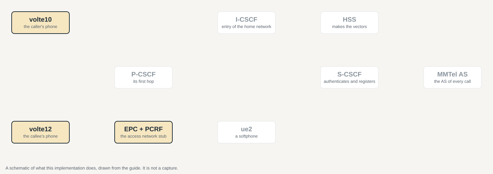
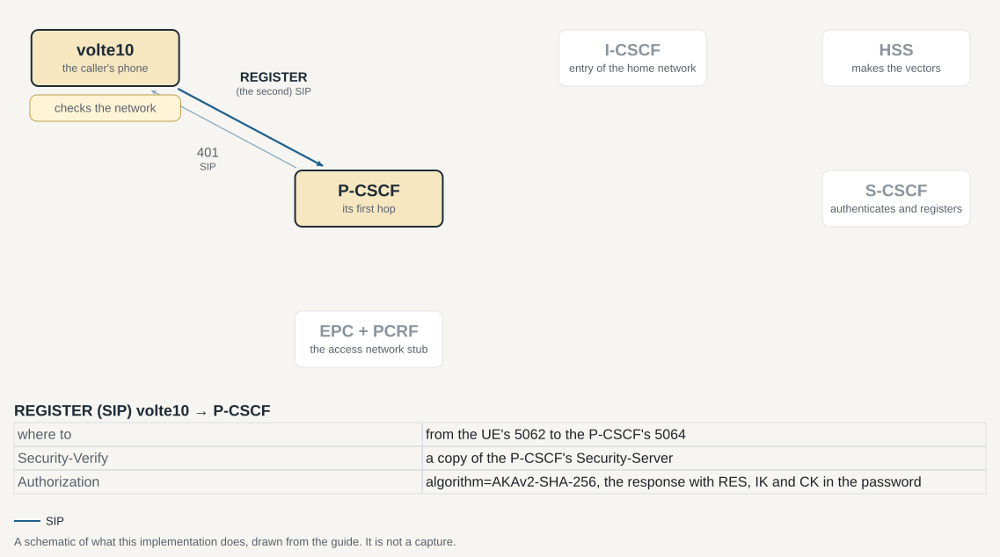
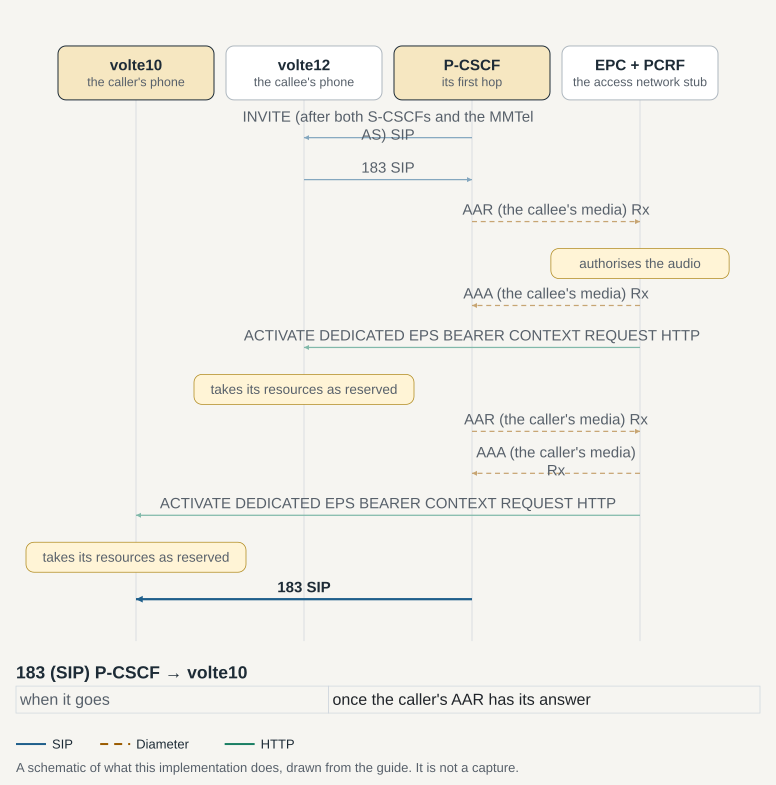
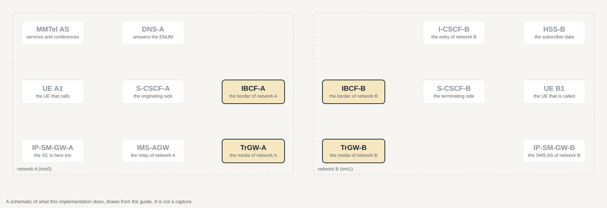
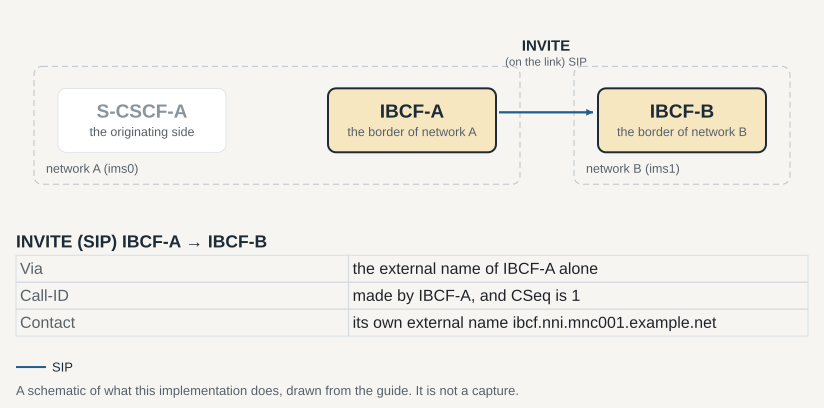
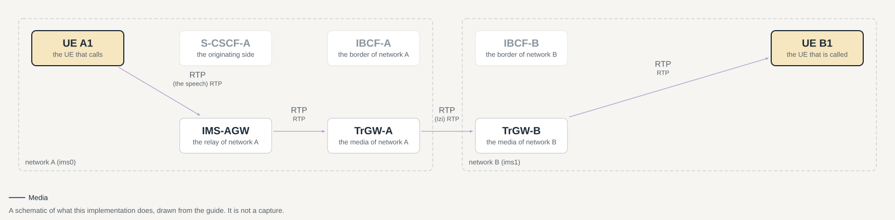

# Mobile access and other operators' networks

When a mobile phone uses the IMS, registration and calls keep their shape. The phone registers with two REGISTERs and calls with an INVITE. What changes is what comes before them and lies beneath them. The phone first connects to a mobile access network, which tells it the address of the P-CSCF. In place of a password, the phone and the network prove themselves to each other with the keys of the SIM, and the phone and the P-CSCF agree on a protected path. For the voice of a call the network sets up a path of its own (a bearer), and the other phone does not ring until it is there.

When the other party is a user of another operator, the signalling and the voice go through the border between two networks. The IBCF and the TrGW at the border follow the agreement between the operators: they narrow what may cross, and hide how the home network is built.

This chapter looks at what each of the two adds, as a whole. Which condition changes which decision, and the code that decides, are followed in [Registration and calls over VoLTE](volte.md) and [Interconnection between networks](interconnect.md).

## What a mobile access adds

The phone of the earlier chapters was a softphone with no SIM card. It was given the address of the P-CSCF in its configuration, authenticated with SIP Digest and a password, and spoke G.711 (PCMU). A VoLTE phone (GSMA IR.92) differs in these points.

| | Softphone (SIP Digest, PCMU) | VoLTE phone |
| --- | --- | --- |
| Access network | None; the P-CSCF is configured | Attaches to the EPC; the network names the P-CSCF |
| Authentication | SIP Digest and a password | IMS AKA, and a security agreement with the P-CSCF; no password |
| Resources | Not considered | The P-CSCF asks the PCRF for them over Rx |
| Ringing | Right after the 183 | Once the bearers of both sides are there |
| Voice | PCMU over RTP | AMR-WB, RTCP and telephone-event |
| Release | Only by a phone's BYE | The P-CSCF ends the call when the network loses the bearer |
| Identities | Configured; the one registered is the one used | Made from the IMSI; the network bars the one used to register |

If everything stayed in the left column, the callee could ring before the voice had a path, and a user who answered would hear nothing. Much of the right column is there to prevent that.

In this setup the EPC stub (role `epc`) stands for the access network. In a real network the PDN GW and the PCRF are separate nodes with Gx between them; the stub serves both in one node. There is no radio and no NAS encoding. The messages and their fields are named as in the specifications, and go between the phone and the stub as JSON over HTTP. A softphone works as before: the PCRF does not know a phone that does not come through the stub, and the P-CSCF serves it without policy control.

### The attach gives the address of the P-CSCF

A VoLTE phone attaches to the access network before it registers. The network gives it its IP address, a default bearer that carries SIP, and the address of the P-CSCF. The address of the P-CSCF is in the protocol configuration options (PCO) of the answer to the attach. The phone sends its first REGISTER to the standard port 5060 of that address.

### The keys of the USIM in place of a password

Registration has the same shape as for a softphone: two REGISTERs. The first says who, the network asks its question in a 401, and the second answers it. What differs is the question and the answer. The HSS of the network computes an authentication vector, good for one use, from the same keys as the USIM. With a value in the question, the phone checks that the network knows the same keys too, a direction that SIP Digest, where only the network checked the phone, did not have. This scheme is called IMS AKA.

### Security associations with the P-CSCF

Between the first REGISTER and the 401, the phone and the P-CSCF agree on security associations (sec-agree). From the second REGISTER on, the protected ports of the phone and of the P-CSCF are used.

The standard protects this path with IPsec ESP. By default this setup agrees on the associations and uses the protected ports, but puts no ESP on them, so that the SIP of a VoLTE phone reads in the captures too. Another setup (`deploy/esp`) puts ESP with null encryption on them, which protects the integrity and leaves the content readable. With `deploy/esp/encryption.yaml` on top of it, the P-CSCF's policy adds AES-CBC encryption, and reading the captures then takes the keys that the P-CSCF writes out.

### The voice bearer and Rx

In a call, the P-CSCF works out from the SDP answer between which addresses how much bandwidth is needed, and asks the PCRF for it over Rx. The P-CSCF is the application function (AF) of policy and charging control; the PCRF decides what the access network carries. Once the PCRF authorises it, the access network sets up a dedicated voice bearer for each phone.

The called phone does not start ringing until the bearers of both phones are there. This mechanism is called preconditions. The caller tells with an UPDATE that its bearer is there.

### The network side may end a call

A softphone's call ended only with a BYE of a phone. In VoLTE, when the network loses the voice bearer, as when the radio is lost, the PCRF tells the P-CSCF, and the P-CSCF ends the call from the network side with BYEs.

## What another operator's network adds

Say the other party is a user of another operator. The two networks meet only at the nodes of their borders.

### The IBCF and the TrGW at the border

The IBCF takes care of the SIP and the TrGW of the media. A node inside one network cannot reach a node inside the other at all; calls and short messages always go through the border. That a number belongs to the other network shows when the S-CSCF looks the number up with ENUM. If the answer is a SIP URI of the other network's domain, the S-CSCF sends the request to the IBCF of its own network.

### The border builds requests again

The IBCF of this setup is a B2BUA. A request that arrives ends there, and a new request of the IBCF's own goes on to the other network.

So the INVITE on the link carries no Via, Route, Record-Route or Contact of the nodes inside network A. Its Call-ID too is the one the IBCF made. The MMTel AS of network A and the two IBCFs each start a new dialog, so one call has four dialogs.

### The agreement between the operators

What an IBCF lets through is decided by the agreement between the operators (the interconnect profile): whether the peer is in the trust domain, which optional methods are allowed (such as MESSAGE, which carries short messages), in which form numbers go, and which codecs the peer takes. When the agreements of the two operators do not match, an IBCF refuses with a response such as 405, 488 or 404. What makes the call fail is not a phone but an IBCF that follows its agreement. A sender with no agreement gets no answer from the IBCF at all.

### Hiding how the network is built

The IBCF puts the media of a call through the TrGW of its network, and writes into the SDP that goes to each network the address of the TrGW in that network.

So what the other network sees is the numbers and the domain of the users, and the outer names and addresses of the border nodes. It does not see the addresses and host names of the nodes inside, or the identities made from the IMSI. The number and the domain are what the other network needs to call back.

### Codecs

The codecs the other network takes are in the agreement too. The IBCF removes from the SDP the codecs that the other network does not take. The IBCF of this setup does not transcode, so a call with no speech codec left is refused with 488.

## About the parts of a 5GC

The repository also has a stub of a 5GC access network (`internal/fivegc`) and the parts with which the P-CSCF would talk N5 to the PCF of a 5GC (`internal/n5`). These are parts, and no node runs them. The mobile access in this book is the EPC; calls over a 5GC (VoNR) are not its subject.

The P-CSCF keeps its policy control behind a boundary called `PolicyControl`, and the phone keeps its access network behind a boundary called `AccessNetwork`. Rx and the EPC stub are one implementation behind each. In 5GC too, SIP signalling uses a QoS flow of 5QI 5 and voice one of 5QI 1, the same idea as QCI 5 and QCI 1 in EPS.

## What this explanation rests on

The explanation in this chapter was checked against the following tests. Each test was run and passes as a Go test of this repository.

- `TestVoLTECallOverTheEPCStub` in `internal/ue/volte_epc_test.go`. Two phones attach to the EPC stub, the P-CSCF has the PCRF authorise the media of each side, the stub sets up a voice bearer for each phone, and the callee alerts once the resources of both sides are there.
- `TestNetworkEndsTheCallWhenItTakesTheBearer` in `internal/ue/volte_epc_test.go`. When the network releases the voice bearer, the P-CSCF ends the call with a BYE to each side.
- `TestIMSAKAThroughTheWholeIMS` in `internal/ue/aka_ims_test.go`. A phone registered with IMS AKA calls and sends a short message over the protected server port.
- `TestCallAcrossTheBorder` in `internal/ibcf/network_test.go`. In a call across the border, neither network gets anything that names the inside of the other, and the SDP of each side names its own TrGW.
- `TestMismatchedProfiles` and `TestRequestFromNoPeerIsDiscarded` in `internal/ibcf/network_test.go`. With mismatched agreements an IBCF refuses with 405, 488 and 404, and a sender outside every agreement gets nothing back.

The figures are diagrams drawn from the guide's account of this setup, not captures.

## If you want to run it yourself

You need not run anything to read this chapter. The registration and calls of the VoLTE phones run as in the guide [The VoLTE call flow](../../guide/en/volte.md#run-it), and the call and short messages between the two networks as in [Connect two IMS networks](../../guide/en/interconnect.md#run-it). In the slides, [the deck on VoLTE](../../../slides/decks/en/09-volte.md) and [the deck on interconnection](../../../slides/decks/en/10-interconnect.md) show the same flows one step at a time.
