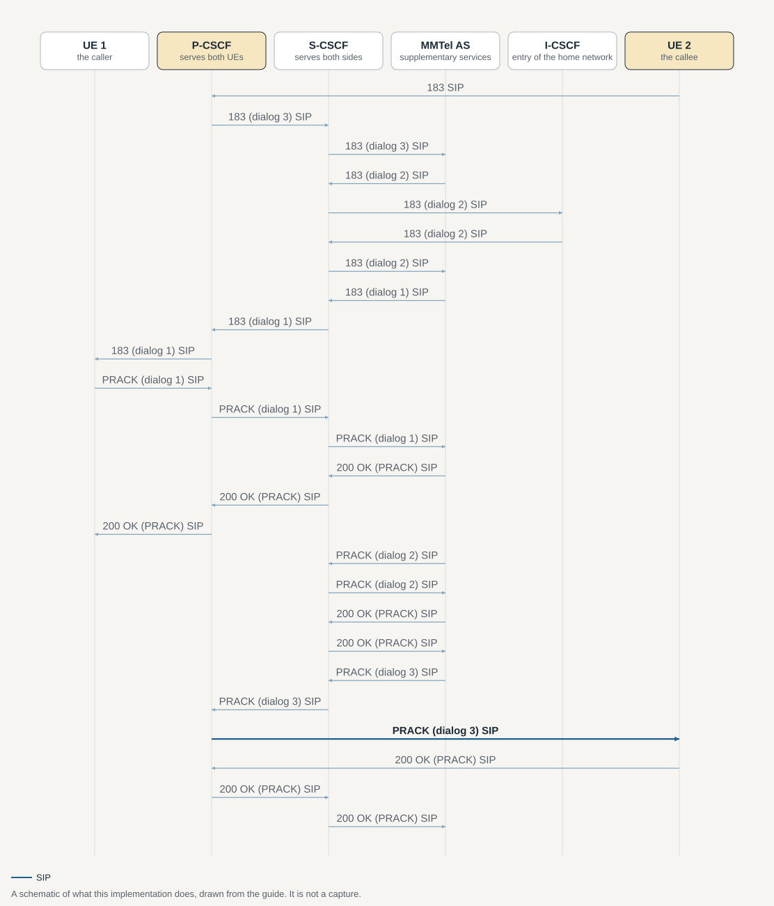
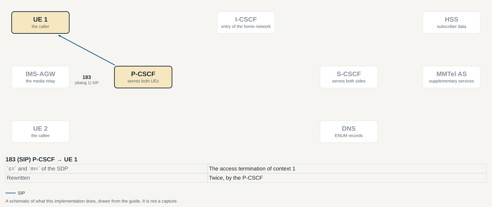
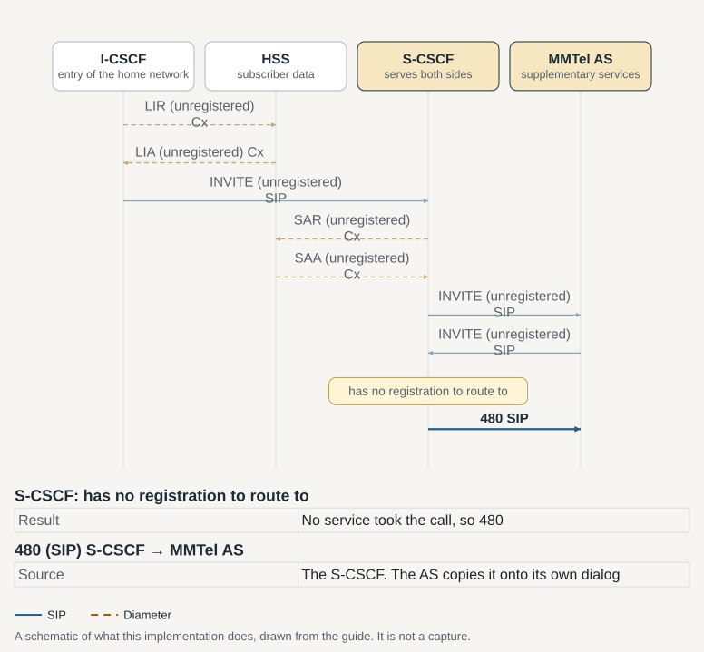
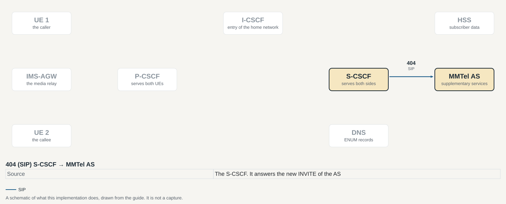
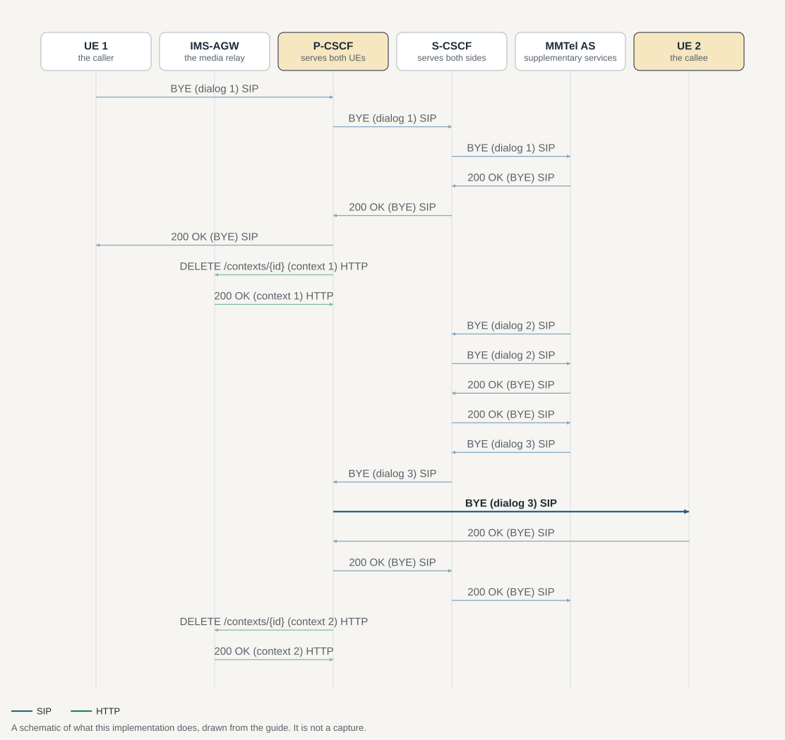

# Transactions, dialogs and media negotiation in a call

The signalling of one call reads best in two units. One is the transaction: a request with its responses. A response goes back hop by hop over the nodes that the request passed, along the Via. The other is the dialog: a relation between two UAs that lasts. The requests within a dialog (PRACK, ACK, BYE and others) pass only the nodes that added Record-Route to the first INVITE.

A call of this implementation has three dialogs, because the MMTel AS is a B2BUA: it answers the INVITE it gets itself, and sends a new INVITE with a Call-ID of its own. The P-CSCF and the S-CSCF are proxies, which stay on the way of the dialogs by adding Record-Route. The I-CSCF adds no Record-Route, so it carries only the first INVITE and its responses.

The media is settled by the offer in the INVITE and the answer in a reliable 183. A PRACK confirms the 183, and this UE sends the 200 OK without SDP. Each time an offer or an answer passes, the P-CSCF rewrites the addresses of the SDP to those of the media relay. A call ended before the answer ends with CANCEL; after the answer, with BYE. When a call fails, the node that makes the response and the condition that decides it differ from case to case. In every case the P-CSCF frees the context in the relay once it sees the INVITE fail or a BYE end the dialog.

This chapter builds on [From a number to the other phone](call.md). It ties the way and the jobs of the nodes seen there to the conditions of the specifications, to the functions that decide, and to the tests that check them.

## The setup and the legs of this chapter

As in the previous chapter, the example is the `deploy/compose` setup, where UE 1 calls UE 2 by number. One P-CSCF and one S-CSCF serve both UEs, and the MMTel AS joins once on the caller's side and once on the callee's.

The three dialogs are these.

| Dialog | The UAs at its ends | Who made its Call-ID |
| --- | --- | --- |
| 1 | UE 1 and the MMTel AS on the caller's side | UE 1 |
| 2 | The MMTel AS on the caller's side and the MMTel AS on the callee's side | The MMTel AS on the caller's side |
| 3 | The MMTel AS on the callee's side and UE 2 | The MMTel AS on the callee's side |

A capture of one leg does not show the whole call: it shows the dialogs that cross that leg.

| Leg of the capture | Dialogs it shows |
| --- | --- |
| UE 1 and the P-CSCF | 1 |
| The P-CSCF and the S-CSCF | 1 and 3 |
| The S-CSCF and the MMTel AS | 1, 2, 3 |
| The S-CSCF and the I-CSCF | Only the INVITE of 2 and its responses (and the CANCEL when it is cancelled) |
| The P-CSCF and UE 2 | 3 |

A capture next to UE 1, for example, has only one Call-ID. The call still has three dialogs; the other two show between the S-CSCF and the MMTel AS. In this chapter, "three dialogs" is the number for the whole call, ASs included.

The editions of the specifications in this chapter are TS 24.229 V18.11.0 and TS 29.228 V18.0.0, and RFC 3261, RFC 3262 and RFC 3264.

## Transactions and dialogs

By RFC 3261 17, a transaction is a request with its responses, provisional and final. For an INVITE, the ACK for a final response other than 2xx belongs to the transaction too. The ACK for a 2xx does not: it is another request, which the UAC sends itself.

There is one transaction per hop. A proxy makes a server transaction when it gets a request, and a client transaction when it sends it on. A response goes back over the same nodes in reverse, taking off one Via of the request at each.

A dialog is a relation between two UAs. A Call-ID and the tags of both ends identify it (RFC 3261 12). On the UAC's side, a response with a tag in To makes the dialog.

[internal/sip/dialog.go](../../../internal/sip/dialog.go)

```go
	routes, err := recordRouteURIs(resp)
	if err != nil {
		return Dialog{}, err
	}
	// The response lists the proxies from the UAS to the UAC; the UAC's
	// route set starts with the proxy nearest to it.
	slices.Reverse(routes)
	return Dialog{
		ID:           DialogID{CallID: invite.Get("Call-ID"), LocalTag: tagOf(invite.Get("From")), RemoteTag: tagOf(resp.Get("To"))},
		State:        state,
		LocalSeq:     cseq.Number,
		LocalURI:     from.URI,
		RemoteURI:    to.URI,
		RemoteTarget: target,
		RouteSet:     routes,
	}, nil
}
```

This is the end of `NewUACDialog`. Its inputs are the INVITE that the UAC sent and the response `resp` that arrived. The ID of the dialog is made of the Call-ID of the INVITE, the tag of From (its own) and the tag of To of the response (the other end's). The route set is the Record-Route of the response. The Record-Route of a response lists the proxies from the UAS's side, so the UAC reverses it to put the proxy nearest to it first (RFC 3261 12.1.2). `RemoteTarget` is the Contact of the other end. The later requests within the dialog go with the other end's Contact as their Request-URI and this route set as their Route (RFC 3261 12.2.1.1).

So a request within a dialog passes only the nodes that added Record-Route. The I-CSCF adds none, so it is in no route set. The next figure draws the 183 and its PRACKs together.



The upper 10 rows are the 183. It is a response to the INVITE, so it retraces the nodes that the INVITE passed, the I-CSCF included. The lower 16 rows are the PRACKs and their 200s, and nothing reaches the line of the I-CSCF. A PRACK from UE 1 ends at the AS on the caller's side, and the AS sends a PRACK of its own in the next dialog. The order of messages of different dialogs is not fixed, so the order of the rows is one example.

## Which node keeps what

Some nodes only forward requests; others are the ends of dialogs.

| Node | Its part | Record-Route | What it keeps during the call |
| --- | --- | --- | --- |
| UE 1, UE 2 | UA | Adds none (an end of a dialog) | Its own dialog (ID, route set, the other end's Contact, CSeq) |
| P-CSCF | Proxy | Adds it | A record of the dialog for each pass: the context in the relay, and the values that let it send a BYE |
| S-CSCF | Proxy | Adds it | A record of the original dialog identifier for each INVITE it sent to an AS |
| MMTel AS | B2BUA | Adds none (an end of a dialog) | The two dialogs of the side it got and the side it sent, and how they match |
| I-CSCF | Proxy | Adds none | Nothing. When the INVITE transaction is over, nothing is left |

The P-CSCF is no UA, but for each pass it stores a record of the dialog, `Dialog`. TS 24.229 has the P-CSCF store the Contact, the CSeq and the Record-Route of the INVITE and its response, and the ID of the dialog, so that it can release the session if needed. The P-CSCF also keeps the ID of the relay context in this record. The record is in the store (Store), so that any instance of the P-CSCF can handle the next request.

The S-CSCF keeps no dialog state. What it keeps is an `OriginalDialog` for each INVITE that it sent to an AS: when the INVITE comes back from the AS, it tells for which user, and after which iFC, to go on (TS 24.229 5.4.3.4). This record goes after 4 minutes. When the S-CSCF sends to an AS, it builds the Route and the Record-Route as follows.

[internal/scscf/services.go](../../../internal/scscf/services.go)

```go
	own := s.ownURI()
	own.Params.Set(odiParam, d.ID)
	toAS.Prepend("Route", sip.NameAddr{URI: own.String()}.String())
	toAS.Prepend("Route", sip.NameAddr{URI: server.String()}.String())
	// 5.4.3.2 step 5 b and 5.4.3.3 step 4 c: whom the server serves, and
	// in which session case, so that one server can tell its originating
	// services from its terminating ones (5.7.1.3A). Those steps leave
	// sescase and regstate to operator policy; this S-CSCF always adds
	// them.
	// There is one value, never two (RFC 8498 5).
	toAS.Set("P-Served-User", d.pServedUser().String())
	// Step 13 leaves it to the operator whether a request to an
	// application server in the trust domain is record-routed. This
	// S-CSCF stays on the path of every dialog it creates.
	if ims.CreatesDialog(toAS.Method) {
		sip.AddRecordRoute(toAS, s.ownURI())
	}
```

`d.ID` is the original dialog identifier made for this INVITE. The S-CSCF adds it to its own URI as `odi`, and puts that under the URI of the AS. So the new INVITE of the AS comes back to the S-CSCF with the `odi`. Whether to record-route an INVITE to an AS is up to the operator, and this S-CSCF always adds Record-Route. So the requests of dialogs 1, 2 and 3 alike pass the S-CSCF.

The MMTel AS is a routeing B2BUA of TS 24.229 5.7.5. It answers the INVITE it got (the side it got) as a UAS, and sends a new INVITE (the side it sent) as a UAC. The two sides are separate dialogs, and the AS copies a response or a request that it gets on one side onto the dialog of the other. That is why a PRACK, an ACK or a BYE ends at the AS in each dialog, and the AS sends it again in the next.

## Reliable provisional responses and PRACK

A provisional response (1xx) is not normally confirmed. UE 2's 183 carries the SDP of the answer, so if it got lost, UE 1 could not settle the media. That is why RFC 3262 defines reliable provisional responses. UE 1's INVITE has `100rel` in Supported, so UE 2 adds `Require: 100rel` and an RSeq to the 183. UE 1 confirms that it got it with a PRACK that has a RAck: the RSeq of the 183 and the CSeq of the INVITE (RFC 3262 3, 4).

Until the PRACK arrives, UE 2 sends the 183 again.

[internal/sip/uas.go](../../../internal/sip/uas.go)

```go
	// RFC 3262 3: the interval doubles without the T2 cap of a 2xx,
	// since a PRACK is not sent again for each retransmission. 64*T1
	// passes before the interval could reach it.
	t := c.stack.cfg.Timers
	err = c.retransmit(c.st, resp, 64*t.T1, pracked, nil, ErrNoPRACK)
	if errors.Is(err, ErrNoPRACK) {
		// RFC 3262 3: the UAS SHOULD reject the INVITE with a 5xx.
		c.mu.Lock()
		if c.final == nil {
			c.sendFailure(500, "no PRACK", ErrNoPRACK, nil)
		}
		c.mu.Unlock()
	}
```

`retransmit` sends the 183 again, doubling the interval, until `pracked` closes (the PRACK arrives). When 64×T1 has passed without a PRACK, UE 2 turns the INVITE down with 500. RFC 3262 3 recommends that the UAS reject it with a 5xx then.

A PRACK is a request within a dialog, so it follows the route set, not the way of the transaction. As the figure of the previous section shows, a PRACK from UE 1 passes the P-CSCF and the S-CSCF, and ends at the AS on the caller's side, the far end of dialog 1. The AS answers 200 at once, and sends a PRACK of its own in dialog 2. Each of the three dialogs has one pair of PRACK and 200. Once the PRACK of dialog 3 arrives, UE 2 stops sending the 183 again.

180 Ringing is a reliable provisional response too, so a PRACK comes back for the 180 as well. Both UEs of this setup have their resources, so UE 2 sends the 180 as soon as the PRACK of the 183 arrives. A callee without resources yet sends no 180 until they are there (RFC 3312 6, IR.92 2.4.1).

## The SDP offer and answer

The two UEs settle the media with the offer and answer of RFC 3264. UE 1 puts an offer in the INVITE, and UE 2 an answer in the 183 (RFC 3264 5.1, 6.1). The offer has UE 1's address and RTP port, PCMU and telephone-event; the answer has the one codec that UE 2 chose and UE 2's address.

The SDP in the reliable 183 is the answer: RFC 3262 5 lets the UAS put the answer in a reliable provisional response. The answer is settled there, so this UE sends the 200 OK without SDP. The UE decides it as follows.

[internal/ue/call.go](../../../internal/ue/call.go)

```go
	// RFC 3262 5: the SDP of a reliable 183 counts; the 200 repeats it
	// only when the 183 went unreliably, or when there was none.
	body := sip.Body{}
	if !reliable {
		body = sdpBody
	}
	ack, err := ic.Accept(body, s.responseHeaders...)
```

`reliable` tells whether the INVITE supports `100rel`. If it does, the 183 has arrived as a reliable provisional response, and the body of the 200 is empty. If it does not, nothing ensures that the 183 arrived, and the 200 carries the SDP again. UE 1 uses the first answer it gets, and ignores any that comes later (RFC 3261 13.2.1).

The P-CSCF rewrites both the offer and the answer. Each time an SDP passes the P-CSCF, this part works.

[internal/pcscf/session.go](../../../internal/pcscf/session.go)

```go
	shown := rc.Core
	if toUE {
		shown = rc.Access
	}
	relay, err := p.relayOf(*rc)
	if err != nil {
		return netip.AddrPort{}, err
	}
	ctx, cancel := relayContext()
	defer cancel()
	if err := relay.Modify(ctx, rc.ID, facingSender(toUE), agw.TerminationRequest{Remote: sender}); err != nil {
		return netip.AddrPort{}, err
	}
	if err := description.SetAudio(shown); err != nil {
		return netip.AddrPort{}, err
	}
	m.Body = description.Bytes()
	return sender, nil
}
```

This is the second half of `relaySDP`. Its inputs are the message `m` with the SDP, the context of that pass `rc`, whether the message goes to the UE `toUE`, and the sender's address in the SDP `sender`. The P-CSCF first tells the termination that faces the sender, with `Modify`, where the sender receives. Then it rewrites the address of the SDP to that of the termination that faces where the message goes: the access side when it goes to the UE, the core side when it goes to the network (TS 24.229 6.7.2.1).

| Message | Pass of the P-CSCF | Where the relay is told to send | Address written in the SDP |
| --- | --- | --- | --- |
| Offer of the INVITE | Caller's side (context 1) | Access side: UE 1's address | Core side of context 1 |
| Offer of the INVITE | Callee's side (context 2) | Core side: the core side of context 1 | Access side of context 2 |
| Answer of the 183 | Callee's side (context 2) | Access side: UE 2's address | Core side of context 2 |
| Answer of the 183 | Caller's side (context 1) | Core side: the core side of context 2 | Access side of context 1 |



The address in the SDP that UE 1 gets is not UE 2's but that of the access side of context 1 in the media relay. Each UE exchanges voice with the relay only. When the `Modify` fails, the P-CSCF cannot make the SDP to pass on. [When a media renegotiation fails](design-media-rollback.md) shows what becomes of the call then.

## CANCEL and BYE

The request that ends a call early differs before and after the answer.

| | CANCEL | BYE |
| --- | --- | --- |
| When | Before the INVITE has a final response | Once the dialog exists |
| What it ends | The INVITE transaction under way | The dialog |
| Its way | Hop by hop over the legs of the INVITE. It passes the I-CSCF too | Along the route set. It does not pass the I-CSCF |
| Who answers | At each hop, the node that gets it answers 200 | The far end of the dialog answers 200 |
| What becomes of the INVITE | 487 Request Terminated | It has already ended with 200 OK |

A CANCEL is a transaction of its own, with the same Call-ID, From, To and CSeq number as the INVITE it cancels, and with its top Via (RFC 3261 9.1). When the user of UE 1 hangs up before the answer, UE 1 sends a CANCEL. The P-CSCF, the S-CSCF and the I-CSCF answer the CANCEL they get with 200 at once, and send a CANCEL for the INVITE transaction that they sent on (RFC 3261 16.10). The SIP stack of this implementation sends a CANCEL where the INVITE went. So a CANCEL passes the I-CSCF too.

At the MMTel AS, when the dialog of the side it got ends with a CANCEL, the AS cancels the INVITE of the side it sent as well.

[internal/b2bua/call.go](../../../internal/b2bua/call.go)

```go
	go func() {
		select {
		case <-c.in.Done():
			if !c.answered.Load() {
				out.Cancel(c.reasons(c.in.EndedBy(), ToCallee)...)
			}
		case <-out.Done():
		}
	}()
```

`c.in` is the side it got, `out` the side it sent. When the side it got has ended and the callee has not answered yet (`answered` is false), it sends a CANCEL on the side it sent. The Reason of the CANCEL is copied, as it was, from the request that ended the side it got (RFC 3326 2). A UA that gets a CANCEL ends the INVITE with 487 (RFC 3261 9.2). In this way UE 1's INVITE, both INVITEs of the ASs, and the INVITE to UE 2 each end with 487.

The other way round, when the callee's side hangs up while it rings, the UE of this implementation turns the INVITE down with 603 Decline.

To hang up after the answer, a UE sends a BYE. A BYE is a request within a dialog, so it follows the route set, and the far end of the dialog answers 200 (RFC 3261 15.1.1, 15.1.2). The UE of this implementation puts `Reason: RELEASE_CAUSE;cause=1;text="User ends call"` in the BYE (TS 24.229 5.1.5).

## The node that decides a failure

When a call fails, which node makes the response, and on what condition, differs from case to case.

| Case | Deciding function | Condition | Response | Test that checks it |
| --- | --- | --- | --- | --- |
| Busy | `Answer` of UE 2 | UE 2 turns it down as busy | 486 Busy Here | `TestBusyCallee` |
| The caller hangs up before the answer | The handling of CANCEL at each node | The INVITE has no final response | 487 Request Terminated | `TestCallerGivesUpOnACalleeThatDoesNotAnswer` |
| A number without an ENUM record | `routeOriginating` of the S-CSCF | `ENUM` returns no SIP URI | 404 Not Found | `TestOriginatingCallToANumberWithoutENUMGets404` |
| A callee that the HSS does not know | `session` of the I-CSCF | The LIA is no success | 404 Not Found | `TestCallToAnUnknownCalleeGets404` |
| Not registered, with no services for that state | `session` of the I-CSCF | The LIA is DIAMETER_ERROR_IDENTITY_NOT_REGISTERED | 480 Temporarily Unavailable | `TestCallToAnUnregisteredCalleeGets480` |
| Not registered, with services for that state | `routeUnregistered` of the S-CSCF | No AS takes the call | 480 Temporarily Unavailable | `TestUnregisteredCalleeServices` |

For ENUM, the part of `routeOriginating` seen in the previous chapter answers 404. A callee that the HSS does not know and one that is not registered are told apart by this part of the I-CSCF.

[internal/icscf/session.go](../../../internal/icscf/session.go)

```go
	lia, err := cx.ParseLocationInfoAnswer(answer)
	switch {
	case err != nil:
		st.Respond(sip.NewResponse(req, 500, sip.NewTag()))
		return
	case lia.Result == diameter.Experimental(cx.DiameterErrorIdentityNotRegistered):
		// 5.3.2.1: a known user who is not registered and has no services
		// for that state.
		log.Info("callee is not registered", "callee", callee)
		st.Respond(sip.NewResponse(req, 480, sip.NewTag()))
		return
	case !lia.Result.Success():
		// 5.3.2.1 and 5.3.2.2: the user does not exist, or the query
		// failed.
		log.Info("HSS does not know the callee", "callee", callee, "result", lia.Result.String())
		st.Respond(sip.NewResponse(req, 404, sip.NewTag()))
		return
	}
	// Step 2 of "upon successful user location query".
```

The input is the LIA of the HSS. For a registered callee, the HSS answers DIAMETER_SUCCESS with the Server-Name. For a callee that is not registered, its answer depends on whether the user has services for the unregistered state: iFCs whose session case is TERMINATING_UNREGISTERED. Without them it is DIAMETER_ERROR_IDENTITY_NOT_REGISTERED, and the I-CSCF answers 480. When the HSS does not know the user, it is DIAMETER_ERROR_USER_UNKNOWN, and the I-CSCF answers 404 (TS 24.229 5.3.2.1).

For a callee with services for the unregistered state, the HSS answers DIAMETER_UNREGISTERED_SERVICE (2003) with the capabilities that the S-CSCF needs (TS 29.228 6.1.4.1). Then the I-CSCF leaves the `switch`, and picks an S-CSCF by the capabilities as for a first registration. Every test subscriber of `deploy/compose` has such a service: an iFC that calls the MMTel AS for TERMINATING_UNREGISTERED. A call to `tel:+12025550103`, which does not register, goes as follows.



The chosen S-CSCF takes the user's profile with a SAR whose Server-Assignment-Type is UNREGISTERED_USER, and with the iFC of the unregistered state sends the INVITE to the MMTel AS (TS 24.229 5.4.3.3). No call forwarding is set, so the AS sends the INVITE back as it was. There is no registration to send it to, so `routeUnregistered` of the S-CSCF answers 480.

The node that made a response is the source of the first packet that carries it. The MMTel AS needs care here. The AS copies a response it gets onto the dialog of the side it got, and sends it again. So a 480 that a capture shows leaving the AS was not always made by the AS. In the example above, the first to send the 480 is the packet from the S-CSCF to the AS. The 404 of ENUM, too, is the S-CSCF's answer to the new INVITE of the AS.



A call that rings with nobody answering is normally ended by the caller who gives up, with a CANCEL. The proxies have a timer to end it too. A proxy starts Timer C when it sends the INVITE, extends it at each provisional response, and cancels the INVITE when it runs out (RFC 3261 16.6 step 11, 16.7 step 2, 16.8). Timer C of this implementation is 3 minutes 30 seconds. A UE that keeps ringing sends a 180 every minute, so that the proxies do not end the INVITE (RFC 3261 13.3.1.1). A service that forwards a call nobody answers belongs to the MMTel AS ([iFC and the supplementary services of the MMTel AS](mmtel.md)).

## How the nodes free resources

The context that the P-CSCF had the relay make has to be freed however the call ends. The P-CSCF does this in two places.

The first is when the INVITE does not succeed.

[internal/pcscf/setup.go](../../../internal/pcscf/setup.go)

```go
func (s *setup) forward(st *sip.ServerTransaction, out *sip.Message, targets []sip.Destination, stack *ims.StackRef) {
	final, err := s.p.proxyInvite(st, out, targets, stack, s)
	s.settle()
	if final != nil {
		s.p.ueResponse(s.leg, s.invite, final)
	}
	ims.Finish(st, final, err)
	// Freeing may wait for the relay and the PCRF, so the response goes
	// on first.
	if err != nil || s.givenUp || (final != nil && final.StatusCode >= 300) {
		s.end()
	}
}
```

`proxyInvite` sends the INVITE on and waits for the final response `final`. After `ims.Finish` has given the final response back to the sender, `end` frees the context and the policy session of this pass when the final response is 300 or more, when the INVITE could not be sent, or when the P-CSCF gave the INVITE up itself. A 486, 480, 404 or 487 is freed here. The response goes first, because freeing may wait for the answers of the relay and the PCRF.

The second is when a BYE ends the dialog. The P-CSCF reads the response to the BYE to decide whether the dialog has really ended.

[internal/pcscf/session.go](../../../internal/pcscf/session.go)

```go
func byeEndsDialog(final *sip.Message, err error) bool {
	if err != nil || final == nil {
		return true
	}
	code := final.StatusCode
	return code < 300 || code == 481 || code == 408
}
```

By RFC 3261 15.1.1, a UAC that sent a BYE considers the dialog ended not only on a 2xx, but also on a 481 or a 408, and when no response comes. Then no other BYE will come, so the P-CSCF frees the context. On any other response, such as the 500 to a BYE out of order (RFC 3261 12.2.2), the dialog stays. The voice of the call goes on, so the P-CSCF keeps the context and waits for the right BYE that will come later.



The MMTel AS ends its two dialogs too. It answers UE 1's BYE with 200, and sends a BYE of its own in dialog 2. The AS on the callee's side does the same in dialog 3. The dialogs differ, so the 200 to UE 1 and the BYE to UE 2 may come in either order. The S-CSCF and the I-CSCF have nothing to free for the call. The S-CSCF's record of the original dialog goes when it expires.

## What this account rests on

This account was checked against the following code and tests. Each test passes as a Go test of this repository.

- `TestUACDialogFromAProvisionalResponse` in `internal/sip/dialog_test.go`. It checks that a 183 with a tag in To makes the early dialog of the UAC, whose ID is the Call-ID and the tags of both ends, and whose route set is the Record-Route of the response reversed.
- `TestUASRetransmitsAReliableProvisionalUntilThePRACK` in `internal/sip/prack_test.go`. It checks that a 183 to an INVITE that supports `100rel` has `Require: 100rel` and an RSeq, that the same 183 is sent again after T1 and then 2×T1 until the PRACK comes, and that a PRACK for another RSeq gets 481. In the same file, `TestUASRejectsTheINVITEWithoutAPRACK` checks that the INVITE ends with 500 when no PRACK comes for 64×T1.
- `TestAnswerInTheReliable183` in `internal/ue/call_test.go`. It checks that the caller can send voice when the callee sends the answer in a reliable 183 and answers with a 200 without SDP.
- `TestOriginatingCallGoesThroughTheRelay` in `internal/pcscf/session_test.go`. It checks that the P-CSCF points the offer to the network at the core side and the answer to the UE at the access side, and that the context in the relay is gone once a 486 ends the INVITE. In the same file, `TestBYEThatIsRejectedKeepsTheMedia` checks that the context stays after a BYE turned down with 500, and `TestBYEAnswered481EndsTheMedia` that it is gone after a BYE answered 481.
- `TestCancelThroughTheAS` in `internal/mmtel/relay_test.go`. It checks that when the caller cancels, the caller gets 487, and the callee's INVITE ends too, with a CANCEL that has the caller's Reason.
- `TestBusyCallee`, `TestCallToAnUnregisteredCallee` and `TestCallerGivesUpOnACalleeThatDoesNotAnswer` in `internal/ue/call_test.go`. They run the whole IMS in one process, and check that the call ends with 486, with 480, and with 487 after the CANCEL. The network of these tests has no MMTel AS, and its unregistered callee has no services for that state, so the I-CSCF is the one that answers 480.
- `TestCallToAnUnregisteredCalleeGets480` and `TestCallToAnUnknownCalleeGets404` in `internal/icscf/icscf_test.go`. They check 480 when the LIA says not registered, and 404 when the user does not exist.
- `TestUnregisteredCalleeServices` in `internal/scscf/unregistered_test.go`. It checks that the S-CSCF answers 480 when the AS of a TERMINATING_UNREGISTERED iFC sends the INVITE back unchanged. `TestOriginatingCallToANumberWithoutENUMGets404` in `internal/scscf/session_test.go` checks that a number without an ENUM record gets 404.

The figures are diagrams of how this setup behaves, drawn from the guide. They are not captures.

## Run it yourself

To see the same call in a real capture, the guide's [Make a call](../../guide/en/call.md#make-a-call) shows how to try busy, unregistered and unknown numbers. The headers to look at in each step are in [8. UE 2 answers the offer: a reliable 183](../../guide/en/call.md#8-ue-2-answers-the-offer-a-reliable-183) to [13. UE 1 hangs up: BYE](../../guide/en/call.md#13-ue-1-hangs-up-bye). A CANCEL before the answer shows when you hang up while it rings, with the steps of [Drive a UE over HTTP](../../guide/en/call.md#drive-a-ue-over-http). In the slides, the scenes of the [call deck](../../../slides/decks/en/05-call.md) from "The shape of the 183 and the PRACKs" to "Watching it fail: an unknown number" show the figures of this chapter in steps.
