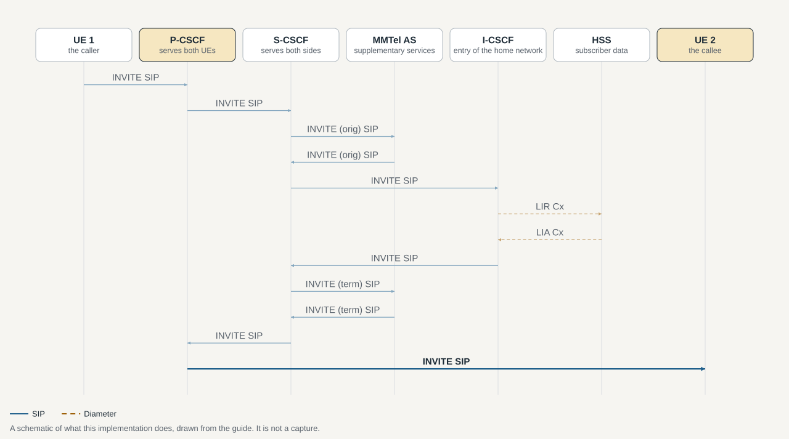
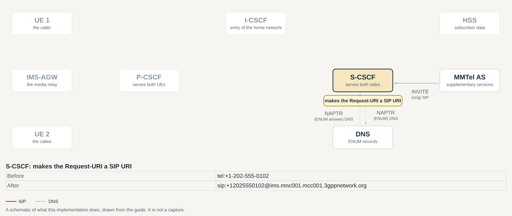
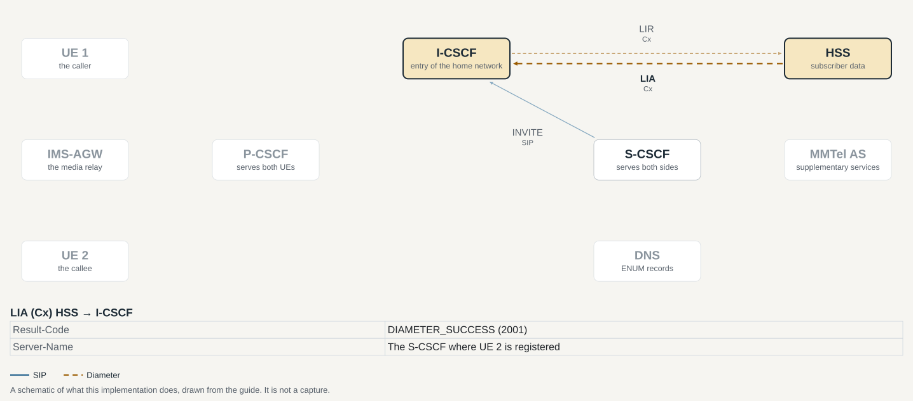
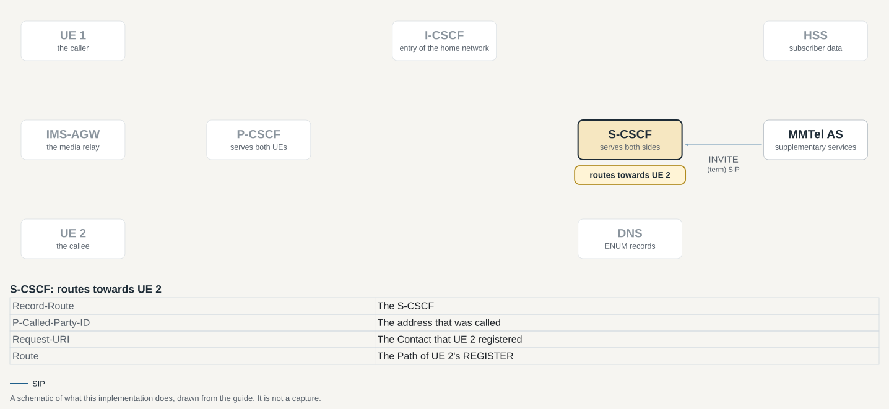
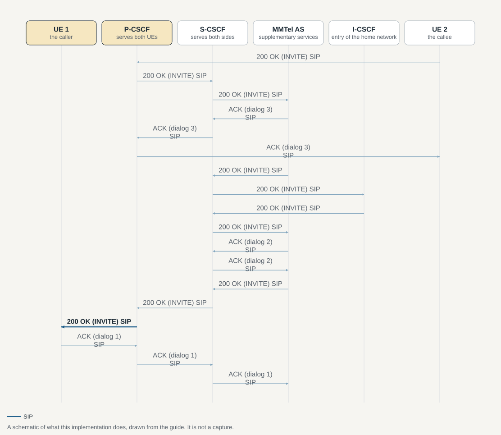
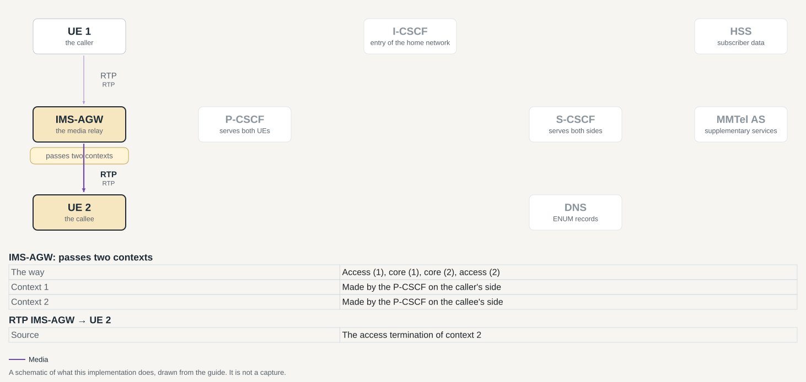
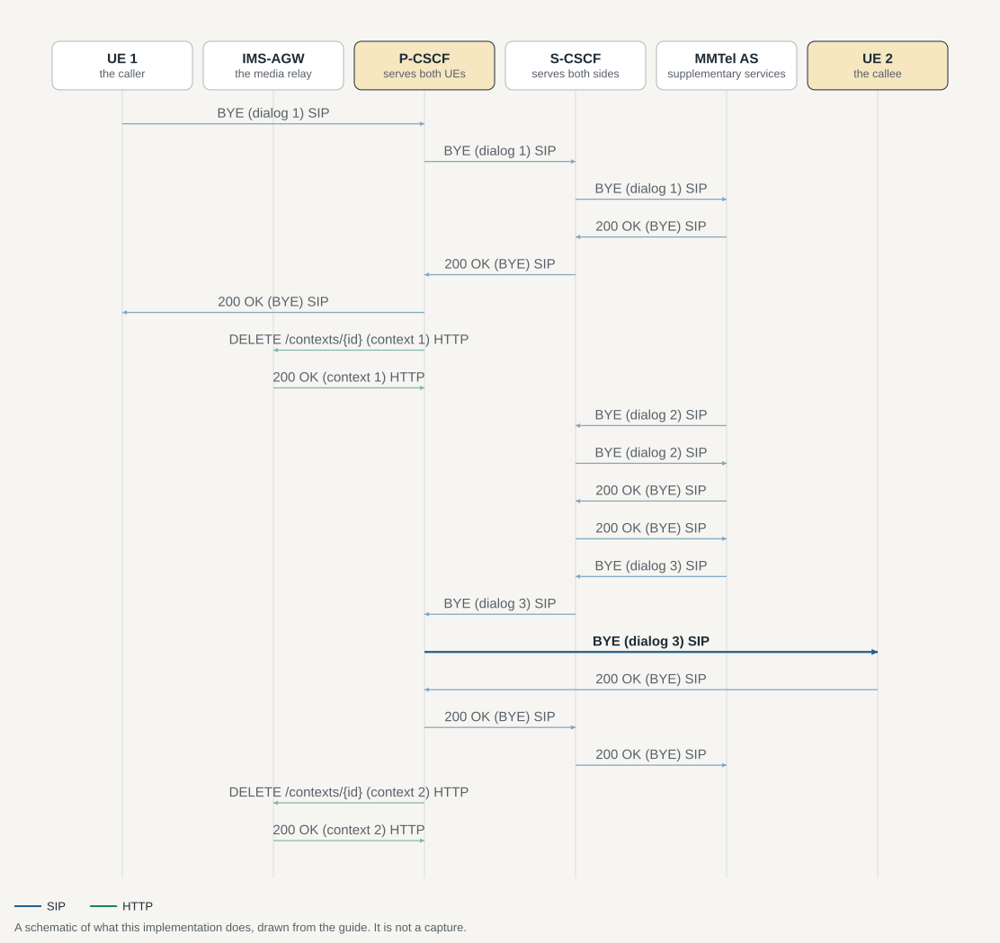

# From a number to the other phone

The UE that makes a call knows only the number of the other party. It knows neither the other UE's IP address nor the S-CSCF that the other UE registered with. The call still connects, because each node on the way decides where the request goes next.

UE 1 sends the INVITE to its own S-CSCF, along the Service-Route that it got at registration. The S-CSCF turns the number into a SIP URI with ENUM in DNS, and sends the INVITE to the I-CSCF, the entry point of the callee's home network. The I-CSCF asks the HSS with an LIR, and learns the S-CSCF that serves the callee. That S-CSCF uses the Contact and the Path that it stored at the callee's registration, and delivers the INVITE to UE 2 through the callee's P-CSCF. On the way, on the caller's side and again on the callee's side, the MMTel AS takes the INVITE and sends it back.

The responses retrace the way of the INVITE back to UE 1. UE 2 rings, then answers; UE 1 sends an ACK, and the call is up. The voice does not take the way of the signalling. The RTP passes no CSCF at all: it flows only between the UEs and the media relay (IMS-AGW). In the end, one side sends a BYE and the call ends.

This chapter builds on [Three things that registration settles](registration.md) and [Which request follows Path and which follows Service-Route](registration-routes.md). It uses the Service-Route, the Path and the IP association of the P-CSCF that registration set up, as they are.

## The setup of this chapter

The example is the `deploy/compose` setup, where UE 1 (`+1-202-555-0101`) calls UE 2 (`+1-202-555-0102`) by number. Both are softphone UEs that register with SIP Digest. The numbers are in the range 555-0100 to 555-0199, which the North American Numbering Plan keeps for fiction.

| Node | Address | What it does in this call |
| --- | --- | --- |
| UE 1 | 172.28.0.100 | The caller. Knows only the number |
| UE 2 | 172.28.0.101 | The callee |
| P-CSCF | 172.28.0.40 | Serves both UEs. One call passes it twice |
| S-CSCF | 172.28.0.30 | Serves both UEs. It is both the caller's and the callee's S-CSCF |
| MMTel AS | 172.28.0.75 | Takes the INVITE of the caller and of the callee, and sends each back |
| DNS | 172.28.0.2 | Holds the ENUM records that turn numbers into SIP URIs |
| I-CSCF | 172.28.0.20 | The entry point of the callee's home network. Asks the HSS for the callee's S-CSCF |
| HSS | 172.28.0.10 | Answers the I-CSCF over Cx, and the MMTel AS over Sh |
| IMS-AGW | 172.28.0.50 | The media relay. It relays the RTP, and the P-CSCF controls it |

In this setup one P-CSCF and one S-CSCF serve both UEs. So one call passes the P-CSCF twice, and the S-CSCF twice: first on the caller's side, then on the callee's. In a real network the two sides are often other nodes, in other networks. Either way, a node decides its position in the same manner.

The editions of the specifications in this chapter are TS 24.229 V18.11.0 and TS 29.228 V18.0.0.

## The way of the INVITE



The INVITE goes in this order. The numbers in brackets are those of the ladder in the guide.

1. UE 1 sends the P-CSCF an INVITE whose Request-URI is the number, `tel:+1-202-555-0102` (1).
2. The P-CSCF sends it to the S-CSCF of the Service-Route (2).
3. The S-CSCF sends it to the MMTel AS, and the AS sends a new INVITE back. The S-CSCF turns the number into a SIP URI (3).
4. The S-CSCF sends it to the I-CSCF, the entry point of the callee's home network (4).
5. The I-CSCF asks the HSS for the callee's S-CSCF, and sends it there (5).
6. The S-CSCF that serves the callee sends it to the MMTel AS once more, then to the P-CSCF along the Path (6).
7. The P-CSCF delivers it to UE 2 (7).

The figure leaves out the DNS and the media relay. The sections below draw the moments when the S-CSCF asks the DNS and when the P-CSCF controls the relay.

## The P-CSCF and the S-CSCF on the caller's side

The P-CSCF and the S-CSCF tell whether an INVITE belongs to the caller's side or to the callee's by the Route on top. In both cases the value is one that the node handed out itself at registration.

At registration, the P-CSCF put `sip:term@pcscf...` in Path. The callee's S-CSCF sends requests for the UE with this Path as their Route. So when the user part of the top Route is `term`, the request goes to the UE; otherwise it comes from the UE.

[internal/pcscf/session.go](../../../internal/pcscf/session.go)

```go
	out := req.Clone()
	top, popped := sip.PopOwnRoute(out, p.ownURIs()...)
	// The Path URI that the P-CSCF put in the REGISTER marks requests to
	// the UE (5.2.6.2).
	l := originating
	if popped && top.User == "term" {
		l = terminating
	}
```

`PopOwnRoute` removes the top Route when it is the node's own URI, and returns it as `top`. The top Route of UE 1's INVITE is the URI of the P-CSCF that UE 1 put first, without a user part. So `l` stays `originating` (TS 24.229 5.2.6.2).

On the caller's side, the P-CSCF does the following before it sends the INVITE to the S-CSCF (TS 24.229 5.2.6.3.3).

- It checks that the rest of the Route is the Service-Route of the registration.
- It puts the default public identity of UE 1 in P-Asserted-Identity. The network trusts this header field, not From.
- It puts itself in Record-Route, so that the later requests of this call pass the P-CSCF too.
- It has the media relay make a context, and rewrites the addresses of the SDP to the relay's. The section "The voice goes through the relay" shows this.

The S-CSCF also decides its position by the Route on top. The Service-Route that it handed out in the 200 OK of the registration has the user part `orig`.

[internal/scscf/session.go](../../../internal/scscf/session.go)

```go
	top, popped := sip.PopOwnRoute(out, s.ownURI())
	log := s.log.With("method", string(out.Method), "call_id", out.Get("Call-ID"))
	odi, returned := top.Params.Get(odiParam)
	if !ims.IsInDialog(st.Request) {
		s.chargeRequest(out)
	}
	switch {
	case ims.IsInDialog(st.Request):
		// A request within a dialog follows the route set the dialog
		// already has (RFC 3261 16.12).
		s.forward(st, out, nil, log)
	case popped && returned:
		s.fromApplicationServer(st, out, odi, log)
	case popped && top.User == "orig":
		s.startedSession(st, ims.OriginatingSession)
		s.originating(st, out, false, log)
	case popped && onBehalf(top):
		s.startedSession(st, ims.OriginatingSession)
		s.originating(st, out, true, log)
	default:
		s.startedSession(st, ims.TerminatingSession)
		s.terminating(st, out, log)
	}
```

The `switch` looks at its cases from the top.

1. A request within a dialog (one with a tag in To) does not decide the position again: it goes on along the route set of the dialog.
2. With the parameter `odi` in the top Route, it is an INVITE that the MMTel AS sent back. The next section covers this.
3. With the user part `orig`, it is a request of the UE along the Service-Route, so the S-CSCF goes to `originating` as the node that serves the caller (TS 24.229 5.4.3.1).
4. The parameter `orig` marks a request that an application server sends on behalf of a user. The call of this chapter does not use it.
5. Otherwise the S-CSCF goes to `terminating` as the node that serves the callee.

UE 1's INVITE is the third case. The S-CSCF checks that the user of P-Asserted-Identity is registered. Then it adds the tel URI of UE 1 as a second P-Asserted-Identity, and puts the ICSI of MMTel in P-Asserted-Service (TS 24.229 5.4.3.2 steps 9 and 4C).

## The MMTel AS joins on both sides

The S-CSCF sends requests to application servers as the iFCs (initial filter criteria) of the user's profile say. In this setup every subscriber has an iFC that sends an INVITE to the MMTel AS first (TS 24.229 5.4.3.2 step 5).

The S-CSCF puts the URI of the AS on top of the Route of the INVITE, and under it its own URI with an original dialog identifier (`odi`). In P-Served-User it puts `sescase=orig`, which says that this is the caller's side. The AS reads the settings of the user's services from the HSS over Sh (UDR and UDA). With the default settings of this setup, nothing changes in the call. The AS makes a new INVITE, and sends it back to the rest of the Route it got: the S-CSCF with the `odi`.

The top Route of the INVITE that comes back has the `odi`. By it the S-CSCF takes the second case of the `switch` above, and goes on after that iFC. On the callee's side the same happens at the same AS, with `sescase=term`.

The AS answers the INVITE it got itself, and sends a new INVITE with a Call-ID of its own. So one call has three dialogs, each with another Call-ID. This is the key to reading the signalling of a call. [Transactions, dialogs and media negotiation in a call](call-signaling.md) looks at it in detail. [What application servers add](services.md) shows what services the AS adds.

## The number becomes a SIP URI (ENUM)

The INVITE that comes back from the AS still has `tel:+1-202-555-0102` as its Request-URI. A number alone does not say which node of which network to send it to. When no iFC is left to apply, the S-CSCF turns the number into a SIP URI here.

[internal/scscf/session.go](../../../internal/scscf/session.go)

```go
	if number, ok := s.globalNumber(out.RequestURI); ok {
		uri, err := s.resolver.ENUM(context.Background(), number, s.cfg.ENUMSuffix)
		if err != nil {
			log.Info("ENUM has no SIP URI for the number", "number", number, "error", err.Error())
			s.respond(st, 404, nil)
			return
		}
		log.Info("translated the number with ENUM", "number", number, "uri", uri)
		out.RequestURI = uri
	}
```

`globalNumber` checks whether the Request-URI is a number that ENUM looks up. A tel URI is one. `ENUM` asks DNS for the NAPTR record of a name made of the digits of the number in reverse, one label each (RFC 6116). For `+12025550102` the name is `2.0.1.0.5.5.5.2.0.2.1.e164.arpa`. The service of the record is `E2U+sip`, and its regular expression makes `sip:+12025550102@ims.mnc001.mcc001.3gppnetwork.org` from the number. That is the new Request-URI (TS 24.229 5.4.3.2 step 10).



For a number without a record, `ENUM` returns an error and the S-CSCF answers 404. A real network can send a number outside the IMS to the telephone network through a BGCF. This project has no BGCF, so the S-CSCF answers the caller instead. TS 24.229 5.4.3.2 step 10 allows that answer too.

With the number turned, the S-CSCF puts itself in Record-Route and sends the INVITE on. The domain of the new Request-URI, `ims.mnc001.mcc001.3gppnetwork.org`, resolved with NAPTR and SRV as the P-CSCF did at registration, gives the I-CSCF at the entry of that domain. On this hop the INVITE is larger than 1300 bytes, so it goes over TCP rather than UDP (RFC 3261 18.1.1).

## Finding the callee's S-CSCF (I-CSCF and LIR)

The I-CSCF does not know the S-CSCF that serves the callee. So it sends the HSS an LIR (Location-Info-Request, Cx command 302) with the callee's public identity (TS 24.229 5.3.2.1, TS 29.228 6.1.4). UE 2 has registered, so the HSS answers DIAMETER_SUCCESS with the Server-Name of the S-CSCF that UE 2 registered with.



The HSS answers with the serving S-CSCF that it recorded at UE 2's registration. The I-CSCF puts that S-CSCF on top of the Route and forwards the INVITE. The I-CSCF adds no Record-Route. So the later requests within the dialog (PRACK, ACK, BYE) do not pass the I-CSCF. The I-CSCF joins only the way of the first INVITE, to find the callee's S-CSCF.

In this setup the INVITE goes back to the same S-CSCF. A capture shows the INVITE leave the S-CSCF for the I-CSCF and come back to the same S-CSCF.

## Along the Path to UE 2

The top Route of the INVITE that comes back is the S-CSCF's URI that the I-CSCF put there, without `orig`. So the S-CSCF takes the last case of the `switch`, `terminating`, and acts as the node that serves the callee (TS 24.229 5.4.3.3). It finds UE 2's registration, and with the iFC of the callee's side it sends the INVITE to the MMTel AS once more. The S-CSCF points the INVITE that comes back from the AS at UE 2 as follows.



- It puts itself in Record-Route.
- It puts the destination that was called in P-Called-Party-ID.
- It makes the Contact that UE 2 registered the Request-URI.
- It puts the Path of UE 2's REGISTER in the Route.

The last two are the handling that [Which request follows Path and which follows Service-Route](registration-routes.md) showed. The INVITE reaches the P-CSCF of the Path. The top Route is the P-CSCF's own `term` URI, so it decides that this pass is on the callee's side (TS 24.229 5.2.6.4.3). It sends the INVITE not to UE 2's Contact but to the address that UE 2's REGISTER came from: a UE behind NAT is reached only there.

The Request-URI changed twice before it reached UE 2. The caller's S-CSCF turned the tel URI into a SIP URI, and the callee's S-CSCF turned it into UE 2's Contact.

## Ringing and answer

UE 2 first answers the INVITE with 183 Session Progress. The 183 carries the SDP answer, from which UE 1 learns which codec to use and where to send the voice. The 183 is a reliable provisional response, so UE 1 confirms with a PRACK that it got it.

Both UEs of this setup have the resources for the voice already. So UE 2 sends 180 Ringing and alerts its user as soon as it gets the PRACK. When the user answers, UE 2 answers the INVITE with 200 OK, and UE 1 sends an ACK. The call is up.



The figure draws the 200 OK and the ACKs only. The 183, the PRACK and the 180 go the same way. A response retraces the nodes of the INVITE, so it passes the I-CSCF too. The ACK follows the route built from Record-Route, so it does not pass the I-CSCF. When the MMTel AS gets the 200 OK, it sends an ACK in its own dialog and the 200 OK on in the next dialog. The order of messages of different dialogs is not fixed, so the order of the rows is one example.

## The voice goes through the relay

The signalling passed the nodes that decide where it goes, one after the other. The voice does not. The RTP passes no CSCF: it flows only between the UEs and the media relay.



The P-CSCF makes this way. Each time an INVITE passes, the P-CSCF has the relay make one context. A context has two terminations: the access side, toward the UE, and the core side, toward the network.

[internal/pcscf/setup.go](../../../internal/pcscf/setup.go)

```go
		c, err := relay.Control.Add(ctx, agw.TerminationRequest{ID: agw.Access}, agw.TerminationRequest{ID: agw.Core, Latch: agw.NAPTOff})
```

This one line asks for the two terminations. The access side sends back to the source of the first packet that arrives. This is called latching: a UE behind NAT sends from an address that its SDP cannot know. The core side does not latch (`NAPTOff`): it sends to the address in the SDP of the network side.

Each time, the P-CSCF rewrites the address of `c=` and `m=` in the SDP to that of a termination of the relay. In the offer that leaves UE 1 for the network it writes the core side; in the answer that reaches UE 1 it writes the access side. The pass on the callee's side does the same. As a result each UE exchanges voice with the relay only, and never learns the other UE's address.

One call has two contexts: one on the caller's side and one on the callee's. UE 1's voice goes in this order.

```text
UE 1 -> relay access (context 1) -> relay core (context 1)
     -> relay core (context 2) -> relay access (context 2) -> UE 2
```

Each UE sends RTP every 20 ms, and each packet carries 160 bytes of G.711 μ-law voice (RFC 3550 5.1, RFC 3551 4.5.14). RTCP uses the port one above that of the RTP, and goes through the relay too.

The requests between the P-CSCF and the relay use a small HTTP API of this project. The standard protocol for this purpose is H.248, and in another setup that the guide describes, the P-CSCF controls the relay over H.248.

The ways of the signalling and of the voice part because their jobs differ. The CSCFs decide where a request goes and add services. For that the signalling passes the nodes that hold the registrations and the profiles. The voice only carries packets, and the SDP has already set where they go. The P-CSCF stays on the way of the signalling, and by rewriting the SDP it points the way of the voice at the relay.

## Ending the call

When the user of UE 1 hangs up, UE 1 sends a BYE within the dialog (RFC 3261 15.1.1). The BYE carries `Reason: RELEASE_CAUSE;cause=1;text="User ends call"`, which tells why the call ended (TS 24.229 5.1.5). Like the ACK, the BYE follows the route built from Record-Route, and does not pass the I-CSCF.



The MMTel AS on the caller's side answers UE 1's BYE with 200, and sends a BYE of its own in the next dialog. So the BYE reaches UE 2 dialog by dialog, and the last 200 comes from UE 2. When a 200 to a BYE passes the P-CSCF, the P-CSCF deletes from the relay the context of that pass. A BYE can be refused, so it waits for the response before it deletes.

## What this account rests on

This account was checked against the following code and tests. Each test passes as a Go test of this repository.

- `TestCallThroughTheWholeIMS` in `internal/ue/call_test.go`. It runs the P-CSCF, the I-CSCF, the S-CSCF and the HSS in one process, has a registered UE 1 call UE 2, and checks that UE 2 gets the 25 RTP packets that UE 1 sent as they were, and that UE 1 hears something too. The network of this test has neither an MMTel AS nor a media relay, and the target is a SIP URI, so no ENUM lookup happens. What it checks is that registration, the call, the answer, the voice and the hang-up connect through the CSCFs.
- `TestOriginatingCallGoesThroughTheRelay` in `internal/pcscf/session_test.go`. It checks that the P-CSCF on the caller's side makes the Route the Service-Route, adds P-Asserted-Identity and Record-Route, and has the relay make one context. It also checks that the offer to the network names the core side, the answer to the UE the access side, and that each termination sends to the address of the other party's SDP.
- `TestOriginatingCallToATelURIGoesToTheICSCF` in `internal/scscf/session_test.go`. It checks that an INVITE to a tel URI reaches the I-CSCF with the result of ENUM as its Request-URI and the S-CSCF's Record-Route. In the same file, `TestOriginatingCallToANumberWithoutENUMGets404` checks that a number without a record gets 404, and `TestTerminatingCallFollowsThePath` that a terminating INVITE has the Contact as its Request-URI, the Path as its Route, and the destination as its P-Called-Party-ID.
- `TestCallToARegisteredCalleeGoesToItsSCSCF` in `internal/icscf/icscf_test.go`. It checks that the I-CSCF sends an INVITE to a registered callee with the S-CSCF of the LIA in its Route. The S-CSCF of this test is a stand-in of the test, not one that connects the call to the end.
- `TestCallThroughTheAS` in `internal/mmtel/relay_test.go`. It checks that the INVITE the MMTel AS sends back has a Call-ID of its own and a Route to the S-CSCF with the `odi`, and that the caller gets 183, 180 and 200.
- `TestRelayLatchesAndForwards` in `internal/agw/agw_test.go`. It checks that the access termination latches onto the source of the first packet that arrives, not the address of the SDP.

The addresses and numbers of the table above are those of the `deploy/compose` configuration. The figures are diagrams of how this setup behaves, drawn from the guide. They are not captures.

## Run it yourself

Reading this chapter needs nothing to run. To see the same call in a real capture, the guide has the steps in [Make a call](../../guide/en/call.md#make-a-call) and [Open the capture](../../guide/en/call.md#open-the-capture), and the full ladder with the numbers 1 to 13 in [The sequence](../../guide/en/call.md#the-sequence). In the slides, the scenes of the [call deck](../../../slides/decks/en/05-call.md) from "The shape of the whole" to "Hanging up" go hop by hop in the order of this chapter.

The next chapter looks at what services the iFC that called the MMTel AS in this call adds. SMS too uses the same registration and the way the I-CSCF finds the S-CSCF, and an iFC brings the short message to the IP-SM-GW. [What application servers add](services.md)
