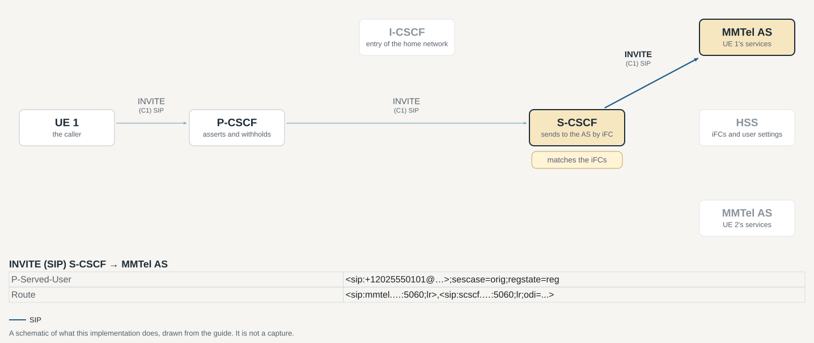
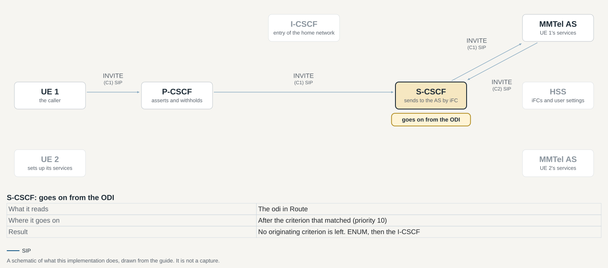

# When an application server is not available

The S-CSCF sends a request that matches an iFC to an application server (AS). When that AS does not answer, or answers with a 408 or a 5xx, the S-CSCF applies default handling: it follows the DefaultHandling of the iFC. With SESSION_CONTINUED, it skips the AS and goes on matching the iFCs of lower priority. With SESSION_TERMINATED, it ends the request there and returns a failure to the user.

Default handling applies only while the S-CSCF can tell that the AS has not taken the request on yet. A 408 or a 5xx that comes after a provisional response from the AS, or after the AS has sent the request back to the S-CSCF, is not a failure of the AS. It is the answer of the session, and it goes to the user as it is. When the AS refuses with a 4xx or a 6xx, that too is the answer of the AS. DefaultHandling has no part in it.

The standard does not say which value to use. The operator writes one per iFC. Continuing keeps calls and registrations going, and loses the barring and the forwarding that the AS takes care of. Terminating keeps the barring, and turns a failure of the AS into failed calls of the users. This setup uses SESSION_TERMINATED for the calls users make and the short messages they send, and SESSION_CONTINUED for calls to users and for the third-party REGISTER that tells an AS of a registration.

This chapter builds on [iFC and the supplementary services of the MMTel AS](mmtel.md) and [Delivering SMS and reporting on it](sms.md). Those chapters explain how iFCs are matched, P-Served-User, and the original dialog identifier (ODI).

## The setup of this chapter

The example is the `deploy/compose` setup and the iFCs that the HSS gives every subscriber in `deploy/compose/hss.yaml`. There are two ASs: the IP-SM-GW, which takes care of SMS, and the MMTel AS, which takes care of the supplementary services. The chapter cites TS 24.229 V18.11.0 and TS 29.228 V18.0.0.



The Route of a request that the S-CSCF sends to an AS holds the URI of the AS and then the S-CSCF's own URI with the ODI (TS 24.229 5.4.3.2 step 5 a). The S-CSCF waits for the answer to this request. This chapter is about how that wait ends.

## What the standard fixes

In the user profile, the ApplicationServer of an iFC may have one DefaultHandling (TS 29.228 B.2.2). It says whether the dialog is released when the AS could not be reached, and its values are SESSION_CONTINUED and SESSION_TERMINATED. In the XML they are 0 and 1 (TS 29.228 Annex E). It may be left out.

TS 24.229 sets when the S-CSCF uses the value. The conditions are the same for requests that the served user initiates (5.4.3.2) and for requests that terminate at the served user (5.4.3.3).

- No SIP response comes within a configurable time.
- A 408 or a 5xx comes from the AS, before any 1xx to the original request, and before any request from the AS that carries the same ODI.

When one of them holds, the S-CSCF acts as follows.

| DefaultHandling | What the S-CSCF does |
| --- | --- |
| SESSION_CONTINUED, or none | Goes on matching the iFCs not yet executed (from step 5 of 5.4.3.2, step 4 of 5.4.3.3) |
| SESSION_TERMINATED | Returns the received response to the user. When an initial INVITE got no response, returns a 408 or a 5xx. Does not match the iFCs of lower priority |

Any other final response is the answer of the AS. The S-CSCF returns it to the user and does not match the iFCs of lower priority (the same two clauses).

Registration has a rule of its own. When a third-party REGISTER gets no response, or a 408 or a 5xx, the S-CSCF does nothing with SESSION_CONTINUED. With SESSION_TERMINATED, it deregisters, from the network side, the identities that the REGISTER registered (TS 24.229 5.4.1.7; the deregistration is 5.4.1.5).

The AS has a way to avoid default handling too. A B2BUA AS that starts a new request of its own without the ODI, apart from the one it received, may send a provisional response to the original request while it waits for the answer to the new one. The S-CSCF then does not apply default handling (TS 24.229 5.7.5.1 NOTE 1).

What the standard leaves to the operator and the implementation:

- Which value each iFC has.
- How long the "configurable time" is.
- Which of 408 and 5xx to return when SESSION_TERMINATED applies and no response came.

## Where this implementation tells the cases apart

The S-CSCF sends a request to the AS of one iFC in `invoke` and waits for the answer. These lines decide what happens after the wait.

[internal/scscf/services.go](../../../internal/scscf/services.go)

```go
	provisional := false
	relay := s.onResponses(st, d.direction())
	targets, err := s.nextHop(toAS)
	var final *sip.Message
	if err == nil {
		final, err = st.ProxyWith(toAS, func(r *sip.Message) {
			provisional = provisional || r.StatusCode < 200
			relay(r)
		}, targets...)
	}
	if unreachable(final, err) && !provisional {
		returned, rerr := s.returned(d.ID)
		if rerr != nil {
			// Without the identifier, the S-CSCF cannot tell the failure
			// of the server from the answer of the session.
			s.storeFailed(st, rerr, log)
			return true
		}
		if !returned {
			log.Info("application server failed", "status", statusOf(final), "error", errorText(err), "default_handling", as.DefaultHandling.String())
			if as.DefaultHandling == ifc.SessionContinued {
				return false
			}
		}
	}
	// Any final response from the server goes to the user, without the
	// criteria of lower priority (5.4.3.2, 5.4.3.3).
	if final != nil {
		relay(final)
	}
	ims.Finish(st, final, err)
	return true
```

There are three inputs: `err`, the result of looking up the AS in DNS and of the wait; `final`, the final response of the AS; and `provisional`, which tells whether a provisional response came from the AS. `ProxyWith` calls the function it was given each time it relays a provisional response to the user. That function sets `provisional`.

Default handling applies only when three conditions hold together.

- `unreachable` is true: no response came, or a 408 or a 5xx came.
- `provisional` is still false: no provisional response was relayed.
- `returned` is false: no request has come back from the AS with this ODI.

When they hold, SESSION_CONTINUED returns `false`. The request is left as it was, and the caller goes on to the next iFC. SESSION_TERMINATED goes on down, and `ims.Finish` answers the user. When the conditions do not hold, the code also goes on to `ims.Finish`. Whenever `invoke` returns `true`, the iFCs of lower priority are not matched.

`unreachable` is the test that the third-party REGISTER uses too.

[internal/scscf/thirdparty.go](../../../internal/scscf/thirdparty.go)

```go
func unreachable(final *sip.Message, err error) bool {
	if err != nil {
		return true
	}
	return final != nil && (final.StatusCode == 408 || final.StatusCode/100 == 5)
}
```

There is an `err` when the request could go nowhere, and when the wait ended without a final response. When a response came, only a 408 and a 5xx count as a failure.

`ims.Finish` decides the response to the user.

[internal/ims/route.go](../../../internal/ims/route.go)

```go
func Finish(st *sip.ServerTransaction, final *sip.Message, err error) {
	switch {
	case err != nil:
		st.Respond(sip.NewResponse(st.Request, 504, sip.NewTag()))
	case final != nil && final.StatusCode == 503:
		st.Respond(sip.NewResponse(st.Request, 500, sip.NewTag()))
	case final != nil:
		st.Respond(final)
	}
}
```

When no response came, it is 504 (Server Time-out). The standard says to return a 408 or a 5xx to an initial INVITE; this implementation chooses 504, for every method. When the AS returned 503, the S-CSCF does not pass the 503 on and returns 500 instead, because a proxy does not forward a 503 as it is (RFC 3261 16.7 step 6). A 503 says that the server that sent it takes no requests now. Forwarded by the S-CSCF, it would read as said of the S-CSCF itself. Every other response goes back as it came.

When the iFC says to continue, the caller is `invokeApplicationServers`, which tries the iFCs in order.

[internal/scscf/services.go](../../../internal/scscf/services.go)

```go
	for i := d.Invoked + 1; i < len(d.Criteria); i++ {
		if !d.Criteria[i].Matches(out, d.SessionCase) {
			continue
		}
		if s.invoke(st, out, d, i, log) {
			return
		}
		// The server failed and its criterion says SESSION_CONTINUED: the
		// evaluation goes on from step 5 (5.4.3.2) or step 4 (5.4.3.3)
		// with the criteria after it.
	}
```

When `invoke` returns `false`, the loop goes on to the next iFC. When no matching iFC is left, the loop ends, and the request goes to its destination as for a user without an AS.

An iFC that gives no value is handled as SESSION_CONTINUED, because that is the zero of the Go type.

[internal/ifc/ifc.go](../../../internal/ifc/ifc.go)

```go
type DefaultHandling int

const (
	// SessionContinued goes on with the criteria of lower priority.
	SessionContinued DefaultHandling = 0
	// SessionTerminated ends the request.
	SessionTerminated DefaultHandling = 1
)
```

## Six cases

"The AS is not available" covers several cases that look different from the S-CSCF. In this implementation they divide as follows. The two columns on the right are what the user gets with a SESSION_TERMINATED iFC, and the test that checks it.

| Case | Default handling | What the user gets with SESSION_TERMINATED | Test |
| --- | --- | --- | --- |
| DNS returns no address for the name of the AS | Applies | 504 at once | `TestDefaultHandling` |
| No response at all comes from the AS | Applies | 504 once the wait ends | Behavior read from the code |
| A 408 or a 5xx comes before any provisional response | Applies | The response received; 500 for a 503 | `TestDefaultHandling` |
| A 408 or a 5xx comes after a provisional response | Does not apply | The response received; 500 for a 503 | Behavior read from the code |
| A 408 or a 5xx comes after the AS sent the request back | Does not apply | The response received; 500 for a 503 | `TestFailureAfterTheRequestCameBack` |
| The AS answers with a 4xx, 6xx, 3xx or 2xx | Has no part | The response received | The barring example below |

With a SESSION_CONTINUED iFC, the request goes on to the next iFC in the rows where default handling applies. The other rows are the same whatever the value.

### When DNS does not find the AS

When `nextHop` cannot look up a target, the request goes nowhere. This implementation handles that as the case where no response comes. The condition of the standard is that no response comes within a configurable time, and it does not name a DNS failure. But a request that never left gets no response, so the S-CSCF goes to default handling without waiting.

When DNS returns several targets for the name of the AS, the SIP stack tries the next target first. A 503, a transport error, and no response at all before Timer B or Timer F are the reasons to move to the next target (RFC 3263 4.3). `invoke` in the S-CSCF sees a failure only after every target has failed. Running the AS on several instances is the first line of defense. Default handling is what applies once that defense is used up.

### When no response comes

The "configurable time" is a transaction timer in this implementation: Timer F for a request other than INVITE, such as MESSAGE, and Timer B for an INVITE. Both are 32 seconds by default (RFC 3261 17.1.1.2, 17.1.2.2). The node setting `transaction_timeout` shortens them.

An INVITE needs care. While the SIP stack of the AS runs, the stack sends 100 (Trying) within 200 ms even if the application does not answer (RFC 3261 17.2.1). After the 100, Timer B stops, and the S-CSCF waits on Timer C of the proxy. Timer C is 3 minutes 30 seconds in this implementation (RFC 3261 16.6 step 11 only asks for more than 3 minutes). When Timer C fires, the S-CSCF sends a CANCEL and waits 64*T1 (32 seconds) more for a final response (RFC 3261 16.8, 9.1). Only when none comes does it go to default handling. When the host of the AS is down altogether, this takes 32 seconds; with an AS whose application alone has stopped, it takes more than 4 minutes. All that time, the caller does not even hear ringing.

### After a provisional response

Once a provisional response has been relayed, a 408 or a 5xx no longer leads to default handling. The conditions of the standard leave out the case after a 1xx too. A provisional response is a sign that the AS has taken the request on and is moving it forward. The user may already be getting ringing or early media. Switching to another AS or destination then would start the same call a second time.

This implementation does not count a 100 (Trying) as that 1xx. It simplifies the condition of the standard there. A proxy stops a 100 at the hop it came over and does not send it on (RFC 3261 16.7 step 5), so the S-CSCF does not relay it either. In the excerpt above, the function that sets `provisional` is called only when `ProxyWith` relays a provisional response other than 100. A 503 that comes after a 100 therefore leads to default handling.

### After the request came back



The MMTel AS is a B2BUA. It answers the INVITE it got as a UA, and sends a new INVITE back to the S-CSCF with the ODI. The S-CSCF reads the ODI and goes on after the iFC that matched. At this point the AS has taken the work on. A failure further along the call comes back through the AS afterwards. Even when it is a 408 or a 5xx, it is not a failure of the AS.

That the request came back is kept in the record of the ODI.

[internal/scscf/services.go](../../../internal/scscf/services.go)

```go
	d.Returned = true
	if err := s.store.PutOriginalDialog(ctx, d); err != nil {
		s.storeFailed(st, err, log)
		return
	}
```

The records of the ODIs are in the store that every S-CSCF instance shares, because the request that the AS sends back may reach an instance other than the one that sent it. When the first instance gets the failure from the AS, it reads `Returned` from the store. If it cannot read it, it cannot tell a failure from an answer, and it answers 500. A record goes away after 4 minutes, long enough to cover Timer C (more than 3 minutes), the wait of a proxy for the final response to an INVITE.

`TestFailureAfterTheRequestCameBack` checks this case. The first AS sends the request back, and the AS of the second iFC answers 503. The second iFC is SESSION_TERMINATED. The test checks that the user gets 500, that nothing reaches the destination I-CSCF, and that the second AS gets the request only once.

### The answer of the AS

When the AS answers with a 4xx or a 6xx, that is the result of the AS handling the request. For outgoing barring, for example, the MMTel AS returns 603 (Decline) (`TestOutgoingCommunicationBarring` in `internal/mmtel/barring_test.go`). The S-CSCF returns this 603 to the user and does not match the iFCs of lower priority. The value of DefaultHandling plays no part.

## What TestDefaultHandling checks

`TestDefaultHandling` in `internal/scscf/services_test.go` sets one iFC for the short messages the user sends, and breaks its AS in two ways: a name for which DNS knows no address, and an AS that answers 503.

| AS | DefaultHandling | Response the user gets | Destination I-CSCF |
| --- | --- | --- | --- |
| A name DNS does not know | SESSION_CONTINUED | 486 | Gets the MESSAGE |
| A name DNS does not know | SESSION_TERMINATED | 504 | Gets nothing |
| Answers 503 | SESSION_CONTINUED | 486 | Gets the MESSAGE |
| Answers 503 | SESSION_TERMINATED | 500 | Gets nothing |

The 486 is the response that the test's stand-in for the destination I-CSCF is made to return to anything. It shows only that the continued request went on to the destination. How a continued request ends in a real network depends on the destination. The next section looks at what happens in this setup when SMS is continued.

## The values of this setup

The iFCs of `deploy/compose/hss.yaml` have these values. The results are for this setup, which runs each AS on one instance, when that AS stops.

| Priority | Matching request | AS | DefaultHandling | Result when the AS stops |
| --- | --- | --- | --- | --- |
| 0 | REGISTER | IP-SM-GW | SESSION_CONTINUED | The registration stays, and calls go both ways. Even after the IP-SM-GW is back, the user cannot receive SMS until the next re-registration |
| 1 | A MESSAGE with SMS that the user sends | IP-SM-GW | SESSION_TERMINATED | The short message ends with a failure response (500 for a 503, 504 when no response came) |
| 2 | A MESSAGE with SMS for the user, from another network | IP-SM-GW | None (handled as continued) | Goes on to the callee's contact without the IP-SM-GW |
| 10 | An INVITE the user makes | MMTel AS | SESSION_TERMINATED | The call fails |
| 11 | An INVITE to a registered user | MMTel AS | SESSION_CONTINUED | Reaches the callee. Incoming barring and forwarding do not work |
| 12 | An INVITE to an unregistered user | MMTel AS | SESSION_CONTINUED | The S-CSCF returns 480. CFNL forwarding does not work |
| 13 | An INVITE that the AS diverted (ORIGINATING_CDIV) | MMTel AS | SESSION_TERMINATED | The diverted call fails |

### Barring holds only on the originating side

Outgoing barring (OCB) is decided when the originating AS gets the INVITE. If the originating iFC were SESSION_CONTINUED, calls made while the AS is down would go on to their destination without the AS. They would reach the parties the user barred, and the international numbers the user barred. Withholding the caller's identity (OIR), which the AS takes care of, would not work either. That is why this setup makes the originating side SESSION_TERMINATED. The price is that while the AS is down, every call fails, including those of users who barred nothing.

The originating side of a diverted call (priority 13) has the same reason: the outgoing barring of the diverting user applies to the call to the forwarding target.

The terminating side makes the other choice. When the AS is down, calls to users still reach the callee. In exchange, incoming barring (ICB and ACR) does not work, and calls from parties the callee barred get through as well. CFU, CFB and CFNR do not work either. The call does not move to the forwarding target; it rings the callee and ends busy or unanswered. A call to an unregistered user is not forwarded by CFNL and ends with 480.

So when the AS stops in this setup, outgoing barring holds and incoming barring does not. "Terminate to keep barring" is the choice of the originating side. The terminating side puts reaching the callee before barring.

### SMS terminates because there is nowhere else to go

No other node can take a short message that the user sends (priority 1) in place of the IP-SM-GW. If it were continued, the S-CSCF would try to send the MESSAGE to its Request-URI, the tel URI of the SC. There is no ENUM record for that number, so the S-CSCF would return 404. The network could not take the short message, and the answer would read as if the SC did not exist. Terminating reports the failure correctly.

The third-party REGISTER (priority 0) is the other way round. With SESSION_TERMINATED, the network would deregister the user just because the IP-SM-GW did not answer, and voice calls would stop working too. Continuing loses only the incoming SMS.

The S-CSCF reads the failure of a third-party REGISTER in these lines.

[internal/scscf/thirdparty.go](../../../internal/scscf/thirdparty.go)

```go
	if !unreachable(final, err) {
		log.Info("third-party REGISTER answered", "status", final.StatusCode)
		return
	}
	log.Info("third-party REGISTER failed", "status", statusOf(final), "error", errorText(err), "default_handling", as.DefaultHandling.String())
	if as.DefaultHandling != ifc.SessionTerminated || expires == 0 {
		return
	}
```

It reads the failure with the same `unreachable`, and goes on only with SESSION_TERMINATED. For the third-party REGISTER of a deregistration (`expires == 0`), there is nothing to deregister, so it does nothing. When it goes on, it takes the lock of the user, checks that the stored registration is the one of this REGISTER, and then deregisters from the network side. When an older third-party REGISTER fails after a re-registration, the current registration stays (`TestAnOlderThirdPartyRegisterThatFailsKeepsTheRegistration`). When the S-CSCF itself stopped and could not hear the answer, that does not count as a failure of the AS either (`TestAThirdPartyRegisterThatTheStopCutsIsNoFailure`). `TestThirdPartyRegisterThatFails` checks, with an AS that answers 503, that the registration stays with SESSION_CONTINUED, and that with SESSION_TERMINATED the AS gets a deregistering REGISTER and the HSS gets an ADMINISTRATIVE_DEREGISTRATION SAR.

## When continuing fits, and when terminating fits

Both values are choices the standard allows. Side by side:

| | SESSION_CONTINUED | SESSION_TERMINATED |
| --- | --- | --- |
| When the AS stops | The request goes on without the AS | The request fails there |
| What it keeps | Basic calls and registrations go on | What the AS restricts and adds always applies |
| What it loses | The barring, forwarding and identity handling of that AS | Every request of that kind while the AS is down |
| What the user sees | A service silently missing | Calls or messages that fail |

Continuing fits when what the AS adds is an extra: the call is still correct without it, and nobody is hurt when it is missing. The terminating supplementary services and the third-party REGISTER of this setup are such cases.

Terminating fits when a request that skips the AS becomes a request that must not go through: barring and the withholding of the caller's identity, which users count on to work, and requests that have no destination at all without the AS. The originating supplementary services and the SMS that users send in this setup are such cases.

Whichever value is chosen, something is lost when the AS stops. What makes the loss small is not the value but running the AS on several instances. In this implementation, the SIP stack sends the request on to the next target that DNS returns, and each AS role keeps its state in a shared store, so any instance can take the next request. Default handling is what applies when every instance has failed.

A network that wants barring to hold on the terminating side too can make the terminating iFCs SESSION_TERMINATED. Then every call to users fails while the AS is down. This setup weighs losing incoming calls more heavily, and continues on the terminating side.

## What this explanation rests on

The explanation of this chapter was checked against the following code and tests. Each test was run and passes as a Go test of this repository.

- `TestDefaultHandling` in `internal/scscf/services_test.go`: the four cases of the table above.
- `TestFailureAfterTheRequestCameBack` in `internal/scscf/services_test.go`: a 503 after the request came back does not lead to default handling even with SESSION_TERMINATED, and reaches the user as 500.
- `TestRequestBackFromAProxyAS` in `internal/scscf/services_test.go`: a request that comes back with the ODI goes on to the next iFC or to the destination.
- `TestThirdPartyRegisterThatFails`, `TestAnOlderThirdPartyRegisterThatFailsKeepsTheRegistration` and `TestAThirdPartyRegisterThatTheStopCutsIsNoFailure` in `internal/scscf/services_test.go`: default handling of the third-party REGISTER.
- `TestOutgoingCommunicationBarring` and `TestIncomingCommunicationBarring` in `internal/mmtel/barring_test.go`: the AS answers a barred call with 603 or 433.

The case where no response comes and the case after a provisional response are behavior read from the code quoted above and from the timers of `internal/sip`. The figures are schematic drawings of this setup made from the guides, not captures.

## Run it yourself

When the MMTel AS is taken out of service, the AS answers 503, and the default handling of the originating iFC ends the call with 500; a capture shows this. The steps are in the guide's [Take the MMTel AS out of service](../../guide/en/mmtel.md#take-the-mmtel-as-out-of-service), and for the IP-SM-GW in [Take the IP-SM-GW out of service](../../guide/en/sms.md#take-the-ip-sm-gw-out-of-service). You can run the tests with `go test ./internal/scscf -run 'TestDefaultHandling|TestFailureAfterTheRequestCameBack'`. In the slides, the scene "The ODI, and three dialogs for one call" of the [supplementary services deck](../../../slides/decks/en/07-mmtel.md) shows in steps how the request comes back from the AS.
