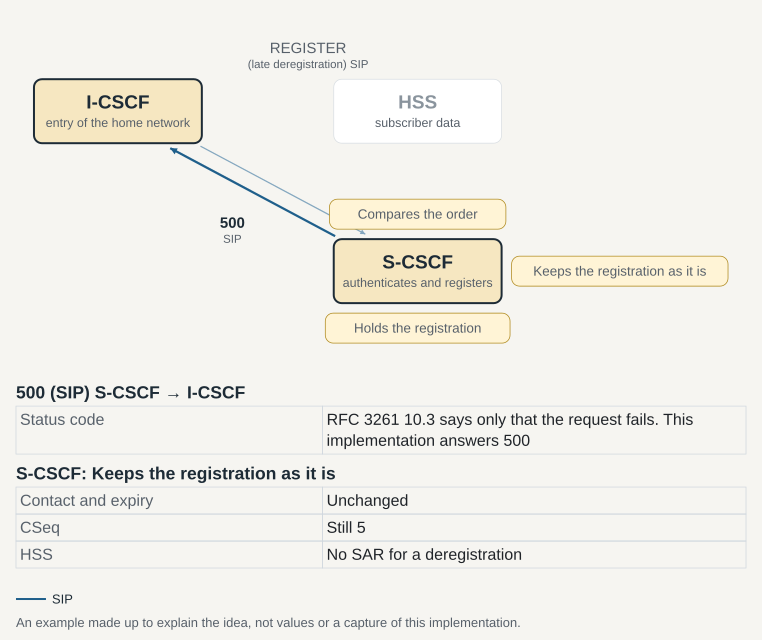
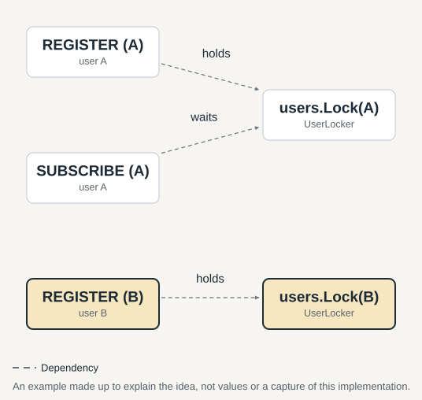

# Registration order and expiry

Every REGISTER that reaches the S-CSCF has the same form. Still, an initial registration, a refresh, a deregistration, an old request that arrives late and an answer to an authentication that has run out cannot be handled alike, because each may change something different. The S-CSCF tells them apart by the values of the request together with two records that it keeps for each user. The values are the Call-ID, the CSeq, the Contact, the expiry interval and the nonce of the answer. The records are the registration and the authentication in progress.

The answer first:

- Order is compared by the CSeq within one Call-ID only, and only for a request that changes the registration of the stored Contact. Another Call-ID, another Contact and a retransmission that the transaction layer absorbs are outside the comparison.
- An expiry is decided by the time written in the record, not by whether the record is still there. The time until which an answer to a challenge is accepted (reg-await-auth) and the time until which the record stays in the store are two different times. When the handling of expiries runs late, the code that handles the request checks the time itself, so a late answer is not accepted.
- What makes reading, comparing, telling the HSS and writing one step for one user is the lock per user. The lock holds as long as its holder finishes within the lease. Nothing stops the writes of a holder that goes on after its lease (there is no fencing).

This chapter builds on [Why a UE sends REGISTER twice](registration-two-registers.md), [Why a late deregistration does not remove a newer registration](registration-stale-deregistration.md) and [Refresh, deregistration, subscription and removal by the network](registration-lifecycle.md). It restates what it needs from them.

## The setup of this chapter

The example is the `deploy/compose` setup, with a softphone UE that registers with SIP Digest. The S-CSCF of that setup is one instance and keeps its state in its own process. The later sections put the state of the S-CSCF in a shared store, Valkey (the `deploy/redundancy` setup), and then let several instances share that store. The Compose setup runs one S-CSCF; the behaviour of several instances is what the Go tests check, by running two instances on one store. The S-CSCF of this implementation keeps one Contact for each private identity (TS 24.229 5.4.1.2.2A without reg-id).

Unless it says otherwise, a time is the default of this implementation. reg-await-auth is 4 minutes (TS 24.229 Table 7.8.1); the sweep that looks for what is due runs every second; the time for which one instance holds an expiry it has found (its claim) and the lease of the lock per user are both 15 seconds. The tests run with shorter values.

The specifications cited are TS 24.229 V18.11.0, TS 29.228 V18.0.0 and RFC 3261.

## What the standard fixes

Before comparing design choices, it helps to see what the standard settles. None of this is the implementation's to choose.

| Rule | Source | What it says |
| --- | --- | --- |
| Process in the order received, atomically | RFC 3261 10.3 (the paragraph before the steps) | A registrar processes REGISTER requests in the order it receives them. A REGISTER is processed completely or not at all. |
| Within one Call-ID, change only with a higher CSeq | RFC 3261 10.3 step 7 | For each Contact, the registrar compares the Call-ID of the stored binding. If it differs, the binding is updated, or removed when the expiry is zero. If it is the same, the binding is updated or removed only when the CSeq is higher than the stored one; otherwise the request fails. Each binding records the Call-ID and the CSeq of the request that changed it. |
| The same comparison when `*` removes everything | RFC 3261 10.3 step 6 | A deregistration with the Contact `*` compares the Call-ID and the CSeq of each binding in the same way. |
| Start reg-await-auth after the 401 | TS 24.229 5.4.1.2.1 step 7 | The timer that guards the next REGISTER. |
| The procedure depends on whether the timer runs | TS 24.229 5.4.1.2.2A | If it does not, the authentication starts anew. If it does, the S-CSCF goes on only when the Call-ID of the answer is that of the 401 that carried the last challenge, then stops the timer and checks the answer. |
| An initial REGISTER while the timer runs | TS 24.229 5.4.1.2.3 | Stop the timer and send a new challenge, as if no authentication were going on. |
| Running out is a failed authentication | TS 24.229 5.4.1.2.3 NOTE 2 | A public identity that was registered stays registered. |
| What the HSS does when told | TS 29.228 6.1.2.1 | An HSS that receives a SAR with the Server-Assignment-Type AUTHENTICATION_TIMEOUT keeps the registration state. It clears the S-CSCF name only when the user is Not Registered. |
| The temporary protection of IMS AKA ends with the same timer | TS 24.229 3.1, 5.2.2.2 | The temporary security associations that the UE and the P-CSCF set up at the 401 have a SIP level lifetime equal to reg-await-auth. |

The standard leaves other things open: whether the timer is a timer of the process or a time in the store; how long a record stays; how several instances that act as one registrar make the processing atomic; which response code a request out of order gets. This chapter compares the choices in that open part. The last one is covered in [Why a late deregistration does not remove a newer registration](registration-stale-deregistration.md): this implementation answers 500.

## The values and the state that tell requests apart

The S-CSCF keeps two records for each user, both looked up by the private identity. The registration, `Registration`, holds the Contact, the expiry `Expires`, and the `CallID` and `CSeq` of the REGISTER that last changed it. The authentication in progress, `Challenge`, holds the nonce of the 401, the Call-ID of the REGISTER that got the 401, the name of the HSS, and two times.

[internal/scscf/store.go](../../../internal/scscf/store.go)

```go
	// Expires is when reg-await-auth runs out (TS 24.229 5.4.1.2.1):
	// the authentication fails then if no REGISTER has answered the
	// challenge.
	Expires time.Time
	// KeepUntil is when the Store forgets the challenge: reg-await-auth
	// after Expires (putChallenge).
	KeepUntil time.Time
```

`Expires` is when reg-await-auth runs out; an answer after it is not accepted. `KeepUntil` is when the store forgets the record. A later section explains why there are two times.

With the two records and the values of the request, the REGISTER requests fall into these cases:

| Case | Values and state that tell it | What it may change | Result in this implementation |
| --- | --- | --- | --- |
| Initial registration | No registration. A REGISTER that carries no answer | Create the authentication record | MAR, 401 |
| Answer to the challenge | An authentication record; now is before `Expires`; the nonce and the Call-ID are those of the record | Remove the authentication record; create or change the registration | SAR, 200 OK |
| Refresh | A registration with the same Contact. With the same Call-ID, a CSeq higher than the stored one | The expiry, the Call-ID, the CSeq | With SIP Digest a new 401, then after the answer a SAR of RE_REGISTRATION and 200 OK |
| Registration with another Contact | A registration with a different Contact | Replace the old Contact with the new one | SAR and 200 OK after the authentication |
| Deregistration | Expiry zero. The stored Contact or `*`. With the same Call-ID, a higher CSeq | Remove the registration | SAR of USER_DEREGISTRATION, 200 OK |
| Deregistration with nothing to remove | No registration, or another Contact | Nothing | 481 |
| Late request | The same Call-ID and Contact, a CSeq that is not higher than the stored one | Nothing | 500 |
| Retransmission within the transaction | Belongs to the transaction of the earlier request | Nothing | The transaction layer sends the earlier response again |
| Answer after the expiry | An authentication record, but now is past `Expires` | Remove the authentication record. Not the registration | SAR of AUTHENTICATION_TIMEOUT. With SIP Digest, a new 401 with `stale=true` |
| Initial REGISTER while the challenge is pending | An authentication record, and a REGISTER that carries no answer | Replace the authentication record with a new one | MAR, a new 401 |
| Running out with no answer | The `Expires` of the authentication record comes up in the time index | Remove the authentication record. Not the registration | SAR of AUTHENTICATION_TIMEOUT |
| Expiry of the registration | The `Expires` of the registration comes up in the time index | Remove the registration | NOTIFY and a SAR of TIMEOUT_DEREGISTRATION |

Three things follow from the table.

First, what tells an initial registration from a refresh is not a value of the request but whether a registration is stored. The same REGISTER gets a SAR of RE_REGISTRATION when there is one, and of `REGISTRATION` when there is none.

Second, what tells an answer from a new request is the authentication record and its nonce. An answer is not compared by its CSeq: whether it answers the challenge depends on the nonce and the Call-ID (TS 24.229 5.4.1.2.2A). The CSeq is recorded when the answer is accepted and the registration is written.

Third, four cases change nothing, each for a different reason. A late request stops on the order, a retransmission on the transaction, a deregistration with nothing to remove on the Contact, and an answer after the expiry on the time. No single mechanism covers the other cases as well.

## Where the Call-ID and CSeq comparison applies



The function that compares is `outOfOrder`, called from `accept`, after the authentication is checked, and from `deregister`. Both compare only a request for the stored Contact, and both compare before the SAR to the HSS and before the record changes, so a refused request leaves nothing behind. The chapter on the late deregistration covers that much. This section looks at the requests for which the comparison really matters, and at those to which it does not apply.

**The requests for which it matters.** These go on without a new authentication. One is a deregistration that comes over an IP association of the P-CSCF (`integrity-protected="ip-assoc-yes"`). The other is a protected re-registration with IMS AKA: TS 24.229 5.4.1.2.2 step 1 leaves it to the S-CSCF whether to authenticate again, and this implementation does not, so the request goes on to `accept`. A SIP Digest refresh gets a new 401 each time unless TLS is used (TS 24.229 5.4.1.2.2A step 1). An old answer that arrives late therefore stops before any comparison: the challenge of its nonce is no longer stored, and the S-CSCF answers with a new 401 with `stale=true`.

**Another Call-ID.** By the rule, another Call-ID is another registration procedure. A UE that starts again and registers with a new Call-ID and CSeq 1 is the example. The CSeq is not compared; after the authentication the registration is updated, and its Call-ID and CSeq become the values to compare with from then on.

**Another Contact.** By the rule this is another binding as well. Without reg-id, as here, the new Contact replaces the old one (TS 24.229 5.4.1.2.2A step 6 d). There is no comparison, and still a late request cannot bring an old Contact back. Other checks stop it, not the comparison: a SIP Digest request is accepted only when it answers the challenge that is pending; a protected re-registration with IMS AKA for another Contact gets 403 (`reregister`); a deregistration of another Contact gets 481.

**A retransmission within the transaction.** A copy of the same REGISTER sent over UDP is taken by the SIP transaction layer before it reaches the registration code of the S-CSCF. Until the first response the layer discards the copies; after a response it sends the last response again for each copy (RFC 3261 17.2.2). This lasts while Timer J runs, 64×T1 over UDP, that is 32 seconds. A copy that comes after that reaches the registration code as a new transaction. Its CSeq is equal to or lower than the stored one, and the comparison refuses it. That is one more reason why an equal CSeq counts as old.

It also helps to see what a different comparison would do:

| Comparison | What happens |
| --- | --- |
| Compare the CSeq without the Call-ID | A UE that starts again and registers with a new Call-ID and CSeq 1 is refused until the old registration expires. RFC 3261 10.3 says that another Call-ID updates the binding, so this goes against the standard. |
| Take an equal CSeq as newer | A copy that arrives after Timer J has run out changes the registration. A copy of a deregistration removes the newer registration. |
| Compare nothing | The case of the chapter on the late deregistration: the late deregistration removes the newer registration, and calls no longer reach the UE. |

## Two times (accepting and keeping)

When it sends a 401, the S-CSCF writes two times into the authentication record with `putChallenge`.

[internal/scscf/scscf.go](../../../internal/scscf/scscf.go)

```go
// putChallenge stores ch with its expiries, which puts reg-await-auth in
// the store (TS 24.229 5.4.1.2.1). The Store keeps the challenge for
// reg-await-auth again after that, so that the instance which handles
// the expiry still finds it: by then the expiry has ended the challenge,
// or the authentication has.
func (s *SCSCF) putChallenge(ch Challenge) error {
	ch.Expires = time.Now().Add(s.cfg.RegAwaitAuth)
	ch.KeepUntil = ch.Expires.Add(s.cfg.RegAwaitAuth)
	return s.store.PutChallenge(context.Background(), ch)
}
```

`Expires` is reg-await-auth from now, and `KeepUntil` is reg-await-auth after that. As the store writes the record, it also puts one member into the time index, due at `Expires`; the member is named by the private identity and the nonce. The Store on Valkey gives the record itself a time to live until `KeepUntil`, and the Store in the process does not return a record past `KeepUntil` either.

Counted from the 401:

| Time after the 401 | What happens | Authentication record in the store | REGISTER with the answer |
| --- | --- | --- | --- |
| 0 | The 401 goes out. `putChallenge` writes the two times and puts `Expires` in the time index | There | Accepted |
| 4 minutes (`Expires`) | reg-await-auth runs out | There | Not accepted |
| A little after 4 minutes | The sweep of some instance claims the expiry, and `regAwaitAuthExpired` removes the record and sends a SAR of AUTHENTICATION_TIMEOUT | Gone | Handled as a REGISTER with no challenge |
| 8 minutes (`KeepUntil`) | A record that no instance handled leaves the store as well | Gone | Handled as a REGISTER with no challenge |

The sweep runs every second, so an expiry is usually handled about a second after `Expires`. When the instance that claimed it stops, another instance claims it again once the claim runs out 15 seconds later. While the store does not answer, no instance can finish, and the claims go on.

**Why the record stays after `Expires`.** The instance that handles the expiry reads the name of the HSS and the name of the S-CSCF from the authentication record, so that the SAR of AUTHENTICATION_TIMEOUT goes to the right HSS under the right name. If the record were gone right at `Expires`, a handler only a little late would find nothing and send no SAR. The HSS would then never learn that the authentication ended, and for a user who is not registered it would keep the S-CSCF name too. `KeepUntil` gives a late handler one more reg-await-auth.

**A record that is there is not an answer that may be accepted.** The record stays for the clean-up. If the REGISTER code took "there is a record" to mean "an answer is awaited", the time until which an answer is accepted would depend on when the sweep runs: usually about a second longer, 15 seconds longer when an instance stops, and up to `KeepUntil`, 4 minutes longer, when no instance can handle it. When the sweep runs depends on the number of instances, the load, the claims and the state of the store, none of which is part of the SIP procedure. The standard sets the time by the timer. With IMS AKA, the temporary security associations of the UE and the P-CSCF have ended with that timer too (TS 24.229 3.1, 5.2.2.2). So the REGISTER code checks the time itself.

[internal/scscf/scscf.go](../../../internal/scscf/scscf.go)

```go
	// The Store keeps a challenge for reg-await-auth after its Expires, so
	// that the expiry is still handled when it comes up late. A challenge
	// past its Expires is no longer one that a REGISTER can answer: the
	// authentication has failed (TS 24.229 5.4.1.2.3), so it ends here,
	// as the expiry would have ended it, and the REGISTER is handled as
	// one with no challenge pending.
	if pending && !time.Now().Before(ch.Expires) {
		if err := s.endRegAwaitAuth(ctx, ch); err != nil {
			s.storeFailed(st, err, log)
			return
		}
		pending = false
	}
```

The input is the authentication record `ch`, read after the lock of the user is taken. `pending` says that there was a record, and `ch.Expires` is the time until which an answer is accepted. When now is past it, the S-CSCF removes the record with `endRegAwaitAuth`, the same function the expiry uses, and tells the HSS of AUTHENTICATION_TIMEOUT. Then it sets `pending` to false and handles the REGISTER as one with no challenge pending. A SIP Digest REGISTER carries an answer, so the S-CSCF sends a new MAR and answers with a 401 that has a new nonce and `stale=true` (TS 24.229 5.4.1.2.2A step 1). A protected answer with IMS AKA is handled as a protected REGISTER with no challenge pending, and gets 500 for a user who is not registered.

The expiry takes the same lock and reads the record again.

[internal/scscf/scscf.go](../../../internal/scscf/scscf.go)

```go
func (s *SCSCF) regAwaitAuthExpired(ctx context.Context, privateID, nonce string) error {
	unlock, err := s.users.Lock(ctx, privateID)
	if err != nil {
		return fmt.Errorf("the lock of the user was not taken: %w", err)
	}
	defer unlock()
	ch, ok, err := s.store.Challenge(ctx, privateID)
	if err != nil {
		return err
	}
	if !ok || ch.Nonce != nonce {
		return nil
	}
	return s.endRegAwaitAuth(ctx, ch)
}

// endRegAwaitAuth ends the challenge ch, whose reg-await-auth has run
// out, and tells the HSS (TS 24.229 5.4.1.2.3). The lock of the user is
// held: the expiry takes it in regAwaitAuthExpired, and a REGISTER that
// finds the challenge late already holds it (register).
func (s *SCSCF) endRegAwaitAuth(ctx context.Context, ch Challenge) error {
	// TS 24.229 5.4.1.2.3 NOTE 2: authentication has failed; a user who
	// was registered stays registered.
	s.log.Info("reg-await-auth expired", "private_identity", ch.PrivateIdentity)
	if err := s.store.DeleteChallenge(ctx, ch.PrivateIdentity); err != nil {
		return err
	}
	s.serverAssignment(ctx, ch.PrivateIdentity, ch.PublicIdentity, ch.HSSHost, ch.ServerName, cx.AuthenticationTimeout)
	return nil
}
```

`regAwaitAuthExpired` ends the record only when its nonce is the nonce of the expiry it claimed. If the REGISTER code ended it first, there is no record, and nothing happens. If the UE sent a new initial REGISTER while it waited (TS 24.229 5.4.1.2.3), the record has been replaced by one with a new nonce, which it leaves alone too. Whichever runs first, the HSS hears of the timeout once. `endRegAwaitAuth` does not look at the answer to the SAR, though: a SAR that does not reach the HSS is not sent again.

`TestRegistrationRejectsExpiredChallengeBeforeSweep` in `internal/scscf/challenge_deadline_test.go` checks this case. The test sets reg-await-auth to 200 milliseconds and the sweep to once an hour, so that the sweep never ends the record. A correct answer sent after `Expires` gets a 401 with a new nonce and `stale=true`, and no registration is made. Calling the expiry of the old nonce after that leaves the new challenge in place. The answer to the new challenge gets 200 OK, and the HSS has received two SARs only: AUTHENTICATION_TIMEOUT and `REGISTRATION`. `TestIMSAKARejectsExpiredChallengeBeforeSweep` checks that a protected answer with IMS AKA does not get 200 either. `TestAChallengePastItsExpiresIsNotAnswered` in `internal/kvstore/scscfstore` checks the same result with the Store on Valkey.

**The expiry of a registration follows the same idea.** A registration past its `Expires` also stays in the store until the sweep ends it. Still, looking up where to send a call goes by the time.

[internal/kvstore/scscfstore/scscfstore.go](../../../internal/kvstore/scscfstore/scscfstore.go)

```go
func (s *Store) RegistrationOf(ctx context.Context, publicID string) (scscf.Registration, bool, error) {
	k := ims.PublicIdentityKey(publicID)
	target, ok, err := s.indexTarget(ctx, s.c.Key("impu", k))
	if err != nil || !ok {
		return scscf.Registration{}, false, err
	}
	r, ok, err := s.Registration(ctx, target)
	if err != nil || !ok || !s.c.Now().Before(r.Expires) || !slices.Contains(publicKeys(r.PublicIdentities), k) {
		return scscf.Registration{}, false, err
	}
	return r, true, nil
}
```

`RegistrationOf`, which finds the registration of a public identity, returns none for a registration whose `Expires` has passed by the clock of the store. `TestTerminatingCallAfterTheExpiryDoesNotGoToTheContact` in `internal/scscf/session_test.go` sets the sweep to once an hour and sends a call to a user whose registration has expired but is still stored. The call gets 480 and does not go to the expired Contact.

`registrationExpired`, which handles the expiry of a registration, reads the registration again under the lock and checks the time once more.

[internal/scscf/scscf.go](../../../internal/scscf/scscf.go)

```go
	reg, ok, err := s.store.Registration(ctx, privateID)
	if err != nil {
		return err
	}
	// Under the lock, the registration may have ended or been refreshed
	// since its expiry came up.
	if !ok || time.Now().Before(reg.Expires) {
		return nil
	}
```

Between the claim of the expiry and the lock, the UE may have refreshed the registration. `Expires` has then moved on, and nothing happens. `TestARegistrationRefreshedBeforeItsExpiryIsHandled` in `internal/kvstore/scscfstore` extends the registration by an hour while the instance that claimed the expiry waits for the lock. Once the lock is free, no SAR and no NOTIFY go out, and the registration stays extended. Without the refresh, a SAR goes out within the same time.

So whether an answer is accepted, and whether a contact is a destination, is decided each time by the code that uses the record, from the time written in it. The sweep is there to tell the HSS and the subscribers that something has ended, and to clean up. A late sweep never makes a wrong answer right; what it delays is the telling and the clean-up.

## The registration when a re-authentication runs out

This section follows one case exactly: an authentication of a user who is registered ends because the time runs out. It is the case of `TestExpiredChallengeKeepsTheRegistration` in `internal/scscf/challenge_deadline_test.go`.

1. The user is registered with Call-ID A.
2. The UE sends a REGISTER with a new Call-ID B that carries no answer. For the S-CSCF it is a REGISTER of a registered user. The S-CSCF sends a MAR and answers 401. The authentication record holds Call-ID B and a new nonce.
3. The answer of the UE arrives after `Expires`. The sweep has not handled the expiry yet.

| | Before 3 | After 3 |
| --- | --- | --- |
| Registration | Contact, expiry, Call-ID A and its CSeq | Unchanged, with the same expiry |
| Authentication record | Call-ID B and the nonce of 2 | The record of 2 is gone; the record is now that of the new nonce of the 401 with `stale=true` |
| HSS | Registered | Gets the SAR of AUTHENTICATION_TIMEOUT and stays registered |
| What the UE receives | The 401 of 2 | A new 401 with `stale=true` |

The test checks that the answer of 3 gets 401, and that the registration is still there with the same expiry as before 3. The HSS acts as TS 29.228 6.1.2.1 says: the HSS of this implementation does not change the state of a registered user on AUTHENTICATION_TIMEOUT. The registration stays usable until the UE answers the new challenge and refreshes it, or until its own expiry.

When no answer comes at all, the effect on the registration is the same: the sweep removes the authentication record in `regAwaitAuthExpired`, sends the SAR of AUTHENTICATION_TIMEOUT, and leaves the registration alone. A wrong answer is different. The S-CSCF answers 403 and sends a SAR of AUTHENTICATION_FAILURE (TS 24.229 5.4.1.2.3B). Even then the registration stays until it expires. `TestFailedReauthenticationKeepsTheRegistrationExpiry` in `internal/scscf/scscf_test.go` checks that the wrong answer gets 403 and that the HSS receives the SARs `REGISTRATION`, AUTHENTICATION_FAILURE and TIMEOUT_DEREGISTRATION in that order. The last one is the SAR of the registration ending at its own expiry.

For a user who is not registered, the HSS clears the S-CSCF name after the timeout. In the case "reg-await-auth at the other instance" of `TestAnotherInstanceNamesTheAssignedSCSCF` in `internal/scscf/instances_test.go`, the instance that sent the 401 stops and another instance handles the expiry. After that the HSS holds no S-CSCF for the user.

## Reading, comparing and writing as one step

RFC 3261 10.3 asks for each REGISTER to be processed atomically. A REGISTER at the S-CSCF goes in this order: read the registration and the authentication record; check the time and the order; send a MAR or a SAR to the HSS and wait for the answer; write the records; answer 200 OK and send the NOTIFYs to the subscribers. TS 24.229 5.4.1.2.2A step 5 also has the S-CSCF store the registration after the procedure with the HSS. If another request of the same user, or an expiry, came in between the read and the write, the comparison would have been made against an old value.

This implementation takes a lock per user at the start of the REGISTER code.

[internal/scscf/scscf.go](../../../internal/scscf/scscf.go)

```go
	ctx := context.Background()
	unlock, err := s.users.Lock(ctx, privateID)
	if err != nil {
		s.lockFailed(st, err, log)
		return
	}
	defer unlock()
```

The lock is named by the private identity, the same identity by which both records are looked up. The expiries (`regAwaitAuthExpired`, `registrationExpired`) and the RTR and the PPR from the HSS take the same lock.

What the lock is depends on the setup. An S-CSCF that keeps its state in the process uses a lock in the process (`ims.UserLocks`). An S-CSCF that keeps its state in a shared store uses a lock in the store (`internal/kvstore/kvlock`). Both have the interface `ims.UserLocker`, so the code of the S-CSCF is the same.



The figure is a schematic of the idea of a lock per user. The second request of a user waits until the first is done; a request of another user does not wait. A lock in the store has the same shape: the waiting request waits in the same way when it is on another instance.

A lock in the store is one item of the store, written only when it is absent and given a time to live of the lease.

[internal/kvstore/kvlock/kvlock.go](../../../internal/kvstore/kvlock/kvlock.go)

```go
		started := time.Now()
		try, cancel := context.WithTimeout(ctx, l.timeout)
		version, err := l.kv.CompareAndSwap(try, key, "", value, l.lease)
		cancel()
		if err == nil {
			return version, nil
```

Passing an empty version to `CompareAndSwap` means "write only if there is no item". The version written is the proof of holding the lock. When another instance holds it, the write fails, and the instance tries again after a pause that starts at 5 milliseconds and doubles up to 100 milliseconds. The release deletes the item only at that version.

[internal/kvstore/kvlock/kvlock.go](../../../internal/kvstore/kvlock/kvlock.go)

```go
func (l *Locker) release(key, version string) {
	ctx, cancel := context.WithTimeout(context.Background(), l.timeout)
	defer cancel()
	switch err := l.kv.CompareAndDelete(ctx, key, version); {
	case err == nil:
	case errors.Is(err, kvstore.ErrConflict):
		l.log.Warn("user lock released after its lease ran out; another instance may have handled the user meanwhile",
			"key", key, "lease", l.lease.String())
	default:
		l.log.Warn("user lock not released; it ends with its lease", "key", key, "lease", l.lease.String(),
			"error", err.Error())
	}
}
```

### What the lock guarantees

- At any time at most one instance holds the lock of a user, as long as each holder finishes within the lease. `TestMutualExclusion` in `internal/kvstore/kvlock` has three goroutines on each of four instances add to one counter 20 times each under the lock, and checks that no increment is lost.
- A holder that stops keeps the others waiting for no longer than the lease. When it goes on after the lease and releases, the lock that the next instance took in the meantime stays, because its version is another. `TestStoppedHolder` checks both.
- Other users do not wait. `TestOnlyOneInstanceHoldsTheLock` checks that while the lock of one user is held, the lock of another user, and the lock of the same user in another role, are had at once. `TestUsersDoNotWaitForEachOther` in `internal/scscf` checks that while the MAA of one user does not come, the REGISTER of another user is answered.
- Without the lock, nothing goes on. The S-CSCF answers 500, since another instance may be handling the user. `TestRegisterWhenTheLockFails` checks it.

### What the lock does not guarantee

The lease is not renewed: the holder is expected to finish within 15 seconds. Under the lock the S-CSCF waits for at most two Diameter answers (each up to 5 seconds), makes a few operations on the store (each up to a second), and sends the NOTIFYs. Two answers happen when an answer after the expiry gets a SAR of AUTHENTICATION_TIMEOUT and then the MAR of a new challenge. A NOTIFY waits for no answer, but finding its destination in DNS and opening a TCP connection take time, and no timer bounds that.

There is also no fencing. The code states this as a simplification:

[internal/kvstore/kvlock/kvlock.go](../../../internal/kvstore/kvlock/kvlock.go)

```go
// SIMPLIFIED: the writes under the lock carry no fencing token:
// a holder that stops for longer than the lease and then goes on may
// overwrite what the next holder wrote. Fencing would make the version
// of the lock a condition of every write of the role's Store, which the
// Store of no role takes; the lease is longer than the longest work under the lock.
```

An order in which this matters, as an illustration: instance X takes the lock of a user, compares a re-registration with CSeq 5 and sends the SAR, and then the process of X stops for longer than 15 seconds. The lease runs out. The UE, which gets no response, registers again with a new REGISTER. Instance Y takes the lock, accepts it, and writes the registration with a higher CSeq. X goes on and writes the registration of CSeq 5 over it. The stored CSeq is back at 5, and the expiry and the Contact are those of CSeq 5. The next comparison is no longer against the newest request. X deletes the lock only at its own version, so the lock of Y stays, but what X wrote cannot be taken back. No test makes this order happen; it is a limit that the code and its comment show.

### Other ways, and when each fits

There are other ways to keep the same properties. Each is a choice within the standard, and each keeps a different part of them.

| Way | What becomes one step | What it needs | What it loses, the limit that stays | When it fits |
| --- | --- | --- | --- | --- |
| A lock per user in the shared store (this implementation) | Reading, comparing, the SAR, writing and the NOTIFYs | One round trip to the store to take the lock and one to release it. Retries of the instances that wait | Without fencing, the writes of a holder past its lease are not stopped. When the store stops, no user can be handled | A setup in which the requests of one user may reach any instance, and the work fits well within the lease |
| Compare in the store and write (a write on the condition of the version) | The write of the record only | A Store that returns versions and takes writes on the condition of a version | The SAR goes before the write (TS 24.229 5.4.1.2.2A step 5), so an instance whose write loses has already told the HSS. The order of the NOTIFYs is not kept either | Work that tells nobody outside, or whose telling gives the same result however often it is done |
| Keep each user at one instance | Everything, with a lock in the process | A route that brings every request of the user, its expiries and the requests from the HSS to the same instance | When that instance stops, the user registers again, unless the state is shared as well | A single instance. A network that picks an instance for each user and accepts a new registration when it stops |
| Add a write on the condition of the lock's version to the lock (fencing) | What the lock does, and also refusing the writes of a holder past its lease | The version of the lock as a condition of every write to the Store of the role | The SARs and NOTIFYs that a holder past its lease sends still go out late | A setup that has to expect a holder to stop for long |

A lock in the process is a special case of the third way: with one instance, as in the Compose setup, every request reaches that instance, and that is enough. This implementation is built for setups in which a request may reach any instance, and takes the first way. It does not build the fourth: the Store of no role takes writes on the condition of a version.

### A coarser or a finer lock

| Scope of the lock | What happens |
| --- | --- |
| One for the whole role | Still correct, but the Cx round trip of one user (up to 5 seconds) makes every user wait, and the wait grows with the number of users. |
| One per Call-ID or per Contact | There is one authentication record per private identity, and an initial REGISTER while it is pending replaces it even with another Call-ID. A registration with another Contact replaces the old Contact. An expiry has no Call-ID. In each case, records of the same user would be read and written under different locks. |
| Taken only for the write | Between the read and the comparison and the write, another instance can change the record. The value compared may be old by the time of the write. |

The scope of the lock matches the scope of the records that one step reads and writes. Here that is the private identity.

## What this account rests on

The account of this chapter was checked against the code and the tests below. Each test was run and passes as a Go test of the repository. The tests of `internal/kvstore` ran on the store in the process; they run on a Valkey server only when the environment variable `KVSTORE_VALKEY_ADDR` is set, which it was not when this chapter was written.

- `TestRegisterOutOfOrderLeavesTheBindingAlone` in `internal/scscf/scscf_test.go`: a deregistration, a refresh and a deregistration with `*` with the same Call-ID and a CSeq that is not higher get 500, the registration and its expiry stay, and no SAR reaches the HSS; a refresh with another Call-ID and a deregistration with a higher CSeq go through.
- `TestServerTransactionAbsorbsRetransmissions` in `internal/sip/stack_test.go`: a server transaction discards retransmissions and sends its last response again.
- `TestRegistrationRejectsExpiredChallengeBeforeSweep`, `TestExpiredChallengeKeepsTheRegistration` and `TestIMSAKARejectsExpiredChallengeBeforeSweep` in `internal/scscf/challenge_deadline_test.go`: an answer after the expiry is not accepted, the registration stays, and the HSS hears of the timeout once.
- `TestAChallengePastItsExpiresIsNotAnswered` and `TestARegistrationRefreshedBeforeItsExpiryIsHandled` in `internal/kvstore/scscfstore`: with the Store on Valkey too, an answer after the expiry is not accepted; an instance that claimed an expiry does not end a registration that was refreshed.
- `TestTerminatingCallAfterTheExpiryDoesNotGoToTheContact` in `internal/scscf/session_test.go`: a call does not go to the Contact of an expired registration.
- `TestRegAwaitAuthExpiry`, `TestFailedReauthenticationKeepsTheRegistrationExpiry` and `TestUsersDoNotWaitForEachOther` in `internal/scscf/scscf_test.go`: a challenge with no answer leads to a SAR of AUTHENTICATION_TIMEOUT; after a wrong answer the registration stays until it expires; users do not wait for each other.
- `TestAnotherInstanceNamesTheAssignedSCSCF` in `internal/scscf/instances_test.go`: after another instance handles the expiry, the HSS holds no S-CSCF name.
- `TestRegisterWhenTheLockFails` in `internal/scscf/storefailure_test.go`: a REGISTER whose user cannot be locked gets 500.
- `TestOnlyOneInstanceHoldsTheLock`, `TestMutualExclusion` and `TestStoppedHolder` in `internal/kvstore/kvlock/kvlock_test.go`.

What the missing fencing can do is read from the code and its comment; no test makes it happen. Of the figures, the one of the registration order is an illustration, and the one of the lock a schematic of the idea. Neither is a capture.

## Run it yourself

You do not need to run anything to read this chapter. To see the challenge, the answer and reg-await-auth in a capture, the guide has the steps in [The S-CSCF challenges the UE](../../guide/en/registration.md#6-the-s-cscf-challenges-the-ue-401) and [The UE answers the challenge](../../guide/en/registration.md#7-the-ue-answers-the-challenge). The setup with the state in a shared store starts as [The state of the users in a store outside the nodes](../../guide/en/README.md#the-state-of-the-users-in-a-store-outside-the-nodes) shows. The tests run with, for example, `go test ./internal/scscf -run 'TestRegistrationRejectsExpiredChallengeBeforeSweep|TestExpiredChallengeKeepsTheRegistration'`.

The next chapter looks at what can be handed over once the state is shared, and what cannot. [What several nodes and failures hand over](design-shared-state.md)
