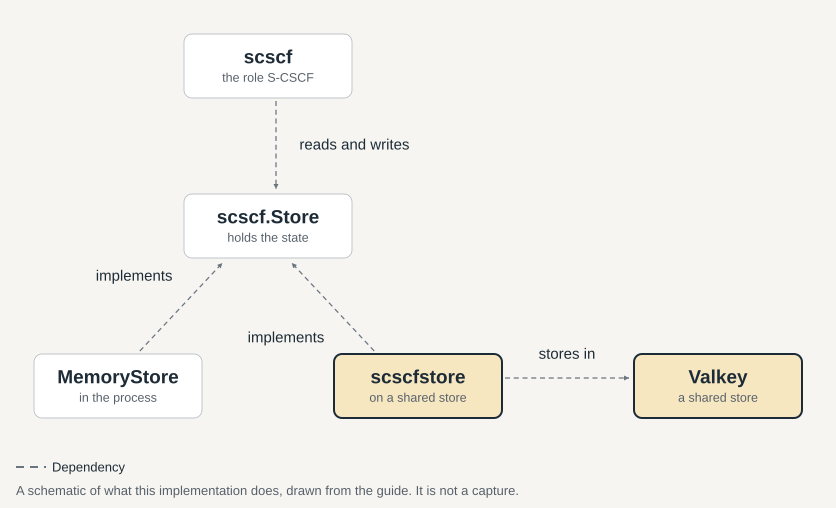

# What several nodes and failures hand over

Once the state is in a shared store, another instance can read the same records. That alone does not hand the work over. To hand the work over, more has to be settled besides the records: which instance the next request reaches, what becomes of the transactions and timers in progress, and whether an instance that stopped can write back later. Sharing the data and taking over the work are separate conditions.

This chapter keeps four cases apart:

1. Sharing the registration.
2. Another instance takes a new request.
3. Another instance carries on a call in progress.
4. Ending what a stopped process left behind.

The answer of this implementation first. The registrations, the expiries that come due and new requests can be taken over by any instance that shares the store. A call in progress at the MMTel AS lives in the process of the instance that took its INVITE, and does not go on when that instance stops. The record of the call in the store serves only to find the other leg of a call from the dialog that a Replaces names. Of the roles in this chapter, only at the IBCF does an instance that is created again under the same name end the calls of the process before it. The store is one server, and when it stops, no instance can read or write its state. This implementation cannot claim to keep calls up through a failure.

This chapter builds on [Registration order and expiry](design-registration-order.md), [iFC and the supplementary services of the MMTel AS](mmtel.md) and Interconnection between networks. It restates what it needs from them.

## The setup of this chapter

`deploy/redundancy/redundancy.yaml` adds one Valkey server to the Compose setup and gives the configuration of each node that holds the state of users a `store` section that points to it. The nodes that hold such state are the HSS, the S-CSCF, the P-CSCF, the IP-SM-GW, the SMS service centre, the MMTel AS, the MRFC and the two media relays. The I-CSCF holds no state of users and does not change. The addresses of the nodes, their configuration and the messages they exchange are those of the Compose setup. Only where each node keeps what it learned changes.



The code of a role reads and writes its state only through the interface `Store`. Without a `store` section, the implementation is `MemoryStore` in the process. With one, the implementation of the role on `internal/kvstore` (`scscfstore` for the S-CSCF) makes the same interface on top of Valkey.

Either way, the Compose setup runs one instance of each role. When a node of the setup with the store is created again under the same name, the new process finds in the store what the process before it left. How several instances of one role share one store is what the Go tests check, by running two instances on one store. The test results in this chapter are those of these tests.

## What the four cases need

| Case | Example | What it needs besides the records | This implementation |
| --- | --- | --- | --- |
| Sharing the registration | Another instance looks up where to send a call. Another instance handles the expiry of a registration | A way to have one instance handle each expiry. A lock per user | Does it |
| Another instance takes a new request | The first instance sends the 401, and the REGISTER with the answer reaches the second | A route to the instance that takes the next request. The S-CSCF name that the HSS keeps | Does it |
| Carrying on a call in progress | A BYE or a re-INVITE of a call in progress reaches an instance in place of the one that stopped | The dialogs, the transactions in progress, the timers, the CSeq of both legs, the relaying between the legs | The MMTel AS does not |
| Ending what a stopped process left | The dialogs of the calls of a stopped process, and their TrGW contexts | Records per instance. Reading them at the start. Enough in them to send a BYE | The IBCF ends them. The MMTel AS leaves its records |

The first two cases mostly need only to read the records; for the last two, the records are not enough. The sections below take them in this order.

## Where the state lives, and for how long

The S-CSCF keeps these keys in the store, each after the prefix of the setup and `scscf:`:

[internal/kvstore/scscfstore/scscfstore.go](../../../internal/kvstore/scscfstore/scscfstore.go)

```go
//	challenge:<private identity>            Challenge, time to live until its KeepUntil
//	registration:<private identity>         Registration, no time to live
//	impu:<public identity>                  index: the private identity of the registration
//	subscription:<Call-ID>:<tags>           Subscription, no time to live
//	subscriptions-of:<private identity>     index: the subscriptions to that registration
//	original-dialog:<identifier>            OriginalDialog, time to live until its Expires
//	unregistered:<private identity>         UnregisteredProfile, no time to live
//	unregistered-impu:<public identity>     index: the private identity of the profile
```

The state that this chapter talks about, by where it lives and how long:

| State | Where | How long | What ends it |
| --- | --- | --- | --- |
| Registration of the S-CSCF | `registration:` in the store | Until the `Expires` of the registration; no time to live | `registrationExpired` at the instance that claims the expiry |
| Authentication in progress at the S-CSCF | `challenge:` in the store | A time to live until `KeepUntil` | The REGISTER with the answer, or `regAwaitAuthExpired` at the instance that claims the expiry |
| Original dialog identifier of the S-CSCF | `original-dialog:` in the store | A time to live of 4 minutes | The store |
| The times of the expiries, and their claims | The time index in the store | A claim lasts 15 seconds | `Done` at the instance that handled it. The claim of a stopped instance runs out |
| Lock per user | `scscf:lock:` in the store | A lease of 15 seconds | The holder releases it, or the lease runs out |
| SIP transaction | The process of the instance | After the last response, until the timer that absorbs retransmissions runs out | The process |
| Dialogs, transactions and no reply timer of a call at the MMTel AS | The process of the instance that took the INVITE | Until the call ends | The process |
| Record of a call at the MMTel AS | `mmtel:call:` in the store | From the 2xx to the end of the call; no time to live | The instance that ends the call. The records of a stopped instance stay |
| Record of a call at the IBCF | In the store, under the name of the instance | From the start of the call to its end | The instance that ends the call, or the one created again under the same name |

A registration of the S-CSCF has no time to live because its end calls for a SAR and a NOTIFY. If it went away by a time to live, nobody would tell the HSS and the subscribers. The instance that claims the expiry reads the registration, removes it, and tells them. For the authentication in progress, the timeout is handled through the time index, and the record itself has a time to live until `KeepUntil`, so that a late handler still finds it and the record goes in the end even when nobody handles it. An original dialog identifier only has to go away, so it has a time to live and nothing else.

## What another instance can carry on once the registration is shared

### Another instance takes the answer

`TestAnotherInstanceNamesTheAssignedSCSCF` in `internal/scscf/instances_test.go` runs two instances of the S-CSCF. They share the store and the lock per user, and each has its own Server-Name, Diameter identity and SIP stack. In the case "challenge answered at the other instance", the first instance answers the first REGISTER with 401, and the REGISTER with the answer reaches the second. It gets 200 OK, and the S-CSCF name that the HSS holds for the user is that of the first instance.

The second instance can go on because the authentication record holds all that the rest of the procedure needs: the nonce and H(A1), the Call-ID of the REGISTER that got the 401, the name of the HSS that sent the MAA, and the Server-Name of the MAR. The HSS takes a SAR under no other name than the one that assigned the user (TS 29.228 8.1.2), so the second instance sends the SAR under the name in the record, not under its own.

### Another instance handles the expiry

The time of an expiry goes into a time index in the store, next to its item. Every second, each instance claims what is due.

[internal/scscf/store.go](../../../internal/scscf/store.go)

```go
	// ClaimDue claims the expiries of kind that are due at now, at most
	// limit of them and the ones due longest first, each until now plus
	// lease. While an expiry is claimed it is not due, and no other
	// ClaimDue gives it out; when its claim runs out without Done, it is
	// due again, for whichever instance asks next.
	//
	// A claim is no proof that the item has expired: it may have been
	// refreshed after it was due, or removed, since the Store does not
	// take the item of a removed registration or profile out of the index
	// (DeleteRegistration). The caller therefore reads the item under the
	// lock of its user and checks its expiry there, as the handlers of
	// the S-CSCF do.
	ClaimDue(ctx context.Context, kind ExpiryKind, now time.Time, lease time.Duration, limit int) ([]Expiry, error)
	// Done takes the item of a claimed expiry out of its index, once the
	// caller has handled it. A claim that has ended in the meantime, by a
	// write that rescheduled the item, by its removal, or because it ran
	// out and another instance has it now, leaves the index as it is;
	// that is the ordinary end of an expiry, not a failure.
	Done(ctx context.Context, e Expiry) error
```

A claimed expiry goes to no other instance. When the instance that claimed it stops without `Done`, another instance claims it again once the claim runs out. A claim does not prove that the expiry has really come: between the claim and the lock, the UE may have refreshed the registration. So the instance that handles it takes the lock of the user, reads the item again and checks the time once more ([Registration order and expiry](design-registration-order.md)).

The tests of `internal/kvstore/scscfstore` check this:

- `TestTwoInstancesHandleARegistrationExpiryOnce`: with two instances sweeping the same store, the expired registration leads to one SAR of TIMEOUT_DEREGISTRATION at the HSS and one NOTIFY at the subscriber.
- `TestAnotherInstanceTakesOverAnExpiryThatWasNotHandled`: the instance that claimed the expiry stops without handling it. The other instance does not handle it before the claim runs out, and handles it after.
- `TestAnExpiryWhoseClaimRunsOutWhileItIsHandled`: the HSS does not answer the SAR, so the claim runs out while the first instance is handling the expiry, and the second instance claims it. The second finds no registration, since the first has already removed it. There is one SAR and one NOTIFY.

This order has a limit. The instance that handles the expiry removes the registration before it sends the NOTIFY and the SAR. If it stops after the removal, neither goes out, and the instance that claims the expiry again finds nothing. The subscribers do not learn of the expiry, and the HSS takes the user for registered until a later SAR. The other order would send the NOTIFY and the SAR again each time the removal failed or the instance stopped before it. This implementation would rather not send than send twice. The table [What this project simplifies](../../guide/en/registration.md#what-this-project-simplifies) of the guide has this point too.

## Finding the instance that takes the next request

### SIP requests

A SIP node finds its next hop in DNS (RFC 3263). An SRV record can list several instances under one name. The stack of this implementation tries the destinations that DNS gives in turn. On a 503, a transport error, or no response at all before Timer B or F, it sends the request to the next destination in a new transaction with another Via branch (RFC 3263 4.3). `TestRequestGoesToTheNextTargetWhenTheFirstIsSilent` and `TestRequestGoesToTheNextTargetAfterA503` in `internal/sip` check these two cases.

This applies to new requests outside a dialog. A request within a dialog goes where the Record-Route and the Contact of the dialog point. The S-CSCF is a proxy that keeps no state of dialogs: it forwards a request within a dialog along the route the dialog already has (RFC 3261 16.12), so any S-CSCF process reached under that name can forward it. The MMTel AS is different, as the next section shows.

### Diameter requests

Requests to the HSS go through the group of HSS instances in the configuration (`diameter.PeerGroup`). The instances appear as one HSS, a server farm (TS 29.228 6.4), and each of them serves every subscriber. A request with no fixed destination therefore goes to the first instance in the configuration whose connection is open. When it does not answer, when its connection closes, or when it answers DIAMETER_TOO_BUSY, the same request goes again to the next instance (RFC 6733 5.5.4). A request with a fixed destination is different.

[internal/diameter/peergroup.go](../../../internal/diameter/peergroup.go)

```go
// serving are the peers of the group that may take a request for host:
// the one peer of that host when the request names one, and all of
// them when it does not. A Diameter identity is an FQDN, which compares
// without case.
//
// SIMPLIFIED: RFC 6733 5.5.4 and TS 29.228 Table 6.1.2.1. Each instance
// of the HSS names itself, so the S-CSCF addresses the requests of a
// registration it has started to the instance that answered its MAR,
// and those requests cannot go to another instance: when that one
// stops, they fail and the user registers again. A commercial network
// keeps them going by letting the instances share one Diameter identity
// behind a load balancer, or by putting an agent in front of them that
// routes on the realm. Neither is built here: the load balancer is
// another node to run and hides which instance answered, and the agent
// is the DRA that the design of the redundancy leaves out.
func (g *PeerGroup) serving(host string) []*Peer {
	if host == "" {
		return g.peers
	}
	for _, p := range g.peers {
		if strings.EqualFold(p.host, host) {
			return []*Peer{p}
		}
	}
	return nil
}
```

The S-CSCF keeps the name of the HSS instance that sent the MAA, and puts it in the Destination-Host of the SARs of that user (TS 29.229 5.5). A request with a Destination-Host reaches that instance only. A registration that has started is therefore bound to the HSS instance that answered its MAR. When that instance stops, the SARs of the registration fail. For a REGISTER, the S-CSCF answers 500 and the user registers again; the MAR of the new challenge has no Destination-Host, so an instance that runs answers it. `TestPeerGroupFailsOverWhenThePeerDoesNotAnswer` in `internal/diameter` checks that a request moves from a silent instance to the next, and `TestPeerGroupKeepsToTheDestinationHost` that a request with a fixed destination does not move to another instance.

## A call in progress lives in the process that took it

The MMTel AS is a B2BUA with two dialogs for each call (TS 24.229 5.7.5): the leg of the INVITE it took from the S-CSCF, and the leg of the INVITE it sends back to the S-CSCF. The two dialogs, the transactions in progress and the no reply timer of CFNR live in the process of the instance that took the INVITE.

[internal/mmtel/mmtel.go](../../../internal/mmtel/mmtel.go)

```go
// uri is the SIP URI of this instance, which both legs of every call
// have as their Contact.
//
// The live handling of a call stays in the instance that took its
// INVITE: the Contact names that instance, and the dialogs, the
// transactions and the no reply timer live in its process. The Store
// keeps the call record outside it, which any instance reads to find
// the other leg of a dialog that a Replaces names (otherSide).
//
// SIMPLIFIED: RFC 3261 12.2.2. A UAS that has restarted may accept a
// request for a dialog it does not know, and carry the dialog on from
// state it kept. An instance of the AS that is created again under the
// same name does not: it builds no dialog from the call records, so
// each request within a call of the earlier process gets 481
// (Call/Transaction Does Not Exist), and the parties are left to end
// the call. A node that is told to stop closes the UA, which ends its
// calls without a BYE, and the goroutine of each call then removes the
// record of the call, but the node does not wait for those goroutines
// (sip.UA.Close leaves them to the user). The record of a call whose
// instance is killed, or whose process exits before that goroutine has
// removed it, stays in the Store with no time to live, as that of a
// call whose BYE no instance sees. Carrying a call on needs the UA to
// take a dialog that it did not set up, with CSeq numbers above any
// that the earlier process sent, and the relaying of each leg's
// requests set up again around it.
func (as *AS) uri() string { return "sip:" + as.cfg.Host + ":" + strconv.Itoa(as.cfg.Port) }
```

The Contact of both legs names this instance. A request within the call (a re-INVITE, a BYE) therefore comes back to the instance that DNS gives for that name, which is the instance that took the INVITE. A B2BUA sends a re-INVITE of one leg as a re-INVITE on the other leg and returns the answer to the first. Both transactions have to be in the same process.

The record of the call in the store, `CallRecord`, holds the two dialogs, the served user, the session case and the services that acted. The AS writes it again once the callee has answered and after each request within the call. It is read in one place only.

[internal/mmtel/conference.go](../../../internal/mmtel/conference.go)

```go
// otherSide is the Replaces that names, for the next hop, the other leg
// of the call of this AS that r names (TS 24.229 5.7.5.1), and false
// when r names no leg of a call here. The error is the failure of the
// store.
func otherSide(ctx context.Context, store Store, r sip.Replaces) (sip.Replaces, bool, error) {
	record, ok, err := store.CallOf(ctx, r.DialogID())
	if err != nil || !ok {
		return sip.Replaces{}, false, err
	}
	other := record.Outgoing
	if record.Outgoing.ID == r.DialogID() {
		other = record.Incoming
	}
	// The UA at the other end of that leg compares to-tag with its own
	// tag, which is the remote tag here (RFC 3891 3).
	return sip.Replaces{CallID: other.ID.CallID, ToTag: other.ID.RemoteTag, FromTag: other.ID.LocalTag, EarlyOnly: r.EarlyOnly}, true, nil
}
```

The input is the Replaces of an incoming INVITE. `CallOf` looks for the record of the call that has the dialog the Replaces names. When it finds one, it makes a Replaces that names the other leg, since that is the dialog the next hop knows (TS 24.229 5.7.5.1). The record is in the store, so an instance that shares the store can make this translation for a call of another instance too. `TestFocusInviteWithReplacesThroughTheAS` in `internal/mmtel/focusrelay_test.go` checks that the AS takes an INVITE with Replaces from a conference focus and rewrites the Replaces to name the other leg, so that the callee finds its own call. The test runs one AS.

### An instance created again does not carry on the calls of the process before it

The UA of an instance created again under the same name does not know the dialogs of the process before it, and answers a request within such a call with 481 (Call/Transaction Does Not Exist). `TestRequestForAnUnknownDialogGets481` in `internal/sip/ua_test.go` checks that the UA answers a BYE for a dialog it does not know with 481 and ends no other call. A party that gets 481 is to end that dialog (RFC 3261 12.2.1.2). The AS does not send that BYE on, so the other party does not get it.

RFC 3261 12.2.2 also lets a UAS that has restarted accept a request for a dialog it does not know, and carry the dialog on. It then has to take care of choosing CSeq numbers above those from before the restart, building the route set again, and more. Carrying on and refusing with 481 are both choices within the standard; this implementation answers 481. Carrying on would need:

- Taking on a dialog it did not set up, from the record: the remote Contact, the route and the CSeq of both directions. The record follows the dialogs, so it has the Contact and the CSeq (`TestRecordFollowsTheDialogs` in `internal/mmtel/relay_test.go`).
- Sending with numbers above any CSeq that the earlier process sent. The earlier process may have sent requests after it wrote the record.
- Setting up the relaying between the two legs again.
- Deciding what becomes of the transactions and timers that were in progress when it stopped. They are not in the record.

### The call goes on when the store stops

There is also a result in the other direction: a call goes on when the store cannot be written. `TestACallThatCannotBeStored` in `internal/mmtel/storefailure_test.go` starts a call while the store is down. The write of the record after the callee answers fails, but the caller gets 200, and the caller's BYE reaches the callee, because the call lives in the process. Without reading the store, though, the AS cannot translate a Replaces. In `TestAnINVITEWhoseReplacesCannotBeRead` an INVITE with Replaces gets 500 and goes no further, since the AS cannot tell whether the dialog that the Replaces names is a leg of one of its calls.

## Ending what a stopped process left behind

The IBCF is the role in which an instance created again ends the calls of the process before it. TS 24.229 5.10.2.2 step 2 and 5.10.3.2 step 2 ask an IBCF that controls the transport plane to save the Contact, the CSeq and the Record-Route of a call, so that it can release the session itself (5.10.2.4, 5.10.3.4).

Each IBCF instance keeps the records of its calls under its own name. A record holds the TrGW context and, once the call is answered, the two dialogs, and it is written again after each request within the call. An instance that starts again under the same name reads its own records before it starts its UAs, and hands them to `ReleaseLeftovers`.

[internal/ibcf/recovery.go](../../../internal/ibcf/recovery.go)

```go
func (b *IBCF) ReleaseLeftovers(records []CallRecord) {
	var wg sync.WaitGroup
	for _, r := range records {
		log := b.log.With("call_record", r.ID, "peer", r.Peer, "direction", string(r.Direction))
		log.Info("ending a call that an earlier process of this instance left")
		if r.Media != nil {
			b.releaseMedia(*r.Media, log)
		}
		for _, d := range []struct {
			s      side
			dialog *sip.Dialog
		}{{b.inside(), r.Home}, {b.outside(), r.PeerSide}} {
			if d.dialog == nil {
				continue
			}
			wg.Add(1)
			go func(s side, dialog sip.Dialog) {
				defer wg.Done()
				b.byeInLeftover(s, dialog)
			}(d.s, *d.dialog)
		}
		if err := b.store.DeleteCall(context.Background(), r.Instance, r.ID); err != nil {
			// The record stays for the next process of the instance,
			// whose BYEs get 481 and whose release finds no context.
			log.Warn("cannot remove the record of the ended call", "error", err.Error())
		}
	}
	wg.Wait()
}
```

For each record it releases the TrGW context, sends a BYE in each of the two dialogs, the one inside the network and the one outside, and deletes the record. `byeInLeftover`, which sends the BYE, sets its CSeq 65536 (`staleSeqGap`) above that of the record, since a request may have gone on after the record was written; the far end takes a request whose CSeq is above the last one it saw (RFC 3261 12.2.2). The record of a call that stopped before it was answered has no dialogs, and only its TrGW context is released. The INVITE of that call gets no final response from the new process and times out.

`TestRestartedInstanceEndsTheCallsItLeft` in `internal/ibcf/network_test.go` checks this. The first process of an instance stops with a call across the border, and the next process starts. The caller and the callee each get one BYE in their dialog, the TrGW contexts of both networks are released, and no record is left. The new process takes new calls. The test runs two ways: with processes that share one `Store` in the program, and with each process making its own `ibcfstore.Store` on a shared store.

This works under some conditions:

- The name of the instance stays the same when it is created again. Each instance reads only the records under its own name, once, when it starts; it does not look through all the calls of the network. The records of an instance that is not created again, with their TrGW contexts, stay until an instance of that name starts. The code states this as a simplification.
- The records can be read. If they cannot, the IBCF does not start, since an instance that took calls without its records would never end the calls of the process before it.
- The records hold enough to send a BYE. That is what the standard asks an IBCF to save.

The MMTel AS neither carries on nor ends the calls of the process before it. The records of the calls of an instance that is killed stay in the store with no time to live.

## When the store itself stops

The store of `deploy/redundancy` is one Valkey server. Nothing makes the store redundant, such as Sentinel or a cluster. The store is a single point of failure: what this setup shows is redundancy of the IMS nodes, not of the store (the simplifications in the [README of internal/kvstore](../../../internal/kvstore/README.md)). The server syncs its writes to an append-only file once a second (AOF).

Each operation on the store has a time limit (one second by default). A role that does not get its state within it answers 500 in SIP, or DIAMETER_UNABLE_TO_COMPLY in Diameter, rather than take the failure for an item that is not there.

| Role | While the store is down | Tests that check it |
| --- | --- | --- |
| S-CSCF | A request that needs state gets 500. So does a REGISTER whose user cannot be locked | `TestRegisterWhenTheLockFails`, `TestInitialRequestsWhenTheStoreFails` |
| S-CSCF | A refresh whose registration cannot be written gets 500. The stored registration stays as it was, and once the store is back a call reaches its Contact | `TestRefreshWhenTheStoreFails` |
| S-CSCF | The handling of an expiry gives up when it cannot read the item, and the expiry is claimed again after the claim runs out. Once the store is back it is handled | `TestAnExpiryIsClaimedAgainWhenTheStoreFails` |
| MMTel AS | A call in progress goes on. An INVITE with Replaces gets 500 | `TestACallThatCannotBeStored`, `TestAnINVITEWhoseReplacesCannotBeRead` |
| IBCF | An instance created again does not start without its records. The instance that starts once the store is back ends the calls of the process before it | `TestAnInstanceThatCannotReadItsCallsDoesNotStart` |

In `TestInitialRequestsWhenTheStoreFails` both an originating and a terminating INVITE get 500, so that the caller is not taken for a user who is not registered (403), and the callee not for one whose profile the S-CSCF has to take from the HSS. In the case of `TestRefreshWhenTheStoreFails`, the S-CSCF has sent the SAR of RE_REGISTRATION before the write. The HSS holds the user as registered at this S-CSCF, and the store still has the registration from before, so the two agree. When the UE sends the refresh again, it goes on from there.

This shows what keeping the state outside costs. With the state in the process, an instance that stops affects nobody on the other instances. With a shared store, the state of the users survives an instance that stops, but when the store stops, every user of every instance that uses it is affected at once. The single point of failure moves from the process to the store.

## Comparing the ways

There are several ways to decide what remains when an instance stops. None is forbidden by the standard, and they can be combined.

| Way | What remains when an instance stops | What it needs | What it loses | When it fits |
| --- | --- | --- | --- | --- |
| State in the process | Nothing | Nothing more, and no round trips to a store | The registrations, authentications in progress, expiries and calls of the users of that instance. A user gets no call until it registers again | One instance, with a new registration accepted when it stops |
| State in an outside store (the redundant setup of this implementation) | Registrations, authentications in progress, expiries, original dialog identifiers, records of calls | Round trips to the store for each request. A lock per user. An order of writes in which a stop half way leaves only a miss. Redundancy of the store itself (not built here) | The calls in progress at a B2BUA, the transactions in progress, the timers of the process. When the store stops, everybody is affected | A setup in which the requests of one user may reach any instance |
| Keep a user or a call at one instance | Nothing of what that instance held, when it stops (unless combined with a store) | A route that brings every request and expiry of the user or call to that instance. A procedure to move them when it stops | The users or calls of that instance | When the network already does so. In IMS the HSS keeps an S-CSCF name for each user, and a call of the MMTel AS is bound to an instance by its Contact |
| Rebuild by registering again | Nothing; the state is built again when the UE registers again | A UE that registers again when a registration fails or the network tells it to | Calls to the user until it registers again, up to the interval between refreshes | Rare failures of instances, with the calls missed meanwhile accepted |

This implementation takes the second way, and for calls a form of the third (a call is bound to the instance that took it). Requests of a registration bound to an HSS instance come back through the fourth when that instance stops. TS 23.380 has restoration procedures by which a network gets back users it lost; this implementation does not build them.

## What this implementation chooses, and its limits

- Instances that share the store take over the registrations, the authentications in progress, the expiries and new requests. One instance handles each expiry, and that instance checks the time again.
- The instance that handles an expiry removes the registration before it tells anyone, so if it stops after the removal, nobody is told.
- The lock per user holds only within its lease, and there is no fencing ([Registration order and expiry](design-registration-order.md)).
- A registration that has started is bound to the HSS instance that answered its MAR. When that instance stops, the user registers again.
- A call in progress at the MMTel AS lives in the process of the instance that took its INVITE and does not go on when that instance stops. An instance created again answers 481, and the records stay. The record in the store serves only to translate a Replaces.
- At the IBCF, an instance created again under the same name ends the calls of the process before it with BYEs and releases their TrGW contexts.
- The store is one server. When it stops, every role that uses it answers its requests with 500.

Neither this implementation nor its tests show calls kept up through a failure. What they show is what the list above says.

## What this account rests on

The account of this chapter was checked against the code and the tests below. Each test was run and passes as a Go test of the repository. The tests of `internal/kvstore` ran on the store in the process; they run on a Valkey server only when the environment variable `KVSTORE_VALKEY_ADDR` is set, which it was not when this chapter was written.

- `TestAnotherInstanceNamesTheAssignedSCSCF` in `internal/scscf/instances_test.go`: another instance takes the answer to the challenge and registers the user, and the HSS keeps the name it assigned first.
- `TestTwoInstancesHandleARegistrationExpiryOnce`, `TestAnotherInstanceTakesOverAnExpiryThatWasNotHandled` and `TestAnExpiryWhoseClaimRunsOutWhileItIsHandled` in `internal/kvstore/scscfstore/instances_test.go`: one instance handles each expiry, and another instance takes over the expiry of an instance that stopped.
- `TestRequestGoesToTheNextTargetWhenTheFirstIsSilent` and `TestRequestGoesToTheNextTargetAfterA503` in `internal/sip/nexttarget_test.go`.
- `TestPeerGroupFailsOverWhenThePeerDoesNotAnswer` and `TestPeerGroupKeepsToTheDestinationHost` in `internal/diameter/peergroup_test.go`.
- `TestFocusInviteWithReplacesThroughTheAS`, `TestRecordFollowsTheDialogs`, `TestACallThatCannotBeStored` and `TestAnINVITEWhoseReplacesCannotBeRead` in `internal/mmtel`.
- `TestRequestForAnUnknownDialogGets481` in `internal/sip/ua_test.go`.
- `TestRestartedInstanceEndsTheCallsItLeft` in `internal/ibcf/network_test.go`, and `TestAnInstanceThatCannotReadItsCallsDoesNotStart` in `internal/ibcf/storefailure_test.go`.
- `TestRegisterWhenTheLockFails`, `TestInitialRequestsWhenTheStoreFails`, `TestRefreshWhenTheStoreFails` and `TestAnExpiryIsClaimedAgainWhenTheStoreFails` in `internal/scscf/storefailure_test.go`.

That an MMTel AS instance created again answers 481 is read from the configuration of the AS, which hands no request for an unknown dialog to the role (it does not use `OnUnknownDialog` of `sip.UAConfig`), and from the test of the UA. No test creates the AS again. The figure is a schematic of this setup, not a capture.

## Run it yourself

You do not need to run anything to read this chapter. How to start the setup with the state in the store, and how to look at the keys in it, is in [The state of the users in a store outside the nodes](../../guide/en/README.md#the-state-of-the-users-in-a-store-outside-the-nodes). How SIP tries one destination after another is in [The P-CSCF finds the I-CSCF and forwards the REGISTER](../../guide/en/registration.md#2-the-p-cscf-finds-the-i-cscf-and-forwards-the-register), and what shows when an IBCF instance is created again is in [When an IBCF instance starts again](../../guide/en/interconnect.md#when-an-ibcf-instance-starts-again). The tests run with, for example, `go test ./internal/kvstore/scscfstore -run TestAnotherInstanceTakesOverAnExpiryThatWasNotHandled`.

The next chapter looks at what the S-CSCF puts first when an application server does not answer. When an application server is not available
