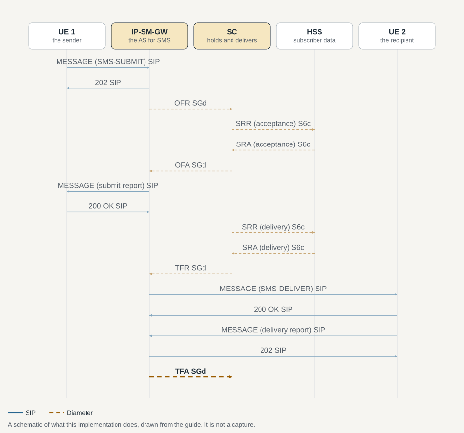

# Retransmitted and duplicated SMS

While a short message crosses the network, four things happen separately: the SC accepts the short message, the answer to that goes back to the sender, the short message is delivered to the recipient, and the report of that goes back to the SC. The four happen between different nodes, at different times. When only an answer or a report is lost, the sender sends again without knowing whether the other end has done the work. If that retransmission is handled as a new request, the same short message is stored twice and delivered twice.

This implementation has three mechanisms that keep the same work from being done twice. The first applies when the IP-SM-GW sends an OFR that got no answer to another SC instance. The SC tells the retransmission by the pair of Origin-Host and End-to-End Identifier, and returns the answer that the first instance left in the store. The second applies when several SC instances try to deliver to the same recipient. A lease per recipient lets only one instance at a time deliver. The third is that the IP-SM-GW ends one delivery only once. Whichever comes first, the delivery report or the end of the wait for it, the SC hears the outcome once.

Each of them is a guarantee with conditions. After a TFR that got no answer, after an SMS-SUBMIT repeated with TP-RD set, after a delivery report that arrives after the IP-SM-GW has stopped waiting, and in some other cases, the recipient may get the same short message twice. This implementation cannot say "delivered exactly once under any failure". This chapter shows, one by one, the conditions under which delivery happens once, and the cases where it does not.

This chapter builds on [Delivering SMS and reporting on it](sms.md) and [What several nodes and failures hand over](design-shared-state.md).

## The setup of this chapter

The example is the `deploy/compose` setup, in which UE 1 sends a short message to UE 2. The nodes are UE 1, the IP-SM-GW, the SC, the HSS and UE 2; the CSCFs are left out. The SC of `deploy/compose` is one instance and keeps what it holds in its process. The `deploy/redundancy` setup keeps that in a store outside the node. The behavior of several instances is checked by tests that have two SC instances share one store.

The chapter cites TS 23.040 V18.0.0 and RFC 6733.

## Four events



From the top of the figure, the four events divide as follows.

| Event | Where it happens | What tells the sender |
| --- | --- | --- |
| Acceptance | The SC reads the OFR, checks the recipient's number with the HSS, and puts the message in the queue | The answer in the next row |
| The answer to acceptance | The SC returns the OFA, and the IP-SM-GW turns it into the RP-ACK of the submit report for UE 1 | The OFA tells the IP-SM-GW, the RP-ACK tells UE 1 |
| Delivery | The SC sends a TFR, and the IP-SM-GW sends the SMS-DELIVER to UE 2 in an RP-DATA | The report in the next row |
| The report of delivery | UE 2 returns the RP-ACK of the delivery report, and the IP-SM-GW turns it into the TFA for the SC. The SC takes the message off the queue | The RP-ACK tells the IP-SM-GW, the TFA tells the SC |

The SIP 202 and 200 are not in this table. They tell only that a MESSAGE reached the next node, not what became of the short message. That it was accepted is told by the submit report, and that it arrived by the delivery report, each in a MESSAGE of its own.

What matters in the table is that the work and its answer are separate. Acceptance is done before the OFA, and delivery before the TFA. Each therefore has a gap in which only the answer can be lost.

## When the work is done and only the answer is lost

When an answer is lost, the sender cannot tell it from a failure. In this setup there are five such cases.

1. **The OFA is lost.** After an SC instance has queued the short message, its connection to the IP-SM-GW breaks. The Diameter layer of the IP-SM-GW sends the OFR that got no answer to another SC instance. The OFR sent again has the T flag set and the same End-to-End Identifier as the first (RFC 6733 5.5.4).
2. **The submit report is lost.** The OFA arrived, but the MESSAGE with the RP-ACK does not reach UE 1. A handset that gets no answer repeats the SMS-SUBMIT with the same TP-MR and TP-RD set (TS 23.040 9.2.3.6). That is a new MESSAGE, and a new OFR.
3. **The TFA is lost.** The IP-SM-GW delivered to UE 2 and got the delivery report, but the TFA does not reach the SC. The SC reads this as a failure that may pass, and tries again later.
4. **The delivery report is late.** UE 2 got the short message, but its delivery report reaches the IP-SM-GW after the time the IP-SM-GW waits (64 seconds in this implementation). The IP-SM-GW has already returned a failure to the SC.
5. **An SC instance stops during an attempt.** After sending a TFR, the instance stops while it waits for the TFA. The IP-SM-GW may have delivered already.

In case 1, what is sent again is a copy of the same Diameter request. In cases 2 to 5, what is sent again is in each case a new request. That difference decides whether the retransmission can be told apart.

Retransmissions on each SIP hop are not the problem of this chapter. When the same MESSAGE is retransmitted over UDP, the SIP transaction layer absorbs it and sends the earlier response again (RFC 3261 17.2). The retransmission does not reach the handling of the IP-SM-GW.

## What tells a retransmission apart

RFC 6733 3 sets the values that tell a copy of the same request: the pair of Origin-Host and End-to-End Identifier. A sender does not use an End-to-End Identifier for another request for at least 4 minutes. A receiver should answer a request with the same pair with the same answer, and the copy must not change any state that the original request set.

The T flag only says that a request may be a copy. The original request may arrive after the copy that was sent again, so a server that uses the flag as a hint must still find copies that arrive in that order (RFC 6733 Appendix C). This implementation does not look at the flag and checks every OFR.

[internal/diameter/duplicate.go](../../../internal/diameter/duplicate.go)

```go
// DuplicateWindow is how long a server keeps the record of a request
// that tells a later copy of it from a new request. A sender keeps each
// End-to-End Identifier unique for at least 4 minutes (RFC 6733 3); a
// record kept longer could take a new request that reuses the
// identifier for a copy of an old one.
const DuplicateWindow = 4 * time.Minute

// DuplicateKey names a request for the check: its Origin-Host, which is
// an FQDN and compares without case, and its End-to-End Identifier
// (RFC 6733 3).
func DuplicateKey(originHost string, endToEnd uint32) string {
	return strings.ToLower(originHost) + ";" + strconv.FormatUint(uint64(endToEnd), 16)
}
```

`DuplicateKey` makes the key that tells requests apart. The Origin-Host is the name of a host, so it compares without case. `DuplicateWindow` is how long the record is kept.

The first thing an SC instance does with an OFR is to begin a record under this key.

[internal/smsc/submit.go](../../../internal/smsc/submit.go)

```go
	request := diameter.DuplicateKey(req.OriginHost, req.EndToEndID)
	expires := now.Add(diameter.DuplicateWindow)
	first, err := c.store.BeginOFR(ctx, request, now, expires)
	if err != nil {
		log.Warn("short message refused: the store failed", "error", err.Error())
		return refusal(sgd.SCCongestion, sms.FCSSCSystemFailure, now)
	}
	if !first {
		return c.answerToCopy(ctx, request, log)
	}
	a := c.takeShortMessage(ctx, req, now, log)
	c.keepOFA(ctx, request, a, expires, log)
	return a
```

`BeginOFR` puts a record that says "this request has begun" in the shared store. When a record with the same key is there already, it changes nothing and returns `false`. However many instances begin the same key at once, only one gets `true`.

Only the instance that got `true` checks the short message and queues it, in `takeShortMessage`. It then writes its answer into the record with `keepOFA`. An instance that got `false` does not touch the short message, and waits for the answer of the first instance in `answerToCopy`. When `BeginOFR` ends in a failure of the store, the SC cannot tell a new request from a copy, and refuses with SC congestion.

## How long the record is kept

Keeping the record longer than 4 minutes causes trouble. When the sender uses the same End-to-End Identifier for a new request after 4 minutes, the SC would take it for a copy and return an old answer to a new short message. As long as the key is the End-to-End Identifier, the record cannot outlast the time for which that identifier is unique.

4 minutes is enough because the senders of this setup send again well within that time. The Diameter layer of the IP-SM-GW fits all the attempts at one request into one Answer timer. The Answer timer of this setup is 5 seconds.

An instance that gets a copy waits for the answer of the first instance up to the same Answer timer.

[internal/smsc/submit.go](../../../internal/smsc/submit.go)

```go
	deadline := time.Now().Add(c.cfg.AnswerTimer)
	for {
		a, ok, err := c.store.OFA(ctx, request, c.clock.Now())
		switch {
		case err != nil:
			log.Warn("the answer to the first copy of the OFR was not read: the store failed", "error", err.Error())
		case ok:
			log.Info("OFR sent again: answered as the first copy was", "result", a.Result.String())
			return a
		}
		if !time.Now().Before(deadline) {
			log.Warn("OFR sent again: refused, the first copy has no answer", "waited", c.cfg.AnswerTimer)
			return refusal(sgd.SCCongestion, sms.FCSSCSystemFailure, c.clock.Now())
		}
		select {
		case <-time.After(copyPoll):
		case <-ctx.Done():
			return refusal(sgd.SCCongestion, sms.FCSSCSystemFailure, c.clock.Now())
		}
	}
```

When the answer is in the record, the copy gets it as it is. While the first instance is still at work, the copy reads again every 50 milliseconds. It waits no longer than the Answer timer because the sender waits no longer than that. An answer returned after it reaches no one.

When the Answer timer passes with no answer, the copy is refused with SC congestion. That happens when the first instance stopped before it answered, or when it takes too long to answer. The first instance may hold the short message already. If the UE that got the refusal sends again, the same short message arrives twice.

There is a reason why the instance that gets the copy does not take the short message over. To take it over, it would have to change the record of the OFR and the recipient's queue in one step. The store of this implementation changes one item at a time, and a queue forgets a short message once it is delivered. So the instance that gets the copy cannot tell a short message that was delivered and left the queue from one that never got into it. This implementation simplifies here. To make a refused copy rare, the first instance tries to write its answer up to 3 times.

The tests check each case of this section.

| Test | Case | What it checks |
| --- | --- | --- |
| `TestOFRSentAgainToAnotherInstance` | A copy reaches another instance while the first waits for the HSS | The copy gets no answer until the first instance answers. The answer to the copy is the same as the first answer, and so is the answer to a copy that comes after. There is only one TFR |
| `TestOFRSentAgainWhileTheFirstHasNoAnswer` | The first instance does not answer for the Answer timer | The copy is not answered before the Answer timer, and is refused with SC congestion after it |
| `TestOFAKeptAfterAStoreThatFailedOnce` | The store refuses the write of the answer once | The answer written again is the answer to the copy. There is only one TFR |

## The right to deliver: the lease

On the side of delivery, instead of a key that tells requests apart, one instance holds the right to deliver. TS 23.040 6.2 does not allow an SC to have more than one SMS-DELIVER without a report outstanding to one MS. However many SC instances there are, only one at a time attempts delivery to each recipient.

That right is the lease.

[internal/smsc/store.go](../../../internal/smsc/store.go)

```go
// for a while. TS 23.040 6.2 allows only one outstanding SMS-DELIVER to
// an MS at a time; the lease is how several instances that share a
// Store keep to that, and how none of them delivers a message that
// another one is delivering.
type Lease struct {
	Destination string
	// Token tells this lease from a later one for the same destination.
	// A Store refuses the calls of a lease that has been taken over.
	Token string
	// Attempts is the number of attempts in a row that failed for a
	// reason that may pass, as the last Release recorded it.
	Attempts int
}
```

The store holds a queue for each recipient, and an index of the recipients in the order of the time each is next due. When an instance claims a recipient, the store makes a new `Token` and moves the time in the index to the end of the lease. To the other instances, the recipient is not due until the lease ends. When the instance has finished an attempt, it releases the lease and writes the next time in the index.

When an instance stops and does not release it, the recipient is due again at the end of the lease, and another instance claims it. The store then makes a new `Token`, so calls made with the old lease are refused.

[internal/smsc/memorystore.go](../../../internal/smsc/memorystore.go)

```go
func (s *MemoryStore) leased(l Lease) (*destination, error) {
	d, ok := s.destinations[l.Destination]
	if !ok || d.token != l.Token {
		return nil, ErrLeaseLost
	}
	return d, nil
}
```

Reading the queue, removing a short message and releasing the lease all go through this check. An old instance that comes back late cannot change the queue of the instance that took over.

But the `Token` stops only calls to the store. A TFR that the old instance has already sent cannot be called back. So for only one instance to deliver, an attempt has to end within its lease. The SC gives the attempt itself a limit shorter than the lease.

[internal/smsc/deliver.go](../../../internal/smsc/deliver.go)

```go
	// The SC has to release the lease before it runs out.
	ctx, cancel := context.WithTimeout(ctx, c.cfg.Lease*9/10)
	defer cancel()
```

The lease is 3 minutes by default, so an attempt is cut off at 2 minutes 42 seconds. One attempt holds the routing query to the HSS and the TFR. The IP-SM-GW does not return the TFA until the UE's delivery report comes, so the SC waits up to 90 seconds for the TFA. That is the 66 seconds that the IP-SM-GW may take to answer a TFR (its 64 seconds for the delivery report, 1 second for the sweep and 1 second for the store), plus 24 seconds for the Diameter round trip and the answer that the IP-SM-GW writes (`scAnswerTimeout` in [cmd/ims/sc.go](../../../cmd/ims/sc.go)). The lease has to be longer than that.

The end of a lease is a time that the instance that claimed it wrote by its own clock. Other instances judge by their own clocks whether that time has passed. When the clocks of the instances differ, the lease gets that much shorter or longer.

The tests check the following.

| Test | Case | What it checks |
| --- | --- | --- |
| `TestTwoInstancesDeliverOnce` | A short message whose first attempt failed becomes due on two instances at once. The MME holds the TFR | Only the instance that claimed first sends a TFR. The other does nothing, as the recipient is under a lease. The TFRs are two: the first attempt and one retry |
| `TestLeaseTakenOver` | The first instance stops while it holds the recipient | During the lease, the second instance sends no TFR. It sends one after the lease ends |
| `TestAStoppingInstanceLeavesItsAttemptToAnother` | An instance is stopped while it waits for a TFA | The stopped instance does not count the attempt, and makes the recipient due at once. An instance in service delivers without waiting for the end of the lease |

The last test includes a case of duplication. An instance that stops cuts the attempt under way short.

[internal/smsc/deliver.go](../../../internal/smsc/deliver.go)

```go
	o := c.attempt(c.life, head, len(live) > 1, log)
	after := c.clock.Now()
	next, attempts := after, 0
	switch {
	case o.kind == temporaryFailure && c.stopped():
		// The stop of this instance cut the attempt short, or came as it
		// failed. Neither tells when the recipient can take the message,
		// so the attempt is not counted, and the destination is due at
		// once for an instance in service rather than at the next retry.
		// The serving node may have delivered a TFR that the stop cut, and
		// the recipient then gets the message twice.
		attempts = l.Attempts
		log.Info("delivery attempt cut short by the stop of the SC; an instance in service takes it at once", "reason", o.reason)
```

A stop tells nothing about when the recipient can take the message. So the attempt is not counted, and the recipient is due at once. But if the IP-SM-GW had already delivered the TFR that the stop cut, the next attempt by the instance in service makes the recipient get the same short message twice. This implementation prefers a message that arrives twice to a message that waits. The test checks only that the instance in service delivers at once, not how many copies the recipient got.

## The IP-SM-GW ends a delivery once

The IP-SM-GW returns the outcome of a delivery to the SC. It too keeps the state of a delivery under way in a store that all its instances share, because the delivery report may reach an instance other than the one that sent the MESSAGE. Three things may try to end one delivery: the UE's delivery report, the response to a MESSAGE that failed, and the end of the wait for the report. Whichever comes first, the SC hears the outcome only once.

[internal/ipsmgw/deliver.go](../../../internal/ipsmgw/deliver.go)

```go
func (g *IPSMGW) endDelivery(ctx context.Context, callID string, outcome Outcome, log *slog.Logger) error {
	d, ok, err := g.store.TakeDelivery(ctx, callID)
	if err != nil {
		return err
	}
	if !ok {
		return nil
	}
	log.Info("delivery ended", "outcome", outcome.String())
	g.reportNow(ctx, d.Reference, d.OverSGd, outcome, log)
	return nil
}
```

`TakeDelivery` reads the delivery and removes it in one step. However many instances call it at once, only the first gets the delivery. A call that does not get it returns and does nothing. `TestDeliveryReportToAnotherIPSMGW` checks the case where two IP-SM-GWs share a store and the delivery report reaches the one that did not send the short message. The instance that got the report ends the delivery and reports it delivered, and nothing comes from the other instance.

A delivery that has ended is gone from the store. A delivery report that arrives after that cannot find its delivery.

[internal/ipsmgw/message.go](../../../internal/ipsmgw/message.go)

```go
	if !ok {
		// Item a: the IP-SM-GW sent no such short message, or has
		// already ended its delivery.
		log.Info("delivery report for no pending delivery")
		g.respond(st, 488, nil)
		return
```

The IP-SM-GW answers 488 and tells the SC nothing. If the delivery ended because the wait ran out, the SC has already heard of a failure and will try again later. UE 2 then gets the same short message once more. `TestFailedMessageEndsTheDelivery` checks that a report arriving after its delivery has ended is answered 488. `TestNoDeliveryReportEndsTheDelivery` checks that when the wait passes with no report, the SC hears of a failure.

The IP-SM-GW also tells copies of a TFR apart. When a TFR with the same Origin-Host and End-to-End Identifier arrives, it begins no delivery of its own and answers with the outcome of the delivery that the first TFR began (`TestTFRSentAgainToAnotherInstance` in `internal/ipsmgw/sgd_test.go`). But the SC of this network sends no copies of a TFR. The options below take this up.

## The limits in one table

These are the limits that came up in this chapter. The values are the defaults of this implementation.

| Limit | Length | What it is for | When it passes |
| --- | --- | --- | --- |
| The record of an OFR | 4 minutes | Telling a retransmission apart | A request with the same key is a new request |
| The wait of a copy for the first answer | The Answer timer (5 seconds in this setup) | Answering while the sender still waits | The copy is refused with SC congestion |
| The lease | 3 minutes | Only one instance at a time delivers | Another instance claims the recipient |
| One attempt | 9/10 of the lease (2 minutes 42 seconds) | Ending the attempt within the lease | Tried again, as a failure that may pass |
| The SC's wait for the TFA | 90 seconds (66 seconds and a margin of 24) | Waiting longer than the IP-SM-GW waits for the delivery report | Tried again, the same way |
| The IP-SM-GW's wait for the delivery report | 64 seconds | Waiting for the UE's report | A failure goes to the SC. A report that comes late is answered 488 |
| The validity period | The TP-VP of the SMS-SUBMIT, or 72 hours without one | The time the SC is responsible for the message (TS 23.040 6.1) | The message is discarded, and a status report tells the sender if it asked for one |
| The interval between retries | 30 seconds, 2 minutes, 10 minutes, 1 hour, and every hour after that by default. `deploy/compose/sc.yaml` of this setup uses 1 hour | Left to the operator by the standard (TS 23.040 3.2.7 NOTE 5) | The next attempt |

Note that there are two kinds of limit. The limit for telling duplicates apart (the 4 minutes of the record) has to be short, because it cannot outlast the time for which the key is unique. The limit of responsibility (the validity period) may be long, because it is the time the SC holds the short message. The two are separate, and the SC goes on holding the short message after the record is gone.

`TestValidityPeriodExpires` checks the end of the validity period. A short message whose TP-VP asks for 5 minutes is discarded when the 5 minutes end, without waiting for the next retry. The sender gets a status report that says the validity period expired, and no further TFR goes to the recipient.

## The conditions under which this implementation delivers once

To sum up: in this implementation, one SMS-SUBMIT reaches the recipient once when all of the following hold.

The conditions on the side of acceptance:

- What is sent again is a copy of the same OFR, sent by the Diameter layer of the IP-SM-GW, with the same Origin-Host and End-to-End Identifier as the first, arriving within 4 minutes.
- The instance that got the first OFR has written its answer into the store within the Answer timer after the copy arrived. If not, the copy is refused, and a retransmission by the UE is a new short message.
- The UE does not repeat the SMS-SUBMIT. A repeated SMS-SUBMIT is accepted as a short message of its own, even with TP-RD set.
- The store does not fail after the short message is queued. With a shared store, when a write after the queueing fails, the SC returns a failure to the UE. If the UE sends again, the message arrives twice.

The conditions on the side of delivery:

- The SC instances share the same store, and one attempt ends within its lease. The clocks of the instances agree within that margin.
- No SC instance stops in the middle of an attempt.
- The TFA reaches the SC. If it does not, the next attempt is a new TFR, which does not ask the IP-SM-GW whether the message was delivered.
- UE 2's delivery report arrives within the 64 seconds the IP-SM-GW waits.

This is a claim limited to kinds of failure. For example, it covers an OFA lost to a failover of the connection, but not a lost TFA. "It retransmits, so it is reliable" does not follow; one has to say, place by place, which loss of an answer is told apart.

## The options, and when each fits

There are ways to reduce duplicates further without changing the protocol. Each uses values the standards already provide.

| Option | Duplicates it prevents | What it needs | Limits |
| --- | --- | --- | --- |
| The current way: telling Diameter copies by Origin-Host and End-to-End Identifier | The OFR sent again after a lost OFA | A record of the key for 4 minutes in the shared store | Does not tell apart a retransmission that is a new request |
| Handling TP-RD at the SC (TS 23.040 9.2.3.6, 9.2.3.25) | The SMS-SUBMIT a handset repeats after a lost submit report | A record in the store that finds the earlier SMS-SUBMIT by sender and TP-MR | Only handsets that set TP-RD. TP-MR wraps from 255 to 0 |
| Sending a TFR that got no answer again, with the same End-to-End Identifier and the T flag (RFC 6733 3, 5.5.4) | The delivery after a lost TFA | The request and its identifier kept with the queue | Only retransmissions within 4 minutes. A later retry is a new request |
| Leaving it to the recipient's handset (TS 23.040 3.1) | A second SMS-DELIVER that reached the recipient | The handset compares the sender's number and the TP-SCTS | Depends on the handset. Duplicates inside the network do not go down |
| A store that can change the record of the OFR and the queue in one step | The copy of an OFR after the first instance stopped without answering | A store that changes several items together | Narrows the choice of store |
| Pinning the SC to one instance | Two instances delivering to the same recipient | Neither a lease nor a shared store | While the instance is down, what it holds waits until it is back. An OFR has nowhere to be sent again, and an OFR whose answer is lost becomes a retransmission by the UE |

The second option is behavior the standard asks for. A handset that gets no answer repeats the SMS-SUBMIT with the same TP-MR and TP-RD set (TS 23.040 9.2.3.6). The SC should discard an SMS-SUBMIT with TP-RD set that has the same TP-MR as the previous one from the same sender. When it discards one, it answers with an RP-ERROR that carries an SMS-SUBMIT-REPORT whose TP-FCS is `SM Rejected – Duplicate SM`. For compatibility with older handsets, an SC may also be set to answer with an RP-ACK. This implementation does not handle TP-RD, because the UE of this project neither sets TP-RD nor repeats. In a network with handsets that set TP-RD, this option fits first.

For the third option, the IP-SM-GW side is already there. When the IP-SM-GW gets a copy of a TFR with the same pair, it begins no delivery of its own and answers with the outcome of the first TFR's delivery (`TestTFRSentAgainToAnotherInstance` in `internal/ipsmgw/sgd_test.go`). What is missing is on the side of the SC. The current SC has whichever instance holds the recipient at the time make a new TFR for each attempt. To send a copy, the request and its identifier would have to be kept in the store with the queue, and an instance that takes over the lease would have to use them. It fits a network where failovers of connections often lose TFAs.

The fourth option is the last line of defense, outside the network. The SC sets the TP-SCTS when it accepts the short message and keeps it in the queue as it is. The SMS-DELIVER of every attempt has the same sender's number and the same TP-SCTS, and the recipient's handset can tell the second one by that (TS 23.040 3.1 asks the receiving side to look at other values too in deciding whether to discard it). The UE simulator of this project does not compare them, and records each message it gets.

The length of the lease is the same kind of choice. A shorter lease lets another instance take over the recipients of a stopped instance sooner, but a slow attempt outlasts it more easily, and the risk that two instances deliver grows. A longer lease does the opposite. This implementation chooses 3 minutes, the longest wait for a TFA plus a margin, and cuts an attempt off at 9/10 of the lease so that no attempt outlasts it.

## What this explanation rests on

The explanation of this chapter was checked against the following code and tests. Each test was run and passes as a Go test of this repository.

- `TestOFRSentAgainToAnotherInstance`, `TestOFRSentAgainWhileTheFirstHasNoAnswer` and `TestOFAKeptAfterAStoreThatFailedOnce` in `internal/smsc/smsc_test.go`: copies of an OFR.
- `TestTwoInstancesDeliverOnce`, `TestLeaseTakenOver` and `TestAStoppingInstanceLeavesItsAttemptToAnother` in `internal/smsc/smsc_test.go`: the lease and taking it over.
- `TestValidityPeriodExpires` in `internal/smsc/smsc_test.go`: the end of the validity period.
- `TestTFRSentAgainToAnotherInstance` in `internal/ipsmgw/sgd_test.go`: a copy of a TFR is answered with the outcome of the first delivery.
- `TestDeliveryReportToAnotherIPSMGW` in `internal/ipsmgw/deliver_test.go`: a delivery report that reaches another instance ends the delivery, and the outcome is told once.
- `TestFailedMessageEndsTheDelivery` and `TestNoDeliveryReportEndsTheDelivery` in `internal/ipsmgw/deliver_test.go`: the 488 to a report after its delivery has ended, and the end of a delivery when the wait for the report passes.

These tests run two SC instances that share one store in the process. For the store kept outside the node, `TestConformance` in `internal/kvstore/smscstore/smscstore_test.go` checks the implementation from two instances against the same contract: one lease at a time per recipient, taking over after a lease runs out, beginning one OFR only once, the first answer reaching the copy, and records going away at their expiry, among others. The cases of a message arriving twice are behavior read from the code and comments quoted above; no test counts how many copies a recipient got. The figure is a schematic drawing of this setup made from the guides, not a capture.

## Run it yourself

The steps to see the exchange of a short message in a capture are in the guide's [Sending and delivering](../../guide/en/sms.md#sending-and-delivering-hello-ue-b-this-is-ue-a). The same guide explains the OFR sent again in [5](../../guide/en/sms.md#5-the-ip-sm-gw-hands-the-short-message-to-the-sc-ofr-srr-and-ofa), the TFR sent again in [8](../../guide/en/sms.md#8-the-sc-forwards-the-message-and-the-ip-sm-gw-delivers-it-tfr-and-sms-deliver), and what happens when an SC instance is taken out of service in [Take the Service Centre out of service](../../guide/en/sms.md#take-the-service-centre-out-of-service). You can run the tests with `go test ./internal/smsc -run 'TestOFRSentAgain|TestTwoInstancesDeliverOnce|TestLeaseTakenOver'`. In the slides, the scene "The shape of the whole: six MESSAGEs" of the [SMS deck](../../../slides/decks/en/06-sms.md) shows the four events of this chapter in steps.
