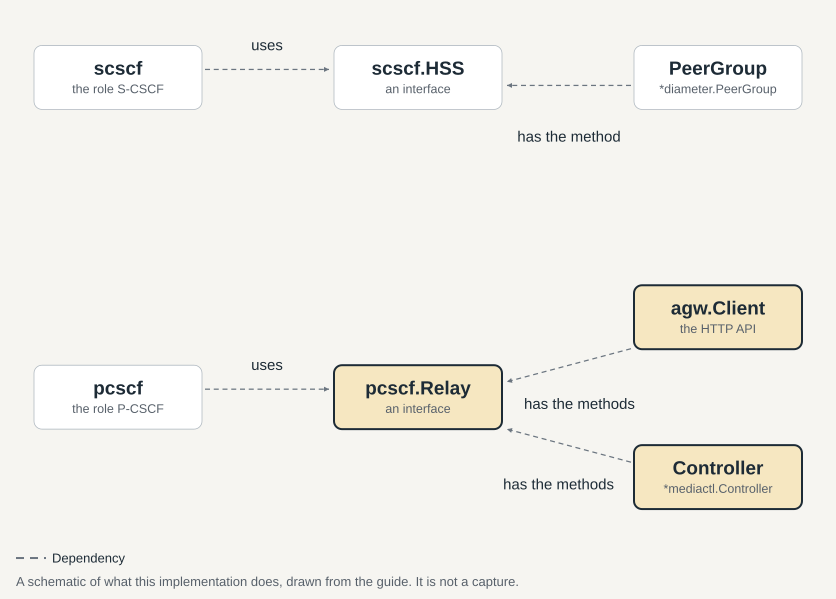
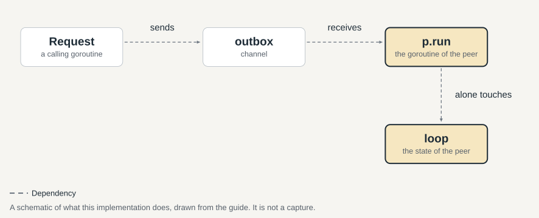
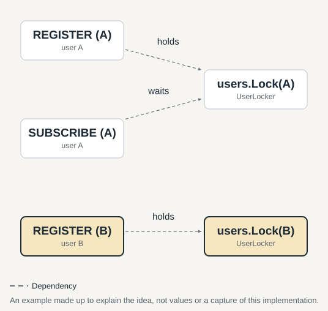
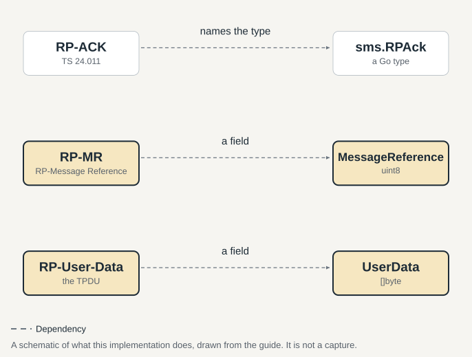

# Go for reading the code

This appendix is optional. The chapters of the book are written so that their figures and text carry them without any Go. For those who want to read the excerpts of code themselves, it explains the Go that this repository uses, one excerpt at a time.

It is not an introduction to Go. It explains only what is needed to follow the excerpts. To learn Go itself, the official [A Tour of Go](https://go.dev/tour/) and [Effective Go](https://go.dev/doc/effective_go) are the way in.

## What this appendix covers

The version of Go is 1.27.4, as in the `go.mod` of the repository. Every excerpt is the lines of a file of the repository as they are. In order, the appendix takes the shape of the code (packages, names, test files), what you meet on every page (structs, interfaces, errors, context, goroutines, locks, bytes), how to read the tests, and how to follow a package shaped like its specification.

## One directory, one package

Every `.go` file of a directory starts with the same `package` line. An import path is the `module` of `go.mod` followed by the directory, such as `github.com/yuu-biz/ims-practice/internal/sms`. The packages under `internal/` cannot be imported from outside this module.

The comment right before the `package` line describes the package. The package of an executable is `package main`, and the function `main` is its entry.

[cmd/ims/main.go](../../../cmd/ims/main.go)

```go
// Command ims is one IMS node. Its roles come from the configuration
// file, so the same binary and image serve as HSS, I-CSCF,
// S-CSCF, P-CSCF, or several of them at once.
package main
```

`cmd/ims` is one IMS node. As the comment says, the configuration file decides which roles it takes: the same executable is an HSS or an I-CSCF. Inside the package of a role, each procedure has a file of its own (in `internal/scscf`, `scscf.go` is registration and `session.go` calls). That is not a rule of Go but a habit of this repository.

## The first letter of a name, and doc comments

A name that starts with a capital letter can be used from outside its package. A name that starts with a small letter is used only inside it. In `internal/sms`, `ParseRP` and `RPAck` can be used from outside, and `decoder` and `maxTPDU` only inside. The comment right before a declaration describes the name: its doc comment.

[internal/sms/rp.go](../../../internal/sms/rp.go)

```go
// ParseRP reads the body of a SIP MESSAGE whose Content-Type is
// application/vnd.3gpp.sms. The result is one of the RP message types;
// a type switch tells which.
func ParseRP(b []byte) (RPMessage, error) {
```

`ParseRP` reads the body of a SIP MESSAGE whose Content-Type is `application/vnd.3gpp.sms`, and returns one of the types of RP messages. Which type it was, the caller finds with a type switch, as a later section shows. The comments are in English and name the specifications, so that the readers of the English and the Japanese guides read the same code.

## Structs and methods

Go has no classes and no inheritance. A struct type is declared, and methods are given to that type.

[internal/rtp/rtp.go](../../../internal/rtp/rtp.go)

```go
type Packet struct {
	Marker         bool
	PayloadType    uint8
	SequenceNumber uint16
	Timestamp      uint32
	SSRC           uint32
	Payload        []byte
}
```

`Packet` is one RTP packet. Its field names are the terms of RFC 3550. A method can take its receiver in two ways.

[internal/rtp/telephoneevent.go](../../../internal/rtp/telephoneevent.go)

```go
func (r *DTMFReceiver) Report(timestamp uint32, e TelephoneEvent) (rune, bool) {
```

`(r *DTMFReceiver)` is a pointer receiver: the method changes what `r` points to, the reports received so far. `func (p Packet) Marshal() []byte`, in a later section, has a value receiver and works on a copy of `p`. It changes nothing, so a copy is enough.

A role is written with methods too. The S-CSCF is a value of type `*SCSCF`, and the 401 of SIP Digest comes from the last lines of its method `challenge`.

[internal/scscf/scscf.go](../../../internal/scscf/scscf.go)

```go
	s.respond(st, 401, func(r *sip.Message) {
		r.Add("WWW-Authenticate", sip.Challenge{Realm: ch.Realm, Nonce: ch.Nonce, Stale: stale, Algorithm: algorithm, QOP: []string{qop}}.String())
	})
```

The third argument of `s.respond` is a function. It is called while the response is built, and adds the WWW-Authenticate header. The 401 of IMS AKA is returned in the same way in `internal/scscf/aka.go` of the same package.

## Small interfaces

An interface is a type that names a set of methods. In Go, a type that has those methods satisfies the interface without declaring anything.

[internal/scscf/scscf.go](../../../internal/scscf/scscf.go)

```go
// HSS is how the S-CSCF reaches the HSS over Cx.
// *diameter.PeerGroup, the instances of the HSS, is one.
type HSS interface {
	Request(ctx context.Context, request *diam.Message) (*diam.Message, error)
}
```

All the S-CSCF sees of the HSS is the method `Request`. `*diameter.PeerGroup`, the set of HSS instances, has a method `Request`, so it can be passed as a `scscf.HSS` as it is. A test can pass a type of its own with the same method.



All the P-CSCF sees of the media relay is the interface `Relay` of `session.go`. Its methods are `Add`, `Modify` and `Subtract`, after the commands of H.248. Two types have these three. `*agw.Client` in `internal/agw/api.go` talks to the HTTP API of the relay, and `*mediactl.Controller` of the package `internal/h248/mediactl` talks H.248. The latter type is declared in `controller.go`, with `Add` and `Modify` in `controller_mp.go` and `Subtract` in `controller_relay.go`.

[internal/pcscf/relay_test.go](../../../internal/pcscf/relay_test.go)

```go
var (
	_ pcscf.Relay = (*agw.Client)(nil)
	_ pcscf.Relay = (*mediactl.Controller)(nil)
)
```

These two lines check at build time that both types satisfy `Relay`. `(*agw.Client)(nil)` is a nil value of that type. If either type loses a method, this test file no longer builds. An interface is put only where a part is to be replaced, in the package that uses it.

### Interfaces and the type switch

[internal/sms/rp.go](../../../internal/sms/rp.go)

```go
type RPMessage interface {
	MTI() RPMTI
	Marshal() ([]byte, error)
}
```

There are five kinds of RP messages, each a type of its own, and all of them satisfy `RPMessage`. `ParseRP` returns this interface, and the caller tells the actual type apart.

[internal/ipsmgw/message.go](../../../internal/ipsmgw/message.go)

```go
	switch m := rp.(type) {
	case sms.RPDataMSToNetwork:
		g.submit(req, sender, m, log)
	case sms.RPSMMA:
		g.memoryAvailable(req, sender, m, log)
	case sms.RPAck, sms.RPError:
```

`switch m := rp.(type)` branches on the actual type of `rp`, and inside each `case` `m` has that type. An RP-DATA from the UE to the network goes to `submit`, an RP-SMMA to `memoryAvailable`. To take out one type alone, write `s, ok := tpdu.(Submit)`. Without `ok`, a wrong type stops the program with a panic.

## Errors are values

Go has no exceptions. A failure is returned as the last result, an `error`.

[internal/diameter/peer.go](../../../internal/diameter/peer.go)

```go
var ErrPeerUnavailable = fmt.Errorf("diameter: peer is not available, so %w", errNotSent)
```

[internal/diameter/peer.go](../../../internal/diameter/peer.go)

```go
		return nil, fmt.Errorf("no answer to %s: %w", commandName(request), ctx.Err())
```

The `%w` of `fmt.Errorf` wraps one error in another. The wrapping error is another value, so `==` does not compare them, but `errors.Is` and `errors.As` find the error inside. `ErrPeerUnavailable` wraps `errNotSent`, which says that the request was not sent. The set of HSS instances learns this with `errors.Is`, and since nothing went out yet, it sends the same request to the next instance.

[internal/ue/aka.go](../../../internal/ue/aka.go)

```go
		var failure aka.SynchronisationFailure
		switch {
		case errors.Is(err, aka.ErrMACFailure):
```

[internal/ue/aka.go](../../../internal/ue/aka.go)

```go
		case errors.As(err, &failure):
```

The UE checks the challenge of IMS AKA and branches on the kind of failure. `errors.Is` compares a value; `errors.As` looks for a type and takes it out. The `failure` taken out holds an AUTS, which the UE sends to the network so that the HSS can set the SQN (sequence number) right again.

## context.Context: when to stop waiting

A function that waits takes a `ctx` as its first argument. A `ctx` closes the channel `ctx.Done()` when it is cancelled or when its deadline comes.

[internal/diameter/peer.go](../../../internal/diameter/peer.go)

```go
func (p *Peer) Request(ctx context.Context, request *diam.Message) (*diam.Message, error) {
	ctx, cancel := context.WithTimeout(ctx, answerTimeout(ctx, p.node.timers))
	defer cancel()
	out := &outgoing{message: request, answer: make(chan answerResult, 1)}
	select {
	case p.outbox <- out:
	case <-p.done:
		return nil, ErrPeerUnavailable
	case <-ctx.Done():
		// The loop never took the request, so it is still here and nothing
		// of it went out on the connection.
		return nil, fmt.Errorf("diameter: the peer did not take the %s, so %w: %w", commandName(request), errNotSent, ctx.Err())
	}
```

`Request` puts a limit on the wait for a Diameter answer, and `defer cancel()` cleans up when the function returns. `select` takes the first of several channels that is ready: here "the goroutine of the peer took the request", "the peer has ended" and "time is up". When time is up nothing has been sent yet, and `errNotSent` says so. `answerTimeout` returns the Answer timer of the node, or a different deadline if the caller put one in `ctx`.

A context is used only for cancellation and deadlines, never to pass values. `cmd/ims/main.go` uses `signal.NotifyContext` to cancel the context of the whole node when it receives SIGTERM.

## Goroutines and channels



[internal/diameter/peer.go](../../../internal/diameter/peer.go)

```go
func (n *Node) Connect(peer PeerConfig) *Peer {
	p := n.newPeer(peer.OriginHost)
	p.address = peer.Address
	go p.run(NewInitiatorState(peer.OriginHost, n.applications), Start{}, nil)
	return p
}
```

[internal/diameter/peer.go](../../../internal/diameter/peer.go)

```go
// loop is the state the I/O loop owns. Only the peer's goroutine
// touches it.
type loop struct {
```

A function called with `go` runs alongside, in a goroutine of its own. `Connect` starts the goroutine of the peer, `p.run`, for each connection. Only that goroutine touches the state of the Diameter peer (`loop`). Other goroutines ask through channels (`inbox` and `outbox`), as `Request` of the previous section does. That is why this state needs no lock. `p.run` runs the state machine of the peer of RFC 6733, and the transitions themselves are the function `Transition` in `internal/diameter/fsm.go`. They are kept apart from the I/O, so that the transitions alone can be tested.

## A lock per user, none for the whole role



[internal/scscf/scscf.go](../../../internal/scscf/scscf.go)

```go
	// users serializes what happens to one user's registration and the
	// subscriptions to it, so that the NOTIFYs of a user go out in the
	// order of the events. Each user has a lock of its own, so that a
	// Cx round trip of one user never holds up another.
	users ims.UserLocker
```

[internal/scscf/scscf.go](../../../internal/scscf/scscf.go)

```go
	unlock, err := s.users.Lock(ctx, privateID)
	if err != nil {
		s.lockFailed(st, err, log)
		return
	}
	defer unlock()
```

The S-CSCF handles what happens to one user in turn, under the lock of that user, so that the NOTIFYs go out in the order of the events. `Lock` waits until the lock is free and returns the function that releases it, which `defer` calls at the end of the function.

`Lock` returns an error in two cases: when `ctx` ends while it waits, and, with the lock in a shared store, when the store fails. Either way nothing is held, and `lockFailed` answers the request with a 500. Two types satisfy `UserLocker`: `UserLocks` in `internal/ims/locks.go`, inside one process, and the lock of `internal/kvstore/kvlock`, which uses the shared store.

Since there is a lock per user, the Cx round trip of one user never holds up another. No lock holds up a whole role, and nothing walks over all subscribers: either would keep a role from growing to many instances and many users. The `sync.Mutex` of the `MemoryStore` is held only while it reads or writes its maps, never during a Cx round trip.

## Generics only for small tools

[internal/ims/expiry.go](../../../internal/ims/expiry.go)

```go
type DueIndex[M comparable] struct {
	heap    dueHeap[M]
	entries map[M]*dueEntry[M]
}
```

`[M comparable]` is a type parameter. One definition makes an index whose element type is all that differs. The S-CSCF orders the items whose time comes by a struct of its own, and the IP-SM-GW orders the deliveries that wait for a report by their Call-ID, a string.

[internal/scscf/store.go](../../../internal/scscf/store.go)

```go
	due map[ExpiryKind]*ims.DueIndex[dueItem]
```

[internal/ipsmgw/store.go](../../../internal/ipsmgw/store.go)

```go
	reportTimeout *ims.DueIndex[string]
```

The other uses are small functions too, such as `lookup[K comparable]` in `internal/rx` or the test helper `roundTrip[T any]`. Of the newer forms, the built-in `min(a, b)` (in `register` of `scscf.go`) and `for range endReports`, a loop that runs a number of times (in `internal/rtp/telephoneevent.go`), show up as well.

## Building bytes

[internal/rtp/rtp.go](../../../internal/rtp/rtp.go)

```go
func (p Packet) Marshal() []byte {
	b := make([]byte, headerLen+len(p.Payload))
	b[0] = version << 6
	b[1] = p.PayloadType & 0x7f
	if p.Marker {
		b[1] |= 0x80
	}
	binary.BigEndian.PutUint16(b[2:], p.SequenceNumber)
	binary.BigEndian.PutUint32(b[4:], p.Timestamp)
	binary.BigEndian.PutUint32(b[8:], p.SSRC)
	copy(b[headerLen:], p.Payload)
	return b
```

`make([]byte, n)` makes bytes of length n. `b[2:]` is a window onto the same array from the third byte on; it copies nothing. `binary.BigEndian` writes the most significant byte first, the order of the network. Bytes 0 to 11 fill in the order of the header figure of RFC 3550 5.1. The top two bits of the first byte are the version, and `version << 6` puts 2 there.

If this one line were broken, how would the tests tell? The test checks the first two bytes of the packet it builds.

[internal/rtp/rtp_test.go](../../../internal/rtp/rtp_test.go)

```go
func TestRoundTrip(t *testing.T) {
	p := Packet{Marker: true, PayloadType: 0, SequenceNumber: 65535, Timestamp: 160, SSRC: 0xdeadbeef, Payload: []byte{1, 2, 3}}
	b := p.Marshal()
	if b[0] != 0x80 || b[1] != 0x80 {
		t.Errorf("first bytes %#x %#x, want V=2 and M set", b[0], b[1])
	}
```

When the author changed `version << 6` to `version << 5` and ran the tests of `internal/rtp`, `TestRoundTrip` failed in two places. The `t.Errorf` above printed `first bytes 0x40 0x80, want V=2 and M set`, and the `Unmarshal` after it refused with `rtp: version 1, want 2`. Shifted by five bits, 2 becomes 0x40, whose top two bits read as 1. `t.Errorf` records a failure and goes on with the test; `t.Fatal` stops the test there.

`Unmarshal`, the reading side, checks the length and reads the same positions. `internal/sms` grows its bytes with `append`, and reads them with a small type, `decoder`, that keeps the first error for one check at the end.

## Test files

A file whose name ends in `_test.go` is built only by `go test`. A test function starts with `Test` and takes a `*testing.T`. A test in `package sms` can use the names inside the package too. `internal/ue/ue_test.go` is `package ue_test`, written the way a user from outside would use the package.

### Examples

A function that starts with `Example` is a test that compares its standard output with the lines after `// Output:`. It is a sample of use and a test at once. It fails on a single different character, so the sample cannot go stale.

[internal/sms/rp_test.go](../../../internal/sms/rp_test.go)

```go
	s := tpdu.(Submit)
	text, _ := DecodeText(s.DataCodingScheme, s.UserData)
	fmt.Println(s.DestinationAddress, text)
	// Output:
	// 00 05 00 07 91 21 20 55 05 01 F0 16 01 01 0B 91 21 20 55 05 01 F2 00 00 0A E8 32 9B FD 46 97 D9 EC 37
	// +12025550102 hellohello
}
```

The excerpt is the end of this sample. The sample builds an SMS-SUBMIT with the text `hellohello` encoded in the GSM 7-bit alphabet, puts it in an RP-DATA from the UE to the network, and prints the bytes in hex: the first line of the output. Then it reads the same bytes back with `ParseRP` and `ParseTPDU`, takes the SMS-SUBMIT out with `tpdu.(Submit)`, and prints its destination and text: the second line, `+12025550102 hellohello`. The sample itself checks that what was written is what is read.

### Table-driven tests

[internal/sms/rp_test.go](../../../internal/sms/rp_test.go)

```go
	tests := []struct {
		name string
		rp   RPMessage
		hex  string
		tpdu TPDU // what ParseTPDU gives, nil for none
```

[internal/sms/rp_test.go](../../../internal/sms/rp_test.go)

```go
	for _, tt := range tests {
		t.Run(tt.name, func(t *testing.T) {
			want := mustHex(t, tt.hex)
```

One row of the table is one case. `t.Run` names each row, so one row can be chosen and run alone. A space of the name becomes `_`, and the row goes after a `/`, as in `TestRPMessages/RP-ACK_without`. Adding a test is often adding a row.

The row for RP-SMMA, for example, is the line below. It is an example for the explanation; the table of the repository does not have it.

```text
{name: "RP-SMMA 9", rp: RPSMMA{MessageReference: 9}, hex: "06 09"},
```

`06` is the type RP-SMMA (Message Type Indicator 110), and `09` is the RP-MR. An RP-SMMA carries nothing but the RP-MR, so it ends after two bytes. When the author added this row to the table and ran it, `Marshal` wrote these bytes, `ParseRP` read them back to the same value, and the row passed.

[internal/milenage/milenage_test.go](../../../internal/milenage/milenage_test.go) puts the 20 test sets of TS 35.208 in a table. They are test values, so they are in the repository; values of real subscribers never are.

### A test that runs the whole IMS in one process

The tests of `internal/ue` run the P-CSCF, the I-CSCF, the S-CSCF and the HSS in one process, and check registration and calls with the UE simulator. `TestRegisterRefreshAndDeregisterThroughTheWholeIMS` in `internal/ue/ue_test.go` registers, re-registers and deregisters in turn. The tests of `internal/ipsmgw` check SMS in the same way. Many of the tests named under "What this explanation rests on" in the chapters take this form, or that of one role with a test peer.

## From the term in the specification to the type

A package shaped like its specification can be followed by the same names from the terms of the specification to the bytes of a test. The example is the RP-ACK of `internal/sms`.



| Step | Place | What to look at |
| --- | --- | --- |
| The package | the top of `internal/sms/text.go` | Which specification and which version it follows |
| The type | `RPAck` in `rp.go` | The name and the fields of the message of the specification |
| Writing | `RPAck.Marshal` | Which table of the specification it follows |
| Reading | the `case` of `ParseRP` | The same order as the writer |
| Checking | `TestRPMessages` in `rp_test.go` | The bytes in hex |

[internal/sms/rp.go](../../../internal/sms/rp.go)

```go
type RPAck struct {
	Direction        Direction
	MessageReference uint8  // the RP-MR of the message acknowledged
	UserData         []byte // the TPDU, or nil when absent
}
```

[internal/sms/rp.go](../../../internal/sms/rp.go)

```go
// Marshal writes table 7.7 of TS 24.011.
func (m RPAck) Marshal() ([]byte, error) {
	return appendOptionalRPUserData([]byte{byte(m.MTI()), m.MessageReference}, m.UserData)
}
```

[internal/sms/rp.go](../../../internal/sms/rp.go)

```go
	case RPMTIAckMSToNetwork, RPMTIAckNetworkToMS:
		m = RPAck{Direction: directionOf(mti), MessageReference: mr, UserData: d.nonImperativePart(true)}
```

`Marshal` writes, in the order of table 7.7 of TS 24.011, the type of the message (its Message Type Indicator), the RP-MR and, when there is one, the RP-User-Data. The `case` of `ParseRP` reads the same order and takes the direction from the type. One row of the table of the test checks both.

[internal/sms/rp_test.go](../../../internal/sms/rp_test.go)

```go
			name: "RP-ACK (MS to network) with SMS-DELIVER-REPORT",
			rp:   RPAck{Direction: MSToNetwork, MessageReference: 6, UserData: mustHex(t, "00 00")},
			hex:  "02 06 41 02 00 00",
			tpdu: DeliverReport{},
```

`02` is an RP-ACK from the MS to the network, `06` the RP-MR, `41` the IEI of RP-User-Data, `02` its length and `00 00` an SMS-DELIVER-REPORT. The one row checks what `Marshal` writes and what `ParseRP` reads. An RP-ACK opened in Wireshark shows the same bytes.

## Reading order

1. Small packages of a specification: `internal/rtp` (RFC 3550), `internal/sms` (TS 24.011, TS 23.040), `internal/milenage` (TS 35.206). They depend on hardly anything else.
2. The test that runs the whole IMS in one process: `TestRegisterRefreshAndDeregisterThroughTheWholeIMS` in `internal/ue/ue_test.go`.
3. The package of a role next to its guide, such as `internal/scscf` with the [guide on registration](../../guide/en/registration.md).
4. How it all fits together: `run` in `cmd/ims/main.go`.

## What this explanation rests on

- `TestRPMessages` and the `Example` of `internal/sms`, and `TestRoundTrip` of `internal/rtp`, were run and pass on the code as it is.
- The results with the row for RP-SMMA added and with `version << 6` changed to `version << 5` come from runs in which the author replaced the files through the `-overlay` of the Go build, without changing the files of the repository.
- The check of the two lines of `internal/pcscf/relay_test.go` holds because the tests of `internal/pcscf` build.

Of the figures, the one on locks per user is an example made up to explain the idea; the others draw the relations of the code of this repository.

## Running it yourself

Reading this appendix needs no test to run. To see the two results above for yourself, add the row for RP-SMMA to the table and run that row alone with `go test -run 'TestRPMessages/RP-SMMA_9' -v ./internal/sms`, or change `version << 6` in `rtp.Packet.Marshal` and run `go test ./internal/rtp`. Put either back afterwards. `grep -rn "401" internal/scscf` finds where a 401 is returned, both in `scscf.go` for SIP Digest and in `aka.go` for IMS AKA.

For the other ways to run them, the last two slides of the [deck on reading the Go code](../../../slides/decks/en/00-go.md) have the commands that run all the tests, one package, one test or one row of a table, in the Go of a container or of the host.
