# Interconnection between networks

The IMS networks of two operators meet only at the nodes of the border. In each network the IBCF carries the SIP and the TrGW the media. The S-CSCF sends a request for a number that ENUM finds in the other network to the IBCF of its own network. The IBCF ends the request there, and builds it again as a request of its own to the other network. While it builds it, it applies the agreement between the two operators to the methods, header fields, form of the numbers and codecs that may cross, and leaves out the Via, Contact and addresses of the nodes inside its own network.

So what the other network sees is the numbers and the domain of the users, and the outer names and addresses of the border nodes. When the two agreements do not match, an IBCF refuses with a response. A sender outside every agreement gets no answer at all.

This chapter follows a call from network A to network B: which condition changes which decision of which node, the function that decides, and the test that checks it. It then looks at short messages, a conference and the restart of an IBCF instance. The INVITE, PRACK and ACK of a call, and the MMTel AS as the B2BUA that serves a call, are explained in [Transactions, dialogs and media negotiation in a call](call-signaling.md) and [iFC and the supplementary services of the MMTel AS](mmtel.md).

## The setup in this chapter

The example is the network of `compose.yaml` with a second network and the link between the two added by `deploy/interconnect/compose.yaml`. Network A is the network of the other chapters. Network B is a second IMS of another operator: the same image with another domain, other numbers and other subscribers. Network B has only the nodes the scenarios need: no MMTel AS, no EPC and PCRF, no media relay of the P-CSCF.

| | Network A | Network B |
| --- | --- | --- |
| Domain | `ims.mnc001.mcc001.3gppnetwork.org` | `ims.mnc002.mcc001.3gppnetwork.org` |
| Phone | UE A1, 172.28.0.100, `+1-202-555-0101` | UE B1, 172.28.1.100, `+1-202-555-0151` |
| IBCF | 172.28.0.90 inside, 172.28.2.10 on the link | 172.28.1.90 inside, 172.28.2.20 on the link |
| TrGW | 172.28.0.91 inside, 172.28.2.11 on the link | 172.28.1.91 inside, 172.28.2.21 on the link |
| SC of the short messages | `+12025550100` | `+12025550150` |

Only the two IBCFs and the two TrGWs are on the bridge of the link (172.28.2.0/24). A node inside network A cannot reach a node inside network B at all. There is one capture per bridge: network A, the link, and network B. The numbers are from the range that the North American Numbering Plan keeps for fictional use.

The specifications are those of the guide: TS 24.229 V20.1.0, TS 29.165 V20.0.0, TS 23.204 V19.1.0, TS 23.040 V20.0.0, TS 24.147 V19.0.0 and RFC 3261.

## The nodes of the border and the four reference points

TS 29.165 calls the interface between two IMS networks the II-NNI.

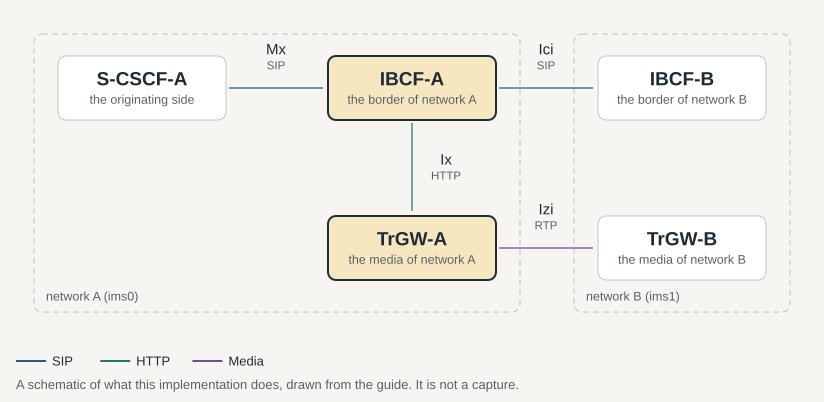

| Reference point | Between | In this setup |
| --- | --- | --- |
| Mx | A CSCF and the IBCF of its own network | SIP. The setting `ibcf` of the S-CSCF names the IBCF |
| Ici | The IBCFs of the two networks | The SIP of the link. An INVITE with SDP is over 1300 bytes and goes over TCP (RFC 3261 18.1.1) |
| Izi | The TrGWs of the two networks | The RTP that crosses the border |
| Ix | An IBCF and the TrGW of its own network | H.248 in the standard (TS 29.238). Here the same HTTP control API that the P-CSCF uses for its media relay |

Ici and Izi make up the II-NNI (TS 29.165 5.1). Mx and Ix are reference points inside one network (TS 29.165 3.2). Here too the TrGW is a media relay (role `agw`): its termination `core` faces the home network and `access` the TrGW of the other network. The IBCF drives the TrGW with the names of the H.248 commands: Add reserves the context of a call, Modify tells a termination where its side receives, and Subtract releases it.

## Until the number turns out to be another network's

UE A1 sends an INVITE to `tel:+12025550151` as for any call. The INVITE goes through the P-CSCF and the S-CSCF, through the MMTel AS by the originating filter criteria, and back to the S-CSCF. Up to here, nobody knows that the number belongs to another network.

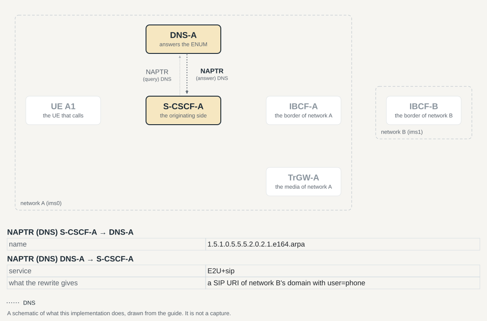

No AS is left to invoke, so the S-CSCF translates the number with ENUM (TS 24.229 5.4.3.2 step 10). The DNS of network A has a zone for the numbers of network B, and the answer is this.

```text
NAPTR 10 100 "u" "E2U+sip" "!^.*$!sip:+12025550151@ims.mnc002.mcc001.3gppnetwork.org;user=phone!" .
```

The result is a SIP URI of network B's domain with the number in international form and `user=phone`, the form that every non-roaming II-NNI can use (TS 29.165 8.1). The record holds the number, not a private identity of a subscriber. In the code of the S-CSCF, the ENUM and the decision about the IBCF come one after the other.

[internal/scscf/session.go](../../../internal/scscf/session.go)

```go
	if number, ok := s.globalNumber(out.RequestURI); ok {
		uri, err := s.resolver.ENUM(context.Background(), number, s.cfg.ENUMSuffix)
		if err != nil {
			log.Info("ENUM has no SIP URI for the number", "number", number, "error", err.Error())
			s.respond(st, 404, nil)
			return
		}
		log.Info("translated the number with ENUM", "number", number, "uri", uri)
		out.RequestURI = uri
	}
	// Steps 11 and 12: a destination in another network needs the
	// interconnect functions, and the home network hides its topology,
	// so the request goes through the IBCF, on top of Route.
	if ibcf, ok := s.exitIBCF(out); ok {
		log.Info("the destination is in another network, leaving through the IBCF", "request_uri", out.RequestURI, "ibcf", ibcf.String())
		out.Prepend("Route", sip.NameAddr{URI: ibcf.String()}.String())
	}
```

`globalNumber` returns the number when the Request-URI is a tel URI, or a SIP URI of the home domain with `user=phone`, holding a number in international form. When ENUM has no answer, the S-CSCF answers 404: in the standard such a call leaves the IMS through a BGCF, and this setup has none.

`exitIBCF`, which comes next, decides whether the destination needs the interconnect functions (steps 11 and 12). When the S-CSCF has an IBCF in its settings, no AS has put a Route of its own, and the host of the Request-URI is neither an address nor the home domain, it returns the URI of the IBCF. The S-CSCF puts it on top of Route, and record-routes itself as always (step 13). Without the setting `ibcf`, the S-CSCF tries to send to network B's domain by itself, and with no way onto the link the request reaches nothing.

## IBCF-A builds the request again as the exit point

An IBCF has two sides. The IBCF of this implementation is a B2BUA (TS 24.229 5.10.5, TS 29.165 5.2.1) with one UA per side. The inner UA listens on the home network's address and the outer UA on the link's address, both on port 5060. A request that arrives on the inner side is leaving the network, so the IBCF is its exit point (TS 24.229 5.10.2). A request that arrives on the outer side is coming in, so the IBCF is its entry point (5.10.3).

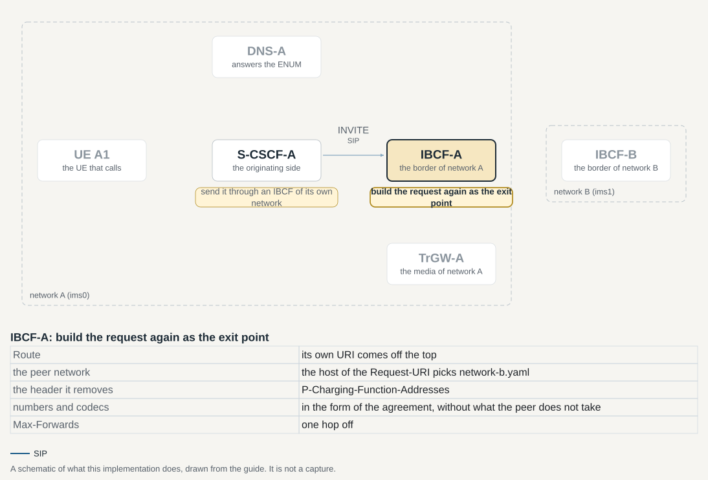

IBCF-A takes the INVITE as the UAS of its dialog with network A. It removes its own URI from the top of Route, finds the peer network by the host of the Request-URI, and picks the agreement with that network. It then applies the agreement to a copy of the request, in a fixed order.

[internal/interconnect/border.go](../../../internal/interconnect/border.go)

```go
func (b Border) ExitRequest(req *sip.Message) error {
	if err := b.screenRequest(req); err != nil {
		return err
	}
	RemoveNotApplicable(req)
	ApplyTrustDomain(req, b.Peer, Exit)
	RemoveReceivedRealm(req)
	ApplyPrivacy(req, b.Peer)
	ApplyHeaderRules(req, b.Peer, Exit)
	if err := NormalizeNumbers(req, b.Peer, b.Peer.NumberFormat, b.Peer.Domain, b.HomeDomain); err != nil {
		return err
	}
	return b.filterRequestBody(req)
}

```

1. `screenRequest` checks the method and the option tags (TS 24.229 5.10.6). A method that is optional and not in the agreement is refused here.
2. `RemoveNotApplicable` removes the header fields that the II-NNI does not carry.
3. `ApplyTrustDomain` removes the header fields that must not leave the trust domain (TS 24.229 4.4). The two operators have an agreement, so in this setup each is in the other's trust domain (`trusted: true`, 4.4.1) and P-Asserted-Identity crosses. P-Charging-Function-Addresses crosses towards no one (5.10.2.2 step 9).
4. `RemoveReceivedRealm`, `ApplyPrivacy` and `ApplyHeaderRules` remove the received-realm parameter of Via, and apply the privacy the user asked for and the operator's own rules for header fields (5.10.6.2). The rules of this setup remove User-Agent and Server, so that the names of network A's software do not leave it.
5. `NormalizeNumbers` puts the numbers into the form of the agreement (TS 29.165 8.1).
6. `filterRequestBody` removes from the SDP the codecs that the peer does not take (TS 29.165 7.1). With no speech codec left, it refuses with 488.

When a step refuses, IBCF-A answers with a response of its own and does not pass the request on. When all pass, it makes a context in TrGW-A and rewrites the `c=` of the SDP to 172.28.2.11, the address of TrGW-A on the link (TS 24.229 6.7.1.4.1). It then sends a new INVITE from the outer side, as the UAC of its dialog with network B.

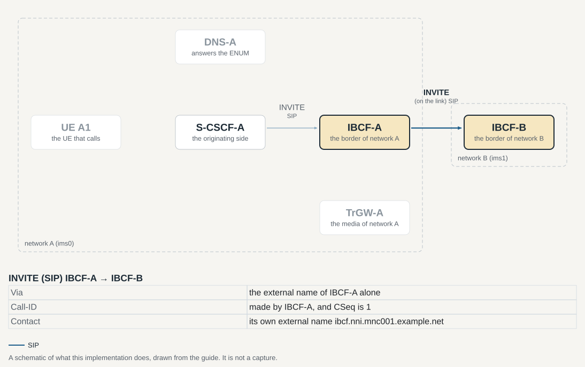

The Call-ID and the From tag of the new INVITE are made by IBCF-A, and its CSeq is 1. Its Via and its Contact are the outer name of IBCF-A, `ibcf.nni.mnc001.example.net`. Its Route holds the entry point of the peer network from the agreement, IBCF-B (5.10.2.2 NOTE 3). IBCF-A does not record-route itself (step 2B): the later requests of the call reach the IBCF as the far end of each dialog. It lowers Max-Forwards by one, as a proxy does (RFC 3261 16.6 step 3), so that two networks passing a request back and forth stop at last.

## What the agreement decides

The agreement of network A with network B is in `deploy/interconnect/profiles/network-b.yaml`. This project calls it the interconnect profile.

[deploy/interconnect/profiles/network-b.yaml](../../../deploy/interconnect/profiles/network-b.yaml)

```yaml
name: network-b
# A number that leaves as a tel URI goes out as a SIP URI of this
# domain with user=phone (TS 29.165 8.1).
domain: ims.mnc002.mcc001.3gppnetwork.org
# The two operators have an interconnect agreement, so network B is in
# the trust domain (TS 24.229 4.4.1): P-Asserted-Identity and the
# other header fields of 4.4 cross the border.
trusted: true
# UDP first, as the SIP of TS 24.229 4.2A; a message longer than 1300
# bytes goes over TCP all the same (RFC 3261 18.1.1).
transports: [udp, tcp]
# The methods of TS 29.165 Table 6.1 that need an agreement. MESSAGE
# carries the short messages between the networks (Table 6.1.3.1 item
# 29).
methods: [MESSAGE]
# 100rel is mandatory at the II-NNI (Table 6.1.3.1 item 18) and the
# precondition mechanism is optional (item 20). Both pass here.
option_tags:
  100rel: pass
  precondition: pass
# Numbers cross in SIP URIs with user=phone, the form that every
# non-roaming II-NNI supports (TS 29.165 8.1).
number_format: sip
# The speech codecs of both networks, with telephone-event for DTMF
# (TS 29.165 7.1 and NOTE 2). Any other payload format is taken out of
# the SDP.
codecs: [AMR-WB, AMR, PCMU, telephone-event]
```

TS 29.165 Annex C lists such choices as option items that two operators fill in. `domain` is the host of a number that leaves as a SIP URI. `trusted` decides whether the peer is in the trust domain. `methods` lists which of the optional methods of TS 29.165 Table 6.1, the ones that need an agreement, are allowed; MESSAGE, which carries short messages, is one of them (Table 6.1.3.1 item 29). `option_tags` says for each option tag whether it passes, is removed or is refused, `number_format` the form of the numbers, and `codecs` the payload formats the peer takes. Network B has its agreement with network A, `network-a.yaml`, which IBCF-B applies.

The agreement is a promise in both directions, but the two files belong to two operators. So a change to one of them alone makes them disagree, as a later section shows.

## Into network B and on to UE B1

The INVITE on the link arrives on the outer side of IBCF-B. The source address 172.28.2.10 is in the `sources` that the settings (`ibcf.yaml`) list for network A, so IBCF-B knows the request comes from network A. It applies the agreement `network-a.yaml` in the same order, and removes its own URI from Route (TS 24.229 5.10.3.2 step 1C). No Route is left, so it sends a new INVITE in a dialog of its own to the I-CSCF of its settings (step 4). The media goes through TrGW-B in the same way, so the SDP that reaches network B names 172.28.1.91, the inner address of TrGW-B.

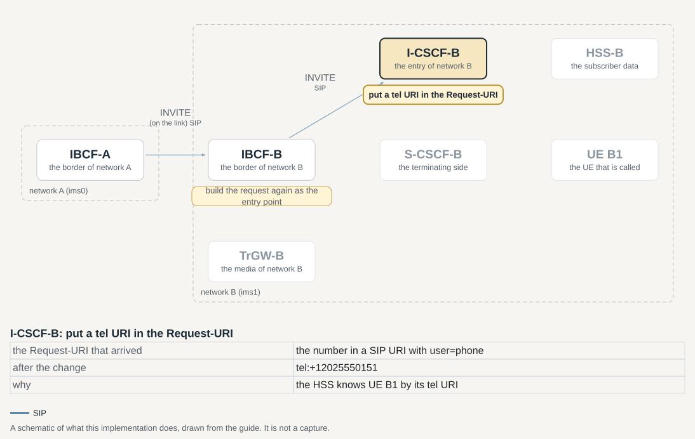

The Request-URI is still the SIP URI with the number in international form and `user=phone`. The HSS of network B knows UE B1 by its tel URI, not by that SIP URI, so the I-CSCF replaces the Request-URI before it sends its LIR to the HSS (TS 24.229 5.3.2.1 item 1 b).

[internal/icscf/session.go](../../../internal/icscf/session.go)

```go
func telURIOf(uri string) (string, bool) {
	n, ok := ims.ParseTelephoneNumber(uri)
	// A Request-URI that is a tel URI already names the user as the HSS
	// knows the number, so only a SIP URI is replaced.
	if !ok || n.SIP == nil || !strings.HasPrefix(n.Number, "+") {
		return "", false
	}
	if _, gruu := n.SIP.Params.Get("gr"); gruu {
		return "", false
	}
	return "tel:" + n.Number + n.Params.String(), true
}
```

The input is the Request-URI that came. Only for a URI that stands for a number, is a SIP URI, has a number that starts with `+` and is no GRUU does it return a tel URI with the number and its parameters. A tel URI is the form the HSS knows already, so it is not replaced. The S-CSCF of network B gets `tel:+12025550151`, and from there the call reaches UE B1 through the P-CSCF of network B as any terminating call does.

UE B1 answers with a reliable 183 that carries the answer. The 183 goes back along the Via, so it passes the I-CSCF too, although the I-CSCF did not record-route. Each IBCF passes the 183 it got on as a 183 of its own in its other dialog. PRACK, ACK and BYE also go dialog by dialog.

## The media goes through two TrGWs

For each SDP, the IBCF tells the termination that faces the sending side, with Modify, where that side will receive. It then writes into the SDP the address of the TrGW that faces the other side (TS 24.229 6.7.1.4.1). The relay writes the same address for both terminations, so it is the IBCF that writes each side's address.

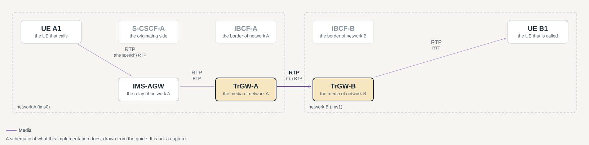

| Capture | Address in the `c=` of the SDP |
| --- | --- |
| Network A | 172.28.0.50 (the media relay of network A) or 172.28.0.91 (the inner side of TrGW-A) |
| The link | 172.28.2.11 or 172.28.2.21 (the sides of the two TrGWs on the link) |
| Network B | 172.28.1.91 (the inner side of TrGW-B) or the address of UE B1 |

The far end that UE A1 sees is 172.28.0.50, and the one that UE B1 sees is 172.28.1.91: each an address of its own network. The RTP that crosses the border goes between the two TrGWs only, and no address of a phone shows on the link. When a TrGW does not take an SDP, the IBCF does not pass that SDP across the border: the other side would send RTP straight to that address instead of through the TrGW, and the peer network would learn an address of the home network.

## Four dialogs, and three captures

The call has four dialogs. A B2BUA ends the dialog of the side it got the request on, and starts a dialog of its own on the other side. The MMTel AS of network A and the two IBCFs each do so, each adding one dialog. The P-CSCF, the S-CSCF and the I-CSCF are proxies, which pass a dialog on as it is. No AS is on the path in network B, so network B adds no dialog.

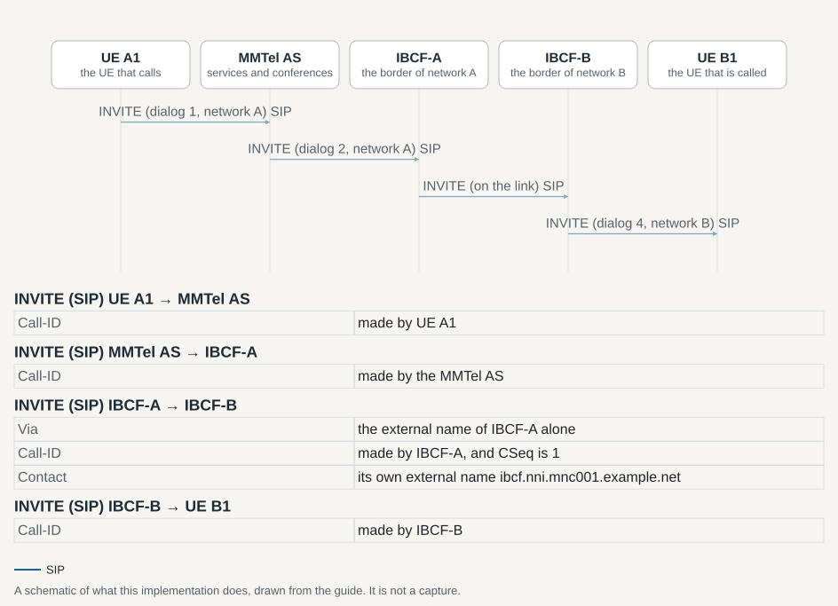

| Dialog | Between | In the capture of |
| --- | --- | --- |
| 1 | UE A1 and the MMTel AS | Network A |
| 2 | The MMTel AS and IBCF-A | Network A |
| 3 | IBCF-A and IBCF-B | The link |
| 4 | IBCF-B and UE B1 | Network B |

What the three captures put side by side are the three around the border, 2, 3 and 4: the INVITE from the S-CSCF to IBCF-A in network A's capture, the INVITE on the link, and the INVITE from IBCF-B to the I-CSCF in network B's capture, each with a Call-ID of its own. Dialog 1 is in network A's capture too, but it does not cross the border, so it is not in that comparison. "Three captures, three Call-IDs" counts the legs around the border, not the dialogs of the whole call.

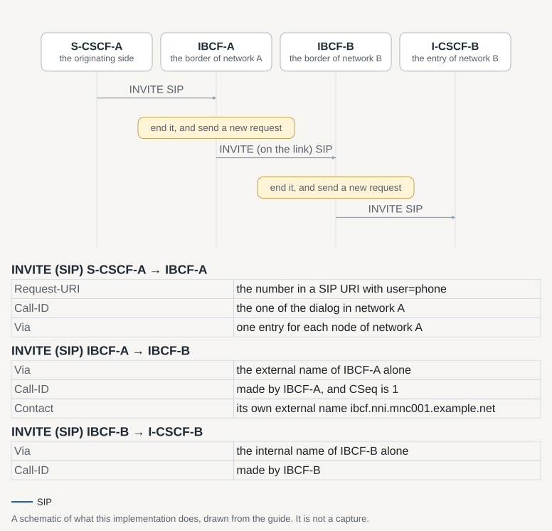

The network of the test `TestCallAcrossTheBorder` in `internal/ibcf` has no MMTel AS, so the call of that test has three dialogs. The "three dialogs" in the description of that test are the number in that network.

## What the other network sees

The values that carry a message inside one network do not go into the dialog with the other network. The Via, Route, Record-Route and Contact of the nodes of network A, and the Call-ID and tags of network A, never reach network B. That is how a B2BUA hides the topology of its network. TS 24.229 5.10.4 has another way for an IBCF that passes requests on as a proxy: it seals such values in encrypted tokens. A B2BUA has nothing to seal.

| Capture | What does not show |
| --- | --- |
| Network A | Addresses of 172.28.1.0/24, and host names of the nodes of network B |
| The link | Addresses and host names of the nodes inside either network, identities made from the IMSIs of network A, and Record-Route (but the one that comes with the Contact of a conference focus) |
| Network B | Addresses of 172.28.0.0/24, host names of the nodes of network A, and identities made from the IMSIs of network A |

The e2e script of the interconnection looks for those addresses in the IP headers and in the whole of each frame, and for names of nodes in front of the peer's domain. If it finds one, the script fails.

Some names of the home network may show to the other network: the domain itself, in the identity `sip:+12025550101@ims.mnc001.mcc001.3gppnetwork.org` of From and P-Asserted-Identity. The other network needs the user's number to call back, and the number and the domain tell nothing of the nodes inside or of the IMSI. Some Contacts cross as they came, too: those of a GRUU and of a conference focus, which the section on the conference shows.

## When the agreements do not match, an IBCF refuses

What makes the call fail is not a phone but an IBCF that follows its agreement. The IBCF that refuses answers with a response and does not pass the request on.

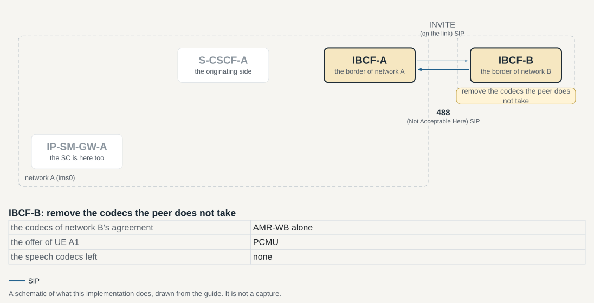

| Mismatch | The IBCF that refuses, and its response | The agreement that matches |
| --- | --- | --- |
| Network A's agreement has no MESSAGE (`network-b-no-message.yaml`) | IBCF-A with 405 (Method Not Allowed). The SC of network A reports TP-ST 98 (no response from the SME) | `network-b.yaml`, which gives TP-ST 1 |
| Network B takes AMR-WB only (`network-a-amr-wb-only.yaml`) | IBCF-B with 488 (Not Acceptable Here). UE A1 offers PCMU | `network-a.yaml`, which lists PCMU |
| Network A's agreement passes local numbers as they are (`network-b-local-numbers.yaml`) | IBCF-B with 404 (Not Found). Network B allows global numbers only | `network-b-global-numbers.yaml`, with which IBCF-A turns the number into `+12025550151` before it sends |

The check of the method refuses a method that the agreement does not list with 405.

[internal/interconnect/screen.go](../../../internal/interconnect/screen.go)

```go
func ScreenMethod(req *sip.Message, p Profile) error {
	allowed := p.allowedMethods()
	if slices.Contains(allowed, req.Method) {
		return nil
	}
	names := make([]string, len(allowed))
	for i, m := range allowed {
		names[i] = string(m)
	}
	return reject(405, ErrMethodNotAllowed, sip.HeaderField{Name: "Allow", Value: strings.Join(names, ", ")})
}
```

This implementation answers with a 405 that lists the methods the IBCF allows in `Allow`, as the local policy that TS 24.229 5.10.1 permits. The peer network is inside the agreement, so the response tells it what went wrong.

The check of the numbers tries to turn a number that does not start with `+` into a global one by the agreement's rules for local numbers.

[internal/interconnect/number.go](../../../internal/interconnect/number.go)

```go
func NormalizeNumber(uri string, format NumberFormat, host string, p Profile) (string, error) {
	n, ok := ims.ParseTelephoneNumber(uri)
	if !ok {
		return uri, nil
	}
	number := ims.WithoutVisualSeparators(n.Number)
	if !strings.HasPrefix(number, "+") {
		context, _ := n.Params.Get("phone-context")
		i := slices.IndexFunc(p.LocalNumbers, func(l LocalNumberPlan) bool { return sameContext(l.PhoneContext, context) })
		switch {
		case i >= 0:
			number = p.LocalNumbers[i].GlobalPrefix + number
		case !p.AllowLocalNumbers:
			return "", fmt.Errorf("%w: %s", ErrLocalNumber, uri)
		}
	}
	if strings.HasPrefix(number, "+") {
```

When the input URI stands for a number and a rule matches its `phone-context`, the global prefix goes in front. When no rule matches and the agreement does not allow local numbers, the result is `ErrLocalNumber`, which `NormalizeNumbers`, its caller, turns into 404 (the local policy of TS 24.229 5.10.1). Network A's `network-b-local-numbers.yaml` passes local numbers as they are, so IBCF-A does not refuse. Network B's agreement does not allow them, so IBCF-B refuses here.

The check of the codecs, `FilterCodecs`, removes from the m= lines of the SDP the payload formats that the agreement's `codecs` does not list. telephone-event carries no speech, so a stream that has only that left counts as lost too. When a stream in use has no speech codec left, the IBCF refuses with 488. There is no transcoding: it would need codecs in the TrGW, and the nodes of this project neither encode nor decode AMR.

## No answer for a sender outside every agreement

Say a host on the link at 172.28.2.99, neither an IBCF nor a TrGW, sends IBCF-A an INVITE and a MESSAGE. IBCF-A drops both, and answers neither.

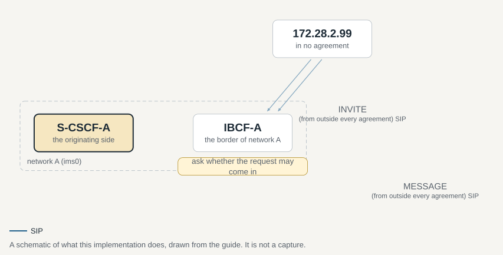

When the SIP stack of IBCF-A gets a request that belongs to none of its transactions, it asks the IBCF, before doing anything, whether the request may come in.

[internal/ibcf/ibcf.go](../../../internal/ibcf/ibcf.go)

```go
func (b *IBCF) Screen(req *sip.Message, source sip.Destination) bool {
	if _, ok := b.peers.BySource(source.Addr.Addr()); ok {
		return true
	}
	b.log.Info("discarded a request from an address of no peer network", "method", string(req.Method),
		"source", source.String(), "call_id", req.Get("Call-ID"))
	b.metrics.discard(DiscardUnknownSource, req.Method)
	return false
}
```

The answer is true when the source address is in the `sources` that the settings list for some peer network. Otherwise the IBCF logs the request, counts it as discarded and returns false. For such a request the stack makes no transaction, sends no 100 (Trying) and no error response, and passes nothing on. The same goes for every method and every retransmission; it remembers nothing of a dropped request, so it asks again and drops each retransmission. A sender with no agreement learns not even that a SIP node is there. Network A's capture keeps nothing of that host.

A peer network, inside the agreement, gets its refusals as responses, such as the 405 of the section before.

## Short messages across

When UE A1 sends a short message to UE B1, the MESSAGE crosses the border too.

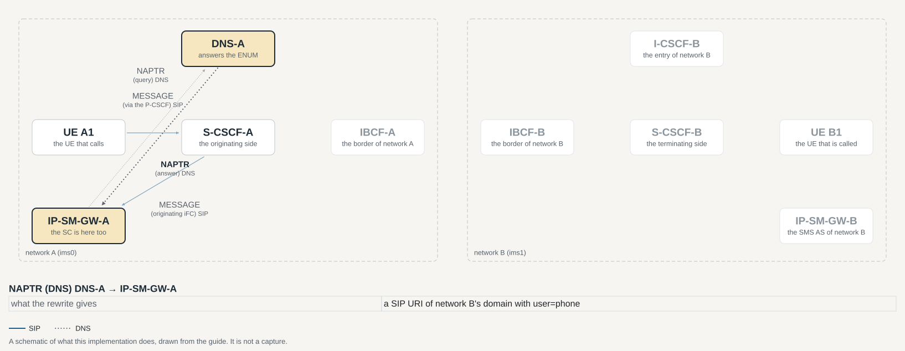

The MESSAGE of UE A1 reaches the IP-SM-GW by the originating filter criteria, as in the chapter on short messages. The SC stub first asks the HSS of network A for the number and is told that there is no such user. It has the setting `ibcf`, so it then looks the number up with ENUM and finds it in network B's domain. The SC accepts the message, and UE A1 gets its submit report.

The IP-SM-GW puts an SMS-DELIVER into a MESSAGE to the SIP URI of network B's domain, and sends it with IBCF-A in Route. The sender is the SC as a number (`tel:+12025550100`), so that no host name of network A leaves it. Both agreements allow MESSAGE, so it crosses the border. In network B the I-CSCF turns the Request-URI into a tel URI, and the S-CSCF gives the MESSAGE to network B's IP-SM-GW by the terminating filter criteria. TS 23.204 6.4a step 2 has a short message from another IMS network reach the IP-SM-GW that serves the user. The criteria match a MESSAGE whose P-Asserted-Identity is not the network's own IP-SM-GW, so the MESSAGE that the IP-SM-GW sends on to UE B1 does not loop between the S-CSCF and the IP-SM-GW.

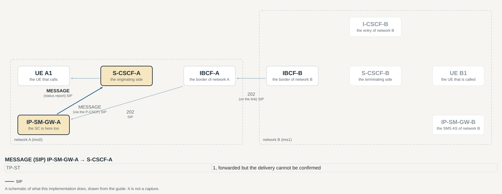

Network B's IP-SM-GW answers 202, which goes back to network A along the way it came. No delivery report crosses back, so the work of network A's SC ends here. The status report to UE A1 has TP-ST 1: the SC passed the message on to the SME but cannot confirm that it arrived (TS 23.040 9.2.3.15). Network B's IP-SM-GW delivers the SMS-DELIVER to UE B1 in a MESSAGE of its own, with the SC of network A still in RP-OA.

This is not the standard way. For a user with an MSISDN, the standard way goes from the SC to an SMS-GMSC, which asks the HSS of network B and passes the message to network B's IP-SM-GW over MAP or SGd (TS 23.204 6.4). This setup has no SMS-GMSC and no MAP, so it follows the way that TS 23.204 6.3a and 6.4a use between IMS networks for users without an MSISDN, and carries the message over the II-NNI in SIP. That is one of the simplifications.

## A conference across the border

An IBCF does not always replace the Contact. TS 24.229 5.10.5 has it pass on as they came the Contact of a GRUU, and a Contact with a feature tag that says what the far end can do with that URI. Its example is `isfocus`, the tag of a conference focus.

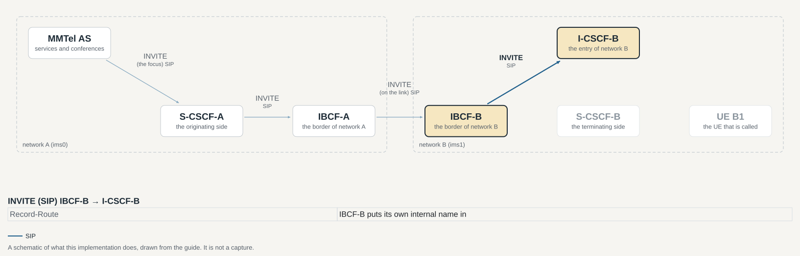

When network A's MMTel AS invites a user of network B as a focus, the Contact of the INVITE is the conference URI with `isfocus`. A participant keeps that URI to subscribe to the state of the conference (TS 24.147 5.3.1.3.2), and uses it to come back to the conference. So it has to reach the participant as it is. When the IBCF passes such a Contact on as it came, it record-routes its own URI, so that requests to the conference URI still go through it. That is the only Record-Route of the INVITE on the link.

The SUBSCRIBE outside a dialog that a participant tries first does not cross the border. IBCF-B answers 403 by local policy, and the participant subscribes again within the dialog of the conference session; TS 24.147 5.3.1.2 has it do so after a 403. A SUBSCRIBE outside a dialog creates a dialog of its own, which the IBCF would have to hold on both sides. This implementation does not have that part, so it does not let it cross.

## When an IBCF instance starts again

The two dialogs of a call are in the process of the IBCF instance that got its INVITE. When that process stops, the call stops with it, but the two sides do not know: each keeps its dialog, and the TrGW keeps the context. TS 24.229 5.10.2.2 step 2 and 5.10.3.2 step 2 have an IBCF that controls the transport plane save the Contact, CSeq and Record-Route of a call, so that it can release the session by itself.

Each IBCF instance puts such a record for each of its calls into its `Store`, under its own name. An instance that starts again under the same name reads its records before its UAs start, and ends them with this function.

[internal/ibcf/recovery.go](../../../internal/ibcf/recovery.go)

```go
func (b *IBCF) ReleaseLeftovers(records []CallRecord) {
	var wg sync.WaitGroup
	for _, r := range records {
		log := b.log.With("call_record", r.ID, "peer", r.Peer, "direction", string(r.Direction))
		log.Info("ending a call that an earlier process of this instance left")
		if r.Media != nil {
			b.releaseMedia(*r.Media, log)
		}
		for _, d := range []struct {
			s      side
			dialog *sip.Dialog
		}{{b.inside(), r.Home}, {b.outside(), r.PeerSide}} {
			if d.dialog == nil {
				continue
			}
			wg.Add(1)
			go func(s side, dialog sip.Dialog) {
				defer wg.Done()
				b.byeInLeftover(s, dialog)
			}(d.s, *d.dialog)
		}
		if err := b.store.DeleteCall(context.Background(), r.Instance, r.ID); err != nil {
			// The record stays for the next process of the instance,
```

For each record it releases the TrGW context, sends a BYE in each of the two dialogs (`r.Home` on the home network's side, `r.PeerSide` on the peer's), and deletes the record. `byeInLeftover` starts the CSeq of the BYE well above the value of the record, since the dialog may have moved on after the record was written (RFC 3261 12.2.2). The record of a call not answered yet has no dialogs, so only its context is released. Each instance reads only its own records, so no instance searches the calls of the whole network.

A record lasts only as long as the `Store` that holds it. A node whose settings have a `store` section of kind `valkey` keeps its records there, and a recreated container reads them back. The two IBCFs of this setup have no `store` section, so their records are in the memory of the process. When IBCF-A is recreated during a call, the new process reads nothing and ends nothing: it answers the BYE of one side with 481, and TrGW-A keeps the context of that call.

## What this project simplifies

The main simplifications that touch this chapter. Each of them has a `SIMPLIFIED:` comment in the code.

| Where | What is left out | Why |
| --- | --- | --- |
| IBCF | Only the non-roaming II-NNI. A REGISTER does not cross (405) | Roaming is outside the scope of this project |
| IBCF | Of the requests outside a dialog, only INVITE and MESSAGE cross. SUBSCRIBE gets 403 | The part that holds the dialog of such a SUBSCRIBE on both sides is not built |
| IBCF | No charging data, and no session timer asked for by the IBCF | The nodes of this project make no charging records |
| The border | No transcoding | It needs codecs in the TrGW, and the nodes neither encode nor decode AMR |
| The border | IPv4 only, and only the first audio stream goes through the TrGW | Both networks are IPv4 only, and a UE offers one audio stream |
| Ix | The TrGW is driven over the HTTP control API of the media relay, not over H.248 | It is the relay that the P-CSCF drives with the same API |
| SC | A user of another network is found by ENUM, not by asking that network through an SMS-GMSC | There is no SMS-GMSC, MAP or S6c |
| IBCF | The records of an instance that never comes back stay in the `Store`, with their TrGW contexts | Instances come back under the same name |

## What this explanation rests on

The explanation in this chapter was checked against the following code and tests. Each test was run and passes as a Go test of this repository.

- `TestOriginatingCallToAnotherNetworkLeavesThroughTheIBCF` and `TestHomeNetworkCallsStayInside` in `internal/scscf/session_test.go`. A number for which ENUM gives a peer's domain, and a SIP URI of that domain, go to the IBCF on top of Route while the S-CSCF still record-routes; calls to a number and to a node of the home network do not go through the IBCF.
- `TestCallToANumberInASIPURIGoesOnAsATelURI` in `internal/icscf/icscf_test.go`. The I-CSCF turns a number that a peer sent in a SIP URI with `user=phone` into a tel URI before it asks the HSS, and the S-CSCF gets the tel URI.
- `TestCallAcrossTheBorder` in `internal/ibcf/network_test.go`. It runs two networks in one process, and checks that each dialog of a call across the border has its own Call-ID, that neither network gets anything that names the inside of the other, that the SDP of each side names its own TrGW, and that the BYE releases both TrGW contexts. Its network has no MMTel AS, so its call has three dialogs.
- `TestTrustedPeerGetsTheAssertedIdentity` in `internal/ibcf/network_test.go`. Towards a trusted peer the header fields of the trust domain cross, and P-Charging-Function-Addresses crosses towards no one.
- `TestMismatchedProfiles` in `internal/ibcf/network_test.go`. With mismatched agreements, the MESSAGE is refused with 405, the codecs with 488 and the number with 404; with the adjusted agreements they get through.
- `TestRequestFromNoPeerIsDiscarded` in `internal/ibcf/network_test.go`. An INVITE from a host outside every agreement, its retransmission, a CANCEL, an ACK and a MESSAGE get nothing back, and nothing enters network A.
- `TestMessageAcrossTheBorder` in `internal/ibcf/network_test.go`. A MESSAGE that the agreement allows crosses the border, with no TrGW.
- `TestConferenceFocusAcrossTheBorder` in `internal/ibcf/focus_test.go`. The IBCF of network B answers a SUBSCRIBE to the conference URI outside the dialog with 403.
- `TestRestartedInstanceEndsTheCallsItLeft` in `internal/ibcf/network_test.go`. An instance that starts again under the same name releases the TrGW contexts of the calls that its earlier process left, and sends a BYE in their two dialogs, with a `Store` in the process and with a `Store` on a shared store.
- `TestScreenMethod`, `TestFilterCodecs` and `TestNormalizeNumber` in `internal/interconnect`. The checks of the method, the codecs and the numbers, one by one.

The figures are diagrams drawn from the guide's account of this setup, not captures.

## If you want to run it yourself

You need not run anything to read this chapter. To see the same flow in real captures, the guide has the steps in ["Run it"](../../guide/en/interconnect.md#run-it) and ["What each capture shows"](../../guide/en/interconnect.md#what-each-capture-shows). How to change the agreements and make them disagree is in ["When the profiles do not match"](../../guide/en/interconnect.md#when-the-profiles-do-not-match). In the slides, the scenes of [the deck on interconnection](../../../slides/decks/en/10-interconnect.md) from "A call from network A to network B" to "A conference across the border" go one step at a time, in nearly the same order as this chapter.
