# iFC and the supplementary services of the MMTel AS

You call a phone that forwards its calls, and another phone rings. The callee's MMTel AS decides that. The S-CSCF only hands the INVITE to the AS by the conditions of an iFC, and says in P-Served-User whose call it is and on which side. The AS reads that and runs the services of that side in a fixed order. Which services act is decided by the rules of the user's document in the HSS, and the user changes those rules with XCAP over Ut.

This chapter follows what changes when a condition changes. When the session case of the iFC changes, the services that the AS runs change. When a rule of the document changes, the answer of the AS to the same INVITE changes. With CFNR, the length of a timer decides when the CANCEL goes. When two parties change the same document at once, one PUT gets 412. Each is tied to the function that decides it and the test that checks it.

## The setup and the editions of this chapter

The example is the `deploy/compose` setup. UE 1 (`tel:+12025550101`) calls, UE 2 (`tel:+12025550102`) is the user who sets the services (the served user), and UE 3 (`tel:+12025550103`) is where UE 2's calls are forwarded. The S-CSCF serves all three, and there is one MMTel AS. The figures draw the AS in two places, once for each user it serves.

Where the AS sits, and the whole of how the S-CSCF hands it requests, is in the chapter [What application servers add](services.md). This chapter goes on from there. It takes the reading of INVITE, PRACK and ACK from the chapter From a number to the other phone.

The clause numbers are those of the editions of the guide: TS 24.229 V20.1.0, TS 24.604 V19.0.0 (CDIV), TS 24.607 V19.1.0 (OIP, OIR), TS 24.608 V19.0.0 (TIP, TIR), TS 24.611 V19.0.0 (barring), TS 24.615 V19.0.0 (CW), TS 24.623 V19.0.0 (Ut), TS 29.364 V19.1.0 (service data), TS 29.328 V20.0.0 (Sh) and GSMA IR.92 v24.0.

## The conditions of the iFCs, and what happens when the AS does not answer

### When a criterion matches

The S-CSCF tries the iFCs of the user's profile in the order of their priority, smallest first (TS 24.229 5.4.3.2 step 3, 5.4.3.3 step 2A). This setup has four criteria for the MMTel AS.

| Priority | Matches | DefaultHandling |
| --- | --- | --- |
| 10 | INVITE, ORIGINATING_REGISTERED | SESSION_TERMINATED |
| 11 | INVITE, TERMINATING_REGISTERED | SESSION_CONTINUED |
| 12 | INVITE, TERMINATING_UNREGISTERED | SESSION_CONTINUED |
| 13 | INVITE, ORIGINATING_CDIV | SESSION_TERMINATED |

The trigger point of a criterion is a set of SPTs (Service Point Triggers). The criteria of this setup put an SPT on the method in group 0 and an SPT on the session case in group 1, with `ConditionTypeCNF` true. Then the criterion matches when every group has one SPT that holds.

[internal/ifc/ifc.go](../../../internal/ifc/ifc.go)

```go
func (t TriggerPoint) matches(req *sip.Message, sc SessionCase) bool {
	groups := map[int][]bool{}
	for _, spt := range t.SPT {
		result := spt.matches(req, sc) != spt.ConditionNegated
		for _, g := range spt.Group {
			groups[g] = append(groups[g], result)
		}
	}
	if t.ConditionTypeCNF {
		// Every group needs one SPT that holds.
		for _, results := range groups {
			if !slices.Contains(results, true) {
				return false
			}
		}
		return true
	}
	// One group needs all of its SPTs to hold.
	for _, results := range groups {
		if !slices.Contains(results, false) {
			return true
		}
	}
	return false
}
```

The inputs are the request `req` and the session case `sc` that the S-CSCF is handling. For each SPT, `spt.matches` gives a result, turned over when `ConditionNegated` is set, and the results are collected by group. When `ConditionTypeCNF` is true, a group in which no SPT holds makes it return `false`. When it is false, one group in which every SPT holds makes it `true`. The SPT of a session case only compares `*s.SessionCase == sc`, so the same INVITE matches priority 10 at the caller's S-CSCF and priority 11 at the callee's. Each criterion matches one session case only, so the four never compete. The three criteria of SMS (priorities 0 to 2) are for REGISTER and MESSAGE, and match no INVITE.

### Why DefaultHandling differs between the two sides

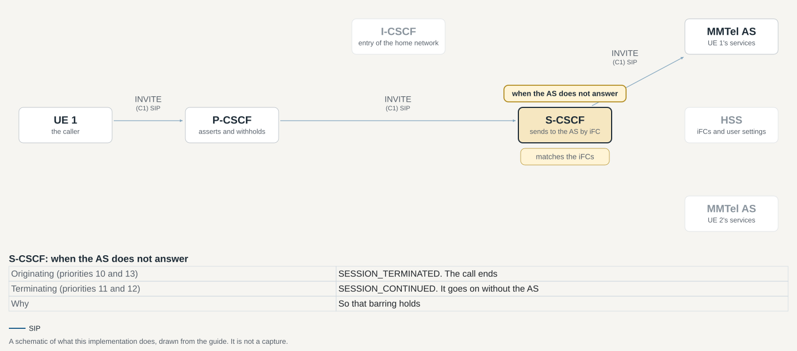

DefaultHandling is what applies when the AS cannot be reached, or answers 408 or a 5xx before any provisional response. The originating criteria (priorities 10 and 13) are SESSION_TERMINATED; the terminating ones (11 and 12) are SESSION_CONTINUED.

Only the originating side ends, so that barring holds. Outgoing barring (BAOC and the like) is applied by the AS on the originating side. If the call went on without the AS when it does not answer, a call that the user has barred would connect. The AS on the terminating side runs forwarding, incoming barring and the handling of identities. Ending the terminating side would turn a failure of the AS into a failed incoming call, so this setup goes on to the callee without the AS. In exchange, incoming barring and forwarding do not apply meanwhile.

Which responses make DefaultHandling apply, which do not, and what each choice gives up, are compared in the chapter When an application server is not available.

## The session case and P-Served-User

### The AS learns the side from P-Served-User

The S-CSCF writes the session case of the matching criterion in P-Served-User for the AS (TS 24.229 5.4.3.2 step 5 b, 5.4.3.3 step 4 c).

```text
P-Served-User: <sip:+12025550101@…>;sescase=orig;regstate=reg
P-Served-User: <sip:+12025550102@…>;sescase=term;regstate=reg
P-Served-User: <sip:+12025550102@…>;sescase=term;regstate=unreg
P-Served-User: <sip:+12025550102@…>;orig-cdiv;regstate=reg
```

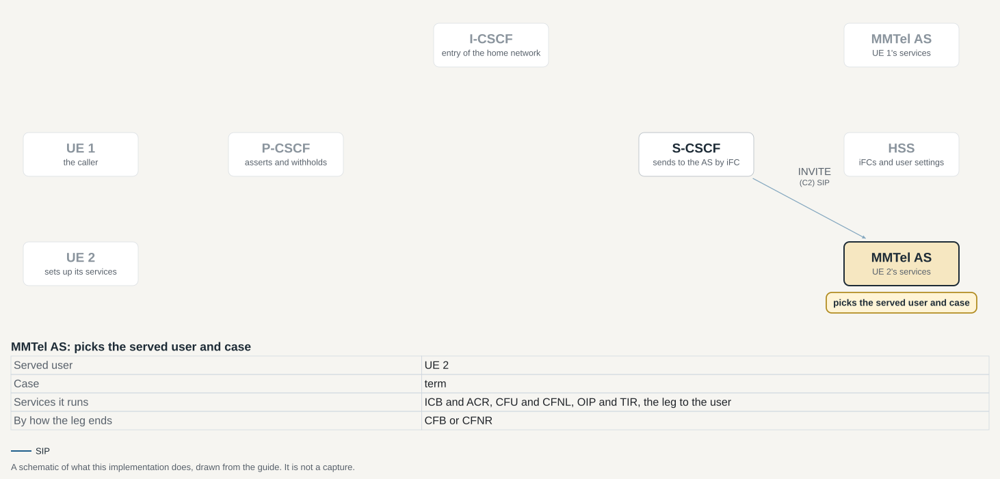

The first thing the AS reads in an INVITE is P-Served-User.

[internal/mmtel/call.go](../../../internal/mmtel/call.go)

```go
func (as *AS) serve(in *sip.IncomingCall) {
	req := in.Request
	log := as.log.With("call_id", req.Get("Call-ID"))
	// TS 24.229 5.7.1.3A: the S-CSCF names the served user in
	// P-Served-User, and this S-CSCF always adds the session case. A
	// request without one came by no filter criterion. The INVITE to a
	// conference URI comes that way, by DNS (conference.go).
	served, err := sip.ParsePServedUser(req.Get("P-Served-User"))
	if err != nil || served.SessionCase == sip.SessionCaseNone {
		if _, ok := as.conferenceID(req.RequestURI); ok {
			as.joinConference(in, log)
			return
		}
		log.Info("INVITE without a served user and its session case", "p_served_user", req.Get("P-Served-User"))
		in.Reject(403, as.warning("No served user"))
		return
	}
```

`sip.ParsePServedUser` reads P-Served-User, and when `served.SessionCase` is not empty, `run` later goes to the steps of that case. An INVITE without P-Served-User did not come by an iFC. The AS joins it to a conference if it is for a conference URI ([Announcements, ringback tones and conferences of the MRF](mrf.md)), and otherwise rejects it with 403: it cannot tell whose services to run.

### The order of the services in each case

| Case | The order of the services the AS runs |
| --- | --- |
| orig | OCB, OIR, then TIP for the responses |
| term | ICB and ACR, CFU and CFNL, OIP and TIR, the leg to the user; by how it ends, CFB or CFNR |
| orig-cdiv | The OCB of the diverting user |

This function holds the steps of the terminating case.

[internal/mmtel/sessioncase.go](../../../internal/mmtel/sessioncase.go)

```go
func (c *call) terminating() {
	inv, fields, err := c.newInvitation(c.in.Request.RequestURI)
	if err != nil {
		c.storeFailed(err)
		return
	}
	// ICB and ACR first: they decide on the caller's identity, which OIP
	// may take out of the request (TS 24.607 4.3.3 NOTE 2), and they come
	// before diversion (TS 24.611 4.6.7).
	info := c.callInfo(fields, inv.RequestURI)
	if c.barIncoming(info) {
		return
	}
	// CFU, and CFNL for a user who is not registered (TS 24.604 4.6.7).
	if d, ok := c.divertAtSetup(info); ok {
		c.divert(d)
		return
	}
	// OIP (TS 24.607 4.5.2.9), then TIR (TS 24.608 4.5.2.9) for the
	// responses.
	c.presentOriginatingIdentity(&inv, fields)
	c.withholdTerminatingIdentity(fields)
	c.withhold = c.withholdSession(info)
	// CAT (TS 24.182 4.5.5.3.7), from the MRF before the INVITE goes on.
	c.startAlertingTone(fields)
	inv.Headers = fields.Headers
	r := c.attempt(inv, c.noReplyTimer(info))
	// The callee did not answer: the tone stops before the caller hears
	// how the call goes on.
	c.stopAlertingTone("the leg to the served user ended")
	// CFB, CFNRc and CFNR, on how the leg to the served user ended (TS
	// 24.604 4.5.2.6.3).
	if d, ok := c.divertOn(r, info); ok {
		c.divert(d)
		return
	}
	c.finish(r)
}
```

Barring comes first (TS 24.611 4.6.7). When `barIncoming` rejects the call, it ends there, with no diversion and no alerting. Next, `divertAtSetup` evaluates CFU, and CFNL for a user who is not registered. Both divert when the INVITE arrives, so the user is not alerted. Then OIP, TIR and CAT act on the INVITE, and `c.attempt` tries the leg to the user. Its result `r` is how the user answered. `divertOn` evaluates the rules as CFB for a 486, CFNR when the no reply timer expired, and CFNRc when the user could not be reached. When none applies, `c.finish(r)` passes the user's answer to the caller as it is.

Because of this order, a call to a user who bars incoming calls and also has CFU set is rejected, not diverted. And UE 2's phone does not ring with CFU but does with CFNR: CFU is decided before `attempt`, CFNR after it.

## The ODI and three dialogs

### The AS is a routeing B2BUA

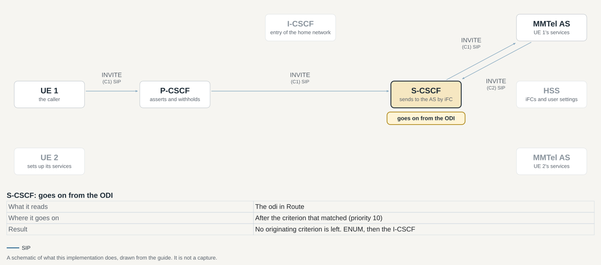

The MMTel AS is a routeing B2BUA (TS 24.229 5.7.5). It answers the INVITE it got as a UA, and sends a new INVITE with its own Call-ID along the rest of the Route. The new INVITE comes back to the S-CSCF with the ODI, and the S-CSCF goes on matching after the criterion that matched. The IP-SM-GW of the SMS deck sends nothing back; the MMTel AS does.

It is a B2BUA and not a proxy because every service needs one. With CFNR, the AS cancels the leg that rings itself and sends a new INVITE to another target. A diversion that changes To, an OIR that makes From anonymous, a barring that plays the caller an announcement before the rejection, and a conference all need the AS to hold dialogs of its own. TS 24.604 4.5.2.6.0 lets an AS that diverts without changing To act as a proxy, but this AS acts as a B2BUA for every service.

### What the capture shows

A call from UE 1 to UE 2 becomes three dialogs, C1, C2 and C3.

```text
 UE 1 ... S-CSCF -- AS(UE 1) -- S-CSCF ... I-CSCF ... S-CSCF -- AS(UE 2) -- S-CSCF ... UE 2
 |<------ C1 ------>|<------------------ C2 ------------------->|<--------- C3 ---------->|
```

| What to see | What to look for |
| --- | --- |
| Call-ID | Three per call. A diverted call adds three more. |
| icid-value of P-Charging-Vector | The same in all three, inside the network. The Lab joins them into one call by it. |
| LIR | It belongs to dialog C2. |
| PRACK and ACK | They go dialog by dialog. The ACK can reach UE 2 before the 200 reaches UE 1. |
| BYE | The AS answers it, and sends a new BYE with the same Reason on the next dialog. |

The LIR belongs to C2 because what the S-CSCF sends to the I-CSCF after ENUM is the INVITE that UE 1's AS sent back. The ACK can reach UE 2 before the 200 reaches UE 1 because the AS acknowledges each 2xx on its own side at once. The P-CSCF removes P-Charging-Vector from what it sends to a UE, so it does not show on the legs to the UEs.

A diverted call has six dialogs: C1 on UE 1's originating side, C2 up to UE 2's AS, C3 from UE 2's AS to UE 2 (not made with CFU), then C4 for the diverted INVITE, C5 after the originating services of the diverting user, and C6 from UE 3's AS to UE 3. The ladder of the guide shows C1 to C6.

### The S-CSCF notices a diversion

When the AS sends a terminating INVITE back to another target, the S-CSCF takes it as a diversion and goes on with the originating services of the diverting user (TS 24.229 5.4.3.3 step 3).

[internal/scscf/services.go](../../../internal/scscf/services.go)

```go
	if d.terminating() && !sameTarget(out.RequestURI, d) {
		s.retargeted(st, out, d, log)
		return
	}
```

The inputs are the request that came back, `out`, and the state stored under the ODI, `d`. In the terminating case, when the Request-URI is not the stored target (or an alias of the served user), it goes to `retargeted`. When the served user has criteria of ORIGINATING_CDIV, `retargeted` evaluates them for the diverting user. In this setup priority 13 matches, and the INVITE comes to the AS once more with `orig-cdiv`. There the AS runs only the OCB of the diverting user, so a diversion to a target that UE 2 has barred stops here (TS 24.611 4.6.7).

## The settings are one document in the HSS

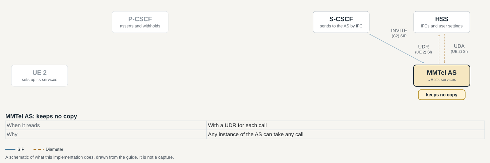

Each user has one XML document, of XCAP simservs (TS 24.623, RFC 4825). It lives only in the HSS, as Sh repository data under the Service-Indication `MMTEL-Services` (TS 29.364 7.2). The AS reads it with a UDR for each call and keeps no copy, so that any instance of the AS can take any call. With several instances of the AS, nothing about the settings has to be kept in step between them.

The first document has rules for every service that IR.92 asks for. The rules of CDIV and CB are switched off with the condition `rule-deactivated`, and have an empty target.

[deploy/compose/hss.yaml](../../../deploy/compose/hss.yaml)

```yaml
            <cp:rule id="cfu">
              <cp:conditions><rule-deactivated/></cp:conditions>
              <cp:actions><forward-to><target/></forward-to></cp:actions>
            </cp:rule>
```

The UE adds no rule. It turns a service on by changing a rule (GSMA IR.92 2.3.2 Note 3). To turn CFU on, it takes `<rule-deactivated/>` out of this rule and puts the target in `<target>`. The address of the document is `http://xcap.ims.mnc001.mcc001.3gppnetwork.org/simservs.ngn.etsi.org/users/<XUI>/simservs.xml`, where the XUI is the user's public identity.

## Changing a rule over Ut: ETags and conditional updates

### What one change sends

`ue xcap set cfu on tel:+12025550103` sends these requests.

| Step | Request | Response, and the Sh in between |
| --- | --- | --- |
| 1 | GET, no credentials | No UDR. 401 with two challenges, SHA-256 then MD5, the same for every user. |
| 2 | GET with `Authorization: Digest` | Two UDRs: the Ut password, then the document. 200 with `ETag: "0"`. |
| 3 | PUT of one rule, a node selector after `~~`, `If-Match: "0"` | A PUR with `<SequenceNumber>1</SequenceNumber>`. After the PUA, 200 with `ETag: "1"`. |
| 4 | GET | The document, printed as settings. |

The AS sends the first 401 without reading anything about the user. The realm of the challenges is the home domain, the same for every user, so the 401 is the same whether or not the XUI names a real user (TS 24.623 5.3.2.2). The two challenges come SHA-256 first, then MD5 (RFC 7616 3.3), and the UE answers the first it supports, here SHA-256. The Authorization of the second GET reads `algorithm=SHA-256`. Only now does the AS read the repository data with the Service-Indication `Ut-Digest-Credential`, which holds HA1 values and not the password, and checks the answer.

The ETag is the Sequence Number of the repository data in the HSS. The HSS checks that number and moves it on by one at each update (TS 29.328 6.1.2.1).

### 412 when the version does not match

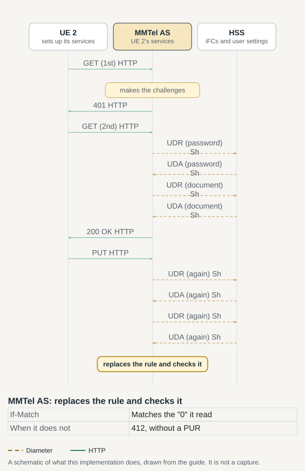

On a PUT, the AS reads the document again and compares If-Match with the ETag of the version it read.

[internal/xcap/handler.go](../../../internal/xcap/handler.go)

```go
		etag := entityTag(stored.SequenceNumber)
		if status := precondition(r, etag, true); status != 0 {
			w.Header().Set("ETag", etag)
			h.answer(w, r, t, status, "")
			return
		}
```

`stored.SequenceNumber` is the version read from the HSS, and `entityTag` makes an ETag such as `"0"` of it. `precondition` returns 412 (Precondition Failed) when If-Match does not match this ETag (RFC 4825 7.11). The AS then sends no PUR, and the document does not change.

Another write can also come in between the read of the document and the PUR. Then the HSS refuses the PUR.

[internal/xcap/handler.go](../../../internal/xcap/handler.go)

```go
		err = h.repo.UpdateRepositoryData(r.Context(), t.xui, simservs.ServiceIndication, stored.SequenceNumber, next.RootElement())
		if isResult(err, diameter.Experimental(sh.DiameterErrorTransparentDataOutOfSync)) {
			if conditional {
				h.answer(w, r, t, http.StatusPreconditionFailed, "the document changed meanwhile")
				return
			}
			if attempt < maxAttempts {
				continue
			}
			w.Header().Set("Retry-After", "1")
			h.answer(w, r, t, http.StatusServiceUnavailable, "the document keeps changing")
			return
		}
```

When the HSS answers DIAMETER_ERROR_TRANSPARENT_DATA_OUT_OF_SYNC (5105), the version that was read is out of date. A conditional request, with If-Match or If-None-Match, gets 412 from the AS here too. A request without a condition reads the newer document and makes the same change again, up to a fixed number of attempts. The UE's `ue xcap` always puts If-Match on a PUT, so what the UE gets is 412.

Take two parties who change the settings at once. Two devices of the same user both read the document with `ETag: "0"`. The first PUTs the CFU rule with `If-Match: "0"`, and the document moves on to version 1. The second PUTs the CFB rule with the same `If-Match: "0"`; the version does not match, so it gets 412. The second reads the document again, PUTs with `"1"`, and succeeds. The final document holds both the CFU and the CFB rules, at version 2. Neither change silently overwrites the other.

The ladders of the Lab show neither XCAP nor Sh: neither belongs to a SIP request. The capture has them, as HTTP on port 80 and Diameter on port 3868. Turning CFU on in the Lab makes the ETag in its list go up by one.

## How each service decides

### A plain call, and TIP

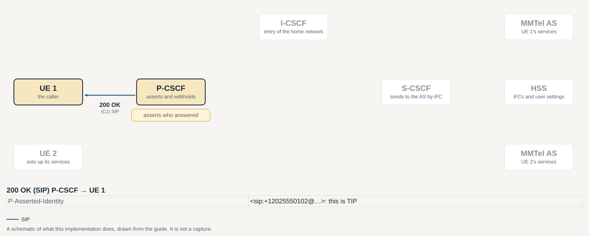

With the default document, the AS changes nothing in the call. Still, the INVITE goes through the AS twice, and each time the AS reads the document of the served user with a UDR. Every user has TIP by default: UE 2's P-CSCF puts the P-Called-Party-ID of the INVITE into the P-Asserted-Identity of UE 2's 200 OK (TS 24.229 5.2.6.4.4 step 1, TS 24.608 4.5.2.4). That is how UE 1 learns who answered.

### OIR and OIP

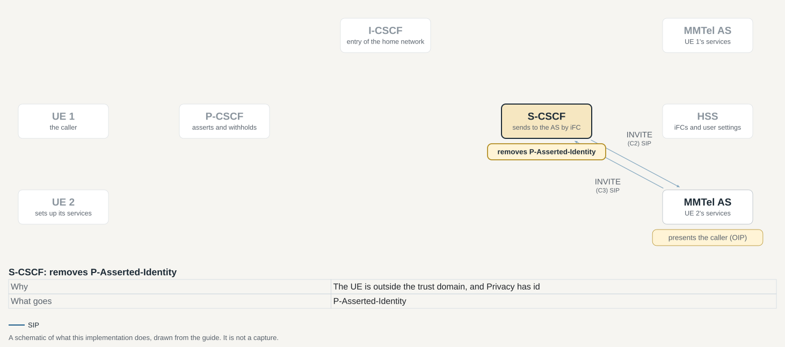

When UE 1 sets its default to restricted with `ue xcap oir restricted` and calls, these nodes each change one thing.

| Node | What it does |
| --- | --- |
| UE 1's AS | Adds `Privacy: id` and sets From to `"Anonymous" <sip:anonymous@anonymous.invalid>`. Keeps P-Asserted-Identity. |
| UE 2's AS | Runs OIP and keeps `id`. |
| UE 2's S-CSCF | Removes P-Asserted-Identity: the UE is outside the trust domain. |

Inside the network, the identity stays as the network asserted it. It is hidden only from a UE outside the trust domain (TS 24.229 5.4.3.3 step 12, 4.4.2). OIR is in the temporary mode, so the UE can present its number for one call with `Privacy: none` (TS 24.607 4.5.2.4). TIR is the same mechanism the other way round: UE 2's AS puts `id` in the Privacy of the response, and UE 1's P-CSCF removes P-Asserted-Identity (TS 24.608 4.5.2.9, RFC 3325 7).

### CFU, CFB and CFNL

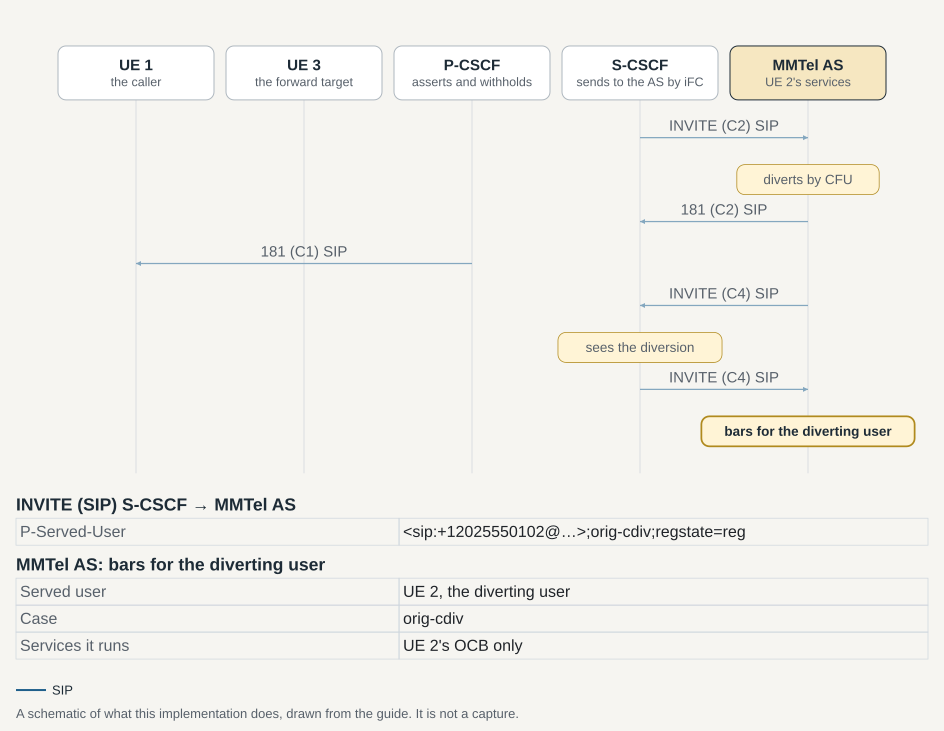

With CFU, UE 2's AS diverts the call when the INVITE arrives (TS 24.604 4.5.2.6.3 item 1). It tells the caller with 181 Call Is Being Forwarded (4.5.2.6.4), and puts the reason for the diversion on the Request-URI of the diverted INVITE, C4 (RFC 4458).

| What to see | What to look for |
| --- | --- |
| Request-URI of the diverted INVITE (C4) | `sip:+12025550103@…;user=phone;cause=302` |
| History-Info | Index 1 is UE 2; index 1.1 is UE 3, with `mp=1`. |
| 181 | The target's entry has `Privacy=history`: UE 2's AS does not know whether UE 3 allows its number to be shown. |

The reasons are the constants of `internal/mmtel/diversion.go`: 302 for CFU, 486 for CFB, 408 for CFNR, 404 for CFNL and 503 for CFNRc (TS 24.604 Annex C). A call can be diverted five times at most (the operator setting of `hss.yaml`); beyond that, the AS answers 480 with `Warning: 399` (4.5.2.6.1).

With CFB, the AS first alerts UE 2. When UE 2 answers C3 with 486 Busy Here, the AS acknowledges it, sends the 181, and diverts with `cause=486`. With CFNL, a call to UE 2, who is not registered, reaches the AS by the TERMINATING_UNREGISTERED criterion of priority 12.

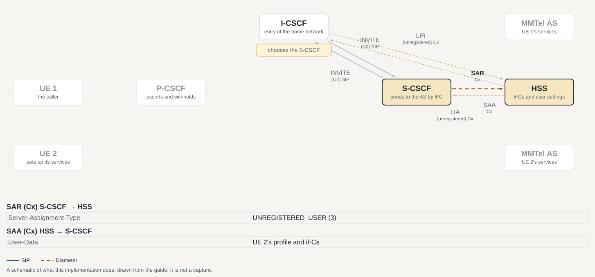

| Step | What to see | What to look for |
| --- | --- | --- |
| 1 | The I-CSCF's LIR | DIAMETER_UNREGISTERED_SERVICE (2003) with the S-CSCF capabilities. |
| 2 | The S-CSCF's SAR | UNREGISTERED_USER, for the profile. |
| 3 | INVITE to the AS | `sescase=term;regstate=unreg` |
| 4 | The AS diverts | By the rule with `<not-registered/>`, at once, `cause=404`. |

The LIA is 2003 because every test subscriber has an iFC of TERMINATING_UNREGISTERED (TS 29.228 6.1.4.1 step 3). A subscriber without it would get DIAMETER_ERROR_IDENTITY_NOT_REGISTERED, and the I-CSCF would answer 480. Without CFNL, the AS sends the INVITE back unchanged and the S-CSCF answers 480.

### CFNR: a timer decides when the CANCEL goes

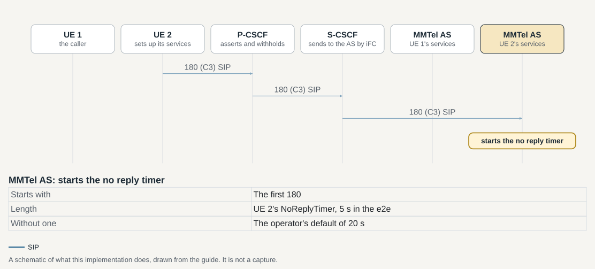

With CFNR, the AS times the call while it alerts UE 2. The timer starts when the first 180 of the leg to UE 2 reaches the AS (TS 24.604 4.5.2.6.3 item 2).

[internal/mmtel/call.go](../../../internal/mmtel/call.go)

```go
			if code == 180 && noReply > 0 && timer == nil {
				// TS 24.604 4.5.2.6.3 item 2: the first 180 starts the no
				// reply timer, and a 180 of another fork does not start
				// it again.
				timedOut = make(chan struct{})
				timer = c.as.cfg.AfterFunc(noReply, func() { close(timedOut) })
				go c.cancelOnNoReply(out, timedOut, settled)
			}
```

`attempt` takes the responses of the leg to UE 2 one by one. Only when `code == 180`, the length `noReply` is not zero and there is no timer yet does it start one with `AfterFunc`. Because of the `timer == nil` condition, a second 180 from another branch of a fork does not start the timer again. When the timer expires, `cancelOnNoReply` sends a CANCEL with `Reason: SIP;cause=408;text="Request Timeout"` on the leg to UE 2.

This function decides the length.

[internal/mmtel/diversion.go](../../../internal/mmtel/diversion.go)

```go
// noReplyTimer is how long the leg to the served user may ring before
// CFNR diverts the call: the NoReplyTimer of the user, or else the
// operator's default (TS 24.604 4.8.1, 4.9.1.1A). It is 0 when no rule
// for no answer can match this call, so that no timer runs. An operator
// default below the least time a user may set (5 s) counts as that
// time.
func (c *call) noReplyTimer(info simservs.CallInfo) time.Duration {
	cdiv := c.communicationDiversion()
	if cdiv == nil || !simservs.EvaluateDiversion(&cdiv.CommunicationDiversion, simservs.OnNoAnswer, info).Diverts() {
		return 0
	}
	return time.Duration(max(cdiv.NoReplyTimer(), simservs.MinNoReplyTimer)) * time.Second
}
```

For a call that no rule for no answer matches, it returns 0, and no timer runs. With such a rule, it takes the user's `NoReplyTimer`, and without one the operator's default (TS 24.604 4.8.1). In the `hss.yaml` of this setup, both the `NoReplyTimer` of the user's document and the operator's default are 20 seconds. The user can change it with `ue xcap noreply` to any value from 5 to 180 seconds (4.9.1.1A).

So the time from the 180 to the CANCEL is that value itself: 5 s with `noreply 5`, and about 10 s after a change to `noreply 10`. The e2e script sets 5 seconds, and in the capture of the guide the CANCEL comes 5.0 s after the first 180. The 10 s example is derived from this function and the test; the author did not measure it in a capture.

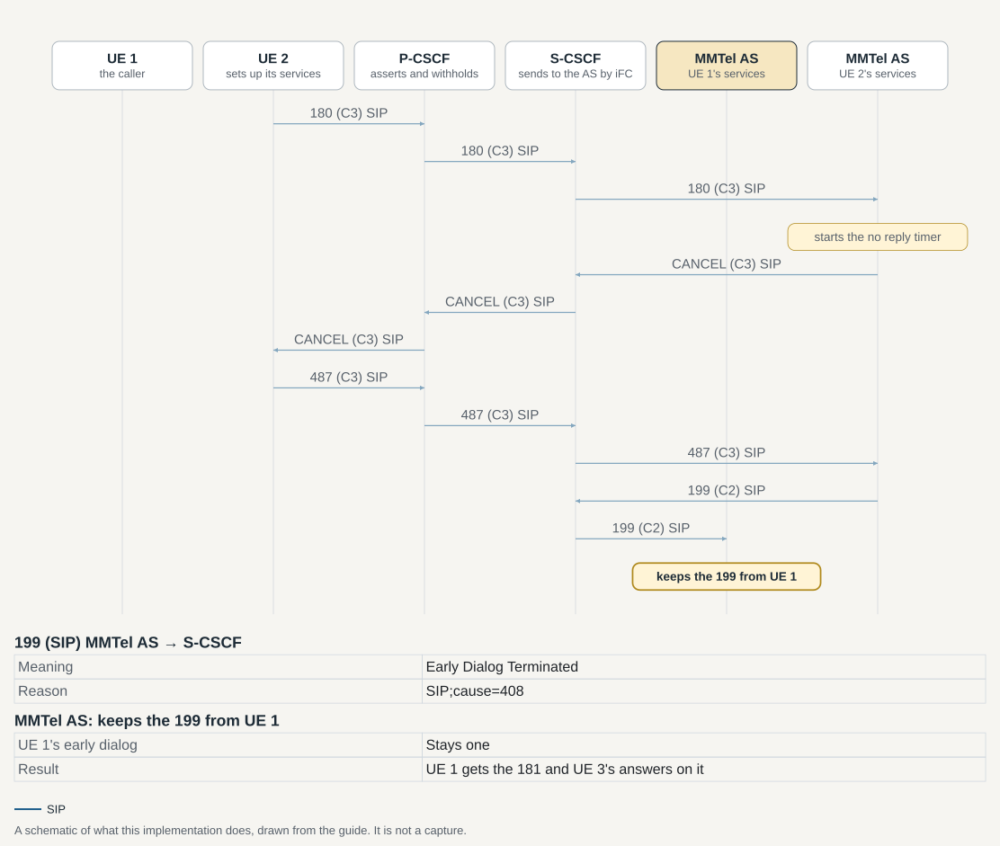

After the CANCEL, UE 2 answers 487 and the leg to UE 2 ends. UE 2's AS sends 199 Early Dialog Terminated on C2 to end UE 2's early dialog (RFC 6228). UE 1's AS keeps its one early dialog with UE 1 and does not send the 199 on to UE 1. So UE 1 gets the 181 and UE 3's responses on the same early dialog. From the 181 on it goes as with CFU, diverting with `cause=408`.

### Barring

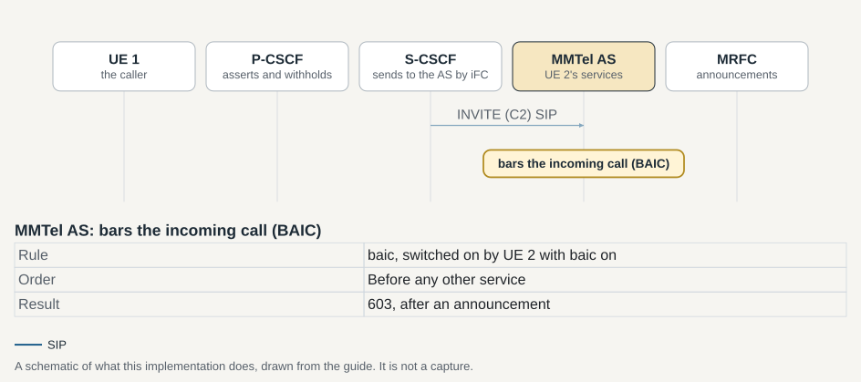

| Service | Setting | What to see |
| --- | --- | --- |
| BAIC | UE 2's `baic on` | UE 2's AS answers 603 Decline, before any other service. |
| ACR | The rule with `<anonymous/>` | 433 Anonymity Disallowed. |
| BAOC | UE 1's `baoc on` | UE 1's AS answers 603 and sends no INVITE of its own. Emergency calls are never barred. |
| BOIC, BOIC-exHC | `boic on` and so on | The callee's country code against the home network's, `1`. |

Before the 603 or 433, the caller hears an announcement. The AS sends the MRFC an INVITE without SDP, and answers the caller with a 183 that has the SDP of the MRFP and `P-Early-Media: sendonly`. The chapter [Announcements, ringback tones and conferences of the MRF](mrf.md) follows that flow.

BOIC bars outgoing international calls. Whether a call is international is decided from the country code of the callee's number by this function.

[internal/simservs/evaluate.go](../../../internal/simservs/evaluate.go)

```go
// SIMPLIFIED: TS 24.611 4.9.1.4. The country of a number is read from
// its country code, so countries that share a code (the NANP countries
// under 1) count as one. A number without a country code (a local number
// with phone-context) is taken to be in the country of the served user.
// Number plans per country are out of scope.
func international(call CallInfo) bool {
	number, ok := telephoneNumber(call.CalledIdentity)
	if !ok || call.HomeCountryCode == "" || !strings.HasPrefix(number, "+") {
		return false
	}
	located := call.VisitedCountryCode
	if located == "" {
		located = call.HomeCountryCode
	}
	return !strings.HasPrefix(number[1:], located)
}
```

The input is the call information `call`, with the callee's number `CalledIdentity` and the home network's country code `HomeCountryCode`. In this setup that code is the `1` of `deploy/compose/mmtel.yaml`. When the user is not abroad, `located` is the home country code. A number that starts with `+1` is not international. So when UE 1 sets `boic on` and calls UE 2 (`tel:+12025550102`), the call is not barred: UE 2's country code is 1, the same as the home network's. As the comment says, treating the North American Numbering Plan countries that share code 1 as one country is a simplification.

### CW and HOLD

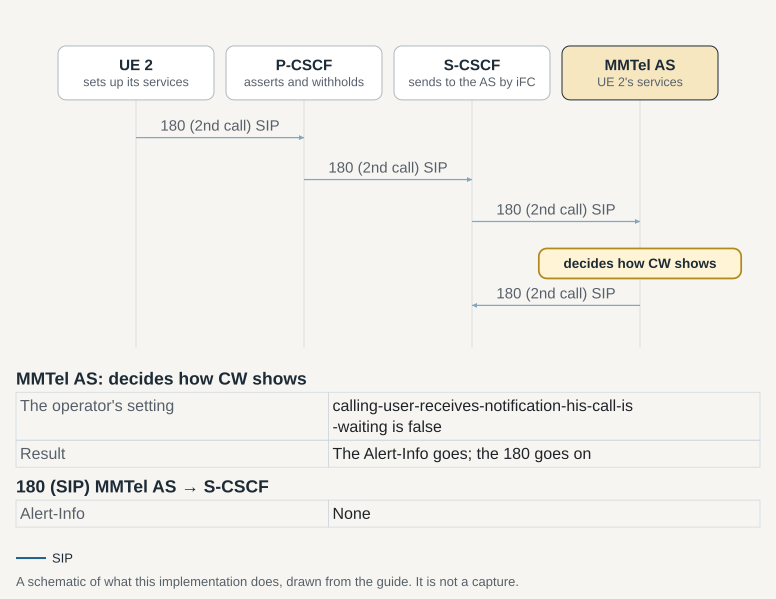

IR.92 asks for call waiting to be done by the UE, not the network (2.3.4). During a call, UE 2 answers a second call with a 180 that has `Alert-Info: <urn:alert:service:call-waiting>` (TS 24.615 4.5.5.3.2, RFC 7462). The AS passes it on, or takes the Alert-Info out by the operator's setting (4.5.5.2.3). The document of this network has `calling-user-receives-notification-his-call-is-waiting` set to `false`: the caller is not told. A hold is a re-INVITE with `a=sendonly`, which the AS passes on to the other leg as it came (TS 24.610 4.5.2.1).

## Each service in the capture

| Service | Trigger | What the capture shows |
| --- | --- | --- |
| OIR | The caller restricts by default | An anonymous From, `Privacy: id` |
| CFU, CFB, CFNR, CFNL | A call, 486, no answer, not registered | 181, History-Info, `cause=` |
| BAIC, ACR, BAOC | A call, an anonymous call, an outgoing call | An announcement in a 183, then 603 or 433 |

The e2e script leaves every service in one capture. The display filters for each service are in the table "Wireshark display filters" of the guide.

## What this project simplifies

| Where | The main items |
| --- | --- |
| AS | No announcement on the 181. No subscription to the settings; read for each call. BIC-Roam never holds. |
| XCAP | No GBA. Plain HTTP, so that the capture shows the XML. A replayed nonce count is not detected. No xcap-diff subscription. |
| simservs | Some conditions and the serv-cap are missing. A country is its country code, so the countries under 1 count as one. |
| CSCFs and HSS | No privacy on History-Info entries. No public service identities, no ORIGINATING_UNREGISTERED. |

The nonce count is not checked so that the AS can run as several instances: keeping the counts would need a Store that every instance shares. A PUT always has If-Match, so a replay after the document has changed gets 412. Each item has a comment that starts with `SIMPLIFIED:` in the code, and the table of the guide gives the clause and the reason of each.

The announcements, alerting tones and conferences of the MRF chapter are asked for by this MMTel AS too. Every VoLTE call also goes through this AS.

## What this account rests on

The author ran these tests and saw them pass.

- The tests of the `internal/ifc` package. They check how trigger points match.
- `TestPServedUser`, `TestTerminatingApplicationServer` and `TestDefaultHandling` in `internal/scscf/services_test.go`. They check P-Served-User, the route when a terminating AS changes the target, and the result of each DefaultHandling. `TestDefaultHandling` uses an SMS criterion, and the 486 that its test peer answers is not a general response.
- `TestINVITEWithoutAServedUser` in `internal/mmtel/relay_test.go`. An INVITE without P-Served-User gets 403.
- `TestCommunicationForwardingNoReply` in `internal/mmtel/diversion_test.go`. The no reply timer starts with the first 180 and runs for the user's 5 s; when it expires, a CANCEL with Reason SIP cause 408 goes out, the caller gets 199 and 181, and the diverted INVITE has `cause=408`. The test fires the timer by hand, so it does not wait 5 s. `TestNoReplyTimerOnlyWithARule` checks that no timer runs without a rule for no answer.
- `TestCFUSetOverUt`, `TestCFBThroughTheIMS`, `TestCFNRThroughTheIMS`, `TestCFNLThroughTheIMS`, `TestBarringThroughTheIMS` and `TestHoldThroughTheIMS` in `internal/mmtel/network_test.go`. They run the whole IMS in one process and check the result of each service.
- `TestConcurrentWritersRetry` and `TestWriterBetweenReadAndWrite` in `internal/xcap/handler_test.go`. A PUT on an old version gets 412 and a PUT after a new read goes through; when another write comes between the read and the write, a conditional PUT gets 412 and an unconditional one tries again and goes through. The example of the two devices above is the first of these tests.
- `TestChallengeOrder` in `internal/xcap/digest_test.go`. The challenges come SHA-256 first, then MD5.
- `TestEvaluateOutgoingBarring` in `internal/simservs/evaluate_test.go`. With home country code 1, BOIC does not bar a call to `tel:+12025550180`.

The values in the tables are those of the tests, the `deploy/compose` configuration and the guide. The figures are diagrams of how this setup behaves, drawn from the guide. They are not captures.

## Run it yourself

The steps to start the setup and try the services one at a time are in "Run it" of the guide [Supplementary services with the MMTel AS](../../guide/en/mmtel.md#run-it), and the display filters in its "Wireshark display filters". Setting them from the Lab is in [Watch the IMS in the Lab](../../guide/en/lab.md#drive-the-ue-simulators). In the slides, the [supplementary services deck](../../../slides/decks/en/07-mmtel.md) shows the figures of this chapter as the steps of its scenes.

The next intermediate chapter follows the audio that the MMTel AS asks the MRF for. [Announcements, ringback tones and conferences of the MRF](mrf.md)
