# Announcements, ringback tones and conferences of the MRF

A caller hears a short tune while the callee's phone rings, and the callee chose that tune. The callee's MMTel AS decided to play it, and the MRFP of the MRF plays it. The AS reads the user's settings and decides what to play and when. The MRF plays the audio it is asked for, and in a conference it mixes the voices of the parties.

The AS sends the MRFC an INVITE whose Request-URI names what to play, without SDP. The MRFC answers with a 200 that has the offer of a termination of the MRFP, and the AS answers the caller's offer itself with that SDP. The audio comes before anyone has answered the call, so the AS allows it as early media with a reliable provisional response and `P-Early-Media: sendonly`. Only when the AS knows from the PRACK that the caller has that response does it send the ACK to the MRFC, and that is when the MRFP starts to play. This chapter follows what this order protects, and, for an announcement, a ringback tone (CAT) and a conference of three, when the resources of the MRF are made and when they go.

## The setup and the editions of this chapter

The example is the `deploy/compose` setup. For the announcement and the ringback tone, UE 1 (`tel:+12025550101`, 172.28.0.100) is the caller and UE 2 (`tel:+12025550102`, 172.28.0.101) the callee. The conference is made with phone1, phone2 and phone3 of the `phones` profile. The MMTel AS is 172.28.0.75, the MRFC 172.28.0.85, the MRFP 172.28.0.86.

The chapter [iFC and the supplementary services of the MMTel AS](mmtel.md) comes first: the AS as a B2BUA that holds three dialogs for a call, and how P-Served-User reads. Reliable provisional responses (PRACK) and preconditions are in the chapter [From a number to the other phone](call.md).

The clause numbers are those of the editions of the guide: TS 23.228 V20.1.0, TS 24.229 V20.1.0, TS 24.182 V19.0.0 (CAT), TS 24.628 V19.0.0 (announcements and early media), TS 24.611 V19.0.0 (barring), TS 24.615 V19.0.0 (CW), TS 24.147 V19.0.0 (conferences), TS 23.333 V19.0.0 (MRFP), RFC 4240, RFC 4575 and GSMA IR.92 v24.0.

## The MRFC and the MRFP

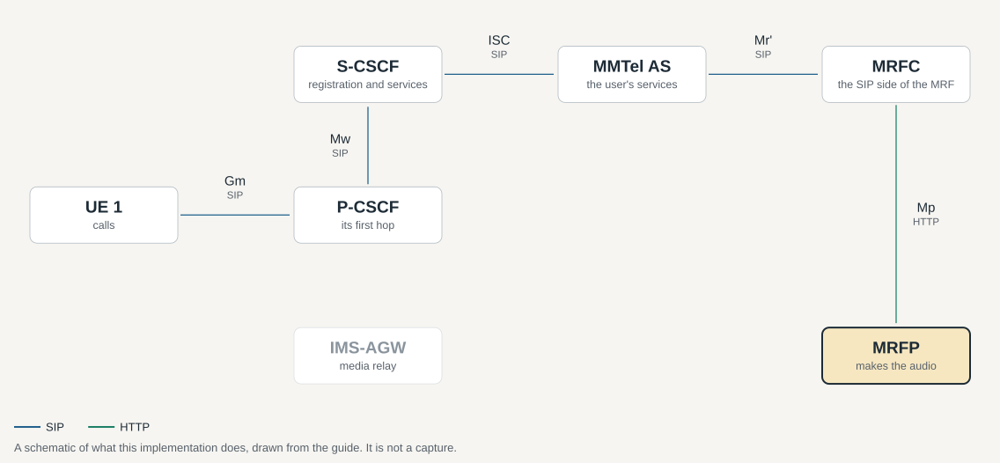

The MRF is the node of the IMS that makes media of its own (TS 23.228 4.7). It has a SIP side, the MRFC, and an RTP side, the MRFP.

- The **MRFC** speaks SIP. An AS asks it for a service with an INVITE, and the MRFC decides which media resources that takes and has the MRFP make the terminations.
- The **MRFP** handles RTP. It plays audio on a termination, and adds up the audio of several terminations to give each of them a mix (TS 23.333 6.2.9).

| Reference point | Between | In this project |
| --- | --- | --- |
| Mr' | the AS and the MRFC | SIP, straight from the MMTel AS. Mr, from the S-CSCF, is not used. |
| Mp | the MRFC and the MRFP | H.248 in the standard (TS 29.333). Here a small HTTP API on port 8080, with one operation per H.248 command. |
| Cr | the AS and the MRFC | Prompts and media control commands. Not built: the MRFP plays the WAV files it has. |

The operations of Mp are to add a termination, to modify one (its mode, its peer address, what it plays), to subtract one, and a Notify that a play has ended. The AS asks for media, not the S-CSCF (TS 23.218). The MRFP is the relay of the P-CSCF's media gateway (the IMS-AGW) with announcements and mixing added. RTP between a UE and the MRFP goes through the IMS-AGW.

## The AS asks with a Request-URI

The AS names the service in the user part of the Request-URI of its INVITE to the MRFC. RFC 4240 sets the form.

| Request-URI | Service |
| --- | --- |
| `sip:annc@mrfc...:5060;play=/provisioned/notice` | Play `notice` once. |
| `sip:annc@...;play=/provisioned/cat1;repeat=forever` | Play `cat1` until the AS ends the dialog. |
| `sip:conf=conf-pcn6hpat5alr@mrfc...` | Join that conference, which the first INVITE creates. |

`annc` plays, and `conf=` joins a conference (RFC 4240 3, 5). `play=` names a file in the configuration of the MRFP: `deploy/compose/mrfp.yaml` maps `notice`, `cat1` and `cat2` to the WAV files of `deploy/announcements`. The AS builds this URI in the following function.

[internal/mmtel/mrf.go](../../../internal/mmtel/mrf.go)

```go
func (as *AS) announcementURI(name string, repeat int) (string, error) {
	if as.cfg.MRFC == "" {
		return "", errNoMRFC
	}
	u, err := sip.ParseURI(as.cfg.MRFC)
	if err != nil {
		return "", err
	}
	u.User = "annc"
	u.Params.Set("play", "/provisioned/"+name)
	switch {
	case repeat < 0:
		u.Params.Set("repeat", "forever")
	case repeat > 0:
		u.Params.Set("repeat", strconv.Itoa(repeat))
	}
	return u.String(), nil
```

The inputs are the name of what to play, `name`, and how many times, `repeat`. From the URI of the MRFC in the configuration, it sets the user part to `annc`, and `play` to `/provisioned/` and the name. A negative `repeat` gives `repeat=forever`, a positive one that count. An announcement asks with 0 (once), a ringback tone with -1 (until stopped).

## Audio before the answer

### An INVITE without SDP lets the AS choose when the play starts

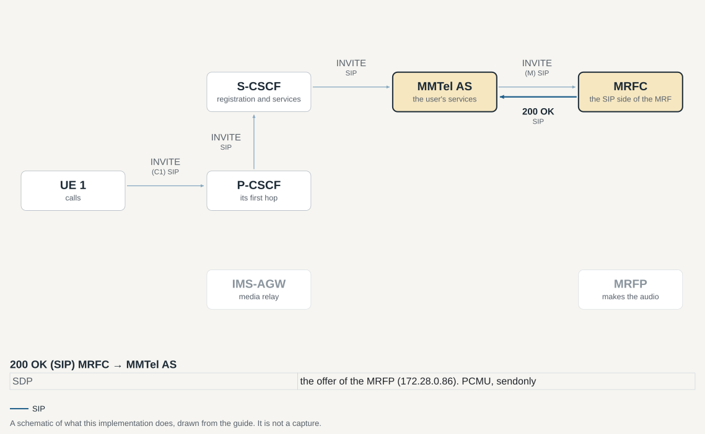

The INVITE that the AS sends the MRFC has no SDP.

[internal/mmtel/mrf.go](../../../internal/mmtel/mrf.go)

```go
	inv := sip.Invitation{RequestURI: uri, From: c.as.uri()}
	if pcv := chargingVector(c.in.Request); pcv != "" {
		inv.Headers = append(inv.Headers, sip.HeaderField{Name: "P-Charging-Vector", Value: pcv})
	}
	out, err := ua.Invite(inv)
```

The `sip.Invitation` has a Request-URI, a From and a P-Charging-Vector, and no body. An MRFC that gets an INVITE without an offer has the MRFP make a termination, and returns its offer (the MRFP's 172.28.0.86, PCMU, `sendonly`) in the 200. The answer then goes in the ACK that the AS sends. The MRFP starts to play once the ACK arrives (TS 24.229 5.8.2.2.1). So an INVITE without an offer lets the AS choose, by when it sends the ACK, when the play starts. With the P-Charging-Vector, the dialog with the MRFC has the icid-value of the caller's call too, and the Lab draws it in the ladder of that call.

### Early media and P-Early-Media

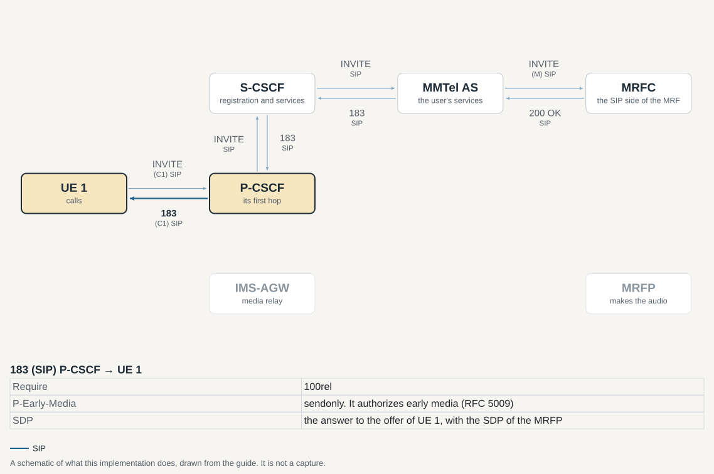

No one has answered the call yet, so the audio to the caller is early media. The AS uses the gateway model of TS 24.628 Annex G: it answers the caller's offer itself with the SDP of the MRFP. It puts `P-Early-Media: sendonly` on the provisional response with that answer, to show that the network allows the audio (RFC 5009). The caller's UE plays the audio that arrives instead of a ringing tone of its own (TS 24.628 4.7.2.1).

The model needs a caller that takes reliable provisional responses. The AS checks that first.

[internal/mmtel/announcement.go](../../../internal/mmtel/announcement.go)

```go
// earlyMediaOffer is the caller's SDP offer when the MRF can play early
// media to it: the INVITE has an offer with PCMU, and the caller
// takes reliable provisional responses, which the gateway model needs
// (TS 24.628 G.1). A caller that requires preconditions gets none: the
// MRFC writes no precondition attributes.
func (c *call) earlyMediaOffer() (sdp.Session, bool) {
	req := c.in.Request
	if !req.Supports(sip.Option100rel) && !req.Requires(sip.Option100rel) || req.Requires(sip.OptionPrecondition) {
		return sdp.Session{}, false
	}
	offer, err := sdp.Parse(req.Body)
	if err != nil || !hasPCMU(offer) {
		return sdp.Session{}, false
	}
	return offer, true
}
```

The input is the caller's INVITE. A caller without `100rel` in Supported or Require, and a caller that requires preconditions, get no early media from the MRF. The MRFC writes no precondition attributes, so it cannot answer a caller that requires them. An offer without PCMU gets none either: the MRFP plays PCMU only. In any of these cases the AS plays nothing and goes on at once; for barring, it answers 603 at once.

## An announcement before a barred call is rejected

When UE 1 bars its own outgoing calls with `ue xcap set baoc on` and calls UE 2, UE 1's AS rejects the call (TS 24.611 4.5.2.4.1). Before that, it plays `notice` (TS 24.628 4.2.4).

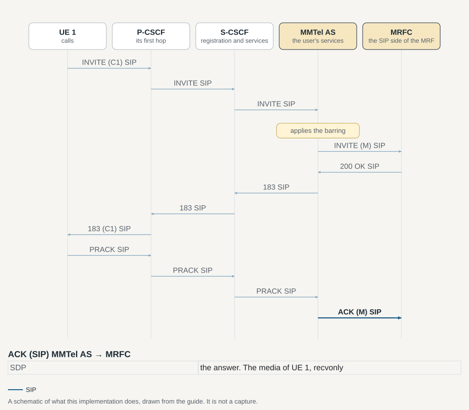

These are the steps of the AS.

[internal/mmtel/announcement.go](../../../internal/mmtel/announcement.go)

```go
	c.mu.Lock()
	c.toCaller, c.sessionToCaller = true, true
	c.mu.Unlock()
	fields := []sip.HeaderField{sip.PEarlyMedia{Directions: []string{sip.EarlyMediaSendonly}}.Header()}
	if pcv := responseChargingVector(c.in.Request, c.as.cfg.HomeDomain); pcv != "" {
		fields = append(fields, sip.HeaderField{Name: "P-Charging-Vector", Value: pcv})
	}
	if err := c.legs.Progress(183, sdpBody(answer), fields...); err != nil {
		c.log.Info("announcement not offered to the caller", "error", err.Error())
		return false
	}
	if err := media.start(offer.Address(*offer.AudioMedia())); err != nil {
		c.log.Warn("announcement not started", "error", err.Error())
		return false
	}
	c.actedOn("announcement")
	select {
	case <-media.dialog.Done():
	case <-c.in.Done():
	case <-time.After(maxAnnouncement):
		c.log.Warn("the announcement did not end", "announcement", name)
	}
	return true
```

`c.legs.Progress(183, ...)` sends the caller a 183 with the MRFP's answer and P-Early-Media. The caller's INVITE offered `100rel`, so this 183 is a reliable provisional response, and the caller acknowledges it with a PRACK. `media.start` sends the ACK to the MRFC, with the address of the caller's media in its answer. The `select` then waits until the MRFC ends the dialog, the caller goes away, or a minute has passed.

The AS waits for the PRACK before it sends the ACK so that no frame of the announcement is lost before UE 1 has the SDP. Until UE 1 has read the SDP of the 183, it does not know where audio will come from. With the ACK first, UE 1 could drop the first frames that the MRFP plays.

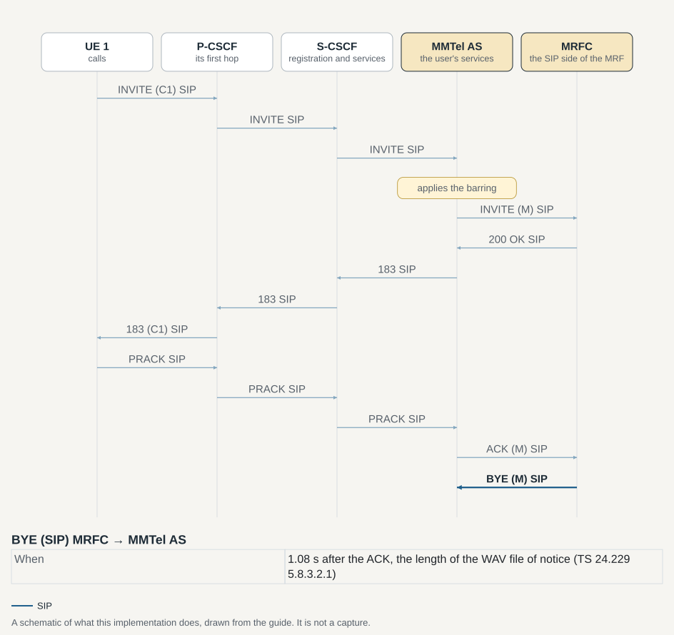

When a play of limited length ends, the MRFC ends the dialog with a BYE (TS 24.229 5.8.3.2.1). In the capture of the guide, the AS's ACK to the MRFC's BYE takes 1.08 s. That is the length of the WAV file of `notice`: the MRFC sends the BYE when the play ends. On the BYE, the AS answers 603 with `Reason: SIP;cause=603;text="Decline"`. The caller has an early dialog already, so the reason for the rejection goes there (TS 24.628 4.2.4).

```text
#525  MMTel  -> MRFC   M  INVITE   sip:annc@mrfc...;play=/provisioned/notice, no SDP
#546  MRFC   -> MMTel  M  200 OK   SDP offer: the MRFP 172.28.0.86, PCMU, sendonly
#559  P-CSCF -> UE 1   C1 183      Require: 100rel, P-Early-Media: sendonly, SDP answer from the MRFP
#564  UE 1   -> P-CSCF C1 PRACK
#582  MMTel  -> MRFC   M  ACK      SDP answer: UE 1's media, recvonly
#728  MRFC   -> MMTel  M  BYE      notice has played, 1.08 s after the ACK
#746  P-CSCF -> UE 1   C1 603      Reason: SIP;cause=603;text="Decline"
```

These lines are copied from the capture of one run of the script in the guide. The frame numbers change from run to run.

## CAT: the tone that the callee chooses

### The terminating AS asks before it alerts

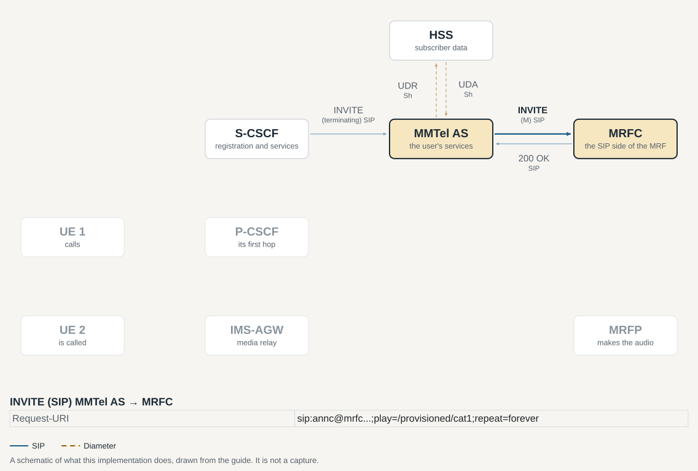

The operator provisions a user's tone in the HSS (TS 24.182 4.5.2); here the OAM does it. There is no standard way for a user to set it (4.8). The terminating AS decides the tone. For each incoming call it reads the setting with a UDR of the Service-Indication `Customized-Alerting-Tone`, and asks the MRFC before it sends the INVITE to UE 2 (4.5.5.3.7).

[internal/mmtel/cat.go](../../../internal/mmtel/cat.go)

```go
func (c *call) startAlertingTone(fields *sip.Message) {
	if c.as.cfg.MRFC == "" || c.withhold {
		return
	}
	offer, ok := c.earlyMediaOffer()
	if !ok {
		return
	}
	tone := c.alertingToneName()
	if tone == "" {
		return
	}
	media, err := c.reserveMedia(tone, -1)
	if err != nil {
		c.log.Warn("CAT: no tone from the MRF", "tone", tone, "error", err.Error())
		return
	}
	fields.Remove("P-Early-Media")
	c.cat = &alertingTone{media: media, callerOffer: offer, content: catContent}
	c.actedOn("CAT")
	c.log.Info("CAT: the tone is reserved", "tone", tone)
}

```

Nothing happens when the configuration has no MRFC, when the AS withholds the callee's answer for a diversion (`c.withhold`), or when the caller cannot take the early media of the MRF (`earlyMediaOffer`). The HSS is asked for the tone only for a call that could have one. With a tone, `reserveMedia(tone, -1)` asks the MRFC with `repeat=forever`. P-Early-Media is taken out of the INVITE to the callee, and the state of the tone goes in `c.cat`. Nothing plays yet: there has been no ACK.

### How the SDP of the tone reaches the caller

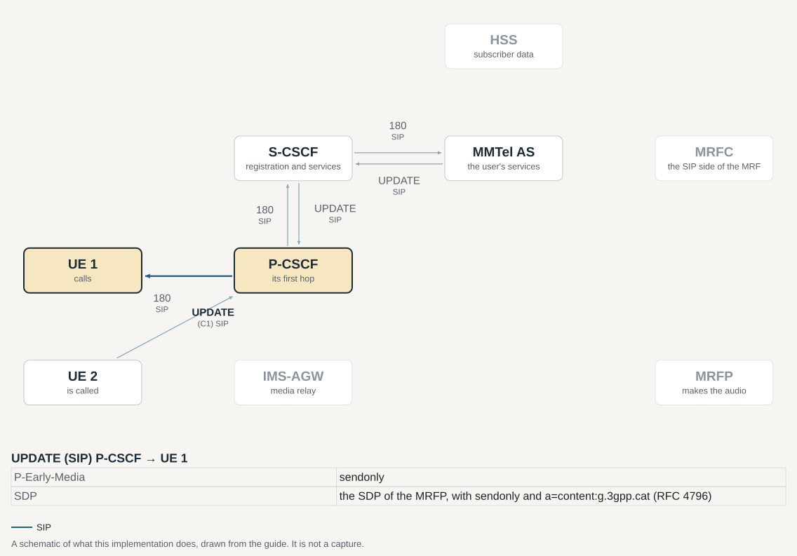

UE 1 uses preconditions. So UE 2's 183 reaches UE 1 as it came, with the table of preconditions, and the tone comes in an UPDATE after the 180 in which UE 2 starts to alert (TS 24.182 4.5.5.3.7 b 1). For a caller without preconditions, the SDP of the tone goes in the 18x itself.

The attribute `a=content:g.3gpp.cat` (RFC 4796) marks the SDP as that of the tone, and the header `P-Early-Media: sendonly` allows the audio (TS 24.182 4.5.5.3.7 b 2). When UE 1 answers the UPDATE, the AS sends the ACK to the MRFC, and the audio of the MRFP reaches UE 1 through the IMS-AGW before the answer.

### The answer stops it and moves the media to the callee

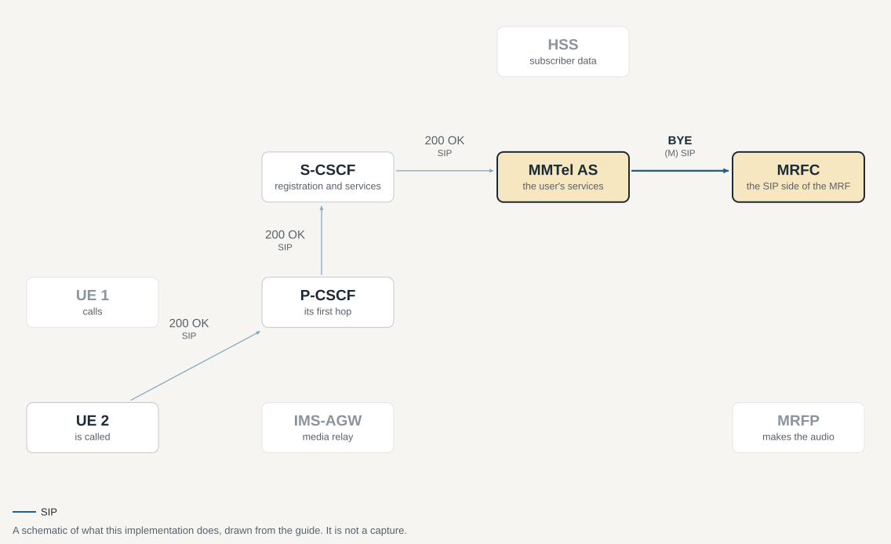

When UE 2's 200 arrives, the AS sends a BYE to the MRFC, which stops the tone. Then, before it sends UE 1 the 200, it sends an UPDATE with UE 2's SDP, which moves UE 1's media to UE 2. This too is the gateway model of TS 24.628 Annex G.

| Look at | With `cat1` | With the tone off |
| --- | --- | --- |
| UE 1's log | `"ringback":"network"` | `"ringback":"local"` |
| What reaches UE 1 | an UPDATE with P-Early-Media | the 180, without it |
| The MRFC | an INVITE with `repeat=forever` | none |
| The MRFP | RTP to UE 1 before the answer | none |

Side by side with a call to a subscriber whose tone is off, the tone adds only the dialog with the MRFC, the UPDATE and the RTP of the MRFP; nothing else of the call changes. The e2e script compares the first second that UE 1 received with `cat1.wav` as the MRFP encodes it to PCMU, and finds them equal byte for byte.

## When the call waits

For a second call to a user who is in a call, the callee's UE answers with a 180 that has the call-waiting Alert-Info (TS 24.615 4.5.5.3.2). The terminating AS then plays no tone: a call that waits gets the waiting indication instead of a ringback tone (the second option of TS 24.182 4.6.11). The document of this network does not tell the caller, so the AS takes the Alert-Info out before it passes the 180 on, and the MRF takes no part. With a setting that tells the caller, and an announcement configured, the AS passes that Alert-Info on and plays the caller the announcement while the call waits (TS 24.615 4.5.5.2.3). That setting is when the MRF comes in.

## A conference of three

### The factory URI and the REFERs

When phone1 has two answered calls and presses **Merge**, the conference is made in these steps.

| Step | What to see |
| --- | --- |
| 1 | An INVITE to the conference factory URI, `sip:mmtel@conf-factory...`. |
| 2 | The AS asks the MRFC with `conf=` and phone1's offer, and answers phone1 with the conference URI in Contact, with `isfocus`. |
| 3 | phone1 SUBSCRIBEs to that conference URI, Event `conference`. |
| 4 | A REFER per peer, whose Refer-To carries a Replaces of phone1's call with that peer. |
| 5 | The focus INVITEs each peer with that Replaces and a new offer of the MRFP. The peer ends the call that was replaced with BYE. |

The creator brings each peer in with a REFER: option 2b of TS 24.147 5.3.1.3.3, which IR.92 2.3.3 asks for. The focus accepts a REFER with 200, not 202, because RFC 7647 5 changed the 202 of RFC 3515.

### The conference URI is a PSI, and DNS points to the focus

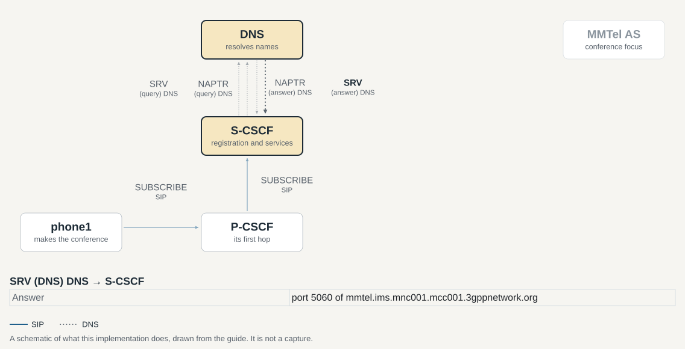

The conference URI is a public service identity (PSI) of the home network (TS 23.228 4.3.6). Its form is `sip:conf-<id>@conf.ims.mnc001.mcc001.3gppnetwork.org`, with a domain that the operator chooses. It names no node and has no port, since a PSI that may leave the network had better have none (TS 23.003 13.5). The NAPTR and SRV records of this subdomain point to the AS that hosts the conferences, and the S-CSCF finds the focus with RFC 3263 as for any other host (TS 23.228 5.4.12.3). The S-CSCF does not ask the HSS.

### The focus and the mix

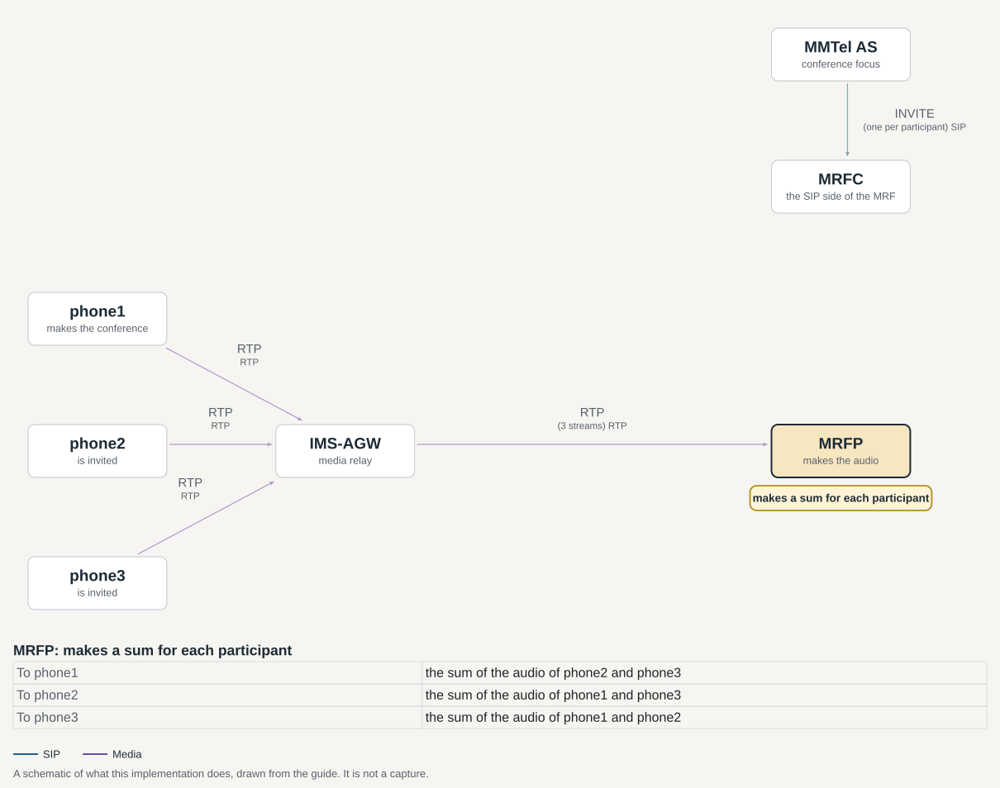

The AS is the focus of the conference and its notification service too (TS 24.147 4). It holds a dialog with each party, and, for the media of each party, a dialog with the MRFC. The MRFC makes the mix on the first `conf=` INVITE, and adds a termination for each INVITE after it. The MRFP sends each party the sum of the audio of the other parties, and never a party's own voice back to it (TS 23.333 6.2.9).

So a conference of three has three RTP streams between the MRFP and the IMS-AGW in each direction: there are three parties, each sends its own voice to the MRFP and gets the sum of the other two. The mix a party gets is louder than the tone of any one party. The invited peers use preconditions too, so each answers the offer of the MRFP in a reliable 183 and sends its 200 without SDP. The AS passes that answer to the MRFC in the ACK (RFC 3262 5).

### The conference event package

| Look at | What to see |
| --- | --- |
| The NOTIFYs | conference-info XML (RFC 4575), with a `<user>` per party and an `<endpoint>` of status `connected`. |
| The `entity` of a `<user>` | The identity that the network asserted for the party, or an anonymous URI for one that asks for privacy (RFC 4575 8.2). |
| The `entity` of an `<endpoint>` | A key that the focus makes, a `urn:uuid:` URI. RFC 4575 5.7 leaves the key to the focus. |
| maximum-user-count | Six. The seventh participant gets 403. |

The key of an `<endpoint>` is not the Contact of the UE because the Contact is the address of that UE, and the NOTIFYs reach every subscriber of the conference, in other networks too. With the Contact as the key, the address of every party's UE would show to every other subscriber.

## Coming back to the conference

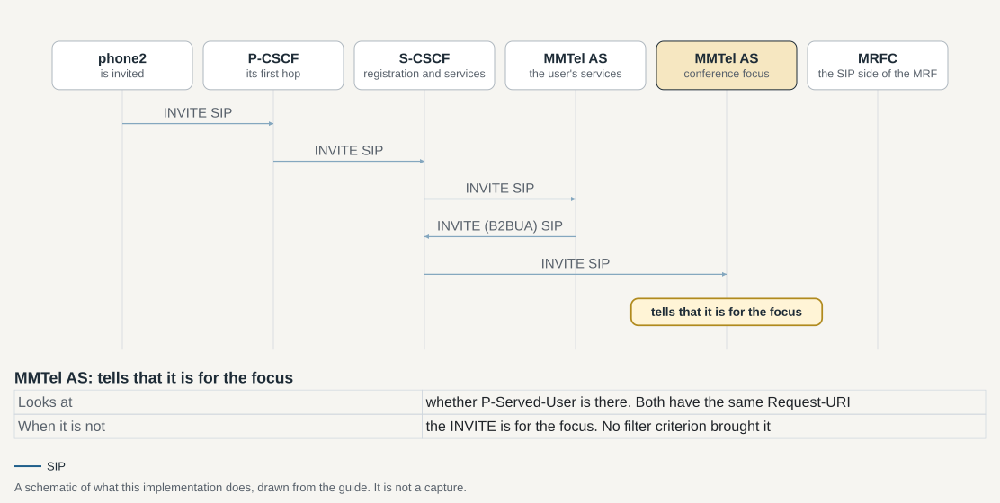

A party that has left can come back while the conference goes on, with an INVITE to the conference URI that it learned from the Contact of the focus (TS 24.147 5.3.1.4.1). That INVITE goes the way of any other call of that user. The S-CSCF hands it to the AS for the originating services, with a P-Served-User of `sescase=orig`. The AS, a B2BUA, sends a new INVITE to the same URI back to the S-CSCF, which finds the focus by DNS. So two INVITEs with the same Request-URI reach the AS.

The AS tells them apart by whether there is a P-Served-User.

[internal/mmtel/call.go](../../../internal/mmtel/call.go)

```go
func (as *AS) serve(in *sip.IncomingCall) {
	req := in.Request
	log := as.log.With("call_id", req.Get("Call-ID"))
	// TS 24.229 5.7.1.3A: the S-CSCF names the served user in
	// P-Served-User, and this S-CSCF always adds the session case. A
	// request without one came by no filter criterion. The INVITE to a
	// conference URI comes that way, by DNS (conference.go).
	served, err := sip.ParsePServedUser(req.Get("P-Served-User"))
	if err != nil || served.SessionCase == sip.SessionCaseNone {
		if _, ok := as.conferenceID(req.RequestURI); ok {
			as.joinConference(in, log)
			return
		}
		log.Info("INVITE without a served user and its session case", "p_served_user", req.Get("P-Served-User"))
		in.Reject(403, as.warning("No served user"))
		return
	}
```

What brings an INVITE to the focus is DNS, not a filter criterion, so an INVITE for the focus has no P-Served-User. When `served.SessionCase` is empty and the Request-URI is a conference URI, it goes to `joinConference`. With a P-Served-User, it is an INVITE for the user's services, and the AS, as a B2BUA, sends it back to the same URI.

The focus takes the party in as it takes the creator (TS 24.147 5.3.2.4.1). It asks the MRFC for a new termination with the party's offer, and answers with a 200 whose Contact has `isfocus`. The NOTIFYs list the party as `connected` again, with the joining-method `dialed-in`, not `dialed-out`.

## The lifetime of the resources: contexts and parties

A resource of the MRF lasts as long as its dialog with the MRFC. When it is made and who ends it is set for each use.

| Use | The dialog with the MRFC is made | The audio starts | What ends it |
| --- | --- | --- | --- |
| The announcement before barring | when the AS decides to reject | at the ACK after the caller's PRACK | the BYE of the MRFC when the play ends |
| CAT | before the INVITE to the callee | at the ACK after the caller has the SDP of the tone | the BYE that the AS sends on the callee's answer or the end of the call |
| A party of a conference | when the party joins (the first one makes the mix) | when the dialog with the MRFC is set up; for an invited peer, at the ACK with its answer | the BYE that the AS sends when the party leaves |

This function handles a party that leaves.

[internal/mmtel/conference.go](../../../internal/mmtel/conference.go)

```go
func (f *conference) left(p *party) {
	if err := p.media.Bye(); err != nil && !errors.Is(err, sip.ErrCallEnded) {
		f.log.Warn("BYE to the MRFC failed", "error", err.Error())
	}
	f.mu.Lock()
	f.setStatus(p, confinfo.Disconnected)
	if f.ended {
		f.mu.Unlock()
		return
	}
	connected := 0
	for _, o := range f.record.Participants {
		if o.Status != confinfo.Disconnected {
			connected++
		}
	}
	ends := p.creator || connected == 0
	var others []*party
	if ends {
		f.ended = true
		others = slices.Clone(f.parties)
	}
	f.writeRecord()
	f.mu.Unlock()
	f.log.Info("participant left", "creator", p.creator, "connected", connected)
	if !ends {
		f.notify(nil)
		f.mu.Lock()
		f.remove(p)
		f.mu.Unlock()
		return
	}
	f.end(others)
}
```

`p` is the party that left. First `p.media.Bye()` ends that party's dialog with the MRFC, which gives up the termination of the MRFP. The party's status becomes `disconnected`, and the parties still connected are counted. `ends` is true when the party that left is the creator, or none is left. If it is false, a NOTIFY goes to the other subscribers and only that party is removed. If it is true, `end` follows. `end` sends a BYE to every remaining party, and after each BYE that party's dialog with the MRFC ends too. Then it ends every subscription to the conference event package with a last NOTIFY, and gives the conference URI up (TS 24.147 5.3.2.7).

Since the URI is given up, a call to the URI of a conference that has ended gets 404. The same goes for the creator who tries to come back.

[internal/mmtel/conference.go](../../../internal/mmtel/conference.go)

```go
	f := as.conferenceAt(req.RequestURI)
	if f == nil {
		// Step 1: no conference has this URI, or none has it any more.
		log.Info("INVITE to a conference URI that is not allocated", "request_uri", req.RequestURI)
		in.Reject(404)
		return
	}
```

When `conferenceAt` finds no conference with that URI, the focus answers 404 (Not Found) (TS 24.147 5.3.2.4.1 step 1).

## What this project simplifies

| Where | The main items |
| --- | --- |
| MRFC | PCMU only, and no transcoding: an offer without PCMU gets 488 with a Warning. Only provisioned announcements, so no Cr. The Contact is the URI of the instance, not a GRUU. |
| MRFP | The mixer takes PCMU, keeps three frames for jitter, writes no CSRC list and sends no RTCP. |
| AS, the tone | The callee's 183 with preconditions goes to the caller as it came, and the tone starts without a look at the caller's preconditions. |
| AS, the conference | Every served user may create one; there is no conference policy. A REFER that asks the focus to remove a participant is refused with 403. |

PCMU only, because a conference mixes decoded speech, and this repository has no AMR decoder. The UE simulators offer PCMU. Each item has a comment that starts with `SIMPLIFIED:` in the code, and the table of the guide gives the clause and the reason of each.

## What this account rests on

The author ran these tests and saw them pass.

- `TestAnnouncementBeforeBarring` in `internal/mmtel/mrf_network_test.go`. The AS of a callee with BAIC plays the caller the announcement before the 603. The caller gets a 183 and then the 603; the 183 has an answer from the MRFP with PCMU and `sendonly`, `Require: 100rel` and `P-Early-Media: sendonly`; the 603 has a Reason of SIP cause 603; every frame of the announcement reaches the caller, in order, before the 603, and none after; and the MRFP holds no context afterwards. The side that bars differs from the example of this chapter (BAOC), but the steps of the AS are the same `reject`. `TestBarringWithoutPCMU` checks that a caller without PCMU gets the 603 alone at once.
- `TestGatewayModelOrder` in `internal/mmtel/cat_test.go`. With a test MRFC, the INVITE to the MRF goes before the INVITE to the callee; the tone starts with the ACK only after the caller has acknowledged the 180 with the SDP of the MRFP; and on the answer, the MRFC gets its BYE and the caller an UPDATE with the callee's SDP, then the 200. `TestNoToneForAWaitingCall` and `TestAnnouncementForAWaitingCall` check a call that waits.
- `TestCustomizedAlertingTone`, `TestCustomizedAlertingToneWithPreconditions` and `TestLocalRingbackWithoutCAT` in `mrf_network_test.go`. The tone reaches a caller without preconditions and one with them before the answer; for a subscriber whose tone is off, the caller gets the 180 alone and no RTP before the answer.
- `TestThreeWayConference` in `internal/mmtel/conference_network_test.go`. The MRFP holds one context with three terminations; every leg runs PCMU; each party hears the other two; the conference goes on with two when one leaves; and when the creator leaves, the conference ends and the MRFP holds no context.
- `TestRejoinWithTheConferenceURI` in the same file. A party that left sends an INVITE to the conference URI, which goes through its originating services and then by DNS to the focus, and the party is back in the conference. `TestJoinWithTheConferenceURI` in `internal/mmtel/conference_test.go` checks that the focus takes in parties that join with the conference URI until the conference is full.
- The tests of the `internal/mrfc` and `internal/netann` packages. They check the MRFC and the reading of the Request-URIs of RFC 4240.

The 1.08 s and the lines of frames are copied from the capture of the guide; the author did not measure them for this chapter. The figures are diagrams of how this setup behaves, drawn from the guide. They are not captures.

## Run it yourself

The steps to run the announcement, the tone, the waiting call and the conference yourself are in "Run it" of the guide [Announcements, alerting tones and conferences with the MRF](../../guide/en/mrf.md#run-it), and the display filters in its "Wireshark display filters". The Lab is in [Watch the IMS in the Lab](../../guide/en/lab.md#drive-the-ue-simulators). A conference with parties in two networks is in the guide [Connect two IMS networks](../../guide/en/interconnect.md#a-conference-across-the-border). In the slides, the [MRF deck](../../../slides/decks/en/08-mrf.md) shows the figures of this chapter as the steps of its scenes.

The next intermediate chapter looks at the authentication and resource control that mobile access adds. VoLTE calls go through the MMTel AS of this chapter too. [Registration and calls over VoLTE](volte.md)
