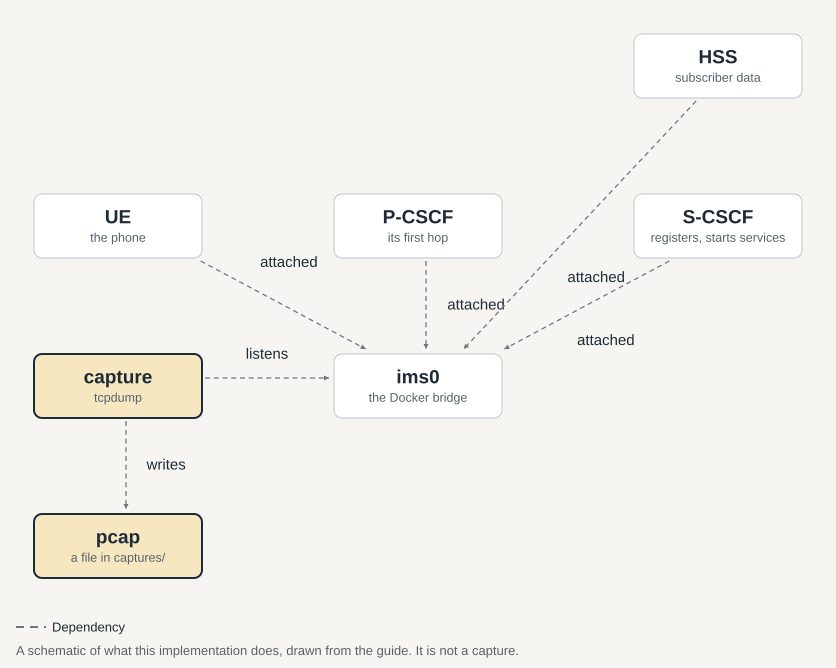
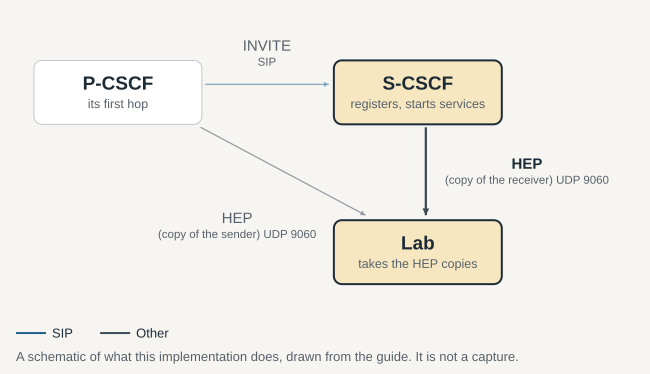
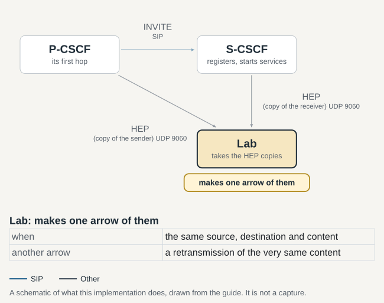
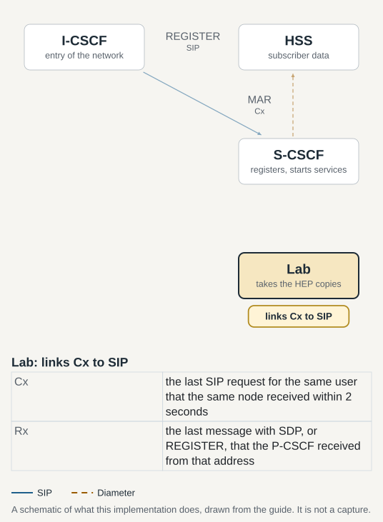
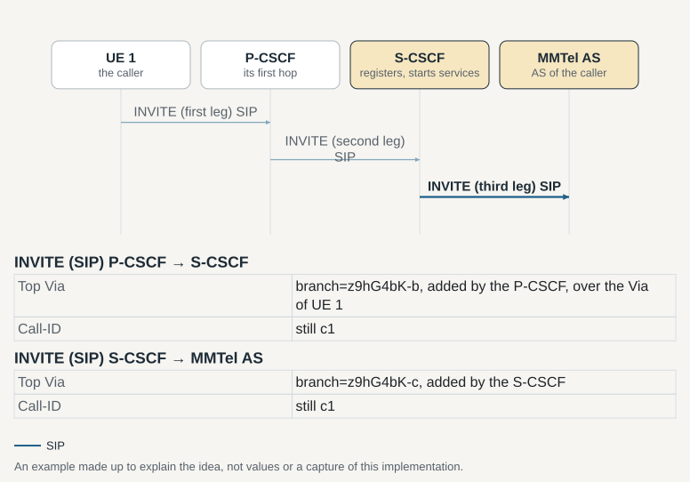
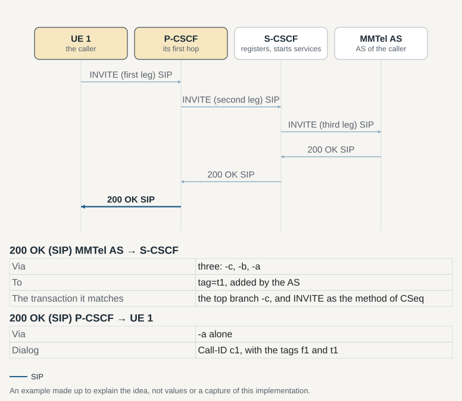
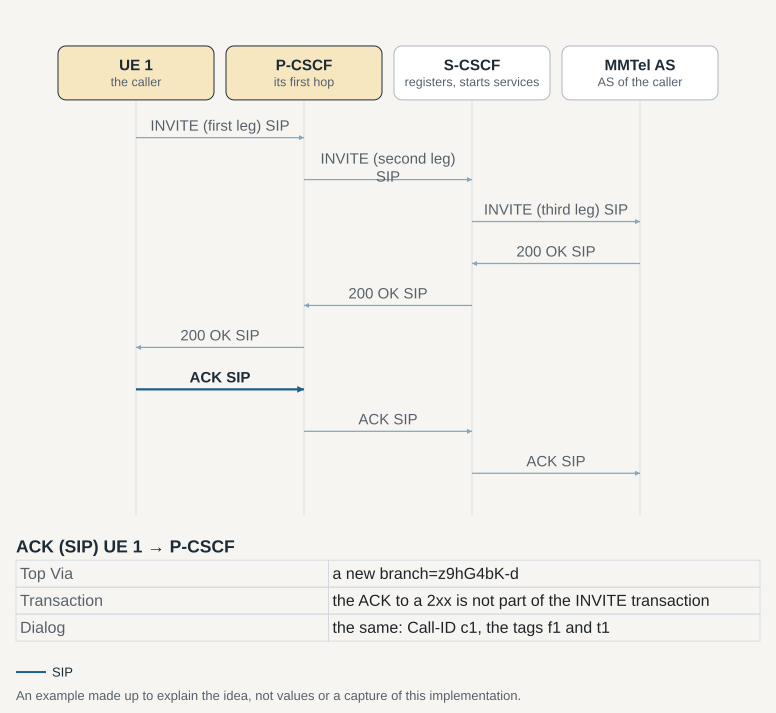
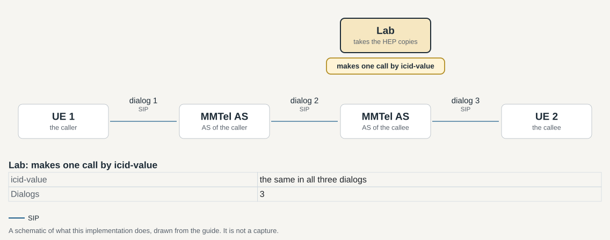

# Watching the signalling

The chapters of this book read signalling drawn from captures and from the ladder diagrams of the Lab. The two show the same signalling, but on different grounds. A capture is a file of the packets themselves that crossed the Docker bridge: what is in it was observed. The Lab builds its ladder from copies of the messages that the nodes send it. The content of the SIP and Diameter messages is observed there too, but which SIP request a Cx or Rx message was for is something the Lab infers by a rule. An inference can be wrong.

This chapter explains where a capture comes from and what it does not show, what the display filters of the book keep, what the Lab builds and what it infers, and how to tell transactions and dialogs apart in a capture.

## The setup of this chapter

The setup is `deploy/compose`. Every node is on one Docker network (172.28.0.0/24), whose bridge is named `ims0`. The capture container `capture` listens on the bridge, and the Lab (172.28.0.60) receives the copies of the nodes on UDP port 9060. The rules of transactions and dialogs are given with the clauses of RFC 3261.

## A capture shows what crossed the bridge



The `capture` container does not join the network of the nodes; it uses the network of the host as it is. From there it runs tcpdump on the bridge `ims0` and writes every packet to `captures/ims-<start time in UTC>.pcap`. The nodes start only after tcpdump runs in this container, so the first message of each node is in the file too. Each start makes a new file, and a file stays until it is deleted. In the setup that joins two networks, each of the three bridges, those of the two networks and that of the link between them, gets a capture container and a file of its own.

Some things are not in a capture. One is a message that a node sends to itself. When the S-CSCF serves both the caller and the callee, it sends an INVITE to itself. That message never leaves the container, so the bridge never shows it. The other is a packet that tcpdump missed. The capture script explains how that happens, and what it sets to make it rarer.

[images/capture/capture.sh](../../../images/capture/capture.sh)

```sh
# The kernel keeps the packets that tcpdump has not written out yet in a
# buffer of its own, and drops the ones that no longer fit. A dropped
# packet leaves a hole that nothing in the file points at: the capture
# simply does not hold that message, and whoever reads the file sees the
# flow go on without it. -B asks for 32 MiB rather than the 2 MiB that
# the default gives, so that a burst on the bridge does not fill the
# buffer while tcpdump waits for the processor. -U writes each packet out
# as it comes, so that a reader of the file sees the flow as it happens.
exec tcpdump -i "$iface" -U -n -B 32768 -w "$file"
```

The kernel keeps in a buffer of its own the packets that tcpdump has not written out yet, and drops those that do not fit. A dropped packet leaves no trace in the file: to a reader, the flow simply goes on without that message. `-B 32768` widens the buffer from the default 2 mebibytes to 32, and `-U` writes each packet out as it comes. That a message is not in a capture does not prove that it was not sent.

### What is in the file before any registration

Before any UE does anything, the file holds the Diameter connections coming up. The display filter `diameter` shows them.

| Look at | What to see |
| --- | --- |
| CER and CEA | Seven connections to port 3868: Cx from the I-CSCF and the S-CSCF, Sh from the two ASs, SGd from the IP-SM-GW to the SC, S6c from the SC to the HSS, Rx from the P-CSCF to the PCRF |
| DWR and DWA | A side that has heard nothing for about 30 seconds asks whether its peer is alive (RFC 3539 3.4.1) |
| DPR and DPA | A node that stops tells its peer before it closes the connection. A stopped S-CSCF sends a DPR with Disconnect-Cause `REBOOTING` |

## What a display filter keeps

One file holds all the signalling of the setup. A display filter of Wireshark keeps only what is to be read. A filter joins the following parts with `&&` (and) and `||` (or), and turns one round with `not` or `!`.

| Written | What it keeps |
| --- | --- |
| `sip`, `diameter`, `rtp` | Every packet of that protocol |
| `diameter.cmd.code == 302` | What has a field equal to a value. 302 is the LIR and LIA of Cx |
| `diameter.cmd.code in {302, 306, 307}` | What has a field equal to one of several values |
| `ip.addr == 172.28.0.70` | Both directions of one node, here the IP-SM-GW. `ip.src` and `ip.dst` are one direction |
| `sip.CSeq.method in {"MESSAGE", "REGISTER"}` | SIP messages of some methods |
| `sip.Call-ID == "<Call-ID>"` | The messages of one dialog |
| `not udp.port == 9060` | Everything but the copies for the Lab |

The guides that the chapters of the book point to use the following filters. Each keeps the messages of its flow and hides what has nothing to do with it.

Registration. It keeps SIP, the Cx messages (command codes 300 and above) and the NAPTR and SRV queries, and hides the watchdog of Diameter (DWR and DWA, command code 280).

```text
sip || diameter.cmd.code >= 300 || dns.qry.type == 35 || dns.qry.type == 33
```

Calls. It keeps SIP, the LIR and LIA, the NAPTR queries (ENUM), and RTP and RTCP.

```text
sip || diameter.cmd.code == 302 || dns.qry.type == 35 || rtp || rtcp
```

SMS. It keeps REGISTER and MESSAGE, the SIP of the IP-SM-GW, the LIR, UDR and PUR, the commands of SGd and S6c, and this project's Ready-For-SM.

```text
sip.CSeq.method in {"MESSAGE", "REGISTER"} || (sip && ip.addr == 172.28.0.70) || diameter.cmd.code in {302, 306, 307, 8388645, 8388646, 8388647, 8388648, 8388649, 16777214}
```

The supplementary services. It keeps the SIP that is not registration, subscription or short message, the HTTP of the MMTel AS (Ut), and the SAR, LIR, UDR and PUR.

```text
(sip && !(sip.CSeq.method in {"REGISTER", "SUBSCRIBE", "NOTIFY", "MESSAGE"})) || (http && ip.addr == 172.28.0.75) || diameter.cmd.code in {301, 302, 306, 307}
```

The MRF. It keeps the SIP of the calls, the subscriptions to conferences and the HTTP of the MRFP (Mp).

```text
(sip && !(sip.CSeq.method in {"REGISTER", "SUBSCRIBE", "NOTIFY", "MESSAGE"})) || (sip.Event contains "conference") || (http && ip.addr == 172.28.0.86)
```

VoLTE. It keeps the SIP of registration and calls, the commands of Rx (AAR, STR, ASR), the MAR and the API of the EPC stub.

```text
(sip && !(sip.CSeq.method in {"SUBSCRIBE", "NOTIFY", "MESSAGE"})) || diameter.cmd.code in {265, 274, 275, 303} || (http && ip.addr == 172.28.0.80)
```

The guide on interconnection has a table of filters for the three captures of the two networks and the link between them. The guide on SMS has a table of filters on the fields of the RP and TP layers.

Wireshark also draws what a filter kept. **Statistics > Flow Graph** with **Limit to display filter** ticked makes a ladder diagram of the messages left. **Telephony > VoIP Calls** lists each SIP dialog as a call, and **Play Streams** plays its audio.

## The Lab builds from the copies the nodes send



A node whose configuration has a `hep` section sends the Lab a copy of every SIP and Diameter message it sends or receives. The UE simulator sends them with `-hep lab:9060`. The copies are HEP version 3, sent to UDP port 9060 and never answered. No node waits for the Lab, and the Lab asks no node for its state. The Lab is not part of the IMS and not on the path of any call.

Two copies of one message arrive: one from its sender, one from its receiver. The copies cross the bridge too, so the capture has them as UDP packets to port 9060. Wireshark does not decode HEP as it comes, so `not udp.port == 9060` hides them.

HEP does not say whether the node sent the message or received it. The Lab compares the source and the destination of the message with the addresses of the node that sent the copy, and finds the direction from that.

### Two copies make one arrow



When the page of the Lab draws a ladder, it puts the two copies into one arrow.

[web/lab/src/ladder.ts](../../../web/lab/src/ladder.ts)

```ts
// A send and a recv with the same payload, src and dst are one message on
// the wire. Each key keeps a queue of arrows still missing a side, so that
// identical retransmissions stay separate arrows, and a recv captured
// before its send still pairs.
export function pairArrows(ordered: Message[]): Arrow[] {
  const arrows: Arrow[] = [];
  const unpaired = new Map<string, Arrow[]>();
  for (const m of ordered) {
    const key = JSON.stringify([m.protocol, m.src, m.dst, m.payload]);
    const waiting = unpaired.get(key) ?? [];
    const match = waiting.findIndex(
      (a) => a.messages.length < 2 && (m.direction === "" || !a.messages.some((seen) => seen.direction === m.direction)),
    );
    const partner = match >= 0 ? waiting[match] : undefined;
    if (partner) {
      partner.messages.push(m);
      waiting.splice(match, 1);
      continue;
    }
    const arrow: Arrow = {
      from: hostOf(m.src),
      to: hostOf(m.dst),
      protocol: m.protocol,
      summary: m.summary,
      messages: [m],
    };
    arrows.push(arrow);
    unpaired.set(key, [...waiting, arrow]);
  }
  return arrows;
}
```

The input is the copies in the order of their times. The key is four things: the protocol, the source, the destination and the content. If an arrow with the same key still has one side only, and no copy of the same direction yet, the copy joins it. Otherwise the copy starts a new arrow. So the copy of the receiver pairs even when it arrives first. A retransmission with exactly the same content has two copies from the sender, so it makes two arrows. A message that only one end reports, such as one with a softphone that sends no HEP, makes an arrow of one copy.

All of this is observed. One arrow is one message on the network. The arrows are in the order of the times that the nodes put in their copies. This setup runs on one machine, so the times of all nodes come from one clock.

## The link of Cx and Rx is the Lab's inference



A ladder shows a REGISTER next to the UAR, MAR and SAR sent for it. But nothing in a Cx message says which SIP request it was sent for. The Session-Id of Diameter and the Call-ID of SIP are unrelated, and HEP carries no link either. The Lab infers it from the rule of the procedures.

[internal/lab/causes.go](../../../internal/lab/causes.go)

```go
// callIDOf is the Call-ID of the SIP request that caused the Cx request
// d, which the node at from sent at t, or "" when none did.
func (ix causeIndex) callIDOf(d *diameterMessage, from netip.Addr, t time.Time) string {
	var best cause
	for _, rule := range diameterCauses[d.Code] {
		for _, identity := range d.identities(rule.avp) {
			list := ix[causeKey{from, rule.field, identity}]
			// Newest first. The copies of one node arrive in the order it
			// sent them, so an older one ends the search.
			for i := len(list) - 1; i >= 0; i-- {
				c := list[i]
				if c.time.After(t) {
					continue
				}
				if t.Sub(c.time) > causeWindow {
					break
				}
				if best.callID == "" || c.time.After(best.time) || c.time.Equal(best.time) && c.id > best.id {
					best = c
				}
				break
			}
		}
	}
	return best.callID
}
```

The input is a Cx or Rx request `d` that the node `from` sent at time `t`. `diameterCauses` gives, for each command, the AVPs that name the user and the value of the SIP side to compare each with. For UAR, MAR and SAR, the User-Name is compared with the username of the Authorization of a REGISTER, and the Public-Identity with its To. For LIR, the Public-Identity is compared with the Request-URI of a request. For the first AAR of Rx, the Framed-IP-Address is compared with the source address of a message with SDP, or of a REGISTER.

The function goes through the SIP messages that the same node received with the same value, newest first. It skips those received after the request, and stops at the first one more than `causeWindow` (2 seconds) older. The Call-ID of the newest match becomes the Call-ID of the request. The answer, and the later messages of the same session, take the same Call-ID through the Session-Id.

The rule is right because the procedures are fixed: the I-CSCF sends a UAR right after it receives a REGISTER, the S-CSCF a MAR right after it receives one. So it goes wrong in these cases.

- **A request that a timer starts.** The SAR that the S-CSCF sends when a registration expires is for no SIP request. It is still linked to a REGISTER of the same user, if the S-CSCF received one less than 2 seconds before. If not, it is linked to nothing.
- **Requests of the same user less than 2 seconds apart.** The newest is chosen. If the Cx for an earlier request is sent after a later request has arrived, it goes with the later one.
- **What the HSS sends on its own.** The PPR after a subscription changes and the RTR after one is deleted are sent for no SIP request, so they are linked to no ladder. The capture has them.

When an arrow of a Cx or Rx message is selected, the page of the Lab says in **Link to this ladder** of its details that the link is the Lab's inference and is not written in the message.

## Transactions and dialogs in a capture

To read SIP in a capture, look at transactions and dialogs apart. A transaction is one request with its responses (RFC 3261 17). A dialog is a relation between two UAs that lasts: an INVITE starts it and a BYE ends it (RFC 3261 12).



An INVITE is a separate transaction on each leg. The P-CSCF and the S-CSCF are proxies: one that receives a request puts a Via of its own, with a new branch, on top and sends it on (RFC 3261 16.6 step 8). On the way back, each node takes its own Via off the top of the response and sends it on (16.7 step 3). So a capture shows the same INVITE once on each leg, and the branch of the top Via differs from leg to leg.



Which transaction a response belongs to is decided by the branch of the top Via and the method of CSeq. The SIP stack of this repository makes that match the type of a key.

[internal/sip/stack.go](../../../internal/sip/stack.go)

```go
// clientKey matches a response to a client transaction: the branch of
// the top Via and the CSeq method (RFC 3261 17.1.3).
type clientKey struct {
	branch string
	method Method
}

// serverKey matches a request to a server transaction: the branch and
// sent-by of the top Via and the method, where an ACK counts as the
// INVITE it acknowledges (RFC 3261 17.2.3).
type serverKey struct {
	branch string
	sentBy sentBy
	method Method
}
```

`clientKey` finds the transaction of a request sent, for a response (RFC 3261 17.1.3). A CANCEL uses the same branch as its INVITE, so without the method a 200 to the CANCEL would be taken for the 200 to the INVITE. `serverKey` tells a new request from a retransmission (17.2.3).

A dialog is set by the Call-ID and two tags.

[internal/sip/dialog.go](../../../internal/sip/dialog.go)

```go
// DialogID identifies a dialog at one UA (RFC 3261 12). The local tag
// of one UA is the remote tag of its peer.
type DialogID struct {
	CallID    string
	LocalTag  string
	RemoteTag string
}
```

The side that sends the request puts the tag of From, and the side that answers the tag of To. The local tag of one UA is the remote tag of the other. A proxy changes neither the Call-ID nor the tags, so the dialog is the same on both sides of the P-CSCF and the S-CSCF. In a capture, `sip.Call-ID == "<Call-ID>"` keeps the messages of that dialog, on every leg.



The ACK to a 2xx is another transaction, with a new branch (RFC 3261 17, 8.1.1.7). The INVITE transaction ends with the 200 OK, and the UAC sends the ACK as a request inside the dialog. The ACK to a final response that is not 2xx has the same branch as the INVITE and is part of its transaction. Comparing the branches of the INVITE, the 200 OK and the ACK in a capture shows the difference.

### Three dialogs in one call



A proxy makes no dialog, but the MMTel AS does. It is a routeing B2BUA (TS 24.229 5.7.5): it answers the INVITE it receives itself and sends a new INVITE with a Call-ID of its own. So a call from UE 1 to UE 2 is three dialogs: UE 1 and the originating AS, the two ASs, and the terminating AS and UE 2. A filter on the Call-ID keeps one of them.

Showing the three dialogs as one call is the Lab's reading. What it goes by is the icid-value of P-Charging-Vector, which every dialog inside the network carries. The caller's P-CSCF puts it in and each AS keeps it (TS 24.229 5.2.6.3.3 step 7, 5.7.5.1).

[internal/lab/store.go](../../../internal/lab/store.go)

```go
// joinCall puts the INVITE session of e into the call of its
// icid-value, once a copy of the INVITE that started it shows one, and
// reports whether it did.
//
// A routeing B2BUA, such as the MMTel AS, answers the INVITE it got and
// sends a new one, with a Call-ID of its own. It passes on what it does
// not change, and of the P-Charging-Vector it takes out only the
// orig-ioi (TS 24.229 5.7.5.1), so every dialog of the call carries the
// icid-value that the caller's P-CSCF put in (5.2.6.3.3 step 7). The
// UE's own copy of its INVITE has none yet.
func (st *store) joinCall(e *callIDEntry, s *sip.Message, callID string) bool {
	if e.call == nil || e.icid != "" || s.Method != sip.INVITE || hasToTag(s) {
		return false
	}
	icid := icidValue(s)
	if icid == "" {
		return false
	}
	e.icid = icid
	st.legs[icid] = append(st.legs[icid], callID)
	return true
}
```

When a copy of the INVITE that starts a dialog (one with no tag in To) has an icid-value, the Lab adds that dialog to the call of that value. The UE's own copy of its INVITE has no P-Charging-Vector yet. The P-CSCF adds it, so the dialog joins with the copy of the next leg. The P-CSCF takes the header out of what it sends to a UE, so the UEs never see the value. The Dialogs column of the Calls panel is the number of dialogs joined.

## Observed and inferred

| What to know | The capture | The ladder of the Lab |
| --- | --- | --- |
| The content of SIP and Diameter messages | Observed, as it crossed the bridge | Observed, as in the copies of the nodes. Diameter as JSON |
| A message a node sent to itself | Not there | Observed: an arrow back to the same column |
| Which SIP request a Cx or Rx message was for | Written nowhere | Inferred: the rule of 2 seconds and the same user |
| Which dialogs are one call | The icid-value header can be observed | The Lab's reading of the icid-value |
| RTP, HTTP, DNS | Observed | Not drawn |
| The PPR and RTR that the HSS sends on its own | Observed | Not drawn |
| The UE cards, the access network, the faults panel | Not concerned | Not from the copies: the state that the APIs of the UE simulator, the EPC stub and the fault agent return |

The figures of the book are neither. They are schematics drawn from the guides and the code. To check a value, the capture is the ground.

## What this explanation rests on

- `TestCxMessagesGetTheCallIDOfTheirCause` in `internal/lab/causes_test.go`. It checks that the UAR, MAR and SAR of a registration, the SAR sent after the 200 of a deregistration, and the LIRs for the same user and for different users each get the Call-ID of the right request, and that nothing is linked when the user does not match, when another node received the request, or for a timer more than 2 seconds later.
- `TestCxLinkDoesNotDependOnArrivalOrder` in the same file. It checks that the link is the same when the copies reach the Lab in another order. `TestRxSessionsGetTheCallIDOfTheirCause` checks the link of an Rx session.
- `TestCallThroughTheASIsOneCall` in `internal/lab/calls_test.go`. It checks that three dialogs with one icid-value make one call, and that a dialog with another icid-value, or with none, makes a call of its own.
- "pairing of captured copies" in `web/lab/test/ladder.test.ts`. It checks that the copy of the receiver pairs even when it comes first, that a retransmission with the same content makes two arrows, and that copies with different content do not pair.
- The keys of transactions and dialogs are the code of `internal/sip` quoted above.

The branches, Call-ID and tags of the figures on transactions are an example written short for the explanation. The other figures are schematics of what this setup does, drawn from the guides. Neither is a capture.

## Running it yourself

Reading this chapter needs nothing to run. The steps to open a capture are in [Start the system](../../guide/en/capture.md#start-the-system), [Open the capture file](../../guide/en/capture.md#open-the-capture-file) and [Watch the traffic live](../../guide/en/capture.md#watch-the-traffic-live) of the guides. The Lab is in [Open the Lab](../../guide/en/lab.md#open-the-lab) and [Drive the UE simulators](../../guide/en/lab.md#drive-the-ue-simulators). How to stop it is in [Stop the system](../../guide/en/capture.md#stop-the-system). Among the slides, the [deck on captures and the Lab](../../../slides/decks/en/03-captures.md) shows the figures of this chapter step by step.

The next chapter reads the first flow in this way: registration. [Three things that registration settles](registration.md)
