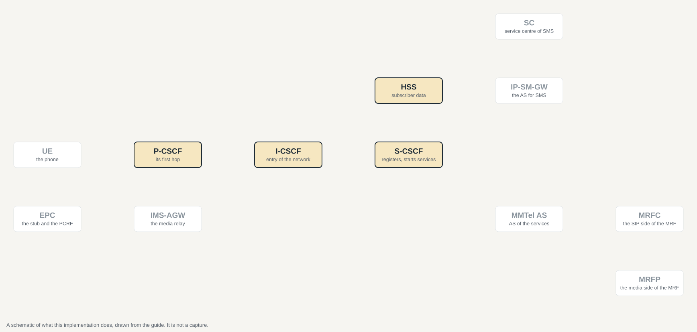
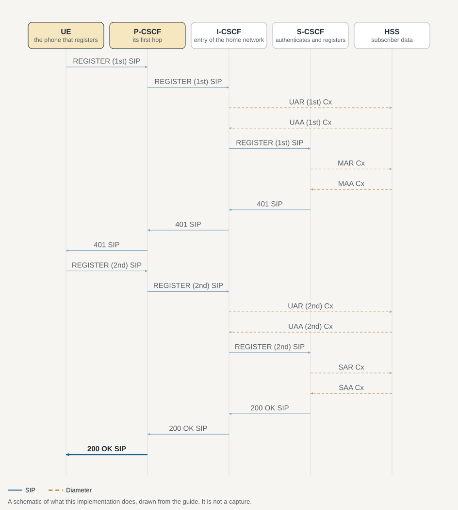
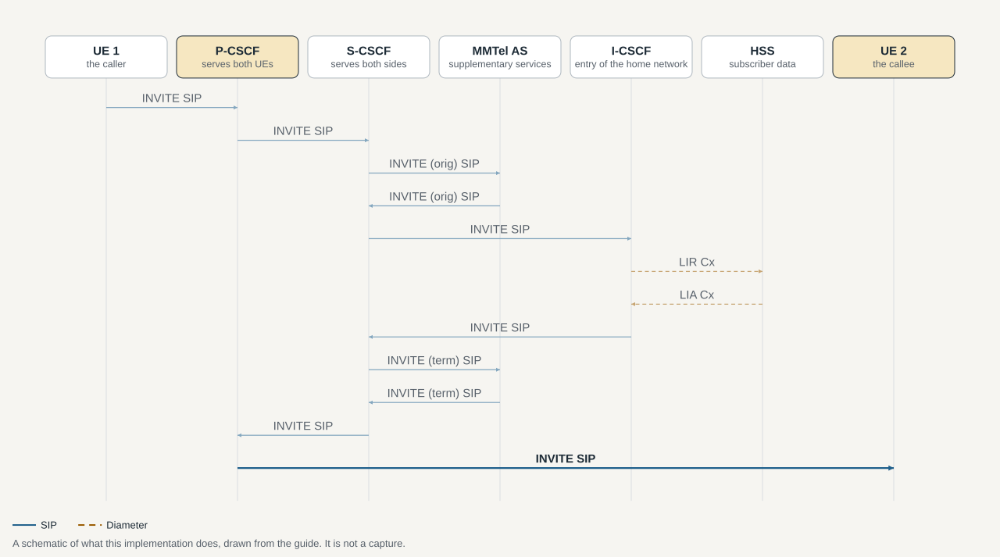
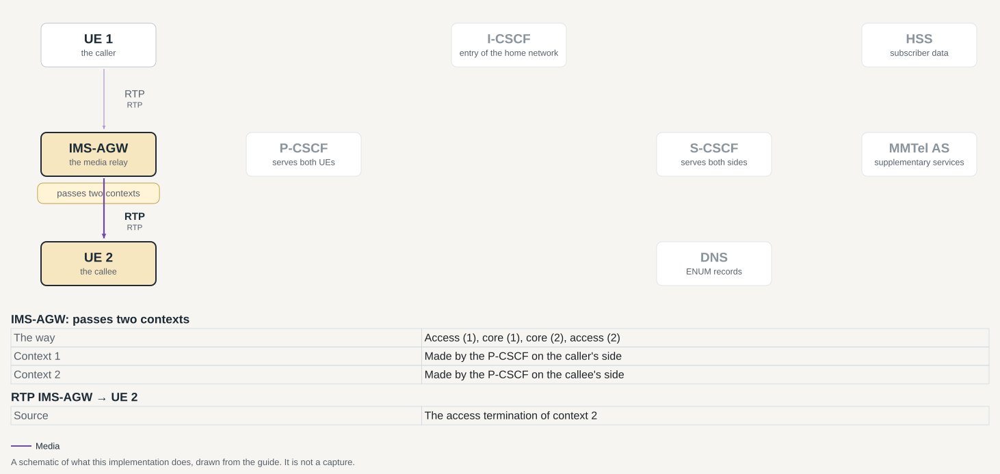
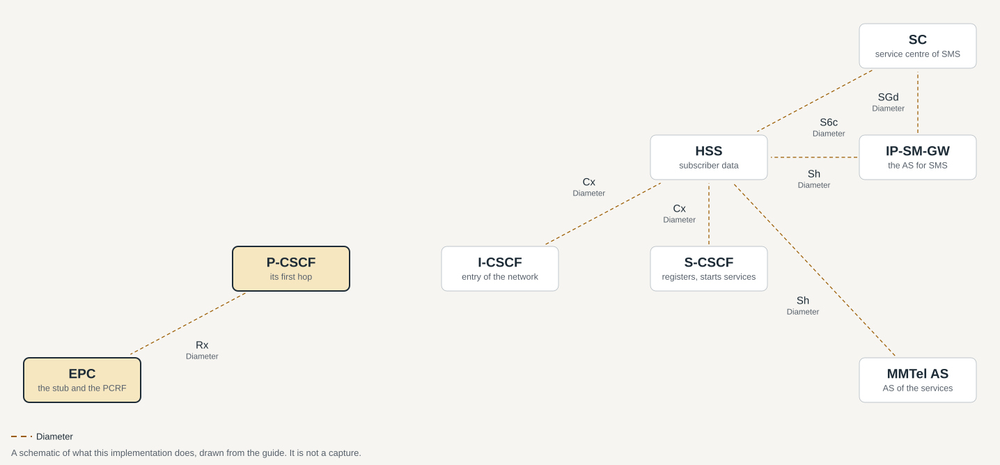
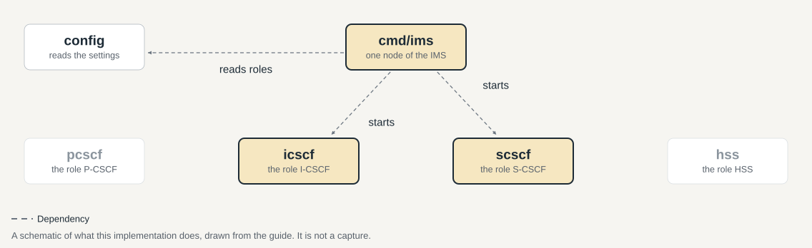
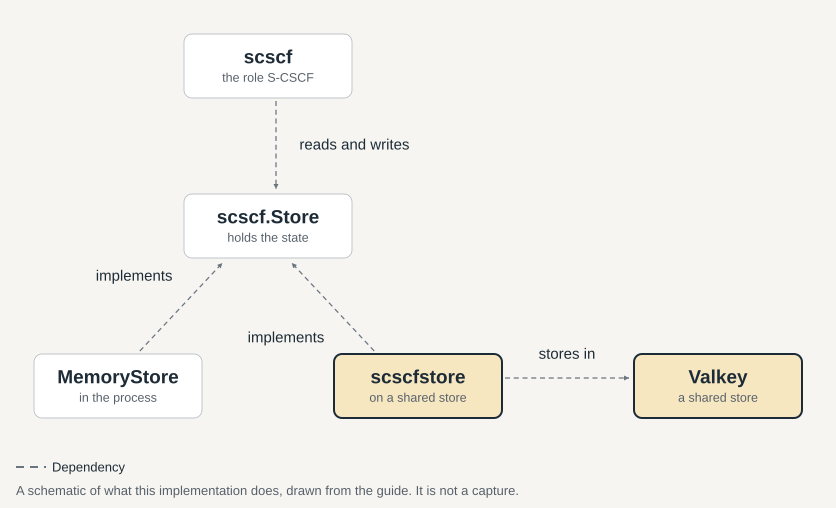

# What IMS does

IMS divides the work that a network must do for a phone call between nodes that each have one job. The work is registration, where a phone tells the network where it is and proves who it is; the signalling of a call, which finds the callee from a number and alerts them; the services that change a call, such as forwarding and barring; and the media, which carries the voice itself. SIP carries the signalling of registrations and calls, Diameter carries the questions to the subscriber data, and RTP carries the voice.

A single SIP proxy can already connect two phones. IMS splits that work and gives each interface between two nodes a name, a reference point (TS 23.228). At a named interface, nodes from different vendors can meet, and so can the networks of different operators. Because each job is a node of its own, each job can run on as many nodes as it needs. A capture also shows which node did what.

This chapter follows one registration and one call, to show which node takes care of what, and where the signalling and the voice each go. The later chapters take the conditions one at a time.

## The setup of this chapter

The example is the `deploy/compose` setup. One node for each role sits on one Docker network. The UE is a softphone without a SIM card: it registers with SIP Digest and calls with G.711. The UE of subscriber 1 (UE 1, `tel:+1-202-555-0101`) registers and calls the UE of subscriber 2 (UE 2, `tel:+1-202-555-0102`), which has registered in the same way.

The clause numbers are those of TS 24.229 V18.11.0 and TS 29.228 V18.0.0, as in the guides on registration and calls. TS 23.228 4.7, which sets the job of the MRF, is that of V20.1.0, as in the guide on the MRF.

## The nodes and their jobs



The figure places the IMS nodes of this setup by their jobs. The four drawn strong take part in every registration and in every call inside this network.

| Node | Job | What it keeps |
| --- | --- | --- |
| P-CSCF | The first SIP hop seen from the phone. Every request of the phone enters here, and every request to the phone leaves from here | For each UE it serves, the IP association and the subscription to the state of its registration |
| I-CSCF | The entry of the home network. It asks the HSS which S-CSCF serves the user, and sends the request there | No state of the users |
| S-CSCF | Authenticates and keeps the registration. It evaluates the iFCs (initial filter criteria) and passes requests to the application servers | The registration: the Contact, the routes, the expiry and the user profile |
| HSS | Holds the subscriber data | The identities, the keys for authentication, the iFCs, the settings of the services, the serving S-CSCF |
| Application servers | Change the call. The MMTel AS handles forwarding and barring, the IP-SM-GW short messages | The MMTel AS its calls, the IP-SM-GW the short messages it is delivering |
| MRF (MRFC and MRFP) | Makes sound in the network: plays announcements and alerting tones, and mixes the audio of a conference | The MRFC the MRFP contexts of each conference, the MRFP the contexts that play and mix the audio |
| Media relay (IMS-AGW) | Relays the RTP of the calls. The P-CSCF controls it | A context for each call |
| EPC stub | Gives a VoLTE UE its address and its P-CSCF, and authorises the media of each call. It holds the PCRF | The attached UEs and their bearers |

There are also the SC (the SMS service centre), which keeps short messages and delivers them; the IBCF and the TrGW at the border with the networks of other operators; and the DNS, which finds the nodes. The SC is a node of the SMS network, not of the IMS; the IP-SM-GW reaches it over Diameter.

The CSCFs only decide where a request goes. The application servers change what a call is, and the MRF makes media of its own (TS 23.228 4.7). The later chapters build on this split.

The Lab, the OAM server and the capture container are on the same network, but they are not part of the IMS. No call waits for an answer from any of them. The Lab and the capture are the subject of [Watching the signalling](observing.md).

## What one registration settles

Before a UE can call or be called, the network has to know it. Registration settles that. The UE sends a REGISTER.



1. The only network address that the UE knows is that of its P-CSCF. A softphone has it in its configuration; a VoLTE UE is given it by the access network when it attaches. The REGISTER reaches the P-CSCF first.
2. The P-CSCF finds an I-CSCF of the home network by DNS, from the domain that the REGISTER is addressed to, and sends it there.
3. The I-CSCF asks the HSS with a UAR which S-CSCF serves this user. At the first registration there is none yet. The HSS returns the capabilities needed, and the I-CSCF picks an S-CSCF that has them.
4. The S-CSCF asks the HSS for the data to authenticate with, in a MAR, and answers the UE with a challenge in a 401. The UE sends a second REGISTER with its answer. The second one too passes the P-CSCF and the I-CSCF, and the I-CSCF asks the HSS again and sends it to the same S-CSCF.
5. The S-CSCF checks the answer, tells the HSS of the registration with a SAR and receives the user profile. It stores the binding and answers 200 OK.

Once the registration is done, three nodes each remember something different. The HSS remembers the serving S-CSCF. The S-CSCF remembers the contact of the UE (Contact) and the route of the requests to the UE (Path). The UE remembers the route of its own requests (Service-Route). The I-CSCF remembers nothing.

Why there are two REGISTERs is the subject of [Why a UE sends REGISTER twice](registration-two-registers.md), and how the two routes are used is that of [Which request follows Path and which follows Service-Route](registration-routes.md).

## The path of the signalling of one call

UE 1 calls the number of UE 2. UE 1 does not know where the callee is. All it knows is the number `tel:+1-202-555-0102`. On its way to the callee, the INVITE passes these nodes.



- **The originating side.** UE 1 sends the INVITE to the P-CSCF. The P-CSCF sends it along the Service-Route received at registration, to the S-CSCF of UE 1. It does not pass the I-CSCF. The S-CSCF passes the INVITE to the MMTel AS, as the iFCs of UE 1 say.
- **The entry of the network.** The S-CSCF turns the number into a SIP URI with ENUM in DNS and sends the INVITE to the I-CSCF. The I-CSCF asks the HSS with a LIR for the S-CSCF of the callee and sends it there.
- **The terminating side.** The S-CSCF of the callee passes it to the MMTel AS again, as the iFCs of UE 2 say, and sends it along the Path stored at registration to the P-CSCF of UE 2. The P-CSCF delivers it to UE 2.

In this setup the S-CSCF of UE 1 and that of UE 2 are the same node, which acts in two roles, for the caller and for the callee. The step of asking the I-CSCF is the same when the two users are on different S-CSCFs.

The MMTel AS answers the INVITE it receives itself and sends a new INVITE with a Call-ID of its own (TS 24.229 5.7.5). So one call between two people is three dialogs: UE 1 and the originating AS, the two ASs, and the terminating AS and UE 2.

When UE 2 rings and answers, the 183, the 180 and the 200 OK go back to UE 1 through each dialog in turn. The BYE that ends the call goes dialog by dialog as well. The steps are in [From a number to the other phone](call.md).

## The voice takes a different path

The signalling went through the CSCFs and the application servers. The voice does not follow it.



The SDP in the INVITE and in its answers decides where the RTP goes. The SDP gives the address and the port that receive the media. In this setup the P-CSCF rewrites the address in the SDP to one of the media relay (IMS-AGW). So the RTP flows only between the UEs and the media relay, and passes neither the CSCFs nor the application servers. The P-CSCF of the caller and that of the callee each make a context (in this setup the same P-CSCF makes one in each of its two roles), so the RTP passes two contexts inside the relay.

The P-CSCF controls the relay with an HTTP API, on the reference point Iq. The API is this project's own, and a setup switches it to the standard H.248. In a VoLTE call the P-CSCF also asks the PCRF over Diameter Rx to authorise the media, and the access network sets up a bearer for the voice. That is in [Mobile access and other operators' networks](access-and-borders.md).

## Reference points and protocols

Each interface between two nodes has a name and a protocol. In a capture, the protocol and the addresses tell which reference point a message is on.




| Protocol | Port in this setup | Reference points and what they carry |
| --- | --- | --- |
| SIP | 5060 | Gm (the UE and the P-CSCF), Mw (between the CSCFs), ISC (the S-CSCF and the application servers), Mr' (an AS and the MRFC), Mx and Ici (the border). Registrations, calls, short messages, subscriptions |
| Diameter | 3868 | Cx (the CSCFs and the HSS), Sh (the ASs and the HSS), SGd (the IP-SM-GW and the SC), S6c (the SC and the HSS), Rx (the P-CSCF and the PCRF). Subscriber data, data for authentication, the serving node, the authorisation of media |
| DNS | 53 | NAPTR, SRV and A to find a SIP server (RFC 3263), and ENUM to turn a number into a SIP URI (RFC 6116) |
| RTP and RTCP | set by the SDP | The voice, between the UEs and the media relay or the MRFP. At the border, Izi between the TrGWs |
| HTTP | 80 for Ut, 8080 for Mp and Iq | Ut (the UE and the MMTel AS: the UE reads and writes the settings of its services with XCAP, TS 24.623), Mp (the MRFC and the MRFP), Iq (the P-CSCF and the media relay) |

SIP and Diameter behave differently. SIP carries a request onwards: a REGISTER or an INVITE goes from hop to hop, and its response comes back the same way. Diameter asks and waits for the answer: the UAR of Cx is one round trip from the I-CSCF to the HSS, and the HSS sends it nowhere else. One SIP message shows up several times in a capture because each hop is captured once.

In the standard, Mp and Iq are H.248 (TS 29.333, TS 29.334). This setup uses a small HTTP API, one operation per command. And the Diameter connections run over TCP where Cx and Sh call for SCTP. The guides give the reason for each in "What this project simplifies".

## A role is chosen by configuration

Every IMS node is the same executable, `cmd/ims`. What node it becomes is set by `roles` in the configuration file of the node. After its opening comment, the configuration file of the S-CSCF starts like this.

[deploy/compose/scscf.yaml](../../../deploy/compose/scscf.yaml)

```yaml
node: scscf
roles: [scscf]
home_domain: ims.mnc001.mcc001.3gppnetwork.org
```

The package `config`, which reads the configuration, has the list of the roles it knows, and refuses at start a configuration that names a role not on that list.

[internal/config/config.go](../../../internal/config/config.go)

```go
var knownRoles = []Role{RoleHSS, RoleICSCF, RoleSCSCF, RolePCSCF, RoleAGW, RoleLab, RoleOAM, RoleIPSMGW, RoleSC, RoleEPC, RoleMMTel, RoleMRFP, RoleMRFC, RoleIBCF, RoleFault}

// Config is a node's validated configuration. Each role's section is
// set exactly when the node has that role.
type Config struct {
```

A configuration that passed the checks has a section only for each role of the node. `run` in `cmd/ims/main.go` looks for each section, as in `if c := cfg.SCSCF; c != nil`, builds the parts of that role and opens its SIP and Diameter ports. The code of a role does not know which node it runs on.



With two or more entries in `roles`, one node takes several roles. The code does not change. The tests of the configuration use a configuration that takes four: the P-CSCF, the I-CSCF, the S-CSCF and the HSS.

[internal/config/config_test.go](../../../internal/config/config_test.go)

```yaml
node: ims
roles: [pcscf, icscf, scscf, hss]
home_domain: ims.mnc001.mcc001.3gppnetwork.org
pcscf:
  sip: {listen: 0.0.0.0:5060, host: pcscf.ims.mnc001.mcc001.3gppnetwork.org}
  visited_network_id: ims.mnc001.mcc001.3gppnetwork.org
icscf:
  sip: {listen: 0.0.0.0:5061, host: icscf.ims.mnc001.mcc001.3gppnetwork.org}
  scscfs:
    - name: sip:scscf.ims.mnc001.mcc001.3gppnetwork.org:5062
scscf:
  sip: {listen: 0.0.0.0:5062, host: scscf.ims.mnc001.mcc001.3gppnetwork.org}
```

Even then, each SIP role listens on a port of its own. In this configuration the I-CSCF sends a request for the S-CSCF to port 5062 of the same host. `config` refuses a configuration in which two roles listen on the same port.

### What this means for several instances

That a role is chosen by configuration also means that one role can run on many nodes. A commercial network runs many nodes for each role. This setup runs one for each, which is enough to follow the signalling. A role can grow because of the following.

- The I-CSCF keeps no state. Whichever I-CSCF a REGISTER reaches, the HSS remembers the serving S-CSCF, so the request goes to the same S-CSCF.
- A role that keeps state about its users keeps it behind an interface named `Store`. The Compose setup keeps it in the memory of the process; the redundant setup (`deploy/redundancy/`) keeps it in a shared store, Valkey. The code of the role is the same.



- A node that reaches the HSS over Diameter can name any number of HSS instances in its configuration. Each of them serves every subscriber.
- Work for one user takes a lock of that user alone. No lock holds up a whole role, and nothing walks over all subscribers.

Keeping the state in a shared store does not by itself keep calls going through a failure. What each instance can take over is the subject of [What several nodes and failures hand over](design-shared-state.md).

## Where the code is

To read the code, start from the package named after the role. There is no need to read the list of all packages.

| What to read | Where it is |
| --- | --- |
| How one node is put together | `run` in `cmd/ims/main.go` |
| The P-CSCF, the I-CSCF, the S-CSCF, the HSS | `internal/pcscf`, `internal/icscf`, `internal/scscf`, `internal/hss` |
| The application servers, the SC, the MRF | `internal/mmtel`, `internal/ipsmgw`, `internal/smsc` (the role `sc`), `internal/mrfc`. The MRFP is `internal/agw`, like the media relay |
| SIP, Diameter, the messages of Cx | `internal/sip` (RFC 3261), `internal/diameter` (RFC 6733), `internal/cx` (TS 29.228, TS 29.229) |
| The UE simulator | `cmd/ue` and `internal/ue` |
| The configuration of each node | one file per node in `deploy/compose/`, and the DNS zones |

Inside the package of a role, each procedure has its own file. In `internal/scscf`, for example, `scscf.go` is registration, `session.go` calls and `services.go` the iFCs. The list of every package is in the [deck on the package layout](../../../slides/decks/en/01-packages.md).

## What this setup does not have

| Not here | What it would be for |
| --- | --- |
| The way out to the telephone network | A number with no ENUM record cannot be reached. The S-CSCF answers 404 where a larger network would send the call out towards a BGCF |
| Gx | The PCRF and the gateway of the bearer share their state inside the EPC stub, so there is nothing between them to see |
| Mr | The S-CSCF asking the MRFC itself. Here every request for media comes from the AS, over Mr' |
| GBA | A key for Ut derived from AKA. The UE uses a password that the AS reads over Sh |

Each guide has a table of "What this project simplifies", which says what was left out of that flow and why.

## What this explanation rests on

- `TestRegisterRefreshAndDeregisterThroughTheWholeIMS` in `internal/ue/ue_test.go`. It runs the P-CSCF, the I-CSCF, the S-CSCF and the HSS in one process, and checks that a registration, a refresh and a deregistration go through.
- `TestCallThroughTheWholeIMS` in `internal/ue/call_test.go`. On the same network two UEs register, one calls the other, the other answers, and the 25 RTP packets that the caller sent reach the callee unchanged. The network of this test has neither the MMTel AS nor a media relay, so the path through the MMTel AS and the voice through the relay are outside this test. They are the flows of the guides that the figures are drawn from.
- `TestParseCombinedRoles` in `internal/config/config_test.go`. It checks that a configuration of four roles gives the sections of the four roles, and that a configuration in which two roles listen on one port is refused. `TestParseRejects` in the same file checks that a configuration naming an unknown role (`mgcf`) is refused.

The figures are schematics of what this setup does, drawn from the guides. They are not captures.

## Running it yourself

Reading this chapter needs nothing to run. To see the same registration and call in a capture of your own, start the setup with [The first commands](../../guide/en/README.md#the-first-commands) of the guides, and go on to [Follow a UE registering with the IMS](../../guide/en/registration.md) and [Follow a voice call through the IMS](../../guide/en/call.md). The address of each service is in [What the Compose project starts](../../guide/en/README.md#what-the-compose-project-starts). Among the slides, the [deck on the map of the network](../../../slides/decks/en/02-network.md) shows the reference points one by one, and the [deck on the package layout](../../../slides/decks/en/01-packages.md) where the code is.

The next chapter is about how to watch the signalling on this map, in a capture and in the Lab. [Watching the signalling](observing.md)
