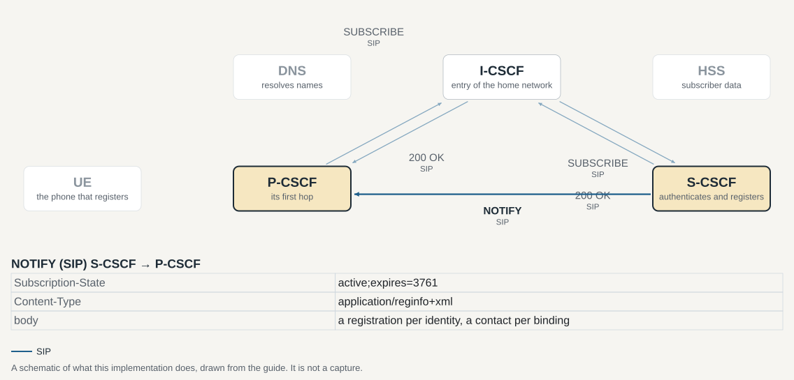
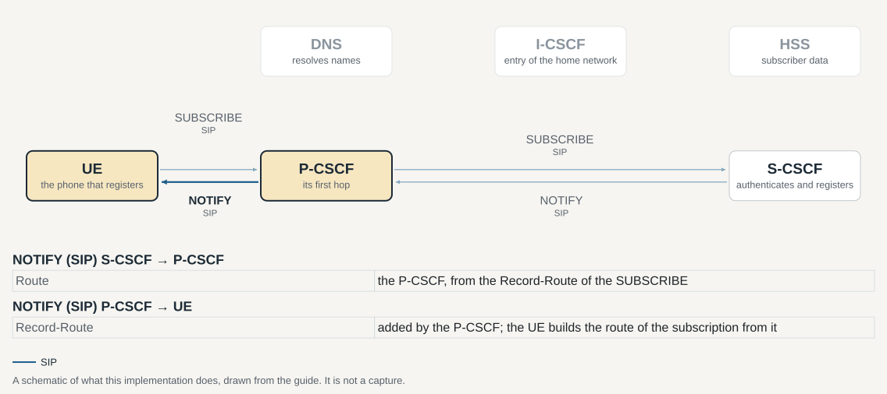
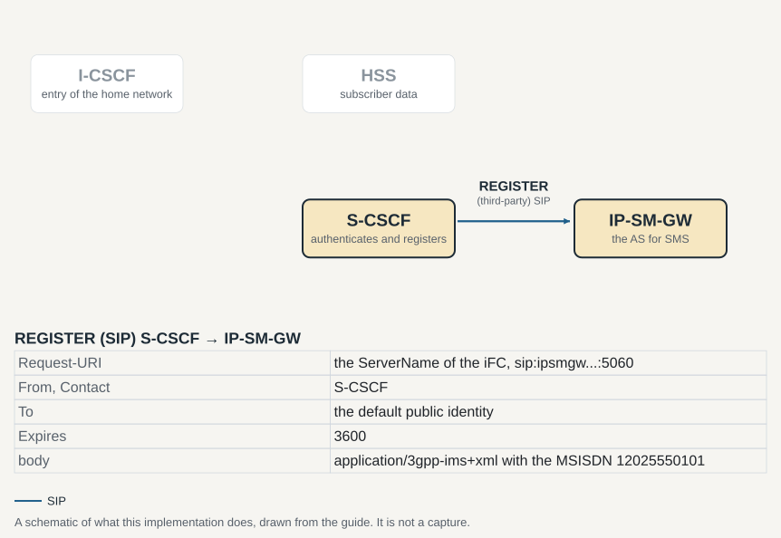
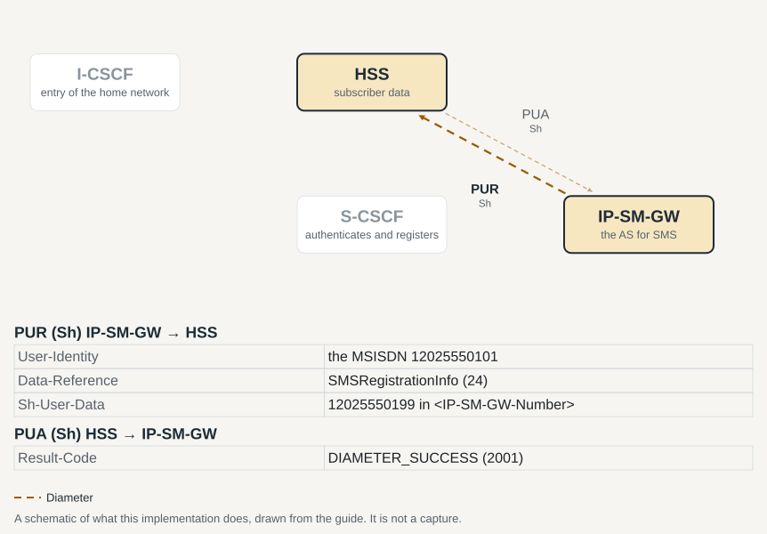
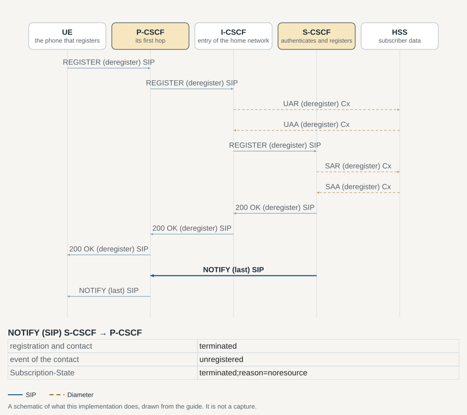
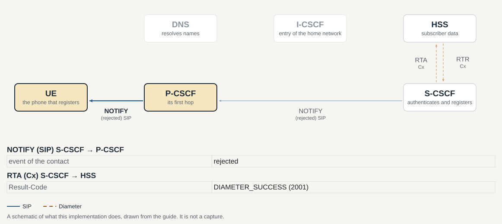
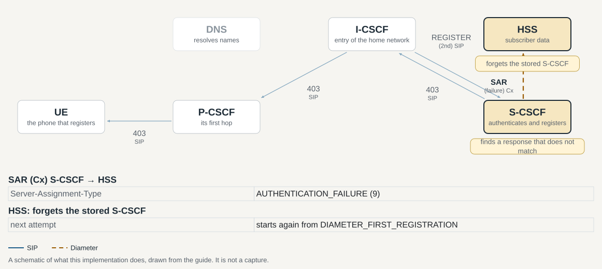

# Refresh, deregistration, subscription and removal by the network

The 200 OK settles the registration, but that is not the end of it. A registration has an expiry, and the UE registers again before it. A registration ends in one of three ways: the UE deregisters, the expiry passes without a refresh, or the network cancels it. Whichever way it ends, the S-CSCF tells the nodes that subscribe to the registration state with a NOTIFY, and the HSS with a SAR. Only when the HSS cancels the registration does the S-CSCF send no SAR, since the HSS started that procedure.

The subscribers are the P-CSCF, the UE and the application server IP-SM-GW. A NOTIFY says what became of a binding in the value of its `event`. Each subscriber decides what to do next from that value. The P-CSCF ends the IP association, the UE decides whether to register again, and the IP-SM-GW writes into the HSS that it handles the user's short messages, or takes that back.

This chapter follows what happens after the 200 OK, in this order: the subscriptions, the third-party REGISTER, deregistration, expiry and removal by the network. At the end it looks at the REGISTER without a Contact, which changes nothing, and at how the Lab shows a registration.

## The setup of this chapter

As in the earlier chapters, the example is the `deploy/compose` setup, with a softphone UE that registers with SIP Digest. The nodes are the UE, the P-CSCF, the I-CSCF, the S-CSCF and the HSS, joined by the IP-SM-GW, the application server for SMS. The S-CSCF of this setup has 3600 seconds as the maximum expiry of a registration.

This chapter cites TS 24.229 V18.11.0, TS 29.228 V18.0.0 and TS 29.229 V18.1.0. The notifications of the registration state use the reg event package of RFC 3680, and the SUBSCRIBE and NOTIFY mechanism of RFC 6665.

## Three nodes subscribe to the registration state

After the registration, three nodes ask the S-CSCF to tell them when the registration of this user changes. They send a SUBSCRIBE with `Event: reg`. As soon as the S-CSCF accepts a subscription, it sends the registration state in a NOTIFY. The subscriptions are needed so that the subscribers learn of an end of the registration that the UE did not ask for, such as an expiry or a removal by the network.

| Subscriber | When it starts | Path of the SUBSCRIBE | P-Asserted-Identity | Expires |
| --- | --- | --- | --- | --- |
| P-CSCF | After it passes the UE the 200 OK to the first registration of the private identity (TS 24.229 5.2.3) | The I-CSCF finds the S-CSCF with a LIR and forwards it | The URI that the P-CSCF put in Path, `sip:term@pcscf...` | 3761 |
| UE | After the 200 OK to its initial registration (TS 24.229 5.1.1.3) | The P-CSCF and the Service-Route. Not through the I-CSCF | The identity of the user, which the P-CSCF adds | 600000 |
| IP-SM-GW | After the third-party REGISTER (TS 24.341 5.3.3.2) | The I-CSCF finds the S-CSCF with a LIR and forwards it | The URI of the IP-SM-GW, the same as the ServerName of the iFC | 3761 |

TS 24.229 5.2.3 has the P-CSCF ask for an Expires higher than the registration interval that the 200 OK gave. 3761 seconds is the default duration of a subscription in RFC 3680 4.4, a little longer than the default registration of 3600 seconds, so that the refreshes of the subscription and of the registration do not coincide. This implementation adds the same margin, 161 seconds, to the registration interval for the Expires of the P-CSCF and of the IP-SM-GW.

The P-CSCF is inside the home network, so it sends the SUBSCRIBE to the I-CSCF at the entry of the home network. The I-CSCF asks the HSS which S-CSCF the user is at with a LIR (Location-Info-Request, TS 29.228 6.1.4), and forwards the SUBSCRIBE to that S-CSCF.



Once the 200 OK has made the dialog of the subscription, the NOTIFYs go straight to the address that the P-CSCF wrote in the Contact of the SUBSCRIBE. The I-CSCF did not stay on the route, so it does not relay the NOTIFY. The P-CSCF makes this subscription once per private identity and does not make it again at a re-registration. It refreshes the subscription 600 seconds before its expiry, within the dialog, straight to the S-CSCF.

The SUBSCRIBE of the UE has the P-CSCF and the Service-Route in its Route, as every other request of the UE. So it does not pass the I-CSCF, and reaches the S-CSCF that holds the registration.



The P-CSCF adds a Record-Route to the SUBSCRIBE, and its own Record-Route to the NOTIFY too (TS 24.229 5.2.6.4.5). The UE builds the route of the subscription from the NOTIFY (RFC 6665 4.4.1), so its later refreshes pass the P-CSCF as well.

### Who may subscribe

The S-CSCF does not accept a subscription from anyone. The subscriber is named in P-Asserted-Identity, and this function checks it (step 1 of TS 24.229 5.4.2.1.1).

[internal/scscf/regevent.go](../../../internal/scscf/regevent.go)

```go
func authorizedSubscriber(req *sip.Message, reg Registration) (string, bool) {
	asserted, err := sip.ParseNameAddr(req.Get("P-Asserted-Identity"))
	if err != nil {
		return "", false
	}
	for _, own := range reg.NonBarredIdentities() {
		if ims.SamePublicIdentity(own, asserted.URI) {
			return asserted.URI, true
		}
	}
	for _, p := range reg.Path {
		if path, err := sip.ParseNameAddr(p); err == nil && sameURI(path.URI, asserted.URI) {
			return asserted.URI, true
		}
	}
	for _, c := range reg.InitialFilterCriteria {
		if sameURI(c.ApplicationServer.ServerName, asserted.URI) {
			return asserted.URI, true
		}
	}
	return "", false
}
```

The input is the SUBSCRIBE `req` and the registration `reg` of the user. Three cases are accepted. The P-Asserted-Identity is an identity of the user that is not barred (the UE's subscription), the URI of a P-CSCF in the Path of the registration (the P-CSCF's subscription), or an application server of the user's iFCs (the IP-SM-GW's subscription). If none matches, the S-CSCF refuses with 403. Before this function, the S-CSCF checks that the user has a registration, and refuses with 480 if not. A subscription with an Accept that does not list `application/reginfo+xml` gets 406, since there is no form the NOTIFYs could carry (RFC 3680 4.5).

That the URI of another P-CSCF is refused matters. The Path of the registration holds only the P-CSCF that the UE registered through.

## What a NOTIFY says

The body of a NOTIFY is an `application/reginfo+xml` document. It has one `registration` for each identity registered together, and in it one `contact` for each binding. The S-CSCF sends the whole state every time (TS 24.229 5.4.2.1.2). This is the shape of the body of the NOTIFY after the initial registration. It is a shortened form of the capture in the guide, and `...` stands for values left out.

```xml
<reginfo xmlns="urn:ietf:params:xml:ns:reginfo" version="0" state="full">
  <registration aor="sip:+12025550101@ims.mnc001.mcc001.3gppnetwork.org" id="reg1" state="active">
    <contact id="..." state="active" event="registered" expires="3600" callid="..." cseq="2">
      <uri>sip:4218b61b-4e20-8e1c-872d-5b39fca1e64f@172.28.0.100:5060</uri>
      <unknown-param name="+g.3gpp.smsip"></unknown-param>
    </contact>
  </registration>
</reginfo>
```

A subscriber reads the `state` of the `registration` and of the `contact` (`active` or `terminated`), and the `event` of the `contact`. The `event` is what brought the binding to its present state.

| event | What happened | state of the binding | What the subscriber does next |
| --- | --- | --- | --- |
| `registered` | A new binding was made | `active` | Starts to use the registration |
| `refreshed` | A re-registration of the same Contact | `active` | Changes nothing |
| `unregistered` | The UE deregistered. An old binding that another Contact replaced gets this too | `terminated` | The P-CSCF ends the IP association |
| `expired` | The expiry passed without a re-registration | `terminated` | The P-CSCF ends the IP association. The UE learns that it is no longer registered |
| `rejected` | The network cancelled it, and registering again would not help | `terminated` | The UE does not register again, and releases its dialogs |
| `deactivated` | The network cancelled it, and asks for a new registration | `terminated` | The UE makes a new initial registration |

What tells `registered` from `refreshed` is these lines of `accept`, where the S-CSCF accepts a registration.

[internal/scscf/scscf.go](../../../internal/scscf/scscf.go)

```go
	// TS 24.229 5.4.2.1.2: a new binding gets a new contact id and the
	// event registered, and replaces the binding of an older contact; a
	// binding that stays is refreshed.
	var replaced *Registration
	if registered && sameURI(old.Contact, reg.Contact) {
		reg.ContactID, reg.ContactEvent = old.ContactID, reginfo.Refreshed
	} else {
		reg.ContactID, reg.ContactEvent = sip.NewTag(), reginfo.Registered
		if registered {
			replaced = &old
		}
	}
```

If there is a registration already and the Contact that came is the stored one, this is a refresh of the same binding, so the event is `refreshed`, and the binding keeps its id. Otherwise it is a new binding, with a new id and the event `registered`. When the old binding had another Contact, it is kept in `replaced`, and the next NOTIFY lists it once more as `terminated` with `unregistered`.

### The last NOTIFY

When a registration ends, the S-CSCF sends a last NOTIFY to each subscription.

[internal/scscf/regevent.go](../../../internal/scscf/regevent.go)

```go
func (s *SCSCF) endRegistration(ctx context.Context, reg Registration, event reginfo.Event, log *slog.Logger) {
	doc := regInfo(reg, reginfo.Terminated, event, time.Now())
	subs, err := s.store.SubscriptionsOf(ctx, reg.PrivateIdentity)
	if err != nil {
		log.Warn("reg event NOTIFYs not sent: the store failed; the subscriptions end when they expire", "error", err.Error())
		return
	}
	for _, sub := range subs {
		sub.Terminate(sip.ReasonNoResource)
		s.notify(ctx, sub, doc, log)
	}
}
```

The input is the registration `reg` that ended and the event `event` that ended it. `regInfo` builds a document with every identity and binding `terminated`, and the reason of the end in the `event` of the `contact`. Then the function reads all the subscriptions to the user, ends each with the reason `noresource`, and sends the NOTIFY. Its Subscription-State is `terminated;reason=noresource`, and the dialog of the subscription ends here too. A subscriber subscribes again after the next initial registration.

The P-CSCF decides from this NOTIFY whether to end the IP association of the UE, with this function (TS 24.229 5.2.5.2).

[internal/pcscf/regevent.go](../../../internal/pcscf/regevent.go)

```go
func removedByTheNetwork(r reginfo.Registration, c reginfo.Contact) bool {
	if r.State == reginfo.Terminated {
		return true
	}
	if c.State != reginfo.Terminated {
		return false
	}
	switch c.Event {
	case reginfo.Unregistered, reginfo.Rejected, reginfo.Deactivated:
		return true
	}
	return false
}
```

If the `registration` of the identity is `terminated`, the registration is over. Even if not, a `contact` that is `terminated` for `unregistered`, `rejected` or `deactivated` is a binding that the network side has removed. In either case the P-CSCF ends the IP association of that Contact and no longer takes requests from the UE. So that the last NOTIFY still reaches the UE, though, it keeps the association that ended for a while, and lets requests to the UE through meanwhile.

## What a re-registration changes

The UE registers again before its registration expires: 600 seconds before the expiry if the earlier registration was for more than 1200 seconds, or when half of it has passed otherwise (TS 24.229 5.1.1.4.1). For the 3600-second registration of this setup, that is after 3000 seconds.

At a re-registration, the following happens.

- A re-registration with SIP Digest is challenged with a 401, as the initial registration was. The S-CSCF removed the challenge when it accepted the registration.
- If the answer is right, the S-CSCF sends a SAR with RE_REGISTRATION and moves the expiry on. The `contact` of the NOTIFY is `refreshed`.
- The P-CSCF does not subscribe again. It refreshes its subscription on a time of its own, apart from the registration.
- The S-CSCF sends the IP-SM-GW a third-party REGISTER again. The IP-SM-GW refreshes its subscription on it. The state has not changed, so it sends nothing to the HSS.

How a re-registration REGISTER that the network reorders is handled is in [Why a late deregistration does not remove a newer registration](registration-stale-deregistration.md).

## The third-party REGISTER to the application server

The S-CSCF matches the REGISTER of the UE against the iFCs of the profile it got in the SAA, and sends a REGISTER of its own to the application server of each iFC that matches. This is the third-party REGISTER (TS 24.229 5.4.1.7). The first iFC of the profile of this setup matches every REGISTER and names the IP-SM-GW.

[internal/scscf/thirdparty.go](../../../internal/scscf/thirdparty.go)

```go
func (s *SCSCF) notifyApplicationServers(req *sip.Message, reg Registration, expires time.Duration, log *slog.Logger) {
	for _, c := range ifc.Ordered(reg.InitialFilterCriteria) {
		// TS 23.218 5.2.1 NOTE 2: a REGISTER is part of the originating
		// case.
		if !c.Matches(req, ifc.OriginatingRegistered) {
			continue
		}
		m := s.thirdPartyRegister(req, reg, c.ApplicationServer, expires)
		go s.sendThirdPartyRegister(m, reg, c.ApplicationServer, expires, log)
	}
}
```

The input is the REGISTER `req` of the UE, the accepted registration `reg`, and the expiry `expires` that the UE was given. `ifc.Ordered` puts the iFCs in the order of their priority, and `Matches` checks the REGISTER against each condition. A REGISTER is matched as an originating request. For each iFC that matches, `thirdPartyRegister` builds a REGISTER, which goes out on a goroutine of its own. The UE has its 200 OK already and does not wait for this answer.



The Request-URI of the third-party REGISTER is the ServerName of the iFC. From and Contact are the S-CSCF, To is the default identity of the user, and Expires is 3600, as the UE was given. The body is `application/3gpp-ims+xml` and holds the MSISDN `12025550101` from the ServiceInfo of the iFC (TS 24.229 5.4.1.7A).

If the IP-SM-GW does not answer, the DefaultHandling of the iFC applies. In this setup it is SESSION_CONTINUED, so the registration stays. With an iFC of SESSION_TERMINATED, the S-CSCF would deregister the user and send the UE a NOTIFY with `rejected` (TS 24.229 5.4.1.5).

The IP-SM-GW answers 200 OK and subscribes to the registration state, as the table above shows. When the first NOTIFY comes, it checks with this function whether the user can take short messages over IP.

[internal/ipsmgw/regevent.go](../../../internal/ipsmgw/regevent.go)

```go
func takesShortMessages(doc reginfo.Document, publicID string) bool {
	for _, r := range doc.Registrations {
		if r.State != reginfo.Active || !ims.SamePublicIdentity(r.AOR, publicID) {
			continue
		}
		for _, c := range r.Contacts {
			if c.State != reginfo.Active {
				continue
			}
			for _, p := range c.UnknownParams {
				if strings.EqualFold(p.Name, featureSMSOverIP) {
					return true
				}
			}
		}
	}
	return false
}
```

The input is the reginfo document `doc` of the NOTIFY and the identity `publicID` in the To of the third-party REGISTER. The result is `true` when the `registration` of that identity is `active` and holds an `active` `contact` with `+g.3gpp.smsip` among its Contact parameters. This feature tag says that the UE can take SMS over IP (TS 24.341 5.3.2.2). The S-CSCF lists the Contact parameters that RFC 3261 does not define as `unknown-param`, so that is where the function looks.



If the user can, the IP-SM-GW reads the IMSI of the user with an Sh UDR, and sends the HSS a PUR (Profile-Update-Request, Sh command 307, TS 29.328 6.1.2). Its Data-Reference is SMSRegistrationInfo (24), and its Sh-User-Data has the number of the IP-SM-GW, `12025550199`, in `<IP-SM-GW-Number>`. The HSS answers with a PUA of DIAMETER_SUCCESS (2001). From then on, the HSS names this IP-SM-GW as the destination of short messages that come from other networks. If the UE registered without `+g.3gpp.smsip`, no PUR is sent. The delivery of short messages itself is in the [chapter on SMS](sms.md).

## The UE deregisters

The UE deregisters with a REGISTER whose Contact has `expires=0` (TS 24.229 5.1.1.6.1). Unlike the initial registration, no 401 comes back. One REGISTER is enough.



Why no 401 comes back lies in one parameter that the P-CSCF adds. Before the P-CSCF forwards a REGISTER, it looks for an IP association with that UE, and rewrites the `integrity-protected` of the Authorization (TS 24.229 5.2.2.3).

[internal/pcscf/pcscf.go](../../../internal/pcscf/pcscf.go)

```go
	switch {
	case protected || asksSecAgree(req):
		var refusal *sip.Message
		if agreement, refusal = p.receiveSecAgree(st, out, privateID, creds, protected, log); refusal != nil {
			respond(refusal)
			return
		}
		integrity = agreement.integrity
	case associated:
		integrity = sip.IPAssociationYes
	case creds != nil && creds.Response != "":
		integrity = sip.IPAssociationPending
	}
```

A SIP Digest UE without the protection of IMS-AKA does not match the first `case`. This UE has registered already, and the P-CSCF made an IP association at that 200 OK, so `associated` is true and `ip-assoc-yes` goes in. With an answer to a challenge but no association yet, it is `ip-assoc-pending`, as in the second REGISTER of the initial registration. Whatever the UE wrote is not used.

The I-CSCF changes the User-Authorization-Type of the UAR, since the REGISTER has an Expires of 0.

[internal/icscf/icscf.go](../../../internal/icscf/icscf.go)

```go
	// TS 29.228 6.1.1: DE_REGISTRATION when the REGISTER asks for an
	// interval of zero.
	uat := cx.Registration
	if seconds, _, _ := sip.RequestedExpires(req); seconds == 0 {
		uat = cx.DeRegistration
	}
```

This is a UAR with DE_REGISTRATION (1) (TS 29.228 6.1.1). The HSS returns the name of the serving S-CSCF, and the I-CSCF sends the REGISTER there. In `register` of the S-CSCF, a request with an Expires of 0 takes this branch before any challenge.

[internal/scscf/scscf.go](../../../internal/scscf/scscf.go)

```go
	if expires == 0 {
		// TS 24.229 5.4.1.4.1: nothing to deregister gets 481 before any
		// authentication, and an existing IP association needs no new
		// authentication.
		if !registered {
			s.respond(st, 481, nil)
			return
		}
		// With IMS AKA, a protected REGISTER needs no new authentication
		// either (5.4.1.2.2 step 2).
		if integrity == sip.IPAssociationYes || integrity == sip.IntegrityProtectedYes {
			s.deregister(st, privateID, wildcard, log)
			return
		}
	}
```

A deregistration of a user with no registration gets 481 before any authentication. A registration past its expiry counts as none here, even while the S-CSCF has not handled that expiry yet. With a registration and an `integrity-protected` of `ip-assoc-yes`, the S-CSCF goes on to `deregister` without a new challenge (TS 24.229 5.4.1.4.1). The IP association shows that this UE registered correctly through the P-CSCF. A deregistering request without `ip-assoc-yes` gets past this branch and is challenged with a 401, as any other REGISTER.

`deregister` checks that the Contact is the stored binding and that the request is not out of order, and then sends the HSS a SAR with Server-Assignment-Type USER_DEREGISTRATION (5). These lines run after the SAA has returned success.

[internal/scscf/scscf.go](../../../internal/scscf/scscf.go)

```go
	if err := s.store.DeleteRegistration(ctx, privateID); err != nil {
		s.storeFailed(st, err, log)
		return
	}
	log.Info("deregistered")
	s.respond(st, 200, func(r *sip.Message) {
		r.Add("Contact", fmt.Sprintf("<%s>;expires=0", reg.Contact))
	})
	s.endRegistration(ctx, reg, reginfo.Unregistered, log)
	s.notifyApplicationServers(st.Request, reg, 0, log)
}
```

The S-CSCF removes the registration from the store and answers with a 200 OK whose Contact has `expires=0`. The HSS answers the SAR before the S-CSCF returns the 200 OK, in the order of the procedure of TS 23.228 5.3.1. Then `endRegistration` sends the subscribers the last NOTIFY with `unregistered`, and `notifyApplicationServers` sends the IP-SM-GW a third-party REGISTER with Expires 0. The IP-SM-GW answers 200 OK, and when the last NOTIFY comes, it removes its own registration from the HSS with a PUR whose `<IP-SM-GW-Number>` is empty.

When no SAA comes back, or the HSS refuses the SAR, the S-CSCF keeps the registration and answers 500, and sends neither a NOTIFY nor a third-party REGISTER. It cannot tell whether the SAR did not reach the HSS or only the SAA was lost. When the UE sends the deregistration again, the SAR goes out again too.

## A registration that is not refreshed ends at its expiry

When the UE does not register again before the expiry, the registration expires. The S-CSCF looks for registrations that have reached their expiry every second, and handles each one it finds like this.

[internal/scscf/scscf.go](../../../internal/scscf/scscf.go)

```go
	}
	// Under the lock, the registration may have ended or been refreshed
	// since its expiry came up.
	if !ok || time.Now().Before(reg.Expires) {
		return nil
	}
	log.Info("registration expired")
	if err := s.store.DeleteRegistration(ctx, privateID); err != nil {
		return err
	}
	// The registration is gone, so the expiry is handled: a NOTIFY or a
	// SAR that does not get through is not sent again.
	//
	// SIMPLIFIED: TS 24.229 5.4.2.1.2 and TS 29.228 6.1.2. The expiry
	// is an event of the user's registration state, which the NOTIFYs
	// tell the subscribers, and the SAR tells the HSS that the S-CSCF no
	// longer serves the user. Both go out only after the registration is
	// deleted from the store. An instance that stops after the delete
	// sends neither, and the instance that claims the expiry again finds
	// no registration: no subscriber gets a NOTIFY of the expiry, and the
	// HSS keeps the user registered until a later SAR for the user
	// changes that. Sending first and deleting afterwards would send the
	// NOTIFYs and the SAR again whenever the delete fails or the instance
	// stops before it, since the expiry is then handled once more.
	s.endRegistration(ctx, reg, reginfo.Expired, log)
	s.serverAssignment(ctx, privateID, reg.PublicIdentities[0], reg.HSSHost, reg.ServerName, cx.TimeoutDeregistration)
```

This takes the lock of the user and then reads the registration again. After the expiry came up, another instance may have accepted a re-registration, or a new registration after the expiry. If the expiry is still ahead, nothing happens. If it has passed, the S-CSCF removes the registration from the store, sends the last NOTIFY with `expired`, and sends the HSS a SAR with TIMEOUT_DEREGISTRATION (4) (TS 24.229 5.4.2.1.2, TS 29.228 6.1.2). The search runs every second, so these two messages can come about a second after the expiry itself. A request for the user that comes meanwhile is not sent to the binding whose expiry has passed. A REGISTER that comes meanwhile finds no binding either. The S-CSCF takes it for an initial registration, so its SAR carries `REGISTRATION` and not RE_REGISTRATION, and the NOTIFY of the new registration reports a contact with a new id. A protected REGISTER with IMS AKA, which needs no new challenge while the registration stands, gets 500 (TS 24.229 5.4.1.2.3A), and the UE makes its initial registration again. When the expiry is handled after such a new registration, the registration it reads has a later expiry, so neither the NOTIFY of the expiry nor its SAR goes out.

The `SIMPLIFIED:` comment is a simplification of the order of removing and telling. This implementation removes first and sends the NOTIFY and the SAR afterwards. If the instance stops after the removal, neither is sent: the subscribers do not learn of the expiry, and the HSS takes the user as registered until the next SAR. The other order would handle the expiry again each time the removal failed, and send the NOTIFY and the SAR twice. This implementation avoids sending them twice.

The P-CSCF that gets the NOTIFY ends the IP association of the UE, as at a deregistration. The UE also learns from the NOTIFY to its own subscription that it is no longer registered.

## The network cancels a registration

The UE is not the only one that ends a registration. When the operator removes a subscription from the HSS, the HSS sends an RTR (Registration-Termination-Request, Cx command 304) to the S-CSCF where the user is registered (TS 29.228 6.1.3). The User-Name is the private identity, and the Reason-Code of the Deregistration-Reason is PERMANENT_TERMINATION (0).



The S-CSCF decides from the Reason-Code which `event` the NOTIFY tells the UE (TS 24.229 5.4.1.5).

[internal/scscf/scscf.go](../../../internal/scscf/scscf.go)

```go
var deregistrationEvents = map[cx.ReasonCode]reginfo.Event{
	// TS 29.228 6.1.3.1: no other S-CSCF can be assigned.
	cx.PermanentTermination: reginfo.Rejected,
	// TS 29.228 6.1.3.1: the user is asked to register again.
	cx.ServerChange: reginfo.Deactivated,
}
```

PERMANENT_TERMINATION means that no other S-CSCF can be assigned either. Registering again would not help, so the event is `rejected`. SERVER_CHANGE asks for a new registration, so the event is `deactivated`. An RTR with a Reason-Code that is not in this table gets DIAMETER_UNABLE_TO_COMPLY. The HSS of this setup sends only these two.

The S-CSCF removes the challenge it waits on and the registration of the user, sends the last NOTIFY, and tells the IP-SM-GW with a third-party REGISTER too. Then it answers with an RTA of DIAMETER_SUCCESS. It sends no SAR, since the HSS has already deregistered the user (TS 29.228 A.4.4.2). An RTR for a user the S-CSCF does not know gets DIAMETER_ERROR_USER_UNKNOWN.

The UE decides from the `event` what to do next. In `ue serve`, these are the lines.

[internal/ue/phone.go](../../../internal/ue/phone.go)

```go
		case state := <-r.lost:
			r.unregistered()
			p.ue.Unbind()
			// TS 24.229 5.1.1.7: with the event rejected the UE releases
			// the dialogs of the identities it lost and does not register
			// again. A call that rings is declined with 603 (Decline).
			if state.Event != reginfo.Deactivated {
				p.log.Info("deregistered by the network", "event", string(state.Event))
				if state.Event == reginfo.Rejected {
					p.releaseCalls()
				}
				continue
			}
			// TS 24.229 5.1.1.7: deactivated asks for a new initial
			// registration, after which the UE subscribes again.
			p.log.Info("registering again after a network-initiated deregistration")
			r.register(ctx)
```

`r.lost` delivers the one NOTIFY that takes the registration away. Unless it is `deactivated`, the UE does not register again. With `rejected` it also releases its calls: a BYE for an established call, a CANCEL for a call it made that is ringing, and a 603 for a call it received that is ringing. With `deactivated` it makes a new initial registration, and subscribes again after it (TS 24.229 5.1.1.7). After an `expired`, too, the UE does not register again by itself.

Suppose the user whose subscription was removed sends a REGISTER again. The HSS answers the UAR of the I-CSCF with DIAMETER_ERROR_USER_UNKNOWN (TS 29.228 6.1.1.1), and the I-CSCF turns that into a 403 (TS 24.229 5.3.1.3).

## A wrong password



With a wrong password, everything up to the second REGISTER goes as in a normal registration, and the paths part at the check of the answer in the S-CSCF. The S-CSCF answers 403 and sends a SAR with AUTHENTICATION_FAILURE (9) (TS 24.229 5.4.1.2.3B). At an initial registration, the HSS removes the serving S-CSCF it recorded (TS 29.228 6.1.2.1), and the next attempt starts again from DIAMETER_FIRST_REGISTRATION. The difference between 401 and 403 was in [Why a UE sends REGISTER twice](registration-two-registers.md).

When an initial registration fails, there is no registration and no subscription yet, so no NOTIFY goes out. When the answer to a re-registration is wrong, the S-CSCF answers 403, but the registration stays as it was. Unless the UE registers again correctly, it ends at its expiry.

## A REGISTER without a Contact

A REGISTER without a Contact changes nothing in the registration. It asks the S-CSCF what it holds for the user (RFC 3261 10.2.3, TS 24.229 5.1.1.4.1). The S-CSCF challenges it with a 401 and checks the answer, as for any other REGISTER. Then it branches at the start of `accept`.

[internal/scscf/scscf.go](../../../internal/scscf/scscf.go)

```go
	if req.Get("Contact") == "" {
		s.answerQuery(st, old, registered, c, ch, log)
		return
	}
```

`answerQuery` returns a 200 OK with the stored Contact, and what is left of its expiry in the `expires` of the Contact (step 8 of RFC 3261 10.3). A user with no registration gets a 200 OK without a Contact, and no binding is made. Either way, the Contact and the expiry of the binding stay as they are, and no SAR to the HSS, no NOTIFY and no third-party REGISTER go out: there is no change to tell the HSS or the subscribers. The Expires header of this request is not an interval, so the S-CSCF does not read it. The P-CSCF passes this 200 OK to the UE and leaves the IP association as it is.

## The ways a registration ends, side by side

| How it ends | The node that starts it | 401 | Cx | event of the NOTIFY | What the UE does next |
| --- | --- | --- | --- | --- | --- |
| The UE deregisters | UE | None (`ip-assoc-yes`) | UAR with DE_REGISTRATION, SAR with USER_DEREGISTRATION | `unregistered` | Does not register |
| The expiry passes | S-CSCF | None | SAR with TIMEOUT_DEREGISTRATION | `expired` | Does not register again by itself |
| The HSS removes the subscription | HSS | None | RTR (PERMANENT_TERMINATION) and RTA. No SAR | `rejected` | Does not register again, and releases its dialogs |
| The HSS changes the serving S-CSCF | HSS | None | RTR (SERVER_CHANGE) and RTA | `deactivated` | Makes a new initial registration |
| A third-party REGISTER fails, and the iFC is SESSION_TERMINATED | S-CSCF | None | SAR with ADMINISTRATIVE_DEREGISTRATION | `rejected` | Does not register again |

The iFC of this setup is SESSION_CONTINUED, so the case of the last row does not happen here. The HSS of this setup sends an RTR with SERVER_CHANGE when the operator changes the default identity of a registered user. When every identity is barred, it is PERMANENT_TERMINATION, as for the removal of the subscription.

## How the Lab shows a registration

The **Registrations** panel of the Lab has one row for each registered public identity, with its Contact, expiry and S-CSCF. Picking an identity draws the ladder of its last REGISTER. The Lab asks the nodes nothing. It builds this table only from the copies (HEP) of the messages that each node sent and received.

- From a 200 OK to a REGISTER, it makes a row for each identity in P-Associated-URI. It reads the S-CSCF from the Service-Route.
- From a NOTIFY of the reg event, it updates the state and the expiry of each identity. An identity it knows only from NOTIFYs has no Call-ID of a REGISTER, so it has no ladder.
- It does not count a third-party REGISTER as a registration of the user. It tells one by this function.

[internal/lab/registrations.go](../../../internal/lab/registrations.go)

```go
func isThirdPartyRegister(m *sip.Message) bool {
	from, to := m.Get("From"), m.Get("To")
	return from != "" && to != "" && addressURI(from) != addressURI(to)
}
```

A UE registers itself, so the From and the To of its REGISTER are the same identity. In a third-party REGISTER, From is the S-CSCF and To is the user (TS 24.229 5.4.1.7). A REGISTER whose From and To differ, and its 200 OK, neither add a row nor change one. That message stays in the capture under its own Call-ID.

The ladder shows SIP and Cx, not DNS. A Cx message carries nothing that says which SIP request it was sent for, so the Lab ties them by inference: it takes a Cx request to belong to the last REGISTER of the same user that the same node received within 2 seconds. An RTR, which the HSS starts, follows no SIP request, so the ladder does not draw it.

| Tool | Good for |
| --- | --- |
| Wireshark | Every packet: DNS, TCP, the inside of each AVP |
| Lab | One registration as a ladder, at once. The tie to Cx is inferred |

## What this account rests on

This chapter was checked against these tests. Each passes as a Go test of this repository.

- `TestRegEventFollowsTheRegistration` in `internal/scscf/regevent_test.go`. The NOTIFYs to the subscription of the P-CSCF say `registered` at the registration, `refreshed` at the re-registration and `terminated` with `unregistered` at the deregistration, and the last Subscription-State is `terminated` with `noresource`.
- `TestRegEventSubscriptionsThatAreRefused` in the same file. A subscription to a user with no registration gets 480, a subscriber that is neither the user nor the P-CSCF of the Path gets 403 and so does another P-CSCF, a subscription that does not accept reginfo gets 406, and the user's own subscription is accepted.
- `TestRegEventReportsAnExpiredContact` in the same file, and `TestRegistrationExpires` in `internal/scscf/scscf_test.go`. At the expiry a NOTIFY with `expired` comes, and the SARs that reach the HSS are `REGISTRATION` and TIMEOUT_DEREGISTRATION.
- `TestRegEventReportsTheExpiryThroughTheWholeIMS` in `internal/ue/regevent_test.go`. It runs the whole IMS in one process: the NOTIFY of the expiry reaches the UE and the P-CSCF, and the P-CSCF ends the IP association.
- `TestRegisterAfterTheBindingExpiredStartsAfresh`, `TestDeregisterAfterTheBindingExpiredGets481`, `TestProtectedRegisterAfterTheBindingExpiredIsRefused` and `TestTheExpiryOfAReplacedBindingLeavesTheNewRegistration` in `internal/scscf/registration_deadline_test.go`. With the sweep set to once an hour, a REGISTER after the expiry gets 200 OK with a SAR of `REGISTRATION` and a contact with a new id, a deregistration gets 481, and a protected REGISTER with IMS AKA gets 500. An expiry handled after the new registration leaves it in place and sends no SAR.
- `TestPCSCFSubscribesToTheRegEventAndEndsTheAssociation` in `internal/pcscf/regevent_test.go`. The headers of the SUBSCRIBE of the P-CSCF, no new subscription at a re-registration, and after the last NOTIFY the association that is kept for a while, with requests to the UE let through and requests from the UE dropped. `TestRemovedByTheNetwork` in the same file tests the cases of the function quoted above.
- `TestThirdPartyRegister` in `internal/scscf/services_test.go`. The To, the Contact, the Expires and the MSISDN of the body of the third-party REGISTER, and the third-party REGISTER with Expires 0 at a deregistration.
- `TestThirdPartyRegisterSubscribesToTheRegistrationState` in `internal/ipsmgw/regevent_test.go`. The headers of the SUBSCRIBE of the IP-SM-GW, the PUR after the first NOTIFY, no PUR at a NOTIFY of the same state, and the PUR that takes the registration back at the last NOTIFY. `TestContactWithoutTheFeatureTag` in the same file tests that a binding without `+g.3gpp.smsip` gets no PUR.
- `TestRegistrationWithSIPDigest` in `internal/scscf/scscf_test.go`. A deregistration with `ip-assoc-yes` gets a 200 OK with `expires=0` without a new challenge, and the SARs are `REGISTRATION` and USER_DEREGISTRATION. `TestDeregisteringAnUnregisteredUserGets481` and `TestDeregistrationWithoutAnSAA` in the same file test the 481 of a deregistration with no registration, and the 500 of a deregistration with no SAA.
- `TestRegistrationTerminationByTheHSS` and `TestRegistrationTerminationReasons` in `internal/scscf/regevent_test.go`. An RTR with PERMANENT_TERMINATION gives a NOTIFY with `rejected`, one with SERVER_CHANGE `deactivated`, the RTA is DIAMETER_SUCCESS with no SAR, and a Reason-Code that is not handled gets DIAMETER_UNABLE_TO_COMPLY. The same test checks that, while the registration stays, a deregistering request without `ip-assoc-yes` gets a 401.
- `TestRemovedSubscriptionIsDeregisteredThroughTheWholeIMS` in `internal/ue/regevent_test.go`. Removing the subscription from the HSS brings the UE a NOTIFY with `rejected`, and the REGISTER after that gets 403.
- `TestFailedReauthenticationKeepsTheRegistrationExpiry` in `internal/scscf/scscf_test.go`. A wrong answer at a re-registration gets 403, and the registration stays until its expiry.
- `TestRegisterWithoutContactFetchesTheBinding` in the same file. A REGISTER without a Contact is authenticated, returns the stored Contact and expiry without changing them, sends no SAR, and gets a 200 OK without a Contact for a user with no registration.
- `TestRegistration` and `TestThirdPartyRegisterIsNoRegistrationOfTheUE` in `internal/lab/registrations_test.go`. The Lab makes a row for each identity from the 200 OK and the NOTIFYs, and a third-party REGISTER changes no row.

The example of the body of a NOTIFY has the values of a capture in the guide, and the figures are diagrams of how this setup behaves, drawn from the guide. Both are examples for this chapter, not values of the tests.

## Run it yourself

You do not need to run the setup to read this chapter. To see it in a capture, the guide has the commands and the display filters in [Subscribe to the registration state](../../guide/en/registration.md#subscribe-to-the-registration-state), [Register the user at the application server: third-party REGISTER](../../guide/en/registration.md#register-the-user-at-the-application-server-third-party-register), [Fetch the bindings](../../guide/en/registration.md#fetch-the-bindings), [Deregistration](../../guide/en/registration.md#deregistration), [Remove a subscription: deregistration by the HSS](../../guide/en/registration.md#remove-a-subscription-deregistration-by-the-hss) and [A wrong password](../../guide/en/registration.md#a-wrong-password). For the Lab, the Lab guide has [What each panel shows](../../guide/en/lab.md#what-each-panel-shows) and [The network cancels a registration](../../guide/en/lab.md#the-network-cancels-a-registration). In the slides, the scenes of the [registration deck](../../../slides/decks/en/04-registration.md) from "The P-CSCF subscribes to the registration state" to "Watching it fail" show the figures of this chapter in steps.

Next, the routes that registration settled are used to make a call. [From a number to the other phone](call.md)
