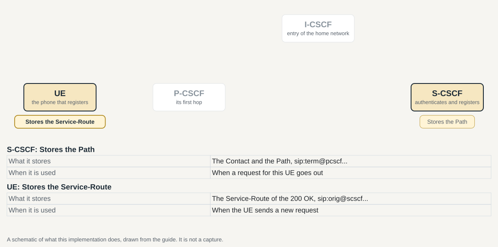
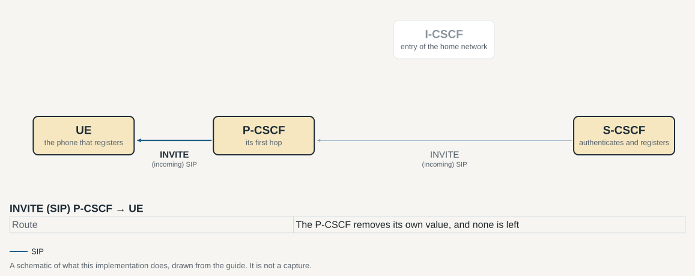
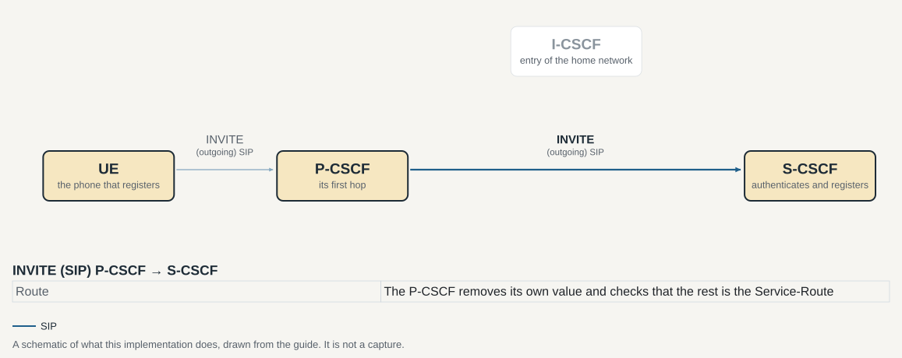

# Which request follows Path and which follows Service-Route

Registration does more than tell the network where the UE is. It also sets the route that delivers requests to the UE, and the route the UE uses for the requests it sends. The first is Path: the S-CSCF stores it with the binding and uses it to send requests to the UE. The second is Service-Route: the UE takes it from the 200 OK, stores it and uses it as the route of its own requests.

Both reach the UE in the 200 OK, so they look like the same kind of thing. But the node that stores each one and the direction of the requests that use it are opposite. And both are routes for the new requests that come later. They do a different job from the list of Vias, which takes the response to the REGISTER just sent back to the UE.

## The setup and the legs of this chapter

As in the previous chapter, the example is the `deploy/compose` setup with a softphone UE that registers with SIP Digest. This chapter looks at the legs between the UE, the P-CSCF and the S-CSCF. For a terminating request, it follows the request from the S-CSCF through the P-CSCF to the UE. For an originating request, it follows the request from the UE through the P-CSCF to the caller's S-CSCF. What happens at the I-CSCF, the HSS and the application servers is covered in the chapter on calls.

## The two routes that registration sets

Start from the 200 OK of the [previous chapter](registration-two-registers.md). During the registration, the two values are created and stored as follows.



1. Before the P-CSCF forwards the REGISTER to the I-CSCF, it puts its own URI, `sip:term@pcscf.ims.mnc001.mcc001.3gppnetwork.org:5060;lr`, in Path (TS 24.229 5.2.2.1). It also adds `path` to Require, so that the registrar must support Path.
2. When the S-CSCF accepts the registration, it stores the value of Path with the binding (the Contact, the expiry and so on). RFC 3327 5.3 has the registrar store the sequence of Path values tied to the registration of that Contact.
3. The S-CSCF puts the stored Path, and a Service-Route with its own URI, in the 200 OK (TS 24.229 5.4.1.2.2F).
4. The UE stores the Service-Route of the 200 OK. The P-CSCF also records the Service-Route from the same 200 OK.

Step 3 is the start of the code in the S-CSCF that builds the 200 OK.

[internal/scscf/scscf.go](../../../internal/scscf/scscf.go)

```go
func (s *SCSCF) bindingResponse(reg Registration, expires time.Duration, c sip.Credentials, ch Challenge) func(*sip.Message) {
	return func(r *sip.Message) {
		for _, p := range reg.Path {
			r.Add("Path", p)
		}
		r.Add("Service-Route", fmt.Sprintf("<sip:orig@%s:%d;lr>", s.cfg.Host, s.cfg.Port))
```

`reg` is the stored binding. Path returns the values received in the REGISTER as they are. The S-CSCF builds the Service-Route from its own host name and port. The user part `orig` is a mark: it lets the S-CSCF later tell that a request arriving at this URI is an originating one. In the same way, the user part `term` of the Path is the mark by which the P-CSCF tells a terminating request.

| Compared | Path | Service-Route |
| --- | --- | --- |
| The node that creates the value in this setup | The P-CSCF puts its own URI in the REGISTER | The S-CSCF puts its own URI in the 200 OK |
| The store this chapter looks at | The binding in the S-CSCF | The registration result in the UE (the P-CSCF records it too) |
| The requests that use it | New requests to the registered UE | New requests the UE sends |
| How it is used | The Request-URI becomes the Contact, and the stored Path goes into Route | The UE puts the Service-Route after the URI of the P-CSCF and makes that the Route |
| The leg in this chapter | From the terminating S-CSCF to the P-CSCF and the UE | From the calling UE to the P-CSCF and the caller's S-CSCF |

## Path is the route of requests to the UE

Suppose an INVITE for this UE reaches the S-CSCF after the registration. From the stored binding, the S-CSCF sets the final destination and the hops on the way separately.



[internal/scscf/session.go](../../../internal/scscf/session.go)

```go
	out.RequestURI = reg.Contact
	for i := len(reg.Path) - 1; i >= 0; i-- {
		out.Prepend("Route", reg.Path[i])
	}
```

`reg.Contact` is the address the UE registered. It becomes the Request-URI, the final destination. `reg.Path` holds the hops on the way, and they go at the top of Route in the order they were stored. The loop runs from the end and calls `Prepend`, so that the Path goes at the top of Route without changing its order. This is the procedure of TS 24.229 5.4.3.3 that sends a terminating request to the binding. RFC 3327 5.4 also has the home proxy rewrite the Request-URI to the registered Contact and make the stored Path the Route.

With the test values of this setup, it looks like this.

| Header | Value | Job |
| --- | --- | --- |
| Request-URI | `sip:001010000000001@192.0.2.10:5060` | The registered Contact. The final destination |
| Route | `<sip:term@pcscf.ims.mnc001.mcc001.3gppnetwork.org:5060;lr>` | The stored Path. The hop on the way |

The INVITE reaches the P-CSCF of the Route first. The top Route is the P-CSCF's own `term` URI, so it treats the request as terminating, removes its Route and sends the request to the UE. The request always passes the P-CSCF that the UE registered through, so that P-CSCF keeps the IP association with the UE and keeps control of the media.

## Service-Route is the route of requests from the UE

For requests in the other direction, the UE builds the route. When the UE sends an originating INVITE, this function sets the Route.



[internal/ue/call.go](../../../internal/ue/call.go)

```go
// routeSet is the preloaded Route of a request from the UE: the P-CSCF,
// then the Service-Route of the registration (TS 24.229 5.1.2A.1.1).
func (u *UE) routeSet(reg Registration) []string {
	return append([]string{"<" + u.pcscfURI() + ";lr>"}, reg.ServiceRoute...)
}
```

The input is the registration result of the UE, `reg`, and `reg.ServiceRoute` is the value received in the 200 OK. The UE puts the URI of the P-CSCF first, then the Service-Route in the order received. TS 24.229 5.1.2A.1.1 has the UE build the Route in this order for a request that starts a new dialog or a standalone transaction. RFC 3608 6.1 also says that the UE uses the Service-Route as the Route of the initial requests it sends later.

| Header | Value | Job |
| --- | --- | --- |
| Request-URI | `tel:+1-202-555-0102` | The number of the other party. The UE does not know where the other party is |
| Route | `<sip:pcscf.ims.mnc001.mcc001.3gppnetwork.org:5060;lr>`, `<sip:orig@scscf.ims.mnc001.mcc001.3gppnetwork.org:5060;lr>` | The P-CSCF and the stored Service-Route |

The P-CSCF removes its own Route and checks that the rest matches the Service-Route it recorded. If the UE put in a different route, the P-CSCF replaces it with the Service-Route (TS 24.229 5.2.6.3.3). So an originating request always reaches the S-CSCF the UE registered at. The top Route is the S-CSCF's own `orig` URI, so it handles the request as the side that serves the caller.

On this leg, the request does not pass the I-CSCF. The I-CSCF is the node that asks the HSS to find the serving S-CSCF, and the caller's S-CSCF is already known from the Service-Route. This holds only up to the caller's S-CSCF, though. After the caller's S-CSCF finds the other party's network, at the entry to that network, its I-CSCF finds the other party's S-CSCF.

## Via and Record-Route do other jobs

The two routes in this chapter are both routes for the new requests sent later. Do not mix them up with two other headers.

- **Via** is the way back for the responses to the request being sent now. Each node adds its own Via when it forwards a request, and removes it when the response goes back. The 200 OK to the REGISTER reaches the UE by the Vias, not by Path or Service-Route.
- **Record-Route** is what a node writes in a request that creates a dialog (such as INVITE) to say "send the requests in this dialog through me too". It becomes the route of the requests in the dialog (such as ACK and BYE). It is not set at registration; it is set for each call.

| Route | Set when | Used by |
| --- | --- | --- |
| Via | Each time a request is forwarded | The responses to that request |
| Path | Registration | New requests to the registered UE |
| Service-Route | Registration | New requests the UE sends |
| Record-Route | A request that creates a dialog | The requests in that dialog |

## What this account rests on

- `TestTerminatingCallFollowsThePath` in `internal/scscf/session_test.go`. It sends a terminating INVITE to the S-CSCF after a registration, and checks that the INVITE reaching the P-CSCF that the test plays has the Contact as its Request-URI and the Path as its Route. The P-CSCF of this test answers 486, so it is not an example of a call that connects to the end. What it checks is the route.
- `TestOriginatingCallGoesThroughTheRelay` in `internal/pcscf/session_test.go`. When the UE sends an INVITE with only the P-CSCF in its Route, the INVITE that reaches the S-CSCF has the Service-Route as its Route. It is a test of the P-CSCF replacing the route.
- `routeSet` in `internal/ue/call.go` and the terminating handling in `internal/scscf/session.go` are as quoted above.

The values in the tables above are those of the tests and of the `deploy/compose` configuration. The figures are diagrams of how this setup behaves, drawn from the guide. They are not captures.

## Run it yourself

To see the Route in a real INVITE, the guide [Follow a voice call through the IMS](../../guide/en/call.md) lists the headers to look at in "1. UE 1 sends the INVITE" and "6. The callee's S-CSCF sends the INVITE along the Path". In the slides, the scene "The directions of Path and Service-Route" of the [registration deck](../../../slides/decks/en/04-registration.md) shows the three figures of this chapter in order.

The last chapter on registration looks at how the stored binding is kept safe from old requests. [Why a late deregistration does not remove a newer registration](registration-stale-deregistration.md)
