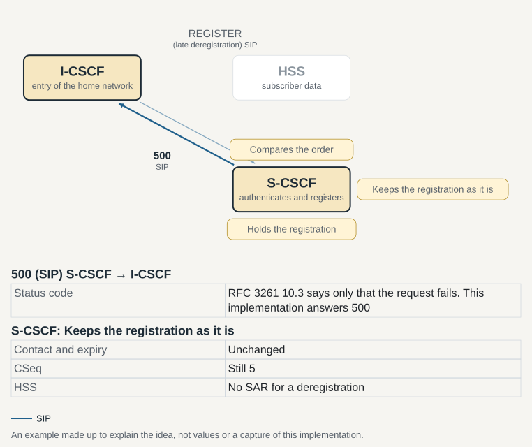
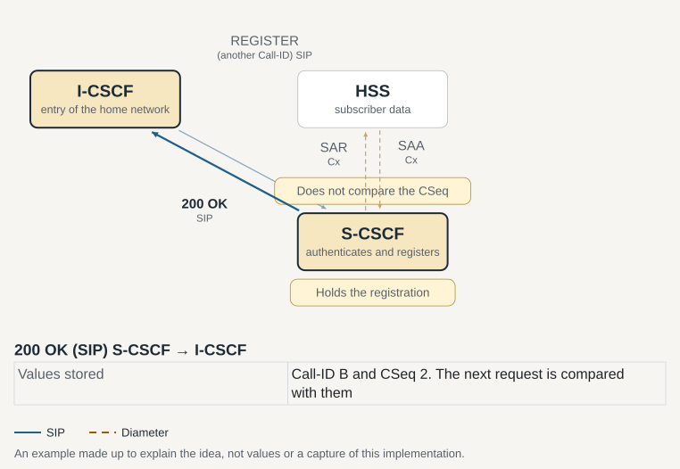

# Why a late deregistration does not remove a newer registration

Registration requests do not always reach the S-CSCF in the order the UE sent them. Suppose the UE sends a REGISTER to deregister, then changes its mind at once and registers again. What if the deregistration is delayed in the network and arrives after the re-registration? If the S-CSCF handles requests in the order they arrive, the new registration, which is still valid, is removed, and calls to this UE no longer reach it.

Comparing Call-ID and CSeq prevents this. For a request with the same Call-ID that tries to change the same binding, the S-CSCF compares the CSeq it stored with the CSeq of the request. If the request's CSeq is not higher than the stored one, the S-CSCF does not change the binding. For that, the Call-ID and the CSeq must not only be read from the arriving message; they must be stored with the binding.

## The setup of this chapter

As in the two previous chapters, the example is the `deploy/compose` setup with a softphone UE that registers with SIP Digest. The S-CSCF of this implementation stores only one Contact for one private identity (TS 24.229 5.4.1.2.2A, when reg-id is not used). The example in this chapter also has one binding.

In the figures and tables of this chapter, the long Call-IDs are written A and B, and the Contact C. They are examples for the explanation, not values from a capture.

## What breaks without the comparison

Suppose the UE sends REGISTERs in this order. The Call-ID of each is A.

| Order sent by the UE | Request | CSeq |
| --- | --- | --- |
| 1 | Initial registration (gets a 401 and answers) | Challenged at 1, answers at 2 |
| 2 | Deregistration (`expires=0`) | 3. No response comes, and the UE's transaction times out |
| 3 | Re-registration (gets a 401 and answers) | Challenged at 4, answers at 5 |

CSeq is a number that goes up with each request within the same Call-ID. The deregistration of 2 is sent over UDP, and the UE retransmits the same request while it waits for the response (RFC 3261 17.1.2). Suppose one of them is delayed in the network and reaches the S-CSCF after the re-registration of 3 has been accepted at CSeq 5. If the S-CSCF handles the arriving request as it is, the binding is removed, and the HSS is told of the deregistration too. The UE thinks it is registered, so it does nothing until the time to re-register. Meanwhile, calls to this UE do not reach it.

## The rule for the comparison

Step 6 of RFC 3261 10.3 sets this rule. The registrar looks for a binding with the same Contact as the request. If there is one, it compares the Call-ID.

- If the Call-ID differs from that of the binding, the registrar updates the binding (and removes it if Expires is 0).
- If the Call-ID is the same, it compares the CSeq. If the request's CSeq is higher than that of the binding, the registrar updates or removes the binding. If not, it abandons the update, and the request fails.

For this comparison, the registrar records, for each binding, the Call-ID and the CSeq of the request that made it. In the S-CSCF of this implementation, the registration record `Registration` has these fields beside the Contact and the expiry.

[internal/scscf/store.go](../../../internal/scscf/store.go)

```go
	ContactID    string
	ContactEvent reginfo.Event
	CallID       string
	CSeq         uint32
```

Each time the S-CSCF accepts a registration, it writes the values of that REGISTER here.

[internal/scscf/scscf.go](../../../internal/scscf/scscf.go)

```go
	cseq, _ := sip.ParseCSeq(req.Get("CSeq"))
	reg.CallID, reg.CSeq = req.Get("Call-ID"), cseq.Number
```

## The function that compares

The comparison is one function, `outOfOrder`.

[internal/scscf/scscf.go](../../../internal/scscf/scscf.go)

```go
func outOfOrder(req *sip.Message, reg Registration) bool {
	if req.Get("Call-ID") != reg.CallID {
		return false
	}
	cseq, _ := sip.ParseCSeq(req.Get("CSeq"))
	return cseq.Number <= reg.CSeq
}
```

The inputs are the REGISTER that arrived, `req`, and the stored registration, `reg`. If the Call-ID differs, there is nothing to compare, so it returns `false`. If the Call-ID is the same, it returns `true`, "out of order", when the arriving CSeq is less than or equal to the stored CSeq. An equal CSeq also counts as old, because the rule says to update only when the CSeq is higher.

This function does not look at the Contact. The comparison applies only to a binding with the same Contact, and the caller of the function decides that.

## Where the comparison happens

The S-CSCF calls this function in two places. Both come before the SAR to the HSS and before any change to the stored registration.

The first is `accept`, which accepts the registration after checking the answer to the authentication.

[internal/scscf/scscf.go](../../../internal/scscf/scscf.go)

```go
	contact, contactErr := sip.ParseNameAddr(req.Get("Contact"))
	if registered && contactErr == nil && sameURI(contact.URI, old.Contact) && outOfOrder(req, old) {
		s.refuseOutOfOrder(st, old, log)
		return
	}
	assignment := cx.AssignRegistration
```

It compares only when a registration is stored and the arriving Contact is the same as the stored Contact. If the Contact differs, the rule treats it as another binding, so there is no comparison. In this implementation, the new Contact replaces the old binding.

The second is the deregistration, `deregister`.

[internal/scscf/scscf.go](../../../internal/scscf/scscf.go)

```go
	if !wildcard {
		contact, err := sip.ParseNameAddr(st.Request.Get("Contact"))
		if err != nil || !sameURI(contact.URI, reg.Contact) {
			s.respond(st, 481, nil)
			return
		}
	}
	if outOfOrder(st.Request, reg) {
		s.refuseOutOfOrder(st, reg, log)
		return
```

If the Contact to deregister differs from the stored Contact, there is nothing to remove, so the S-CSCF answers 481. If it is the same, the S-CSCF compares the order. A deregistration that writes `*` in Contact to remove everything (`wildcard`) skips the check of the Contact, but the order is still compared.

What matters is that the comparison comes before the side effects. In `accept`, the SAR is sent and the registration rewritten after the comparison. In `deregister`, the deregistering SAR is sent and the registration removed after the comparison. If these came before the comparison, the records of the HSS and the S-CSCF would change even when the request is refused.

If the P-CSCF holds an IP association, the deregistering REGISTER carries `integrity-protected="ip-assoc-yes"`, and the S-CSCF goes on to `deregister` without a new challenge. A re-registration is challenged with a 401, and goes on to `accept` only after the answer is found right. The authentication and the order are separate conditions. A request in order with a wrong answer gets a 403, and a request with a right answer that is out of order is refused.

## What a refused request leaves unchanged



When the S-CSCF finds a request out of order, it returns a 500 in `refuseOutOfOrder`. The Contact, the expiry, the Call-ID and the CSeq of the binding do not change, and no SAR goes to the HSS.

The response code needs a separate look. Step 6 of RFC 3261 10.3 says only that such a request fails. It does not say which response code to return. This implementation chooses 500, the code that step 7 of the same section gives for a failed update of a binding. The standard does not fix 500 as the only code for this case; it is the choice of this implementation. Sending the same request again is refused for the same reason, so there is no Retry-After.

On the re-registration side, the challenge that the refused request used was removed when the answer was checked. What remains after the refusal is the binding from before.

## A request with another Call-ID is not compared



A request with a different Call-ID is not refused by the size of its CSeq. For example, the UE restarts and registers again with a new Call-ID, B. Even if the CSeq of B is 2, it is not compared with the 5 of A. If the answer to the authentication is right, the S-CSCF sends a RE_REGISTRATION SAR and answers 200 OK, and the registration keeps the Call-ID and the CSeq of B. Later comparisons use the values of B.

A different Call-ID is no reason to skip the authentication. The request with Call-ID B also gets a 401 and is accepted only after a right answer.

## What the test checks

`TestRegisterOutOfOrderLeavesTheBindingAlone` in `internal/scscf/scscf_test.go` checks the cases of this chapter in order. The test sends REGISTERs to the S-CSCF directly, so they do not pass the P-CSCF and the I-CSCF. The CSeqs of the test differ a little from the example above: the re-registration is stored at CSeq 4, and the test sends requests with CSeq 3 and 4.

| Stored state | Request that arrives | Result the test checks |
| --- | --- | --- |
| Call-ID A, CSeq 4 | A, CSeq 3, `expires=0` | 500. The registration stays |
| The same | A, CSeq 4, `expires=0` | 500. The registration stays |
| The same | A: a re-registration challenged at CSeq 3 and answered at CSeq 4 | 500. The Contact, the expiry and CSeq 4 do not change |
| The same | A, CSeq 4: a deregistration with Contact `*` | 500 |
| The same | B: a re-registration challenged at CSeq 1 and answered at CSeq 2 | 200 |
| B, CSeq 2 | B, CSeq 3, `expires=0` | 200. The registration is removed |

Across the refused requests, the test also checks that the HSS received only two SARs: `REGISTRATION` for the initial registration, and RE_REGISTRATION for the re-registration at CSeq 4. The refused requests did not reach the HSS.

In the third row, the REGISTER with CSeq 3 gets a 401, not a 500. The order is compared in `accept`, after the answer to the authentication is checked.

The same CSeq arriving twice is not the same as a retransmission of one request. When the same REGISTER is retransmitted over UDP, the SIP transaction layer (RFC 3261 17.2) absorbs it and sends the earlier response again. The retransmission does not reach the registration handling of the S-CSCF and is not subject to this comparison. `TestServerTransactionAbsorbsRetransmissions` in `internal/sip/stack_test.go` checks this behavior of that layer.

## The condition added by a shared store

When several S-CSCFs run and keep the registrations in a shared store, another S-CSCF may rewrite the same user's registration between the comparison and the write. If two S-CSCFs each read an old CSeq, compare and both write, the comparison means nothing.

The S-CSCF of this implementation takes a lock per user at the start of handling a REGISTER (`s.users.Lock` in `register`). Then only one S-CSCF at a time reads, compares and writes for the same user. It is a lock per user, not a lock that stops the whole role. Registration order and expiry looks at what this lock guarantees and what it does not.

## Run it yourself

To cause this comparison on the setup, a delayed request has to be made in the network, and the guide's usual steps do not do that. You can run the test with `go test ./internal/scscf -run TestRegisterOutOfOrderLeavesTheBindingAlone`. In the slides, the scene "A deregistration that comes late" of the [registration deck](../../../slides/decks/en/04-registration.md) shows the two figures of this chapter in steps.

The next chapter looks at what follows registration: refresh, deregistration, subscription and removal by the network. [Refresh, deregistration, subscription and removal by the network](registration-lifecycle.md)
