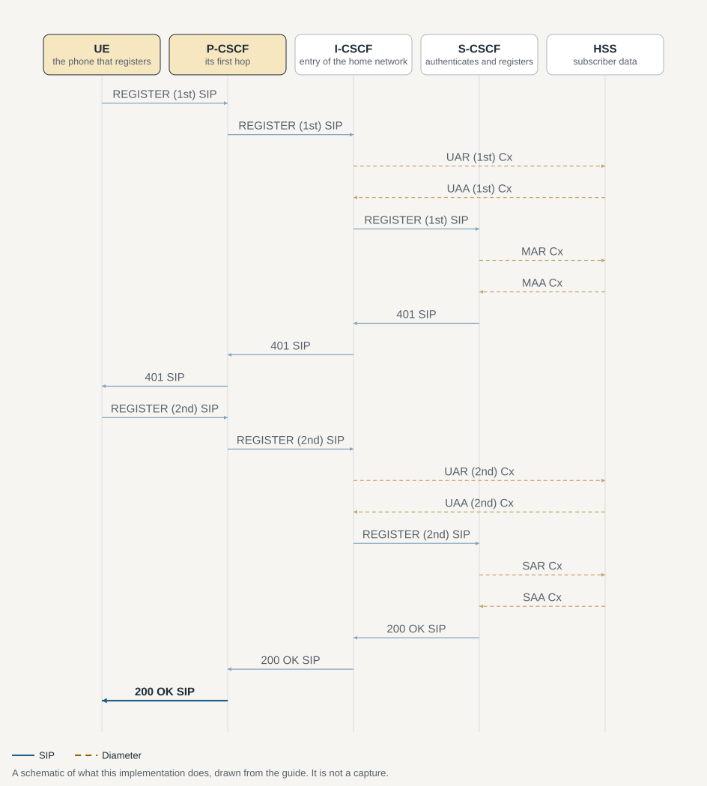
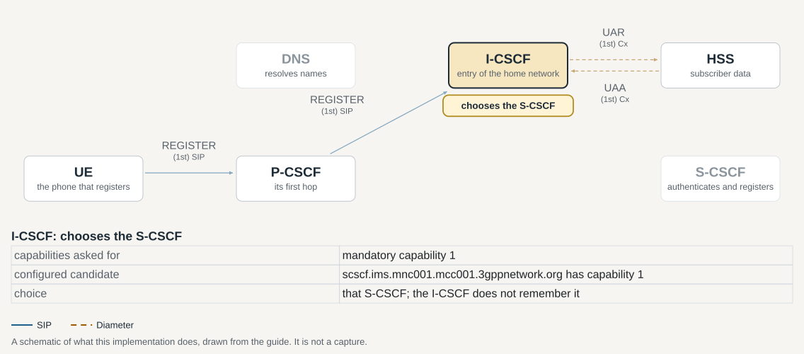
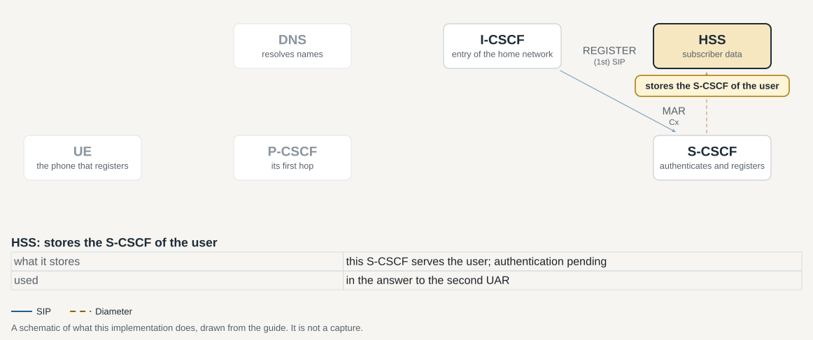
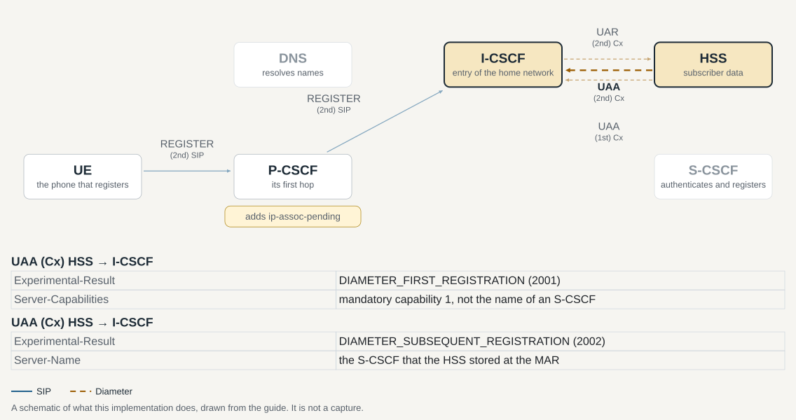
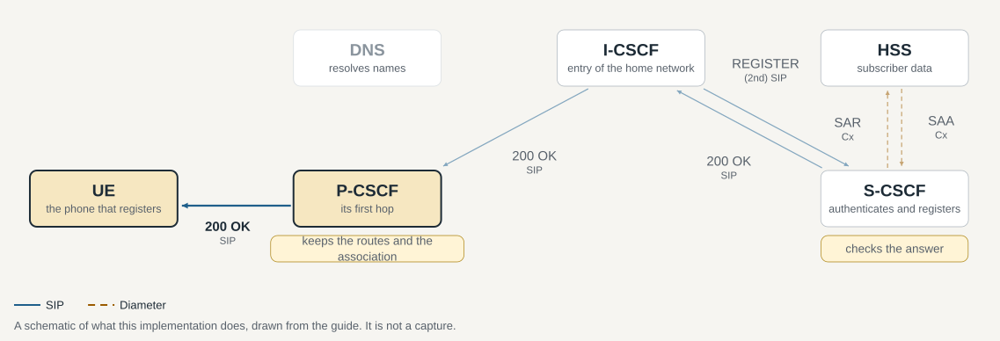

# Why a UE sends REGISTER twice

In the first REGISTER, the UE says which user it wants to register as. It has not yet received the nonce that the network gives out, so it cannot put an answer to the authentication in the request. The S-CSCF gets the data for the authentication from the HSS and returns a challenge in a 401. The UE puts its answer to that challenge in the second REGISTER. The S-CSCF checks the answer, gets the user profile from the HSS and stores the binding. Then a 200 OK comes back.

So the second REGISTER is not a retransmission of the first. The first request says who the user is. The second proves that the user is who it claims to be. This chapter follows, in order, what the network settles between the two: the S-CSCF that serves the user, and what the HSS and the S-CSCF each record.

## The setup of this chapter

The example in this chapter is the `deploy/compose` setup, with a softphone UE that has no SIM card and registers with SIP Digest. There are five nodes: the UE, the P-CSCF, the I-CSCF, the S-CSCF and the HSS. This chapter leaves out how the P-CSCF finds the I-CSCF with DNS.

A VoLTE phone registers with IMS-AKA, which uses the keys of the USIM. The REGISTER exchange has the same shape, but the challenge in the 401 differs, and so does the protection set up with the P-CSCF. The chapter on VoLTE covers that.

This chapter cites TS 24.229 V18.11.0, TS 29.228 V18.0.0 and TS 29.229 V18.1.0.

## The whole exchange



From the UE, the exchange is four messages: REGISTER, 401, REGISTER and 200 OK. Inside the network, the HSS is asked four times: two UARs from the I-CSCF, and one MAR and one SAR from the S-CSCF. Both REGISTERs pass the P-CSCF and the I-CSCF to reach the S-CSCF. The 401 and the 200 OK take the same path back to the UE.

The two REGISTERs differ in three headers.

| Header | First | Second |
| --- | --- | --- |
| Authorization | The private identity in `username`. `nonce` and `response` are empty | The `nonce` from the 401 and the `response` to it. Also `cnonce`, `nc=00000001` and `qop=auth` |
| Call-ID | A value the UE chose | The same as the first |
| CSeq | 1 | One higher, 2 |

The first Authorization is not empty. It gives the network the private identity used for the authentication before any challenge comes. The S-CSCF asks the HSS for the authentication data with this identity.

## The I-CSCF chooses the S-CSCF

The I-CSCF that receives the first REGISTER does not know which S-CSCF serves this user. So it sends the HSS a UAR (User-Authorization-Request) (TS 29.228 6.1.1).

No S-CSCF is assigned yet, so the HSS answers DIAMETER_FIRST_REGISTRATION (2001). The answer has no S-CSCF name in it. It carries Server-Capabilities, the capabilities that the serving S-CSCF needs. The I-CSCF chooses the S-CSCF (TS 29.228 6.7).



In the code of the I-CSCF, this branch is a few lines.

[internal/icscf/icscf.go](../../../internal/icscf/icscf.go)

```go
	server := uaa.ServerName
	if server == "" {
		server = i.choose(uaa.ServerCapabilities)
		if server == "" {
			// 5.3.1.3: no S-CSCF has the mandatory capabilities.
			log.Warn("no S-CSCF has the capabilities", "capabilities", uaa.ServerCapabilities)
			st.Respond(sip.NewResponse(req, 600, sip.NewTag()))
			return
		}
	}
	log.Info("selected S-CSCF", "server_name", server, "result", uaa.Result.String())
```

The input is the answer of the HSS, `uaa`. If it has a Server-Name, the I-CSCF uses it. If not, `choose` picks, from the configured list of S-CSCFs, one that has every mandatory capability and the most optional ones. If no S-CSCF has the mandatory capabilities, the I-CSCF answers 600. The first REGISTER has no Server-Name, so it takes the `choose` side.

The I-CSCF does not remember the S-CSCF it chose. It keeps no registration state, and its choice only becomes the target of the REGISTER. The second REGISTER still reaches the same S-CSCF, because the HSS records the assignment, as the next section shows.

## What the HSS and the S-CSCF record before the 401

The S-CSCF that receives the REGISTER sends the HSS a MAR (Multimedia-Auth-Request) (TS 24.229 5.4.1.2.1, TS 29.228 6.3). The REGISTER has no `integrity-protected` parameter, so the S-CSCF sets the authentication scheme to `Unknown` and lets the HSS choose. The HSS chooses SIP Digest and answers with a MAA (Multimedia-Auth-Answer).

Here the two nodes each record something different.



- **The HSS** records the S-CSCF that sent the MAR as the one that serves this user, and marks the authentication as pending. The registration is not done yet.
- **The S-CSCF** stores the nonce it generated and the H(A1) it got from the HSS as the pending authentication, the challenge. It also stores the Call-ID of the REGISTER it challenged. Then it starts the timer reg-await-auth, which waits for the answer (4 minutes in TS 24.229 Table 7.7.1).

The MAA carries H(A1), not the password itself. H(A1) is a hash computed from the user name, the realm and the password (RFC 2617 3.2.2.2). With it alone, the S-CSCF can check the UE's answer. But anyone who knows H(A1) can compute a correct answer in the same realm. It is not the password, yet it is a secret used for the authentication and is handled as one.

The S-CSCF answers 401 Unauthorized. WWW-Authenticate carries the realm, the nonce, `algorithm=MD5` and `qop="auth"` (TS 24.229 5.4.1.2.1B). In this procedure, the 401 means that things go as planned. The response code 401 does not always mean success, but a 401 to the first REGISTER is a fixed step: it asks the user for an answer before the registration is accepted.

## Why the second REGISTER reaches the same S-CSCF

The UE computes the answer from the password and the nonce, and sends the second REGISTER. The P-CSCF adds `integrity-protected="ip-assoc-pending"` to Authorization (TS 24.229 5.2.2.3). It tells the S-CSCF that this request answers a challenge and that no IP association exists yet.

The I-CSCF does not remember the first REGISTER, so it sends another UAR. This time the HSS answers differently.



The answer changes because the record of the HSS has changed. In the code of the HSS, the answer to a UAR ends like this.

[internal/hss/hss.go](../../../internal/hss/hss.go)

```go
	case u.ServerName != "":
		// Not registered, but an S-CSCF was stored by a MAR whose
		// authentication is still pending: send the user there again.
		return cx.UserAuthorizationAnswer{Result: diameter.Experimental(cx.DiameterSubsequentRegistration), ServerName: u.ServerName}
	}
	caps := h.config.ServerCapabilities
	return cx.UserAuthorizationAnswer{Result: diameter.Experimental(cx.DiameterFirstRegistration), ServerCapabilities: &caps}
```

The user is not registered yet, but there is the name of the S-CSCF recorded at the MAR, `u.ServerName`. So the HSS answers DIAMETER_SUBSEQUENT_REGISTRATION (2002) with the Server-Name (TS 29.228 6.1.1.1). The first answer had no name, so it was the last line, DIAMETER_FIRST_REGISTRATION with Server-Capabilities.

The I-CSCF takes the Server-Name side of the branch in the previous section, and forwards the request to that S-CSCF without calling `choose`. The second REGISTER reaches the same S-CSCF because the HSS records the assignment, not because the I-CSCF remembers its earlier choice. If another I-CSCF receives the second REGISTER, it reaches the same S-CSCF too.

## Check the answer, then register

The S-CSCF that receives the second REGISTER compares it with the stored challenge.

[internal/scscf/scscf.go](../../../internal/scscf/scscf.go)

```go
func (s *SCSCF) check(req *sip.Message, c sip.Credentials, ch Challenge) verdict {
	if req.Get("Call-ID") != ch.CallID || c.Realm != ch.Realm || c.CNonce == "" || c.NC == "" {
		return wrong
	}
	want, err := sip.DigestResponse(ch.digestHA1(), sip.REGISTER, c)
	if err != nil || subtle.ConstantTimeCompare([]byte(want), []byte(c.Response)) != 1 {
		return wrong
	}
	// A fresh nonce is answered with the first nonce count.
	if c.Nonce != ch.Nonce || c.NC != "00000001" {
		return stale
	}
	return valid
}
```

The inputs are the REGISTER that arrived, `req`, the value of its Authorization, `c`, and the stored challenge, `ch`. The function checks three things in order.

1. Is the Call-ID the same as in the challenged REGISTER, and is the realm the one the S-CSCF gave out? If either differs, the request does not answer the challenge (TS 24.229 5.4.1.2.2A).
2. Does the answer computed from H(A1) match the UE's `response`? If not, the password is wrong.
3. Is this the first answer to the nonce that is pending now? If the password is right but the nonce is old, the S-CSCF treats it as stale, not wrong, and challenges again with a new nonce (TS 24.229 5.4.1.2.3B).

If the verdict is `valid`, the S-CSCF removes the challenge and sends the HSS a SAR (Server-Assignment-Request) with Server-Assignment-Type `REGISTRATION` (1). The HSS records that the user is registered at this S-CSCF and returns the user profile in the User-Data of the SAA. The profile holds the identities registered together and the iFCs. After that, the S-CSCF stores the binding and answers 200 OK.



In this flow, what the three nodes know does not change at the same moment.

| Point | What the HSS records | What the S-CSCF stores | What the UE knows |
| --- | --- | --- | --- |
| First UAR and UAA | The subscriber exists. The capabilities needed | Nothing yet | It sent a REGISTER |
| MAR, MAA, 401 | This S-CSCF serves the user. Authentication pending | The challenge (nonce, H(A1), Call-ID) and the deadline for the answer | It received the nonce in the 401 |
| The answer is right, and the SAR and the SAA are done | Registered at this S-CSCF. The profile | The binding (Contact, Path, expiry, identities, iFCs, Call-ID and CSeq) | It still waits for the response |
| The 200 OK reached the UE | The same | The same | It is registered. With rspauth, it confirms that the S-CSCF knows H(A1) too, and it receives the Service-Route and the expiry |

The HSS marking the user as registered, the S-CSCF storing the binding and the UE receiving the 200 OK happen at different moments. If a node stops in between, the nodes are left out of step. What several nodes and failures hand over looks at how that is handled.

The `rspauth` in the Authentication-Info of the 200 OK proves that the S-CSCF knows H(A1) too (RFC 2617 3.2.3). The UE checks it and learns that the network side is genuine as well.

## 401 and 403

With a wrong password, everything up to the second REGISTER goes the same way. The paths split in `check` in the S-CSCF: the answer does not match, so the verdict is `wrong`. The S-CSCF answers 403 Forbidden and sends the HSS a SAR with Server-Assignment-Type AUTHENTICATION_FAILURE (9) (TS 24.229 5.4.1.2.3B). For an initial registration, the HSS removes the S-CSCF it recorded, so the next attempt starts again from the first UAR.

A 401 says "give me an answer". A 403 says "the answer is wrong". An answer on a Call-ID other than that of the challenged REGISTER also fails the first condition in `check` and gets a 403.

## Not always two

This chapter followed a normal initial registration. In these cases, the number of REGISTERs changes.

- **A stale answer.** If the password is right but the nonce is old, the S-CSCF challenges again with a new 401 that has `stale=true`. There are three REGISTERs or more.
- **An answer after the deadline.** An answer that comes after reg-await-auth runs out is not accepted. The S-CSCF ends the challenge and returns a 401 with a new nonce (TS 24.229 5.4.1.2.3).
- **Deregistration.** If the P-CSCF holds an IP association, the deregistering REGISTER carries `ip-assoc-yes`, and the S-CSCF handles it without a challenge. One REGISTER is enough.
- **Re-registration.** The S-CSCF removed the challenge when it accepted the registration. So a SIP Digest re-registration is challenged with a new 401 too, and there are two REGISTERs again. The 401 to a REGISTER that answers with the earlier nonce has `stale=true` (TS 24.229 5.4.1.2.2A).

## What this account rests on

The account in this chapter was checked against the code and the tests below. Each test passes as a Go test of this repository.

- `TestRegistrationWithSIPDigest` in `internal/scscf/scscf_test.go`. The first REGISTER gets a 401, and the REGISTER that answers gets a 200 OK.
- `TestFirstRegistrationChoosesAnSCSCFByCapability` in `internal/icscf/icscf_test.go`. An I-CSCF that receives a UAA without a Server-Name chooses an S-CSCF by its capabilities.
- `TestWrongPasswordIsForbidden` and `TestAnswerOnAnotherCallIDIsForbidden` in `internal/scscf/scscf_test.go`. A wrong password leads to a 403 and a SAR with AUTHENTICATION_FAILURE, and an answer on another Call-ID gets a 403.
- `TestRegisterRefreshAndDeregisterThroughTheWholeIMS` in `internal/ue/ue_test.go`. It runs every node from the P-CSCF to the HSS in one process, and registration, re-registration and deregistration go through.

The figures are diagrams of how this setup behaves, drawn from the guide. They are not captures.

## Run it yourself

You do not need to run the setup to read this chapter. To see the same exchange in a real capture, the guide has the steps in [Run a registration](../../guide/en/registration.md#run-a-registration) and [Open the capture](../../guide/en/registration.md#open-the-capture). In the slides, the scenes of the [registration deck](../../../slides/decks/en/04-registration.md) from "The shape of the whole" to "SAR and the 200 OK" go one leg at a time, in the same order as this chapter.

The next chapter looks at the two routes that this 200 OK carries, Path and Service-Route. [Which request follows Path and which follows Service-Route](registration-routes.md)
