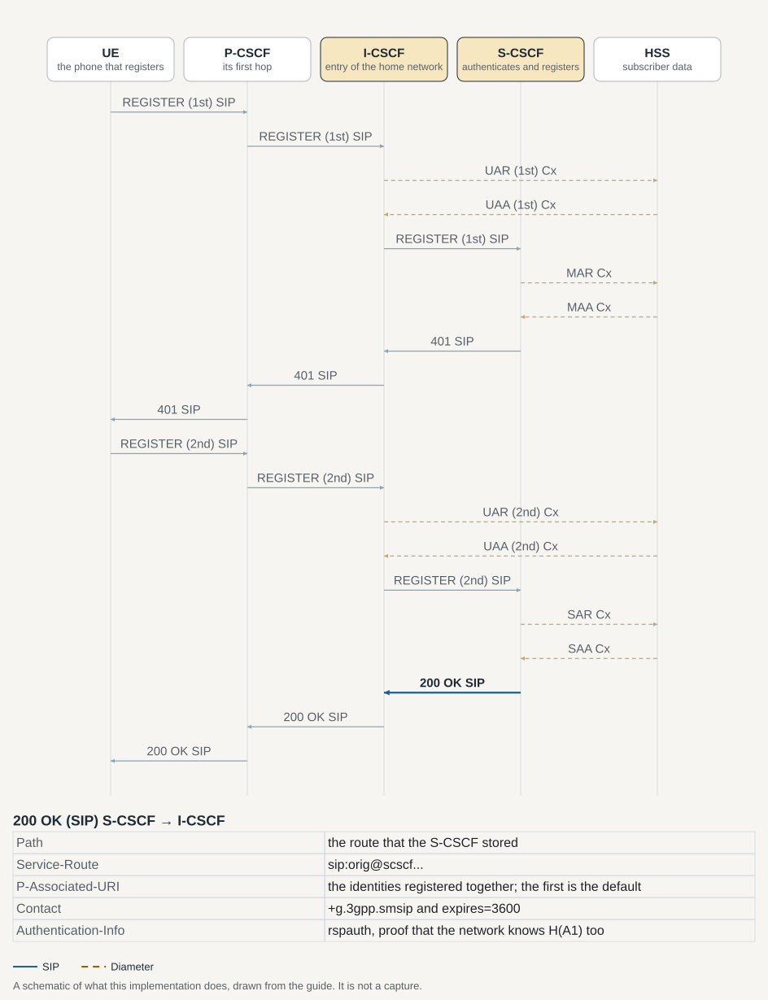

# Three things that registration settles

A UE registers with the IMS before it makes a call or sends a short message. Registration settles three things for the network: where the UE is, whether the user is who it claims to be, and which route the later requests take. The place comes in the Contact of the REGISTER, the identity is proved by the answer to the challenge of a 401, and the routes are the Path and the Service-Route of the 200 OK.

Registration does two more things. It tells the UE, in the P-Associated-URI of the 200 OK, which identities were registered together. And it starts what follows registration: the P-CSCF and the UE subscribe to the registration state (the reg event), and the S-CSCF registers the user at the application server too (the third-party REGISTER).

This chapter looks at the whole registration in one figure and shows where each of the three things is settled. The intermediate chapters explain each mechanism in detail.

## The setup of this chapter

The example is the `deploy/compose` setup, with a softphone UE that has no SIM card and registers with SIP Digest. These nodes take part in registration.

| Node | What it takes care of in registration |
| --- | --- |
| UE | Sends REGISTER and answers the challenge. Stores the route of the 200 OK |
| P-CSCF | The first hop of the UE. Finds the entry point of the home network with DNS, and adds a Path to the REGISTER |
| I-CSCF | The entry point of the home network. Asks the HSS for the S-CSCF that serves this user, and sends the REGISTER there |
| S-CSCF | The node that accepts the registration (the registrar). Authenticates the user and stores the binding |
| HSS | The subscriber database. Holds the authentication data and the user profile, and records the S-CSCF that serves the user |
| IP-SM-GW | The application server for SMS. The S-CSCF registers the user there with a third-party REGISTER |

The test user has the private identity `001010000000001@ims.mnc001.mcc001.3gppnetwork.org` and the public identity `sip:+12025550101@ims.mnc001.mcc001.3gppnetwork.org`. The private identity is the name used for authentication. The public identity is the name that other users see.

A VoLTE phone registers with IMS-AKA, which uses the keys of the USIM. The three things it settles are the same. The way of authenticating and the protection with the P-CSCF differ. The chapter on VoLTE covers that.

## The whole exchange



From the UE, the exchange is four messages: REGISTER, 401, REGISTER and 200 OK. Both REGISTERs pass the P-CSCF and the I-CSCF to reach the S-CSCF, and the 401 and the 200 OK take the same path back. Inside the network, the HSS is asked four times: two UARs from the I-CSCF, which asks for the serving S-CSCF, and one MAR and one SAR from the S-CSCF, which asks for the authentication data and then reports the registration.

The table under the figure has the main headers of the 200 OK that the S-CSCF sends. What registration settled comes back to the UE as values of this 200 OK: the place in the Contact and its expiry, the routes in Path and Service-Route, and the identities registered together in P-Associated-URI. The `rspauth` in Authentication-Info proves that the network side is genuine too.

| What is settled | What carries it | The node that decides | The node that stores it |
| --- | --- | --- | --- |
| Where the UE is | The Contact of the REGISTER | The S-CSCF accepts it and sets its expiry | The binding at the S-CSCF |
| That the user is who it claims to be | The answer (`response`) in the second REGISTER | The S-CSCF checks it with the H(A1) from the HSS | The HSS records the serving S-CSCF, the S-CSCF stores the binding |
| The routes of later requests | The Path of the REGISTER, the Service-Route of the 200 OK | The P-CSCF makes the Path, the S-CSCF the Service-Route | The Path at the S-CSCF, the Service-Route at the UE (the P-CSCF records it too) |

## Where the UE is

The Request-URI of the REGISTER is the home network domain `ims.mnc001.mcc001.3gppnetwork.org`, not a server. The network decides which server accepts it. The P-CSCF finds the I-CSCF at the entry of the home network with DNS, and the I-CSCF asks the HSS to settle the S-CSCF.

The UE gives its place in the Contact of the REGISTER. It is the address where the UE takes requests; in this setup it is `sip:...@172.28.0.100:5060` with a UUID in the user part. The S-CSCF stores this Contact as the binding, together with its expiry. The UE asks for 600000 seconds, but the S-CSCF shortens it to the configured maximum of 3600 seconds and returns that value in the `expires` of the Contact of the 200 OK. The UE registers again before the expiry. For the 3600-second registration of this setup, that is 600 seconds before it (TS 24.229 5.1.1.4.1).

The S-CSCF knows the place. The HSS knows which S-CSCF serves the user. So when a call for this user comes later, the I-CSCF asks the HSS for the serving S-CSCF, and the S-CSCF sends the request to the stored Contact.

## That the user is who it claims to be

The first REGISTER says who the user is, and the second proves it. The Authorization of the first holds only the private identity, with an empty answer. The S-CSCF gets the authentication data from the HSS and returns a challenge (a nonce) in a 401. The UE computes the answer from the password and the nonce and puts it in the second REGISTER.

The HSS does not give the password to the S-CSCF. It gives H(A1), a hash computed from the user name, the realm and the password. The S-CSCF can check the answer with this alone. The `rspauth` in the Authentication-Info of the 200 OK proves that the S-CSCF knows H(A1) too, and with it the UE checks that the network is genuine as well.

The I-CSCF asks the HSS twice in one registration. The first answer is DIAMETER_FIRST_REGISTRATION with the capabilities that the serving S-CSCF needs (Server-Capabilities), and the I-CSCF chooses an S-CSCF that has them. The second answer is DIAMETER_SUBSEQUENT_REGISTRATION with the name of the S-CSCF (Server-Name) that the HSS recorded at the MAR. So the second REGISTER reaches the same S-CSCF.

What the HSS and the S-CSCF record during this exchange, and what happens with a wrong password, is in [Why a UE sends REGISTER twice](registration-two-registers.md).

## The routes of later requests

Registration settles one route for each direction of the new requests that come later.

- **Path** is the route of requests to the UE. The P-CSCF puts its URI in the REGISTER, and the S-CSCF stores it with the binding. When an INVITE for this UE comes, the S-CSCF sets the Request-URI to the Contact, puts the Path in the Route, and sends it through the P-CSCF that the UE registered through.
- **Service-Route** is the route of requests from the UE. The S-CSCF puts its URI in the 200 OK, and the UE stores it. The UE lists the Service-Route after the P-CSCF in the Route of an outgoing INVITE or a SUBSCRIBE. The request reaches the UE's own S-CSCF without passing the I-CSCF.

Neither is the way back of the answer to the REGISTER just sent (Via). Who makes which value and which request uses it is in [Which request follows Path and which follows Service-Route](registration-routes.md).

## The identities registered together

A user does not always have one public identity. The test user of this setup has two: the SIP URI `sip:+12025550101@ims.mnc001.mcc001.3gppnetwork.org` and the telephone number `tel:+12025550101`. Registering one registers every identity of the set.

The S-CSCF gets the user profile from the HSS in the answer to the SAR (the SAA). The profile holds this set of identities and the iFCs, which decide which application servers a request goes to. When the S-CSCF builds the 200 OK, it lists the set in P-Associated-URI.

[internal/scscf/scscf.go](../../../internal/scscf/scscf.go)

```go
		for _, id := range reg.NonBarredIdentities() {
			r.Add("P-Associated-URI", "<"+id+">")
		}
```

`reg.NonBarredIdentities()` returns the identities of the set that are not barred, with the default identity first (TS 24.229 5.4.1.2.2F). A barred identity is not listed. The UE takes the first P-Associated-URI as its default identity and uses it in requests such as its subscription.

## What follows registration

The 200 OK settles the registration, but the work of the network goes on.

- **Subscriptions to the registration state.** The P-CSCF and the UE subscribe to the registration state with a SUBSCRIBE of `Event: reg`. The S-CSCF tells them with a NOTIFY each time the state changes. That is how they learn of an end of the registration that the UE did not ask for, such as an expiry or a removal by the network.
- **The third-party REGISTER.** Following the iFCs of the profile, the S-CSCF sends a REGISTER to the IP-SM-GW as well. The IP-SM-GW also subscribes to the registration state, and tells the HSS that it handles the short messages of this user. The UE does not wait for this.
- **Refresh and the ways a registration ends.** The UE registers again before the expiry. At a deregistration the P-CSCF has an IP association for the UE, so the S-CSCF does not challenge again, and no 401 comes back. A registration that is not refreshed ends at its expiry, and removing the subscription from the HSS makes the network cancel the registration.

These are in [Refresh, deregistration, subscription and removal by the network](registration-lifecycle.md). How an old deregistration that the network delayed is kept from removing a newer registration is in [Why a late deregistration does not remove a newer registration](registration-stale-deregistration.md).

## The chapters that go into detail

| Question | Chapter |
| --- | --- |
| Why does a UE send REGISTER twice, and who settles the serving S-CSCF | [Why a UE sends REGISTER twice](registration-two-registers.md) |
| Who uses Path and Service-Route, and for what | [Which request follows Path and which follows Service-Route](registration-routes.md) |
| Why does a late deregistration not remove a newer registration | [Why a late deregistration does not remove a newer registration](registration-stale-deregistration.md) |
| What happens after registration: subscriptions, the third-party REGISTER, deregistration, expiry and removal by the network | [Refresh, deregistration, subscription and removal by the network](registration-lifecycle.md) |

## What this account rests on

- `TestRegistrationWithSIPDigest` in `internal/scscf/scscf_test.go`. The first REGISTER gets a 401, and the 200 OK to the REGISTER that answers carries the Service-Route, the P-Associated-URI, the Path, a Contact with `expires=3600` and the right `rspauth`. Then a deregistration with `ip-assoc-yes` gets a 200 OK without a new challenge, and the SARs that reach the HSS are `REGISTRATION` and USER_DEREGISTRATION.
- `TestRegisterRefreshAndDeregisterThroughTheWholeIMS` in `internal/ue/ue_test.go`. It runs every node from the P-CSCF to the HSS in one process, and registration, re-registration and deregistration go through.

Both pass as Go tests of this repository. The figure is a diagram of how this setup behaves, drawn from the guide. It is not a capture.

## Run it yourself

You do not need to run the setup to read this chapter. To see the same exchange in a real capture, the guide has the steps in [Run a registration](../../guide/en/registration.md#run-a-registration) and [Open the capture](../../guide/en/registration.md#open-the-capture). In the slides, the scene "The shape of the whole" of the [registration deck](../../../slides/decks/en/04-registration.md) shows the figure of this chapter in steps.

The next chapter uses the routes that registration settled to make a call. From a number to the other phone
