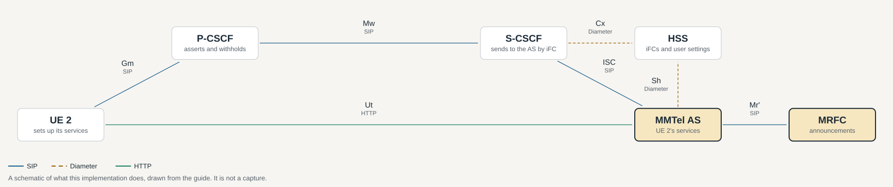
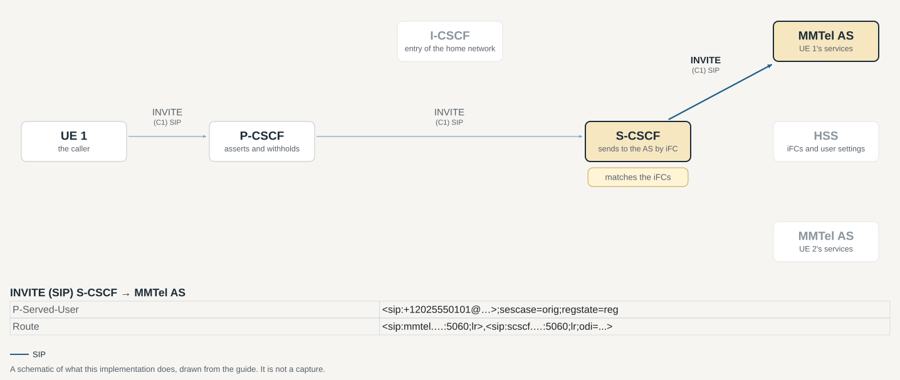
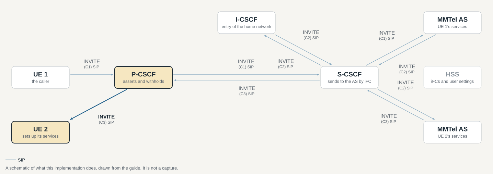
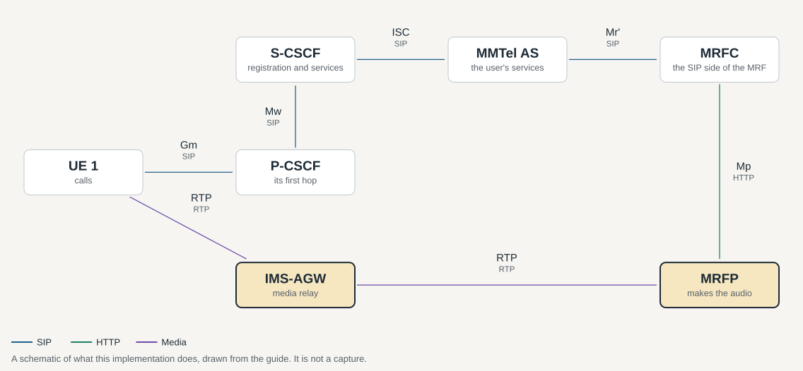

# What application servers add

Forwarding a call, barring outgoing calls, withholding a number, a short message, an announcement before a call is rejected: none of these is decided by a CSCF. A CSCF only routes requests and knows nothing of a user's settings. The services belong to application servers (ASs), which sit beside the route.

The S-CSCF matches each request against the initial filter criteria (iFCs) in the user's profile, and hands the request to the AS of the criterion that matched. It puts the AS first in Route and itself second, with an original dialog identifier (ODI) on its own URI. When the AS sends the request back, the request comes to the S-CSCF with the ODI, and the S-CSCF goes on matching after the criterion that matched. This chapter shows how that works, and what the three servers of this repository add.

## The setup of this chapter

The example is the `deploy/compose` setup. The chapters [Three things that registration settles](registration.md) and From a number to the other phone come before this one. The service nodes of this chapter are these three.

| Node | Role in Compose | What it takes care of |
| --- | --- | --- |
| MMTel AS | `mmtel` | The supplementary services of telephony: presenting and withholding identities, call forwarding, barring, call waiting and hold. Their settings over Ut. The focus of a conference. |
| IP-SM-GW | `ipsmgw` | The bridge between short messages carried in SIP MESSAGEs and the service centre (SC) of the SMS network. |
| MRF | `mrfc` and `mrfp` | The audio that the network plays itself: announcements, alerting tones and the mix of a conference. The MMTel AS asks for it. |

The MRF is not a server that an iFC invokes. The MMTel AS asks the MRF for audio on its own decision. This chapter treats it with the ASs as a resource that the AS uses.

## The reference points of an AS



An AS talks SIP with no UE directly. A request of the UE reaches the P-CSCF over Gm and the S-CSCF over Mw, and the S-CSCF hands it to the AS over ISC. ISC is the SIP reference point between the S-CSCF and an AS.

The user's settings, on which the AS decides, are in the HSS, not in the AS. The AS reads them from the HSS over Sh for each call. To change them, the UE sends HTTP requests to the AS over Ut. The MMTel AS takes the Ut requests as an XCAP server and writes the same settings to the HSS over Sh. When audio is needed, the AS asks the MRFC over Mr'.

| Reference point | Between | Protocol | What it carries |
| --- | --- | --- | --- |
| ISC | the S-CSCF and an AS | SIP | the requests that match an iFC |
| Cx | the S-CSCF and the HSS | Diameter | the profile with the iFCs, at registration |
| Sh | an AS and the HSS | Diameter | the service settings of each user |
| Ut | the UE and an AS | HTTP (XCAP) | the settings that the user changes |
| Mr' | an AS and the MRFC | SIP | requests for announcements, tones and conferences |

## How the S-CSCF hands a request to an AS

### The iFCs arrive with registration

When the S-CSCF accepts a registration, it gets the user's profile from the HSS with a SAR ([Why a UE sends REGISTER twice](registration-two-registers.md)). The profile lists iFCs. Each iFC says which requests go to which server (TS 29.228 Annex E). The HSS of this setup gives every subscriber these four criteria for the MMTel AS.

[deploy/compose/hss.yaml](../../../deploy/compose/hss.yaml)

```yaml
      - priority: 10
        feature: mmtel
        trigger_point: {condition_type_cnf: true, spt: [{group: [0], method: INVITE}, {group: [1], session_case: ORIGINATING_REGISTERED}]}
        application_server: {server_name: sip:mmtel.ims.mnc001.mcc001.3gppnetwork.org:5060, default_handling: SESSION_TERMINATED}
      - priority: 11
        feature: mmtel
        trigger_point: {condition_type_cnf: true, spt: [{group: [0], method: INVITE}, {group: [1], session_case: TERMINATING_REGISTERED}]}
        application_server: {server_name: sip:mmtel.ims.mnc001.mcc001.3gppnetwork.org:5060, default_handling: SESSION_CONTINUED}
      - priority: 12
        feature: mmtel
        trigger_point: {condition_type_cnf: true, spt: [{group: [0], method: INVITE}, {group: [1], session_case: TERMINATING_UNREGISTERED}]}
        application_server: {server_name: sip:mmtel.ims.mnc001.mcc001.3gppnetwork.org:5060, default_handling: SESSION_CONTINUED}
      - priority: 13
        feature: mmtel
        trigger_point: {condition_type_cnf: true, spt: [{group: [0], method: INVITE}, {group: [1], session_case: ORIGINATING_CDIV}]}
        application_server: {server_name: sip:mmtel.ims.mnc001.mcc001.3gppnetwork.org:5060, default_handling: SESSION_TERMINATED}
```

A criterion has a priority (`priority`), the points a request has to meet (`trigger_point`), and a destination (`application_server`).

- **trigger_point** ANDs two conditions: the method is INVITE, and the session case (`condition_type_cnf: true`, TS 29.228 B.2.3). The session case is what the request is to the user. `ORIGINATING_REGISTERED` is a call that a registered user makes, `TERMINATING_REGISTERED` a call to a registered user, `TERMINATING_UNREGISTERED` a call to a user who is not registered, and `ORIGINATING_CDIV` a call to the user that the AS diverted.
- **server_name** is the SIP URI of the AS. The S-CSCF looks up its address in DNS.
- **default_handling** is what the S-CSCF does when the AS does not answer. `SESSION_TERMINATED` ends the request, and `SESSION_CONTINUED` skips that AS and goes on to the next criterion. This setup ends the originating side and continues the terminating side, so that barring of outgoing calls holds even when the AS does not answer.

The same HSS has three criteria for the IP-SM-GW at priorities 0 to 2. They are for REGISTER and MESSAGE, and match no INVITE.

### The request goes to the AS of the matching criterion

The S-CSCF orders the criteria by priority, smallest first, and tries them from the top. When UE 1 calls UE 2, the INVITE matches the criterion of priority 10 at the caller's S-CSCF.



These lines build the INVITE that the S-CSCF sends to the AS.

[internal/scscf/services.go](../../../internal/scscf/services.go)

```go
	own := s.ownURI()
	own.Params.Set(odiParam, d.ID)
	toAS.Prepend("Route", sip.NameAddr{URI: own.String()}.String())
	toAS.Prepend("Route", sip.NameAddr{URI: server.String()}.String())
	// 5.4.3.2 step 5 b and 5.4.3.3 step 4 c: whom the server serves, and
	// in which session case, so that one server can tell its originating
	// services from its terminating ones (5.7.1.3A). Those steps leave
	// sescase and regstate to operator policy; this S-CSCF always adds
	// them.
	// There is one value, never two (RFC 8498 5).
	toAS.Set("P-Served-User", d.pServedUser().String())
```

`own` is the S-CSCF's own URI, and the `odi` parameter gets the value of the ODI. `Prepend` adds at the top of Route, so after the two lines Route holds the AS and then the S-CSCF with the ODI. The INVITE reaches the AS first, and when the AS sends it back it comes to the S-CSCF. The ODI is a random string, and the S-CSCF stores how far it got with the criteria under that value (TS 24.229 5.4.3.4).

P-Served-User tells the AS whom the request is for, and in which case. One MMTel AS serves both ends of a call, so the AS reads this to decide whether to run the originating services or the terminating ones.

```text
P-Served-User: <sip:+12025550101@ims.mnc001.mcc001.3gppnetwork.org>;sescase=orig;regstate=reg
```

## When the AS sends the request back, the S-CSCF goes on with the next criterion

What an AS does differs from AS to AS. The S-CSCF does not know what is inside an AS, so it sends every AS the request with an ODI in the same way.

- **The MMTel AS sends it back.** The AS answers the INVITE it got as a UA, and sends a new INVITE with a Call-ID of its own along the rest of the Route. The new INVITE comes back to the S-CSCF with the ODI. An AS of this kind is a routeing B2BUA (TS 24.229 5.7.5).
- **The IP-SM-GW does not.** It takes the MESSAGE as a UA and ends it there (TS 24.229 5.7.2), and passes the short message on to the service centre.

The S-CSCF reads the state it stored under the ODI of the request that came back, and goes on matching. This function goes on.

[internal/scscf/services.go](../../../internal/scscf/services.go)

```go
func (s *SCSCF) invokeApplicationServers(st *sip.ServerTransaction, out *sip.Message, d OriginalDialog, log *slog.Logger) {
	for i := d.Invoked + 1; i < len(d.Criteria); i++ {
		if !d.Criteria[i].Matches(out, d.SessionCase) {
			continue
		}
		if s.invoke(st, out, d, i, log) {
			return
		}
		// The server failed and its criterion says SESSION_CONTINUED: the
		// evaluation goes on from step 5 (5.4.3.2) or step 4 (5.4.3.3)
		// with the criteria after it.
	}
```

`d` is the state stored under the ODI, and `d.Invoked` is the number of the criterion that sent the request away before. The loop starts at `d.Invoked + 1`, so the same request never goes to the same AS again. A criterion that `Matches` does not hold for is skipped, and when `invoke` sends the request to the AS of a matching one, the function returns. If the AS does not answer and its criterion is `SESSION_CONTINUED`, `invoke` returns `false` and the loop goes on to the next criterion. When no criterion is left, the request goes on to its destination after the loop: on the originating side, to the network of the number; on the terminating side, to the callee's UE.

So one call goes through the MMTel AS twice: first the S-CSCF of UE 1 sends it there with an originating criterion, then the S-CSCF of UE 2 with a terminating criterion.



Each new INVITE of the AS splits off a dialog. UE 1 to UE 1's AS is the first dialog, UE 1's AS to UE 2's AS the second, and UE 2's AS to UE 2 the third. Each has its own Call-ID, tags and CSeq. A capture filtered on one Call-ID shows a third of the call. Inside the network, all three dialogs carry the same icid-value of the P-Charging-Vector, which ties them into one call.

The figure draws the MMTel AS in two places, but in this setup it is one instance: above when it runs UE 1's services, below when it runs UE 2's.

## What the three servers add

### The supplementary services of the MMTel AS

Telephony in IMS is the MMTel service (TS 24.173). The MMTel AS takes care of the supplementary services that the telephone network has offered besides the call itself. Which of them a VoLTE network offers is in GSMA IR.92 2.3.

| Service | What it does | Which side runs it |
| --- | --- | --- |
| OIP, OIR | present or withhold the caller's identity | withholding on the originating side, presenting on the terminating side |
| TIP, TIR | present or withhold the identity of the party that answered | presenting on the originating side, withholding on the terminating side |
| CDIV (CFU, CFB, CFNR, CFNRc, CFNL) | forward a call to another number | terminating side |
| CB (BAOC, BOIC, BAIC, ACR and others) | bar outgoing or incoming calls | outgoing barring on the originating side, incoming barring on the terminating side |
| HOLD, CW | hold, and call waiting | the re-INVITE of a hold is passed on; call waiting is done by the UE, and the AS decides what the caller is told |

For each call, the AS reads the settings of the served user (the user of P-Served-User) from the HSS over Sh. The settings are an XML document of XCAP simservs, and the user turns a service on by changing a rule of that document over Ut. The AS keeps no copy, so any instance of the AS can take any call. The chapter [iFC and the supplementary services of the MMTel AS](mmtel.md) explains how it works in detail.

### The role of the IP-SM-GW

A short message travels in the body of a SIP MESSAGE. But the node that stores and delivers short messages is the service centre of the SMS network. The IP-SM-GW is the AS that stands between the two networks.

- When the user registers, the S-CSCF sends the IP-SM-GW a third-party REGISTER by the criterion of priority 0. That tells the IP-SM-GW that the user can take short messages in the IMS.
- A MESSAGE that the user sends reaches the IP-SM-GW by an originating criterion. The IP-SM-GW takes the MESSAGE and ends it there, and passes the short message in it to the service centre.
- A short message for the user comes from the service centre to the IP-SM-GW, which builds a MESSAGE of its own and sends it to the user.

This book names only the role of the IP-SM-GW here. Reports, storing and sending again are in the chapter Delivering SMS and reporting on it.

### The MRF that the MMTel AS uses

Some supplementary services need audio: the announcement before a barred call is rejected, the alerting tone that the callee chose (CAT), and the conference of three. The AS makes no audio. The node of the IMS that makes media of its own is the MRF (TS 23.228 4.7).



The MRF has two parts. The MRFC talks SIP, takes the INVITE of the AS, and decides which media resources it needs. The MRFP handles RTP: it plays audio and mixes the voices of the parties of a conference. The AS names what to play in the Request-URI.

| A Request-URI that the AS sends | What it asks for |
| --- | --- |
| `sip:annc@mrfc...;play=/provisioned/notice` | play the announcement `notice` once |
| `sip:annc@mrfc...;play=/provisioned/cat1;repeat=forever` | play the alerting tone `cat1` until the AS stops it |
| `sip:conf=conf-...@mrfc...` | join the mix of a conference |

The AS decides to play, and the MRFP plays. With this split, the decision on which call hears what and when stays in the AS, which reads the user's settings. The chapter [Announcements, ringback tones and conferences of the MRF](mrf.md) has the details.

## What the standard settles, and what this implementation chooses

| Item | The standard | This implementation |
| --- | --- | --- |
| The order of the iFCs, and how a request goes to an AS | TS 24.229 5.4.3.2 (originating) and 5.4.3.3 (terminating): by priority, with the AS and the S-CSCF with an ODI in Route | as the standard says |
| `sescase` and `regstate` of P-Served-User | operator policy decides whether to add them | the S-CSCF always adds them |
| How an AS acts | an AS may act as a UA, a proxy or a B2BUA (TS 24.229 5.7) | the MMTel AS is a B2BUA for every service; the IP-SM-GW is a UA |
| The settings that the AS reads | the AS may subscribe to changes of the settings (TS 29.364) | it does not subscribe and reads them for each call, a simplification that leaves out the subscription |
| Which calls an AS gets | the operator writes the iFCs | every INVITE of every subscriber goes through the MMTel AS |

## What this account rests on

- `TestPServedUser` in `internal/scscf/services_test.go`. A request that the S-CSCF sends to an AS carries the served user, the session case and the registration state in P-Served-User, and a request that leaves for the destination or the UE carries none.
- `TestRequestBackFromAProxyAS` in the same file. When an AS sends back a request with the ODI, the S-CSCF goes on with the next criterion, and with none left sends it to the destination. `TestTerminatingApplicationServer` checks the same on the terminating side.
- `TestPlainCallThroughTheAS` in `internal/mmtel/network_test.go`. With the default settings document, a call goes through the MMTel AS on both sides and connects, media and all, as it would without it.
- `TestOneICIDThroughTheIMS` in `internal/mmtel/charging_network_test.go`. Every node of the three dialogs gets the same icid-value, and no UE gets a P-Charging-Vector.

The author ran these tests and saw them pass. The values in the tables are those of `deploy/compose/hss.yaml` and of the guide. The figures are diagrams of how this setup behaves, drawn from the guide. They are not captures. The clause numbers are those of TS 24.229 V20.1.0, the edition of the guide.

## Run it yourself

To see P-Served-User and the ODI in a real INVITE, the section "A plain call through the AS" of the guide [Supplementary services with the MMTel AS](../../guide/en/mmtel.md#a-plain-call-through-the-as) lists the frames of a capture. The third-party REGISTER to the IP-SM-GW is in the guide [Follow a short message through the IMS](../../guide/en/sms.md). In the slides, the scenes "Where supplementary services run" and "The ODI, and three dialogs for one call" of the [supplementary services deck](../../../slides/decks/en/07-mmtel.md) show the figures of this chapter step by step.

The intermediate chapter that follows traces the conditions of the iFCs and the decisions behind each service of the MMTel AS. [iFC and the supplementary services of the MMTel AS](mmtel.md)
