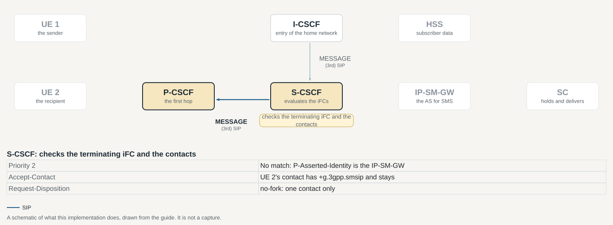
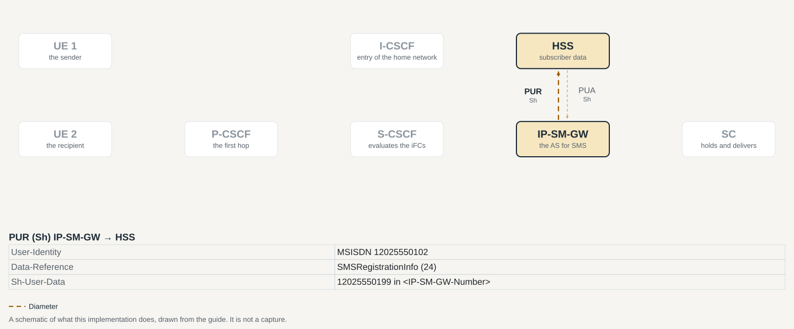
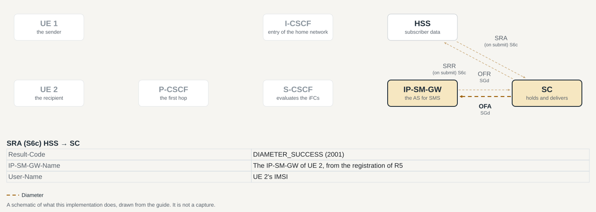
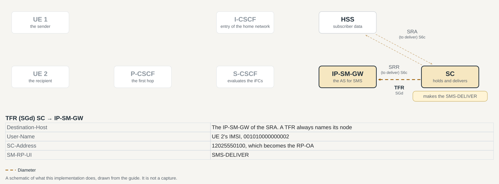
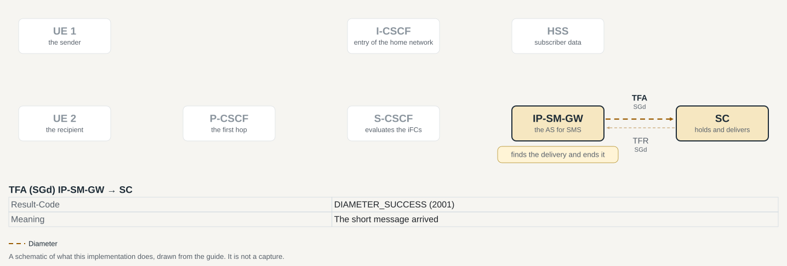
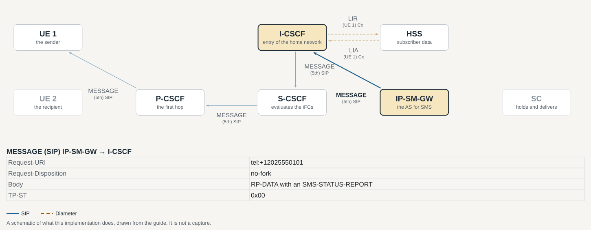
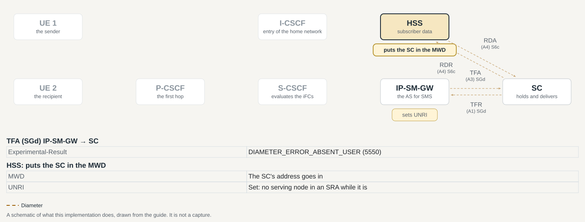
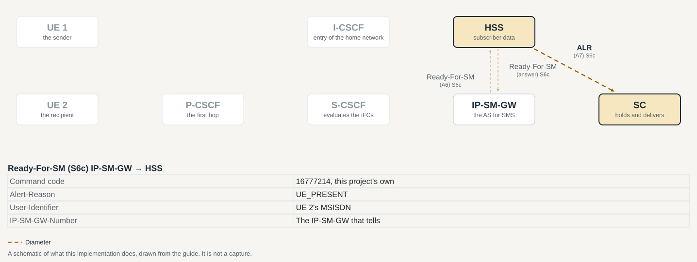
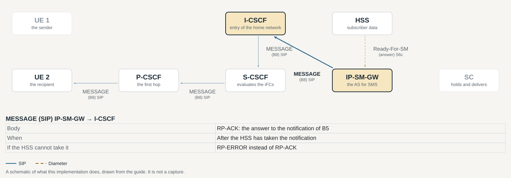
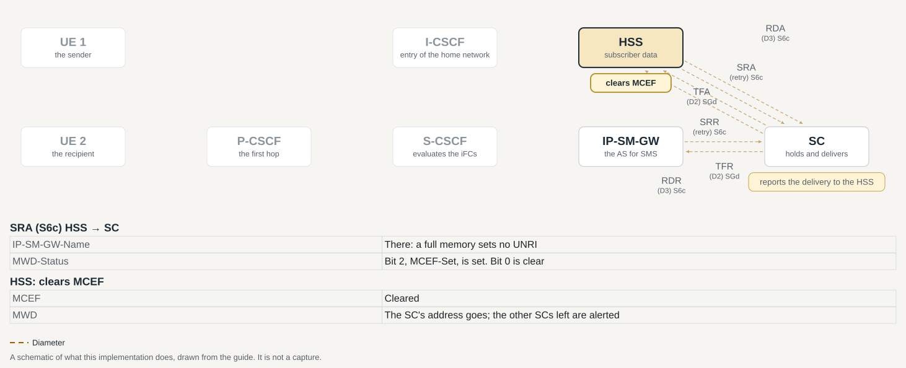

# Delivering SMS and reporting on it

UE 1 sends a short message not to UE 2 but to the Service Centre (SC). The S-CSCF knows nothing of SMS, but the iFCs it got from the HSS have it pass the MESSAGE to the IP-SM-GW. The IP-SM-GW hands what it carries to the SC over SGd, and the SC holds the short message. The SC asks the HSS over S6c which node serves the recipient, and has the IP-SM-GW that the HSS names deliver it. That IP-SM-GW sends a new MESSAGE to UE 2.

On this way there are three kinds of "received", and they mean different things.

- The SIP 202 and 200 only say that the node the MESSAGE was for (the IP-SM-GW or a UE) got that MESSAGE.
- An RP-ACK says that the other side took the short message on. The RP-ACK of the submit report to the sender says that the SC took it on; the RP-ACK of the delivery report from the recipient says that UE 2 got it.
- The status report tells the sender, afterwards, that the SC delivered the message to the recipient.

When UE 2 cannot take it, the SC does not drop the short message but holds it. The HSS writes the SC's address into UE 2's message waiting data (MWD) and keeps a flag, UNRI or MCEF, for why the delivery failed. When the IP-SM-GW reports that UE 2 is back, the HSS alerts the SC, and the SC sends the message again. When no alert comes, the retry of the SC ends the wait, and when the validity period passes, its end does.

This chapter follows which condition makes which node decide what, together with the function that decides and the test that checks it.

## The setup of this chapter

The example is the `deploy/compose` setup. UE 1 (`+1-202-555-0101`) sends "Hello UE-B, this is UE-A." to UE 2 (`+1-202-555-0102`) and asks for a status report. The SC's address is `+12025550100`, and the IP-SM-GW's number is `+12025550199`. All of them are in the range that the North American Numbering Plan keeps for fictional use.

This chapter takes the registration and the call as known. REGISTER, Path and Service-Route are in [Why a UE sends REGISTER twice](registration-two-registers.md) and [Which request follows Path and which follows Service-Route](registration-routes.md); how the I-CSCF finds a user's S-CSCF with an LIR is in [From a number to the other phone](call.md).

The editions of the specifications that this chapter cites are TS 24.341 V19.0.0 and TS 23.204 V19.1.0 (SMS over IP), TS 24.011 V20.0.0 (relay layer), TS 23.040 V20.0.0 (transfer layer), TS 23.038 V20.0.0 (character coding), TS 29.338 V19.3.0 (SGd and S6c), TS 29.328 V20.0.0 (Sh), TS 24.229 V20.1.0 and TS 29.228 V20.0.0 (iFCs).

Besides the IMS, a short message can reach a phone over NAS, through an MSC, an MME or an SMSF. This implementation covers the IMS alone. Whichever way it travels, the short message inside is made of the same two layers.

## What the IP-SM-GW and the SC each take care of

The CSCFs only relay SIP, and do not read what a short message carries. A node has to speak the language of SIP and that of the SMS network both. That node is the IP-SM-GW, the application server (AS) of SMS over IP (TS 24.341 5.3.3).

| Node | What it takes care of | Whom it talks to |
| --- | --- | --- |
| IP-SM-GW | Turns a MESSAGE of a UE into a short message for the SC, and one from the SC into a MESSAGE for the UE. Learns from the registration state whether a user can take short messages, and writes into the HSS that it serves that user. | The S-CSCF and the I-CSCF (SIP), the SC (SGd), the HSS (Sh) |
| SC | Takes short messages, holds them until they are delivered or their validity period ends, and delivers them (TS 23.040 6.1). It is the SMS-IWMSC that takes them and the SMS-GMSC that delivers them as well (TS 23.040 4.1 lets them be one node). | The IP-SM-GW (SGd), the HSS (S6c) |
| HSS | Gives the S-CSCF the iFCs. Takes the IP-SM-GW's registration, and answers the SC's question with the IP-SM-GW that serves the recipient. Keeps an SC that could not deliver in the MWD, and alerts it when the user is back. | The S-CSCF (Cx), the IP-SM-GW (Sh and S6c), the SC (S6c) |

The body of a MESSAGE is made of two layers, the relay layer (RP, TS 24.011) and the transfer layer (TP, TS 23.040). RP stands for "one hand-over between two nodes of the network", TP for "the short message from the sender to the recipient".

| Layer | Message | Used for |
| --- | --- | --- |
| RP | RP-DATA | Carries a short message or a status report |
| RP | RP-ACK, RP-ERROR | The answer to an RP-DATA: taken, or refused and why (RP-Cause) |
| RP | RP-SMMA | The notice that the UE has memory again |
| TP | SMS-SUBMIT, SMS-DELIVER | What the sender gives the SC, what the SC gives the recipient |
| TP | SMS-SUBMIT-REPORT, SMS-DELIVER-REPORT | The answer inside an RP-ACK or RP-ERROR, with the reason of a refusal (TP-FCS) |
| TP | SMS-STATUS-REPORT | Tells the sender whether the message reached the recipient |

SIP only takes the place of what carries these two layers. The Content-Type of the body is `application/vnd.3gpp.sms`.

## Three kinds of "received"


The figure leaves out the CSCFs and draws only what passes between the UEs, the IP-SM-GW, the SC and the HSS. There are six MESSAGEs, each an independent request with a Call-ID of its own.

| No. | Direction | Body | SIP response to it |
| --- | --- | --- | --- |
| 1 | UE 1 to IP-SM-GW | RP-DATA with SMS-SUBMIT | 202 |
| 2 | IP-SM-GW to UE 1 | Submit report: RP-ACK with SMS-SUBMIT-REPORT | 200 |
| 3 | IP-SM-GW to UE 2 | RP-DATA with SMS-DELIVER | 200 |
| 4 | UE 2 to IP-SM-GW | Delivery report: RP-ACK with SMS-DELIVER-REPORT | 202 |
| 5 | IP-SM-GW to UE 1 | Status report: RP-DATA with SMS-STATUS-REPORT | 200 |
| 6 | UE 1 to IP-SM-GW | Delivery report: RP-ACK | 202 |

The SIP response of the IP-SM-GW is 202, not 200. It says that the MESSAGE was received, and that what it carries has not been delivered anywhere yet (RFC 3428 7, TS 24.341 5.3.3.4.1). The IP-SM-GW returns the 202 before it reads what the MESSAGE carries.

[internal/ipsmgw/message.go](../../../internal/ipsmgw/message.go)

```go
	if callID := req.Get("In-Reply-To"); callID != "" {
		g.deliveryReport(st, callID, log)
		return
	}
	g.respond(st, 202, nil)

	// Steps b and c: the RPDU type, and the format of the SC address.
	rp, err := sms.ParseRP(req.Body)
	if err != nil {
		g.refuseUndecodable(req, sender, err, log)
		return
	}
	switch m := rp.(type) {
	case sms.RPDataMSToNetwork:
		g.submit(req, sender, m, log)
	case sms.RPSMMA:
		g.memoryAvailable(req, sender, m, log)
```

The input is a MESSAGE from a UE. With In-Reply-To it is the delivery report for a MESSAGE that the IP-SM-GW sent earlier, and `deliveryReport` takes it. Without, the IP-SM-GW first answers 202, and only then reads the body as RP. When it cannot, `refuseUndecodable` writes an RP-ERROR, which goes back to the UE in a MESSAGE of its own. When it can, an RP-DATA goes on to `submit` as a short message for the SC, and an RP-SMMA to `memoryAvailable` as the notice about memory.

So the 202 does not even say whether the body is sound. An RP-DATA with a broken body gets the 202 too, and then a submit report that is an RP-ERROR with RP-Cause 96 (invalid mandatory information). `TestShortMessagesThatFail` in `internal/ipsmgw/network_test.go` checks this order, with the S-CSCF and the IP-SM-GW running in one process.

The same holds on the UE's side. The 200 that UE 2 returns to the third MESSAGE only says that the MESSAGE reached UE 2 (TS 24.341 5.3.2.3). Whether UE 2 could take the short message is in the RP-ACK or RP-ERROR of the fourth MESSAGE, the delivery report.

In short, the sender, UE 1, learns things in three steps.

| What UE 1 gets | Node that sends it | What it says | What it does not say yet |
| --- | --- | --- | --- |
| The 202 to the first MESSAGE | IP-SM-GW | The IP-SM-GW got the MESSAGE | Whether the SC accepted it |
| The second MESSAGE, the RP-ACK of the submit report | IP-SM-GW (carrying the SC's answer) | The SC took the short message on | Whether it reached the recipient |
| The fifth MESSAGE, the status report | SC (carried by the IP-SM-GW) | It reached the recipient (TP-ST 0x00) | ― |

UE 1 keeps the Call-ID of the MESSAGE it sent and compares it with the In-Reply-To of the submit report (TS 24.341 5.3.1.2). A status report it matches by TP-MR, TP-RA and TP-SCTS, which "Until the status report reaches the sender" below shows.

## The iFCs that bring in the IP-SM-GW

The S-CSCF decides which request goes to which AS by the iFCs that came in the User-Data of the SAA at registration (TS 29.228 B.2.2). The iFCs of this setup are in `deploy/compose/hss.yaml`, and three of them concern SMS over IP.

| Priority | Requests it matches | Where they go, and DefaultHandling |
| --- | --- | --- |
| 0 | Every REGISTER | A third-party REGISTER to the IP-SM-GW, with the user's MSISDN in ServiceInfo. SESSION_CONTINUED |
| 1 | A MESSAGE that a registered user sends, with Content-Type `application/vnd.3gpp.sms` | The IP-SM-GW. SESSION_TERMINATED |
| 2 | The same MESSAGE to a registered user, except one that the IP-SM-GW itself sent | The IP-SM-GW |

The first MESSAGE comes from UE 1, so it matches priority 1. Its Request-URI is the SC's `tel:+12025550100`, but the S-CSCF does not send it there: it puts the IP-SM-GW at the top of Route and sends it on (TS 24.229 5.4.3.2). The delivery reports, the fourth and the sixth MESSAGE, are MESSAGEs with an SMS body that UE 2 and UE 1 send, so each matches priority 1 of the UE that sent it and reaches the IP-SM-GW.

The second, third and fifth MESSAGE, from the IP-SM-GW to a UE, are new requests that the IP-SM-GW starts as a UA. The IP-SM-GW sends them to the entry point of the home network, the I-CSCF, which finds the user's S-CSCF with an LIR (TS 24.229 5.7.3). For the S-CSCF, each is a MESSAGE to the user. Here the condition of priority 2 comes in.

[deploy/compose/hss.yaml](../../../deploy/compose/hss.yaml)

```yaml
      - priority: 2
        feature: sms
        trigger_point:
          condition_type_cnf: true
          spt:
            - {group: [0], method: MESSAGE}
            - {group: [1], sip_header: {header: ^Content-Type$, content: '^[Aa][Pp][Pp][Ll][Ii][Cc][Aa][Tt][Ii][Oo][Nn]/[Vv][Nn][Dd]\.3[Gg][Pp][Pp]\.[Ss][Mm][Ss]([[:space:]]*;.*)?$'}}
            - {group: [2], session_case: TERMINATING_REGISTERED}
            - {group: [3], condition_negated: true, sip_header: {header: ^P-Asserted-Identity$, content: 'sip:ipsmgw\.ims\.mnc001\.mcc001\.3gppnetwork\.org'}}
        application_server: {server_name: sip:ipsmgw.ims.mnc001.mcc001.3gppnetwork.org:5060}
```

The four SPTs are in four groups, and `condition_type_cnf: true` makes the criterion match only when all four hold. The last SPT has `condition_negated: true`: it is the negation of "P-Asserted-Identity is the URI of the IP-SM-GW". The IP-SM-GW puts its own URI in the P-Asserted-Identity of every MESSAGE it sends, so the second, third and fifth MESSAGE do not match. Without the negation, a MESSAGE that the IP-SM-GW sent to a UE would come back to the IP-SM-GW (TS 23.218 5.2.3 NOTE 5). What the criterion matches is a short message for the user from another network, which is the subject of [Interconnection between networks](interconnect.md).

The S-CSCF evaluates the combination like this.

[internal/ifc/ifc.go](../../../internal/ifc/ifc.go)

```go
func (t TriggerPoint) matches(req *sip.Message, sc SessionCase) bool {
	groups := map[int][]bool{}
	for _, spt := range t.SPT {
		result := spt.matches(req, sc) != spt.ConditionNegated
		for _, g := range spt.Group {
			groups[g] = append(groups[g], result)
		}
	}
	if t.ConditionTypeCNF {
		// Every group needs one SPT that holds.
		for _, results := range groups {
			if !slices.Contains(results, true) {
				return false
			}
		}
		return true
	}
	// One group needs all of its SPTs to hold.
	for _, results := range groups {
		if !slices.Contains(results, false) {
			return true
		}
	}
	return false
}
```

The result of each SPT is inverted by `ConditionNegated` first, then gathered by group. In conjunctive normal form, every group needs one SPT that holds: the SPTs of one group are joined by OR, and the groups by AND (TS 29.228 B.2.3). Priority 2 has one SPT in each group, so it is the AND of four.



DefaultHandling says what happens when the AS does not answer. The operator chooses it, not the specification. In this setup the criterion of the registration is SESSION_CONTINUED: the registration stays when the IP-SM-GW does not answer. The criterion of a MESSAGE that a UE sends is SESSION_TERMINATED. No other node can take a short message, so when the IP-SM-GW does not answer, the S-CSCF ends the MESSAGE there, and the UE gets a failure response. With SESSION_CONTINUED, the S-CSCF would try to send the MESSAGE to the SC's number in the Request-URI and answer 404, for a number that ENUM does not have.

`TestSMSCriteria` in `internal/ifc/ifc_test.go` checks which requests match the criterion of priority 1 and which do not, including the ways of writing Content-Type (a header name in lower case, a media type with parameters). `TestShortMessageThroughTheWholeIMS` in `internal/ue/sms_ims_test.go` runs the P-CSCF to the S-CSCF in one process, with the IP-SM-GW as the test's stand-in, and checks that UE-A's MESSAGE reaches the IP-SM-GW by UE-A's criteria and UE-B's delivery report by UE-B's. The iFC of that test is a criterion of the same shape as priority 1, written in the test.

## Until the IP-SM-GW serves the user

When the SC asks the HSS where to deliver, the HSS can name the IP-SM-GW because the IP-SM-GW has written itself into the HSS beforehand. That happens at the user's registration (TS 24.341 5.3.3.2).

1. UE 2 registers with the feature tag `+g.3gpp.smsip` in the Contact of its REGISTER (TS 24.341 5.3.2.2). The tag says that this contact can take short messages over IP (R1).
2. Once the registration is done, the S-CSCF sends a third-party REGISTER to the IP-SM-GW by the criterion of priority 0 (TS 24.229 5.4.1.7). The user's MSISDN is in `<service-info>` of the body (R2).
3. The third-party REGISTER has no Contact of the UE, so it does not tell whether the UE set the feature tag. The IP-SM-GW therefore subscribes to the reg event of the user (TS 24.229 5.7.1.1). In the reginfo of the S-CSCF's NOTIFY, the feature tags of each contact are listed as `<unknown-param>` (R3, R4).
4. When there is an active contact with the feature tag, the IP-SM-GW reads the user's IMSI with a UDR over Sh, and writes its own number into the HSS with a PUR (R5; TS 29.328 6.1.2, 7.6.16).

R1 to R5 are the names that the guide and the slides give these steps, and they show in the labels of the figures too.

Step 3 decides in this function.

[internal/ipsmgw/regevent.go](../../../internal/ipsmgw/regevent.go)

```go
func takesShortMessages(doc reginfo.Document, publicID string) bool {
	for _, r := range doc.Registrations {
		if r.State != reginfo.Active || !ims.SamePublicIdentity(r.AOR, publicID) {
			continue
		}
		for _, c := range r.Contacts {
			if c.State != reginfo.Active {
				continue
			}
			for _, p := range c.UnknownParams {
				if strings.EqualFold(p.Name, featureSMSOverIP) {
					return true
				}
			}
		}
	}
	return false
}
```

The input is the reginfo of the NOTIFY and the public user identity of the user it subscribed to. It is true when an active contact of an active registration has `+g.3gpp.smsip`. The IP-SM-GW updates the HSS only when this result changed since the NOTIFY before: a PUR with its number when it turned true, one with an empty number when it turned false.



The IMSI that the UDR reads is there because a TFR from the SC names the recipient by IMSI. The IP-SM-GW stores the IMSI with the state of the subscription before it sends the PUR. An HSS that gets the PUR may alert a waiting SC at once, and the TFR that follows may arrive before the answer to the PUR; the IP-SM-GW finds the user all the same.

A UE that registered without the feature tag gets no PUR. The HSS has no IP-SM-GW for that user, so the SC gets no node to deliver to, and holds the short message. `TestContactWithoutTheFeatureTag` in `internal/ipsmgw/regevent_test.go` checks that a NOTIFY without the feature tag sends no PUR and one with it does. `TestRegistrationWithoutTheFeatureTag` in `internal/ipsmgw/network_test.go` checks the same with the S-CSCF and the HSS in the loop.

## Until the SC takes the message on (submit report)

After its 202, the IP-SM-GW checks the RP-DATA: that RP-DA is the number of its SC, that the SMS-SUBMIT inside decodes, and that P-Asserted-Identity has a tel URI of the sender. The S-CSCF adds the tel URI as a second P-Asserted-Identity when it serves the sender (TS 24.229 5.4.3.2). The SC deals with the sender by telephone number, and the IP-SM-GW passes that number on (TS 24.341 5.3.1.2 NOTE 2).

The IP-SM-GW hands the SMS-SUBMIT to the SC in an OFR (MO-Forward-Short-Message, SGd; TS 23.204 6.3, TS 29.338 6.2.1). Before the SC takes it, it asks the HSS with an SRR (Send-Routing-Info-for-SM, S6c) whether a user has the recipient's number. TS 23.040 8.2.2 allows the SMS-IWMSC that query.



The SC's decision depends on the HSS's answer. When the HSS does not know the number (DIAMETER_ERROR_USER_UNKNOWN), the SC refuses in the OFA. When a user has the number, the SC takes the message on, whether that user can be reached now or not: that is for the delivery to find out. The SC stamps the message with the time it took it, TP-SCTS, holds it, and returns an SMS-SUBMIT-REPORT in the OFA. From here on, the short message is the SC's.

The IP-SM-GW turns this answer into the submit report.

[internal/ipsmgw/message.go](../../../internal/ipsmgw/message.go)

```go
	// Step e: the short message goes to the SC.
	report, err := g.sc.Submit(context.Background(), originator, submit)
	var answer sms.RPMessage
	var refusal *Refusal
	switch {
	case err == nil:
		log.Info("SC accepted the short message")
		answer, err = ackWith(rp.MessageReference, report)
	case errors.As(err, &refusal):
		log.Info("SC refused the short message", "reason", refusal.Error())
		answer, err = errorWith(rp.MessageReference, refusal)
	default:
		// The SC could not be asked. TS 24.011 Table 8.4 part 1: cause 41
		// is a failure that the sender may try again soon.
		log.Warn("SC did not answer", "error", err.Error())
		answer, err = sms.RPError{Direction: sms.NetworkToMS, MessageReference: rp.MessageReference, Cause: sms.RPCauseTemporaryFailure}, nil
	}
```

`g.sc.Submit` sends the OFR and reads the OFA. On success it writes an RP-ACK with the SC's SMS-SUBMIT-REPORT. When the SC refused (`*Refusal`), it writes an RP-ERROR with the RP-Cause the SC chose and an SMS-SUBMIT-REPORT with TP-FCS. When the SC could not be asked, it answers RP-Cause 41 (temporary failure), a failure the sender may try again (TS 24.011 Table 8.4). In every case `g.answer` then sends a new MESSAGE to UE 1. That is the submit report, with the Call-ID of the first MESSAGE in In-Reply-To (TS 24.341 5.3.3.4.3).

| Recipient | The SC's decision | The submit report UE 1 gets |
| --- | --- | --- |
| A registered subscriber | Takes it on | RP-ACK, with TP-SCTS in the SMS-SUBMIT-REPORT |
| A subscriber who is not registered (`+12025550103`) | Takes it on; the delivery finds the user absent, and the SC holds it | RP-ACK |
| No subscriber has the number (`+12025550198`) | Refuses: the SRA is DIAMETER_ERROR_USER_UNKNOWN (5001) | RP-ERROR with RP-Cause 1 (unassigned number) and TP-FCS 0xC3 (invalid SME address) |

A sender who mistyped the number learns of the failure in the submit report, without waiting for a status report. `TestRefusals` in `internal/smsc/smsc_test.go` checks the answer and the TP-FCS of each case in which the SC refuses, among them the number that no user has.

## Until the SC delivers it (delivery report and TFA)

The SC rewrites the SMS-SUBMIT into an SMS-DELIVER. In place of the recipient's number, TP-DA, it puts the sender's number, TP-OA, and it adds TP-SCTS. The text stays as it is. The sender asked for a status report, so the SC sets TP-SRI too.

Before the delivery, the SC sends another SRR, this time as the SMS-GMSC that delivers (TS 23.040 8.1.1): the user may have moved or gone since the message was taken. The HSS decides with this function whether to name a node.

[internal/hss/s6c.go](../../../internal/hss/s6c.go)

```go
func servingNode(u Subscriber) *sgd.ServingNode {
	if u.IPSMGWNumber == "" || u.IPSMGW.OriginHost == "" || u.UNRI {
		return nil
	}
	return &sgd.ServingNode{
		IPSMGWNumber: u.IPSMGWNumber,
		IPSMGWName:   u.IPSMGW.OriginHost,
		IPSMGWRealm:  u.IPSMGW.OriginRealm,
	}
}
```

The HSS names a node to deliver to (the serving node) when the IP-SM-GW wrote its number with a PUR, the HSS knows its Diameter name, and UNRI is not set. UNRI is the flag of an earlier delivery that found the user absent, which a later section covers. When it names none, the SRA is DIAMETER_ERROR_ABSENT_USER (5550), and the SC sends no TFR (TS 29.338 5.2.1.3).

The SRA gives the name of the IP-SM-GW and the IMSI of the recipient. The SC sends a TFR (MT-Forward-Short-Message, SGd) with that IP-SM-GW in Destination-Host. A TFR always names the node it is for (TS 29.338 6.3.1.2), and it names the recipient by the IMSI in User-Name.



The IP-SM-GW finds UE 2 by the IMSI it read with the UDR at registration, and sends the third MESSAGE to UE 2's tel URI. The MESSAGE carries `Accept-Contact: *;+g.3gpp.smsip;require;explicit`. UE 2's S-CSCF matches it against the parameters of the contacts that UE 2 registered (RFC 3841 7.2.4), and for a UE that did not register the feature tag it sends nothing and answers 480. `TestShortMessageToAUEWithoutSMSOverIP` in `internal/ue/sms_ims_test.go` checks that a MESSAGE to a UE that registered only MMTel gets a 480, and that the UE gets nothing.

UE 2 answers 200, then sends the fourth MESSAGE, the delivery report. The IP-SM-GW finds the delivery by the Call-ID in In-Reply-To and answers 202. Only now does the answer to the TFR, the TFA, go back to the SC.



The TFA carries the outcome of the delivery, so the IP-SM-GW holds the TFR unanswered until the delivery report comes. It waits up to 64 seconds for the delivery report, and the answer to the TFR takes up to 66 seconds. A delivery whose wait runs out reaches the SC as one whose outcome could not be confirmed. The state of a delivery in progress is in a store that the instances share, so that any instance of the IP-SM-GW that gets the delivery report can end the delivery (`TestDeliveryReportThroughAnotherIPSMGW` in `internal/ipsmgw/network_test.go`).

The outcome of the delivery comes from the SIP response to the MESSAGE or from the RP of the delivery report. How a failure response of the MESSAGE maps is in TS 29.311 6.1.4.4.1, and the IP-SM-GW keeps that table.

[internal/ipsmgw/servicecentre.go](../../../internal/ipsmgw/servicecentre.go)

```go
var failedMessageOutcomes = map[int]Outcome{
	401: IllegalSubscriber,
	404: UnidentifiedSubscriber,
	407: IllegalSubscriber,
	480: AbsentSubscriber,
	486: SubscriberBusy,
	600: SubscriberBusy,
	603: SubscriberBusy,
	604: UnidentifiedSubscriber,
}
```

A response that is not in the table, such as 408 or 500, is a system failure. When the MESSAGE got a 200 and the delivery report came, its RP decides: an RP-ACK is delivered, an RP-ERROR with RP-Cause 22 (memory capacity exceeded) is a full memory, any other RP-ERROR is an error of the phone.

| Outcome | The TFA of the IP-SM-GW | What the SC keeps |
| --- | --- | --- |
| The delivery report is an RP-ACK | DIAMETER_SUCCESS (2001) | Delivered. Off the queue, and a status report if asked for |
| The MESSAGE got 480 | DIAMETER_ERROR_ABSENT_USER (5550) | The recipient is absent. Holds it, and reports to the HSS |
| The delivery report is an RP-ERROR with RP-Cause 22 | DIAMETER_ERROR_SM_DELIVERY_FAILURE (5555) with MEMORY_CAPACITY_EXCEEDED | No memory. Holds it, and reports to the HSS |

`TestMTForwardShortMessageFailures` in `internal/ipsmgw/sgd_test.go` checks the result of the TFA for each combination of the response to the MESSAGE and the delivery report.

## Until the status report reaches the sender

When the TFA comes back with 2001, the SC takes the short message off the queue. If the sender asked for it with TP-SRR in the SMS-SUBMIT, the SC writes an SMS-STATUS-REPORT and puts it in the queue of the sender's number. From there on it is like any short message: the SC sends an SRR about the sender, a TFR to the IP-SM-GW that serves UE 1, and the IP-SM-GW delivers it to UE 1 in the fifth MESSAGE (TS 24.341 5.3.3.4.4).



The status report carries the TP-MR of the SMS-SUBMIT, the recipient's number in TP-RA, and the time the SC took the message in TP-SCTS. TP-ST 0x00 says that the recipient got it (TS 23.040 9.2.3.15). UE 1 decides with this function which short message a report is for.

[internal/ue/sms.go](../../../internal/ue/sms.go)

```go
func statusReportIsFor(s SentSMS, r sms.StatusReport) bool {
	if !s.StatusReportRequested || s.MessageReference != r.MessageReference {
		return false
	}
	if r.RecipientAddress.TypeOfNumber != sms.TONInternational || r.RecipientAddress.String() != s.To {
		return false
	}
	return s.ServiceCentreTimeStamp == nil || s.ServiceCentreTimeStamp.Equal(r.ServiceCentreTimeStamp)
}
```

TP-MR has 8 bits and wraps, so by TP-MR alone an old report that comes late could pass for the outcome of a newer short message. The UE therefore compares TP-RA as well, and TP-SCTS once the submit report has given it. It records the report when exactly one short message matches all three. UE 1 then says in the sixth MESSAGE, a delivery report, that it got the status report (TS 24.341 5.3.1.3).

`TestStatusReport` in `internal/smsc/smsc_test.go` checks that the SC puts the TP-MR and TP-DA of the SMS-SUBMIT and the time it took it into the status report. `TestShortMessageThroughTheIMS` in `internal/ipsmgw/network_test.go` checks the six MESSAGEs, from the registration to the status report, through an S-CSCF with the iFCs of `deploy/compose`.

## When the recipient cannot take it

A registered UE cannot always take a short message. The UE simulator of this implementation can be put in two such states through its control API: one in which it takes no short message, and one with no memory left. In both the SC does not drop the short message but holds it, but the HSS keeps a different flag (TS 23.040 3.2.6). In the labels of the figures that follow, A1 to A9, B1 to B8 and D1 to D3 are the names of the steps in the guide and the slides: A for a UE that takes none, B for a full memory, D for a lost notice of free memory.

| State | UE 2 answers | TFA | `SM-Delivery-Cause` of the SC's RDR | Flag in the HSS |
| --- | --- | --- | --- | --- |
| Takes none | 480 (Temporarily Unavailable) to the MESSAGE | DIAMETER_ERROR_ABSENT_USER (5550) | ABSENT_USER | UNRI |
| No memory left | 200 to the MESSAGE, then an RP-ERROR with RP-Cause 22 | DIAMETER_ERROR_SM_DELIVERY_FAILURE (5555) with MEMORY_CAPACITY_EXCEEDED | UE_MEMORY_CAPACITY_EXCEEDED | MCEF |

A 480 means "it reached the other side, which cannot take the request in its present state". The IP-SM-GW reports it to the SC as an absent subscriber (TS 24.341 5.3.3.4.2, TS 29.311 6.1.4.4.1, TS 29.338 7.3.3), and raises its own UNRI (UE-Not-Reachable-for-IP) too. The IP-SM-GW is the only node that knows that the delivery in the IMS failed, so it is also the node that tells when the UE is back.

The SC treats both failures as ones that may pass. It keeps holding the short message and reports to the HSS with a Report-SM-Delivery-Status (RDR, S6c; TS 29.338 5.2.3). The HSS records it with this function.

[internal/hss/store.go](../../../internal/hss/store.go)

```go
func (s *Subscriber) addMessageWaiting(scAddress string, cause DeliveryFailure) bool {
	switch cause {
	case MemoryCapacityExceeded:
		s.MCEF, s.UNRI = true, false
	default:
		s.UNRI = true
	}
	if slices.Contains(s.MessageWaitingData, scAddress) {
		return true
	}
	if len(s.MessageWaitingData) >= maxMessageWaitingData {
		return false
	}
	s.MessageWaitingData = append(s.MessageWaitingData, scAddress)
	return true
}
```

It puts the SC's address in the MWD and sets the flag that the reason asks for. An absent user sets UNRI. A full memory sets MCEF and clears UNRI: the message reached the UE, which only had no room for it. When the MWD is full, the SC's address does not go in, and the SC has only its own retries left.



The difference between the flags shows in the next answers to an SRR. While UNRI is set, `servingNode` of the section before names no node, so that the SC is not sent to an IP-SM-GW where it would only fail again. With MCEF, UNRI is clear, so a node is named, and the MWD-Status of the SRA has the bit MCEF-Set (TS 29.338 5.3.3.8).

`TestReportSMDeliveryStatusKeepsTheSCAddress` in `internal/hss/s6c_test.go` checks that an RDR of an absent user leaves the SC's address and UNRI, and one of a full memory MCEF, with UNRI cleared. `TestDeliveryFailures` in `internal/smsc/smsc_test.go` checks, for each result of the TFA, whether the SC holds the short message and tries again, or drops it and sends a status report. `TestSendRoutingInfoLeavesOutANodeMarkedNotReachable`, in the same file as the first, checks that the SRR after a report of an absent user gets 5550, and that the node comes back once the user registers again.

## The news that the UE is back, and the resend

The SC sends a held short message again as soon as the HSS alerts it (Alert-Service-Centre, ALR, S6c; TS 29.338 5.2.2, TS 23.040 3.2.6). What makes the HSS alert is the news from the IP-SM-GW that the user can take short messages again.

The IP-SM-GW knows that the UE is back as soon as anything from UE 2 reaches it, whatever it is: a short message of UE 2's own, or the third-party REGISTER of a re-registration (TS 23.204 6.5b). If its own UNRI is set, the IP-SM-GW clears it and tells the HSS. For a user that the IP-SM-GW had not written into the HSS yet, such as subscriber 3 who was not registered, the PUR of the registration is itself the news, and the HSS alerts the waiting SC (TS 23.040 3.2.6; `TestRegistrationAlertsTheServiceCentre` in `internal/hss/s6c_test.go`). For the memory, UE 2 says in an RP-SMMA that it has room again (TS 24.011 7.3.2, TS 23.204 6.6).

A real network carries this news in the READY_FOR_SM of MAP. Neither S6c nor Sh has a command for it, and this project does not speak MAP, so the IP-SM-GW sends a command of this project's own over S6c, Ready-For-SM (command code 16777214, a value that RFC 6733 keeps for experiments). `Alert-Reason` gives the reason, UE_PRESENT or UE_MEMORY_AVAILABLE. The HSS decides with this function which flags to clear and whether to alert the SC.

[internal/hss/store.go](../../../internal/hss/store.go)

```go
func (s *Subscriber) readyForShortMessages(reason sgd.AlertReason) bool {
	switch reason {
	case sgd.AlertReasonUEPresent:
		// Item 2c: the UE is reachable over IP again, so UNRI goes. While
		// MCEF is set the service centres wait for free memory instead.
		s.UNRI = false
		return len(s.MessageWaitingData) > 0 && !s.MCEF
	case sgd.AlertReasonUEMemoryAvailable:
		// Item 2f alerts the service centres when the UE has memory
		// again, and clears UNRI, since a UE that says so is reachable.
		// MCEF goes too: TS 23.040 3.2.8 Case 1 has the HLR clear it on
		// the MS Memory Capacity Available message, together with UNRI
		// for a UE reachable via the IP-SM-GW.
		s.MCEF, s.UNRI = false, false
		return len(s.MessageWaitingData) > 0
	}
	return false
}
```

UE_PRESENT clears UNRI, but while MCEF is set it alerts no one: that the UE is there does not help an SC that waits for free memory. UE_MEMORY_AVAILABLE clears MCEF and UNRI both. In either case, when an SC is left in the MWD, the HSS sends it an ALR. `TestReadyForShortMessages` in `internal/hss/s6c_test.go` checks this outcome for each combination of flags and MWD.



The alerted SC puts the queue of that number up for delivery at once, without waiting for its retry. The SRR now gets the IP-SM-GW, and the delivery goes as in the section before.

The notice about memory has one more condition. The IP-SM-GW answers the MESSAGE that carried the RP-SMMA with 202 at once, but sends the RP-ACK to the RP-SMMA, in a MESSAGE of its own, only after the HSS has answered the Ready-For-SM with success (`memoryAvailable` in `internal/ipsmgw/message.go`). That way it never tells the UE that a notice got through when it did not. When the HSS does not answer, it returns an RP-ERROR with RP-Cause 38 (network out of order), and the UE keeps the notice as one it still owes (TS 23.040 11.2). `TestMemoryAvailableThatTheHSSRefuses` in `internal/ipsmgw/ipsmgw_test.go` checks the RP-Cause of the RP-ERROR for each answer of the HSS.



Three tests in `internal/ipsmgw/chain_test.go` check this flow with the IP-SM-GW, the SC and the HSS joined by real Diameter connections. `TestAbsentUserIsAlertedThroughTheServiceCentre` does it with a MESSAGE of the UE's own after the 480, `TestAbsentUserWhoRegistersAgainIsAlertedThroughTheServiceCentre` with a re-registration alone, and `TestMemoryFullIsAlertedThroughTheServiceCentre` with an RP-SMMA; each checks that the MWD and the flags in the HSS end up clear and that the held short message reaches the UE.

## Retries when no news comes, and clearing the flag

Besides the alerts, the SC retries on its own. The interval of the retries is the operator's choice (TS 23.040 3.2.7 NOTE 5), and in this setup it is one hour, from `retry_delays` in `deploy/compose/sc.yaml`. What delivers a held short message is normally the alert; the retry is there for an alert that never comes.

A retry matters, for example, when the RP-SMMA is lost on the way. UE 2 has memory again, but MCEF stays set in the HSS. While MCEF is set, a re-registration of UE 2 sends no alert. At the retry, the HSS answers the SRR with an MWD-Status that has MCEF-Set, and the delivery succeeds. From that answer the SC knows to report the successful delivery to the HSS.

[internal/smsc/deliver.go](../../../internal/smsc/deliver.go)

```go
func (c *SMSC) reportDelivered(ctx context.Context, msisdn string, kind nodeKind, status *sgd.MWDStatus, log *slog.Logger) {
	if status == nil || *status&(sgd.MWDMNRFSet|sgd.MWDMCEFSet|sgd.MWDMNRGSet) == 0 {
		return
	}
```

When none of MNRF, MCEF and MNRG is set in the MWD-Status, it reports nothing. When one is, it sends an RDR with `SM-Delivery-Cause` SUCCESSFUL_TRANSFER (TS 23.040 10.1 operation 3, TS 29.338 5.2.3.1). The HSS clears MCEF and takes the SC's address out of the MWD. Without this report MCEF would stay set, and when UE 2 later became unreachable and came back, no one would be alerted. `TestARetryAfterAFullMemoryClearsTheFlag` in `internal/ipsmgw/chain_test.go` sets the retry to one second and checks that this report leaves MCEF and the MWD clear.



## When the validity period ends

The SC is responsible for a short message until its validity period ends (TS 23.040 6.1). When the SMS-SUBMIT asks for no validity period in TP-VP, the SC holds it for its default of 72 hours. The UE of this implementation asks for none, so every short message gets 72 hours.

Each time the SC takes a queue up for delivery, it looks at the periods first.

[internal/smsc/deliver.go](../../../internal/smsc/deliver.go)

```go
	for _, m := range queue {
		if now.Before(m.Expires) {
			live = append(live, m)
			continue
		}
		if err := c.store.Remove(ctx, l, m.ID); err != nil {
			log.Warn("cannot discard a message", "message_id", m.ID, "error", err.Error())
			return false
		}
		// TS 23.040 6.1: the SC is responsible for the message only
		// until its validity period ends.
		log.Info("short message discarded: its validity period ended", "message_id", m.ID, "expires", m.Expires)
		c.reportStatus(ctx, m, statusValidityPeriodExpired, now)
	}
```

A short message whose period has ended leaves the queue, and if the sender asked for one, the SC writes a status report. Its TP-ST is `SM Validity Period Expired` (0x46), a failure that is not tried again (TS 23.040 9.2.3.15). `TestValidityPeriodExpires` in `internal/smsc/smsc_test.go` gives a short message a validity period of five minutes and a recipient that it never reaches, and checks that the status report goes out exactly at the end of the period and that nothing is sent after it.

So the sender of a short message to subscriber 3, who is not registered, gets nothing for a while after the RP-ACK of the submit report. The status report comes when subscriber 3 registers and the message is delivered, or when 72 hours have passed.

## Retransmissions and duplicates

So far, every request has got its answer. In fact the answer to an OFR or a TFR can be lost, and the sender of the request sends it again. When the copy reaches another instance, what tells the instances that they must not hold the same short message twice, or deliver it twice, and how far that holds, is the subject of Retransmitted and duplicated SMS.

## Reading the body of the first MESSAGE

The body of the first MESSAGE has 47 octets. It is the sequence that the guide shows, which the UE simulator wrote with `internal/sms`.

```text
00 00 00 07 91 21 20 55 05 01 f0 23 21 00 0b 91 21 20 55 05 01 f2 00 00 19 c8 32 9b fd 06 55 8b 2d 21 0b
44 47 a7 e7 a0 f4 1c 54 2d b6 82 2e
```

The first 12 octets are the RP-DATA (TS 24.011 7.3.1.2, 8.2).

| Octets | Field | Meaning |
| --- | --- | --- |
| `00` | RP-MTI | The lowest 3 bits are 0: RP-DATA from the phone to the network |
| `00` | RP-MR | 0. The RP-ACK or RP-ERROR that answers carries the same value |
| `00` | Length of RP-OA | 0. An RP-DATA from the phone has an empty originator address |
| `07` | Length of RP-DA | 7 octets follow |
| `91` | Type of address | International number, numbering plan E.164 |
| `21 20 55 05 01 f0` | Digits of RP-DA | Two digits per octet, the lower half first, and `f` for the one left over: 1 2 0 2 5 5 5 0 1 0 0, the SC's `+12025550100` |
| `23` | Length of RP-User-Data | 35 octets follow: the TPDU |

The remaining 35 octets are the SMS-SUBMIT (TS 23.040 9.2.2.2, 9.2.3).

| Octets | Field | Meaning |
| --- | --- | --- |
| `21` | First octet | `0010 0001`: TP-MTI 01 is SMS-SUBMIT, TP-VPF 00 is no validity period, TP-SRR 1 asks for a status report |
| `00` | TP-MR | 0. The status report repeats this value |
| `0b` | Length of TP-DA | 11 digits |
| `91` | Type of address | International number, E.164 |
| `21 20 55 05 01 f2` | Digits of TP-DA | The recipient's `+12025550102` |
| `00` | TP-PID | 0. A plain short message |
| `00` | TP-DCS | 0. The GSM 7 bit default alphabet |
| `19` | TP-UDL | 25 septets: 25 characters |
| `c8 32 9b fd ... b6 82 2e` | TP-UD | The text packed into 22 octets |

The same 11-digit number has length 7 in RP-DA and 11 in TP-DA. RP counts the octets that follow the length, the type of address included, and TP counts the digits. TP-MTI 01 is SMS-SUBMIT from a phone and SMS-SUBMIT-REPORT from the network; the direction of the RP message around it tells which.

The 7-bit characters of the text (septets) are packed into octets from the lowest bit up (TS 23.038 6.1.2.1.1). The first two octets come out like this.

```text
H = 100 1000, e = 110 0101, l = 110 1100
octet 1: lowest bit of 'e' (1), then 'H' (1001000)            = 1100 1000 = c8
octet 2: lowest 2 bits of 'l' (00), then rest of 'e' (110010) = 0011 0010 = 32
```

25 septets are 175 bits, which fit in 22 octets. The sequence matches what these rules give for the text. A text with characters that the default alphabet does not have, such as Japanese, goes in UCS2: TP-DCS becomes `08`, a character takes two octets, and TP-UDL counts octets. In the example of the guide, `こんにちは、UE-A さん` has TP-UDL `1a` (26 octets).

## What this account rests on

What this chapter says was checked against the following code and tests. Each test passes as a Go test of this repository.

- `TestShortMessageThroughTheServiceCentre` in `internal/ipsmgw/chain_test.go`. The UE's MESSAGE reaches the SC over SGd, the SC asks the HSS and brings the message back to the IP-SM-GW, the submit report is an RP-ACK, the delivery report ends the delivery, and no SC is left waiting in the HSS. The S-CSCF and the UE of this test are stand-ins; the IP-SM-GW, the SC and the HSS are the real ones.
- `TestAbsentUserIsAlertedThroughTheServiceCentre`, `TestAbsentUserWhoRegistersAgainIsAlertedThroughTheServiceCentre`, `TestMemoryFullIsAlertedThroughTheServiceCentre` and `TestARetryAfterAFullMemoryClearsTheFlag` in the same file: holding, the flags, the alerts, the resend, and the report after a retry.
- `TestShortMessageThroughTheIMS`, `TestShortMessagesThatFail`, `TestRegistrationWithoutTheFeatureTag` and `TestDeliveryReportThroughAnotherIPSMGW` in `internal/ipsmgw/network_test.go`. They run the S-CSCF, the IP-SM-GW and the HSS in one process, with a stand-in in place of the SC that collects the outcomes. What the SC does in these tests is therefore not what the `sc` node does.
- `TestMTForwardShortMessageFailures` in `internal/ipsmgw/sgd_test.go`, `TestContactWithoutTheFeatureTag` in `internal/ipsmgw/regevent_test.go` and `TestMemoryAvailableThatTheHSSRefuses` in `internal/ipsmgw/ipsmgw_test.go`.
- `TestRefusals`, `TestStatusReport`, `TestDeliveryFailures` and `TestValidityPeriodExpires` in `internal/smsc/smsc_test.go`. They check the decisions of the SC with stand-ins for the nodes it talks to.
- `TestReportSMDeliveryStatusKeepsTheSCAddress`, `TestSendRoutingInfoLeavesOutANodeMarkedNotReachable`, `TestReadyForShortMessages` and `TestRegistrationAlertsTheServiceCentre` in `internal/hss/s6c_test.go`.
- `TestSMSCriteria` in `internal/ifc/ifc_test.go`, and `TestShortMessageThroughTheWholeIMS` and `TestShortMessageToAUEWithoutSMSOverIP` in `internal/ue/sms_ims_test.go`.

The figures are diagrams of how this setup behaves, drawn from the guide. They are not captures. The octets of the body are those of the guide, and they match what the text and the coding rules give.

## Run it yourself

You do not need to run the setup to read this chapter. To see the same flow in a real capture, the guide has the steps in [Send a short message](../../guide/en/sms.md#send-a-short-message) and [Open the capture](../../guide/en/sms.md#open-the-capture). How to put the UE in the states where it cannot take a message, with their ladders, is in [When the UE cannot take it: hold, alert and resend](../../guide/en/sms.md#when-the-ue-cannot-take-it-hold-alert-and-resend), and every field of the body and the display filters are in [Read the body](../../guide/en/sms.md#read-the-body). How to send from a UE's card in the Lab is in the Lab guide, [Drive the UE simulators](../../guide/en/lab.md#drive-the-ue-simulators). In the slides, the [SMS deck](../../../slides/decks/en/06-sms.md) goes through the same flow one leg at a time.
