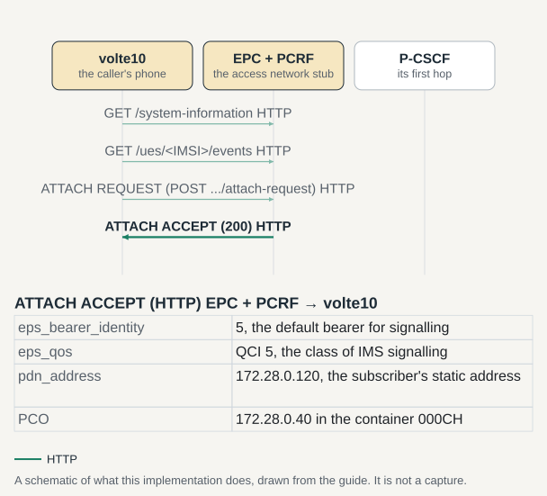
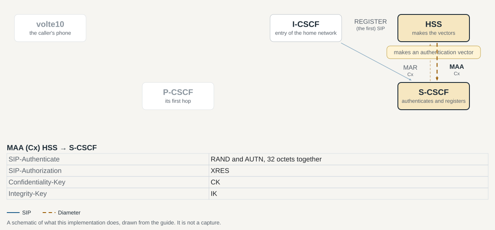
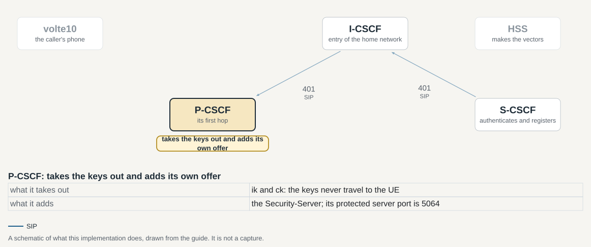
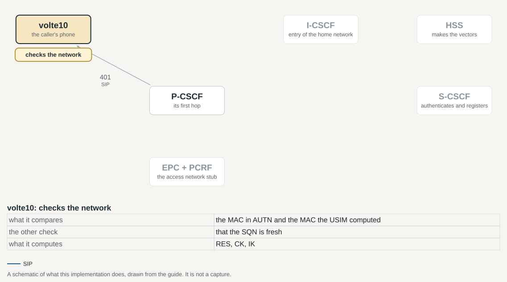
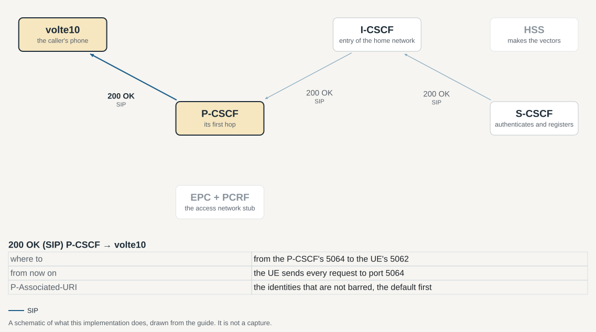
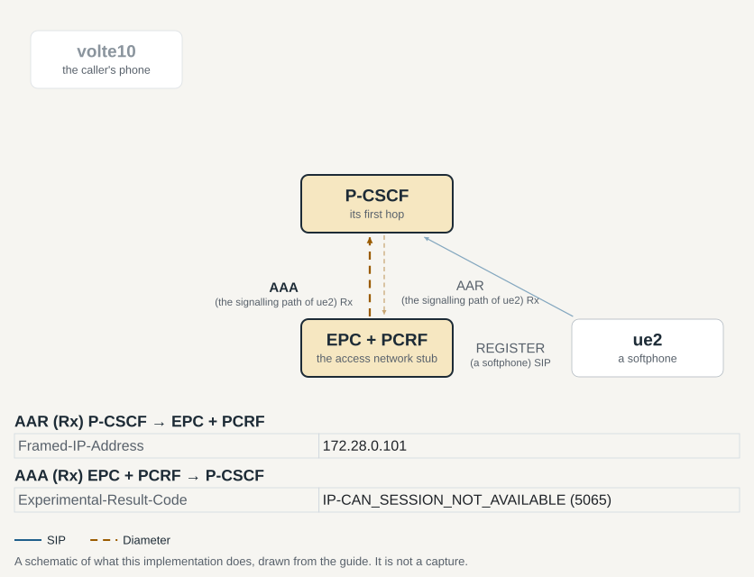
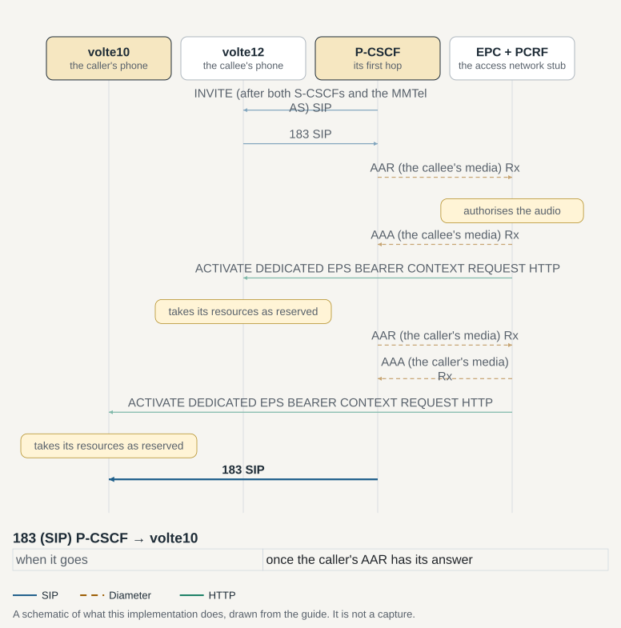
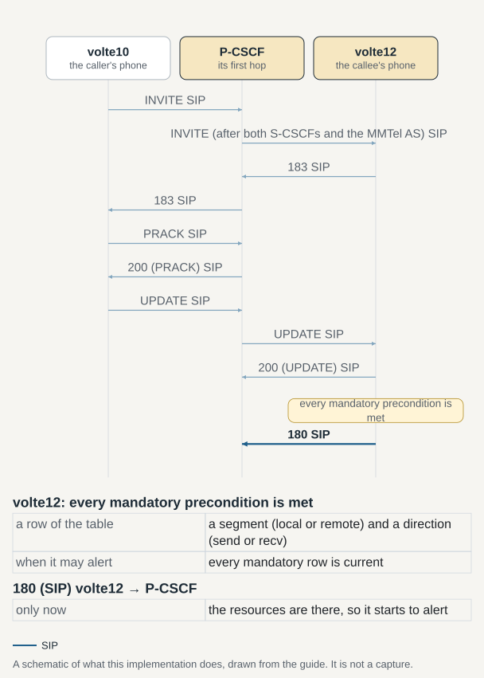
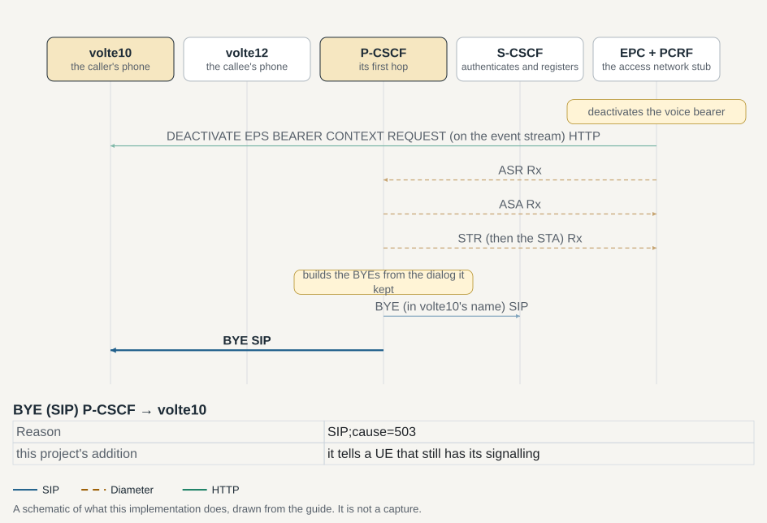

# Registration and calls over VoLTE

A VoLTE phone attaches to a mobile access network before it registers. There the network gives it its IP address, a default bearer that carries SIP, and the address of the P-CSCF. Registration keeps its shape of two REGISTERs, but becomes IMS AKA, which uses the keys of the USIM in place of a password. The network challenges with an authentication vector that is good for one use, and the phone checks with that challenge that the network is the real one. Meanwhile the phone and the P-CSCF agree on security associations, and later requests go to protected ports.

In a call, the P-CSCF looks at the SDP answer and asks the PCRF over Rx for resources for the voice. The network sets up a voice bearer for each phone, and the callee does not ring until the resources of both sides are there. When the network takes a bearer away, the P-CSCF ends the call although no phone hung up.

This chapter follows each step of that flow: which condition changes which decision of which node, the function that decides, and the test that checks it. The shape of a registration with SIP Digest is explained in [Why a UE sends REGISTER twice](registration-two-registers.md), and the INVITE, PRACK and ACK of a call in [Transactions, dialogs and media negotiation in a call](call-signaling.md). This chapter covers only what differs.

## The setup in this chapter

The example is the setup of `deploy/compose` with the two phones of the profile `volte` added.

| Node | Address | Its part in this chapter |
| --- | --- | --- |
| volte10 | 172.28.0.120 | The calling phone, number `tel:+12025550110`. Its USIM holds K and OPc |
| volte12 | 172.28.0.121 | The called phone, number `tel:+12025550112` |
| EPC stub and PCRF | 172.28.0.80 | Stands for the access network. It answers the phones over HTTP and the P-CSCF over Rx |
| P-CSCF | 172.28.0.40 | Listens on 5060 and on 5064, the protected server port for phones with IMS AKA. A client of Rx |
| I-CSCF, S-CSCF, HSS | 172.28.0.20, 30, 10 | As in the chapters on registration. The HSS makes the authentication vectors |
| MMTel AS, media relay | 172.28.0.75, 50 | Every call goes through the MMTel AS, and the voice through the relay |

K and OPc are values of the MILENAGE test sets (TS 35.208 4.3.1, 4.3.3). The EPC stub is not a real EPC. Its messages and their fields are the EMM and ESM ones of TS 24.301, but there is no radio and no NAS encoding: the phones talk to it in JSON over HTTP. The PCRF and the PDN GW share their state inside one node, with no Gx between them.

The specifications are those of the guide: TS 24.229 V20.1.0, TS 29.214 V20.0.0, TS 24.301 V20.1.0, TS 33.203 V20.0.0, TS 33.102 V19.1.0, RFC 3310, RFC 3329, RFC 3312, RFC 4867 and GSMA IR.92 v24.0.

## The attach gives the address of the P-CSCF

A softphone is given the address of the P-CSCF in its configuration. A VoLTE phone gets it from the access network.



The phone first reads the cell, and opens the event stream on which the network sends what it starts by itself. It opens it before the attach so that nothing the network sends right after the attach is lost. It then asks with ATTACH REQUEST for a PDN connection to the IMS APN (`ims`), and asks for the P-CSCF address in the protocol configuration options (PCO).

ATTACH ACCEPT holds three things. EPS bearer 5 is the default bearer, with QCI 5, the class for IMS signalling (IR.92 4.4.1). The PDN address is the subscriber's static address. The container with identifier `000CH` in the PCO carries the P-CSCF address 172.28.0.40 (TS 24.008 10.5.6.3). Giving the P-CSCF in the PCO is method II of TS 24.229 L.2.2.1, the one that IR.92 4.5 asks for.

How the phone uses that address is decided in these lines of the UE simulator.

[cmd/ue/main.go](../../../cmd/ue/main.go)

```go
		// TS 24.229 L.2.2.1: the first P-CSCF of the PCO is the most
		// preferred. The PCO gives an address only, so the port is the
		// one of -pcscf, 5060 by default.
		//
		// SIMPLIFIED: TS 24.229 L.2.2.1. The PCO may give a list of
		// P-CSCF addresses, and the UE takes the first one and drops the
		// rest. Where TS 24.229 5.1.1.2.1 and 5.1.2A.1.6 have the UE
		// register through another P-CSCF of the list, it registers
		// through the same one again (ue.RegistrationBackoff). The EPC
		// stub of each deployment of this project gives one address.
		target = netip.AddrPortFrom(attached.PCSCFs[0], target.Port())
```

The input is the list of P-CSCF addresses from ATTACH ACCEPT. The first one of the list is the most preferred (TS 24.229 L.2.2.1), so the phone uses it. The PCO carries no port, so the port stays the standard 5060. The standard has cases where a failed registration makes the phone try another P-CSCF of the list; this implementation takes the first and drops the rest, because in every setup the EPC stub gives one address.

The phone then checks that the PDN address is the address it reaches the P-CSCF from, and stops if not (the error `the PDN address ... is not the address` in the same file). The stub has no tunnel, and the phone's packets reach the P-CSCF with the address of the container, so if the two differ the PCRF cannot find the phone.

## The first REGISTER of IMS AKA, and the 401

The first REGISTER only says who, as with SIP Digest. Three things differ: the REGISTER carries `Security-Client` and `Require: sec-agree`; the P-CSCF keeps that offer and adds `integrity-protected="no"`; and the S-CSCF sees that mark and picks IMS AKA as the scheme.

In the code of the S-CSCF, this fork is these lines.

[internal/scscf/scscf.go](../../../internal/scscf/scscf.go)

```go
	// 5.4.1.1 items 1 and 2.
	if integrity == sip.IntegrityProtectedNo || integrity == sip.IntegrityProtectedYes {
		s.registerAKA(st, privateID, publicID, current.ServerName, *creds, integrity == sip.IntegrityProtectedYes, min(expires, s.cfg.MaxExpires), ch, pending, log)
		return
	}
```

`integrity` is the value of `integrity-protected` that the P-CSCF wrote into Authorization. `no` means the first registration of IMS AKA, `yes` a REGISTER that came protected (TS 24.229 5.4.1.1). Anything else goes on to the handling of SIP Digest further down. For a registration with SIP Digest, the S-CSCF left the scheme `Unknown` for the HSS to choose. For IMS AKA, `challengeAKA`, which `registerAKA` calls, asks in the MAR for one item of the scheme `Digest-AKAv1-MD5` (TS 29.229 6.3.9). That name covers both versions of Digest AKA. The HSS builds the same vector for either version; the version only decides how the Digest password is made from the vector.



What the HSS returns is no password but an authentication vector that is good for one use. The HSS steps SQN_HE once, picks a new RAND, and computes the other values from the subscriber's K and OPc with MILENAGE (TS 33.102 6.3.2, TS 35.206).

[internal/aka/aka.go](../../../internal/aka/aka.go)

```go
func NewAuthenticationVector(secret Secret, rand RAND, sqn SQN, amf AMF) AuthenticationVector {
	m := secret.milenage()
	mac := m.F1(rand, sqn.octets(), amf)
	res := m.F2(rand)
	return AuthenticationVector{
		RAND: rand,
		XRES: res[:],
		CK:   m.F3(rand),
		IK:   m.F4(rand),
		AUTN: newAUTN(conceal(sqn, m.F5(rand)), amf, mac),
	}
}
```

f1 to f5 are the functions of MILENAGE. f1 makes the MAC that authenticates the network, f2 the XRES that the phone's answer should match, f3 and f4 the keys CK and IK of the associations, and f5 the key AK that hides the SQN. AUTN is SQN ⊕ AK (6 octets), the AMF (2 octets) and the MAC (8 octets) in a row. A USIM with the same K and OPc can redo the same computation once it has RAND and AUTN.

The S-CSCF puts RAND and AUTN side by side in base64 as the nonce of the 401 (RFC 3310 3.2). It hands CK and IK to the P-CSCF in the parameters `ik` and `ck` (TS 24.229 5.4.1.2.1A). With the challenge it stores RAND, XRES, IK and CK: RAND to hand back to the HSS for a re-synchronisation, the other three to check the answer. The 401 has one WWW-Authenticate for each algorithm it offers.

[internal/scscf/aka.go](../../../internal/scscf/aka.go)

```go
	s.respond(st, 401, func(r *sip.Message) {
		for _, algorithm := range ch.Algorithms {
			challenge := sip.Challenge{Realm: ch.Realm, Nonce: ch.Nonce, Stale: stale, Algorithm: algorithm, QOP: []string{"auth"}}
			// 5.4.1.2.1A item 1 c: IK and CK for the P-CSCF (7.2A.1).
			challenge.SetKeys(hex.EncodeToString(av.IK[:]), hex.EncodeToString(av.CK[:]))
			r.Add("WWW-Authenticate", challenge.String())
		}
	})
```

`ch.Algorithms` is the list that the same function chose with `akaAlgorithms`, the most preferred first. A REGISTER whose Authorization names no algorithm is offered two: `AKAv2-SHA-256` first, then `AKAv1-MD5`, which is kept for backward compatibility (TS 33.203 6.1.1). A REGISTER that names one of them is offered that one alone (TS 24.229 5.4.1.2.1A). The VoLTE phones of this setup name no algorithm in their first REGISTER, so their 401 has two WWW-Authenticate. Both stand for the one authentication vector, so they carry the same nonce and the same `ik` and `ck`.

`ch.Nonce` is the value the same function made with `aka.Nonce(av.RAND, av.AUTN)`. Decoded from base64, the nonce is the same 32 octets as the SIP-Authenticate of the MAA. The first 16 octets are RAND and the rest AUTN, whose octets 7 and 8 are the AMF. For the subscribers of this setup the AMF is `0000`.

## The P-CSCF takes the keys out and offers protection

The 401 comes back to the P-CSCF through the I-CSCF. The P-CSCF does not pass it to the phone as it is.



[internal/pcscf/secagree.go](../../../internal/pcscf/secagree.go)

```go
func (p *PCSCF) challenged(st *sip.ServerTransaction, final *sip.Message, a *secAgreement, log *slog.Logger) (*sip.Message, error) {
	var ik aka.IK
	var ck aka.CK
	found := false
	challenges := final.GetAll("WWW-Authenticate")
	final.Remove("WWW-Authenticate")
	for _, v := range challenges {
		if ch, err := sip.ParseChallenge(v); err == nil {
			if hexIK, hexCK, ok := ch.Keys(); ok {
				found = found || (decodeKey(ik[:], hexIK) && decodeKey(ck[:], hexCK))
				ch.RemoveKeys()
				v = ch.String()
			}
		}
		final.Add("WWW-Authenticate", v)
	}
	if !found {
		log.Warn("401 without ik and ck")
		return sip.NewResponse(st.Request, 500, sip.NewTag()), nil
	}
```

The P-CSCF reads each WWW-Authenticate of the 401, takes `ik` and `ck` out when they are there, and writes the value again without them. The keys never travel to the phone: it can compute the same keys from its own K and RAND, so there is no need to send them. TS 24.229 5.2.2.2 item 2 has the P-CSCF forward the 401 only if it has removed `ck` and `ik`, so a 401 without the keys does not reach the phone. The clause does not say what the P-CSCF sends instead. This implementation answers 500, because it could not set up associations with the phone.

Further on, the P-CSCF chooses its SPIs and protected ports, and adds them to the 401 in `Security-Server`. The protected server port is 5064. At the same time it puts temporary associations with IK and CK into the SA table, with the time to wait for the answer as their expiry (TS 33.203 7.2). The 401 reaches the phone over the same pair of ports 5060 as the REGISTER that went out.

## The phone checks the network and answers

With SIP Digest, only the network checked the phone. With IMS AKA the phone checks the network too.



The check of the USIM is this function (TS 33.102 6.3.3).

[internal/aka/usim.go](../../../internal/aka/usim.go)

```go
func (u *USIM) Authenticate(rand RAND, autn AUTN) (Response, error) {
	m := u.secret.milenage()
	concealed, amf, mac := autn.parts()
	sqn := reveal(concealed, m.F5(rand))
	xmac := m.F1(rand, sqn.octets(), amf)
	if subtle.ConstantTimeCompare(mac[:], xmac[:]) != 1 {
		return Response{}, ErrMACFailure
	}
	if !u.fresh(sqn) {
		return Response{}, SynchronisationFailure{AUTS: newAUTS(m, rand, u.SQNMS())}
	}
	u.seqMS[sqn.IND()] = sqn.SEQ()
	res := m.F2(rand)
	return Response{RES: res[:], CK: m.F3(rand), IK: m.F4(rand)}, nil
}
```

The input is the RAND and AUTN taken out of the nonce. The function recovers the SQN that AK hides, computes the MAC again with its own K, and compares it with the MAC of the AUTN. If they match, the network knows the same K. If not, it fails with `ErrMACFailure` and the phone makes no answer. It then checks that the SQN is fresh (TS 33.102 C.2), and returns `SynchronisationFailure` if not. That failure carries an AUTS, which the phone puts into its next REGISTER. The S-CSCF hands the RAND it stored and the AUTS to the HSS in a MAR, and challenges again with a vector for which the HSS has set SQN_HE right. Only a challenge that passes both checks moves the USIM's SQN forward and gives RES, CK and IK.

The phone takes the topmost algorithm of the 401 that it supports, here `AKAv2-SHA-256`, and names it in its Authorization (TS 24.229 5.1.1.5.1). The Digest password of that version is made from an HMAC-SHA-256 keyed with RES, IK and CK, and the Digest is computed with SHA-256 too (RFC 4169 2.1). So the response shows that the phone holds the session keys and not RES alone. With `AKAv1-MD5` the password is RES itself and the Digest is MD5 (RFC 3310 3.3). The second REGISTER goes from the phone's protected server port 5062 to the P-CSCF's protected server port 5064. The phone puts its Security-Client in again and copies the Security-Server it got into `Security-Verify`, so that the P-CSCF can check that nobody on the way removed a stronger offer (RFC 3329).

The P-CSCF checks that the REGISTER came to the protected port, that the associations have the same private identity, and that Security-Verify and Security-Client are those it remembered, and forwards it with `integrity-protected="yes"` (TS 24.229 5.2.2.2). If one of them differs, it refuses with 403 or 494.

The S-CSCF checks that the algorithm the phone named is one the 401 offered, and then makes the H(A1) of that algorithm from the challenge it stored.

[internal/scscf/store.go](../../../internal/scscf/store.go)

```go
func (c Challenge) digestHA1(algorithm string) string {
	switch {
	case !c.offers(algorithm):
		return ""
	case strings.EqualFold(algorithm, sip.AlgorithmAKAv1MD5):
		return sip.HA1(algorithm, c.PrivateIdentity, c.Realm, aka.DigestPassword(c.XRES))
	case strings.EqualFold(algorithm, sip.AlgorithmAKAv2SHA256):
		return sip.HA1(algorithm, c.PrivateIdentity, c.Realm, aka.AKAv2DigestPassword(c.XRES, c.IK, c.CK))
	}
	return c.HA1
}
```

The password is made as the phone makes it, with XRES in place of RES: XRES alone for `AKAv1-MD5`, XRES, IK and CK for `AKAv2-SHA-256`. An algorithm the 401 did not offer has no H(A1), so its response is refused with 403. The last line, `c.HA1`, is for a challenge of SIP Digest, whose H(A1) the HSS hands over. The S-CSCF computes the Digest with this H(A1) and compares it with the phone's response; if they match, it tells the HSS of the registration with a SAR (TS 24.229 5.4.1.2.2).



The 200 OK comes back over the associations, and the P-CSCF turns the temporary associations into established ones, with the life of the registration. From then on the phone sends every request to port 5064, and the only REGISTER it sends to port 5060 is the first. Re-registration and deregistration go over these associations, with no new challenge (TS 24.229 5.1.1.4.2, 5.1.1.6.2).

## No ESP by default

The standard protects the messages after the 401 with IPsec ESP, with keys derived from IK and CK (TS 33.203 7.1). By default this setup agrees on the associations, keeps them, and uses the protected ports, but puts no ESP on the signalling, so that the SIP of a registered VoLTE phone reads in the captures too. IMS AKA without protection is not in the standard: it is a simplification of this implementation. So, by default, the protected client ports (`port-c`) are agreed on but never used, and the P-CSCF takes a message as protected because it came to the protected server port.

The setup in `deploy/esp` puts ESP between the UE and the P-CSCF. It protects the integrity with the algorithm the two ends agreed on, and encrypts with null (`ealg=null`). TS 33.203 6.3 asks for the integrity protection of ESP in every case, and confidentiality only when the P-CSCF's policy asks for it (6.2), so this is a form a real network can run. As the encryption is null, the SIP in the captures reads in this setup too. How to read it, and how the associations in the kernel look, is in ["The same agreement with ESP"](../../guide/en/volte.md#the-same-agreement-with-esp) of the guide.

With `deploy/esp/encryption.yaml` on top of it, the P-CSCF's policy asks for confidentiality, and ESP encrypts too, with AES-CBC. The P-CSCF offers `ealg=aes-cbc` before `ealg=null`, and selects AES-CBC for a phone that offers aes-cbc too (TS 33.203 7.2). The phones' settings do not change: a phone that sets up ESP offers the encryption algorithms it supports from the start. In the capture, the only things left readable between a phone and the P-CSCF are the first REGISTER and its 401. The keys are not in the capture, so Wireshark decrypts with the keys that the P-CSCF writes to a file. How is in ["The signalling encrypted"](../../guide/en/volte.md#the-signalling-encrypted) of the guide.

## The identities of a phone without an ISIM

The card of volte10 has a USIM and no ISIM. The USIM holds the IMSI and the keys, but no IMS identity, so the phone makes its identities from the IMSI (TS 24.229 5.1.1.1A, TS 23.003 13.2, 13.3, 13.4B).

| Identity | Value | Where it shows |
| --- | --- | --- |
| Private user identity | `001010000000010@ims.mnc001.mcc001.3gppnetwork.org` | The `username` of Authorization, and the User-Name of Cx |
| Temporary public user identity | `sip:001010000000010@ims.mnc001.mcc001.3gppnetwork.org` | From and To of the REGISTER, and the Public-Identity of Cx |
| Default public user identity | `sip:+12025550110@ims.mnc001.mcc001.3gppnetwork.org` | The first P-Associated-URI of the 200 OK, and From and P-Asserted-Identity after it |

The temporary public user identity holds the IMSI, so the HSS of this network bars it. The S-CSCF lists in the P-Associated-URI of the 200 OK only the identities that are not barred, the default one first (TS 24.229 5.4.1.2.2F). The phone keeps the first as its default identity and uses it as the From of its calls and short messages. So the IMSI shows in no request but the REGISTER.

## The Rx session that watches the signalling path

The P-CSCF is the application function (AF) of policy and charging control; the PCRF decides what the access network carries (TS 29.214 clause 4). Once a registration succeeds, the P-CSCF sends an AAR over Rx and asks the PCRF to tell it when the phone loses its signalling bearer (TS 29.214 A.4). It has one Media-Component-Description, number 0, with `Flow-Usage` AF_SIGNALLING. The PCRF finds the phone's IP-CAN session by `Framed-IP-Address` and binds the two.



The P-CSCF sends the same AAR for a softphone that did not attach. The PCRF has no PDN connection for that address and answers 5065 (IP-CAN_SESSION_NOT_AVAILABLE). The P-CSCF does not treat that answer as a failure: it serves the phone without policy control. The registration succeeds, and the calls of that phone get no AAR. That is why every capture of a softphone's registration shows this AAR and its 5065.

## The AAR for the media of a call

In a call, the P-CSCF of each side sends an AAR once it sees the SDP answer (TS 29.214 A.1). The callee's P-CSCF gets the answer in the 183 from volte12, the caller's in the same 183 on its way to volte10. One call makes one Rx session for the media on each side, apart from the sessions of the signalling path.

[internal/pcscf/setup.go](../../../internal/pcscf/setup.go)

```go
func (s *setup) authorize(answer []byte) error {
	if s.p.policy == nil || bytes.Equal(answer, s.authorized) {
		return nil
	}
	// The P-CSCF subscribes to the signalling path after its 200 to the
	// REGISTER (watchSignallingPath), so a UE that calls at once can send
	// its INVITE before the policy session is in the association. The
	// answer comes back through the callee, so the registration is read
	// as it is now, not as it was when the INVITE came.
	a, ok, err := s.p.store.Association(context.Background(), s.ue.Source)
	if err != nil {
		return storeError(err)
	}
	if !ok || a.SignallingSession == "" {
		return nil
	}
	session, err := s.p.policy.AuthorizeMedia(context.Background(), policy.MediaRequest{
		Session:       s.session,
		UE:            s.ue.Source.Addr.Addr(),
		SDP:           policy.OfferAnswer{Offer: s.offered, Answer: answer, UEOffered: !s.toUE()},
		ApplicationID: s.communicationService(),
		Subscribe:     mediaEvents,
	})
	if err != nil {
		s.log.Warn("the network has no resources for the media", "error", err.Error())
		return fmt.Errorf("%w: %w", errResources, err)
	}
	s.log.Info("media authorised", "policy_session", string(session))
	s.session, s.authorized = session, answer
	return nil
}
```

The input `answer` is the SDP answer as the phone sees it. The first condition does nothing for an answer that was authorised already: the same answer comes again in the 2xx after an unreliable 183, and in each retransmission of the 2xx. Next it reads whether the registration has a policy session for its signalling path. Without one, this phone did not come through the EPC, and its calls get no policy control either. With one, `AuthorizeMedia` sends the AAR with the offer and the answer, the phone's address, and the events to be told about (the loss of a bearer, its release, and a failed allocation). If the PCRF refuses, the P-CSCF ends the call there.

The content of the AAR comes from the SDP (TS 29.213 6.2). In the callee's AAR, one `Flow-Description` is `permit in 17 from 172.28.0.121 to 172.28.0.50 40004`: the other end of the media is the relay, not the other phone. `Max-Requested-Bandwidth-UL` and `-DL` are 80000 and 41000 from b=AS, in bit/s, and `Flow-Status` is `ENABLED` from sendrecv. On hold, the caller's `Flow-Status` becomes `ENABLED-UPLINK` and the callee's `ENABLED-DOWNLINK`. Only the callee's P-CSCF sends `AF-Application-Identifier`, which is a simplification: the caller's would take it from Feature-Caps, and no node writes that.

## The order of the AAA and the bearer

The PCRF authorises the voice with QCI 1, and the EPC stub sets up a dedicated bearer. The order of the two is fixed.



[internal/epc/pcrf.go](../../../internal/epc/pcrf.go)

```go
	// TS 29.214 4.4.1: the AAA goes before, or in parallel with, the
	// provisioning of the PCC rules, which here is the bearer for the UE.
	e.node.AfterAnswer(request, func() { e.carryOut(context.Background(), fx) })
	return answer(diameter.Base(diameter.DiameterSuccess))
```

The PCRF returns the AAA first, and runs `carryOut`, which sets up the bearer, after the answer has gone. TS 29.214 4.4.1 has the AAA go before the provisioning of the PCC rules, or in parallel with it. On the P-CSCF's side, `authorize` returns once the AAA has come, and the 183 goes on only after that. The P-CSCF waits for the AAA only, not for the bearer, so either the news of the bearer or the 183 may reach the calling phone first.

The bearer reaches the phone on the event stream. EPS bearer 6 is the voice bearer, and its `linked_eps_bearer_identity` is the default bearer, 5. Its traffic flow template (TFT) has four packet filters, for RTP and RTCP up and down between the phone and the relay. Once the phone has the bearer, it takes the resources of its own segment as reserved (TS 24.229 L.2.2.5.1B, IR.92 2.4.3.1).

In a call to ue2, which did not attach, the side of ue2 has no Rx session for its signalling path, so `authorize` returns at its second condition: only volte10's side has an AAR for the call. ue2 knows PCMU only, so its answer is `RTP/AVP 0 101` and the VoLTE phone speaks PCMU.

## No ringing until the resources are there

If the callee rings before the voice has a path, the user who answers hears nothing. Preconditions (RFC 3312) have each side show the state of its resources in the SDP, and the callee alert only once the mandatory ones are met. IR.92 2.4.1 asks for them, with UPDATE for the update of the status. The INVITE only lists `precondition` in Supported, not in Require (TS 24.229 5.1.3.1).

| SDP | Sent by | `curr` local | `curr` remote | `des` strength (local, remote) | `conf` |
| --- | --- | --- | --- | --- | --- |
| INVITE | volte10 | none | none | mandatory, optional | |
| 183 | volte12 | none | none | mandatory, mandatory | remote |
| UPDATE | volte10 | sendrecv | none | mandatory, mandatory | |
| 200 to the UPDATE | volte12 | sendrecv | sendrecv | mandatory, mandatory | |

The values are those of the side that sent the SDP. Each phone uses the segmented status type, which reserves its own segment only (TS 24.229 6.1.2). In the 183 the callee raises the strength of the caller's segment to mandatory, and asks with `conf:qos remote sendrecv` to be told once the caller's resources are there (RFC 3312 clause 7). Once the caller has its voice bearer, it waits for the 200 to its PRACK and sends an UPDATE with `curr:qos local sendrecv`. Seen from the callee, local and remote are both met when that UPDATE comes.



Whether the callee may ring is decided by this function of the precondition table (RFC 3312 clause 6).

[internal/precondition/table.go](../../../internal/precondition/table.go)

```go
func (t *Table) Met() bool {
	for _, r := range t.rows {
		if r.Strength == Mandatory && !r.Current {
			return false
		}
	}
	return true
}
```

A row of the table is a segment (local or remote) and a direction (send or recv). One row that is mandatory and has no resources yet (`Current` false) makes it false. The called phone sends no 180 and does not alert its user until it is true. So, seen from the callee, the 180 always comes after the 200 to the UPDATE. At the caller, the 180 may arrive before the 200 to the UPDATE: the P-CSCF holds that 200 while it sends the AAR of the new answer.

The 200 (INVITE) has no SDP: the answer came in the reliable 183.

## Speaking AMR-WB

The offer of a VoLTE phone lists AMR-WB first and AMR next, each in the two payload formats of RFC 4867. Bandwidth-efficient (96, 98) goes before octet-aligned (97, 99) because IR.92 3.2.5 has the caller prefer it. There is no mode-set, so every mode may be used (IR.92 2.4.3.2). PCMU stays last, so that the phone can talk to a softphone that knows PCMU only. That makes b=AS the value for PCMU, 80, and the uplink bandwidth that the P-CSCF asks the PCRF for takes the same value. volte12 answers `m=audio 60734 RTP/AVP 96 100` with `b=AS:41`: AMR-WB in bandwidth-efficient mode, and telephone-event at 16000 Hz.

This UE neither encodes nor decodes AMR. It sends frames prepared in the storage format of RFC 4867 clause 5, one 20 ms frame per packet. So it cannot follow the CMR, which is one of the simplifications. RTCP goes on the port above RTP (RFC 3550 11, IR.92 3.2.4), and DTMF as telephone-events (RFC 4733).

## When the network takes the bearer, the P-CSCF ends the call

A softphone's call ended only with a BYE of a phone. In VoLTE the network side ends the call when the network loses the resources (TS 24.229 5.2.8.1.2, IR.92 2.4.2.3).



The stub deactivates the EPS bearer context as the network does when the radio is lost (TS 24.301 6.4.4.2). The voice bearer carried all the media of the session, so the PCRF does not report the lost flows with an RAR: it ends the whole Rx session with an ASR (TS 29.214 4.4.6.1, 4.4.6.2), with `Abort-Cause` BEARER_RELEASED. The P-CSCF answers with an ASA, ends the session with an STR, and releases the call itself. volte10 sends no BYE of its own.

When the dialog is confirmed, the P-CSCF sends two BYEs with this function.

[internal/pcscf/release.go](../../../internal/pcscf/release.go)

```go
func (p *PCSCF) sendBYEs(d Dialog, log *slog.Logger) {
	toRemote := p.sendBYE(releaseBYE(d, d.remote(), d.ue()), "the other party", log)
	toUE := p.sendBYE(releaseBYE(d, d.ue(), d.remote()), "the served UE", log)
	go func() {
		logAnswer(toRemote, "the other party", log)
		logAnswer(toUE, "the served UE", log)
		p.endDialog(d.Key, d, log)
	}()
}
```

The BYEs are built from the Contact, the tags, the CSeq and the route of the dialog that the P-CSCF saved in its `Store`. The first goes to the other side in the name of the served phone; that is the BYE the standard asks for. The second goes to the served phone in the name of the other side. This implementation adds it, and the code says so with a `SIMPLIFIED:` note: a phone that lost only its voice bearer still has its signalling path, and without a BYE it would stay in a call that the network has ended. Both BYEs carry `Reason: SIP;cause=503;text="Service Unavailable"`. Once both have their answers, the P-CSCF deletes the dialog.

When the voice bearer is lost before the call is answered, the P-CSCF gives up the INVITE: it answers the INVITE with 500 and cancels it towards the callee. TS 24.229 5.2.8.1.1 asks for both steps when the resources for the media are gone, whichever side the P-CSCF serves. It splits them by side only when the signalling bearer is lost: then the P-CSCF of the calling user sends the CANCEL, and the P-CSCF of the called user answers with 500. In a call that ends with an ordinary BYE, the P-CSCF of each side ends its Rx session with an STR, with `Termination-Cause` DIAMETER_LOGOUT (TS 29.214 4.4.4).

## What this project simplifies

The main simplifications that touch this chapter. Each of them has a `SIMPLIFIED:` comment in the code.

| Where | What is left out | Why |
| --- | --- | --- |
| EPC stub | No NAS encoding, S1-AP, radio, GTP-U, Gx or authentication of the attach. A bearer is a record, and no QoS is enforced | What is read is the procedure, not the encoding. The PCRF and the PDN GW are in one node |
| PCRF | Audio only, with QCI 1. No DRA | A call of this network has one audio stream |
| P-CSCF and UE | No ESP by default (the setup in `deploy/esp` has it) | So that the captures read |
| UE | Uses only the first P-CSCF of the list in the PCO | In every setup the stub gives one address |
| P-CSCF | Releases at once when a bearer is lost, and sends a BYE to the served phone too | A call has one audio stream. Without the BYE the phone would stay in the call |
| UE and AMR | The CMR and the mode-set are not followed | The UE cannot encode |

## What this explanation rests on

The explanation in this chapter was checked against the following code and tests. Each test was run and passes as a Go test of this repository.

- `TestVoLTECallOverTheEPCStub` in `internal/ue/volte_epc_test.go`. Both phones attach to the EPC stub, the P-CSCF has the PCRF authorise the media of each side from the answer in the 183, the stub sets up a voice bearer for each phone, the caller reports its reservation in an UPDATE, and the callee alerts. It also checks that the caller's signalling goes INVITE, 183, PRACK, UPDATE, 180, 200, ACK, BYE in that order.
- `TestNetworkEndsTheCallWhenItTakesTheBearer` in `internal/ue/volte_epc_test.go`. When the stub releases the caller's voice bearer, the PCRF tells the P-CSCF, and the P-CSCF ends the call with a BYE to each side.
- `TestIMSAKAThroughTheWholeIMS` in `internal/ue/aka_ims_test.go`. Through every node, a phone whose USIM is ahead of the HSS registers after one re-synchronisation, then calls and sends a short message, all over the protected server port.
- `TestRegistrationWithIMSAKA`, `TestIMSAKAResynchronisation` and `TestIMSAKANetworkAuthenticationFailure` in `internal/scscf/aka_test.go`. The S-CSCF challenges with RAND and AUTN and with IK and CK for the P-CSCF and checks the answer against XRES; it challenges again with the AUTS; and it answers 403 to a phone that could not authenticate the network.
- `TestIMSAKAOfferedAlgorithms` and `TestIMSAKAAcceptsTheAlgorithmTheUEChose` in `internal/scscf/aka_test.go`. The 401 to a REGISTER that names no algorithm offers two challenges, `AKAv2-SHA-256` then `AKAv1-MD5`, with the same nonce and with `ik` and `ck`; a REGISTER that names an algorithm is offered that one alone; and the answer of either version that the phone chose is accepted.
- `TestIMSAKAAnswersWithAKAv2` in `internal/ue/aka_ims_test.go`. The first REGISTER has no algorithm, and the phone chooses `AKAv2-SHA-256` and answers with a SHA-256 response of 64 hex digits.
- `TestIMSAKASecurityAgreement` in `internal/pcscf/secagree_test.go`. The Security-Client stays at the P-CSCF, the 401 loses `ik` and `ck` and gains Security-Server, and the answer that comes protected goes on with `integrity-protected="yes"`.
- `TestUSIMAcceptsTheNetworksVector` and `TestResynchronisation` in `internal/aka/aka_test.go`. The USIM accepts the network's vector and gives the same RES and keys, and an SQN out of step is set right with the AUTS.
- `TestAKAv2DigestPasswordFromTestSet1` in `internal/aka/digest_test.go`. The password of AKAv2-SHA-256 is made from the RES, IK and CK of a vector of the TS 35.208 test data as RFC 4169 2.1 says.
- `TestESPConfidentialityPolicy` and `TestESPKeysForWireshark` in `internal/pcscf/esp_test.go`. A P-CSCF whose policy asks for confidentiality offers `ealg=aes-cbc` before `ealg=null` and selects AES-CBC, and writes the keys of each set of associations to the configured file, as rows of Wireshark's ESP SAs table.
- `TestUEWithoutIPCANSessionRegistersWithoutPolicyControl` and `TestTerminatingCallHasItsMediaAuthorised` in `internal/pcscf/policy_test.go`. A phone the PCRF does not know registers all the same, and the callee's P-CSCF asks for the media of a call with the answer.
- `TestAttachGivesTheAddressAndTheP_CSCFs` and `TestTheMediaOfACallGetAVoiceBearer` in `internal/epc/epc_test.go`. ATTACH ACCEPT gives the default bearer with QCI 5, the static address and the P-CSCF address, and the AAR of a call makes a voice bearer with QCI 1.
- `TestVoLTEFlow` in `internal/precondition/precondition_test.go`. The precondition lines of the four SDPs of the table above.
- `TestReleasedBearerEndsTheCallWithBYEs` in `internal/pcscf/release_test.go`. When the PCRF reports that the bearer was released, the P-CSCF builds a BYE with `Reason: SIP;cause=503` from the dialog it saved.

The figures are diagrams drawn from the guide's account of this setup, not captures.

## If you want to run it yourself

You need not run anything to read this chapter. To see the same flow in a real capture, the guide has the steps in ["Run it"](../../guide/en/volte.md#run-it) and ["Open the capture"](../../guide/en/volte.md#open-the-capture). How to compute the vector and the response again by hand is in ["Check the vector by hand"](../../guide/en/volte.md#check-the-vector-by-hand), and how to have the network take a bearer down in ["The network takes the bearer"](../../guide/en/volte.md#the-network-takes-the-bearer). In the slides, the scenes of [the deck on VoLTE](../../../slides/decks/en/09-volte.md) from "Attach, and finding the P-CSCF" to "The network takes the bearer" go one step at a time in the same order as this chapter.

What joining this network to another operator's network adds is the subject of [Interconnection between networks](interconnect.md).
