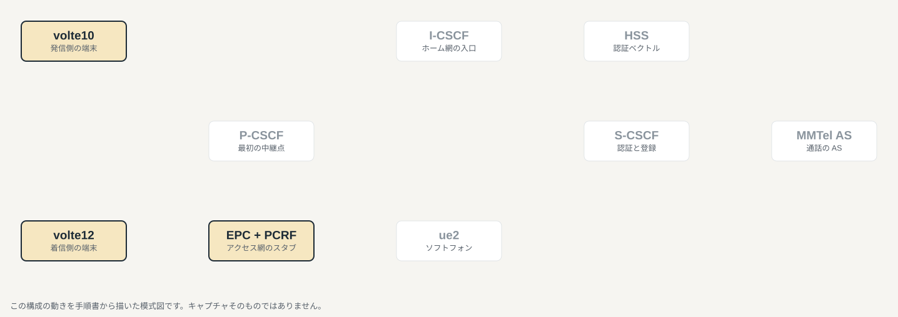
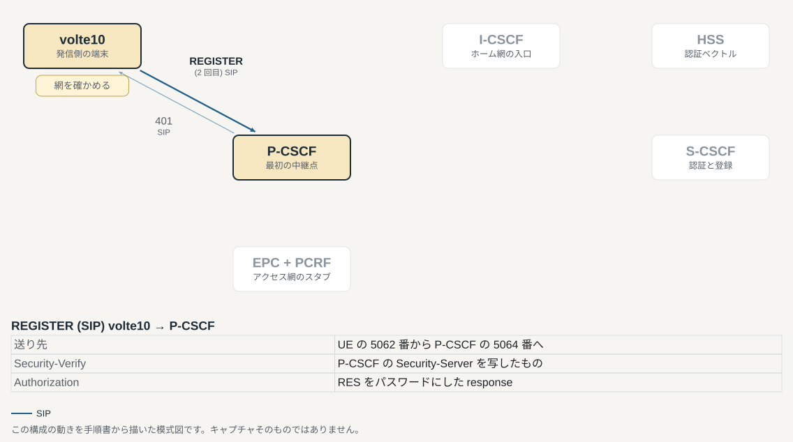
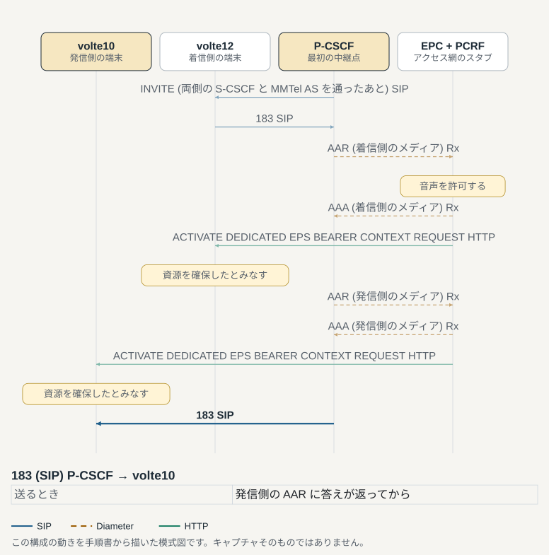
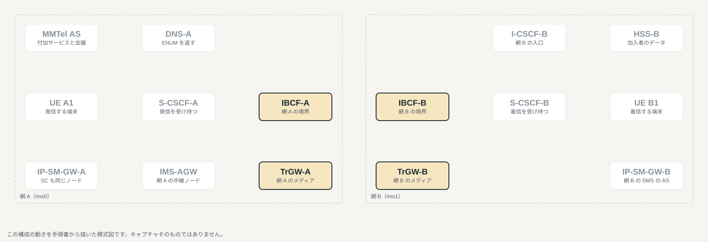
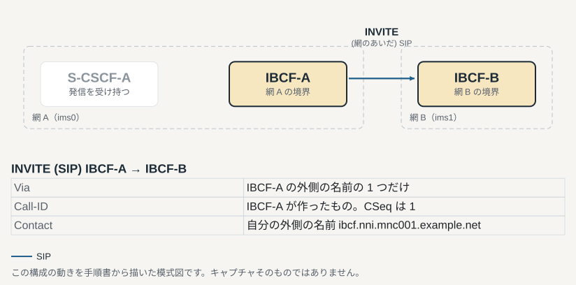
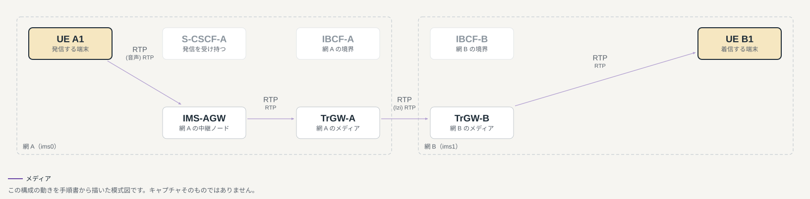

# 携帯のアクセスと、別の事業者の網

携帯電話が IMS を使うときも、登録と通話の形は変わりません。REGISTER を 2 回送って登録し、INVITE で相手を呼びます。変わるのは、その手前と下にあるものです。端末はまず携帯のアクセス網につながり、そこで P-CSCF のアドレスを教わります。パスワードの代わりに SIM の鍵で網と互いを確かめ、P-CSCF とのあいだに保護された経路を取り決めます。通話の音声には、網が専用の通り道（bearer）を用意し、それがそろうまで相手の電話は鳴りません。

通話の相手が別の事業者の利用者なら、信号と音声は 2 つの網の境界を通ります。境界の IBCF と TrGW は、事業者どうしの取り決めに従って、通してよいものを絞り、自網の中の構成を隠します。

この章は、この 2 つが何を加えるかを全体として見ます。どの条件がどの判断を変えるかと、判断するコードは、[VoLTE の登録と通話](volte.md) と [網間接続](interconnect.md) で追います。

## 携帯のアクセスが加えるもの

ここまでの章の端末は、SIM カードの無いソフトフォンでした。P-CSCF のアドレスは設定で与えられ、SIP Digest とパスワードで認証し、音声には G.711（PCMU）を使います。VoLTE の端末（GSMA IR.92）は、次の点で違います。

| | ソフトフォン（SIP Digest、PCMU） | VoLTE の端末 |
| --- | --- | --- |
| アクセス網 | 無い。P-CSCF は設定で与える | EPC に attach する。P-CSCF は網が教える |
| 認証 | SIP Digest とパスワード | IMS-AKA と、P-CSCF とのセキュリティの合意。パスワードは無い |
| 資源 | 考えない | P-CSCF が Rx で PCRF に求める |
| 呼び出し | 183 のあとすぐ | 両側の bearer がそろってから |
| 音声 | PCMU の RTP | AMR-WB、RTCP、telephone-event |
| 切断 | 端末の BYE だけ | 網が bearer を失うと P-CSCF が切る |
| 識別子 | 設定で与え、登録したものを使う | IMSI から作る。登録に使ったものは網が規制する |

すべて左の列のままだと、音声の通り道ができる前に着信側が鳴り、出ても何も聞こえないことがあります。右の列の多くは、それを防ぐためのものです。

この構成でアクセス網の代わりをするのは、EPC スタブ（役割 `epc`）です。本物の網では PDN GW と PCRF は別のノードで、そのあいだに Gx がありますが、スタブは 1 つのノードの中で両方を受け持ちます。無線も NAS の符号化もありません。メッセージの名前と項目は仕様のとおりで、端末とは HTTP の上の JSON でやり取りします。ソフトフォンはこれまでどおり動きます。スタブを通らない端末は PCRF が知らないので、P-CSCF はその端末をポリシー制御なしで扱います。

### attach で P-CSCF のアドレスを受け取る

VoLTE の端末は、登録の前にアクセス網に attach します。網は、端末の IP アドレスと、SIP を運ぶ default bearer と、P-CSCF のアドレスを渡します。P-CSCF のアドレスは、attach の応答のプロトコル設定オプション（PCO）に入っています。端末はそのアドレスの標準のポート 5060 番に、最初の REGISTER を送ります。

### パスワードの代わりに USIM の鍵で確かめ合う

登録は、ソフトフォンと同じく REGISTER を 2 回送る形です。1 回目で「誰か」を伝え、網が 401 で問いを出し、2 回目でその問いに答えます。違いは問いと答えの中身です。網の HSS は、USIM と同じ鍵から、1 回だけ使う認証ベクトルを計算します。端末は問いの中の値で、網が同じ鍵を知っていることも確かめます。網が端末を確かめるだけだった SIP Digest には無かった向きです。この方式を IMS-AKA と呼びます。

### P-CSCF とのあいだのセキュリティアソシエーション

1 回目の REGISTER と 401 のあいだで、端末と P-CSCF はセキュリティアソシエーションを取り決めます（sec-agree）。2 回目の REGISTER からは、端末と P-CSCF の保護ポートどうしを使います。

標準では、この経路を IPsec の ESP で保護します。この構成は既定では、アソシエーションを取り決めて保護ポートを使うところまでを行い、ESP はかけません。キャプチャで VoLTE の端末の SIP も読めるようにするためです。別の構成（`deploy/esp`）では、暗号化を null にした ESP をかけ、完全性を保護したまま中身を読めるようにします。その上に `deploy/esp/encryption.yaml` を重ねると、P-CSCF の方針で AES-CBC の暗号化もかかり、キャプチャを読むには P-CSCF が書き出す鍵が要ります。

### 音声の bearer と Rx

通話では、P-CSCF が SDP の answer から、どのアドレスのあいだにどれだけの帯域が要るかを組み立て、Rx で PCRF に求めます。P-CSCF は、ポリシーと課金の制御のアプリケーション機能（AF）で、アクセス網が何を運ぶかは PCRF が決めます。PCRF が許可すると、アクセス網は端末ごとに音声の dedicated bearer を作ります。

着信側の端末は、両方の端末の bearer がそろうまで呼び出しを始めません。このしくみをプリコンディションと呼びます。発信側は、自分の bearer ができたことを UPDATE で伝えます。

### 網の側から通話が終わることもある

ソフトフォンの通話は、端末の BYE でだけ終わりました。VoLTE では、無線が切れたときのように網が音声の bearer を失うと、PCRF が P-CSCF に知らせ、P-CSCF が網の側から BYE を送って通話を終えます。

## 別の事業者の網が加えるもの

通話の相手が別の事業者の利用者だとします。2 つの網は、それぞれの境界のノードだけでつながります。

### 境界に立つ IBCF と TrGW

IBCF は SIP を、TrGW はメディアを受け持ちます。網の中のノードは、相手網のノードに直接は届きません。通話もショートメッセージも、必ず境界を通ります。番号が相手網のものだと分かるのは、S-CSCF が番号を ENUM で引いたときです。答えが相手網のドメインの SIP URI なら、S-CSCF はその要求を自網の IBCF へ送ります。

### 境界で要求を作り直す

この構成の IBCF は B2BUA です。届いた要求はそこでいったん終わり、相手網へは IBCF 自身の新しい要求が出ていきます。

そのため、網のあいだの INVITE には、網 A の中のノードの Via、Route、Record-Route、Contact が 1 つも入りません。Call-ID も IBCF が作ったものです。網 A の MMTel AS と 2 つの IBCF がそれぞれ新しいダイアログを始めるので、1 つの通話には 4 つのダイアログがあります。

### 事業者どうしの取り決め

IBCF が何を通すかは、事業者どうしの取り決め（相互接続プロファイル）が決めます。相手が信頼ドメインに入るか、どの任意のメソッドを認めるか（ショートメッセージを運ぶ MESSAGE など）、番号をどの形で送るか、どのコーデックを受けるかです。2 つの事業者の取り決めが食い違うと、IBCF が 405、488、404 などの応答で断ります。失敗させるのは端末ではなく、取り決めに従った IBCF です。取り決めを結んでいない送り手には、IBCF は何も答えません。

### 網の構成を隠す

IBCF は呼のメディアを自網の TrGW に通し、それぞれの網に渡す SDP に、その網での TrGW のアドレスを書きます。

その結果、相手網に見えるのは、利用者の番号とドメインと、境界のノードの外側の名前とアドレスだけです。網の中のノードのアドレスとホスト名、IMSI から作った識別子は見えません。番号とドメインは、相手網が折り返し電話をかけるために要るものです。

### コーデック

相手網が受けるコーデックも取り決めにあります。IBCF は、相手網が受けないコーデックを SDP から外します。この構成の IBCF はコーデックの変換をしないので、音声のコーデックが 1 つも残らなければ、その通話は 488 で断られます。

## 5GC の部品について

このリポジトリには、5GC のアクセス網のスタブ（`internal/fivegc`）と、P-CSCF が 5GC の PCF と N5 で話すための部品（`internal/n5`）もあります。これらは部品で、どのノードも動かしません。この本が扱う携帯のアクセスは EPC で、5GC の上の通話（VoNR）は扱いません。

P-CSCF は、ポリシー制御を `PolicyControl` という境界の後ろに置いています。端末も、アクセス網を `AccessNetwork` という境界の後ろに置いています。Rx と EPC スタブは、その後ろにある実装の 1 つです。5GC でも、SIP の信号は 5QI 5 の QoS フローを、音声は 5QI 1 の QoS フローを使います。EPS の QCI 5 と QCI 1 と同じ考え方です。

## この説明の根拠

この章の説明は、次の試験に照らして確かめたものです。どの試験も、このリポジトリの Go の試験として通ることを確かめています。

- `internal/ue/volte_epc_test.go` の `TestVoLTECallOverTheEPCStub`。2 台の端末が EPC スタブに attach し、P-CSCF が両側のメディアの許可を PCRF に求め、スタブが端末ごとに音声の bearer を作り、着信側が両方の資源がそろってから呼び出すことを確かめています。
- `internal/ue/volte_epc_test.go` の `TestNetworkEndsTheCallWhenItTakesTheBearer`。網が音声の bearer を解放すると、P-CSCF が両側に BYE を送って通話を終えることを確かめています。
- `internal/ue/aka_ims_test.go` の `TestIMSAKAThroughTheWholeIMS`。IMS-AKA で登録した端末が、保護サーバーポートを通して通話とショートメッセージを送ることを確かめています。
- `internal/ibcf/network_test.go` の `TestCallAcrossTheBorder`。境界を越える通話で、どちらの網にも相手網の中を指すものが届かず、各側の SDP が自網の TrGW を指すことを確かめています。
- `internal/ibcf/network_test.go` の `TestMismatchedProfiles` と `TestRequestFromNoPeerIsDiscarded`。食い違った取り決めで IBCF が 405、488、404 で断ること、取り決めの外の送り手には何も返さないことを確かめています。

図は、この構成の動きを手順書から描いた模式図で、キャプチャそのものではありません。

## 自分で動かす場合

この章を読むのに、構成を動かす必要はありません。VoLTE の端末の登録と通話は、手順書の [VoLTE の呼の流れ](../../guide/ja/volte.md#動かしてみる) で、2 つの網のあいだの通話とショートメッセージは [IMS 網どうしを相互接続する](../../guide/ja/interconnect.md#動かす) で動かせます。スライドでは、[VoLTE のデッキ](../../../slides/decks/ja/09-volte.md) と [網間接続のデッキ](../../../slides/decks/ja/10-interconnect.md) が、同じ流れを 1 段階ずつ見せます。
