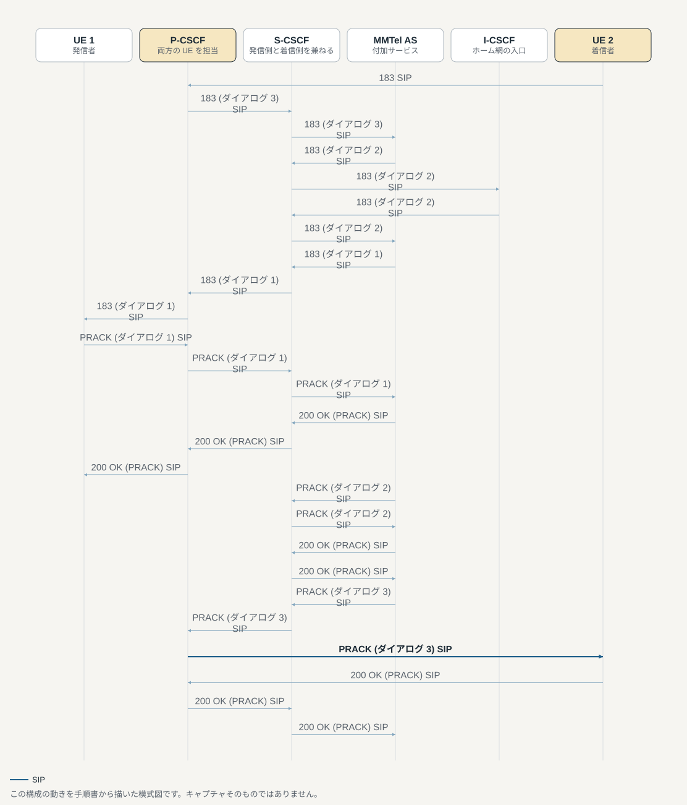
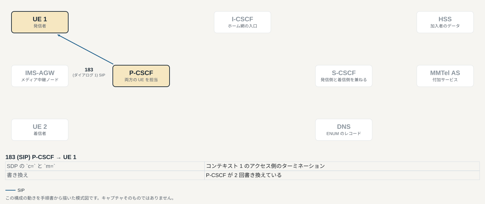
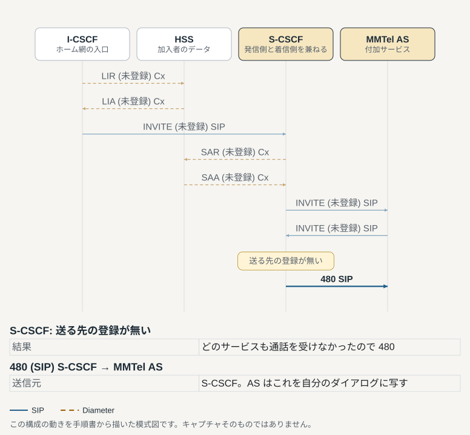
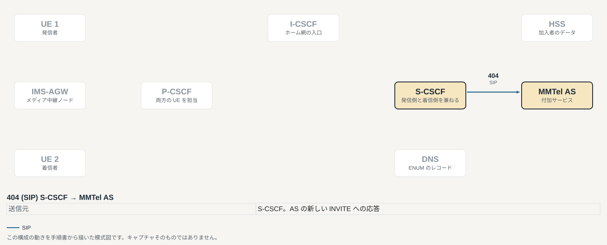
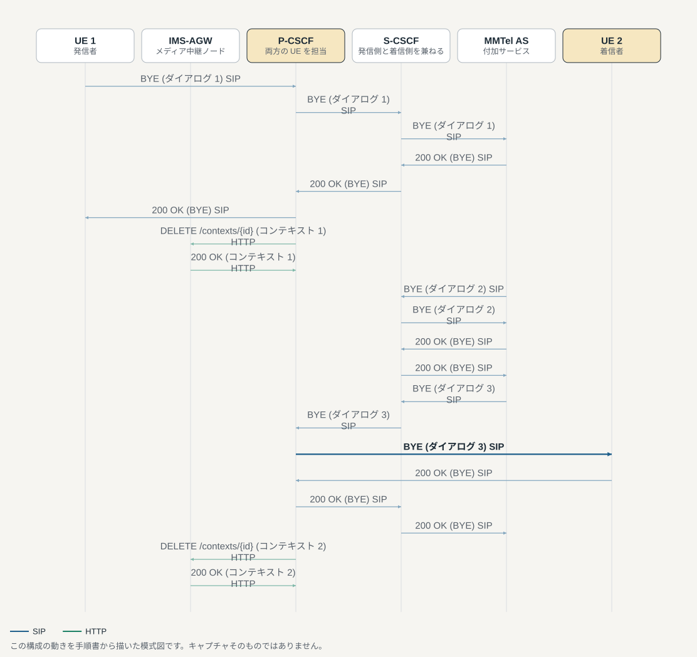

# 通話のトランザクション、ダイアログ、メディアの交渉

1 回の通話の信号は、2 つの単位で読むと整理できます。1 つはトランザクションで、1 つの要求と、それへの応答のまとまりです。応答は、要求が通ったノードを Via に沿って 1 区間ずつ戻ります。もう 1 つはダイアログで、2 つの UA のあいだに続く関係です。ダイアログの中の要求（PRACK、ACK、BYE など）は、最初の INVITE で Record-Route を付けたノードだけを通ります。

この実装の通話には、ダイアログが 3 つあります。MMTel AS が受けた INVITE に自分で答え、自分の Call-ID で新しい INVITE を送る B2BUA だからです。P-CSCF と S-CSCF はプロキシで、Record-Route を付けてダイアログの道に残ります。I-CSCF は Record-Route を付けないので、最初の INVITE とその応答だけを運びます。

メディアは、INVITE のオファーと、信頼性のある 183 のアンサーで決まります。183 は PRACK で確かめられ、この UE は 200 OK に SDP を入れません。P-CSCF は、オファーとアンサーが通るたびに SDP のアドレスを中継ノードのものに書き換えます。応答の前に終えるなら CANCEL、応答のあとなら BYE です。通話が失敗するときは、その応答を作ったノードと、決めた条件が場合ごとに違います。どの場合も、P-CSCF は INVITE の失敗か BYE の終わりを見て、中継ノードのコンテキストを解放します。

この章は [番号から相手の電話へ](call.md) を前提にします。そこで見た経路とノードの役目を、ここでは仕様の条件と、それを決める関数と試験に結び付けます。

## この章で扱う構成と区間

前の章と同じく、`deploy/compose` の構成で、UE 1 が UE 2 に番号で発信する場合を例にします。1 台の P-CSCF と 1 台の S-CSCF が両方の UE を担当し、MMTel AS が発信者の側と着信者の側で 1 回ずつ加わります。

3 つのダイアログは次のとおりです。

| ダイアログ | 両端の UA | Call-ID を作ったもの |
| --- | --- | --- |
| 1 | UE 1 と、発信者の側の MMTel AS | UE 1 |
| 2 | 発信者の側の MMTel AS と、着信者の側の MMTel AS | 発信者の側の MMTel AS |
| 3 | 着信者の側の MMTel AS と UE 2 | 着信者の側の MMTel AS |

キャプチャのある区間に見えるのは、通話の全体ではなく、その区間を通るダイアログだけです。

| キャプチャの区間 | 見えるダイアログ |
| --- | --- |
| UE 1 と P-CSCF | 1 |
| P-CSCF と S-CSCF | 1 と 3 |
| S-CSCF と MMTel AS | 1、2、3 |
| S-CSCF と I-CSCF | 2 の INVITE とその応答だけ（取り消すときは CANCEL も） |
| P-CSCF と UE 2 | 3 |

たとえば UE 1 のそばのキャプチャには Call-ID が 1 つしかありません。それでも通話にはダイアログが 3 つあり、残りの 2 つは S-CSCF と MMTel AS のあいだに見えます。この章の「ダイアログが 3 つ」は、AS を含めた通話の全体の数です。

この章が引く仕様の版は、TS 24.229 V18.11.0、TS 29.228 V18.0.0 と、RFC 3261、RFC 3262、RFC 3264 です。

## トランザクションとダイアログ

RFC 3261 17 によれば、トランザクションは 1 つの要求と、その応答（暫定応答と最終応答）のまとまりです。INVITE の場合、2xx 以外の最終応答への ACK もトランザクションに入ります。2xx への ACK は入りません。この ACK は UAC が自分で送る、別の要求です。

トランザクションは区間ごとにあります。プロキシは要求を受けるとサーバーのトランザクションを作り、先へ送るときにクライアントのトランザクションを作ります。応答は、要求に積まれた Via を 1 つずつ外しながら、同じノードを逆にたどります。

ダイアログは 2 つの UA のあいだの関係です。Call-ID と、両端のタグで識別します（RFC 3261 12）。UAC の側のダイアログは、To にタグのある応答から作られます。

[internal/sip/dialog.go](../../../internal/sip/dialog.go)

```go
	routes, err := recordRouteURIs(resp)
	if err != nil {
		return Dialog{}, err
	}
	// The response lists the proxies from the UAS to the UAC; the UAC's
	// route set starts with the proxy nearest to it.
	slices.Reverse(routes)
	return Dialog{
		ID:           DialogID{CallID: invite.Get("Call-ID"), LocalTag: tagOf(invite.Get("From")), RemoteTag: tagOf(resp.Get("To"))},
		State:        state,
		LocalSeq:     cseq.Number,
		LocalURI:     from.URI,
		RemoteURI:    to.URI,
		RemoteTarget: target,
		RouteSet:     routes,
	}, nil
}
```

`NewUACDialog` の最後の部分です。入力は、UAC が送った INVITE と、届いた応答 `resp` です。ダイアログの ID は、INVITE の Call-ID、From のタグ（自分）、応答の To のタグ（相手）から作ります。ルートセットは応答の Record-Route です。応答の Record-Route は UAS の側から並んでいるので、逆順にして、自分に近いプロキシを先頭にします（RFC 3261 12.1.2）。`RemoteTarget` は相手の Contact です。このあとのダイアログの中の要求は、Request-URI を相手の Contact にし、Route をこのルートセットにして送ります（RFC 3261 12.2.1.1）。

つまり、ダイアログの中の要求が通るのは、Record-Route を付けたノードだけです。I-CSCF は Record-Route を付けないので、ルートセットに入りません。次の図は、183 とその PRACK を並べたものです。



上の 10 段が 183 です。183 は INVITE への応答なので、INVITE が通ったノードを逆にたどり、I-CSCF も通ります。下の 16 段が PRACK とその 200 で、I-CSCF の線には何も届きません。PRACK は UE 1 から発信者の側の AS までで終わり、AS が次のダイアログで自分の PRACK を送ります。別のダイアログのメッセージのあいだの順序は決まっていないので、図の段の順は一例です。

## どのノードが何を持つか

ノードは、要求を転送するだけのものと、ダイアログの端になるものに分かれます。

| ノード | 役目 | Record-Route | 通話のあいだ持つもの |
| --- | --- | --- | --- |
| UE 1、UE 2 | UA | 付けない（ダイアログの端） | 自分のダイアログ（ID、ルートセット、相手の Contact、CSeq） |
| P-CSCF | プロキシ | 付ける | 通過ごとのダイアログの記録。中継ノードのコンテキストと、BYE を送れるだけの値 |
| S-CSCF | プロキシ | 付ける | AS に送った INVITE ごとの、元のダイアログの識別子の記録 |
| MMTel AS | B2BUA | 付けない（ダイアログの端） | 受けた側と送った側の 2 つのダイアログと、その対応 |
| I-CSCF | プロキシ | 付けない | 何も持たない。INVITE のトランザクションが終われば残らない |

P-CSCF は UA ではありませんが、通過ごとにダイアログの記録 `Dialog` を保存します。TS 24.229 は、P-CSCF が必要ならセッションを解放できるように、INVITE と応答の Contact、CSeq、Record-Route、ダイアログの ID を保存することを求めています。P-CSCF は、この記録に中継ノードのコンテキストの ID も持ちます。どの P-CSCF のインスタンスでも次の要求を扱えるように、記録は保存先（Store）に置きます。

S-CSCF はダイアログの状態を持ちません。持つのは、AS に送った INVITE ごとの `OriginalDialog` で、AS から INVITE が戻ったときに、どの利用者のどの iFC の次から続けるかを知るためのものです（TS 24.229 5.4.3.4）。この記録は 4 分で消えます。S-CSCF は AS に送るときに、Route と Record-Route を次のように組み立てます。

[internal/scscf/services.go](../../../internal/scscf/services.go)

```go
	own := s.ownURI()
	own.Params.Set(odiParam, d.ID)
	toAS.Prepend("Route", sip.NameAddr{URI: own.String()}.String())
	toAS.Prepend("Route", sip.NameAddr{URI: server.String()}.String())
	// 5.4.3.2 step 5 b and 5.4.3.3 step 4 c: whom the server serves, and
	// in which session case, so that one server can tell its originating
	// services from its terminating ones (5.7.1.3A). Those steps leave
	// sescase and regstate to operator policy; this S-CSCF always adds
	// them.
	// There is one value, never two (RFC 8498 5).
	toAS.Set("P-Served-User", d.pServedUser().String())
	// Step 13 leaves it to the operator whether a request to an
	// application server in the trust domain is record-routed. This
	// S-CSCF stays on the path of every dialog it creates.
	if ims.CreatesDialog(toAS.Method) {
		sip.AddRecordRoute(toAS, s.ownURI())
	}
```

`d.ID` は、この INVITE のために作った元のダイアログの識別子です。S-CSCF は自分の URI にそれを `odi` として付け、AS の URI の下に置きます。そのため AS の新しい INVITE は、`odi` の付いた S-CSCF に戻ります。AS に送る INVITE を Record-Route するかは運用者が決めてよく、この S-CSCF はいつも Record-Route を付けます。そのため、ダイアログ 1、2、3 のどれの要求も S-CSCF を通ります。

MMTel AS は、TS 24.229 5.7.5 の routeing B2BUA です。受けた INVITE（受けた側）に UAS として答え、新しい INVITE（送った側）を UAC として送ります。2 つの側は別々のダイアログで、AS は一方で受けた応答や要求を、もう一方のダイアログに写します。PRACK、ACK、BYE がダイアログごとに AS で終わり、AS が次のダイアログで送り直すのは、このためです。

## 信頼性のある暫定応答と PRACK

暫定応答（1xx）は、ふつうは届いたかを確かめません。UE 2 の 183 にはアンサーの SDP が入るので、失われると UE 1 がメディアを決められません。そこで RFC 3262 は、信頼性のある暫定応答を定めています。UE 1 の INVITE の Supported に `100rel` があるので、UE 2 は 183 に `Require: 100rel` と RSeq を付けます。UE 1 は、RAck（183 の RSeq と INVITE の CSeq）を付けた PRACK で受け取ったことを伝えます（RFC 3262 3、4）。

PRACK が届くまで、UE 2 は 183 を送り直します。

[internal/sip/uas.go](../../../internal/sip/uas.go)

```go
	// RFC 3262 3: the interval doubles without the T2 cap of a 2xx,
	// since a PRACK is not sent again for each retransmission. 64*T1
	// passes before the interval could reach it.
	t := c.stack.cfg.Timers
	err = c.retransmit(c.st, resp, 64*t.T1, pracked, nil, ErrNoPRACK)
	if errors.Is(err, ErrNoPRACK) {
		// RFC 3262 3: the UAS SHOULD reject the INVITE with a 5xx.
		c.mu.Lock()
		if c.final == nil {
			c.sendFailure(500, "no PRACK", ErrNoPRACK, nil)
		}
		c.mu.Unlock()
	}
```

`retransmit` は、`pracked` が閉じる（PRACK が届く）まで、間隔を倍にしながら 183 を送り直します。64×T1 が過ぎても PRACK が来なければ、UE 2 は INVITE を 500 で断ります。RFC 3262 3 は、このとき UAS が 5xx で断るよう勧めています。

PRACK はダイアログの中の要求なので、トランザクションの道ではなくルートセットに沿います。前の節の図のとおり、PRACK は UE 1 から P-CSCF と S-CSCF を通って、ダイアログ 1 の相手である発信者の側の AS で終わります。AS はすぐに 200 で答え、ダイアログ 2 で自分の PRACK を送ります。3 つのダイアログに、PRACK と 200 が 1 組ずつあります。ダイアログ 3 の PRACK が届くと、UE 2 は 183 を送り直すのをやめます。

180 Ringing も信頼性のある暫定応答なので、180 にも PRACK が返ります。この構成の UE はどちらも資源を持っているので、UE 2 は 183 の PRACK が届くとすぐ 180 を送ります。資源がまだ無い着信側は、資源がそろうまで 180 を送りません（RFC 3312 6、IR.92 2.4.1）。

## SDP のオファーとアンサー

2 台の UE は、RFC 3264 のオファーとアンサーでメディアを決めます。UE 1 が INVITE にオファーを入れ、UE 2 が 183 にアンサーを入れます（RFC 3264 5.1、6.1）。オファーには UE 1 のアドレスと RTP のポート、PCMU と telephone-event があり、アンサーには UE 2 が選んだ 1 つのコーデックと UE 2 のアドレスがあります。

信頼性のある 183 に入れた SDP がアンサーです。RFC 3262 5 は、UAS がアンサーを信頼性のある暫定応答に入れることを認めています。アンサーはそこで決まるので、この UE は 200 OK に SDP を入れません。UE は次のように決めます。

[internal/ue/call.go](../../../internal/ue/call.go)

```go
	// RFC 3262 5: the SDP of a reliable 183 counts; the 200 repeats it
	// only when the 183 went unreliably, or when there was none.
	body := sip.Body{}
	if !reliable {
		body = sdpBody
	}
	ack, err := ic.Accept(body, s.responseHeaders...)
```

`reliable` は、INVITE が `100rel` に対応しているかです。対応していれば、183 は信頼性のある暫定応答として届いているので、200 の本文は空になります。対応していなければ、183 は届いた保証がないので、200 にもう一度 SDP を入れます。UE 1 は最初に受け取ったアンサーを使い、あとから来たものは無視します（RFC 3261 13.2.1）。

P-CSCF は、オファーとアンサーの両方を書き換えます。SDP が P-CSCF を通るたびに、次の部分が働きます。

[internal/pcscf/session.go](../../../internal/pcscf/session.go)

```go
	shown := rc.Core
	if toUE {
		shown = rc.Access
	}
	relay, err := p.relayOf(*rc)
	if err != nil {
		return netip.AddrPort{}, err
	}
	ctx, cancel := relayContext()
	defer cancel()
	side := facingSender(toUE)
	change := agw.TerminationRequest{Remote: sender, Latch: relatching(side, rc.agreed(side), sender)}
	if err := relay.Modify(ctx, rc.ID, side, change); err != nil {
		return netip.AddrPort{}, err
	}
	if err := description.SetAudio(shown); err != nil {
		return netip.AddrPort{}, err
	}
	m.Body = description.Bytes()
	return sender, nil
}
```

`relaySDP` の後半です。入力は SDP の入ったメッセージ `m`、その通過のコンテキスト `rc`、メッセージが UE に向かうか `toUE`、SDP に書かれた送り手のアドレス `sender` です。P-CSCF は、まず送り手に面したターミネーションに、送り手がどこで受けるかを `Modify` で伝えます。そのあとで SDP のアドレスを、メッセージが向かう側に面したターミネーションのものに書き換えます。UE に向かうならアクセス側、網に向かうならコア側です（TS 24.229 6.7.2.1）。

`Modify` には、ラッチングの指示も入ることがあります。アクセス側のターミネーションは、最初に届いたパケットの送信元にラッチして、そこへ送ります。ラッチしたあとは、`Remote` に新しいアドレスを書いても送り先は変わりません。そこで、UE が SDP でメディアのアドレスを変えたとき（`rc.agreed(side)` と `sender` が違うとき）だけ、`relatching` が `NAPTRelatch` を返し、新しい送信元にラッチし直すよう求めます。同じアドレスをもう一度伝える応答や、コア側のターミネーションには、指示を入れません。コア側はラッチングをせず、SDP のアドレスへ送るからです。この動きは `internal/pcscf/latch_test.go` の `TestOfferThatMovesTheUEAsksTheAccessTerminationToLatchAgain` と `TestOfferThatLeavesTheUEWhereItIsAsksForNoRelatch` が確かめています。

| メッセージ | P-CSCF の通過 | 中継ノードに伝える送り先 | SDP に書くアドレス |
| --- | --- | --- | --- |
| INVITE のオファー | 発信者の側（コンテキスト 1） | アクセス側に UE 1 のアドレス | コンテキスト 1 のコア側 |
| INVITE のオファー | 着信者の側（コンテキスト 2） | コア側にコンテキスト 1 のコア側 | コンテキスト 2 のアクセス側 |
| 183 のアンサー | 着信者の側（コンテキスト 2） | アクセス側に UE 2 のアドレス | コンテキスト 2 のコア側 |
| 183 のアンサー | 発信者の側（コンテキスト 1） | コア側にコンテキスト 2 のコア側 | コンテキスト 1 のアクセス側 |



UE 1 が受け取る SDP のアドレスは、UE 2 のものではなく、メディア中継ノードのコンテキスト 1 のアクセス側のものです。どちらの UE も中継ノードとだけ音声をやり取りします。`Modify` が失敗すると、P-CSCF は先へ渡す SDP を作れません。そのときに呼をどう扱うかは [メディアの再交渉が失敗したとき](design-media-rollback.md) で見ます。

## CANCEL と BYE

通話を途中で終える要求は、応答の前と後で違います。

| | CANCEL | BYE |
| --- | --- | --- |
| 使うとき | INVITE に最終応答が来る前 | ダイアログができたあと |
| 何を終えるか | 進んでいる INVITE のトランザクション | ダイアログ |
| 進む道 | INVITE と同じ区間を 1 区間ずつ。I-CSCF も通る | ルートセットに沿う。I-CSCF を通らない |
| 誰が答えるか | 各区間で、受けたノードが 200 で答える | ダイアログの相手が 200 で答える |
| INVITE の結果 | 487 Request Terminated | すでに 200 OK で終わっている |

CANCEL は、取り消す INVITE と同じ Call-ID、From、To、CSeq の番号と、一番上の Via を持つ、別のトランザクションです（RFC 3261 9.1）。応答の前に UE 1 の利用者が切ると、UE 1 は CANCEL を送ります。P-CSCF、S-CSCF、I-CSCF は、受けた CANCEL にすぐ 200 で答え、自分が先へ送った INVITE のトランザクションに CANCEL を送ります（RFC 3261 16.10）。この実装の SIP のスタックは、CANCEL を INVITE と同じ宛先へ送ります。そのため CANCEL は I-CSCF も通ります。

MMTel AS では、受けた側のダイアログが CANCEL で終わると、送った側の INVITE も取り消します。

[internal/b2bua/call.go](../../../internal/b2bua/call.go)

```go
	go func() {
		select {
		case <-c.in.Done():
			if !c.answered.Load() {
				out.Cancel(c.reasons(c.in.EndedBy(), ToCallee)...)
			}
		case <-out.Done():
		}
	}()
```

`c.in` は受けた側、`out` は送った側です。受けた側が終わり、まだ着信者が応答していなければ（`answered` が偽なら）、送った側に CANCEL を送ります。CANCEL の Reason は、受けた側を終えた要求のものをそのまま写します（RFC 3326 2）。CANCEL を受けた UA は、INVITE を 487 で終えます（RFC 3261 9.2）。こうして、UE 1 の INVITE も、AS の 2 つの INVITE も、UE 2 への INVITE も、それぞれ 487 で終わります。

反対に、鳴っているあいだに着信者の側で切ると、この実装の UE は 603 Decline で INVITE を断ります。

応答のあとで切るときは BYE です。BYE はダイアログの中の要求なので、ルートセットに沿って進み、ダイアログの相手が 200 で答えます（RFC 3261 15.1.1、15.1.2）。この実装の UE は、BYE に `Reason: RELEASE_CAUSE;cause=1;text="User ends call"` を入れます（TS 24.229 5.1.5）。

## 失敗の応答を決めるノード

通話が失敗するとき、どのノードがどの条件で応答を作るかは、場合ごとに違います。

| 場合 | 決める関数 | 見る条件 | 応答 | 確かめる試験 |
| --- | --- | --- | --- | --- |
| 話し中 | UE 2 の `Answer` | UE 2 が話し中として断る | 486 Busy Here | `TestBusyCallee` |
| 応答の前に発信者が切る | 各ノードの CANCEL の処理 | INVITE に最終応答が無い | 487 Request Terminated | `TestCallerGivesUpOnACalleeThatDoesNotAnswer` |
| ENUM のレコードが無い番号 | S-CSCF の `routeOriginating` | `ENUM` が SIP URI を返さない | 404 Not Found | `TestOriginatingCallToANumberWithoutENUMGets404` |
| HSS が知らない着信者 | I-CSCF の `session` | LIA が成功でない | 404 Not Found | `TestCallToAnUnknownCalleeGets404` |
| 未登録で、未登録のサービスも無い | I-CSCF の `session` | LIA が DIAMETER_ERROR_IDENTITY_NOT_REGISTERED | 480 Temporarily Unavailable | `TestCallToAnUnregisteredCalleeGets480` |
| 未登録で、未登録のサービスがある | S-CSCF の `routeUnregistered` | どの AS も呼を引き受けない | 480 Temporarily Unavailable | `TestUnregisteredCalleeServices` |

ENUM の場合は、前の章で見た `routeOriginating` の部分が 404 を返します。HSS が知らない着信者と、未登録の着信者は、I-CSCF の次の部分が分けます。

[internal/icscf/session.go](../../../internal/icscf/session.go)

```go
	lia, err := cx.ParseLocationInfoAnswer(answer)
	switch {
	case err != nil:
		st.Respond(sip.NewResponse(req, 500, sip.NewTag()))
		return
	case lia.Result == diameter.Experimental(cx.DiameterErrorIdentityNotRegistered):
		// 5.3.2.1: a known user who is not registered and has no services
		// for that state.
		log.Info("callee is not registered", "callee", callee)
		st.Respond(sip.NewResponse(req, 480, sip.NewTag()))
		return
	case !lia.Result.Success():
		// 5.3.2.1 and 5.3.2.2: the user does not exist, or the query
		// failed.
		log.Info("HSS does not know the callee", "callee", callee, "result", lia.Result.String())
		st.Respond(sip.NewResponse(req, 404, sip.NewTag()))
		return
	}
	// Step 2 of "upon successful user location query".
```

入力は HSS の LIA です。HSS は、着信者が登録していれば、DIAMETER_SUCCESS と Server-Name で答えます。登録していない着信者には、その利用者に未登録の状態のサービスがあるかで答えを分けます。サービスとは、session case が TERMINATING_UNREGISTERED の iFC です。無ければ DIAMETER_ERROR_IDENTITY_NOT_REGISTERED で、I-CSCF は 480 を返します。HSS が利用者を知らなければ DIAMETER_ERROR_USER_UNKNOWN で、I-CSCF は 404 を返します（TS 24.229 5.3.2.1）。

未登録の状態のサービスがある着信者には、HSS は DIAMETER_UNREGISTERED_SERVICE（2003）と、S-CSCF に必要な能力で答えます（TS 29.228 6.1.4.1）。この場合は `switch` を抜け、I-CSCF は初回の登録と同じように能力で S-CSCF を選びます。`deploy/compose` の試験用の加入者には、どれもこのサービスがあります。TERMINATING_UNREGISTERED のときに MMTel AS を呼ぶ iFC です。登録していない `tel:+12025550103` に発信すると、次のように進みます。



選ばれた S-CSCF は、Server-Assignment-Type が UNREGISTERED_USER の SAR で利用者のプロファイルを受け取り、未登録の状態の iFC で MMTel AS に送ります（TS 24.229 5.4.3.3）。着信転送を設定していないので、AS は INVITE をそのまま送り返します。送る先の登録が無いので、S-CSCF の `routeUnregistered` が 480 を返します。

応答を作ったノードは、その応答を運ぶ最初のパケットの送信元で分かります。このとき注意が要るのは MMTel AS です。AS は受けた応答を、自分の受けた側のダイアログに写して送り直します。そのため、キャプチャで AS から出た 480 を見つけても、作ったのは AS とは限りません。上の例で最初に 480 を送ったのは、S-CSCF から AS へのパケットです。ENUM の 404 も、S-CSCF が AS の新しい INVITE に答えたものです。



鳴っても誰も出ない通話を終えるのは、ふつうは待ちきれなくなった発信者の CANCEL です。プロキシにも打ち切るタイマーがあります。プロキシは INVITE を送るときに Timer C を始め、暫定応答が来るたびに延ばし、切れると INVITE を取り消します（RFC 3261 16.6 の手順 11、16.7 の手順 2、16.8）。この実装の Timer C は 3 分 30 秒です。鳴り続ける UE は 1 分ごとに 180 を送り、プロキシが INVITE を打ち切らないようにします（RFC 3261 13.3.1.1）。応答の無い着信を転送するサービスは、MMTel AS が受け持ちます（[iFC と MMTel AS の付加サービス](mmtel.md)）。

## ノードが資源を解放する

P-CSCF が中継ノードに作らせたコンテキストは、通話の終わり方によらず解放しなければなりません。P-CSCF は 2 つの場面でこれを行います。

1 つ目は、INVITE が成功しなかったときです。

[internal/pcscf/setup.go](../../../internal/pcscf/setup.go)

```go
func (s *setup) forward(st *sip.ServerTransaction, out *sip.Message, targets []sip.Destination, stack *ims.StackRef) {
	final, err := s.p.proxyInvite(st, out, targets, stack, s)
	s.settle()
	if final != nil {
		s.p.ueResponse(s.leg, s.invite, final)
	}
	ims.Finish(st, final, err)
	// Freeing may wait for the relay and the PCRF, so the response goes
	// on first.
	if err != nil || s.givenUp || (final != nil && final.StatusCode >= 300) {
		s.end()
	}
}
```

`proxyInvite` は INVITE を先へ送り、最終応答 `final` が来るまで待ちます。`ims.Finish` で最終応答を送り手に返してから、最終応答が 300 以上か、送れなかったか、P-CSCF が自分で INVITE をあきらめたときに、`end` でこの通過のコンテキストとポリシーのセッションを解放します。486、480、404、487 は、どれもここで解放されます。応答を先に送るのは、解放が中継ノードと PCRF の答えを待つことがあるからです。

2 つ目は、BYE でダイアログが終わったときです。P-CSCF は BYE への応答を見て、ダイアログが本当に終わったかを決めます。

[internal/pcscf/session.go](../../../internal/pcscf/session.go)

```go
func byeEndsDialog(final *sip.Message, err error) bool {
	if err != nil || final == nil {
		return true
	}
	code := final.StatusCode
	return code < 300 || code == 481 || code == 408
}
```

RFC 3261 15.1.1 によれば、BYE を送った UAC は、2xx だけでなく、481 か 408 を受けたときと、応答が無かったときにも、ダイアログを終えたものとします。その場合、もう別の BYE は来ないので、P-CSCF はコンテキストを解放します。それ以外の応答、たとえば順序の狂った BYE への 500（RFC 3261 12.2.2）では、ダイアログは残ります。通話の音声が続くので、P-CSCF はコンテキストを残し、あとで来る正しい BYE を待ちます。



MMTel AS も、自分の 2 つのダイアログを終えます。UE 1 の BYE に 200 で答え、ダイアログ 2 に自分の BYE を送ります。着信者の側の AS も同じようにダイアログ 3 に BYE を送ります。ダイアログが違うので、UE 1 への 200 と UE 2 への BYE は、どちらが先に来ることもあります。S-CSCF と I-CSCF には、通話のために解放するものがありません。S-CSCF の元のダイアログの記録は、期限で消えます。

## この説明の根拠

この章の説明は、次のコードと試験に照らして確かめたものです。どの試験も、このリポジトリの Go の試験として通ることを確かめています。

- `internal/sip/dialog_test.go` の `TestUACDialogFromAProvisionalResponse`。To にタグのある 183 から UAC の初期ダイアログが作られ、その ID が Call-ID と両端のタグに、ルートセットが応答の Record-Route を逆にしたものになることを確かめています。
- `internal/sip/prack_test.go` の `TestUASRetransmitsAReliableProvisionalUntilThePRACK`。`100rel` に対応した INVITE への 183 に `Require: 100rel` と RSeq が付き、PRACK が来るまで T1、2×T1 の間隔で同じ 183 が送り直されること、別の RSeq への PRACK が 481 になることを確かめています。同じファイルの `TestUASRejectsTheINVITEWithoutAPRACK` は、64×T1 のあいだ PRACK が来なければ INVITE が 500 で終わることを確かめています。
- `internal/ue/call_test.go` の `TestAnswerInTheReliable183`。着信者が信頼性のある 183 でアンサーを送り、SDP の無い 200 で応答しても、発信者が音声を送れることを確かめています。
- `internal/pcscf/session_test.go` の `TestOriginatingCallGoesThroughTheRelay`。P-CSCF が網へ出るオファーをコア側に、UE に届くアンサーをアクセス側に向けること、486 で INVITE が終わると中継ノードのコンテキストが無くなることを確かめています。同じファイルの `TestBYEThatIsRejectedKeepsTheMedia` は、500 で断られた BYE ではコンテキストが残ることを、`TestBYEAnswered481EndsTheMedia` は、481 で答えられた BYE ではコンテキストが無くなることを確かめています。
- `internal/mmtel/relay_test.go` の `TestCancelThroughTheAS`。発信者が CANCEL すると、発信者には 487 が届き、着信者の INVITE も、発信者と同じ Reason の CANCEL で終わることを確かめています。
- `internal/ue/call_test.go` の `TestBusyCallee`、`TestCallToAnUnregisteredCallee`、`TestCallerGivesUpOnACalleeThatDoesNotAnswer`。IMS の全体を 1 つのプロセスで動かし、それぞれ 486、480、CANCEL のあとの 487 で通話が終わることを確かめています。この試験の網には MMTel AS が無く、未登録の着信者に未登録のサービスも無いので、480 を返すのは I-CSCF です。
- `internal/icscf/icscf_test.go` の `TestCallToAnUnregisteredCalleeGets480` と `TestCallToAnUnknownCalleeGets404`。LIA が未登録を示すと 480、利用者がいないと 404 になることを確かめています。
- `internal/scscf/unregistered_test.go` の `TestUnregisteredCalleeServices`。TERMINATING_UNREGISTERED の iFC の AS が INVITE をそのまま送り返すと、S-CSCF が 480 を返すことを確かめています。`internal/scscf/session_test.go` の `TestOriginatingCallToANumberWithoutENUMGets404` は、ENUM のレコードが無い番号が 404 になることを確かめています。

図は、この構成の動きを手順書から描いた模式図で、キャプチャそのものではありません。

## 自分で動かす場合

実際のキャプチャで同じ通話を見たいときは、手順書の [発信する](../../guide/ja/call.md#発信する) に、話し中、未登録、存在しない番号の試し方があります。各手順の見るヘッダは [8. UE 2 がオファーに答える（信頼性のある 183）](../../guide/ja/call.md#8-ue-2-がオファーに答える信頼性のある-183) から [13. UE 1 が切断する（BYE）](../../guide/ja/call.md#13-ue-1-が切断するbye) までにあります。応答の前に切る CANCEL は、[HTTP で UE を操作する](../../guide/ja/call.md#http-で-ue-を操作する) の手順で、鳴っているあいだに切ると見られます。スライドでは [通話のデッキ](../../../slides/decks/ja/05-call.md) の「183 と PRACK の全体の形」から「失敗の例（存在しない番号）」までのシーンが、この章の図を段階に分けて見せます。
