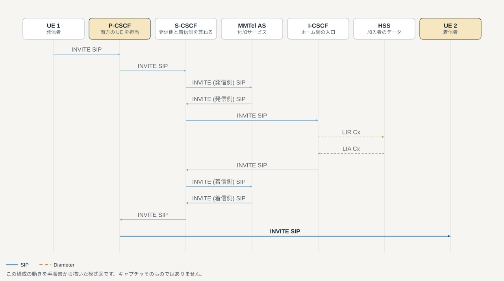
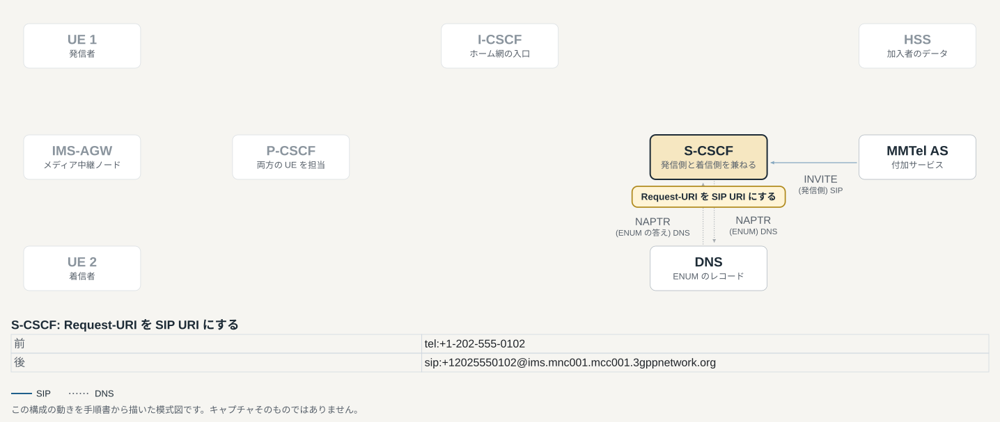
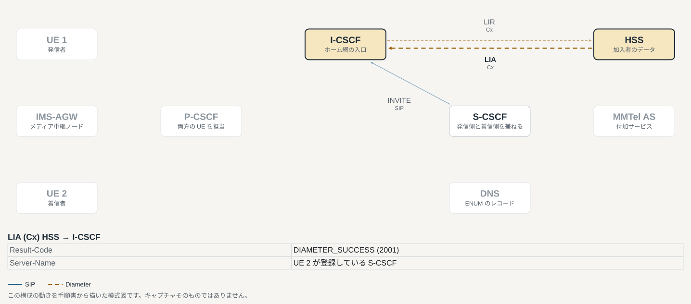
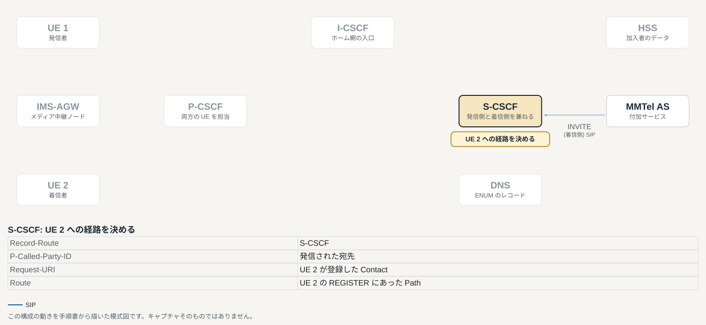
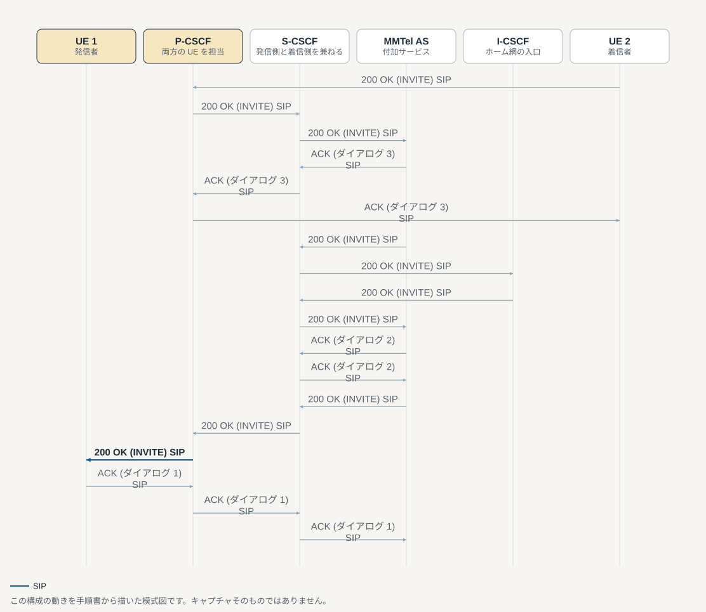
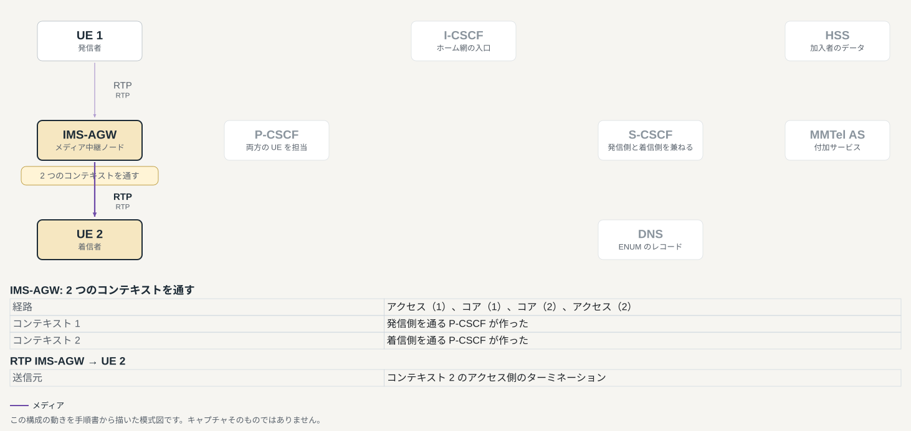
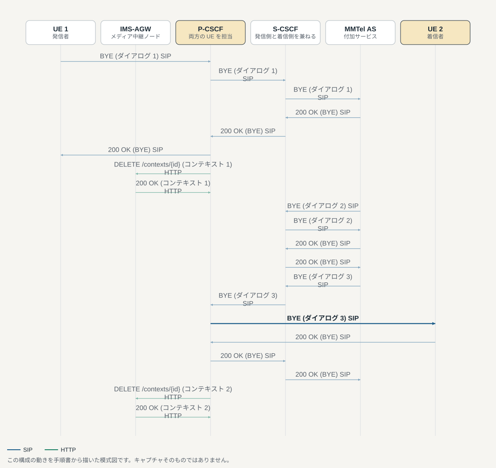

# 番号から相手の電話へ

発信する UE が知っているのは、相手の電話番号だけです。相手の IP アドレスも、相手がどの S-CSCF に登録しているかも知りません。それでも電話がつながるのは、通り道のノードが、それぞれ次の行き先を決めるからです。

UE 1 は INVITE を、登録で受け取った Service-Route に沿って、自分の S-CSCF へ送ります。S-CSCF は番号を DNS の ENUM で SIP URI に変え、着信者のホーム網の入口である I-CSCF へ送ります。I-CSCF は HSS に LIR で尋ね、着信者を担当する S-CSCF を知ります。その S-CSCF は、着信者の登録で保存した Contact と Path を使い、着信者の P-CSCF を通して UE 2 に INVITE を届けます。途中で、発信者の側と着信者の側のそれぞれで、MMTel AS が INVITE を受けて送り返します。

応答は INVITE の道を逆にたどって UE 1 に戻ります。UE 2 が鳴ってから応答し、UE 1 が ACK を返すと、通話が始まります。音声は信号と同じ道を通りません。RTP は CSCF を 1 台も通らず、UE とメディア中継ノード（IMS-AGW）のあいだだけを流れます。最後に、どちらかが BYE を送って通話を終えます。

この章は [登録で決まる 3 つのこと](registration.md) と [Path と Service-Route の使い分け](registration-routes.md) を前提にします。登録で決まった Service-Route、Path、P-CSCF の IP の対応付けを、ここではそのまま使います。

## この章で扱う構成

`deploy/compose` の構成で、UE 1（`+1-202-555-0101`）が UE 2（`+1-202-555-0102`）に番号で発信する場合を例にします。どちらの UE も、SIP Digest で登録するソフトフォン型の UE です。番号は、北米の番号計画が架空の用途に取ってある 555-0100 から 555-0199 の範囲から選んでいます。

| ノード | アドレス | この通話での役目 |
| --- | --- | --- |
| UE 1 | 172.28.0.100 | 発信者。番号だけを知っている |
| UE 2 | 172.28.0.101 | 着信者 |
| P-CSCF | 172.28.0.40 | 両方の UE を担当する。1 回の通話で 2 回通る |
| S-CSCF | 172.28.0.30 | 両方の UE を担当する。発信側と着信側の S-CSCF を兼ねる |
| MMTel AS | 172.28.0.75 | 発信者と着信者のそれぞれの INVITE を受けて、送り返す |
| DNS | 172.28.0.2 | 番号を SIP URI に変える ENUM のレコードを持つ |
| I-CSCF | 172.28.0.20 | 着信者のホーム網の入口。着信者の S-CSCF を HSS に尋ねる |
| HSS | 172.28.0.10 | I-CSCF に Cx で、MMTel AS に Sh で答える |
| IMS-AGW | 172.28.0.50 | メディア中継ノード。RTP を中継する。P-CSCF が制御する |

この構成では、1 台の P-CSCF と 1 台の S-CSCF が両方の UE を担当します。そのため、1 回の通話は P-CSCF と S-CSCF をそれぞれ 2 回通ります。1 回目は発信者の側、2 回目は着信者の側としての通過です。実際の網では、2 つの側は別のノードで、別の網にあることも多いです。どちらでも、ノードが自分の立場を決める方法は同じです。

この章が引く仕様の版は、TS 24.229 V18.11.0、TS 29.228 V18.0.0 です。

## INVITE の道筋



INVITE は次の順に進みます。括弧の番号は、手順書のシーケンス図の番号です。

1. UE 1 が、Request-URI を番号の `tel:+1-202-555-0102` にした INVITE を P-CSCF に送ります（1）。
2. P-CSCF が、Service-Route の S-CSCF へ送ります（2）。
3. S-CSCF が MMTel AS に送り、AS が新しい INVITE を送り返します。S-CSCF は番号を SIP URI に変えます（3）。
4. S-CSCF が、着信者のホーム網の入口の I-CSCF へ送ります（4）。
5. I-CSCF が、着信者の S-CSCF を HSS に尋ね、その S-CSCF へ送ります（5）。
6. 着信者を担当する S-CSCF が、もう一度 MMTel AS に送ってから、Path に沿って P-CSCF へ送ります（6）。
7. P-CSCF が UE 2 に届けます（7）。

図では、DNS とメディア中継ノードを省いています。S-CSCF が DNS を引く場面と、P-CSCF が中継ノードを制御する場面は、このあとの節で別の図にします。

## 発信者の側の P-CSCF と S-CSCF

P-CSCF と S-CSCF は、届いた INVITE が発信者の側のものか、着信者の側のものかを、一番上の Route で見分けます。どちらも、その値は登録のときに自分で配ったものです。

P-CSCF は、登録のときに `sip:term@pcscf...` を Path に入れました。着信者の S-CSCF は、この Path を Route にして、UE あての要求を送ってきます。そのため、一番上の Route のユーザー部が `term` なら UE に向かう要求で、そうでなければ UE から来た要求です。

[internal/pcscf/session.go](../../../internal/pcscf/session.go)

```go
	out := req.Clone()
	top, popped := sip.PopOwnRoute(out, p.ownURIs()...)
	// The Path URI that the P-CSCF put in the REGISTER marks requests to
	// the UE (5.2.6.2).
	l := originating
	if popped && top.User == "term" {
		l = terminating
	}
```

`PopOwnRoute` は、一番上の Route が自分の URI なら取り除き、それを `top` として返します。UE 1 の INVITE の一番上の Route は、UE 1 が先頭に置いた P-CSCF の URI で、ユーザー部がありません。そのため `l` は `originating` のままです（TS 24.229 5.2.6.2）。

発信者の側の P-CSCF は、次のことをしてから S-CSCF に送ります（TS 24.229 5.2.6.3.3）。

- 残りの Route が、登録のときの Service-Route と同じかを確かめます。
- P-Asserted-Identity に、UE 1 の既定の公開の識別子を入れます。網が信じるのは From ではなく、このヘッダです。
- Record-Route に自分を入れます。この通話のあとの要求も P-CSCF を通るようにするためです。
- メディア中継ノードにコンテキストを作らせ、SDP のアドレスを中継ノードのものに書き換えます。これは「音声は中継ノードを通る」の節で見ます。

S-CSCF も、同じように一番上の Route で立場を決めます。登録の 200 OK で配った Service-Route には、ユーザー部 `orig` がありました。

[internal/scscf/session.go](../../../internal/scscf/session.go)

```go
	top, popped := sip.PopOwnRoute(out, s.ownURI())
	log := s.log.With("method", string(out.Method), "call_id", out.Get("Call-ID"))
	odi, returned := top.Params.Get(odiParam)
	if !ims.IsInDialog(st.Request) {
		s.chargeRequest(out)
	}
	switch {
	case ims.IsInDialog(st.Request):
		// A request within a dialog follows the route set the dialog
		// already has (RFC 3261 16.12).
		s.forward(st, out, nil, log)
	case popped && returned:
		s.fromApplicationServer(st, out, odi, log)
	case popped && top.User == "orig":
		s.startedSession(st, ims.OriginatingSession)
		s.originating(st, out, false, log)
	case popped && onBehalf(top):
		s.startedSession(st, ims.OriginatingSession)
		s.originating(st, out, true, log)
	default:
		s.startedSession(st, ims.TerminatingSession)
		s.terminating(st, out, log)
	}
```

`switch` は上から順に条件を見ます。

1. ダイアログの中の要求（To にタグがある要求）は、立場を決め直さず、ダイアログのルートセットに沿って先へ送ります。
2. 一番上の Route に `odi` のパラメータがあれば、MMTel AS が送り返してきた INVITE です。次の節で見ます。
3. ユーザー部が `orig` なら、Service-Route を使った UE の要求なので、発信者を担当する側として `originating` に進みます（TS 24.229 5.4.3.1）。
4. `orig` のパラメータは、アプリケーションサーバーが利用者の代わりに送る要求の印です。この章の通話では使いません。
5. どれでもなければ、着信者を担当する側として `terminating` に進みます。

UE 1 の INVITE は 3 番目に当たります。S-CSCF は、P-Asserted-Identity の利用者が登録済みかを確かめます。そして、UE 1 の tel URI を 2 つ目の P-Asserted-Identity として足し、MMTel の ICSI を P-Asserted-Service に入れます（TS 24.229 5.4.3.2 の手順 9 と 4C）。

## MMTel AS が両側で加わる

S-CSCF は、利用者のプロファイルにある iFC（initial filter criteria）に従って、要求をアプリケーションサーバーに送ります。この構成では、どの加入者にも、INVITE をまず MMTel AS に送る iFC があります（TS 24.229 5.4.3.2 の手順 5）。

S-CSCF は INVITE の Route の先頭に AS の URI を置き、その次に、元のダイアログの識別子（`odi`）を付けた自分の URI を置きます。P-Served-User には、発信者の側であることを示す `sescase=orig` を入れます。AS は利用者のサービスの設定を Sh（UDR と UDA）で HSS から読みます。この構成の既定の設定では、通話は何も変わりません。AS は新しい INVITE を作り、受け取った Route の残り、つまり `odi` の付いた S-CSCF に送り返します。

戻ってきた INVITE の一番上の Route には `odi` があります。S-CSCF はそれを見て、前の `switch` の 2 番目に進み、その iFC の次から処理を続けます。着信者の側でも、同じ AS に `sescase=term` で同じことが起きます。

AS は受けた INVITE に自分で答え、自分の Call-ID で新しい INVITE を送ります。そのため、1 回の通話に、Call-ID の違うダイアログが 3 つできます。これが通話の信号を読むときの要になります。[通話のトランザクション、ダイアログ、メディアの交渉](call-signaling.md) で詳しく見ます。AS がどんなサービスを加えるかは、[アプリケーションサーバーが加えるサービス](services.md) で見ます。

## 番号を SIP URI に変える（ENUM）

AS から戻った INVITE の Request-URI は、まだ `tel:+1-202-555-0102` です。この番号のままでは、どの網のどのノードに送ればよいかが分かりません。適用する iFC が残っていなければ、S-CSCF は次の部分で番号を SIP URI に変えます。

[internal/scscf/session.go](../../../internal/scscf/session.go)

```go
	if number, ok := s.globalNumber(out.RequestURI); ok {
		uri, err := s.resolver.ENUM(context.Background(), number, s.cfg.ENUMSuffix)
		if err != nil {
			log.Info("ENUM has no SIP URI for the number", "number", number, "error", err.Error())
			s.respond(st, 404, nil)
			return
		}
		log.Info("translated the number with ENUM", "number", number, "uri", uri)
		out.RequestURI = uri
	}
```

`globalNumber` は、Request-URI が ENUM で引く番号かを見ます。tel URI は当たります。`ENUM` は、番号の数字を逆に並べ、1 桁ずつラベルにした名前の NAPTR レコードを DNS に尋ねます（RFC 6116）。`+12025550102` なら、名前は `2.0.1.0.5.5.5.2.0.2.1.e164.arpa` です。このレコードのサービスは `E2U+sip` で、正規表現が番号から `sip:+12025550102@ims.mnc001.mcc001.3gppnetwork.org` を作ります。これが新しい Request-URI です（TS 24.229 5.4.3.2 の手順 10）。



レコードの無い番号では `ENUM` が誤りを返し、S-CSCF は 404 で答えます。実際の網では、IMS の外の番号を BGCF から電話網へ送ることもできます。このプロジェクトには BGCF が無いので、S-CSCF が発信者に応答を返します。TS 24.229 5.4.3.2 の手順 10 は、この応答も認めています。

番号を変えた S-CSCF は、Record-Route に自分を入れて、INVITE を先へ送ります。新しい Request-URI のドメイン `ims.mnc001.mcc001.3gppnetwork.org` を、登録のときの P-CSCF と同じく NAPTR と SRV で引くと、そのドメインの入口の I-CSCF が見つかります。この区間の INVITE は 1300 バイトを超えるので、UDP ではなく TCP で送ります（RFC 3261 18.1.1）。

## 着信者の S-CSCF を探す（I-CSCF と LIR）

I-CSCF は、着信者を担当する S-CSCF を知りません。そこで、着信者の公開の識別子を入れた LIR（Location-Info-Request、Cx のコマンド 302）を HSS に送ります（TS 24.229 5.3.2.1、TS 29.228 6.1.4）。UE 2 は登録しているので、HSS は DIAMETER_SUCCESS と、UE 2 が登録した S-CSCF の Server-Name で答えます。



HSS は、UE 2 の登録のときに記録した、担当の S-CSCF を答えます。I-CSCF は答えの S-CSCF を Route の一番上に入れて、INVITE を転送します。I-CSCF は Record-Route を付けません。そのため、このあとのダイアログの中の要求（PRACK、ACK、BYE）は I-CSCF を通りません。I-CSCF は、着信者の S-CSCF を探すためだけに、最初の INVITE の道に入ります。

この構成では、届く先は同じ S-CSCF です。キャプチャでは、INVITE が S-CSCF から I-CSCF へ出て、また同じ S-CSCF に戻ってくるように見えます。

## Path に沿って UE 2 へ

戻ってきた INVITE の一番上の Route は、I-CSCF が入れた S-CSCF の URI で、`orig` がありません。そのため S-CSCF は、`switch` の最後の `terminating` に進み、着信者を担当する側として動きます（TS 24.229 5.4.3.3）。UE 2 の登録を見つけ、着信者の側の iFC で、もう一度 MMTel AS に送ります。AS から戻った INVITE を、S-CSCF は次のように UE 2 に向けます。



- Record-Route に自分を入れます。
- P-Called-Party-ID に、発信された宛先を入れます。
- Request-URI を、UE 2 が登録した Contact にします。
- UE 2 の REGISTER にあった Path を Route に入れます。

最後の 2 つは、[Path と Service-Route の使い分け](registration-routes.md) で見た処理そのものです。INVITE は Path の P-CSCF に届きます。P-CSCF は、一番上の Route が自分の `term` の URI なので、着信者の側の通過だと判断します（TS 24.229 5.2.6.4.3）。そして、INVITE を UE 2 の Contact ではなく、UE 2 の REGISTER が来たアドレスに送ります。NAT の内側にいる UE には、そのアドレスでしか届かないからです。

Request-URI は、UE 2 に届くまでに 2 回変わりました。発信者の S-CSCF が tel URI を SIP URI に変え、着信者の S-CSCF が UE 2 の Contact に変えました。

## 呼び出しと応答

INVITE を受けた UE 2 は、まず 183 Session Progress で答えます。183 には SDP のアンサーが入っていて、UE 1 はこれで、どのコーデックで、どのアドレスに音声を送るかを知ります。183 は信頼性のある暫定応答なので、UE 1 は PRACK で受け取ったことを知らせます。

この構成の UE は、どちらも音声のための資源をすでに持っています。そのため、UE 2 は PRACK を受けるとすぐに 180 Ringing を送り、利用者を呼び出します。利用者が応答すると、UE 2 は INVITE に 200 OK を返し、UE 1 が ACK を返します。これで通話が始まります。



図は 200 OK と ACK だけを描いています。183、PRACK、180 も同じ形で進みます。応答は INVITE が通ったノードを逆にたどるので、I-CSCF も通ります。ACK は、Record-Route から作った経路に沿うので、I-CSCF を通りません。MMTel AS は 200 OK を受けると、自分のダイアログで ACK を返し、次のダイアログに 200 OK を送ります。ダイアログが違うメッセージのあいだの順序は決まっていないので、図の段の順は一例です。

## 音声は中継ノードを通る

信号は、行き先を決めるノードを順に通りました。音声は違います。RTP は CSCF を 1 台も通らず、UE とメディア中継ノードのあいだだけを流れます。



この経路を作るのは P-CSCF です。P-CSCF は INVITE が通るたびに、中継ノードに 1 つのコンテキストを作らせます。コンテキストには、UE に向いたアクセス側と、網に向いたコア側の 2 つのターミネーションがあります。

[internal/pcscf/setup.go](../../../internal/pcscf/setup.go)

```go
		c, err := relay.Control.Add(ctx, agw.TerminationRequest{ID: agw.Access}, agw.TerminationRequest{ID: agw.Core, Latch: agw.NAPTOff})
```

この 1 行が、2 つのターミネーションを求めます。アクセス側は、最初に届いたパケットの送信元に送り返します。これをラッチングと呼びます。NAT の内側の UE は、SDP に書けないアドレスから送ってくるからです。コア側はラッチングをせず（`NAPTOff`）、網の側の SDP に書かれたアドレスへ送ります。

P-CSCF は、SDP の `c=` と `m=` のアドレスを、そのたびに中継ノードのターミネーションのアドレスに書き換えます。UE 1 から網へ出ていくオファーにはコア側を、UE 1 に届くアンサーにはアクセス側を書きます。着信者の側の通過でも同じことをします。その結果、どちらの UE も中継ノードとだけ音声をやり取りし、相手の UE のアドレスを知りません。

1 回の通話には、発信者の側と着信者の側で、コンテキストが 2 つできます。UE 1 の音声は、次の順に進みます。

```text
UE 1 -> relay access (context 1) -> relay core (context 1)
     -> relay core (context 2) -> relay access (context 2) -> UE 2
```

各 UE は 20 ms ごとに RTP を送り、1 つのパケットには G.711 μ-law の音声が 160 バイト入っています（RFC 3550 5.1、RFC 3551 4.5.14）。RTCP は RTP の 1 つ上のポートを使い、これも中継ノードを通ります。

P-CSCF と中継ノードのあいだの要求は、このプロジェクトの小さな HTTP の API です。この用途の標準のプロトコルは H.248 で、手順書が示す別の構成では、P-CSCF は H.248 で中継ノードを制御します。

信号と音声の道が分かれるのは、受け持つ仕事が違うからです。CSCF は、要求の行き先を決め、サービスを加えます。そのために、信号は登録とプロファイルを持つノードを通ります。音声は、パケットを運ぶだけで、行き先は SDP で決まっています。P-CSCF は信号の道に残り、SDP を書き換えることで、音声の道を中継ノードに向けます。

## 通話を終える

UE 1 の利用者が電話を切ると、UE 1 はダイアログの中で BYE を送ります（RFC 3261 15.1.1）。BYE には、通話を終えた理由を示す `Reason: RELEASE_CAUSE;cause=1;text="User ends call"` が入ります（TS 24.229 5.1.5）。BYE も ACK と同じく、Record-Route から作った経路に沿って進み、I-CSCF を通りません。



発信者の側の MMTel AS は、UE 1 の BYE に 200 で答え、次のダイアログに自分の BYE を送ります。BYE はこうしてダイアログごとに UE 2 まで届き、最後の 200 は UE 2 から返ります。P-CSCF は、自分を通る BYE に 200 が返るときに、その通過で作ったコンテキストを中継ノードから削除します。BYE が断られることもあるので、応答を待ってから削除します。

## この説明の根拠

この章の説明は、次のコードと試験に照らして確かめたものです。どの試験も、このリポジトリの Go の試験として通ることを確かめています。

- `internal/ue/call_test.go` の `TestCallThroughTheWholeIMS`。P-CSCF、I-CSCF、S-CSCF、HSS を 1 つのプロセスの中で動かし、登録した UE 1 から UE 2 に発信して、UE 2 が UE 1 の送った 25 個の RTP のパケットをそのまま受け取ることと、UE 1 にも音声が届くことを確かめています。この試験の網には MMTel AS もメディア中継ノードも無く、宛先は SIP URI なので ENUM も引きません。確かめているのは、登録から発信、応答、音声、切断までが CSCF を通ってつながることです。
- `internal/pcscf/session_test.go` の `TestOriginatingCallGoesThroughTheRelay`。発信者の側の P-CSCF が、Route を Service-Route にし、P-Asserted-Identity と Record-Route を付け、中継ノードにコンテキストを 1 つ作ることを確かめています。網へ出るオファーがコア側を、UE に届くアンサーがアクセス側を指すこと、各ターミネーションの送り先が相手の SDP のアドレスになることも確かめています。
- `internal/scscf/session_test.go` の `TestOriginatingCallToATelURIGoesToTheICSCF`。tel URI に発信した INVITE が、ENUM の結果を Request-URI にし、S-CSCF の Record-Route を付けて I-CSCF に届くことを確かめています。同じファイルの `TestOriginatingCallToANumberWithoutENUMGets404` は、レコードの無い番号が 404 になることを、`TestTerminatingCallFollowsThePath` は、着信の INVITE の Request-URI が Contact、Route が Path、P-Called-Party-ID が宛先になることを確かめています。
- `internal/icscf/icscf_test.go` の `TestCallToARegisteredCalleeGoesToItsSCSCF`。登録した着信者への INVITE を、I-CSCF が LIA の S-CSCF を Route に入れて送ることを確かめています。この試験の S-CSCF は試験の相手役で、通話を最後までつなぐものではありません。
- `internal/mmtel/relay_test.go` の `TestCallThroughTheAS`。MMTel AS が送り返す INVITE が自分の Call-ID を持ち、Route が `odi` の付いた S-CSCF になることと、発信者に 183、180、200 が届くことを確かめています。
- `internal/agw/agw_test.go` の `TestRelayLatchesAndForwards`。アクセス側のターミネーションが、SDP のアドレスではなく、最初に届いたパケットの送信元にラッチすることを確かめています。

上の表のアドレスと番号は `deploy/compose` の設定の値です。図は、この構成の動きを手順書から描いた模式図で、キャプチャそのものではありません。

## 自分で動かす場合

この章を読むのに、構成を動かす必要はありません。実際のキャプチャで同じ通話を見たいときは、手順書の [発信する](../../guide/ja/call.md#発信する) と [キャプチャを開く](../../guide/ja/call.md#キャプチャを開く) に手順があり、[シーケンス](../../guide/ja/call.md#シーケンス) に番号 1 から 13 のシーケンス図の全体があります。スライドでは [通話のデッキ](../../../slides/decks/ja/05-call.md) の「全体の流れ」から「通話を切る」までのシーンが、この章と同じ順に 1 区間ずつ進みます。

次の章では、この通話で MMTel AS を呼んだ iFC が、どんなサービスを加えるかを見ます。SMS も、同じ登録と、I-CSCF が S-CSCF を探すしくみを使い、iFC がショートメッセージを IP-SM-GW に届けます。[アプリケーションサーバーが加えるサービス](services.md)
