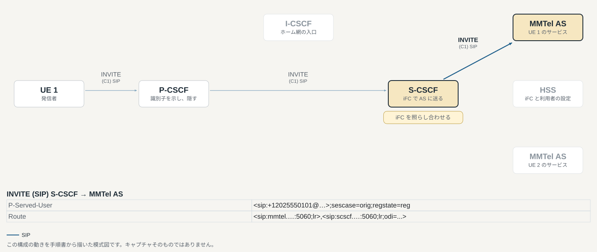
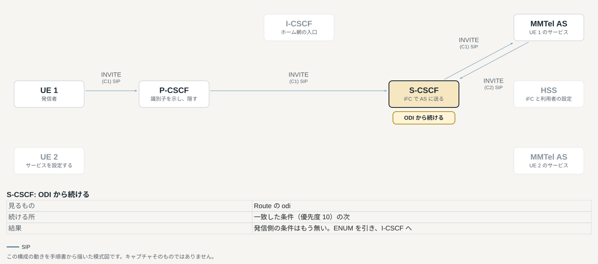

# アプリケーションサーバーが使えないとき

S-CSCF は、iFC に一致した要求をアプリケーションサーバー（AS）に送ります。その AS が答えないとき、または 408 か 5xx で答えたとき、S-CSCF はその iFC の DefaultHandling に従います。この扱いを、既定の処理（default handling）と呼びます。SESSION_CONTINUED なら、その AS を飛ばして、優先度の低い iFC から照らし合わせを続けます。SESSION_TERMINATED なら、要求をそこで終え、利用者に失敗を返します。

ただし、DefaultHandling が働くのは、AS がまだ要求を引き受けていないと S-CSCF が判断できるあいだだけです。AS から暫定応答が届いたあとや、AS が要求を S-CSCF に送り返したあとの 408 と 5xx は、AS の故障ではなくセッションの答えとして、そのまま利用者に返します。AS が 4xx や 6xx で断ったときも、それは AS の答えです。DefaultHandling は関係しません。

どちらの値にするかは、標準が決めていません。運用者が iFC ごとに書きます。続ける方は、通話や登録を保つ代わりに、その AS が受け持つ規制や転送を失います。終える方は、規制を守る代わりに、AS の故障を利用者の発信の失敗に変えます。この構成は、利用者がかける通話と送るショートメッセージを SESSION_TERMINATED にし、利用者への通話と、登録を AS に知らせる第三者 REGISTER を SESSION_CONTINUED にしています。

この章は、[iFC と MMTel AS の付加サービス](mmtel.md) と [SMS の配達と報告](sms.md) を前提にします。iFC の照らし合わせ、P-Served-User、元のダイアログの識別子（ODI）は、そちらで説明しています。

## この章で扱う構成

例は `deploy/compose` の構成で、HSS の `deploy/compose/hss.yaml` がどの加入者にも与える iFC です。AS は、SMS を受け持つ IP-SM-GW と、付加サービスを受け持つ MMTel AS の 2 つです。引く仕様の版は TS 24.229 V18.11.0 と TS 29.228 V18.0.0 です。



S-CSCF が AS に送る要求の Route には、AS の URI と、その次に ODI を付けた S-CSCF 自身の URI が入ります（TS 24.229 5.4.3.2 の step 5 a）。S-CSCF はこの要求の答えを待ちます。この章が扱うのは、この待ちがどう終わるかです。

## 標準が決めていること

利用者のプロファイルでは、iFC の ApplicationServer が DefaultHandling を 1 つ持てます（TS 29.228 B.2.2）。AS に届かなかったときにダイアログを解放するかどうかを表し、値は SESSION_CONTINUED と SESSION_TERMINATED です。XML では 0 と 1 で書きます（TS 29.228 Annex E）。書かなくてもかまいません。

S-CSCF がこの値を使う条件は、TS 24.229 が決めています。利用者が発信する要求（5.4.3.2）と、利用者が受ける要求（5.4.3.3）で、条件は同じです。

- 決めた時間のうちに、SIP の応答が 1 つも来ない。
- AS から 408 か 5xx が来る。そのとき、元の要求への 1xx をまだ受けておらず、同じ ODI を持つ要求を AS からまだ受けていない。

どちらかに当たると、S-CSCF は次のようにします。

| DefaultHandling | S-CSCF がすること |
| --- | --- |
| SESSION_CONTINUED、または書いていない | まだ実行していない iFC の照らし合わせを続ける（5.4.3.2 の step 5、5.4.3.3 の step 4 から） |
| SESSION_TERMINATED | 受けた応答を利用者に返す。最初の INVITE に応答が無ければ、408 か 5xx を返す。優先度の低い iFC は照らし合わせない |

この条件に当たらない最終応答は、どれも AS の答えです。S-CSCF はそれを利用者に返し、優先度の低い iFC を照らし合わせません（同じ 2 つの節）。

登録には別の決まりがあります。第三者 REGISTER に応答が無いか、408 か 5xx が来たとき、SESSION_CONTINUED なら何もしません。SESSION_TERMINATED なら、その REGISTER が登録した識別子を、網から解除します（TS 24.229 5.4.1.7。解除の手順は 5.4.1.5）。

AS の側にも、既定の処理を避ける手段があります。受けた要求とは別に、ODI を付けない新しい要求を自分で始める B2BUA の AS は、そちらの答えを待つあいだ、元の要求に暫定応答を返せます。S-CSCF はそれで既定の処理をしなくなります（TS 24.229 5.7.5.1 の NOTE 1）。

一方、標準が運用者と実装に任せているのは次のことです。

- どの iFC にどちらの値を書くか。
- 応答を待つ「決めた時間」の長さ。
- SESSION_TERMINATED で応答が来なかったとき、408 と 5xx のどれを返すか。

## この実装が状況を分けるところ

S-CSCF は `invoke` で 1 つの iFC の AS に要求を送り、答えを待ちます。待ったあとの分かれ道が、次の行です。

[internal/scscf/services.go](../../../internal/scscf/services.go)

```go
	provisional := false
	relay := s.onResponses(st, d.direction())
	targets, err := s.nextHop(toAS)
	var final *sip.Message
	if err == nil {
		final, err = st.ProxyWith(toAS, func(r *sip.Message) {
			provisional = provisional || r.StatusCode < 200
			relay(r)
		}, targets...)
	}
	if unreachable(final, err) && !provisional {
		returned, rerr := s.returned(d.ID)
		if rerr != nil {
			// Without the identifier, the S-CSCF cannot tell the failure
			// of the server from the answer of the session.
			s.storeFailed(st, rerr, log)
			return true
		}
		if !returned {
			log.Info("application server failed", "status", statusOf(final), "error", errorText(err), "default_handling", as.DefaultHandling.String())
			if as.DefaultHandling == ifc.SessionContinued {
				return false
			}
		}
	}
	// Any final response from the server goes to the user, without the
	// criteria of lower priority (5.4.3.2, 5.4.3.3).
	if final != nil {
		relay(final)
	}
	ims.Finish(st, final, err)
	return true
```

入力は 3 つです。DNS で AS の宛先を引いた結果 `err`、AS の最終応答 `final`、そして AS から暫定応答が来たかを表す `provisional` です。`ProxyWith` は暫定応答を利用者へ中継するたびに、渡した関数を呼びます。その関数が `provisional` を立てます。

既定の処理に進むのは、3 つの条件がそろったときだけです。

- `unreachable` が真になる。応答が無いか、408 か 5xx が来た。
- `provisional` が偽のまま。暫定応答を 1 つも中継していない。
- `returned` が偽。この ODI で、AS から要求が戻っていない。

そろったとき、SESSION_CONTINUED なら `false` を返します。要求は変えずに、呼び出し元が次の iFC へ進みます。SESSION_TERMINATED なら、そのまま下へ進み、`ims.Finish` が利用者に答えます。条件がそろわないときも、同じく `ims.Finish` に進みます。どの場合も、`true` を返すと優先度の低い iFC は照らし合わせません。

`unreachable` は、第三者 REGISTER と共通の判定です。

[internal/scscf/thirdparty.go](../../../internal/scscf/thirdparty.go)

```go
func unreachable(final *sip.Message, err error) bool {
	if err != nil {
		return true
	}
	return final != nil && (final.StatusCode == 408 || final.StatusCode/100 == 5)
}
```

`err` があるのは、要求をどこにも送れなかったときと、最終応答が来ないまま待ちが終わったときです。応答があれば、408 と 5xx だけを故障と読みます。

利用者に返す応答は `ims.Finish` が決めます。

[internal/ims/route.go](../../../internal/ims/route.go)

```go
func Finish(st *sip.ServerTransaction, final *sip.Message, err error) {
	switch {
	case err != nil:
		st.Respond(sip.NewResponse(st.Request, 504, sip.NewTag()))
	case final != nil && final.StatusCode == 503:
		st.Respond(sip.NewResponse(st.Request, 500, sip.NewTag()))
	case final != nil:
		st.Respond(final)
	}
}
```

応答が来なかったときは、504（Server Time-out）です。標準は、最初の INVITE に 408 か 5xx を返すとしています。この実装は、どのメソッドでも 504 を選んでいます。AS が 503 を返したときは、503 を渡さずに 500 にします。プロキシは 503 をそのまま転送しないためです（RFC 3261 16.7 の step 6）。503 は、それを返したサーバーが今は要求を受けないことを示します。S-CSCF が転送すると、S-CSCF 自身がそうであるように読めてしまいます。ほかの応答は、受けたまま返します。

続ける場合の呼び出し元は、iFC を順に試す `invokeApplicationServers` です。

[internal/scscf/services.go](../../../internal/scscf/services.go)

```go
	for i := d.Invoked + 1; i < len(d.Criteria); i++ {
		if !d.Criteria[i].Matches(out, d.SessionCase) {
			continue
		}
		if s.invoke(st, out, d, i, log) {
			return
		}
		// The server failed and its criterion says SESSION_CONTINUED: the
		// evaluation goes on from step 5 (5.4.3.2) or step 4 (5.4.3.3)
		// with the criteria after it.
	}
```

`invoke` が `false` を返すと、ループは次の iFC に進みます。一致する iFC が残っていなければ、ループを抜けて、AS の無い利用者と同じように宛先へ送ります。

値を書いていない iFC は、SESSION_CONTINUED として扱います。Go の型の 0 がそれに当たるからです。

[internal/ifc/ifc.go](../../../internal/ifc/ifc.go)

```go
type DefaultHandling int

const (
	// SessionContinued goes on with the criteria of lower priority.
	SessionContinued DefaultHandling = 0
	// SessionTerminated ends the request.
	SessionTerminated DefaultHandling = 1
)
```

## 6 つの状況

「AS が使えない」には、S-CSCF から見て違う状況がいくつもあります。この実装では次のように分かれます。右の 2 つの列は、SESSION_TERMINATED の iFC で利用者が受けるものと、確かめた試験です。

| 状況 | 既定の処理 | SESSION_TERMINATED で利用者が受けるもの | 試験 |
| --- | --- | --- | --- |
| DNS が AS の名前にアドレスを返さない | 働く | すぐに 504 | `TestDefaultHandling` |
| AS から応答が 1 つも来ない | 働く | 待ちが終わってから 504 | コードから読んだ動き |
| 暫定応答の前に 408 か 5xx が来る | 働く | 受けた応答。503 は 500 | `TestDefaultHandling` |
| 暫定応答のあとに 408 か 5xx が来る | 働かない | 受けた応答。503 は 500 | コードから読んだ動き |
| AS が要求を送り返したあとに 408 か 5xx が来る | 働かない | 受けた応答。503 は 500 | `TestFailureAfterTheRequestCameBack` |
| AS が 4xx、6xx、3xx、2xx で答える | 関係しない | 受けた応答 | 下の規制の例 |

SESSION_CONTINUED の iFC なら、「働く」の行で要求は次の iFC へ進みます。「働かない」と「関係しない」の行は、値にかかわらず同じです。

### DNS が AS を見つけないとき

`nextHop` が宛先を引けなければ、要求はどこにも出ません。この実装は、これを応答が来ない場合と同じに扱います。標準の条件は「決めた時間のうちに応答が来ない」で、DNS の失敗を名指ししていません。ただ、出ていない要求に応答は来ないので、待たずに既定の処理に進みます。

DNS が AS の名前に宛先を複数返すときは、先に SIP のスタックが次の宛先を試します。503、トランスポートの誤り、Timer B か Timer F までに応答が何も無いことが、次の宛先へ移る理由です（RFC 3263 4.3）。S-CSCF の `invoke` が故障を見るのは、すべての宛先で失敗したあとです。AS を複数台で動かすことが、1 段目の守りになります。既定の処理は、その守りが尽きたときの扱いです。

### 応答が来ないとき

「決めた時間」は、この実装ではトランザクションのタイマーです。MESSAGE のような INVITE 以外の要求では Timer F、INVITE では Timer B で、どちらも既定では 32 秒です（RFC 3261 17.1.1.2、17.1.2.2）。ノードの設定 `transaction_timeout` で短くできます。

INVITE には注意が要ります。AS の SIP のスタックが動いていれば、アプリケーションが答えなくても、スタックが 200 ミリ秒で 100（Trying）を返します（RFC 3261 17.2.1）。100 が来ると Timer B は止まり、S-CSCF はプロキシの Timer C で待ちます。この実装の Timer C は 3 分 30 秒です（RFC 3261 16.6 の step 11 は 3 分より長くとしか決めていません）。Timer C が切れると、S-CSCF は CANCEL を送り、さらに 64*T1（32 秒）だけ最終応答を待ちます（RFC 3261 16.8、9.1）。それでも来なければ、ようやく既定の処理に進みます。AS のホストごと止まっていれば 32 秒で済みますが、アプリケーションだけが止まった AS では、4 分あまりかかります。そのあいだ、発信者には呼び出し音も届きません。

### 暫定応答が来たあと

暫定応答を中継したあとは、408 や 5xx が来ても既定の処理をしません。標準の条件も、1xx のあとを除いています。暫定応答は、AS が要求を引き受けて先へ進めている印です。利用者はもう呼び出し音や早期メディアを受けているかもしれません。そこで別の AS や宛先へ切り替えると、同じ通話をもう一度始めることになります。

この実装は、100（Trying）をこの 1xx に数えません。標準の条件を簡略化しているところです。プロキシは 100 を、届いた区間で止めて先へ送らないので（RFC 3261 16.7 の step 5）、S-CSCF の中でも 100 は中継しません。上の抜き出しで `provisional` を立てる関数は、`ProxyWith` が 100 以外の暫定応答を中継するときだけ呼ばれます。そのため、100 のあとに来た 503 には既定の処理が働きます。

### 要求が戻ったあと



MMTel AS は B2BUA で、受けた INVITE に UA として答え、新しい INVITE を ODI 付きで S-CSCF に送り返します。S-CSCF はその ODI を見て、一致した iFC の次から続けます。これで AS は仕事を引き受けたことになります。このあと通話の先で起きた失敗は、AS を通って戻ってきます。408 や 5xx であっても、AS の故障ではありません。

要求が戻ったことは、ODI の記録に残します。

[internal/scscf/services.go](../../../internal/scscf/services.go)

```go
	d.Returned = true
	if err := s.store.PutOriginalDialog(ctx, d); err != nil {
		s.storeFailed(st, err, log)
		return
	}
```

ODI の記録は、S-CSCF のどの台も共有する保存先にあります。AS が送り返した要求は、最初に要求を送った台とは別の台に届くこともあるからです。最初の台は、AS の失敗を受けたときに保存先から `Returned` を読みます。読めなければ、故障か答えかを見分けられないので、500 で答えます。記録は 4 分で消えます。プロキシが INVITE の最終応答を待つ Timer C（3 分より長い）を覆う長さです。

`TestFailureAfterTheRequestCameBack` は、この場合を確かめています。1 つ目の AS が要求を送り返し、2 つ目の iFC の AS が 503 で答えます。2 つ目の iFC は SESSION_TERMINATED です。試験は、利用者が 500 を受け、宛先の I-CSCF には何も届かず、2 つ目の AS には要求が 1 度だけ届くことを確かめます。

### AS の答え

AS が 4xx や 6xx で答えたときは、AS がその要求を処理した結果です。たとえば発信の規制では、MMTel AS が 603（Decline）を返します（`internal/mmtel/barring_test.go` の `TestOutgoingCommunicationBarring`）。S-CSCF はこの 603 を利用者に返し、優先度の低い iFC を照らし合わせません。DefaultHandling の値は関係しません。

## TestDefaultHandling が確かめていること

`internal/scscf/services_test.go` の `TestDefaultHandling` は、利用者が送るショートメッセージに当たる iFC を 1 つ置き、その AS を 2 通りに壊します。DNS がアドレスを知らない名前にする場合と、503 で答える AS にする場合です。

| AS | DefaultHandling | 利用者が受ける応答 | 宛先の I-CSCF |
| --- | --- | --- | --- |
| DNS が知らない名前 | SESSION_CONTINUED | 486 | MESSAGE が届く |
| DNS が知らない名前 | SESSION_TERMINATED | 504 | 届かない |
| 503 で答える | SESSION_CONTINUED | 486 | MESSAGE が届く |
| 503 で答える | SESSION_TERMINATED | 500 | 届かない |

486 は、この試験で宛先の I-CSCF の役をする相手が、何にでも返すように作った応答です。続けた要求が宛先まで進んだことを示すだけです。実際の網で続けた要求がどう終わるかは、宛先しだいです。この構成で SMS を続けた場合については、次の節で見ます。

## この構成の値

`deploy/compose/hss.yaml` の iFC は、次の値を書いています。どれも、その AS を 1 台で動かしている構成で、AS が止まったときの結果です。

| 優先度 | 一致する要求 | AS | DefaultHandling | AS が止まったときの結果 |
| --- | --- | --- | --- | --- |
| 0 | REGISTER | IP-SM-GW | SESSION_CONTINUED | 登録は残り、発信も着信もできる。IP-SM-GW が戻っても、次の再登録までその利用者は SMS を受け取れない |
| 1 | 利用者が送る SMS の MESSAGE | IP-SM-GW | SESSION_TERMINATED | ショートメッセージは失敗の応答で終わる（503 なら 500、応答が無ければ 504） |
| 2 | 利用者への SMS の MESSAGE（ほかの網から） | IP-SM-GW | 書いていない（続ける扱い） | IP-SM-GW を通らずに、着信者の連絡先へ進む |
| 10 | 利用者がかける INVITE | MMTel AS | SESSION_TERMINATED | 発信は失敗する |
| 11 | 登録している利用者への INVITE | MMTel AS | SESSION_CONTINUED | 着信者に届く。着信の規制と転送は働かない |
| 12 | 登録していない利用者への INVITE | MMTel AS | SESSION_CONTINUED | S-CSCF が 480 を返す。CFNL の転送は働かない |
| 13 | AS が転送した INVITE（ORIGINATING_CDIV） | MMTel AS | SESSION_TERMINATED | 転送した通話は失敗する |

### 規制は発信側だけが守られる

発信の規制（OCB）は、発信側の AS が INVITE を受けたときに決めます。発信側の iFC を SESSION_CONTINUED にすると、AS が止まったあいだの通話は AS を通らずに宛先へ進みます。利用者が規制した相手にも、規制した国際電話にも、通話がつながります。AS が受け持つ発信者番号の非通知（OIR）も働きません。だから、この構成は発信側を SESSION_TERMINATED にしています。代わりに、AS が止まると、規制を設定していない利用者も含めて、すべての発信が失敗します。

転送した通話の発信側（優先度 13）も同じ理由です。転送した利用者の発信の規制が、転送先への通話にかかります。

着信側は逆を選んでいます。AS が止まっても、利用者への通話は着信者に届きます。その代わり、着信の規制（ICB と ACR）は働きません。着信を規制した相手からの通話も届きます。CFU、CFB、CFNR の転送も働きません。通話は転送先へ移らず、着信者を呼び出し、話し中や応答の無いまま終わります。登録していない利用者への通話は、CFNL で転送されずに 480 で終わります。

つまり、この構成で AS が止まると、発信の規制は守られ、着信の規制は守られません。「規制を守るために終える」は発信側の選択で、着信側では、通話が届くことを規制より優先しています。

### SMS は送り先が無いので終える

利用者が送るショートメッセージ（優先度 1）は、IP-SM-GW の代わりに受け取れるノードがありません。続けると、S-CSCF は MESSAGE を Request-URI、つまり SC の tel URI へ送ろうとします。この番号には ENUM のレコードが無いので、S-CSCF は 404 を返します。網がショートメッセージを受け取れなかったのに、SC が存在しないかのような答えになります。終える方が、失敗を正しく伝えます。

第三者 REGISTER（優先度 0）は逆です。SESSION_TERMINATED にすると、IP-SM-GW が答えないだけで網が利用者の登録を解除し、音声の通話もできなくなります。続ければ、失うのは SMS の着信だけです。

S-CSCF は、第三者 REGISTER の失敗を次の行で読みます。

[internal/scscf/thirdparty.go](../../../internal/scscf/thirdparty.go)

```go
	if !unreachable(final, err) {
		log.Info("third-party REGISTER answered", "status", final.StatusCode)
		return
	}
	log.Info("third-party REGISTER failed", "status", statusOf(final), "error", errorText(err), "default_handling", as.DefaultHandling.String())
	if as.DefaultHandling != ifc.SessionTerminated || expires == 0 {
		return
	}
```

同じ `unreachable` で故障を読み、SESSION_TERMINATED のときだけ先へ進みます。登録の解除の第三者 REGISTER（`expires == 0`）では、解除するものが無いので何もしません。先へ進むと、利用者ごとのロックを取り、保存した登録がこの REGISTER のものかを確かめてから、網からの解除をします。再登録のあとに古い第三者 REGISTER が失敗しても、今の登録は消しません（`TestAnOlderThirdPartyRegisterThatFailsKeepsTheRegistration`）。S-CSCF 自身が止まって答えを聞けなかったときも、AS の故障とはみなしません（`TestAThirdPartyRegisterThatTheStopCutsIsNoFailure`）。`TestThirdPartyRegisterThatFails` は、503 で答える AS に対して、SESSION_CONTINUED では登録が残り、SESSION_TERMINATED では AS に解除の REGISTER が届き、HSS に ADMINISTRATIVE_DEREGISTRATION の SAR が届くことを確かめています。

## 続ける方法と終える方法が合う条件

どちらの値も、標準が認める選択です。比べると次のようになります。

| | SESSION_CONTINUED | SESSION_TERMINATED |
| --- | --- | --- |
| AS が止まったとき | 要求は AS 無しで進む | 要求はそこで失敗する |
| 守るもの | 基本の通話や登録が続くこと | AS が加える制限と処理が、必ず通ること |
| 失うもの | その AS の規制、転送、識別子の扱い | AS の故障のあいだの、その種類の要求のすべて |
| 利用者に見えるもの | サービスが黙って欠ける | 発信や送信の失敗 |

続ける方が合うのは、AS が加えるものが付け足しのときです。無くても通話そのものは正しく、欠けても利用者や運用者が困らないサービスです。この構成の着信側の付加サービスと第三者 REGISTER がそうです。

終える方が合うのは、AS を通らない要求が、通ってはいけない要求になるときです。規制や発信者番号の非通知のように、利用者がそれが効くことを当てにしているもの、そして AS が無ければ要求の行き先そのものが無いものです。この構成の発信側の付加サービスと、利用者が送る SMS がそうです。

どちらを選んでも、AS が止まれば何かを失います。その損失を小さくするのは、値の選択ではなく、AS を複数台で動かすことです。この実装では、DNS が返す次の宛先へ SIP のスタックが要求を送り直し、AS の各役割が状態を共有の保存先に置くので、どの台でも次の要求を受けられます。既定の処理は、すべての台が失敗したときの扱いです。

規制を着信側でも守りたい網は、着信側の iFC を SESSION_TERMINATED にできます。代わりに、AS が止まると、利用者への通話がすべて失敗します。この構成は、着信を失うことの方を重く見て、着信側を続ける方にしています。

## この説明の根拠

この章の説明は、次のコードと試験で確かめたものです。試験は、このリポジトリの Go の試験として通ることを確かめています。

- `internal/scscf/services_test.go` の `TestDefaultHandling`。上の表の 4 つの場合です。
- `internal/scscf/services_test.go` の `TestFailureAfterTheRequestCameBack`。要求が戻ったあとの 503 は、SESSION_TERMINATED でも既定の処理にならず、500 として利用者に返ることを確かめています。
- `internal/scscf/services_test.go` の `TestRequestBackFromAProxyAS`。要求が ODI 付きで戻ると、次の iFC か宛先へ進むことを確かめています。
- `internal/scscf/services_test.go` の `TestThirdPartyRegisterThatFails`、`TestAnOlderThirdPartyRegisterThatFailsKeepsTheRegistration`、`TestAThirdPartyRegisterThatTheStopCutsIsNoFailure`。第三者 REGISTER の既定の処理です。
- `internal/mmtel/barring_test.go` の `TestOutgoingCommunicationBarring` と `TestIncomingCommunicationBarring`。規制した通話に AS が 603 か 433 で答えることを確かめています。

応答が来ない場合と、暫定応答のあとの場合は、上に引いたコードと、`internal/sip` のタイマーから読んだ動きです。図は、この構成の動きを手順書から描いた模式図で、キャプチャそのものではありません。

## 自分で動かす場合

MMTel AS を運用から外すと、AS が 503 で答え、発信側の iFC の既定の処理で通話が 500 で終わる様子を、キャプチャで見られます。手順は手順書の [MMTel AS を運用から外す](../../guide/ja/mmtel.md#mmtel-as-を運用から外す) にあります。IP-SM-GW の場合は [IP-SM-GW を運用から外す](../../guide/ja/sms.md#ip-sm-gw-を運用から外す) です。試験は `go test ./internal/scscf -run 'TestDefaultHandling|TestFailureAfterTheRequestCameBack'` で動かせます。スライドでは [付加サービスのデッキ](../../../slides/decks/ja/07-mmtel.md) の「ODI と 3 つのダイアログ」のシーンが、要求が AS から戻る様子を段階に分けて見せます。
