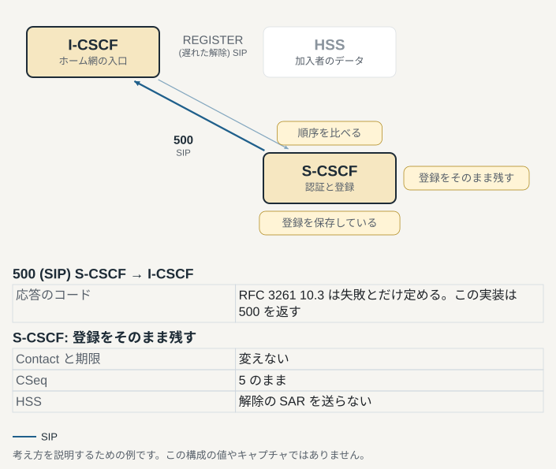
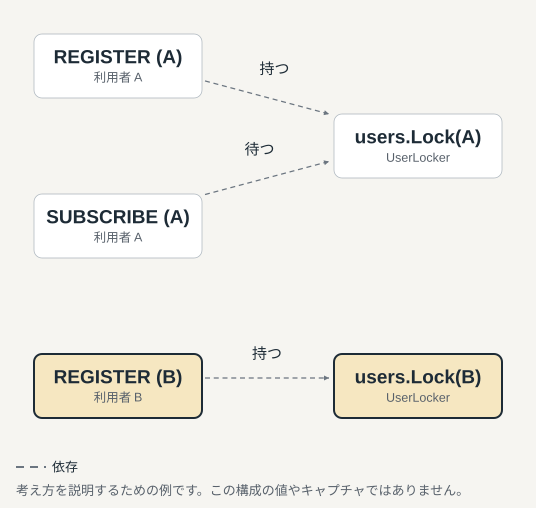

# 登録の順序と期限

S-CSCF に届く REGISTER は、どれも同じ形のメッセージです。それでも、最初の登録、登録の更新、登録の解除、遅れて届いた古い要求、期限を過ぎた認証への答えは、同じには扱えません。それぞれが変えてよいものが違うからです。S-CSCF はこれを、届いた要求の値と、利用者ごとに保存した 2 つの記録の組で見分けます。要求の値は Call-ID、CSeq、Contact、有効期間、認証の答えの nonce です。記録は、登録の記録と、認証の途中の記録です。

答えを先にまとめます。

- 順序は、同じ Call-ID の中の CSeq だけで比べます。比べるのは、保存した Contact と同じ Contact の登録を変える要求だけです。別の Call-ID、別の Contact、トランザクションの層が受け止める再送は、この比較の外にあります。
- 期限は、記録が残っているかどうかではなく、記録に書いた時刻で決めます。認証の答えを受け付ける期限（reg-await-auth）と、その記録を保存先に残す期限は、別の時刻です。期限を処理する仕組みが遅れても、要求を処理する側が時刻を自分で確かめるので、遅れた答えは受け付けられません。
- 読む、比べる、HSS に知らせる、書く、を 1 人の利用者について 1 つの手順にするのは、利用者ごとのロックです。このロックは、持ち主がリースの時間の中で仕事を終えるかぎりで効きます。リースを過ぎて動き出した持ち主の書き込みを止める仕組み（フェンシング）はありません。

この章は [REGISTER が 2 回送られる理由](registration-two-registers.md)、[遅れて届いた登録の解除が、新しい登録を消さない理由](registration-stale-deregistration.md)、[登録の更新、解除、購読、網からの取り消し](registration-lifecycle.md) を前提にします。必要なところは、この章の中で言い直します。

## この章で扱う構成

例は、`deploy/compose` の構成で、SIP Digest で登録するソフトフォン型の UE です。この構成の S-CSCF は 1 台で、状態を自分のプロセスに置きます。後半では、S-CSCF の状態を共有の保存先（Valkey）に置き（`deploy/redundancy` の構成）、さらに同じ保存先を複数の台が分け合う場合を考えます。Compose の構成が動かす S-CSCF は 1 台です。複数の台の動きは、Go の試験が 2 つの台を 1 つの保存先の上で動かして確かめています。この実装の S-CSCF は、秘密の識別子 1 つにつき Contact を 1 つだけ保存します（reg-id を使わない場合の TS 24.229 5.4.1.2.2A）。

時間の値は、断らないかぎりこの実装の既定値です。reg-await-auth は 4 分（TS 24.229 Table 7.7.1）、期限の来たものを探す見回りは 1 秒ごと、見つけた期限を 1 台が借りる時間（期限の借り）と利用者ごとのロックのリースは、どちらも 15 秒です。試験はこれらを短くして動かします。

引く仕様の版は、TS 24.229 V18.11.0、TS 29.228 V18.0.0、RFC 3261 です。

## 標準が決めていること

設計の選択を比べる前に、標準が 1 つに決めていることを確かめます。ここは実装が選べるものではありません。

| 決まり | 出典 | 内容 |
| --- | --- | --- |
| 届いた順に、不可分に処理する | RFC 3261 10.3（手順の前の段落） | レジストラは、REGISTER を受け取った順に処理します。1 つの REGISTER は、全部を処理するか、まったく処理しないかのどちらかです。 |
| 同じ Call-ID では、CSeq が大きいときだけ変える | RFC 3261 10.3 の手順 7 | Contact ごとに、保存した登録先と Call-ID を比べます。違えば更新し、有効期間が 0 なら消します。同じなら、CSeq が保存した値より大きいときだけ更新するか消します。そうでなければ要求は失敗します。登録先は、それを変えた要求の Call-ID と CSeq を記録します。 |
| `*` ですべてを消すときも比べる | RFC 3261 10.3 の手順 6 | Contact が `*` の解除も、登録先ごとに Call-ID と CSeq を同じように比べます。 |
| 401 のあとで reg-await-auth を始める | TS 24.229 5.4.1.2.1 の手順 7 | 次の REGISTER を待つタイマーです。 |
| タイマーが動いているかで手順が分かれる | TS 24.229 5.4.1.2.2A | 動いていなければ、認証を新しく始めます。動いていれば、答えの Call-ID が最後の問いを運んだ 401 の Call-ID と同じときだけ先へ進み、タイマーを止めて答えを確かめます。 |
| 待っているあいだに届いた最初の REGISTER | TS 24.229 5.4.1.2.3 | タイマーを止め、認証が無かったものとして新しい問いを返します。 |
| 時間切れは認証の失敗 | TS 24.229 5.4.1.2.3 の NOTE 2 | すでに登録している公開の識別子は、登録したまま残します。 |
| 時間切れを聞いた HSS | TS 29.228 6.1.2.1 | Server-Assignment-Type が AUTHENTICATION_TIMEOUT の SAR を受けた HSS は、登録の状態を変えません。S-CSCF の名前を消すのは、利用者が Not Registered のときだけです。 |
| IMS-AKA の仮の保護も同じ時間で切れる | TS 24.229 3.1、5.2.2.2 | 401 のときに UE と P-CSCF が張る仮のセキュリティアソシエーションは、SIP の上での寿命が reg-await-auth と同じです。 |

標準が決めていないこともあります。タイマーをプロセスのタイマーで持つか、保存先に時刻として置くか。記録をいつまで残すか。複数の台が 1 つのレジストラとして働くとき、「不可分」をどう作るか。順序の古い要求にどの応答のコードを返すか。この章が比べるのは、この選べる部分です。最後のものは [遅れて届いた登録の解除が、新しい登録を消さない理由](registration-stale-deregistration.md) で見たとおりで、この実装は 500 を返します。

## 要求を見分ける値と状態

S-CSCF が利用者ごとに持つ記録は 2 つです。どちらも秘密の識別子で引きます。登録の記録 `Registration` は、Contact、有効期限 `Expires`、その登録を最後に変えた REGISTER の `CallID` と `CSeq` を持ちます。認証の途中の記録 `Challenge` は、401 に入れた nonce、401 を受けた REGISTER の Call-ID、HSS の名前、それに 2 つの時刻を持ちます。

[internal/scscf/store.go](../../../internal/scscf/store.go)

```go
	// Expires is when reg-await-auth runs out (TS 24.229 5.4.1.2.1):
	// the authentication fails then if no REGISTER has answered the
	// challenge.
	Expires time.Time
	// KeepUntil is when the Store forgets the challenge: reg-await-auth
	// after Expires (putChallenge).
	KeepUntil time.Time
```

`Expires` は reg-await-auth が切れる時刻で、これを過ぎた答えは受け付けません。`KeepUntil` は、保存先がこの記録を忘れる時刻です。時刻が 2 つある理由は、あとの節で説明します。

届いた REGISTER は、この 2 つの記録と要求の値の組で、次のように分かれます。

| 場合 | 見分ける値と状態 | 変えてよいもの | この実装の結果 |
| --- | --- | --- | --- |
| 最初の登録 | 登録の記録が無い。答えを持たない REGISTER | 認証の記録を作る | MAR、401 |
| 問いへの答え | 認証の記録があり、今が `Expires` より前で、nonce と Call-ID が記録と同じ | 認証の記録を消し、登録を作るか変える | SAR、200 OK |
| 登録の更新 | 登録の記録があり、Contact が同じ。Call-ID が同じなら CSeq が保存した値より大きい | 期限、Call-ID、CSeq | SIP Digest では 401 で問い直し、答えのあとで RE_REGISTRATION の SAR、200 OK |
| 別の Contact での登録 | 登録の記録があり、Contact が違う | 古い Contact を新しい Contact で置き換える | 認証のあとで SAR、200 OK |
| 登録の解除 | 有効期間が 0。Contact が保存したものと同じか `*`。Call-ID が同じなら CSeq が大きい | 登録を消す | USER_DEREGISTRATION の SAR、200 OK |
| 消すものの無い解除 | 登録の記録が無いか、Contact が違う | 何も変えない | 481 |
| 遅れて届いた要求 | Call-ID と Contact が同じで、CSeq が保存した値より大きくない | 何も変えない | 500 |
| トランザクションの中の再送 | 前の要求と同じトランザクションに属する | 何も変えない | トランザクションの層が前の応答を送り直す |
| 期限を過ぎた答え | 認証の記録はあるが、今が `Expires` を過ぎている | 認証の記録を消す。登録は変えない | AUTHENTICATION_TIMEOUT の SAR。SIP Digest では `stale=true` の新しい 401 |
| 待っているあいだの最初の REGISTER | 認証の記録があり、REGISTER は答えを持たない | 認証の記録を新しいもので置き換える | MAR、新しい 401 |
| 答えが来ないままの時間切れ | 期限の索引で、認証の記録の `Expires` が来た | 認証の記録を消す。登録は変えない | AUTHENTICATION_TIMEOUT の SAR |
| 登録の期限切れ | 期限の索引で、登録の `Expires` が来た | 登録を消す | NOTIFY と TIMEOUT_DEREGISTRATION の SAR |

この表から分かることが 3 つあります。

1 つ目に、最初の登録と更新を分けるのは、要求の値ではなく、登録の記録があるかどうかです。同じ形の REGISTER でも、記録があれば SAR は RE_REGISTRATION になり、無ければ `REGISTRATION` になります。

2 つ目に、問いへの答えを、新しい要求と分けるのは、認証の記録と nonce です。答えは CSeq では比べません。同じ問いへの答えかどうかは、nonce と Call-ID で決まります（TS 24.229 5.4.1.2.2A）。CSeq を記録するのは、答えを受け付けて登録を書くときです。

3 つ目に、何も変えない場合が 4 つあり、そのどれも理由が違います。遅れて届いた要求は順序で、再送はトランザクションで、消すものの無い解除は Contact で、期限を過ぎた答えは時刻で止まります。どれか 1 つの仕組みで、ほかの場合をまとめて防ぐことはできません。

## Call-ID と CSeq の比較が当てはまる範囲



比べる関数は `outOfOrder` で、呼ぶ場所は、認証を確かめたあとの `accept` と、解除の `deregister` です。どちらも、保存した Contact と同じ Contact の要求だけを比べます。比べるのは HSS への SAR と記録の書き換えより前なので、断った要求は何も残しません。ここまでは、遅れて届いた解除の章で見ました。この節では、比較が実際に効く要求と、当てはまらない要求を見ます。

**比較が実際に効く要求。** 認証を求め直さずに進む要求です。1 つは、P-CSCF が IP の対応付けを持つ解除（`integrity-protected="ip-assoc-yes"`）です。もう 1 つは、IMS-AKA の保護された再登録です。TS 24.229 5.4.1.2.2 の手順 1 は、このとき問い直すかどうかを S-CSCF に任せていて、この実装は問い直さずに `accept` へ進みます。SIP Digest の更新は、TLS を使わないかぎり毎回 401 で問い直されます（TS 24.229 5.4.1.2.2A の手順 1）。そのため、遅れて届いた古い答えは、比べる前に止まります。その答えの nonce の問いは、もう保存されていないからです。S-CSCF は `stale=true` の新しい 401 を返します。

**別の Call-ID。** 規則のうえで、Call-ID が違えば別の登録の手順です。UE が起動し直して、新しい Call-ID と CSeq 1 で登録し直す場合がこれに当たります。CSeq は比べず、認証のあとで登録を更新し、その Call-ID と CSeq を新しく比べる値として残します。

**別の Contact。** 規則のうえでも別の登録先です。reg-id を使わないこの構成では、新しい Contact は古い Contact を置き換えます（TS 24.229 5.4.1.2.2A の手順 6 の d）。比較はしませんが、遅れて届いた要求が古い Contact を戻すことはありません。止めるのは比較ではなく、ほかの確かめです。SIP Digest の要求は、いま待っている問いに答えなければ受け付けられません。IMS-AKA の保護された再登録は、保存した Contact と違えば 403 になります（`reregister`）。解除は、保存した Contact と違えば 481 になります。

**トランザクションの中の再送。** UDP で送られた同じ REGISTER の写しは、S-CSCF の登録の処理に届く前に、SIP のトランザクションの層が受け止めます。応答を返すまでは写しを捨て、最後の応答を返したあとは、写しが来るたびに同じ応答を送り直します（RFC 3261 17.2.2）。この状態はタイマー J のあいだ続き、UDP では 64×T1、つまり 32 秒です。そのあとで届いた写しは、新しいトランザクションとして登録の処理に届きます。CSeq は保存した値と等しいか小さいので、比較で断られます。等しい CSeq も古いとみなすのは、このためでもあります。

比べ方を変えると、何が起きるかも見ておきます。

| 比べ方 | 起きること |
| --- | --- |
| Call-ID を見ずに CSeq だけを比べる | 起動し直して新しい Call-ID と CSeq 1 で登録し直す UE が、古い登録の期限まで断られ続ける。RFC 3261 10.3 は、Call-ID が違えば更新すると定めているので、標準に反する。 |
| 等しい CSeq を新しいとみなす | タイマー J が切れたあとに届いた写しが、登録を変える。解除の写しなら、新しい登録が消える。 |
| 比べない | 遅れて届いた解除の章の場合になる。遅れた解除が新しい登録を消し、その UE に着信が届かなくなる。 |

## 2 つの期限（受け付ける期限と残す期限）

401 を返すとき、S-CSCF は `putChallenge` で認証の記録に 2 つの時刻を書きます。

[internal/scscf/scscf.go](../../../internal/scscf/scscf.go)

```go
// putChallenge stores ch with its expiries, which puts reg-await-auth in
// the store (TS 24.229 5.4.1.2.1). The Store keeps the challenge for
// reg-await-auth again after that, so that the instance which handles
// the expiry still finds it: by then the expiry has ended the challenge,
// or the authentication has.
func (s *SCSCF) putChallenge(ch Challenge) error {
	ch.Expires = time.Now().Add(s.cfg.RegAwaitAuth)
	ch.KeepUntil = ch.Expires.Add(s.cfg.RegAwaitAuth)
	return s.store.PutChallenge(context.Background(), ch)
}
```

`Expires` は今から reg-await-auth の後、`KeepUntil` はそこからさらに reg-await-auth の後です。保存先は、記録を書くときに、期限の索引にも `Expires` の時刻で 1 つの項目を入れます。この項目は秘密の識別子と nonce で名前が付いています。Valkey に置く Store は、記録そのものに `KeepUntil` までの生存時間を付けます。プロセスの中の Store も、`KeepUntil` を過ぎた記録を返しません。

401 からの時間で並べると、次のようになります。

| 401 からの時間 | 起きること | 保存先の認証の記録 | 答えの REGISTER |
| --- | --- | --- | --- |
| 0 | 401 を返す。`putChallenge` が 2 つの時刻を書き、期限の索引に `Expires` の時刻を入れる | ある | 受け付ける |
| 4 分（`Expires`） | reg-await-auth が切れる | ある | 受け付けない |
| 4 分を少し過ぎたころ | どこかの台の見回りが期限を借り、`regAwaitAuthExpired` が記録を消し、AUTHENTICATION_TIMEOUT の SAR を送る | 無い | 問いの無い REGISTER として扱う |
| 8 分（`KeepUntil`） | どの台も処理しなかった記録も、保存先から消える | 無い | 問いの無い REGISTER として扱う |

見回りは 1 秒ごとなので、ふつうは `Expires` から 1 秒ほどで期限が処理されます。期限を借りた台が止まると、借りが切れる 15 秒後に、ほかの台が借り直します。保存先が答えないあいだは、どの台も処理を終えられず、借り直しが続きます。

**記録を `Expires` のあとも残す理由。** 期限を処理する台は、認証の記録から HSS の名前と S-CSCF の名前を読んで、正しい HSS に正しい名前で AUTHENTICATION_TIMEOUT の SAR を送ります。記録が `Expires` ちょうどに消えると、少しでも遅れた処理は何も見つけず、SAR を送りません。そうなると HSS は、認証が終わったことを知らないままです。登録していない利用者なら、S-CSCF の名前も残ります。`KeepUntil` は、遅れた処理に、もう 1 回分の reg-await-auth の時間を与えます。

**記録があることと、答えを受け付けてよいことは別。** 保存先に記録が残っているのは、後始末のためです。もし REGISTER の処理が「記録があれば、問いへの答えを待っている」と判断すると、答えを受け付ける期限は、見回りがいつ動くかで変わってしまいます。ふつうは 1 秒ほど延び、台が止まれば 15 秒延び、どの台も処理できなければ `KeepUntil` まで、つまり 4 分も延びます。見回りが動く時刻は、台の数、負荷、借りの時間、保存先の状態で決まり、SIP の手順とは関係ありません。標準は受け付ける期限をタイマーで決めています。IMS-AKA では、UE と P-CSCF の仮のセキュリティアソシエーションも、そのタイマーで切れています（TS 24.229 3.1、5.2.2.2）。そのため、REGISTER の処理は時刻を自分で確かめます。

[internal/scscf/scscf.go](../../../internal/scscf/scscf.go)

```go
	// The Store keeps a challenge for reg-await-auth after its Expires, so
	// that the expiry is still handled when it comes up late. A challenge
	// past its Expires is no longer one that a REGISTER can answer: the
	// authentication has failed (TS 24.229 5.4.1.2.3), so it ends here,
	// as the expiry would have ended it, and the REGISTER is handled as
	// one with no challenge pending.
	if pending && !time.Now().Before(ch.Expires) {
		if err := s.endRegAwaitAuth(ctx, ch); err != nil {
			s.storeFailed(st, err, log)
			return
		}
		pending = false
	}
```

入力は、利用者のロックを取ったあとに読んだ認証の記録 `ch` です。`pending` は記録があったことを、`ch.Expires` は受け付ける期限を表します。今がその時刻を過ぎていれば、S-CSCF は期限の処理と同じ `endRegAwaitAuth` で記録を消し、HSS に AUTHENTICATION_TIMEOUT を伝えます。そのうえで `pending` を偽にして、問いを待っていない REGISTER として扱います。SIP Digest の REGISTER は答えを持っているので、S-CSCF は新しい MAR を送り、新しい nonce と `stale=true` を入れた 401 を返します（TS 24.229 5.4.1.2.2A の手順 1）。IMS-AKA の保護された答えは、問いを待っていない保護された REGISTER として扱われ、登録の無い利用者なら 500 を受けます。

期限を処理する側も、同じロックを取り、記録を読み直します。

[internal/scscf/scscf.go](../../../internal/scscf/scscf.go)

```go
func (s *SCSCF) regAwaitAuthExpired(ctx context.Context, privateID, nonce string) error {
	unlock, err := s.users.Lock(ctx, privateID)
	if err != nil {
		return fmt.Errorf("the lock of the user was not taken: %w", err)
	}
	defer unlock()
	ch, ok, err := s.store.Challenge(ctx, privateID)
	if err != nil {
		return err
	}
	if !ok || ch.Nonce != nonce {
		return nil
	}
	return s.endRegAwaitAuth(ctx, ch)
}

// endRegAwaitAuth ends the challenge ch, whose reg-await-auth has run
// out, and tells the HSS (TS 24.229 5.4.1.2.3). The lock of the user is
// held: the expiry takes it in regAwaitAuthExpired, and a REGISTER that
// finds the challenge late already holds it (register).
func (s *SCSCF) endRegAwaitAuth(ctx context.Context, ch Challenge) error {
	// TS 24.229 5.4.1.2.3 NOTE 2: authentication has failed; a user who
	// was registered stays registered.
	s.log.Info("reg-await-auth expired", "private_identity", ch.PrivateIdentity)
	if err := s.store.DeleteChallenge(ctx, ch.PrivateIdentity); err != nil {
		return err
	}
	s.serverAssignment(ctx, ch.PrivateIdentity, ch.PublicIdentity, ch.HSSHost, ch.ServerName, cx.AuthenticationTimeout)
	return nil
}
```

`regAwaitAuthExpired` は、借りた期限の nonce と、いま保存されている記録の nonce が同じときだけ記録を終わらせます。REGISTER の処理が先に終わらせていれば、記録は無いので何もしません。UE が待っているあいだに最初の REGISTER を送り直していれば（TS 24.229 5.4.1.2.3）、記録は新しい nonce のものに置き換わっているので、それにも触りません。こうして、どちらが先に動いても、HSS に時間切れを伝えるのは 1 回です。ただし、`endRegAwaitAuth` は SAR の答えを確かめません。SAR が HSS に届かなくても、送り直しません。

`internal/scscf/challenge_deadline_test.go` の `TestRegistrationRejectsExpiredChallengeBeforeSweep` が、この場合を確かめています。試験は reg-await-auth を 200 ミリ秒にし、見回りを 1 時間に 1 回にします。これで、見回りが記録を終わらせることはありません。`Expires` を過ぎてから正しい答えを送ると、結果は 401 で、新しい nonce と `stale=true` が入り、登録は作られません。そのあとで古い nonce の期限の処理を呼んでも、新しい問いはそのまま残ります。新しい問いに答えると 200 OK になり、HSS が受けた SAR は AUTHENTICATION_TIMEOUT と `REGISTRATION` の 2 つだけです。`TestIMSAKARejectsExpiredChallengeBeforeSweep` は、IMS-AKA の保護された答えも 200 にならないことを確かめます。`internal/kvstore/scscfstore` の `TestAChallengePastItsExpiresIsNotAnswered` は、Valkey に置く Store の実装でも同じ結果になることを確かめます。

**登録の期限も同じ考え方。** 登録の `Expires` を過ぎた登録も、見回りが終わらせるまでは保存先に残ります。それでも、着信の宛先を探すときは、時刻で判断します。

[internal/kvstore/scscfstore/scscfstore.go](../../../internal/kvstore/scscfstore/scscfstore.go)

```go
func (s *Store) RegistrationOf(ctx context.Context, publicID string) (scscf.Registration, bool, error) {
	k := ims.PublicIdentityKey(publicID)
	target, ok, err := s.indexTarget(ctx, s.c.Key("impu", k))
	if err != nil || !ok {
		return scscf.Registration{}, false, err
	}
	r, ok, err := s.Registration(ctx, target)
	if err != nil || !ok || !s.c.Now().Before(r.Expires) || !slices.Contains(publicKeys(r.PublicIdentities), k) {
		return scscf.Registration{}, false, err
	}
	return r, true, nil
}
```

公開の識別子から登録を引く `RegistrationOf` は、保存先の時計で `Expires` を過ぎた登録を、無いものとして返します。`internal/scscf/session_test.go` の `TestTerminatingCallAfterTheExpiryDoesNotGoToTheContact` は、見回りを 1 時間に 1 回にして、期限を過ぎたがまだ残っている登録の利用者に着信を送ります。結果は 480 で、要求は期限の切れた Contact へ届きません。

登録の期限を処理する `registrationExpired` は、ロックを取ったあとで登録を読み直し、時刻をもう一度確かめます。

[internal/scscf/scscf.go](../../../internal/scscf/scscf.go)

```go
	reg, ok, err := s.store.Registration(ctx, privateID)
	if err != nil {
		return err
	}
	// Under the lock, the registration may have ended or been refreshed
	// since its expiry came up.
	if !ok || time.Now().Before(reg.Expires) {
		return nil
	}
```

期限を借りてからロックを取るまでのあいだに、UE が登録を更新しているかもしれません。そのときは `Expires` が先に延びているので、何もしません。`internal/kvstore/scscfstore` の `TestARegistrationRefreshedBeforeItsExpiryIsHandled` は、期限を借りた台がロックを待っているあいだに、登録を 1 時間先まで延ばします。ロックを渡すと、SAR も NOTIFY も出ず、登録は延びたまま残ります。延ばさなければ、同じ時間のうちに SAR が出ます。

つまり、受け付けるか、宛先にするかは、記録に書いた時刻を、使う側がそのたびに確かめて決めます。見回りが受け持つのは、終わったことを HSS と購読者に伝えることと、記録を片付けることです。見回りが遅れても、正しくない答えが正しくなることはありません。遅れるのは、伝えることと片付けることだけです。

## 再認証が時間切れになったときの登録

すでに登録している利用者の認証が、時間切れで終わる場合を 1 つ選び、前後の状態を正確に追います。`internal/scscf/challenge_deadline_test.go` の `TestExpiredChallengeKeepsTheRegistration` の場合です。

1. 利用者は Call-ID A で登録しています。
2. UE が新しい Call-ID B で、答えを持たない REGISTER を送ります。S-CSCF にとっては、すでに登録している利用者の REGISTER です。S-CSCF は MAR を送り、401 を返します。認証の記録は Call-ID B と新しい nonce を持ちます。
3. UE の答えが、`Expires` を過ぎてから届きます。見回りはまだこの期限を処理していません。

| | 3 の前 | 3 のあと |
| --- | --- | --- |
| 登録の記録 | Contact、期限、Call-ID A と CSeq | 変わらない。期限も同じ |
| 認証の記録 | Call-ID B と 2 の nonce | 2 の記録は消え、`stale=true` の 401 の新しい nonce の記録になる |
| HSS | 登録済み | AUTHENTICATION_TIMEOUT の SAR を受け、登録済みのまま |
| UE が受けるもの | 2 の 401 | `stale=true` の新しい 401 |

試験が確かめているのは、3 の答えが 401 を受けることと、登録が残り、その期限が 3 の前と同じことです。HSS の扱いは TS 29.228 6.1.2.1 のとおりで、この実装の HSS も、登録済みの利用者の AUTHENTICATION_TIMEOUT では状態を変えません。登録は、UE が新しい問いに答えて更新するか、自分の期限が来るまで、そのまま使えます。

答えがまったく来ない場合も、登録への影響は同じです。見回りが `regAwaitAuthExpired` で認証の記録を消し、AUTHENTICATION_TIMEOUT の SAR を送り、登録には触りません。誤った答えの場合は違います。S-CSCF は 403 を返し、AUTHENTICATION_FAILURE の SAR を送ります（TS 24.229 5.4.1.2.3B）。それでも登録は、期限が来るまで残ります。`internal/scscf/scscf_test.go` の `TestFailedReauthenticationKeepsTheRegistrationExpiry` は、誤った答えに 403 が返り、HSS が受ける SAR が `REGISTRATION`、AUTHENTICATION_FAILURE、TIMEOUT_DEREGISTRATION の順になることを確かめます。最後のものは、登録が自分の期限で終わったときの SAR です。

登録していない利用者では、時間切れのあとに HSS が S-CSCF の名前を消します。`internal/scscf/instances_test.go` の `TestAnotherInstanceNamesTheAssignedSCSCF` の「reg-await-auth at the other instance」の場合は、401 を返した台が止まり、別の台が期限を処理します。そのあとで HSS は、その利用者の S-CSCF を持っていません。

## 読む、比べる、書くを 1 つの手順にする

RFC 3261 10.3 は、1 つの REGISTER を不可分に処理するよう求めています。S-CSCF の 1 つの REGISTER は、次の順に進みます。登録の記録と認証の記録を読む。期限と順序を確かめる。HSS に MAR か SAR を送り、答えを待つ。記録を書く。200 OK を返し、購読者に NOTIFY を送る。TS 24.229 5.4.1.2.2A の手順 5 も、HSS への SAR を終えてから登録の情報を保存する順にしています。読んでから書くまでのあいだに、同じ利用者の別の要求や期限の処理が割り込むと、比較は古い値を相手にしたことになります。

この実装は、REGISTER の処理の最初に、利用者ごとのロックを取ります。

[internal/scscf/scscf.go](../../../internal/scscf/scscf.go)

```go
	ctx := context.Background()
	unlock, err := s.users.Lock(ctx, privateID)
	if err != nil {
		s.lockFailed(st, err, log)
		return
	}
	defer unlock()
```

ロックの名前は秘密の識別子です。登録の記録も認証の記録も、同じ秘密の識別子で引きます。期限の処理（`regAwaitAuthExpired`、`registrationExpired`）と、HSS からの RTR と PPR の処理も、同じロックを取ります。

ロックの実体は、構成で変わります。状態をプロセスに置く S-CSCF は、プロセスの中のロック（`ims.UserLocks`）を使います。状態を共有の保存先に置く S-CSCF は、保存先の中のロック（`internal/kvstore/kvlock`）を使います。どちらも同じ `ims.UserLocker` のインタフェースなので、S-CSCF のコードは同じです。



図は、利用者ごとのロックの考え方を描いた模式図です。同じ利用者の 2 つ目の要求は 1 つ目が終わるのを待ち、別の利用者の要求は待ちません。保存先の中のロックでも形は同じで、待つ要求が別の台にあっても同じように待ちます。

保存先の中のロックは、保存先の 1 つの項目です。無いときにだけ書き、リースの長さの生存時間を付けます。

[internal/kvstore/kvlock/kvlock.go](../../../internal/kvstore/kvlock/kvlock.go)

```go
		started := time.Now()
		try, cancel := context.WithTimeout(ctx, l.timeout)
		version, err := l.kv.CompareAndSwap(try, key, "", value, l.lease)
		cancel()
		if err == nil {
			return version, nil
```

`CompareAndSwap` の版に空の文字列を渡すのは、「項目が無いときだけ書く」という意味です。書けた版が、ロックを持っている印です。ほかの台が持っていれば書けないので、少し待って試し直します。待つ時間は 5 ミリ秒から倍にしていき、100 ミリ秒までです。放すときは、その版のときだけ消します。

[internal/kvstore/kvlock/kvlock.go](../../../internal/kvstore/kvlock/kvlock.go)

```go
func (l *Locker) release(key, version string) {
	ctx, cancel := context.WithTimeout(context.Background(), l.timeout)
	defer cancel()
	switch err := l.kv.CompareAndDelete(ctx, key, version); {
	case err == nil:
	case errors.Is(err, kvstore.ErrConflict):
		l.log.Warn("user lock released after its lease ran out; another instance may have handled the user meanwhile",
			"key", key, "lease", l.lease.String())
	default:
		l.log.Warn("user lock not released; it ends with its lease", "key", key, "lease", l.lease.String(),
			"error", err.Error())
	}
}
```

### このロックが保証すること

- 同じ利用者のロックを持つ台は、どの時点でも 1 つです。ただし、持ち主がリースの中で仕事を終えるかぎりです。`internal/kvstore/kvlock` の `TestMutualExclusion` は、4 つの台の 3 つずつの処理が、ロックの中で同じ数を 20 回ずつ足し、足し損ねが無いことを確かめます。
- 止まった持ち主は、ほかの台をリースの長さまでしか待たせません。リースのあとで動き出した持ち主が放しても、そのあいだに次の台が取ったロックは消えません。版が違うからです。`TestStoppedHolder` がこの 2 つを確かめます。
- ほかの利用者は待ちません。`TestOnlyOneInstanceHoldsTheLock` は、ある利用者のロックが持たれているあいだも、別の利用者のロックと、別の役割の同じ利用者のロックはすぐに取れることを確かめます。`internal/scscf` の `TestUsersDoNotWaitForEachOther` は、1 人の利用者の MAR の答えが止まっているあいだも、別の利用者の REGISTER に答えが返ることを確かめます。
- ロックを取れなければ、先へ進みません。S-CSCF は 500 を返します。ほかの台がその利用者を処理しているかもしれないからです。`TestRegisterWhenTheLockFails` が確かめます。

### このロックが保証しないこと

リースは延ばしません。持ち主は 15 秒の中で仕事を終える前提です。S-CSCF がロックの中でする仕事は、Diameter の答えを待つのが多くても 2 回（1 回は最大 5 秒）、保存先の操作が数回（1 回は最大 1 秒）、それに NOTIFY の送信です。2 回になるのは、期限を過ぎた答えに AUTHENTICATION_TIMEOUT の SAR を送り、続けて新しい問いの MAR を送る場合です。NOTIFY は答えを待ちませんが、宛先を DNS で探し、TCP の接続を開く時間がかかり、それを区切るタイマーはありません。

そのうえ、フェンシングがありません。コードはこれを簡略化として書いています。

[internal/kvstore/kvlock/kvlock.go](../../../internal/kvstore/kvlock/kvlock.go)

```go
// SIMPLIFIED: the writes under the lock carry no fencing token:
// a holder that stops for longer than the lease and then goes on may
// overwrite what the next holder wrote. Fencing would make the version
// of the lock a condition of every write of the role's Store, which the
// Store of no role takes; the lease is longer than the longest work under the lock.
```

起こりうる順序を、説明のための例で書きます。台 X が利用者のロックを取り、CSeq 5 の再登録を比べて SAR を送ったあとで、台 X のプロセスが 15 秒より長く止まります。リースが切れます。応答を受けない UE は、新しい REGISTER で登録し直します。台 Y がロックを取り、それを受け付けて、より大きい CSeq の登録を書きます。動き出した台 X は、CSeq 5 の登録をその上に書きます。保存した CSeq は 5 に戻り、期限と Contact も CSeq 5 のときのものになります。次に比べる相手は、いちばん新しい要求の値ではなくなります。台 X は、放すときに自分の版でなければ消さないので、台 Y のロックは消しません。それでも、書いたものは戻せません。この順序を起こす試験はありません。コードとコメントから読み取れる限界です。

### 別の方法と、それが合う条件

同じ性質を守る方法は、ほかにもあります。どれも標準の中の選択で、守れる範囲は方法ごとに違います。

| 方法 | 1 つの手順にできるもの | 要るもの | 失うもの、残る限界 | 合う条件 |
| --- | --- | --- | --- | --- |
| 利用者ごとのロックを共有の保存先に置く（この実装） | 読む、比べる、SAR、書く、NOTIFY のすべて | 取るときと放すときに、保存先への往復が 1 回ずつ。待つ台の試し直し | フェンシングが無いので、リースを過ぎた持ち主の書き込みは止められない。保存先が止まると、どの利用者も処理できない | どの台にも同じ利用者の要求が届きうる構成。仕事の時間がリースに十分に収まる |
| 保存先の中で比べて書く（版を条件にした書き込み） | 記録の書き込みだけ | 版を返す読み出しと、版を条件にした書き込みを持つ Store | SAR は書く前に送るので（TS 24.229 5.4.1.2.2A の手順 5）、書き込みに負けた台も HSS に知らせたあとになる。NOTIFY の順序も守れない | 外へ知らせることが無いか、知らせることを何度しても同じ結果になる処理 |
| 利用者を 1 つの台に寄せる | プロセスの中のロックで、すべて | 利用者のどの要求も、その期限も、HSS からの要求も、同じ台に届く経路 | その台が止まると、状態が共有されていなければ利用者は登録し直す | 台が 1 つの構成。網が利用者ごとに台を決めていて、止まったときの登録し直しを受け入れる構成 |
| ロックに、版を条件にした書き込みを足す（フェンシング） | ロックと同じ。加えて、リースを過ぎた持ち主の書き込みを断る | ロックの版を、役割の Store へのすべての書き込みの条件にすること | リースを過ぎた持ち主が送った SAR や NOTIFY は、遅れて出ていく | 持ち主が長く止まることを考えに入れる構成 |

プロセスの中のロックは、3 つ目の方法の特別な形です。Compose の構成のように台が 1 つなら、すべての要求がその台に届くので、それで足ります。この実装は、どの台にも要求が届きうる構成を前提にし、1 つ目を選んでいます。4 つ目は作っていません。どの役割の Store も、版を条件にした書き込みを受け付けないからです。

### ロックを粗くしたり細かくしたりすると

| ロックの範囲 | 起きること |
| --- | --- |
| 役割全体で 1 つ | 正しさは保てるが、1 人の利用者の Cx の往復（最大 5 秒）が、すべての利用者を待たせる。利用者が増えるほど、待ちが伸びる。 |
| Call-ID ごと、Contact ごと | 認証の記録は秘密の識別子ごとに 1 つで、待っているあいだの最初の REGISTER は、別の Call-ID で届いても、それを置き換える。別の Contact の登録は、古い Contact を置き換える。期限の処理は Call-ID を持たない。どれも同じ利用者の記録を、別々のロックの下で読み書きすることになる。 |
| 書くときだけ取る | 読んで比べてから書くまでのあいだに、別の台が記録を変えられる。比べた値は、書くときにはもう古いかもしれない。 |

ロックの範囲は、1 つの手順が読み書きする記録の範囲と同じにします。この実装では、それが秘密の識別子です。

## この説明の根拠

この章の説明は、次のコードと試験に照らして確かめたものです。試験は、どれもこのリポジトリの Go の試験として通ることを確かめています。`internal/kvstore` の試験は、プロセスの中の保存先で動かしています。Valkey のサーバーでの実行は、環境変数 `KVSTORE_VALKEY_ADDR` があるときだけ行われ、この章を書くときには行っていません。

- `internal/scscf/scscf_test.go` の `TestRegisterOutOfOrderLeavesTheBindingAlone`。同じ Call-ID で CSeq が大きくない解除、更新、`*` の解除が 500 を受け、登録と期限が変わらず、HSS に SAR が届かないこと。別の Call-ID の更新と、それより大きい CSeq の解除が通ること。
- `internal/sip/stack_test.go` の `TestServerTransactionAbsorbsRetransmissions`。サーバーのトランザクションが再送を捨て、最後の応答を送り直すこと。
- `internal/scscf/challenge_deadline_test.go` の `TestRegistrationRejectsExpiredChallengeBeforeSweep`、`TestExpiredChallengeKeepsTheRegistration`、`TestIMSAKARejectsExpiredChallengeBeforeSweep`。期限を過ぎた答えを受け付けないこと、登録を残すこと、HSS に時間切れを 1 回だけ伝えること。
- `internal/kvstore/scscfstore` の `TestAChallengePastItsExpiresIsNotAnswered` と `TestARegistrationRefreshedBeforeItsExpiryIsHandled`。Valkey に置く Store の実装でも、期限を過ぎた答えを受け付けないこと。期限を借りた台が、更新された登録を終わらせないこと。
- `internal/scscf/session_test.go` の `TestTerminatingCallAfterTheExpiryDoesNotGoToTheContact`。期限を過ぎた登録の Contact に着信を送らないこと。
- `internal/scscf/scscf_test.go` の `TestRegAwaitAuthExpiry`、`TestFailedReauthenticationKeepsTheRegistrationExpiry`、`TestUsersDoNotWaitForEachOther`。答えの来ない問いに AUTHENTICATION_TIMEOUT の SAR が出ること。誤った答えのあとも登録が期限まで残ること。利用者どうしが待たないこと。
- `internal/scscf/instances_test.go` の `TestAnotherInstanceNamesTheAssignedSCSCF`。別の台が期限を処理したあと、HSS が S-CSCF の名前を持たないこと。
- `internal/scscf/storefailure_test.go` の `TestRegisterWhenTheLockFails`。ロックを取れない REGISTER が 500 を受けること。
- `internal/kvstore/kvlock/kvlock_test.go` の `TestOnlyOneInstanceHoldsTheLock`、`TestMutualExclusion`、`TestStoppedHolder`。

フェンシングが無いことの影響は、コードとそのコメントから読み取ったもので、試験で起こしたものではありません。図のうち、登録の比較の図は説明のための例で、ロックの図はロックの考え方の模式図です。どちらもキャプチャではありません。

## 自分で動かす場合

この章を読むのに、構成を動かす必要はありません。認証の問いと答え、reg-await-auth の扱いをキャプチャで見たいときは、手順書の [S-CSCF が UE に認証を求める](../../guide/ja/registration.md#6-s-cscf-が-ue-に認証を求める401) と [UE が認証の要求に答える](../../guide/ja/registration.md#7-ue-が認証の要求に答える) に手順があります。状態を共有の保存先に置く構成は、手順書の [利用者の状態をノードの外の保存先に置く](../../guide/ja/README.md#利用者の状態をノードの外の保存先に置く) で起動できます。試験は、たとえば `go test ./internal/scscf -run 'TestRegistrationRejectsExpiredChallengeBeforeSweep|TestExpiredChallengeKeepsTheRegistration'` で動かせます。

次の章では、状態を共有したときに、何を引き継げて、何を引き継げないかを見ます。[複数台と障害で引き継ぐもの](design-shared-state.md)
