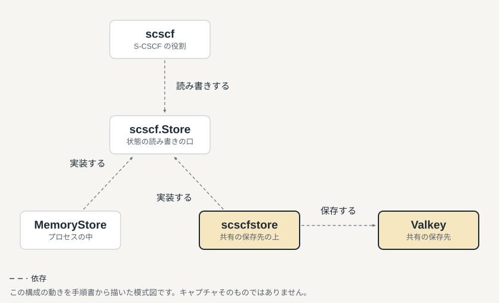

# 複数台と障害で引き継ぐもの

状態を共有の保存先に置くと、別の台が同じ記録を読めるようになります。それだけでは、処理を引き継いだことにはなりません。処理を引き継ぐには、記録のほかに、次の要求がどの台に届くか、進行中のトランザクションとタイマーをどうするか、止まった台があとから書き戻さないか、が決まっている必要があります。データを共有することと、処理を引き継ぐことは、別の条件です。

この章では、次の 4 つの場合を分けて考えます。

1. 登録を共有する。
2. 新しい要求を、別の台が受ける。
3. 処理中の呼を、別の台が続ける。
4. 止まったプロセスが残したものを、終わらせる。

この実装の答えを先に書きます。登録と、時刻の来た期限と、新しい要求は、保存先を共有するどの台でも引き継げます。MMTel AS の通話中の呼は、INVITE を受けた台のプロセスの中にあり、その台が止まると続きません。保存先にある呼の記録は、Replaces が指すダイアログから呼のもう一方の脚を探すためだけに使います。止まったプロセスの呼を、同じ名前で作り直した台が自分から終わらせるのは、この章で見る役割のうちでは IBCF だけです。保存先は 1 台で、それが止まると、どの台も状態を読み書きできません。この実装は、障害のあいだも呼を保つとは言えません。

この章は [登録の順序と期限](design-registration-order.md)、[iFC と MMTel AS の付加サービス](mmtel.md)、網間接続 を前提にします。必要なところは、この章の中で言い直します。

## この章で扱う構成

`deploy/redundancy/redundancy.yaml` は、Compose の構成に Valkey のサーバーを 1 つ足し、利用者の状態を持つノードの設定に、その保存先を指す `store` の節を加えます。状態を持つのは、HSS、S-CSCF、P-CSCF、IP-SM-GW、SMS のサービスセンタ、MMTel AS、MRFC と、2 つのメディア中継ノードです。I-CSCF は利用者の状態を持たないので、変わりません。ノードのアドレス、設定、やり取りするメッセージは、Compose の構成と同じです。変わるのは、各ノードが知ったことを置く場所だけです。



役割のコードは、状態を `Store` というインタフェースを通してだけ読み書きします。`store` の節が無ければ、その実装はプロセスの中の `MemoryStore` です。節があれば、`internal/kvstore` の上の役割ごとの実装（S-CSCF なら `scscfstore`）が、同じインタフェースを Valkey の上に作ります。

Compose の構成は、どちらの場合も役割ごとに 1 台を動かします。保存先を使う構成で同じ名前のノードを作り直すと、新しいプロセスは前のプロセスが残した状態を保存先で見つけます。1 つの役割の複数の台が 1 つの保存先を分け合う動きは、Go の試験が 2 つの台を 1 つの保存先の上で動かして確かめています。この章の試験の結果は、その試験のものです。

## 4 つの場合で要るもの

| 場合 | 例 | 記録のほかに要るもの | この実装 |
| --- | --- | --- | --- |
| 登録を共有する | 別の台が、着信の宛先を登録から引く。別の台が、登録の期限を処理する | 期限を 1 台だけが処理する仕組み。利用者ごとのロック | できる |
| 新しい要求を別の台が受ける | 1 台目が 401 を返し、答えの REGISTER は 2 台目に届く | 次の要求を受ける台を見つける経路。HSS が覚えている S-CSCF の名前 | できる |
| 処理中の呼を続ける | 通話中の呼の BYE や re-INVITE が、止まった台の代わりの台に届く | ダイアログ、進行中のトランザクション、タイマー、両方の脚の CSeq、脚と脚の中継 | MMTel AS は続けない |
| 止まったプロセスが残したものを終わらせる | 止まったプロセスの呼のダイアログと、TrGW のコンテキスト | 台ごとの記録。起動したときにそれを読むこと。BYE を送れるだけの中身 | IBCF は終わらせる。MMTel AS は記録を残したまま |

上の 2 つは記録を読めれば済むことが多く、下の 2 つは記録だけでは足りません。以下、この順に見ます。

## 状態の置き場所と寿命

S-CSCF が保存先に置くものは、次のキーです。どれも構成の接頭辞と `scscf:` のあとに続きます。

[internal/kvstore/scscfstore/scscfstore.go](../../../internal/kvstore/scscfstore/scscfstore.go)

```go
//	challenge:<private identity>            Challenge, time to live until its KeepUntil
//	registration:<private identity>         Registration, no time to live
//	impu:<public identity>                  index: the private identity of the registration
//	subscription:<Call-ID>:<tags>           Subscription, no time to live
//	subscriptions-of:<private identity>     index: the subscriptions to that registration
//	original-dialog:<identifier>            OriginalDialog, time to live until its Expires
//	unregistered:<private identity>         UnregisteredProfile, no time to live
//	unregistered-impu:<public identity>     index: the private identity of the profile
```

この章に出てくる状態を、置き場所と寿命で並べると次のようになります。

| 状態 | 置き場所 | 寿命 | 終わらせるもの |
| --- | --- | --- | --- |
| S-CSCF の登録 | 保存先の `registration:` | 登録の `Expires` まで。生存時間は付けない | 期限を借りた台の `registrationExpired` |
| S-CSCF の認証の途中の記録 | 保存先の `challenge:` | `KeepUntil` までの生存時間 | 答えの REGISTER か、期限を借りた台の `regAwaitAuthExpired` |
| S-CSCF の元のダイアログの識別子 | 保存先の `original-dialog:` | 4 分の生存時間 | 保存先 |
| 期限の時刻と、それを借りた印 | 保存先の時刻の索引 | 借りは 15 秒 | 処理した台の `Done`。止まった台の借りは切れる |
| 利用者ごとのロック | 保存先の `scscf:lock:` | 15 秒のリース | 持ち主が放すか、リースが切れる |
| SIP のトランザクション | 台のプロセス | 最後の応答のあと、再送を受け止めるタイマーが切れるまで | プロセス |
| MMTel AS の呼のダイアログ、トランザクション、無応答のタイマー | INVITE を受けた台のプロセス | 呼が終わるまで | プロセス |
| MMTel AS の呼の記録 | 保存先の `mmtel:call:` | 2xx から呼の終わりまで。生存時間は無い | 呼を終えた台。止まった台の記録は残る |
| IBCF の呼の記録 | 保存先の、台の名前の下 | 呼の始まりから終わりまで | 呼を終えた台か、同じ名前で作り直した台 |

S-CSCF の登録に生存時間が無いのは、その終わりに SAR と NOTIFY が要るからです。生存時間で消えると、誰も HSS と購読者に知らせません。期限を借りた台が登録を読み、消し、知らせます。認証の途中の記録は、時間切れの処理を期限の索引で行い、記録そのものには `KeepUntil` までの生存時間を付けます。処理が遅れても記録が見つかり、誰も処理しなくても最後には消えるようにするためです。元のダイアログの識別子は、消えるだけでよいので、生存時間だけを付けます。

## 登録を共有すると、別の台が続けられること

### 別の台が答えを受ける

`internal/scscf/instances_test.go` の `TestAnotherInstanceNamesTheAssignedSCSCF` は、S-CSCF の 2 つの台を動かします。2 つの台は保存先と利用者ごとのロックを共有し、Server-Name、Diameter の名前、SIP のスタックは台ごとに違います。「challenge answered at the other instance」の場合では、1 台目が最初の REGISTER に 401 を返し、答えの REGISTER は 2 台目に届きます。結果は 200 OK で、HSS がその利用者について持つ S-CSCF の名前は 1 台目のものです。

2 台目が続けられるのは、認証の記録に、続きに要るものがすべて入っているからです。nonce と H(A1)、401 を受けた REGISTER の Call-ID、MAA を返した HSS の名前、それに MAR で使った Server-Name です。HSS は、利用者を割り当てた名前以外の SAR を受け付けません（TS 29.228 8.1.2）。そのため 2 台目は、自分の名前ではなく、記録にある名前で SAR を送ります。

### 期限を別の台が処理する

期限の時刻は、項目と一緒に保存先の時刻の索引に置きます。各台は 1 秒ごとに、時刻の来たものを借ります。

[internal/scscf/store.go](../../../internal/scscf/store.go)

```go
	// ClaimDue claims the expiries of kind that are due at now, at most
	// limit of them and the ones due longest first, each until now plus
	// lease. While an expiry is claimed it is not due, and no other
	// ClaimDue gives it out; when its claim runs out without Done, it is
	// due again, for whichever instance asks next.
	//
	// A claim is no proof that the item has expired: it may have been
	// refreshed after it was due, or removed, since the Store does not
	// take the item of a removed registration or profile out of the index
	// (DeleteRegistration). The caller therefore reads the item under the
	// lock of its user and checks its expiry there, as the handlers of
	// the S-CSCF do.
	ClaimDue(ctx context.Context, kind ExpiryKind, now time.Time, lease time.Duration, limit int) ([]Expiry, error)
	// Done takes the item of a claimed expiry out of its index, once the
	// caller has handled it. A claim that has ended in the meantime, by a
	// write that rescheduled the item, by its removal, or because it ran
	// out and another instance has it now, leaves the index as it is;
	// that is the ordinary end of an expiry, not a failure.
	Done(ctx context.Context, e Expiry) error
```

借りている期限は、ほかの台には渡りません。借りた台が `Done` を呼ばずに止まると、借りが切れたあとで、ほかの台が借り直します。借りたことは、期限が本当に来たことの証明ではありません。借りてからロックを取るまでに、UE が登録を更新しているかもしれないからです。そのため、処理する台は利用者のロックを取り、項目を読み直し、時刻をもう一度確かめます（[登録の順序と期限](design-registration-order.md)）。

`internal/kvstore/scscfstore` の試験が、この動きを確かめています。

- `TestTwoInstancesHandleARegistrationExpiryOnce`。2 つの台が同じ保存先を見回っても、期限の切れた登録について HSS に届く TIMEOUT_DEREGISTRATION の SAR は 1 つ、購読者に届く NOTIFY も 1 つです。
- `TestAnotherInstanceTakesOverAnExpiryThatWasNotHandled`。期限を借りた台が、処理せずに止まります。もう 1 つの台は、借りが切れるまでは処理せず、切れたあとで処理します。
- `TestAnExpiryWhoseClaimRunsOutWhileItIsHandled`。HSS が SAR に答えないので、1 台目が処理しているあいだに借りが切れ、2 台目が同じ期限を借ります。2 台目は登録を見つけません。1 台目がすでに消しているからです。SAR と NOTIFY は 1 つずつです。

この順には限界があります。期限を処理する台は、登録を消してから NOTIFY と SAR を送ります。消したあとで台が止まると、どちらも送られず、借り直した台は何も見つけません。購読者は期限切れを知らず、HSS は次の SAR まで利用者を登録済みとして扱います。逆の順にすると、消すのに失敗するたびや、消す前に止まるたびに、NOTIFY と SAR をもう一度送ることになります。この実装は、二度送るより、送らないほうを選んでいます。手順書の [このプロジェクトで簡略化していること](../../guide/ja/registration.md#このプロジェクトで簡略化していること) の表にも、この点があります。

## 次の要求が届く台を見つける

### SIP の要求

SIP のノードは、次のホップを DNS で探します（RFC 3263）。SRV のレコードは、1 つの名前に複数の台を並べられます。この実装のスタックは、DNS が返した宛先を順に試します。503 が返ったとき、トランスポートの誤りのとき、タイマー B か F までに応答が何も無いときは、Via の branch を変えた新しいトランザクションで、次の宛先へ送ります（RFC 3263 4.3）。`internal/sip` の `TestRequestGoesToTheNextTargetWhenTheFirstIsSilent` と `TestRequestGoesToTheNextTargetAfterA503` が、この 2 つの場合を確かめています。

これが当てはまるのは、ダイアログの外の新しい要求です。ダイアログの中の要求は、ダイアログを作ったときの Record-Route と Contact が指す先へ届きます。S-CSCF は、ダイアログの状態を持たないプロキシです。ダイアログの中の要求は、決まった経路に従って転送するだけなので（RFC 3261 16.12）、その名前で届くどの S-CSCF のプロセスでも転送できます。MMTel AS は違います。次の節で見ます。

### Diameter の要求

HSS への要求は、設定に並べた HSS の台の組（`diameter.PeerGroup`）を通ります。HSS の台はサーバーファームとして 1 つの HSS に見え（TS 29.228 6.4）、どの台も全加入者を扱えます。そのため、宛先を決めていない要求は、接続の開いている台のうち設定で先にあるものへ送ります。答えが無い、接続が閉じた、DIAMETER_TOO_BUSY が返った、のどれかなら、次の台へ同じ要求を送り直します（RFC 6733 5.5.4）。宛先を決めた要求は違います。

[internal/diameter/peergroup.go](../../../internal/diameter/peergroup.go)

```go
// serving are the peers of the group that may take a request for host:
// the one peer of that host when the request names one, and all of
// them when it does not. A Diameter identity is an FQDN, which compares
// without case.
//
// SIMPLIFIED: RFC 6733 5.5.4 and TS 29.228 Table 6.1.2.1. Each instance
// of the HSS names itself, so the S-CSCF addresses the requests of a
// registration it has started to the instance that answered its MAR,
// and those requests cannot go to another instance: when that one
// stops, they fail and the user registers again. A commercial network
// keeps them going by letting the instances share one Diameter identity
// behind a load balancer, or by putting an agent in front of them that
// routes on the realm. Neither is built here: the load balancer is
// another node to run and hides which instance answered, and the agent
// is the DRA that the design of the redundancy leaves out.
func (g *PeerGroup) serving(host string) []*Peer {
	if host == "" {
		return g.peers
	}
	for _, p := range g.peers {
		if strings.EqualFold(p.host, host) {
			return []*Peer{p}
		}
	}
	return nil
}
```

S-CSCF は、MAA を返した HSS の台の名前を覚え、その利用者の SAR の Destination-Host に入れます（TS 29.229 5.5）。Destination-Host のある要求は、その台にだけ届きます。そのため、始まった登録は、MAR に答えた HSS の台に結び付きます。その台が止まると、その登録の SAR は失敗します。REGISTER の処理なら、S-CSCF は 500 を返し、利用者は登録し直します。新しい問いのための MAR には Destination-Host が無いので、動いている台が答えます。`internal/diameter` の `TestPeerGroupFailsOverWhenThePeerDoesNotAnswer` は答えない台から次の台へ移ることを、`TestPeerGroupKeepsToTheDestinationHost` は宛先を決めた要求がほかの台へ移らないことを確かめています。

## 通話中の呼は、受けた台のプロセスにある

MMTel AS は、呼ごとに 2 つのダイアログを持つ B2BUA です（TS 24.229 5.7.5）。S-CSCF から受けた INVITE の脚と、自分が S-CSCF へ送る INVITE の脚です。この 2 つのダイアログ、進行中のトランザクション、CFNR の無応答のタイマーは、INVITE を受けた台のプロセスの中にあります。

[internal/mmtel/mmtel.go](../../../internal/mmtel/mmtel.go)

```go
// uri is the SIP URI of this instance, which both legs of every call
// have as their Contact.
//
// The live handling of a call stays in the instance that took its
// INVITE: the Contact names that instance, and the dialogs, the
// transactions and the no reply timer live in its process. The Store
// keeps the call record outside it, which any instance reads to find
// the other leg of a dialog that a Replaces names (otherSide).
//
// SIMPLIFIED: RFC 3261 12.2.2. A UAS that has restarted may accept a
// request for a dialog it does not know, and carry the dialog on from
// state it kept. An instance of the AS that is created again under the
// same name does not: it builds no dialog from the call records, so
// each request within a call of the earlier process gets 481
// (Call/Transaction Does Not Exist), and the parties are left to end
// the call. A node that is told to stop closes the UA, which ends its
// calls without a BYE, and the goroutine of each call then removes the
// record of the call, but the node does not wait for those goroutines
// (sip.UA.Close leaves them to the user). The record of a call whose
// instance is killed, or whose process exits before that goroutine has
// removed it, stays in the Store with no time to live, as that of a
// call whose BYE no instance sees. Carrying a call on needs the UA to
// take a dialog that it did not set up, with CSeq numbers above any
// that the earlier process sent, and the relaying of each leg's
// requests set up again around it.
func (as *AS) uri() string { return "sip:" + as.cfg.Host + ":" + strconv.Itoa(as.cfg.Port) }
```

両方の脚の Contact は、この台の名前です。そのため、呼の中の要求（re-INVITE、BYE など）は、DNS がこの名前で指す台、つまり INVITE を受けた台に戻ってきます。B2BUA は、片方の脚の re-INVITE を、もう片方の脚の re-INVITE にして送り、その答えを元の脚に返します。2 つのトランザクションが同じプロセスの中に要ります。

保存先の呼の記録 `CallRecord` は、2 つのダイアログ、サービスを受けた利用者、session case、働いたサービスを持ちます。AS は、着信者が応答したあとと、呼の中の要求のたびに、これを書き直します。読むのは 1 か所だけです。

[internal/mmtel/conference.go](../../../internal/mmtel/conference.go)

```go
// otherSide is the Replaces that names, for the next hop, the other leg
// of the call of this AS that r names (TS 24.229 5.7.5.1), and false
// when r names no leg of a call here. The error is the failure of the
// store.
func otherSide(ctx context.Context, store Store, r sip.Replaces) (sip.Replaces, bool, error) {
	record, ok, err := store.CallOf(ctx, r.DialogID())
	if err != nil || !ok {
		return sip.Replaces{}, false, err
	}
	other := record.Outgoing
	if record.Outgoing.ID == r.DialogID() {
		other = record.Incoming
	}
	// The UA at the other end of that leg compares to-tag with its own
	// tag, which is the remote tag here (RFC 3891 3).
	return sip.Replaces{CallID: other.ID.CallID, ToTag: other.ID.RemoteTag, FromTag: other.ID.LocalTag, EarlyOnly: r.EarlyOnly}, true, nil
}
```

入力は、届いた INVITE の Replaces です。`CallOf` が、Replaces の指すダイアログを持つ呼の記録を探します。見つかれば、もう一方の脚を指す Replaces を作ります。次のホップが知っているのは、そちらのダイアログだからです（TS 24.229 5.7.5.1）。記録は保存先にあるので、保存先を共有する台なら、別の台の呼についてもこの変換ができます。`internal/mmtel/focusrelay_test.go` の `TestFocusInviteWithReplacesThroughTheAS` は、会議のフォーカスが送った Replaces 付きの INVITE を AS が受け、相手が自分の呼を見つけられるように、Replaces をもう一方の脚に書き換えることを確かめます。この試験の AS は 1 台です。

### 作り直した台は、前のプロセスの呼を続けない

同じ名前で作り直した台の UA は、前のプロセスのダイアログを知りません。呼の中の要求には、481（Call/Transaction Does Not Exist）を返します。`internal/sip/ua_test.go` の `TestRequestForAnUnknownDialogGets481` が、知らないダイアログの BYE に UA が 481 を返し、ほかの呼を終わらせないことを確かめています。481 を受けた当事者は、そのダイアログを終えることになっています（RFC 3261 12.2.1.2）。AS はその BYE を先へ送らないので、もう一方の当事者には届きません。

RFC 3261 12.2.2 は、作り直した UAS が、知らないダイアログの要求を受け付けて、続けることも認めています。そのときは、作り直す前より大きい CSeq を選ぶこと、経路を組み立て直すことなどを考える必要があります。続けることも 481 で断ることも、標準の中の選択です。この実装は 481 を選んでいます。続けるには、次のものが要ります。

- 自分で作っていないダイアログを、記録から受け持つこと。相手の Contact、経路、両方向の CSeq が要ります。記録はダイアログを書き直しているので、Contact と CSeq は持っています（`internal/mmtel/relay_test.go` の `TestRecordFollowsTheDialogs`）。
- 前のプロセスが送ったどの CSeq よりも大きい番号で送ること。記録を書いたあとにも、前のプロセスが要求を送っていたかもしれません。
- 2 つの脚のあいだの中継を、組み立て直すこと。
- 止まったときに進んでいたトランザクションとタイマーをどうするか、決めること。これは記録にありません。

### 保存先が止まっても、呼は続く

逆の向きの結果もあります。保存先に書けなくても、呼は続きます。`internal/mmtel/storefailure_test.go` の `TestACallThatCannotBeStored` は、保存先が止まった状態で呼を始めます。着信者が応答したあとの記録の書き込みは失敗しますが、発信者は 200 を受け、発信者の BYE は着信者に届きます。呼はプロセスの中にあるからです。一方、保存先を読めないと、Replaces の変換はできません。`TestAnINVITEWhoseReplacesCannotBeRead` では、Replaces 付きの INVITE が 500 を受け、先へ進みません。Replaces の指すダイアログが自分の呼の脚かどうか、分からないからです。

## 止まったプロセスが残したものを終わらせる

IBCF は、止まったプロセスの呼を、作り直した台が終わらせる役割です。TS 24.229 5.10.2.2 の手順 2 と 5.10.3.2 の手順 2 は、伝送の面を制御する IBCF に、呼の Contact、CSeq、Record-Route を覚えておくよう求めています。IBCF が自分でセッションを解放できるようにするためです（5.10.2.4、5.10.3.4）。

IBCF の各台は、自分の呼の記録を、自分の名前の下に置きます。記録には、TrGW のコンテキストと、応答のあとは 2 つのダイアログが入り、呼の中の要求のたびに書き直します。同じ名前で起動し直した台は、UA を動かす前に自分の記録を読み、`ReleaseLeftovers` に渡します。

[internal/ibcf/recovery.go](../../../internal/ibcf/recovery.go)

```go
func (b *IBCF) ReleaseLeftovers(records []CallRecord) {
	var wg sync.WaitGroup
	for _, r := range records {
		log := b.log.With("call_record", r.ID, "peer", r.Peer, "direction", string(r.Direction))
		log.Info("ending a call that an earlier process of this instance left")
		if r.Media != nil {
			b.releaseMedia(*r.Media, log)
		}
		for _, d := range []struct {
			s      side
			dialog *sip.Dialog
		}{{b.inside(), r.Home}, {b.outside(), r.PeerSide}} {
			if d.dialog == nil {
				continue
			}
			wg.Add(1)
			go func(s side, dialog sip.Dialog) {
				defer wg.Done()
				b.byeInLeftover(s, dialog)
			}(d.s, *d.dialog)
		}
		if err := b.store.DeleteCall(context.Background(), r.Instance, r.ID); err != nil {
			// The record stays for the next process of the instance,
			// whose BYEs get 481 and whose release finds no context.
			log.Warn("cannot remove the record of the ended call", "error", err.Error())
		}
	}
	wg.Wait()
}
```

記録ごとに、TrGW のコンテキストを解放し、網の内側と外側の 2 つのダイアログのそれぞれで BYE を送り、記録を消します。BYE を送る `byeInLeftover` は、CSeq を記録の値より 65536（`staleSeqGap`）大きくします。記録を書いたあとにも、要求が進んでいたかもしれないからです。相手は、最後に見た番号より大きい CSeq の要求を受け付けます（RFC 3261 12.2.2）。応答の前に止まった呼の記録にはダイアログが無いので、TrGW のコンテキストだけを解放します。その呼の INVITE は、新しいプロセスから最終応答を受けず、時間切れになります。

`internal/ibcf/network_test.go` の `TestRestartedInstanceEndsTheCallsItLeft` が、これを確かめています。台の最初のプロセスが境界を越える呼を持ったまま止まり、次のプロセスが起動します。結果として、発信者も着信者も、自分のダイアログで BYE を 1 つずつ受けます。両方の網の TrGW のコンテキストは解放され、記録は残りません。新しいプロセスは、新しい呼も受けます。試験は 2 通りに動きます。何代かのプロセスが 1 つの `Store` を共有する形と、共有の保存先の上でプロセスごとに `ibcfstore.Store` を作る形です。

この仕組みには条件があります。

- 台の名前が、作り直しても変わらないこと。各台は自分の名前の記録だけを、起動したときに 1 回読みます。網の全部の呼を探すことはしません。作り直されない台の記録とその TrGW のコンテキストは、同じ名前の台が起動するまで残ります。コードはこれを簡略化として書いています。
- 記録を読めること。読めなければ、IBCF は起動しません。記録を持たずに呼を受けた台は、前のプロセスの呼をいつまでも終わらせないからです。
- 記録に BYE を送れるだけの中身があること。それは、標準が IBCF に覚えておくよう求めている中身です。

MMTel AS は、作り直した台が前のプロセスの呼を、続けることも終わらせることもしません。強制的に止められた台の呼の記録は、生存時間の無いまま保存先に残ります。

## 保存先そのものが止まったとき

`deploy/redundancy` の保存先は、Valkey のサーバー 1 台です。Sentinel やクラスタのような、保存先の冗長の仕組みはありません。保存先は単一障害点で、この構成が見せるのは IMS のノードの冗長であって、保存先の冗長ではありません（[internal/kvstore の README](../../../internal/kvstore/README.ja.md) の簡略化の表）。サーバーは書き込みを追記のファイルに 1 秒ごとに同期します（AOF）。

保存先の操作には、1 回ごとに時間の上限があります（既定は 1 秒）。上限のあいだに状態を得られない役割は、SIP では 500、Diameter では DIAMETER_UNABLE_TO_COMPLY で答えます。失敗を「項目が無い」と取り違えないためです。

| 役割 | 保存先が止まっているあいだ | 確かめている試験 |
| --- | --- | --- |
| S-CSCF | 状態を要る要求に 500 を返す。ロックを取れない REGISTER も 500 | `TestRegisterWhenTheLockFails`、`TestInitialRequestsWhenTheStoreFails` |
| S-CSCF | 登録を書けない更新は 500。保存してあった登録はそのまま残り、保存先が戻ったあとの着信はその Contact に届く | `TestRefreshWhenTheStoreFails` |
| S-CSCF | 期限の処理は項目を読めずに諦め、借りが切れたあとで借り直す。保存先が戻ると処理する | `TestAnExpiryIsClaimedAgainWhenTheStoreFails` |
| MMTel AS | 通話中の呼は続く。Replaces 付きの INVITE は 500 | `TestACallThatCannotBeStored`、`TestAnINVITEWhoseReplacesCannotBeRead` |
| IBCF | 作り直した台は、記録を読めなければ起動しない。保存先が戻ってから起動した台が、前のプロセスの呼を終わらせる | `TestAnInstanceThatCannotReadItsCallsDoesNotStart` |

`TestInitialRequestsWhenTheStoreFails` では、着信の INVITE も発信の INVITE も 500 を受けます。発信者を未登録の利用者（403）と、着信者をプロファイルを HSS から取るべき利用者と、取り違えないためです。`TestRefreshWhenTheStoreFails` の場合、S-CSCF は書く前に RE_REGISTRATION の SAR を送っています。HSS は利用者をこの S-CSCF で登録済みとして持ち、保存先には前の登録が残るので、両者は食い違いません。UE が更新を送り直せば、そこから続きます。

ここで、状態を外に置くことの代わりに失うものが見えます。プロセスの中に状態を置けば、1 つの台が止まっても、ほかの台の利用者には何も起きません。保存先を共有すると、台が止まっても利用者の状態は残りますが、保存先が止まると、それを使うすべての台の、すべての利用者が同時に影響を受けます。単一障害点が、プロセスから保存先へ移ります。

## 方法を比べる

台が止まったときに何を残すかには、いくつかの方法があります。どれも標準が禁じるものではなく、組み合わせることもできます。

| 方法 | 台が止まったときに残るもの | 要るもの | 失うもの | 合う条件 |
| --- | --- | --- | --- | --- |
| 状態をプロセスの中に置く | 何も残らない | 追加のものは無い。保存先への往復も無い | その台の利用者の登録、認証の途中、期限、呼。利用者は登録し直すまで着信を受けられない | 台が 1 つで、止まったときの登録し直しを受け入れる構成 |
| 状態を外の保存先に置く（この実装の冗長の構成） | 登録、認証の途中、期限、元のダイアログの識別子、呼の記録 | 要求ごとの保存先への往復。利用者ごとのロック。途中で止まっても見つからないだけになる書き込みの順。保存先そのものの冗長（ここでは作っていない） | B2BUA の通話中の呼、進行中のトランザクション、プロセスのタイマー。保存先が止まると全員が影響を受ける | どの台にも同じ利用者の要求が届きうる構成 |
| 利用者や呼を 1 つの台に固定する | 固定した台が止まれば、その台の分は何も残らない（保存先と組み合わせなければ） | 利用者や呼のすべての要求と期限が、その台に届く経路。台が止まったときに移す手順 | 固定した台の利用者や呼 | 網がすでに固定している場合。IMS は HSS が利用者ごとに S-CSCF の名前を持ち、MMTel AS の呼は Contact で台に結び付いている |
| 登録し直しで作り直す | 何も残さず、UE がもう一度登録したときに作り直す | UE が登録の失敗や網からの知らせを受けて、登録し直すこと | 登録し直すまでの着信。長ければ、登録の更新の間隔のあいだ | 台の障害がまれで、そのあいだの着信の取りこぼしを受け入れる構成 |

この実装は、2 つ目を選び、呼については 3 つ目に当たる形（呼を受けた台に結び付ける）を取っています。HSS の台に結び付いた登録の要求は、その台が止まると 4 つ目の形で戻ります。網が失った利用者を戻す復旧の手順は TS 23.380 にありますが、この実装はそれを作っていません。

## この実装の判断と限界

- 保存先を共有する台は、登録、認証の途中、期限、新しい要求を引き継ぎます。期限は 1 台だけが処理し、処理する台は時刻を確かめ直します。
- 期限を処理する台は登録を消してから知らせるので、消したあとで止まると、知らせは出ません。
- 利用者ごとのロックはリースの中でだけ効き、フェンシングはありません（[登録の順序と期限](design-registration-order.md)）。
- 始まった登録は、MAR に答えた HSS の台に結び付きます。その台が止まると、利用者は登録し直します。
- MMTel AS の通話中の呼は、INVITE を受けた台のプロセスにあり、その台が止まると続きません。作り直した台は 481 を返し、記録は残ります。保存先の記録は Replaces の変換にだけ使います。
- IBCF は、同じ名前で作り直した台が、前のプロセスの呼を BYE で終わらせ、TrGW のコンテキストを解放します。
- 保存先は 1 台で、止まると、それを使うすべての役割が要求に 500 を返します。

障害のあいだも呼が保たれることを、この実装と試験は示していません。示しているのは、上に挙げた範囲です。

## この説明の根拠

この章の説明は、次のコードと試験に照らして確かめたものです。試験は、どれもこのリポジトリの Go の試験として通ることを確かめています。`internal/kvstore` の試験は、プロセスの中の保存先で動かしています。Valkey のサーバーでの実行は、環境変数 `KVSTORE_VALKEY_ADDR` があるときだけ行われ、この章を書くときには行っていません。

- `internal/scscf/instances_test.go` の `TestAnotherInstanceNamesTheAssignedSCSCF`。別の台が問いへの答えを受けて登録すること、HSS が最初に割り当てた名前のままであること。
- `internal/kvstore/scscfstore/instances_test.go` の `TestTwoInstancesHandleARegistrationExpiryOnce`、`TestAnotherInstanceTakesOverAnExpiryThatWasNotHandled`、`TestAnExpiryWhoseClaimRunsOutWhileItIsHandled`。期限を 1 台だけが処理し、止まった台の期限を別の台が引き継ぐこと。
- `internal/sip/nexttarget_test.go` の `TestRequestGoesToTheNextTargetWhenTheFirstIsSilent` と `TestRequestGoesToTheNextTargetAfterA503`。
- `internal/diameter/peergroup_test.go` の `TestPeerGroupFailsOverWhenThePeerDoesNotAnswer` と `TestPeerGroupKeepsToTheDestinationHost`。
- `internal/mmtel` の `TestFocusInviteWithReplacesThroughTheAS`、`TestRecordFollowsTheDialogs`、`TestACallThatCannotBeStored`、`TestAnINVITEWhoseReplacesCannotBeRead`。
- `internal/sip/ua_test.go` の `TestRequestForAnUnknownDialogGets481`。
- `internal/ibcf/network_test.go` の `TestRestartedInstanceEndsTheCallsItLeft` と、`internal/ibcf/storefailure_test.go` の `TestAnInstanceThatCannotReadItsCallsDoesNotStart`。
- `internal/scscf/storefailure_test.go` の `TestRegisterWhenTheLockFails`、`TestInitialRequestsWhenTheStoreFails`、`TestRefreshWhenTheStoreFails`、`TestAnExpiryIsClaimedAgainWhenTheStoreFails`。

作り直した MMTel AS の台が 481 を返すことは、AS が知らないダイアログの要求を役割に渡さない設定（`sip.UAConfig` の `OnUnknownDialog` を使わないこと）と、UA の試験から読み取ったものです。AS を作り直す試験はありません。図は、この構成の動きを描いた模式図で、キャプチャではありません。

## 自分で動かす場合

この章を読むのに、構成を動かす必要はありません。状態を保存先に置く構成の起動と、保存先のキーの見方は、手順書の [利用者の状態をノードの外の保存先に置く](../../guide/ja/README.md#利用者の状態をノードの外の保存先に置く) にあります。SIP の宛先を順に試す動きは [P-CSCF が I-CSCF を探して REGISTER を転送する](../../guide/ja/registration.md#2-p-cscf-が-i-cscf-を探して-register-を転送する) に、IBCF の台を作り直したときに見えるものは [IBCF の台が起動し直したとき](../../guide/ja/interconnect.md#ibcf-の台が起動し直したとき) にあります。試験は、たとえば `go test ./internal/kvstore/scscfstore -run TestAnotherInstanceTakesOverAnExpiryThatWasNotHandled` で動かせます。

次の章では、アプリケーションサーバーが答えないときに、S-CSCF が何を優先するかを見ます。アプリケーションサーバーが使えないとき
