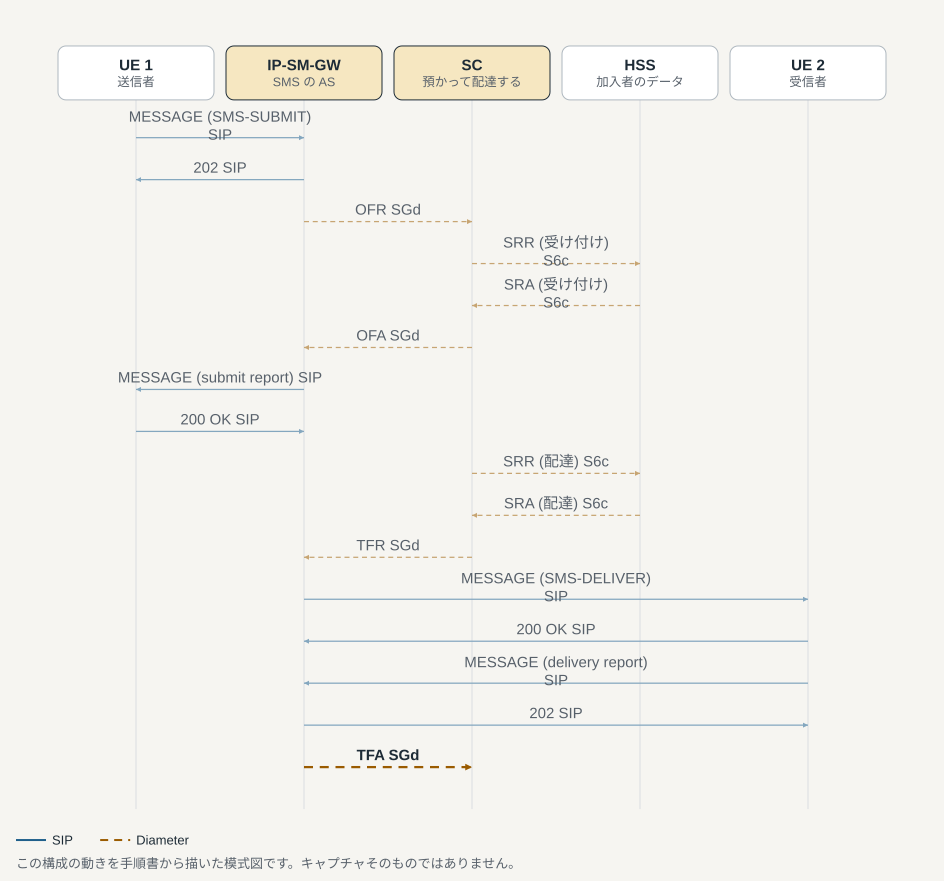

# SMS の再送と重複

ショートメッセージが網を通るあいだに、4 つのことが別々に起きます。SC がショートメッセージを受け付けること、その答えが送信者に戻ること、受信者に配達すること、その報告が SC に戻ることです。この 4 つは、別のノードのあいだで、別の時に起きます。答えか報告だけが失われると、送り手は、相手が処理を済ませたのかどうかを知らないまま、送り直します。その送り直しを新しい要求として扱えば、同じショートメッセージが 2 度預けられ、2 度配達されます。

この実装が同じ処理を重ねないようにしている仕組みは、3 つあります。1 つ目は、IP-SM-GW が答えの来なかった OFR を、SC の別の台へ送り直したときです。SC は Origin-Host と End-to-End Identifier の組で送り直しを見分け、最初の台が保存先に残した答えを返します。2 つ目は、SC の複数の台が同じ受信者に配達しようとするときです。受信者ごとのリースが、1 度に 1 台だけに配達させます。3 つ目は、IP-SM-GW が 1 つの配達を 1 度だけ終わらせることです。delivery report と、報告を待つ時間の終わりのどちらが先に来ても、SC が結果を聞くのは 1 度です。

どれも、条件の付いた保証です。答えの来なかった TFR の次の試み、TP-RD を立てた SMS-SUBMIT の繰り返し、IP-SM-GW が待つ時間のあとに届いた delivery report などでは、受信者に同じショートメッセージが 2 度届くことがあります。この実装は「どんな故障でも 1 度だけ届く」とは言えません。この章は、1 度だけになる条件と、そうならない場合を、1 つずつ示します。

この章は、[SMS の配達と報告](sms.md) と [複数台と障害で引き継ぐもの](design-shared-state.md) を前提にします。

## この章で扱う構成

例は `deploy/compose` の構成で、UE 1 が UE 2 にショートメッセージを送ります。ノードは UE 1、IP-SM-GW、SC、HSS、UE 2 で、CSCF は省きます。`deploy/compose` の SC は 1 台で、預かったものをプロセスの中に置きます。`deploy/redundancy` の構成は、それをノードの外の保存先に置きます。複数台の動きは、2 つの SC の台に 1 つの保存先を共有させる試験で確かめています。

引く仕様の版は TS 23.040 V18.0.0 と RFC 6733 です。

## 4 つの出来事



図の上から、4 つの出来事を順に分けます。

| 出来事 | どこで起きるか | 送り手に伝えるもの |
| --- | --- | --- |
| 受け付け | SC が OFR を読み、受信者の番号を HSS に確かめて、待ち行列に入れる | 次の行の答え |
| 受け付けの答え | SC が OFA を返し、IP-SM-GW がそれを submit report の RP-ACK にして UE 1 へ送る | IP-SM-GW には OFA、UE 1 には RP-ACK |
| 配達 | SC が TFR を送り、IP-SM-GW が SMS-DELIVER を RP-DATA に入れて UE 2 へ送る | 次の行の報告 |
| 配達の報告 | UE 2 が delivery report の RP-ACK を返し、IP-SM-GW がそれを TFA にして SC へ返す。SC は待ち行列から外す | IP-SM-GW には RP-ACK、SC には TFA |

SIP の 202 と 200 は、この表に入りません。MESSAGE が 1 つ先のノードに届いたことを伝えるだけで、ショートメッセージがどうなったかは伝えないからです。受け付けたことは submit report が、届いたことは delivery report が、それぞれ別の MESSAGE で伝えます。

この表で大切なのは、処理と答えが分かれていることです。受け付けは OFA より前に済み、配達は TFA より前に済みます。そのため、答えだけが失われる隙間が、それぞれにあります。

## 済んだのに答えだけが失われる場合

答えが失われたとき、送り手は失敗と区別できません。この構成で起きうるのは次の 5 つです。

1. **OFA が失われる。** SC の台がショートメッセージを待ち行列に入れたあと、IP-SM-GW との接続が切れます。IP-SM-GW の Diameter の層は、答えの来なかった OFR を、SC の別の台に送り直します。送り直した OFR には T フラグが立ち、End-to-End Identifier は最初と同じです（RFC 6733 5.5.4）。
2. **submit report が失われる。** OFA は届いたのに、RP-ACK の MESSAGE が UE 1 に届きません。端末は、答えが無ければ、同じ TP-MR で TP-RD を立てて SMS-SUBMIT を繰り返します（TS 23.040 9.2.3.6）。これは新しい MESSAGE で、新しい OFR です。
3. **TFA が失われる。** IP-SM-GW は UE 2 に配達し、delivery report も受けたのに、TFA が SC に届きません。SC は、時間が経てば直るかもしれない失敗と読み、あとで試し直します。
4. **delivery report が遅れる。** UE 2 はショートメッセージを受け取ったのに、delivery report が IP-SM-GW の待つ時間（この実装では 64 秒）のあとに届きます。IP-SM-GW はもう SC に失敗を返しています。
5. **SC の台が試みの途中で止まる。** TFR を送ったあと、TFA を待つあいだに台が止まります。IP-SM-GW はもう配達しているかもしれません。

1 の送り直しは、Diameter の同じ要求のコピーです。2 から 5 で送り直されるのは、どれも新しい要求です。この違いが、見分けられるかどうかを決めます。

なお、SIP の区間ごとの送り直しは、この章の問題ではありません。UDP で同じ MESSAGE が再送されると、SIP のトランザクションの層がそれを受け止め、前の応答を送り直します（RFC 3261 17.2）。再送は IP-SM-GW の処理に届きません。

## 送り直しを見分けるもの

RFC 6733 3 は、同じ要求のコピーを見分ける値を決めています。Origin-Host と End-to-End Identifier の組です。送り手は、End-to-End Identifier を少なくとも 4 分のあいだ、ほかの要求に使いません。受け手は、同じ組の要求には同じ答えを返すことが勧められ、最初の要求が変えた状態をコピーで変えてはいけません。

T フラグは、コピーかもしれないことを示すだけです。最初の要求が、送り直したコピーよりあとに届くこともあります。そのため、フラグを手がかりにするサーバーも、その順で届いたコピーを見つけなければなりません（RFC 6733 Appendix C）。この実装は、フラグを見ずに、すべての OFR を調べます。

[internal/diameter/duplicate.go](../../../internal/diameter/duplicate.go)

```go
// DuplicateWindow is how long a server keeps the record of a request
// that tells a later copy of it from a new request. A sender keeps each
// End-to-End Identifier unique for at least 4 minutes (RFC 6733 3); a
// record kept longer could take a new request that reuses the
// identifier for a copy of an old one.
const DuplicateWindow = 4 * time.Minute

// DuplicateKey names a request for the check: its Origin-Host, which is
// an FQDN and compares without case, and its End-to-End Identifier
// (RFC 6733 3).
func DuplicateKey(originHost string, endToEnd uint32) string {
	return strings.ToLower(originHost) + ";" + strconv.FormatUint(uint64(endToEnd), 16)
}
```

`DuplicateKey` が、要求を見分ける鍵を作ります。Origin-Host はホストの名前なので、大文字と小文字を区別せずに比べます。`DuplicateWindow` は、記録を保つ時間です。

SC の台は、OFR を受けるとまず、この鍵で記録を始めます。

[internal/smsc/submit.go](../../../internal/smsc/submit.go)

```go
	request := diameter.DuplicateKey(req.OriginHost, req.EndToEndID)
	expires := now.Add(diameter.DuplicateWindow)
	first, err := c.store.BeginOFR(ctx, request, now, expires)
	if err != nil {
		log.Warn("short message refused: the store failed", "error", err.Error())
		return refusal(sgd.SCCongestion, sms.FCSSCSystemFailure, now)
	}
	if !first {
		return c.answerToCopy(ctx, request, log)
	}
	a := c.takeShortMessage(ctx, req, now, log)
	c.keepOFA(ctx, request, a, expires, log)
	return a
```

`BeginOFR` は、共有の保存先に「この要求はもう始まった」という記録を置きます。同じ鍵の記録がもう有れば、何も変えずに `false` を返します。同時に何台が同じ鍵で始めても、`true` を受け取るのは 1 台です。

`true` を受け取った台だけが、`takeShortMessage` でショートメッセージを確かめ、待ち行列に入れます。そのあと `keepOFA` で、自分の答えを記録に書きます。`false` を受け取った台は、ショートメッセージに触れず、`answerToCopy` で最初の台の答えを待ちます。`BeginOFR` が保存先の失敗で終われば、新しい要求かコピーかを判断できないので、SC congestion で断ります。

## 記録を保つ時間

記録を 4 分より長く保つと、困ったことが起きます。送り手が 4 分を過ぎて同じ End-to-End Identifier を新しい要求に使ったとき、それをコピーと読み違え、新しいショートメッセージに古い答えを返してしまいます。鍵が End-to-End Identifier である限り、記録はその一意である期間より長く保てません。

4 分で足りるのは、この構成の送り手が送り直す時間が、それより十分に短いからです。IP-SM-GW の Diameter の層は、1 つの要求のすべての試みを、1 つの Answer timer の中に収めます。この構成の Answer timer は 5 秒です。

コピーを受けた台は、最初の台の答えを、同じ Answer timer まで待ちます。

[internal/smsc/submit.go](../../../internal/smsc/submit.go)

```go
	deadline := time.Now().Add(c.cfg.AnswerTimer)
	for {
		a, ok, err := c.store.OFA(ctx, request, c.clock.Now())
		switch {
		case err != nil:
			log.Warn("the answer to the first copy of the OFR was not read: the store failed", "error", err.Error())
		case ok:
			log.Info("OFR sent again: answered as the first copy was", "result", a.Result.String())
			return a
		}
		if !time.Now().Before(deadline) {
			log.Warn("OFR sent again: refused, the first copy has no answer", "waited", c.cfg.AnswerTimer)
			return refusal(sgd.SCCongestion, sms.FCSSCSystemFailure, c.clock.Now())
		}
		select {
		case <-time.After(copyPoll):
		case <-ctx.Done():
			return refusal(sgd.SCCongestion, sms.FCSSCSystemFailure, c.clock.Now())
		}
	}
```

答えが記録にあれば、それをそのまま返します。最初の台がまだ処理の途中なら、50 ミリ秒ごとに読み直します。Answer timer より長く待たないのは、送り手がそれ以上は待たないからです。そのあとで返した答えは、誰にも届きません。

答えが無いまま Answer timer が過ぎると、SC congestion で断ります。最初の台が答える前に止まったときや、答えに時間がかかっているときです。このとき、最初の台はショートメッセージをもう預かっているかもしれません。断られた UE が送り直すと、同じショートメッセージが 2 度届きます。

コピーを受けた台が、ショートメッセージを引き取らないのには理由があります。引き取るには、OFR の記録と受信者の待ち行列を、1 回の操作で変えなければなりません。この実装の保存先は、1 つの項目ずつしか変えません。待ち行列は、配達したショートメッセージを忘れます。そのため、コピーを受けた台は、配達が済んで待ち行列から消えたものと、最初から入らなかったものを見分けられません。この実装はここを簡略化しています。そこで、最初の台は答えの書き込みを 3 回まで試み、コピーが断られる場合をまれにしています。

試験は、この節のそれぞれの場合を確かめています。

| 試験 | 場合 | 確かめる結果 |
| --- | --- | --- |
| `TestOFRSentAgainToAnotherInstance` | 最初の台が HSS の答えを待つあいだに、コピーが別の台に届く | 最初の台が答えるまで、コピーには答えない。コピーへの答えは最初の答えと同じ。そのあとに届いたコピーも同じ。TFR は 1 つだけ |
| `TestOFRSentAgainWhileTheFirstHasNoAnswer` | 最初の台が Answer timer のあいだ答えない | コピーは Answer timer の前には答えられず、そのあと SC congestion で断られる |
| `TestOFAKeptAfterAStoreThatFailedOnce` | 保存先が答えの書き込みを 1 度だけ断る | 書き直した答えが、コピーへの答えになる。TFR は 1 つだけ |

## 配達の権利（リース）

配達の側では、見分ける鍵の代わりに、配達の権利を 1 台に持たせます。TS 23.040 6.2 は、SC が 1 つの端末に、報告の来ていない SMS-DELIVER を 2 つ以上持つことを認めていません。SC の台が何台あっても、受信者ごとに、配達を試みるのは 1 度に 1 台です。

その権利がリースです。

[internal/smsc/store.go](../../../internal/smsc/store.go)

```go
// for a while. TS 23.040 6.2 allows only one outstanding SMS-DELIVER to
// an MS at a time; the lease is how several instances that share a
// Store keep to that, and how none of them delivers a message that
// another one is delivering.
type Lease struct {
	Destination string
	// Token tells this lease from a later one for the same destination.
	// A Store refuses the calls of a lease that has been taken over.
	Token string
	// Attempts is the number of attempts in a row that failed for a
	// reason that may pass, as the last Release recorded it.
	Attempts int
}
```

保存先は、受信者ごとの待ち行列と、受信者を次に試す時刻の順に並べた索引を持ちます。台が受信者を取る（claim）と、保存先は新しい `Token` を作り、索引の時刻をリースの終わりに動かします。ほかの台から見ると、その受信者はリースが終わるまで、試す時刻になりません。台は試みを終えると、リースを返し（release）、次に試す時刻を索引に書きます。

台が止まって返さなければ、リースの終わりに受信者はまた試す時刻になり、ほかの台が取ります。そのとき保存先は新しい `Token` を作るので、古いリースでの呼び出しは断られます。

[internal/smsc/memorystore.go](../../../internal/smsc/memorystore.go)

```go
func (s *MemoryStore) leased(l Lease) (*destination, error) {
	d, ok := s.destinations[l.Destination]
	if !ok || d.token != l.Token {
		return nil, ErrLeaseLost
	}
	return d, nil
}
```

待ち行列を読む、ショートメッセージを外す、リースを返す、のどれも、この確かめを通ります。遅れて戻ってきた古い台は、引き継いだ台の待ち行列を変えられません。

ただし、`Token` が止められるのは保存先への呼び出しだけです。古い台がもう送った TFR は、取り消せません。だから、1 台だけが配達するには、試みがリースの中で終わる必要があります。SC は試みそのものに、リースより短い期限を付けています。

[internal/smsc/deliver.go](../../../internal/smsc/deliver.go)

```go
	// The SC has to release the lease before it runs out.
	ctx, cancel := context.WithTimeout(ctx, c.cfg.Lease*9/10)
	defer cancel()
```

リースは既定で 3 分なので、試みは 2 分 42 秒で打ち切られます。1 回の試みには、HSS への経路の問い合わせと TFR が入ります。IP-SM-GW は UE の delivery report が来るまで TFA を返さないので、SC は TFA を最長 90 秒待ちます。IP-SM-GW が TFR に答えるまでの最長 66 秒（delivery report を待つ 64 秒、見回りの 1 秒、保存先の 1 秒）に、Diameter の往復と IP-SM-GW が書く答えのための 24 秒を足したものです（[cmd/ims/sc.go](../../../cmd/ims/sc.go) の `scAnswerTimeout`）。リースは、これより長くなければなりません。

リースの終わりは、取った台が自分の時計で書いた時刻です。ほかの台は、自分の時計で、その時刻を過ぎたかを判断します。台どうしの時計がずれると、そのぶん、リースは短くも長くもなります。

試験は次のことを確かめています。

| 試験 | 場合 | 確かめる結果 |
| --- | --- | --- |
| `TestTwoInstancesDeliverOnce` | 1 度目の試みが失敗したショートメッセージが、2 つの台で同時に試す時刻になる。MME は TFR を止めておく | 先に取った台だけが TFR を送る。もう一方の台は、受信者がリースの中なので何もしない。TFR は、1 度目の試みと、1 回の試し直しの 2 つ |
| `TestLeaseTakenOver` | 1 台目が受信者を取ったまま止まる | リースのあいだ、2 台目は TFR を送らない。リースの終わりのあとで送る |
| `TestAStoppingInstanceLeavesItsAttemptToAnother` | 台が TFA を待つあいだに止められる | 止まった台は試みを数えず、受信者をすぐに試す時刻に戻す。運用中の台が、リースの終わりを待たずに配達する |

最後の試験には、重複の場合が含まれています。止まった台は、止まるときに途中の試みを打ち切ります。

[internal/smsc/deliver.go](../../../internal/smsc/deliver.go)

```go
	o := c.attempt(c.life, head, len(live) > 1, log)
	after := c.clock.Now()
	next, attempts := after, 0
	switch {
	case o.kind == temporaryFailure && c.stopped():
		// The stop of this instance cut the attempt short, or came as it
		// failed. Neither tells when the recipient can take the message,
		// so the attempt is not counted, and the destination is due at
		// once for an instance in service rather than at the next retry.
		// The serving node may have delivered a TFR that the stop cut, and
		// the recipient then gets the message twice.
		attempts = l.Attempts
		log.Info("delivery attempt cut short by the stop of the SC; an instance in service takes it at once", "reason", o.reason)
```

止まったことは、受信者がいつ受け取れるかについて何も教えません。そこで、試みを数えず、受信者をすぐに試す時刻にします。ところが、打ち切った TFR を IP-SM-GW がもう配達していれば、運用中の台の次の試みで、受信者は同じショートメッセージを 2 度受け取ります。この実装は、ショートメッセージを待たせるより、2 度届く方を選んでいます。試験が確かめるのは、運用中の台がすぐ配達することまでで、受信者が受け取った数ではありません。

## IP-SM-GW で配達を 1 度だけ終える

配達の結果を SC に返すのは IP-SM-GW です。IP-SM-GW も、配達の途中の状態を、すべての台が共有する保存先に置きます。delivery report は、MESSAGE を送った台とは別の台に届くことがあるからです。1 つの配達を終わらせようとするものは 3 つあります。UE の delivery report、失敗した MESSAGE の応答、そして報告を待つ時間の終わりです。どれが先に来ても、SC が結果を聞くのは 1 度だけです。

[internal/ipsmgw/deliver.go](../../../internal/ipsmgw/deliver.go)

```go
func (g *IPSMGW) endDelivery(ctx context.Context, callID string, outcome Outcome, log *slog.Logger) error {
	d, ok, err := g.store.TakeDelivery(ctx, callID)
	if err != nil {
		return err
	}
	if !ok {
		return nil
	}
	log.Info("delivery ended", "outcome", outcome.String())
	g.reportNow(ctx, d.Reference, d.OverSGd, outcome, log)
	return nil
}
```

`TakeDelivery` は、配達を読むのと消すのを 1 回の操作で行います。何台が同時に呼んでも、配達を受け取るのは最初の 1 台です。受け取れなかった呼び出しは、何もせずに戻ります。`TestDeliveryReportToAnotherIPSMGW` は、2 つの IP-SM-GW が保存先を共有し、ショートメッセージを送らなかった方の台に delivery report が届く場合を確かめています。報告を受けた台が配達を終わらせ、届いたことを伝え、もう一方の台からは何も伝わりません。

終わった配達は、保存先から消えています。そのあとで届いた delivery report は、配達を見つけられません。

[internal/ipsmgw/message.go](../../../internal/ipsmgw/message.go)

```go
	if !ok {
		// Item a: the IP-SM-GW sent no such short message, or has
		// already ended its delivery.
		log.Info("delivery report for no pending delivery")
		g.respond(st, 488, nil)
		return
```

IP-SM-GW は 488 で答え、SC には何も伝えません。報告を待つ時間で終わった配達なら、SC はもう失敗を聞いていて、あとで試し直します。UE 2 には、同じショートメッセージがもう一度届きます。`TestFailedMessageEndsTheDelivery` は、配達が終わったあとに届いた報告が 488 で答えられることを確かめています。`TestNoDeliveryReportEndsTheDelivery` は、報告が来ないまま待つ時間が過ぎると、SC に失敗が伝わることを確かめています。

IP-SM-GW は、TFR のコピーも見分けます。同じ Origin-Host と End-to-End Identifier の TFR が来ると、自分では配達を始めず、最初の TFR の配達の結果で答えます（`internal/ipsmgw/sgd_test.go` の `TestTFRSentAgainToAnotherInstance`）。ただし、この網の SC は TFR のコピーを送りません。これは下の「選べる方法」で扱います。

## 期限の一覧

この章に出てきた期限を並べます。値はこの実装の既定です。

| 期限 | 長さ | 何のためか | 過ぎたら |
| --- | --- | --- | --- |
| OFR の記録 | 4 分 | 送り直しを見分ける | 同じ鍵の要求は、新しい要求になる |
| コピーが最初の答えを待つ時間 | Answer timer（この構成では 5 秒） | 送り手がまだ待っているあいだに答える | SC congestion で断る |
| リース | 3 分 | 1 度に 1 台だけが配達する | ほかの台が受信者を取る |
| 1 回の試み | リースの 9/10（2 分 42 秒） | リースの中で試みを終える | 時間が経てば直るかもしれない失敗として、試し直す |
| SC が TFA を待つ時間 | 90 秒（66 秒と余裕の 24 秒） | IP-SM-GW が delivery report を待つ時間より長く待つ | 同じく試し直す |
| IP-SM-GW が delivery report を待つ時間 | 64 秒 | UE の報告を待つ | SC に失敗を返す。遅れて届いた報告には 488 で答える |
| 有効期間 | SMS-SUBMIT の TP-VP、無ければ 72 時間 | SC が責任を持つ期間（TS 23.040 6.1） | 捨てる。頼まれていれば status report で知らせる |
| 試し直しの間隔 | 既定は 30 秒、2 分、10 分、1 時間、以後 1 時間ごと。この構成の `deploy/compose/sc.yaml` は 1 時間 | 標準は運用者に任せている（TS 23.040 3.2.7 の NOTE 5） | 次の試み |

期限が 2 種類あることに注意します。重複を見分ける期限（記録の 4 分）は、短くなければなりません。鍵の一意である期間を越えられないからです。責任の期限（有効期間）は、長くてかまいません。ショートメッセージを預かる時間だからです。この 2 つは別のもので、記録が消えたあとも、SC はショートメッセージを預かり続けます。

有効期間の終わりは `TestValidityPeriodExpires` が確かめています。TP-VP で 5 分を求めたショートメッセージは、次の試し直しを待たずに、有効期間の終わる 5 分の時点で捨てられます。送信者には、有効期間が切れたことを伝える status report が送られ、そのあと受信者への TFR は出ません。

## この実装が 1 度だけと言える条件

ここまでをまとめます。この実装で、1 つの SMS-SUBMIT が受信者に 1 度だけ届くと言えるのは、次の条件がすべてそろうときです。

受け付けの側の条件です。

- 送り直しが、IP-SM-GW の Diameter の層が送った同じ OFR のコピーであること。Origin-Host と End-to-End Identifier が最初と同じで、4 分のうちに届くこと。
- 最初に受けた台が、コピーの届いてから Answer timer のうちに、答えを保存先に書けたこと。書けなければコピーは断られ、UE の送り直しは新しいショートメッセージになります。
- UE が SMS-SUBMIT を繰り返さないこと。繰り返した SMS-SUBMIT は、TP-RD が立っていても、別のショートメッセージとして受け付けます。
- ショートメッセージを待ち行列に入れたあとで、保存先が失敗しないこと。共有の保存先では、待ち行列に入ったあとの書き込みが失敗すると、SC は UE に失敗を返します。UE が送り直せば、2 度届きます。

配達の側の条件です。

- SC の台が同じ保存先を共有し、1 回の試みがリースの中で終わること。台どうしの時計が、その余裕の中でそろっていること。
- 試みの途中で、SC の台が止まらないこと。
- TFA が SC に届くこと。届かなければ、次の試みは新しい TFR で、配達済みかどうかを IP-SM-GW に尋ねません。
- UE 2 の delivery report が、IP-SM-GW が待つ 64 秒のうちに届くこと。

これは、故障の種類を限った主張です。たとえば、接続の切り替えで OFA が失われることは含みますが、TFA が失われることは含みません。「再送を実装したから信頼できる」とは言えず、どの答えの喪失を見分けるかを、場所ごとに言う必要があります。

## 選べる方法と、それが合う条件

プロトコルを変えずに、重複をもっと減らす方法があります。どれも、標準がもう用意している値を使います。

| 方法 | 防ぐ重複 | 要るもの | 限界 |
| --- | --- | --- | --- |
| 今の方法。Diameter のコピーを Origin-Host と End-to-End Identifier で見分ける | 失われた OFA の送り直し | 鍵の記録を 4 分、共有の保存先に置く | 新しい要求の送り直しは見分けない |
| TP-RD を SC で扱う（TS 23.040 9.2.3.6、9.2.3.25） | 失われた submit report のあとで、端末が繰り返す SMS-SUBMIT | 送信者と TP-MR から、前の SMS-SUBMIT を探せる記録を保存先に置く | TP-RD を立てる端末だけ。TP-MR は 0 から 255 で回る |
| 答えの来なかった TFR を、同じ End-to-End Identifier と T フラグで送り直す（RFC 6733 3、5.5.4） | 失われた TFA のあとの配達 | 要求とその識別子を、待ち行列と一緒に置く | 4 分のうちの送り直しだけ。それより遅い試し直しは、新しい要求になる |
| 受信者の端末に任せる（TS 23.040 3.1） | 受信者に届いた 2 つ目の SMS-DELIVER | 端末が、送信者の番号と TP-SCTS を比べる | 端末の実装しだい。網の中の重複は減らない |
| OFR の記録と待ち行列を、1 回の操作で変えられる保存先を使う | 最初の台が答えずに止まったあとの OFR のコピー | 複数の項目をまとめて変えられる保存先 | 保存先の選択が狭まる |
| SC を 1 台に固定する | 2 つの台が同じ受信者に配達する重複 | リースも共有の保存先も要らない | 台が止まると、預かったものは戻るまで待つ。OFR の送り直し先が無く、答えの失われた OFR は UE の送り直しになる |

2 つ目の方法は、標準が求めている動きです。端末は、答えが無ければ、同じ TP-MR で TP-RD を立てて SMS-SUBMIT を繰り返します（TS 23.040 9.2.3.6）。SC は、同じ送信者から前と同じ TP-MR で TP-RD の立った SMS-SUBMIT が来たら、捨てることが勧められています。捨てるときは、TP-FCS が `SM Rejected – Duplicate SM` の SMS-SUBMIT-REPORT を RP-ERROR に入れて答えます。古い端末との互換のために、RP-ACK で答える設定も認められています。この実装は TP-RD を扱っていません。このプロジェクトの UE は TP-RD を立てず、繰り返しもしないからです。TP-RD を立てる端末がつながる網では、この方法が最初に合います。

3 つ目の方法は、IP-SM-GW の側はもうできています。IP-SM-GW は、同じ組の TFR のコピーを受けると、自分では配達を始めず、最初の TFR の配達の結果で答えます（`internal/ipsmgw/sgd_test.go` の `TestTFRSentAgainToAnotherInstance`）。足りないのは SC の側です。今の SC は、試みのたびに、そのとき受信者を持つ台が新しい TFR を作ります。コピーを送るには、要求と識別子を待ち行列と一緒に保存先に置き、リースを引き継いだ台がそれを使う必要があります。接続の切り替えで TFA が失われることが多い網に合います。

4 つ目の方法は、網の外の最後の守りです。SC は、ショートメッセージを受け付けたときに TP-SCTS を決め、待ち行列にそのまま置きます。どの試みの SMS-DELIVER も、同じ送信者の番号と同じ TP-SCTS を持ちます。受信者の端末はそれで 2 つ目を見分けられます（TS 23.040 3.1 は、受け取る側がほかの値も見て捨てるかを決めるよう求めています）。このプロジェクトの UE シミュレータは比べず、受け取るたびに記録します。

リースの長さにも、同じ種類の選択があります。短くすると、止まった台の受信者を早く引き継げますが、遅い試みがリースを越えやすくなり、2 台が配達するおそれが増えます。長くすると、その逆です。この実装は、TFA を待つ最長の時間に余裕を足した 3 分を選び、試みをリースの 9/10 で打ち切って、試みがリースを越えないようにしています。

## この説明の根拠

この章の説明は、次のコードと試験で確かめたものです。試験は、このリポジトリの Go の試験として通ることを確かめています。

- `internal/smsc/smsc_test.go` の `TestOFRSentAgainToAnotherInstance`、`TestOFRSentAgainWhileTheFirstHasNoAnswer`、`TestOFAKeptAfterAStoreThatFailedOnce`。OFR のコピーの扱いです。
- `internal/smsc/smsc_test.go` の `TestTwoInstancesDeliverOnce`、`TestLeaseTakenOver`、`TestAStoppingInstanceLeavesItsAttemptToAnother`。リースと引き継ぎです。
- `internal/smsc/smsc_test.go` の `TestValidityPeriodExpires`。有効期間の終わりです。
- `internal/ipsmgw/sgd_test.go` の `TestTFRSentAgainToAnotherInstance`。TFR のコピーに、最初の配達の結果で答えることを確かめています。
- `internal/ipsmgw/deliver_test.go` の `TestDeliveryReportToAnotherIPSMGW`。別の台に届いた delivery report で配達が終わり、結果が 1 度だけ伝わることを確かめています。
- `internal/ipsmgw/deliver_test.go` の `TestFailedMessageEndsTheDelivery` と `TestNoDeliveryReportEndsTheDelivery`。配達が終わったあとの報告への 488 と、報告が来ないときに待つ時間で配達が終わることを確かめています。

これらの試験は、2 つの SC の台に、プロセスの中の保存先を 1 つ共有させて動かします。ノードの外に置く保存先の実装は、`internal/kvstore/smscstore/smscstore_test.go` の `TestConformance` が、2 つの台から同じ取り決めで調べます。1 つの受信者に 1 度に 1 つのリース、リースの切れたあとの引き継ぎ、1 つの OFR を始めるのは 1 度だけ、コピーに最初の答えが届くこと、記録が期限で消えること、などです。2 度届く場合は、上に引いたコードとコメントから読んだ動きで、受信者が受け取った数を数える試験はありません。図は、この構成の動きを手順書から描いた模式図で、キャプチャそのものではありません。

## 自分で動かす場合

ショートメッセージの往復をキャプチャで見る手順は、手順書の [送信と配達](../../guide/ja/sms.md#送信と配達hello-ue-b-this-is-ue-a) にあります。OFR の送り直しの説明は同じ手順書の [5](../../guide/ja/sms.md#5-ip-sm-gw-が-sc-にショートメッセージを渡すofrsrrofa)、TFR の送り直しは [8](../../guide/ja/sms.md#8-sc-がメッセージを転送しip-sm-gw-が配達するtfr-と-sms-deliver)、SC の台を運用から外したときの動きは [サービスセンタを運用から外す](../../guide/ja/sms.md#サービスセンタを運用から外す) にあります。試験は `go test ./internal/smsc -run 'TestOFRSentAgain|TestTwoInstancesDeliverOnce|TestLeaseTakenOver'` で動かせます。スライドでは [SMS のデッキ](../../../slides/decks/ja/06-sms.md) の「全体の流れ（MESSAGE は 6 通）」のシーンが、この章の 4 つの出来事を段階に分けて見せます。
