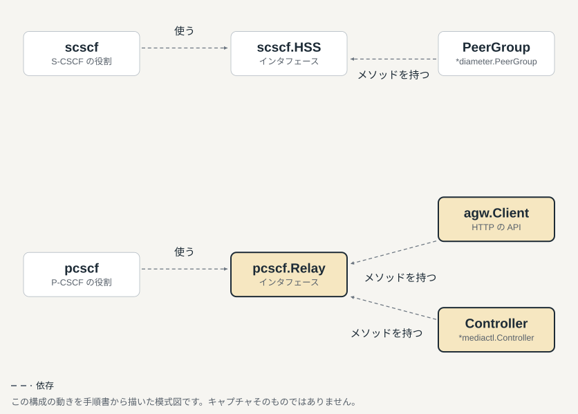
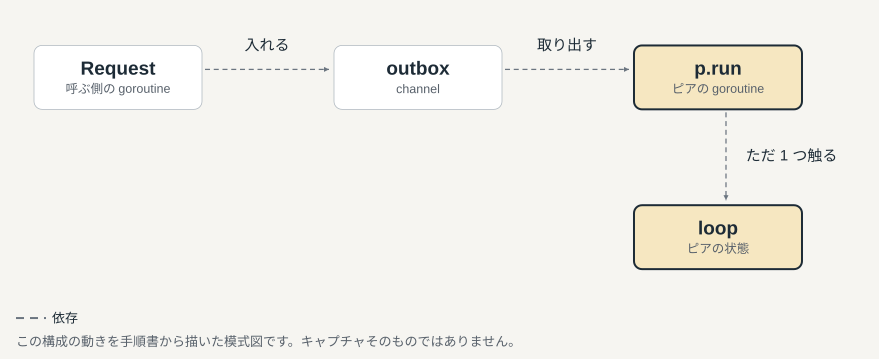
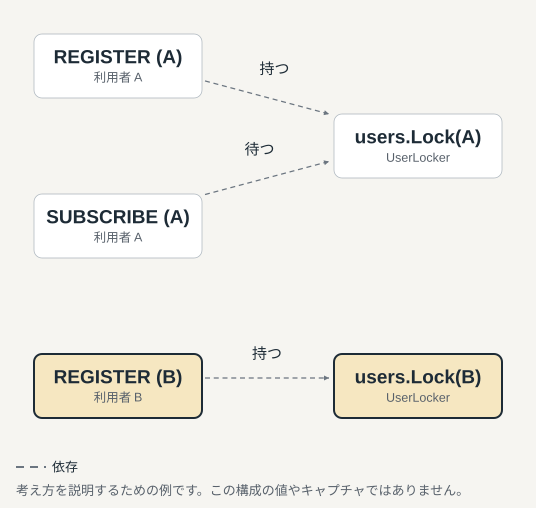
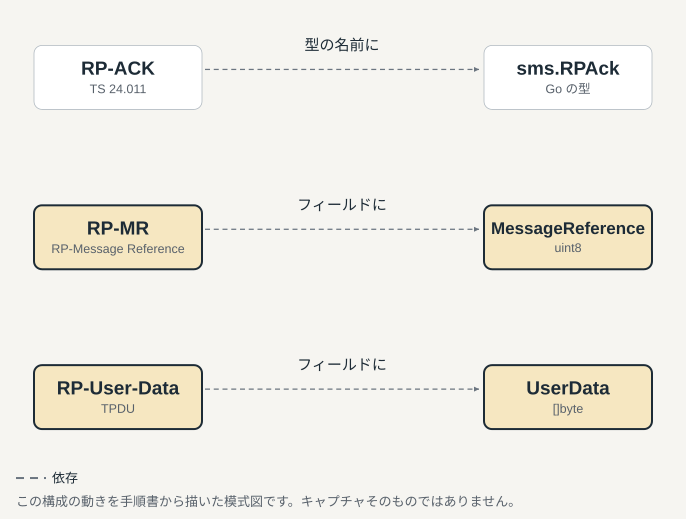

# コードを読むための Go

この付録は任意です。本の章は、Go を読まなくても図と文で分かるように書いてあります。章に出てくるコードの抜き出しを自分で読みたい人のために、このリポジトリで出会う Go の書き方を、抜き出しを 1 つずつ示して説明します。

Go の入門書ではありません。抜き出しの意味を追うのに要るところまでを説明します。Go そのものを学ぶなら、公式の [A Tour of Go](https://go.dev/tour/) と [Effective Go](https://go.dev/doc/effective_go) が入口です。

## この付録で扱うもの

Go の版は、リポジトリの `go.mod` にある 1.27.4 です。抜き出しは、どれもリポジトリのファイルの行そのままです。順に、コードの形（パッケージ、名前、試験のファイル）、毎ページで出会う書き方（構造体、インタフェース、エラー、context、goroutine、ロック、バイト列）、試験の読み方、仕様の形をしたパッケージのたどり方を扱います。

## ディレクトリ 1 つがパッケージ 1 つ

1 つのディレクトリの `.go` のファイルは、どれも同じ `package` の行で始まります。import のパスは、`go.mod` の `module` の後ろにディレクトリをつないだもので、たとえば `github.com/yuu-biz/ims-practice/internal/sms` です。`internal/` の下のパッケージは、このモジュールの外からは import できません。

`package` の行の直前のコメントは、パッケージの説明です。実行ファイルのパッケージは `package main` で、`main` 関数が入口です。

[cmd/ims/main.go](../../../cmd/ims/main.go)

```go
// Command ims is one IMS node. Its roles come from the configuration
// file, so the same binary and image serve as HSS, I-CSCF,
// S-CSCF, P-CSCF, or several of them at once.
package main
```

`cmd/ims` は IMS のノード 1 台です。コメントが言うとおり、何の役割になるかは設定ファイルが決めます。同じ実行ファイルが HSS にも I-CSCF にもなります。役割のパッケージの中は、手順ごとにファイルが分かれています（`internal/scscf` なら、`scscf.go` が登録、`session.go` が通話）。これは Go の決まりではなく、このリポジトリの約束です。

## 名前の公開と doc comment

大文字で始まる名前は、パッケージの外から使えます。小文字で始まる名前は、パッケージの中だけで使います。`internal/sms` では、`ParseRP` と `RPAck` は外から使え、`decoder` と `maxTPDU` は中だけのものです。宣言の直前のコメントが、その名前の説明（doc comment）です。

[internal/sms/rp.go](../../../internal/sms/rp.go)

```go
// ParseRP reads the body of a SIP MESSAGE whose Content-Type is
// application/vnd.3gpp.sms. The result is one of the RP message types;
// a type switch tells which.
func ParseRP(b []byte) (RPMessage, error) {
```

`ParseRP` は、Content-Type が `application/vnd.3gpp.sms` の SIP の MESSAGE の本文を読み、RP のメッセージの型のどれかを返します。どの型だったかは、呼んだ側が型の switch で調べます（後の節で見ます）。コメントは英語で、仕様の参照を含みます。英語と日本語の手順書の読者が、同じコードを読むためです。

## 構造体とメソッド

Go にクラスと継承はありません。構造体の型を宣言し、その型にメソッドを付けます。

[internal/rtp/rtp.go](../../../internal/rtp/rtp.go)

```go
type Packet struct {
	Marker         bool
	PayloadType    uint8
	SequenceNumber uint16
	Timestamp      uint32
	SSRC           uint32
	Payload        []byte
}
```

`Packet` は RTP のパケット 1 つです。フィールドの名前は RFC 3550 の用語のままです。メソッドには、受け手（レシーバー）の書き方が 2 つあります。

[internal/rtp/telephoneevent.go](../../../internal/rtp/telephoneevent.go)

```go
func (r *DTMFReceiver) Report(timestamp uint32, e TelephoneEvent) (rune, bool) {
```

`(r *DTMFReceiver)` はポインタの受け手です。メソッドは `r` が指す値、つまりそれまでに受け取った報告を変えます。後の節の `func (p Packet) Marshal() []byte` は値の受け手で、`p` の写しの上で動きます。何も変えないので、写しで足ります。

役割もメソッドで書きます。S-CSCF は `*SCSCF` 型の値で、SIP Digest の 401 を返すのは、そのメソッド `challenge` の最後の行です。

[internal/scscf/scscf.go](../../../internal/scscf/scscf.go)

```go
	s.respond(st, 401, func(r *sip.Message) {
		r.Add("WWW-Authenticate", sip.Challenge{Realm: ch.Realm, Nonce: ch.Nonce, Stale: stale, Algorithm: algorithm, QOP: []string{qop}}.String())
	})
```

`s.respond` の 3 つ目の引数は関数です。応答を組み立てる途中で呼ばれ、WWW-Authenticate のヘッダを足します。IMS-AKA の 401 は、同じパッケージの `internal/scscf/aka.go` で、同じ形で返します。

## 小さなインタフェース

インタフェースは、メソッドの集まりに名前を付けた型です。Go では、型がそのメソッドを持っていれば、何も宣言せずにそのインタフェースを満たします。

[internal/scscf/scscf.go](../../../internal/scscf/scscf.go)

```go
// HSS is how the S-CSCF reaches the HSS over Cx.
// *diameter.PeerGroup, the instances of the HSS, is one.
type HSS interface {
	Request(ctx context.Context, request *diam.Message) (*diam.Message, error)
}
```

S-CSCF から見える HSS は、`Request` のメソッドだけです。`*diameter.PeerGroup` は HSS の台の組で、`Request` のメソッドを持つので、そのまま `scscf.HSS` として渡せます。試験では、同じメソッドを持つ試験用の型を渡せます。



P-CSCF から見えるメディア中継ノードは、`session.go` のインタフェース `Relay` だけです。メソッドは H.248 のコマンドにならった `Add`、`Modify`、`Subtract` です。この 3 つを持つ型は 2 つあります。`internal/agw/api.go` の `*agw.Client` は中継ノードの HTTP の API で話し、パッケージ `internal/h248/mediactl` の `*mediactl.Controller` は H.248 で話します。後者の型は `controller.go` で宣言し、`Add` と `Modify` は `controller_mp.go` に、`Subtract` は `controller_relay.go` にあります。

[internal/pcscf/relay_test.go](../../../internal/pcscf/relay_test.go)

```go
var (
	_ pcscf.Relay = (*agw.Client)(nil)
	_ pcscf.Relay = (*mediactl.Controller)(nil)
)
```

この 2 行は、2 つの型が `Relay` を満たすことを、ビルドのときに確かめます。`(*agw.Client)(nil)` は、その型の nil の値です。どちらかの型がメソッドを 1 つでも失うと、この試験のファイルがビルドできなくなります。インタフェースは、部品を差し替えたい所にだけ、それを使う側のパッケージに置いてあります。

### インタフェースと型の switch

[internal/sms/rp.go](../../../internal/sms/rp.go)

```go
type RPMessage interface {
	MTI() RPMTI
	Marshal() ([]byte, error)
}
```

RP 層のメッセージは 5 種類あり、それぞれが別の型で、どれも `RPMessage` を満たします。`ParseRP` はこのインタフェースで返し、受け取った側が実際の型で分けます。

[internal/ipsmgw/message.go](../../../internal/ipsmgw/message.go)

```go
	switch m := rp.(type) {
	case sms.RPDataMSToNetwork:
		g.submit(req, sender, m, log)
	case sms.RPSMMA:
		g.memoryAvailable(req, sender, m, log)
	case sms.RPAck, sms.RPError:
```

`switch m := rp.(type)` は、`rp` の実際の型で分かれ、それぞれの `case` の中では `m` がその型になります。UE から網への RP-DATA なら `submit` に、RP-SMMA なら `memoryAvailable` に渡します。1 つの型だけを取り出すときは `s, ok := tpdu.(Submit)` と書きます。`ok` を受けずに型が違うと、プログラムは panic で止まります。

## エラーは値

Go に例外はありません。失敗は、最後の戻り値の `error` で返します。

[internal/diameter/peer.go](../../../internal/diameter/peer.go)

```go
var ErrPeerUnavailable = fmt.Errorf("diameter: peer is not available, so %w", errNotSent)
```

[internal/diameter/peer.go](../../../internal/diameter/peer.go)

```go
		return nil, fmt.Errorf("no answer to %s: %w", commandName(request), ctx.Err())
```

`fmt.Errorf` の `%w` は、エラーを別のエラーで包みます。包んだエラーは別の値なので `==` では比べられませんが、`errors.Is` と `errors.As` は中のエラーを見つけます。`ErrPeerUnavailable` は、要求を送っていないことを表す `errNotSent` を包んでいます。HSS の台の組は `errors.Is` でそれを知り、まだ何も送っていないので、同じ要求を次の台に送ります。

[internal/ue/aka.go](../../../internal/ue/aka.go)

```go
		var failure aka.SynchronisationFailure
		switch {
		case errors.Is(err, aka.ErrMACFailure):
```

[internal/ue/aka.go](../../../internal/ue/aka.go)

```go
		case errors.As(err, &failure):
```

UE は IMS-AKA の問いを確かめ、失敗の種類で分かれます。`errors.Is` は値を比べ、`errors.As` は型で探して取り出します。取り出した `failure` には AUTS が入っていて、UE はそれを網に送り、HSS が SQN（系列番号）を合わせ直します。

## context.Context で待つのをやめる

待つ関数は、最初の引数に `ctx` を取ります。`ctx` は、取り消されるか期限が来ると `ctx.Done()` の channel を閉じます。

[internal/diameter/peer.go](../../../internal/diameter/peer.go)

```go
func (p *Peer) Request(ctx context.Context, request *diam.Message) (*diam.Message, error) {
	ctx, cancel := context.WithTimeout(ctx, answerTimeout(ctx, p.node.timers))
	defer cancel()
	out := &outgoing{message: request, answer: make(chan answerResult, 1)}
	select {
	case p.outbox <- out:
	case <-p.done:
		return nil, ErrPeerUnavailable
	case <-ctx.Done():
		// The loop never took the request, so it is still here and nothing
		// of it went out on the connection.
		return nil, fmt.Errorf("diameter: the peer did not take the %s, so %w: %w", commandName(request), errNotSent, ctx.Err())
	}
```

`Request` は Diameter の答えを待つ時間に上限を付け、`defer cancel()` で関数を抜けるときに後始末をします。`select` は、先に準備ができた channel を 1 つ選びます。ここでは「ピアの goroutine に要求を渡せた」「ピアが終わった」「時間切れ」の 3 つです。時間切れでは、まだ何も送っていないので、そのことを `errNotSent` で伝えます。`answerTimeout` はノードの Answer のタイマーを返し、呼んだ側が `ctx` に別の期限を入れていれば、そちらを返します。

context は取り消しと期限にだけ使い、値の受け渡しには使っていません。`cmd/ims/main.go` は `signal.NotifyContext` で、SIGTERM を受けたらノード全体の context を取り消します。

## goroutine と channel



[internal/diameter/peer.go](../../../internal/diameter/peer.go)

```go
func (n *Node) Connect(peer PeerConfig) *Peer {
	p := n.newPeer(peer.OriginHost)
	p.address = peer.Address
	go p.run(NewInitiatorState(peer.OriginHost, n.applications), Start{}, nil)
	return p
}
```

[internal/diameter/peer.go](../../../internal/diameter/peer.go)

```go
// loop is the state the I/O loop owns. Only the peer's goroutine
// touches it.
type loop struct {
```

`go` を付けて呼んだ関数は、別の goroutine で並行して動きます。`Connect` は、接続ごとにピアの goroutine `p.run` を始めます。Diameter のピアの状態（`loop`）は、その goroutine だけが触ります。ほかの goroutine は、前の節の `Request` のように、channel（`inbox` と `outbox`）で頼みます。だからこの状態にはロックが要りません。`p.run` は RFC 6733 のピアの状態機械を回し、状態の遷移そのものは `internal/diameter/fsm.go` の `Transition` 関数にあります。I/O から切り離してあるので、遷移だけを試験できます。

## ロックは利用者ごとにかける



[internal/scscf/scscf.go](../../../internal/scscf/scscf.go)

```go
	// users serializes what happens to one user's registration and the
	// subscriptions to it, so that the NOTIFYs of a user go out in the
	// order of the events. Each user has a lock of its own, so that a
	// Cx round trip of one user never holds up another.
	users ims.UserLocker
```

[internal/scscf/scscf.go](../../../internal/scscf/scscf.go)

```go
	unlock, err := s.users.Lock(ctx, privateID)
	if err != nil {
		s.lockFailed(st, err, log)
		return
	}
	defer unlock()
```

S-CSCF は、1 人の利用者に起きることを、その利用者のロックで順に処理します。NOTIFY が起きた順に出るようにするためです。`Lock` はロックが空くのを待ち、ロックを放す関数を返します。それを `defer` が関数の終わりに呼びます。

`Lock` がエラーを返すのは 2 つの場合です。待つあいだに `ctx` が終わったときと、共有のストアのロックで、ストアが失敗したときです。どちらでも何も持っていないので、`lockFailed` が要求に 500 を返します。`UserLocker` を満たす型は 2 つあり、1 つのプロセスの中の `internal/ims/locks.go` の `UserLocks` と、共有のストアを使う `internal/kvstore/kvlock` のロックです。

ロックは利用者ごとにあるので、1 人の Cx の往復が、ほかの利用者を止めません。役割全体を止めるロックも、全加入者を走査する処理もありません。どちらかがあると、役割を何台にも、何人もの利用者にも広げられなくなります。`MemoryStore` の `sync.Mutex` は、map を読み書きするあいだだけ持ち、Cx の往復のあいだは持ちません。

## ジェネリクスは小さな道具だけ

[internal/ims/expiry.go](../../../internal/ims/expiry.go)

```go
type DueIndex[M comparable] struct {
	heap    dueHeap[M]
	entries map[M]*dueEntry[M]
}
```

`[M comparable]` は型の引数です。要素の型だけが違う索引を、1 つの定義で作ります。S-CSCF は期限の来る項目を自分の構造体で、IP-SM-GW は報告を待つ配送を Call-ID の文字列で並べます。

[internal/scscf/store.go](../../../internal/scscf/store.go)

```go
	due map[ExpiryKind]*ims.DueIndex[dueItem]
```

[internal/ipsmgw/store.go](../../../internal/ipsmgw/store.go)

```go
	reportTimeout *ims.DueIndex[string]
```

ほかの使い方も、`internal/rx` の `lookup[K comparable]` や、試験の補助の `roundTrip[T any]` のような小さな関数です。新しめの書き方では、組み込みの `min(a, b)`（`scscf.go` の `register`）と、回数だけ回す `for range endReports`（`internal/rtp/telephoneevent.go`）も出てきます。

## バイト列を組み立てる

[internal/rtp/rtp.go](../../../internal/rtp/rtp.go)

```go
func (p Packet) Marshal() []byte {
	b := make([]byte, headerLen+len(p.Payload))
	b[0] = version << 6
	b[1] = p.PayloadType & 0x7f
	if p.Marker {
		b[1] |= 0x80
	}
	binary.BigEndian.PutUint16(b[2:], p.SequenceNumber)
	binary.BigEndian.PutUint32(b[4:], p.Timestamp)
	binary.BigEndian.PutUint32(b[8:], p.SSRC)
	copy(b[headerLen:], p.Payload)
	return b
```

`make([]byte, n)` は長さ n のバイト列を作ります。`b[2:]` は同じ配列の 3 バイト目からを指す窓で、写しは作りません。`binary.BigEndian` は上位のバイトを先に書きます。網で使う順です。0 から 11 バイト目が、RFC 3550 5.1 のヘッダの図の順に埋まります。最初のバイトの上位 2 ビットが版で、`version << 6` がそこに 2 を置きます。

この 1 行が壊れたら、試験はどう知らせるでしょうか。試験は、作ったパケットの最初の 2 バイトを確かめます。

[internal/rtp/rtp_test.go](../../../internal/rtp/rtp_test.go)

```go
func TestRoundTrip(t *testing.T) {
	p := Packet{Marker: true, PayloadType: 0, SequenceNumber: 65535, Timestamp: 160, SSRC: 0xdeadbeef, Payload: []byte{1, 2, 3}}
	b := p.Marshal()
	if b[0] != 0x80 || b[1] != 0x80 {
		t.Errorf("first bytes %#x %#x, want V=2 and M set", b[0], b[1])
	}
```

著者が `version << 6` を `version << 5` に変えて `internal/rtp` の試験を流すと、`TestRoundTrip` が 2 か所で失敗しました。上の `t.Errorf` が `first bytes 0x40 0x80, want V=2 and M set` を出し、続く `Unmarshal` が `rtp: version 1, want 2` で断ります。5 ビットずらすと 0x40 になり、上位 2 ビットが 1 と読めるからです。`t.Errorf` は失敗を記録して試験を続け、`t.Fatal` はそこで試験を止めます。

読む側の `Unmarshal` は、長さを確かめてから同じ位置を読みます。`internal/sms` は `append` でバイト列を伸ばし、読む側は `decoder` という小さな型で最初のエラーを覚えておき、最後に 1 回だけ確かめます。

## 試験のファイル

名前が `_test.go` で終わるファイルは、`go test` のときだけビルドされます。試験の関数は `Test` で始まり、`*testing.T` を受けます。`package sms` の試験はパッケージの中の名前も使えます。`internal/ue/ue_test.go` は `package ue_test` で、外から使う人と同じ形で書いてあります。

### Example

`Example` で始まる関数は、標準出力を `// Output:` の行と比べる試験です。使い方の見本と試験を兼ねます。1 文字でも違えば失敗するので、見本が古くなりません。

[internal/sms/rp_test.go](../../../internal/sms/rp_test.go)

```go
	s := tpdu.(Submit)
	text, _ := DecodeText(s.DataCodingScheme, s.UserData)
	fmt.Println(s.DestinationAddress, text)
	// Output:
	// 00 05 00 07 91 21 20 55 05 01 F0 16 01 01 0B 91 21 20 55 05 01 F2 00 00 0A E8 32 9B FD 46 97 D9 EC 37
	// +12025550102 hellohello
}
```

抜き出しはこの見本の終わりです。見本は、本文 `hellohello` を GSM 7 ビットで符号化した SMS-SUBMIT を作り、それを UE から網への RP-DATA に入れて 16 進で表示します。出力の 1 行目がそのバイト列です。そのあとで同じバイト列を `ParseRP` と `ParseTPDU` で読み戻し、型の取り出し `tpdu.(Submit)` で SMS-SUBMIT にして、宛先と本文を表示します。2 行目の `+12025550102 hellohello` がそれです。書いたものと読んだものが同じだと、見本そのものが確かめます。

### 表駆動の試験

[internal/sms/rp_test.go](../../../internal/sms/rp_test.go)

```go
	tests := []struct {
		name string
		rp   RPMessage
		hex  string
		tpdu TPDU // what ParseTPDU gives, nil for none
```

[internal/sms/rp_test.go](../../../internal/sms/rp_test.go)

```go
	for _, tt := range tests {
		t.Run(tt.name, func(t *testing.T) {
			want := mustHex(t, tt.hex)
```

表の 1 行が試験の 1 件です。`t.Run` が行ごとに名前を付けるので、1 行だけを選んで流せます。名前の空白は `_` になり、`TestRPMessages/RP-ACK_without` のように「/」の後ろに書きます。試験を足すときは、表に 1 行を足すだけで済むことが多いです。

たとえば RP-SMMA の行は、次の 1 行です。これは説明のための例で、リポジトリの表にはありません。

```text
{name: "RP-SMMA 9", rp: RPSMMA{MessageReference: 9}, hex: "06 09"},
```

`06` は RP-SMMA の種類（Message Type Indicator の 110）、`09` は RP-MR です。RP-SMMA は RP-MR のほかに何も運ばないので、2 バイトで終わります。著者がこの行を表に足して流すと、`Marshal` がこのバイト列を書き、`ParseRP` が同じ値に読み戻して、通りました。

[internal/milenage/milenage_test.go](../../../internal/milenage/milenage_test.go) は、TS 35.208 の 20 のテストセットを表にしています。試験用の値なので、リポジトリに入れてあります。実在の加入者の値は入れません。

### IMS 全体を 1 つのプロセスで動かす試験

`internal/ue` の試験は、P-CSCF、I-CSCF、S-CSCF、HSS を 1 つのプロセスの中で動かし、UE シミュレータで登録と通話を確かめます。`internal/ue/ue_test.go` の `TestRegisterRefreshAndDeregisterThroughTheWholeIMS` は、登録、再登録、登録の解除を順に行います。`internal/ipsmgw` の試験は、同じ方法で SMS を確かめます。章の「この説明の根拠」に挙げる試験の多くは、この形か、1 つの役割を試験用の相手役と組み合わせた形です。

## 仕様の用語から型へ

仕様の形をしたパッケージは、仕様の用語から試験のバイト列まで、同じ名前でたどれます。`internal/sms` の RP-ACK を例にします。



| 段 | 場所 | 見るもの |
| --- | --- | --- |
| パッケージ | `internal/sms/text.go` の先頭 | どの仕様のどの版に沿うか |
| 型 | `rp.go` の `RPAck` | 仕様のメッセージの名前とフィールド |
| 書く | `RPAck.Marshal` | 仕様のどの表に沿うか |
| 読む | `ParseRP` の `case` | 書く側と同じ並び |
| 確かめる | `rp_test.go` の `TestRPMessages` | 16 進のバイト列 |

[internal/sms/rp.go](../../../internal/sms/rp.go)

```go
type RPAck struct {
	Direction        Direction
	MessageReference uint8  // the RP-MR of the message acknowledged
	UserData         []byte // the TPDU, or nil when absent
}
```

[internal/sms/rp.go](../../../internal/sms/rp.go)

```go
// Marshal writes table 7.7 of TS 24.011.
func (m RPAck) Marshal() ([]byte, error) {
	return appendOptionalRPUserData([]byte{byte(m.MTI()), m.MessageReference}, m.UserData)
}
```

[internal/sms/rp.go](../../../internal/sms/rp.go)

```go
	case RPMTIAckMSToNetwork, RPMTIAckNetworkToMS:
		m = RPAck{Direction: directionOf(mti), MessageReference: mr, UserData: d.nonImperativePart(true)}
```

`Marshal` は TS 24.011 の表 7.7 の順に、メッセージの種類（Message Type Indicator）、RP-MR、必要なら RP-User-Data を並べます。`ParseRP` の `case` は、同じ並びを読み、向きをメッセージの種類から決めます。試験の表の 1 行が、その両方を確かめます。

[internal/sms/rp_test.go](../../../internal/sms/rp_test.go)

```go
			name: "RP-ACK (MS to network) with SMS-DELIVER-REPORT",
			rp:   RPAck{Direction: MSToNetwork, MessageReference: 6, UserData: mustHex(t, "00 00")},
			hex:  "02 06 41 02 00 00",
			tpdu: DeliverReport{},
```

`02` は MS から網への RP-ACK、`06` は RP-MR、`41` は RP-User-Data の IEI、`02` はその長さ、`00 00` は SMS-DELIVER-REPORT です。同じ 1 行で、`Marshal` が書くものと `ParseRP` が読むものの両方を確かめます。Wireshark で RP-ACK を開くと、同じバイト列が見えます。

## 読む順

1. 小さな仕様のパッケージ。`internal/rtp`（RFC 3550）、`internal/sms`（TS 24.011、TS 23.040）、`internal/milenage`（TS 35.206）。ほかのパッケージにほとんど依存しません。
2. IMS 全体を 1 つのプロセスで動かす試験。`internal/ue/ue_test.go` の `TestRegisterRefreshAndDeregisterThroughTheWholeIMS`。
3. 役割のパッケージを、手順書と並べて。たとえば `internal/scscf` と [登録の手順書](../../guide/ja/registration.md)。
4. 全体の組み立て。`cmd/ims/main.go` の `run`。

## この説明の根拠

- `internal/sms` の `TestRPMessages` と `Example` の試験、`internal/rtp` の `TestRoundTrip` は、いまのコードで通ることを確かめました。
- 表に RP-SMMA の行を足した場合と、`version << 6` を `version << 5` に変えた場合の結果は、著者がリポジトリのファイルを変えずに、Go のビルドの `-overlay` で差し替えて流したときのものです。
- `internal/pcscf/relay_test.go` の 2 行の確かめは、`internal/pcscf` の試験がビルドできることで通っています。

図のうち、利用者ごとのロックの図は考え方を説明するための例で、ほかはこのリポジトリのコードの関係を描いたものです。

## 自分で動かす場合

この付録を読むのに、試験を動かす必要はありません。上の 2 つの結果を自分で見たいときは、RP-SMMA の行を表に足して `go test -run 'TestRPMessages/RP-SMMA_9' -v ./internal/sms` でその行だけを流すか、`rtp.Packet.Marshal` の `version << 6` を変えて `go test ./internal/rtp` を流します。どちらも、見たあとで元に戻します。401 を返す場所は `grep -rn "401" internal/scscf` で、SIP Digest の `scscf.go` と IMS-AKA の `aka.go` の両方が見つかります。

そのほかの動かし方は、[Go の読み方のデッキ](../../../slides/decks/ja/00-go.md) の終わりの 2 枚に、試験を全部、パッケージ 1 つ、試験 1 つ、表の 1 行の単位で動かすコマンドと、コンテナとホストのどちらの Go で動かすかがあります。
