# 網間接続

2 つの事業者の IMS 網は、境界のノードだけでつながります。SIP は各網の IBCF が、メディアは各網の TrGW が運びます。S-CSCF は、ENUM で相手網のものと分かった番号への要求を、自網の IBCF へ送ります。IBCF は届いた要求をそこで受け止め、相手網への自分の要求として作り直します。作り直すときに、事業者どうしの取り決めに従って、通してよいメソッド、ヘッダ、番号の形、コーデックを当て、自網の中のノードの Via、Contact、アドレスを外します。

そのため、相手網に見えるのは、利用者の番号とドメインと、境界のノードの外側の名前とアドレスだけです。2 つの取り決めが食い違うと、IBCF が応答で断ります。取り決めの外の送り手には、何も答えません。

この章では、網 A から網 B への通話を軸に、どの条件がどのノードの判断を変えるかを、判断する関数と試験で追います。そのあとで、ショートメッセージ、会議、IBCF の台の再起動を見ます。通話の INVITE、PRACK、ACK と、MMTel AS が B2BUA として通話を受け持つことは、[通話のトランザクション、ダイアログ、メディアの交渉](call-signaling.md) と [iFC と MMTel AS の付加サービス](mmtel.md) で説明しています。

## この章で扱う構成

例は、`compose.yaml` の網に、`deploy/interconnect/compose.yaml` で 2 つ目の網と網のあいだのリンクを重ねた構成です。網 A は、ほかの章で使ってきた網です。網 B は別の事業者の 2 つ目の IMS で、同じイメージを別のドメイン、別の番号、別の加入者で動かします。網 B には、シナリオに要る最小限のノードしかありません。MMTel AS、EPC と PCRF、P-CSCF のメディア中継ノードはありません。

| | 網 A | 網 B |
| --- | --- | --- |
| ドメイン | `ims.mnc001.mcc001.3gppnetwork.org` | `ims.mnc002.mcc001.3gppnetwork.org` |
| 端末 | UE A1、172.28.0.100、`+1-202-555-0101` | UE B1、172.28.1.100、`+1-202-555-0151` |
| IBCF | 網の中は 172.28.0.90、網のあいだは 172.28.2.10 | 網の中は 172.28.1.90、網のあいだは 172.28.2.20 |
| TrGW | 網の中は 172.28.0.91、網のあいだは 172.28.2.11 | 網の中は 172.28.1.91、網のあいだは 172.28.2.21 |
| ショートメッセージの SC | `+12025550100` | `+12025550150` |

網のあいだのブリッジ（172.28.2.0/24）には、2 つの IBCF と 2 つの TrGW しかつながっていません。網 A の中のノードは、網 B の中のノードに直接は届きません。キャプチャはブリッジごとに 1 つずつ、網 A、網のあいだ、網 B の 3 つです。番号は、北米番号計画が架空の番号に取ってある範囲のものです。

この章が引く仕様の版は、手順書と同じく TS 24.229 V20.1.0、TS 29.165 V20.0.0、TS 23.204 V19.1.0、TS 23.040 V20.0.0、TS 24.147 V19.0.0、RFC 3261 です。

## 境界のノードと 4 つの参照点

TS 29.165 は、IMS 網どうしのあいだのインタフェースを II-NNI と呼びます。

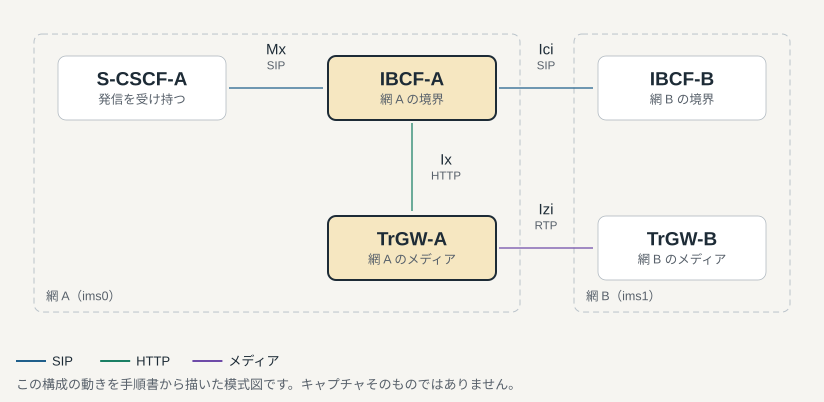

| 参照点 | どこの間か | この構成では |
| --- | --- | --- |
| Mx | CSCF と自網の IBCF | SIP。S-CSCF の設定 `ibcf` が IBCF を指す |
| Ici | 2 つの網の IBCF | 網のあいだの SIP。SDP 付きの INVITE は 1300 バイトを超えるので TCP で送る（RFC 3261 18.1.1） |
| Izi | 2 つの網の TrGW | 境界を越える RTP |
| Ix | IBCF と自網の TrGW | 標準では H.248（TS 29.238）。この実装では、P-CSCF がメディア中継ノードに使うのと同じ HTTP の制御 API |

II-NNI を作るのは、Ici と Izi の 2 つです（TS 29.165 5.1）。Mx と Ix は、1 つの網の中の参照点です（TS 29.165 3.2）。TrGW は、ここでもメディア中継ノード（役割 `agw`）で、ターミネーション `core` が自網を、`access` が相手網の TrGW を向きます。IBCF は H.248 のコマンドの名前で TrGW を動かします。Add が呼のコンテキストを確保し、Modify がターミネーションにその側の宛先を伝え、Subtract が解放します。

## 番号が相手網のものだと分かるまで

UE A1 は、いつもの通話と同じように `tel:+12025550151` へ INVITE を送ります。INVITE は P-CSCF と S-CSCF を通り、発信側のフィルタ条件で MMTel AS を通ってから S-CSCF に戻ります。ここまでは、番号が別の網のものだと誰も知りません。

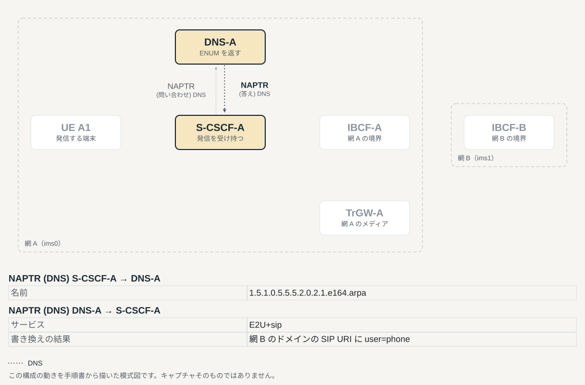

呼び出す AS が残っていないので、S-CSCF は番号を ENUM で変換します（TS 24.229 5.4.3.2 の手順 10）。網 A の DNS には、網 B の番号のためのゾーンがあり、次の答えが返ります。

```text
NAPTR 10 100 "u" "E2U+sip" "!^.*$!sip:+12025550151@ims.mnc002.mcc001.3gppnetwork.org;user=phone!" .
```

結果は、網 B のドメインの SIP URI に、国際形式の番号と `user=phone` を入れたものです。どの non-roaming の II-NNI でも使える形です（TS 29.165 8.1）。レコードに書いてあるのは番号で、加入者の私的な識別子ではありません。S-CSCF のコードでは、ENUM と IBCF の判断が続けて並んでいます。

[internal/scscf/session.go](../../../internal/scscf/session.go)

```go
	if number, ok := s.globalNumber(out.RequestURI); ok {
		uri, err := s.resolver.ENUM(context.Background(), number, s.cfg.ENUMSuffix)
		if err != nil {
			log.Info("ENUM has no SIP URI for the number", "number", number, "error", err.Error())
			s.respond(st, 404, nil)
			return
		}
		log.Info("translated the number with ENUM", "number", number, "uri", uri)
		out.RequestURI = uri
	}
	// Steps 11 and 12: a destination in another network needs the
	// interconnect functions, and the home network hides its topology,
	// so the request goes through the IBCF, on top of Route.
	if ibcf, ok := s.exitIBCF(out); ok {
		log.Info("the destination is in another network, leaving through the IBCF", "request_uri", out.RequestURI, "ibcf", ibcf.String())
		out.Prepend("Route", sip.NameAddr{URI: ibcf.String()}.String())
	}
```

`globalNumber` は、Request-URI が tel URI か、自網のドメインの `user=phone` の SIP URI で、国際形式の番号のときに番号を返します。ENUM に答えが無ければ、S-CSCF は 404 で答えます。標準ではそうした呼は BGCF から IMS の外へ出ますが、この構成には BGCF が無いためです。

続く `exitIBCF` が、相互接続の機能が要る宛先かを決めます（手順 11、12）。S-CSCF に IBCF の設定があり、AS が自分の Route を入れておらず、Request-URI のホストがアドレスでも自網のドメインでもないときに、IBCF の URI を返します。S-CSCF はそれを Route の先頭に入れ、今までどおり Record-Route に自分を入れます（手順 13）。設定 `ibcf` が無ければ、S-CSCF は網 B のドメインに自分で送ろうとし、網のあいだに届く道が無いので、どこにも届きません。

## IBCF-A が出口として要求を作り直す

IBCF には 2 つの側があります。この実装の IBCF は B2BUA で（TS 24.229 5.10.5、TS 29.165 5.2.1）、側ごとに UA を 1 つ持ちます。内側の UA は自網のアドレスで、外側の UA は網のあいだのアドレスで、どちらも 5060 番で待ちます。内側に届いた要求は網から出ていくので、IBCF はその出口です（TS 24.229 5.10.2）。外側に届いた要求は網に入ってくるので、IBCF はその入口です（5.10.3）。

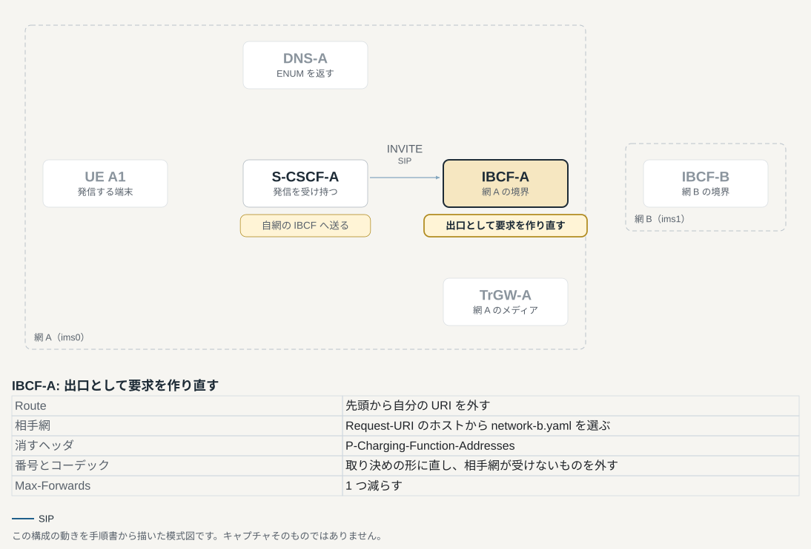

IBCF-A は、届いた INVITE を網 A とのダイアログの UAS として受け止めます。Route の先頭から自分の URI を外し、Request-URI のホストから相手網を探して、その相手網との取り決めを選びます。そして要求の写しに、取り決めを決まった順に当てます。

[internal/interconnect/border.go](../../../internal/interconnect/border.go)

```go
func (b Border) ExitRequest(req *sip.Message) error {
	if err := b.screenRequest(req); err != nil {
		return err
	}
	RemoveNotApplicable(req)
	ApplyTrustDomain(req, b.Peer, Exit)
	RemoveReceivedRealm(req)
	ApplyPrivacy(req, b.Peer)
	ApplyHeaderRules(req, b.Peer, Exit)
	if err := NormalizeNumbers(req, b.Peer, b.Peer.NumberFormat, b.Peer.Domain, b.HomeDomain); err != nil {
		return err
	}
	return b.filterRequestBody(req)
}

```

1. `screenRequest` が、メソッドと option tag を調べます（TS 24.229 5.10.6）。取り決めに無い任意のメソッドなら、ここで断ります。
2. `RemoveNotApplicable` が、II-NNI で使わないヘッダを消します。
3. `ApplyTrustDomain` が、信頼ドメインの外に出してはいけないヘッダを消します（TS 24.229 4.4）。2 つの事業者には取り決めがあるので、この構成では互いに信頼ドメインに入り（`trusted: true`、4.4.1）、P-Asserted-Identity は境界を越えます。P-Charging-Function-Addresses は、どの相手にも越えません（5.10.2.2 の手順 9）。
4. `RemoveReceivedRealm`、`ApplyPrivacy`、`ApplyHeaderRules` が、Via の received-realm のパラメータを外し、利用者が求めた秘匿と、事業者が決めたヘッダの規則（5.10.6.2）を当てます。この構成の規則は、網 A のソフトウェアの名前を出さないように User-Agent と Server を消します。
5. `NormalizeNumbers` が、番号を取り決めの形に直します（TS 29.165 8.1）。
6. `filterRequestBody` が、相手網が受けないコーデックを SDP から外します（TS 29.165 7.1）。音声のコーデックが 1 つも残らなければ 488 で断ります。

どこかで断れば、IBCF-A は自分の応答を返し、要求を先へ送りません。最後まで通れば、TrGW-A にコンテキストを作り、SDP の `c=` を TrGW-A の網のあいだ側のアドレス 172.28.2.11 に書き換えます（TS 24.229 6.7.1.4.1）。そのうえで、網 B とのダイアログの UAC として、新しい INVITE を外側から送ります。

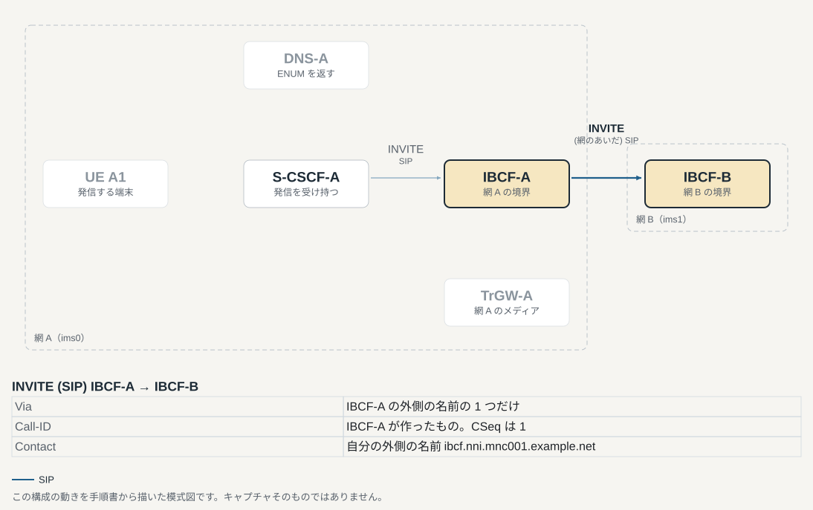

新しい INVITE の Call-ID と From の tag は IBCF-A が作ったもので、CSeq は 1 です。Via と Contact は IBCF-A の外側の名前 `ibcf.nni.mnc001.example.net` です。Route には、取り決めにある相手網の入口 IBCF-B が入ります（5.10.2.2 NOTE 3）。Record-Route に自分は入れません（手順 2B）。呼のあとの要求は、それぞれのダイアログの相手として IBCF に届くからです。Max-Forwards は、プロキシと同じく 1 つ減らします（RFC 3261 16.6 の手順 3）。2 つの網が要求を回し合っても、いつかは終わるようにするためです。

## 取り決めが決めること

網 A の網 B との取り決めは、`deploy/interconnect/profiles/network-b.yaml` にあります。このプロジェクトでは、これを相互接続プロファイルと呼びます。

[deploy/interconnect/profiles/network-b.yaml](../../../deploy/interconnect/profiles/network-b.yaml)

```yaml
name: network-b
# A number that leaves as a tel URI goes out as a SIP URI of this
# domain with user=phone (TS 29.165 8.1).
domain: ims.mnc002.mcc001.3gppnetwork.org
# The two operators have an interconnect agreement, so network B is in
# the trust domain (TS 24.229 4.4.1): P-Asserted-Identity and the
# other header fields of 4.4 cross the border.
trusted: true
# UDP first, as the SIP of TS 24.229 4.2A; a message longer than 1300
# bytes goes over TCP all the same (RFC 3261 18.1.1).
transports: [udp, tcp]
# The methods of TS 29.165 Table 6.1 that need an agreement. MESSAGE
# carries the short messages between the networks (Table 6.1.3.1 item
# 29).
methods: [MESSAGE]
# 100rel is mandatory at the II-NNI (Table 6.1.3.1 item 18) and the
# precondition mechanism is optional (item 20). Both pass here.
option_tags:
  100rel: pass
  precondition: pass
# Numbers cross in SIP URIs with user=phone, the form that every
# non-roaming II-NNI supports (TS 29.165 8.1).
number_format: sip
# The speech codecs of both networks, with telephone-event for DTMF
# (TS 29.165 7.1 and NOTE 2). Any other payload format is taken out of
# the SDP.
codecs: [AMR-WB, AMR, PCMU, telephone-event]
```

TS 29.165 Annex C は、こうした選択を、2 つの事業者が埋める選択項目として並べています。`domain` は、番号を SIP URI にして送るときのホストです。`trusted` は、相手が信頼ドメインに入るかを決めます。`methods` は、TS 29.165 Table 6.1 で取り決めが要る任意のメソッドのうち、認めるものです。ショートメッセージを運ぶ MESSAGE はその 1 つです（Table 6.1.3.1 の項目 29）。`option_tags` は option tag ごとに通すか、外すか、断るかを、`number_format` は番号の形を、`codecs` は相手網が受けるペイロードの形式を決めます。網 B の側には、網 A との取り決め `network-a.yaml` があり、IBCF-B はそれを当てます。

取り決めは双方向の約束ですが、2 つのファイルは別々の事業者が持ちます。そのため、片方だけを変えると食い違いが起きます。それは後の節で見ます。

## 網 B に入って UE B1 に届くまで

網のあいだの INVITE は、IBCF-B の外側に届きます。IBCF-B は、送信元のアドレス 172.28.2.10 が、設定（`ibcf.yaml`）で網 A の送信元として挙げた `sources` にあるので、網 A からの要求だと分かります。取り決め `network-a.yaml` を同じ順に当て、Route から自分の URI を外します（TS 24.229 5.10.3.2 の手順 1C）。Route が残っていないので、設定した I-CSCF へ、自分のダイアログで新しい INVITE を送ります（手順 4）。メディアも同じように TrGW-B に通すので、網 B に届く SDP は TrGW-B の網の中のアドレス 172.28.1.91 を指します。

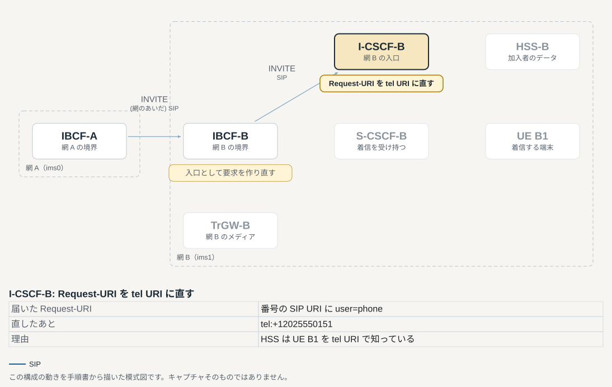

Request-URI は、国際形式の番号と `user=phone` を持つ SIP URI のままです。網 B の HSS は UE B1 を tel URI で知っていて、この SIP URI では知りません。そこで I-CSCF は、HSS に LIR を送る前に Request-URI を置き換えます（TS 24.229 5.3.2.1 の手順 1 の b）。

[internal/icscf/session.go](../../../internal/icscf/session.go)

```go
func telURIOf(uri string) (string, bool) {
	n, ok := ims.ParseTelephoneNumber(uri)
	// A Request-URI that is a tel URI already names the user as the HSS
	// knows the number, so only a SIP URI is replaced.
	if !ok || n.SIP == nil || !strings.HasPrefix(n.Number, "+") {
		return "", false
	}
	if _, gruu := n.SIP.Params.Get("gr"); gruu {
		return "", false
	}
	return "tel:" + n.Number + n.Params.String(), true
}
```

入力は届いた Request-URI です。番号を表す URI で、SIP URI で、番号が `+` で始まり、GRUU でないときだけ、番号とそのパラメータを持つ tel URI を返します。tel URI はすでに HSS が知っている形なので、置き換えません。網 B の S-CSCF には `tel:+12025550151` が届き、あとはいつもの着信と同じように、網 B の P-CSCF を通って UE B1 に届きます。

UE B1 は answer を付けた信頼性のある 183 で答えます。183 は Via に沿って戻るので、Record-Route を付けていない I-CSCF も通ります。各 IBCF は、受け取った 183 を、もう一方のダイアログの自分の 183 として渡します。PRACK、ACK、BYE も、ダイアログごとにあります。

## メディアは 2 つの TrGW を通る

IBCF は SDP ごとに、送った側に面したターミネーションに、その側がこれからどこで受けるかを Modify で伝えます。そのあとで、もう一方の側に向けた TrGW のアドレスを SDP に書きます（TS 24.229 6.7.1.4.1）。中継ノードは両方のターミネーションに同じアドレスを書くので、側ごとのアドレスを書き分けるのは IBCF です。

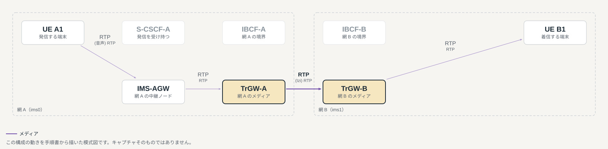

| キャプチャ | SDP の `c=` に書かれるアドレス |
| --- | --- |
| 網 A | 172.28.0.50（網 A のメディア中継ノード）か 172.28.0.91（TrGW-A の網の中の側） |
| 網のあいだ | 172.28.2.11 か 172.28.2.21（2 つの TrGW の網のあいだの側） |
| 網 B | 172.28.1.91（TrGW-B の網の中の側）か UE B1 のアドレス |

UE A1 の相手は 172.28.0.50、UE B1 の相手は 172.28.1.91 で、どちらも自分の網のアドレスです。境界を越える RTP は TrGW どうしのあいだにだけ流れ、UE のアドレスは出てきません。TrGW がある SDP を受け取らなかったときは、IBCF はその SDP を境界の向こうへ渡しません。渡すと、向こう側が TrGW を通らずにそのアドレスへ直接 RTP を送ろうとし、相手網に自網のアドレスが分かるためです。

## 4 つのダイアログと 3 つのキャプチャ

この通話のダイアログは 4 つです。B2BUA は、届いた側のダイアログを終え、もう一方の側で自分のダイアログを始めます。網 A の MMTel AS と 2 つの IBCF がそれぞれそうするので、ダイアログは 1 つずつ増えます。P-CSCF、S-CSCF、I-CSCF はプロキシで、ダイアログをそのまま渡します。網 B の経路には AS が無いので、網 B の中でダイアログは増えません。

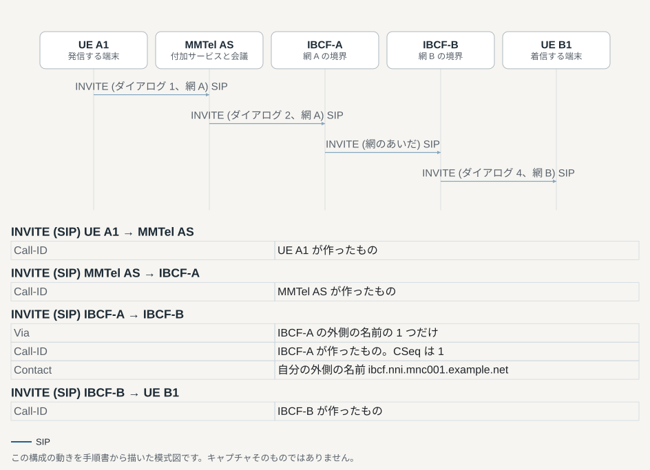

| ダイアログ | あいだのノード | 写るキャプチャ |
| --- | --- | --- |
| 1 | UE A1 と MMTel AS | 網 A |
| 2 | MMTel AS と IBCF-A | 網 A |
| 3 | IBCF-A と IBCF-B | 網のあいだ |
| 4 | IBCF-B と UE B1 | 網 B |

3 つのキャプチャを並べて比べるのは、境界のまわりの 2、3、4 の 3 つです。網 A のキャプチャの S-CSCF から IBCF-A への INVITE、網のあいだの INVITE、網 B のキャプチャの IBCF-B から I-CSCF への INVITE で、3 つとも別の Call-ID を持ちます。ダイアログ 1 も網 A のキャプチャにありますが、境界を越えないので、この比較には入りません。「3 つのキャプチャに 3 つの Call-ID」は境界のまわりの区間の数で、通話全体のダイアログの数ではありません。

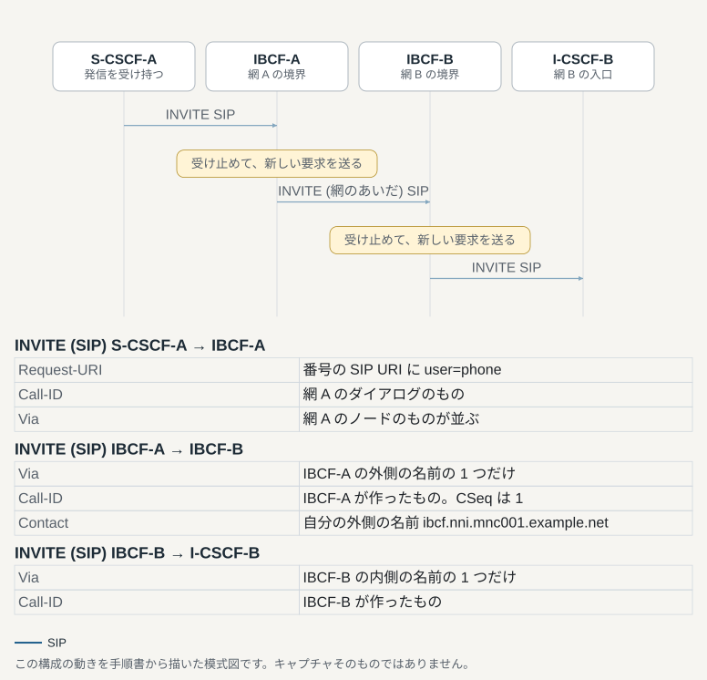

`internal/ibcf` の試験 `TestCallAcrossTheBorder` の網には MMTel AS が無いので、試験の通話のダイアログは 3 つです。試験の名前の説明にある「3 つのダイアログ」は、その網での数です。

## 相手網に見えるもの

一方の網の中でメッセージを運ぶための値は、相手網とのダイアログに入りません。網 A のノードの Via、Route、Record-Route、Contact と、網 A の Call-ID と tag は、網 B に届きません。B2BUA は、こうして自網の構成を隠します。TS 24.229 5.10.4 には、要求をプロキシとして通す IBCF のための別のやり方があります。そうした値を暗号化したトークンに封じるやり方です。B2BUA には封じるものがありません。

| キャプチャ | 出てこないもの |
| --- | --- |
| 網 A | 172.28.1.0/24 のアドレスと、網 B のノードのホスト名 |
| 網のあいだ | どちらの網の中のアドレスとノードのホスト名、網 A の IMSI から作った識別子、Record-Route（会議のフォーカスの Contact を渡すときのものを除く） |
| 網 B | 172.28.0.0/24 のアドレス、網 A のノードのホスト名、網 A の IMSI から作った識別子 |

網間接続の e2e のスクリプトは、IP のヘッダとフレームの全体からこれらのアドレスを探し、相手網のドメインの手前にノードの名前が付いていないかも探します。1 つでも見つかれば、スクリプトは失敗します。

自網の名前のうち、相手網に見えてよいものもあります。ドメインそのものです。From と P-Asserted-Identity の `sip:+12025550101@ims.mnc001.mcc001.3gppnetwork.org` に入っています。相手網は折り返すために利用者の番号が要り、番号とドメインからは網の中のノードも IMSI も分かりません。Contact も、届いたまま越えるものがあります。GRUU と会議のフォーカスの Contact です。それは「境界を越える会議」の節で見ます。

## 取り決めが食い違うと IBCF が断る

失敗させるのは UE ではなく、取り決めに従った IBCF です。断った IBCF は応答を返し、要求を先へ送りません。

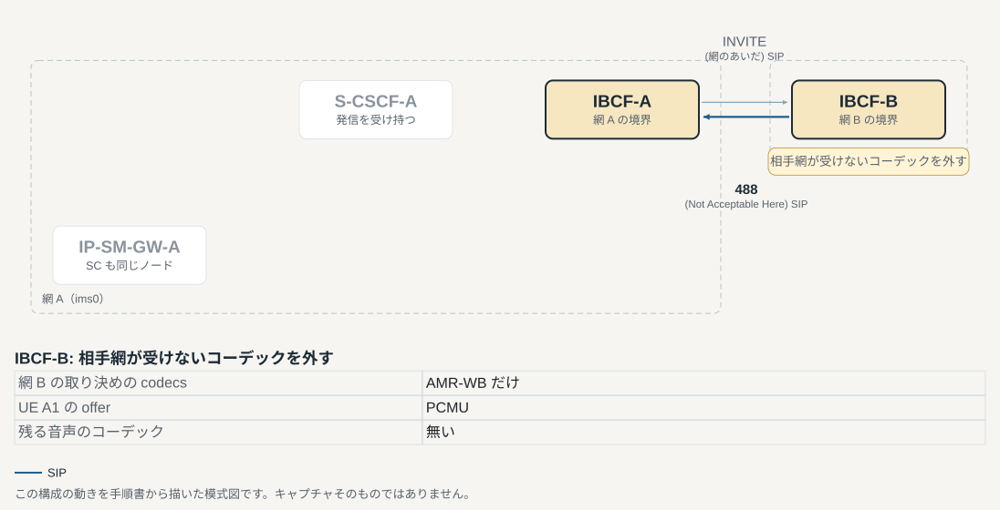

| 食い違い | 断る IBCF と応答 | 合わせた取り決め |
| --- | --- | --- |
| 網 A の取り決めに MESSAGE が無い（`network-b-no-message.yaml`） | IBCF-A が 405（Method Not Allowed）。網 A の SC は TP-ST 98（SME から応答が無い）を報告する | `network-b.yaml`。TP-ST 1 になる |
| 網 B が AMR-WB しか受けない（`network-a-amr-wb-only.yaml`） | IBCF-B が 488（Not Acceptable Here）。UE A1 は PCMU を offer する | PCMU を挙げた `network-a.yaml` |
| 網 A の取り決めが国内形式の番号をそのまま通す（`network-b-local-numbers.yaml`） | IBCF-B が 404（Not Found）。網 B は国際形式の番号しか認めない | `network-b-global-numbers.yaml`。IBCF-A が送る前に `+12025550151` に直す |

メソッドの検査は、取り決めの一覧に無いメソッドを 405 で断ります。

[internal/interconnect/screen.go](../../../internal/interconnect/screen.go)

```go
func ScreenMethod(req *sip.Message, p Profile) error {
	allowed := p.allowedMethods()
	if slices.Contains(allowed, req.Method) {
		return nil
	}
	names := make([]string, len(allowed))
	for i, m := range allowed {
		names[i] = string(m)
	}
	return reject(405, ErrMethodNotAllowed, sip.HeaderField{Name: "Allow", Value: strings.Join(names, ", ")})
}
```

この実装は、TS 24.229 5.10.1 が認める局所的な方針として、IBCF が使えるメソッドを `Allow` に並べた 405 で答えます。相手網は取り決めの内側にいるので、何がいけなかったかを応答で伝えるためです。

番号の検査は、`+` で始まらない番号を、取り決めの国内番号の規則で国際形式に直そうとします。

[internal/interconnect/number.go](../../../internal/interconnect/number.go)

```go
func NormalizeNumber(uri string, format NumberFormat, host string, p Profile) (string, error) {
	n, ok := ims.ParseTelephoneNumber(uri)
	if !ok {
		return uri, nil
	}
	number := ims.WithoutVisualSeparators(n.Number)
	if !strings.HasPrefix(number, "+") {
		context, _ := n.Params.Get("phone-context")
		i := slices.IndexFunc(p.LocalNumbers, func(l LocalNumberPlan) bool { return sameContext(l.PhoneContext, context) })
		switch {
		case i >= 0:
			number = p.LocalNumbers[i].GlobalPrefix + number
		case !p.AllowLocalNumbers:
			return "", fmt.Errorf("%w: %s", ErrLocalNumber, uri)
		}
	}
	if strings.HasPrefix(number, "+") {
```

入力の URI が番号を表すとき、`phone-context` に合う規則があれば国際形式の頭を付けます。規則が無く、取り決めが国内形式の番号を認めていなければ `ErrLocalNumber` になり、呼び出し側の `NormalizeNumbers` が 404 にします（TS 24.229 5.10.1 の局所的な方針）。網 A の `network-b-local-numbers.yaml` は国内形式をそのまま通すので、IBCF-A では断られません。網 B の取り決めは認めないので、IBCF-B がここで断ります。

コーデックの検査 `FilterCodecs` は、取り決めの `codecs` に無いペイロードの形式を、SDP の m= の行から外します。telephone-event は音声を運ばないので、それだけが残ったストリームも使えないものとして数えます。使っていたストリームに音声のコーデックが 1 つも残らなければ、IBCF は 488 で断ります。コーデックの変換はしません。変換には TrGW にコーデックが要り、このプロジェクトのノードは AMR を符号化も復号もしないためです。

## 取り決めの外の送り手には答えない

網のあいだにいて、どちらの IBCF でも TrGW でもない 172.28.2.99 のホストが、IBCF-A に INVITE と MESSAGE を送ったとします。IBCF-A は、どちらにも何も答えずに捨てます。

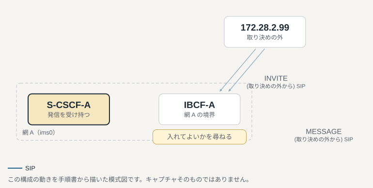

IBCF-A の SIP のスタックは、手持ちのどのトランザクションにも属さない要求を受けると、何かをする前に、それを入れてよいかを IBCF に尋ねます。

[internal/ibcf/ibcf.go](../../../internal/ibcf/ibcf.go)

```go
func (b *IBCF) Screen(req *sip.Message, source sip.Destination) bool {
	if _, ok := b.peers.BySource(source.Addr.Addr()); ok {
		return true
	}
	b.log.Info("discarded a request from an address of no peer network", "method", string(req.Method),
		"source", source.String(), "call_id", req.Get("Call-ID"))
	b.metrics.discard(DiscardUnknownSource, req.Method)
	return false
}
```

送信元のアドレスが、設定でどれかの相手網の送信元として挙げた `sources` にあれば true です。無ければ、ログに書き、捨てた要求として数えて、false を返します。スタックは false の要求について、トランザクションを作らず、100（Trying）も誤りの応答も返さず、先へも渡しません。どのメソッドでも、再送でも同じです。捨てた要求のことは何も覚えていないので、再送もそのたびに尋ねて捨てます。取り決めを結んでいない送り手には、そこに SIP のノードがあることさえ知らせないためです。網 A のキャプチャには、このホストのものは何も残りません。

取り決めの中にいる相手網には、応答で断ります。前の節の 405 がその例です。

## 網をまたぐショートメッセージ

UE A1 が UE B1 にショートメッセージを送ると、MESSAGE も境界を越えます。

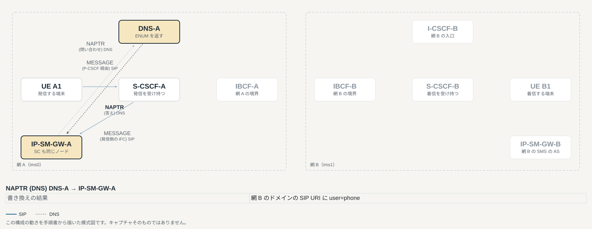

UE A1 の MESSAGE は、ショートメッセージの章と同じく、発信側のフィルタ条件で IP-SM-GW に届きます。SC のスタブは、まず網 A の HSS に番号を問い合わせ、利用者がいないと答えられます。設定に `ibcf` があるので、続けて ENUM を引き、番号が網 B のドメインにあると分かります。SC はメッセージを受け付け、UE A1 には submit report が届きます。

IP-SM-GW は、網 B のドメインの SIP URI 宛ての MESSAGE に SMS-DELIVER を入れ、IBCF-A を Route に入れて送ります。差出人は、番号で表した SC（`tel:+12025550100`）です。網 A のホスト名を境界の外に出さないためです。どちらの取り決めも MESSAGE を認めているので、MESSAGE は境界を越えます。網 B では、I-CSCF が Request-URI を tel URI に直し、S-CSCF が着信側のフィルタ条件で網 B の IP-SM-GW に渡します。TS 23.204 6.4a の手順 2 は、別の IMS 網からのショートメッセージが、利用者を担当する IP-SM-GW に届くとしています。条件は、P-Asserted-Identity が自網の IP-SM-GW でない MESSAGE に当たるように書いてあるので、IP-SM-GW が UE B1 へ送り直す MESSAGE が、S-CSCF と IP-SM-GW のあいだを回り続けることはありません。

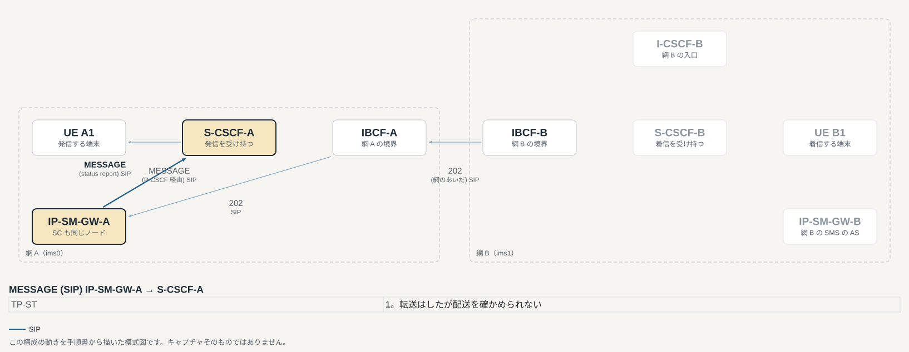

網 B の IP-SM-GW は 202 を返し、202 は来た道を網 A まで戻ります。delivery report は境界を越えて戻らないので、網 A の SC の仕事はここで終わります。UE A1 への status report は TP-ST 1 で、「SC は SME に転送したが、届いたかは確かめられない」という意味です（TS 23.040 9.2.3.15）。網 B の IP-SM-GW は、自分の MESSAGE で UE B1 に SMS-DELIVER を届け、RP-OA には網 A の SC が残ります。

この運び方は、標準の道ではありません。MSISDN を持つ利用者の標準の道では、SC から SMS-GMSC に渡り、SMS-GMSC が網 B の HSS に問い合わせ、MAP か SGd で網 B の IP-SM-GW に渡します（TS 23.204 6.4）。この構成には SMS-GMSC も MAP も無いので、TS 23.204 6.3a と 6.4a が MSISDN の無い利用者のために IMS 網のあいだで運ぶ方法にならい、SIP で II-NNI を通します。簡略化の 1 つです。

## 境界を越える会議

IBCF は Contact をいつも替えるわけではありません。TS 24.229 5.10.5 は、GRUU の Contact と、その URI で相手が何をできるかを示す feature tag の付いた Contact を、届いたまま渡すよう求めています。例に挙がっているのが、会議のフォーカスを示す `isfocus` です。

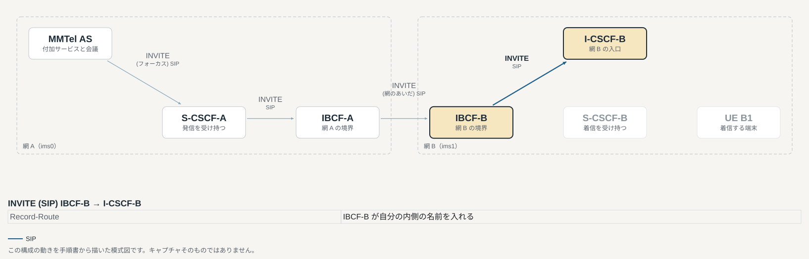

網 A の MMTel AS がフォーカスとして網 B の利用者を招くとき、INVITE の Contact は会議の URI に `isfocus` を付けたものです。参加者は、この URI を控えて会議の状態を購読し（TS 24.147 5.3.1.3.2）、会議に戻るときにも使います。そのため、参加者にそのまま届かなければなりません。IBCF はこの Contact をそのまま渡すとき、Record-Route に自分の URI を入れます。会議の URI に宛てた要求が、やはり自分を通るようにするためです。網のあいだの INVITE の Record-Route は、これだけです。

参加者が最初に試すダイアログの外の SUBSCRIBE は、境界を越えません。IBCF-B が局所的な方針で 403 を返し、参加者は会議のセッションのダイアログの中で購読し直します。TS 24.147 5.3.1.2 が、403 のあとにそうするとしています。ダイアログの外の SUBSCRIBE は自分のダイアログを作るので、IBCF はそれも両側で持たなければなりません。この実装はその部分を作っていないので、越えさせません。

## IBCF の台が起動し直したとき

呼の 2 つのダイアログは、その INVITE を受けた IBCF の台のプロセスの中にあります。そのプロセスが止まると呼も止まりますが、両側はそれを知りません。どちらも自分のダイアログを持ったままで、TrGW もコンテキストを持ったままです。TS 24.229 5.10.2.2 の手順 2 と 5.10.3.2 の手順 2 は、伝送の面を制御する IBCF が、自分でセッションを解放できるように、呼の Contact、CSeq、Record-Route を覚えておくとしています。

IBCF の各台は、こうした記録を自分の名前の下に、呼ごとに `Store` に置きます。同じ名前で起動し直した台は、UA を動かす前に自分の記録を読み、次の関数で終わらせます。

[internal/ibcf/recovery.go](../../../internal/ibcf/recovery.go)

```go
func (b *IBCF) ReleaseLeftovers(records []CallRecord) {
	var wg sync.WaitGroup
	for _, r := range records {
		log := b.log.With("call_record", r.ID, "peer", r.Peer, "direction", string(r.Direction))
		log.Info("ending a call that an earlier process of this instance left")
		if r.Media != nil {
			b.releaseMedia(*r.Media, log)
		}
		for _, d := range []struct {
			s      side
			dialog *sip.Dialog
		}{{b.inside(), r.Home}, {b.outside(), r.PeerSide}} {
			if d.dialog == nil {
				continue
			}
			wg.Add(1)
			go func(s side, dialog sip.Dialog) {
				defer wg.Done()
				b.byeInLeftover(s, dialog)
			}(d.s, *d.dialog)
		}
		if err := b.store.DeleteCall(context.Background(), r.Instance, r.ID); err != nil {
			// The record stays for the next process of the instance,
```

記録ごとに、TrGW のコンテキストを解放し、2 つのダイアログ（`r.Home` が自網の側、`r.PeerSide` が相手網の側）のそれぞれで BYE を送り、記録を消します。BYE の CSeq は、`byeInLeftover` が記録の値より十分に大きくします。記録を書いたあとも、ダイアログが進んでいたかもしれないためです（RFC 3261 12.2.2）。応答される前の呼の記録にはダイアログが無いので、コンテキストだけを解放します。各台は自分の記録だけを読むので、網全体の呼を探し回る台はありません。

記録が残るのは、記録を持つ `Store` が残るあいだだけです。設定に種類が `valkey` の `store` の節があるノードは、記録をその保存先に置くので、コンテナを作り直しても読み出せます。この構成の 2 つの IBCF には `store` の節が無く、記録はプロセスのメモリの中にあります。そのため通話中に IBCF-A を作り直すと、新しいプロセスは何も読まず、何も終わらせません。通話の一方の BYE には新しいプロセスが 481 を返し、TrGW-A はその呼のコンテキストを確保したままになります。

## 簡略化していること

この章に関わる主な簡略化です。どれも、コードに `SIMPLIFIED:` のコメントがあります。

| 場所 | 省いたこと | 理由 |
| --- | --- | --- |
| IBCF | ローミングなしの II-NNI だけ。REGISTER は越えない（405） | ローミングはこのプロジェクトの範囲の外 |
| IBCF | ダイアログの外の要求のうち、越えるのは INVITE と MESSAGE だけ。SUBSCRIBE には 403 を返す | ダイアログの外の SUBSCRIBE のダイアログを両側で持つ部分を作っていない |
| IBCF | 課金のデータを扱わず、IBCF からセッションタイマーも求めない | このプロジェクトのノードは課金の記録を作らない |
| 境界 | コーデックの変換をしない | 変換には TrGW にコーデックが要り、ノードは AMR を符号化も復号もしない |
| 境界 | IPv4 だけで、TrGW に通すのは最初の音声のストリームだけ | 2 つの網は IPv4 だけで、UE は音声のストリームを 1 つだけ offer する |
| Ix | H.248 ではなく、メディア中継ノードの HTTP の制御 API で TrGW を動かす | P-CSCF が同じ API で動かす中継ノードを使う |
| SC | 相手網の利用者を、SMS-GMSC で相手網に尋ねるのではなく ENUM で探す | SMS-GMSC、MAP、S6c が無い |
| IBCF | 二度と起動しない台の記録は、TrGW のコンテキストと一緒に `Store` に残る | 台は同じ名前で起動し直す |

## この説明の根拠

この章の説明は、次のコードと試験に照らして確かめたものです。どの試験も、このリポジトリの Go の試験として通ることを確かめています。

- `internal/scscf/session_test.go` の `TestOriginatingCallToAnotherNetworkLeavesThroughTheIBCF` と `TestHomeNetworkCallsStayInside`。ENUM が相手網のドメインを返した番号と、そのドメインの SIP URI が、Route の先頭の IBCF へ送られ、S-CSCF が Record-Route に残ること、自網の番号とノードへの呼は IBCF を通らないことを確かめています。
- `internal/icscf/icscf_test.go` の `TestCallToANumberInASIPURIGoesOnAsATelURI`。相手網が `user=phone` の SIP URI で送った番号を、I-CSCF が HSS に尋ねる前に tel URI に直し、S-CSCF に tel URI が届くことを確かめています。
- `internal/ibcf/network_test.go` の `TestCallAcrossTheBorder`。2 つの網を 1 つのプロセスで動かし、境界を越える通話のダイアログごとに Call-ID が違うこと、どちらの網にも相手網の中を指すものが届かないこと、各側の SDP が自網の TrGW を指すこと、BYE で両方の TrGW のコンテキストが解放されることを確かめています。この試験の網には MMTel AS が無いので、ダイアログは 3 つです。
- `internal/ibcf/network_test.go` の `TestTrustedPeerGetsTheAssertedIdentity`。信頼する相手には信頼ドメインのヘッダが越え、P-Charging-Function-Addresses はどの相手にも越えないことを確かめています。
- `internal/ibcf/network_test.go` の `TestMismatchedProfiles`。食い違った取り決めで、MESSAGE が 405、コーデックが 488、番号が 404 で断られ、合わせた取り決めで通ることを確かめています。
- `internal/ibcf/network_test.go` の `TestRequestFromNoPeerIsDiscarded`。取り決めの外のホストからの INVITE、その再送、CANCEL、ACK、MESSAGE に何も返らず、網 A に何も入らないことを確かめています。
- `internal/ibcf/network_test.go` の `TestMessageAcrossTheBorder`。取り決めが認めた MESSAGE が境界を越え、TrGW を使わないことを確かめています。
- `internal/ibcf/focus_test.go` の `TestConferenceFocusAcrossTheBorder`。会議の URI へのダイアログの外の SUBSCRIBE に網 B の IBCF が 403 を返すことを確かめています。
- `internal/ibcf/network_test.go` の `TestRestartedInstanceEndsTheCallsItLeft`。同じ名前で起動し直した台が、前のプロセスの残した呼の TrGW のコンテキストを解放し、2 つのダイアログに BYE を送ることを、プロセスの中の `Store` と、共有の保存先の上の `Store` の両方で確かめています。
- `internal/interconnect` の `TestScreenMethod`、`TestFilterCodecs`、`TestNormalizeNumber`。メソッド、コーデック、番号の検査を 1 つずつ確かめています。

図は、この構成の動きを手順書から描いた模式図で、キャプチャそのものではありません。

## 自分で動かす場合

この章を読むのに、構成を動かす必要はありません。実際のキャプチャで同じ流れを見たいときは、手順書の [動かす](../../guide/ja/interconnect.md#動かす) と [各キャプチャに見えるもの](../../guide/ja/interconnect.md#各キャプチャに見えるもの) に手順があります。取り決めを替えて食い違いを起こす方法は [プロファイルが食い違うとき](../../guide/ja/interconnect.md#プロファイルが食い違うとき) にあります。スライドでは [網間接続のデッキ](../../../slides/decks/ja/10-interconnect.md) の「網 A から網 B への通話」から「境界を越える会議」までのシーンが、この章とほぼ同じ順に 1 区間ずつ進みます。
