# iFC と MMTel AS の付加サービス

着信を転送している電話にかけると、別の電話が鳴ります。それを決めるのは着信者の MMTel AS です。S-CSCF は iFC の条件に従って INVITE を AS に渡し、P-Served-User で「誰の、どちらの側の通話か」を伝えるだけです。AS はそれを見て、その側のサービスを決まった順に動かします。どのサービスを動かすかは、HSS にある利用者の文書の規則で決まり、利用者は Ut の XCAP でその規則を変えます。

この章では、条件が変わると何が変わるかを追います。iFC の session case が変われば、AS が動かすサービスが変わります。文書の規則が変われば、同じ INVITE への AS の答えが変わります。CFNR では、タイマーの長さが CANCEL の時刻を決めます。2 人が同じ文書を同時に変えれば、片方の PUT が 412 になります。どれも、判断する関数と、それを確かめる試験に結び付けて説明します。

## この章で扱う構成と版

例は `deploy/compose` の構成です。UE 1（`tel:+12025550101`）が発信し、UE 2（`tel:+12025550102`）がサービスを設定する利用者（served user）、UE 3（`tel:+12025550103`）が UE 2 の着信の転送先です。S-CSCF は 3 人をすべて担当し、MMTel AS は 1 台です。図では、受け持つ利用者ごとに AS を 2 か所に描きます。

AS の位置と、S-CSCF が要求を AS に渡す仕組みの全体は [アプリケーションサーバーが加えるサービス](services.md) の章にあります。この章はその続きです。INVITE、PRACK、ACK の読み方は [番号から相手の電話へ](call.md) の章を前提にします。

条項番号は、手順書と同じ次の版のものです。TS 24.229 V20.1.0、TS 24.604 V19.0.0（CDIV）、TS 24.607 V19.1.0（OIP、OIR）、TS 24.608 V19.0.0（TIP、TIR）、TS 24.611 V19.0.0（規制）、TS 24.615 V19.0.0（CW）、TS 24.623 V19.0.0（Ut）、TS 29.364 V19.1.0（サービスのデータ）、TS 29.328 V20.0.0（Sh）、GSMA IR.92 v24.0。

## iFC の条件と、AS が答えないときの扱い

### 1 つの条件が一致するとき

S-CSCF は、利用者のプロファイルの iFC を優先度の小さい順に照らし合わせます（TS 24.229 5.4.3.2 step 3、5.4.3.3 step 2A）。この構成の MMTel AS のための条件は 4 つです。

| 優先度 | 一致する要求 | DefaultHandling |
| --- | --- | --- |
| 10 | INVITE、ORIGINATING_REGISTERED | SESSION_TERMINATED |
| 11 | INVITE、TERMINATING_REGISTERED | SESSION_CONTINUED |
| 12 | INVITE、TERMINATING_UNREGISTERED | SESSION_CONTINUED |
| 13 | INVITE、ORIGINATING_CDIV | SESSION_TERMINATED |

1 つの条件の trigger point は、SPT（Service Point Trigger）の集まりです。この構成の条件は、グループ 0 にメソッドの SPT、グループ 1 に session case の SPT を置き、`ConditionTypeCNF` を真にしています。真のときは、どのグループにも成り立つ SPT が 1 つあれば、条件が一致します。

[internal/ifc/ifc.go](../../../internal/ifc/ifc.go)

```go
func (t TriggerPoint) matches(req *sip.Message, sc SessionCase) bool {
	groups := map[int][]bool{}
	for _, spt := range t.SPT {
		result := spt.matches(req, sc) != spt.ConditionNegated
		for _, g := range spt.Group {
			groups[g] = append(groups[g], result)
		}
	}
	if t.ConditionTypeCNF {
		// Every group needs one SPT that holds.
		for _, results := range groups {
			if !slices.Contains(results, true) {
				return false
			}
		}
		return true
	}
	// One group needs all of its SPTs to hold.
	for _, results := range groups {
		if !slices.Contains(results, false) {
			return true
		}
	}
	return false
}
```

入力は要求 `req` と、S-CSCF がいま扱っている session case `sc` です。SPT ごとに `spt.matches` を求め、`ConditionNegated` なら結果を反転して、グループごとに結果を集めます。`ConditionTypeCNF` が真なら、成り立つ SPT が 1 つも無いグループがあれば `false` を返します。偽なら、すべての SPT が成り立つグループが 1 つあれば `true` です。session case の SPT は `*s.SessionCase == sc` を比べるだけなので、同じ INVITE でも、発信側の S-CSCF では優先度 10 に、着信側の S-CSCF では優先度 11 に一致します。どの条件も 1 つの session case にしか一致しないので、4 つが互いに競うことはありません。SMS の 3 つの条件（優先度 0 から 2）は REGISTER と MESSAGE の条件で、INVITE には一致しません。

### DefaultHandling が発信側と着信側で違う理由

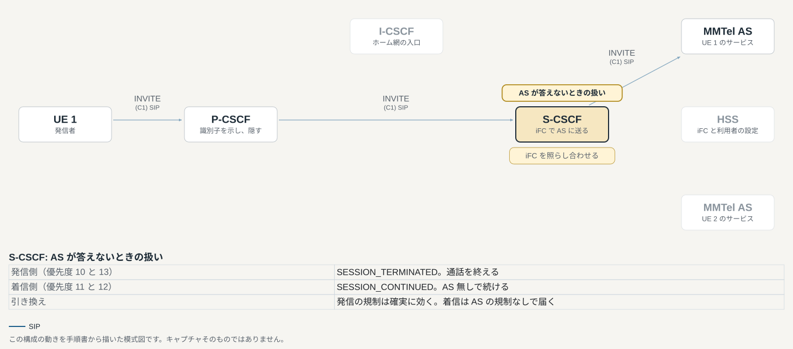

DefaultHandling は、AS に届かないときや、AS が暫定応答を出す前に 408 か 5xx で答えたときの扱いです。発信側の条件（優先度 10 と 13）は SESSION_TERMINATED、着信側の条件（11 と 12）は SESSION_CONTINUED です。

発信側だけを終わらせるのは、規制を確実に効かせるためです。発信の規制（BAOC など）は発信側の AS が掛けます。AS が答えないときに AS を通さずに通話を続けると、利用者が規制した通話がつながってしまいます。着信側の AS が担うのは、転送、着信の規制、識別子の扱いです。着信側を止めると、AS の故障がそのまま着信の失敗になるので、この構成は AS 無しで着信者へ続けます。代わりに、そのあいだは着信の規制も転送も効きません。

どの応答のときに DefaultHandling が働き、どの応答では働かないか、続けるか終えるかで何を失うかは、[アプリケーションサーバーが使えないとき](design-as-unavailable.md) の章で比べます。

## session case と P-Served-User

### AS は P-Served-User で側を知る

S-CSCF は、一致した条件の session case を P-Served-User に書いて AS に渡します（TS 24.229 5.4.3.2 step 5 b、5.4.3.3 step 4 c）。

```text
P-Served-User: <sip:+12025550101@…>;sescase=orig;regstate=reg
P-Served-User: <sip:+12025550102@…>;sescase=term;regstate=reg
P-Served-User: <sip:+12025550102@…>;sescase=term;regstate=unreg
P-Served-User: <sip:+12025550102@…>;orig-cdiv;regstate=reg
```

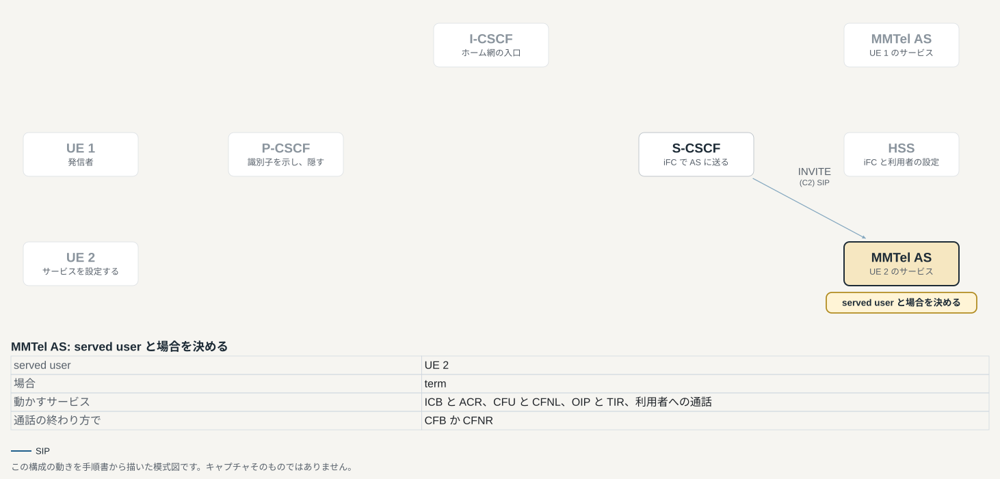

AS は INVITE を受けると、まず P-Served-User を読みます。

[internal/mmtel/call.go](../../../internal/mmtel/call.go)

```go
func (as *AS) serve(in *sip.IncomingCall) {
	req := in.Request
	log := as.log.With("call_id", req.Get("Call-ID"))
	// TS 24.229 5.7.1.3A: the S-CSCF names the served user in
	// P-Served-User, and this S-CSCF always adds the session case. A
	// request without one came by no filter criterion. The INVITE to a
	// conference URI comes that way, by DNS (conference.go).
	served, err := sip.ParsePServedUser(req.Get("P-Served-User"))
	if err != nil || served.SessionCase == sip.SessionCaseNone {
		if _, ok := as.conferenceID(req.RequestURI); ok {
			as.joinConference(in, log)
			return
		}
		log.Info("INVITE without a served user and its session case", "p_served_user", req.Get("P-Served-User"))
		in.Reject(403, as.warning("No served user"))
		return
	}
```

`sip.ParsePServedUser` が P-Served-User を読み、`served.SessionCase` が空でなければ、そのあとで `run` が場合ごとの手順に分かれます。P-Served-User の無い INVITE は、iFC で届いたものではありません。AS は、会議の URI 宛てのものなら会議に入れ（[MRF の音声ガイダンス、呼び出し音、会議](mrf.md)）、そうでなければ 403 で断ります。誰のためのサービスを動かせばよいかが分からないからです。

### 場合ごとのサービスの順

| 場合 | AS が動かすサービスの順 |
| --- | --- |
| orig | OCB、OIR、応答に TIP |
| term | ICB と ACR、CFU と CFNL、OIP と TIR、利用者への通話。終わり方で CFB か CFNR |
| orig-cdiv | 転送元の利用者の OCB |

着信側の手順は次の関数です。

[internal/mmtel/sessioncase.go](../../../internal/mmtel/sessioncase.go)

```go
func (c *call) terminating() {
	inv, fields, err := c.newInvitation(c.in.Request.RequestURI)
	if err != nil {
		c.storeFailed(err)
		return
	}
	// ICB and ACR first: they decide on the caller's identity, which OIP
	// may take out of the request (TS 24.607 4.3.3 NOTE 2), and they come
	// before diversion (TS 24.611 4.6.7).
	info := c.callInfo(fields, inv.RequestURI)
	if c.barIncoming(info) {
		return
	}
	// CFU, and CFNL for a user who is not registered (TS 24.604 4.6.7).
	if d, ok := c.divertAtSetup(info); ok {
		c.divert(d)
		return
	}
	// OIP (TS 24.607 4.5.2.9), then TIR (TS 24.608 4.5.2.9) for the
	// responses.
	c.presentOriginatingIdentity(&inv, fields)
	c.withholdTerminatingIdentity(fields)
	c.withhold = c.withholdSession(info)
	// CAT (TS 24.182 4.5.5.3.7), from the MRF before the INVITE goes on.
	c.startAlertingTone(fields)
	inv.Headers = fields.Headers
	r := c.attempt(inv, c.noReplyTimer(info))
	// The callee did not answer: the tone stops before the caller hears
	// how the call goes on.
	c.stopAlertingTone("the leg to the served user ended")
	// CFB, CFNRc and CFNR, on how the leg to the served user ended (TS
	// 24.604 4.5.2.6.3).
	if d, ok := c.divertOn(r, info); ok {
		c.divert(d)
		return
	}
	c.finish(r)
}
```

規制が最初です（TS 24.611 4.6.7）。`barIncoming` が通話を断れば、そこで終わり、転送も呼び出しもしません。次に `divertAtSetup` が CFU と、登録していない利用者の CFNL を評価します。どちらも INVITE が届いた時点で転送するので、利用者を呼び出しません。そのあと OIP、TIR、CAT を INVITE に当て、`c.attempt` が利用者への区間を試します。`attempt` の結果 `r` が、利用者がどう答えたかです。`divertOn` は、486 なら CFB、無応答のタイマーが切れたなら CFNR、届かなかったなら CFNRc として規則を評価します。どれにも当たらなければ `c.finish(r)` が利用者の答えをそのまま発信者に返します。

この順のため、着信を規制し、かつ CFU も設定している利用者への通話は、転送されずに断られます。また CFU では UE 2 の電話は鳴らず、CFNR では鳴ります。CFU は `attempt` より前に、CFNR は `attempt` のあとに決まるからです。

## ODI と 3 つのダイアログ

### AS は routeing B2BUA

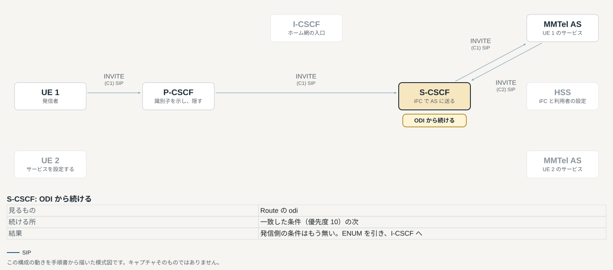

MMTel AS は routeing B2BUA です（TS 24.229 5.7.5）。受けた INVITE に UA として答え、自分の Call-ID で新しい INVITE を、残りの Route に沿って送ります。新しい INVITE は ODI を持って S-CSCF に戻り、S-CSCF は一致した条件の次から照らし合わせを続けます。SMS のデッキの IP-SM-GW は何も送り返しませんが、MMTel AS は送り返します。

プロキシではなく B2BUA なのは、どのサービスも B2BUA を必要とするからです。CFNR は呼び出している区間を AS が自分で CANCEL し、別の宛先へ新しい INVITE を送ります。To を変える転送、From を匿名にする OIR、発信者に音声ガイダンスを流してから断る規制、会議も、AS が自分のダイアログを持たなければできません。TS 24.604 4.5.2.6.0 は To を変えずに転送する AS にはプロキシとして動くことも認めていますが、この AS はどのサービスでも B2BUA として動きます。

### キャプチャでの見え方

UE 1 から UE 2 への通話は、ダイアログ C1、C2、C3 の 3 つになります。

```text
 UE 1 ... S-CSCF -- AS(UE 1) -- S-CSCF ... I-CSCF ... S-CSCF -- AS(UE 2) -- S-CSCF ... UE 2
 |<------ C1 ------>|<------------------ C2 ------------------->|<--------- C3 ---------->|
```

| 見るもの | 見どころ |
| --- | --- |
| Call-ID | 1 つの通話に 3 つ。転送した通話ではさらに 3 つ増える。 |
| P-Charging-Vector の icid-value | 網の中では 3 つとも同じ。ラボはこれで 1 つの通話にまとめる。 |
| LIR | ダイアログ C2 のもの。 |
| PRACK と ACK | ダイアログごとに進む。200 が UE 1 に届くより先に、ACK が UE 2 に届くことがある。 |
| BYE | AS が答え、同じ Reason を付けた新しい BYE を次に送る。 |

LIR が C2 のものなのは、S-CSCF が ENUM を引いて I-CSCF に送るのが、UE 1 の AS が送り返した INVITE だからです。200 が UE 1 に届くより先に ACK が UE 2 に届くことがあるのは、AS が自分の側で受けた 2xx にすぐ ACK を返すからです。P-Charging-Vector は P-CSCF が UE に送るものから消すので、UE との区間には出ません。

転送した通話では、ダイアログの数が 6 つになります。UE 1 の発信側の C1、UE 2 の AS までの C2、UE 2 の AS から UE 2 への C3（CFU では作られない）に加えて、転送の INVITE の C4、転送元の利用者の発信側のサービスを通った C5、UE 3 の AS から UE 3 への C6 です。手順書のシーケンス図には C1 から C6 までが並んでいます。

### 転送に気づく S-CSCF

AS が着信側の INVITE を別の宛先に送り返したとき、S-CSCF はそれを転送だと気づき、着信側の iFC を照らすのをやめます（TS 24.229 5.4.3.3 step 3）。そのあと転送元の利用者の発信側のサービスを動かすかどうかは、標準では決まっていません。S-CSCF の設定で、要求をそのまま送るか（a）、転送のあとの発信側のサービスを照らすか（b）を選びます。この S-CSCF は利用者の iFC で選びます（同じ step の NOTE 6）。この構成では転送元の利用者が ORIGINATING_CDIV の条件を持つので、発信側のサービスを続けます。

[internal/scscf/services.go](../../../internal/scscf/services.go)

```go
	if d.terminating() && !sameTarget(out.RequestURI, d) {
		s.retargeted(st, out, d, log)
		return
	}
```

入力は送り返された要求 `out` と、ODI に結び付けた状態 `d` です。着信側の場合で、Request-URI が保存した宛先（または served user の別名）と同じでなければ、`retargeted` に進みます。`retargeted` は、served user が ORIGINATING_CDIV の条件を持っていれば、その条件を転送元の利用者のために照らします。持っていなければ、発信側と同じように要求を送ります。この構成では優先度 13 が一致し、INVITE は `orig-cdiv` を付けてもう一度 AS に届きます。そこで AS が動かすのは転送元の利用者の OCB だけで、UE 2 が規制した宛先への転送はここで止まります（TS 24.611 4.6.7）。

## 設定は HSS の文書 1 つ

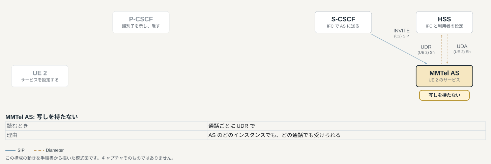

利用者ごとに XML の文書が 1 つあります。XCAP の simservs です（TS 24.623、RFC 4825）。置き場所は HSS だけで、Sh の repository data として、Service-Indication `MMTEL-Services` の下にあります（TS 29.364 7.2）。AS は通話ごとに UDR で読み、写しを持ちません。AS のどのインスタンスでも、どの通話でも受けられるようにするためです。AS を複数台にしても、設定を台どうしでそろえる必要がありません。

最初の文書には、IR.92 が求めるサービスすべての規則があります。CDIV と CB の規則は `rule-deactivated` の条件で止めてあり、転送先も空です。

[deploy/compose/hss.yaml](../../../deploy/compose/hss.yaml)

```yaml
            <cp:rule id="cfu">
              <cp:conditions><rule-deactivated/></cp:conditions>
              <cp:actions><forward-to><target/></forward-to></cp:actions>
            </cp:rule>
```

UE は規則を足しません。ある規則を変えてサービスを有効にします（GSMA IR.92 2.3.2 Note 3）。CFU を有効にするなら、この規則から `<rule-deactivated/>` を外し、`<target>` に転送先を入れます。文書のアドレスは `http://xcap.ims.mnc001.mcc001.3gppnetwork.org/simservs.ngn.etsi.org/users/<XUI>/simservs.xml` で、XUI は利用者の公開識別子です。

## Ut で規則を変える（ETag と条件付きの更新）

### 1 回の変更で送るもの

`ue xcap set cfu on tel:+12025550103` は次の要求を送ります。

| 順 | 要求 | 応答と、その間の Sh |
| --- | --- | --- |
| 1 | GET。資格情報なし | UDR は無し。401 とチャレンジ 2 つ（SHA-256、MD5）。どの利用者でも同じ。 |
| 2 | GET。`Authorization: Digest` | UDR が 2 つ。Ut のパスワードと文書。200 と `ETag: "0"`。 |
| 3 | 規則 1 つの PUT。`~~` のノードセレクタ、`If-Match: "0"` | PUR に `<SequenceNumber>1</SequenceNumber>`。PUA のあと 200 と `ETag: "1"`。 |
| 4 | GET | 設定として表示する文書。 |

最初の 401 は、AS が利用者について何も読まずに返します。チャレンジの realm はホームドメインで、どの利用者でも同じなので、XUI が実在の利用者を指していてもいなくても 401 は同じになります（TS 24.623 5.3.2.2）。2 つのチャレンジは SHA-256、MD5 の順で（RFC 7616 3.3）、UE はそのうち自分が使える最初のもの、ここでは SHA-256 に答えます。2 回目の GET の Authorization を読むと、`algorithm=SHA-256` になっています。AS はここで初めて、Service-Indication `Ut-Digest-Credential` の repository data から、パスワードそのものではなく HA1 の値を読み、答えを確かめます。

ETag は、HSS の repository data の Sequence Number です。HSS は更新のたびにこの番号を確かめて 1 つ進めます（TS 29.328 6.1.2.1）。

### 版が合わないときの 412

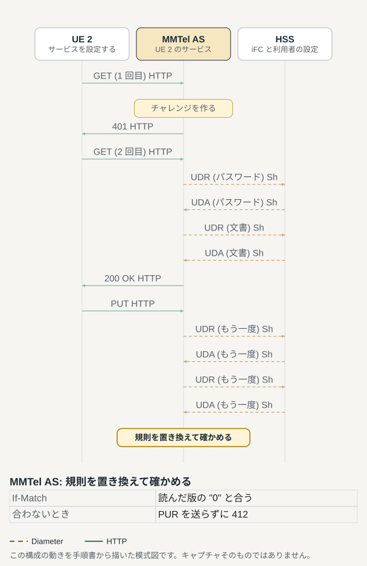

PUT を受けた AS は、文書をもう一度読み、If-Match を読んだ版の ETag と比べます。

[internal/xcap/handler.go](../../../internal/xcap/handler.go)

```go
		etag := entityTag(stored.SequenceNumber)
		if status := precondition(r, etag, true); status != 0 {
			w.Header().Set("ETag", etag)
			h.answer(w, r, t, status, "")
			return
		}
```

`stored.SequenceNumber` が HSS から読んだ版で、`entityTag` がそれを `"0"` のような ETag にします。`precondition` は If-Match がこの ETag と一致しなければ 412（Precondition Failed）を返します（RFC 4825 7.11）。そのとき AS は PUR を送らず、文書は変わりません。

文書を読んでから PUR を送るまでのあいだに、ほかの書き込みが入ることもあります。そのときは HSS が PUR を断ります。

[internal/xcap/handler.go](../../../internal/xcap/handler.go)

```go
		err = h.repo.UpdateRepositoryData(r.Context(), t.xui, simservs.ServiceIndication, stored.SequenceNumber, next.RootElement())
		if isResult(err, diameter.Experimental(sh.DiameterErrorTransparentDataOutOfSync)) {
			if conditional {
				h.answer(w, r, t, http.StatusPreconditionFailed, "the document changed meanwhile")
				return
			}
			if attempt < maxAttempts {
				continue
			}
			w.Header().Set("Retry-After", "1")
			h.answer(w, r, t, http.StatusServiceUnavailable, "the document keeps changing")
			return
		}
```

HSS の答えが DIAMETER_ERROR_TRANSPARENT_DATA_OUT_OF_SYNC（5105）なら、読んだ版がもう古いということです。If-Match か If-None-Match の付いた条件付きの要求には、AS はやはり 412 を返します。条件の無い要求なら、新しい文書を読み直して、決まった回数まで同じ変更をやり直します。UE の `ue xcap` は PUT にいつも If-Match を付けるので、UE が受け取るのは 412 です。

2 人が同時に設定を変えた例で、結果をたどります。同じ利用者の 2 台の端末が、どちらも `ETag: "0"` の文書を読みました。1 台目が CFU の規則を `If-Match: "0"` で PUT すると、文書の版は 1 に進みます。2 台目が CFB の規則を同じ `If-Match: "0"` で PUT すると、版が合わないので 412 になります。2 台目は文書を読み直し、`"1"` で PUT し直して成功します。最後の文書には CFU と CFB の両方の規則が入り、版は 2 です。どちらの変更も、もう一方を黙って上書きしません。

ラボのシーケンス図には、XCAP も Sh も出ません。どちらも SIP の要求には属さないからです。キャプチャには、80 番の HTTP と 3868 番の Diameter として残ります。ラボで CFU を有効にすると、一覧の ETag が 1 つ増えます。

## サービスごとの判断

### 通常の通話と TIP

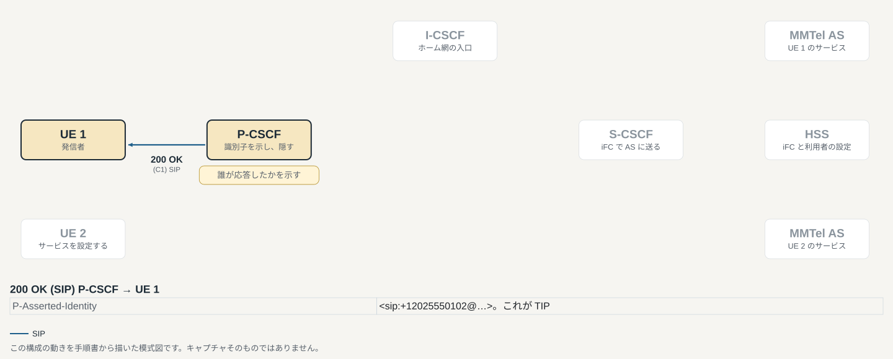

既定の文書では、AS は通話を何も変えません。それでも INVITE は AS を 2 回通り、AS はそのたびに UDR で served user の文書を読みます。どの利用者も既定で TIP を持ち、UE 2 の P-CSCF が INVITE の P-Called-Party-ID を、UE 2 の 200 OK の P-Asserted-Identity に入れます（TS 24.229 5.2.6.4.4 step 1、TS 24.608 4.5.2.4）。UE 1 はこれで、誰が応答したかを知ります。

### OIR と OIP

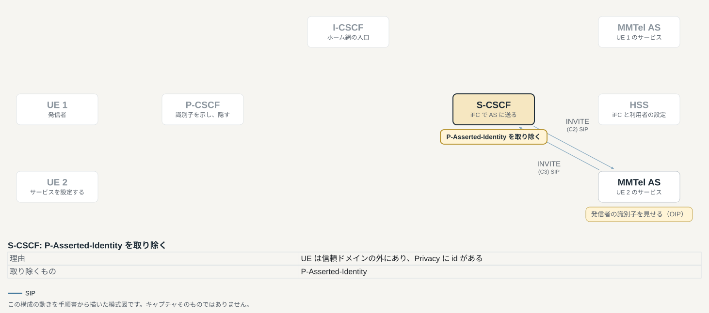

UE 1 が `ue xcap oir restricted` で既定を非通知にしてから発信すると、次のノードがそれぞれ 1 つずつ変えます。

| ノード | すること |
| --- | --- |
| UE 1 の AS | `Privacy: id` を足し、From を `"Anonymous" <sip:anonymous@anonymous.invalid>` にする。P-Asserted-Identity は残す。 |
| UE 2 の AS | OIP を動かす。`id` を残す。 |
| UE 2 の S-CSCF | P-Asserted-Identity を取り除く。UE は信頼ドメインの外にある。 |

網の中では、識別子は網が保証したまま残ります。隠すのは、信頼の範囲の外にある UE に対してだけです（TS 24.229 5.4.3.3 step 12、4.4.2）。OIR は一時モードなので、UE は `Privacy: none` を付ければ、その通話だけ番号を通知できます（TS 24.607 4.5.2.4）。TIR は同じ仕組みの逆向きです。UE 2 の AS が応答の Privacy に `id` を入れ、UE 1 の P-CSCF が P-Asserted-Identity を取り除きます（TS 24.608 4.5.2.9、RFC 3325 7）。

### CFU、CFB、CFNL

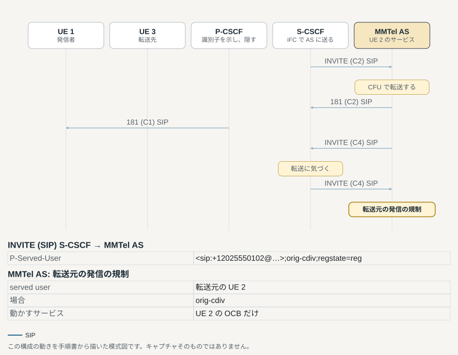

CFU では、UE 2 の AS が INVITE を受けた時点で転送します（TS 24.604 4.5.2.6.3 item 1）。発信者には 181 Call Is Being Forwarded で知らせ（4.5.2.6.4）、転送の INVITE（C4）の Request-URI に転送の理由を付けます（RFC 4458）。

| 見るもの | 見どころ |
| --- | --- |
| 転送の INVITE（C4）の Request-URI | `sip:+12025550103@…;user=phone;cause=302` |
| History-Info | index 1 が UE 2、index 1.1 が UE 3 で `mp=1`。 |
| 181 | 転送先の項目に `Privacy=history`。UE 3 が番号の表示を許すかを UE 2 の AS が知らないため。 |

理由の値は、`internal/mmtel/diversion.go` の定数のとおり、CFU が 302、CFB が 486、CFNR が 408、CFNL が 404、CFNRc が 503 です（TS 24.604 Annex C）。転送は 1 つの通話で 5 回まで（`hss.yaml` の事業者の設定）で、超えると `Warning: 399` を付けた 480 を返します（4.5.2.6.1）。

CFB では、AS はまず UE 2 を呼び出します。UE 2 が C3 に 486 Busy Here を返すと、AS は ACK を返し、181 を送って、`cause=486` で転送します。CFNL では、登録していない UE 2 への通話が、優先度 12 の TERMINATING_UNREGISTERED の条件で AS に届きます。

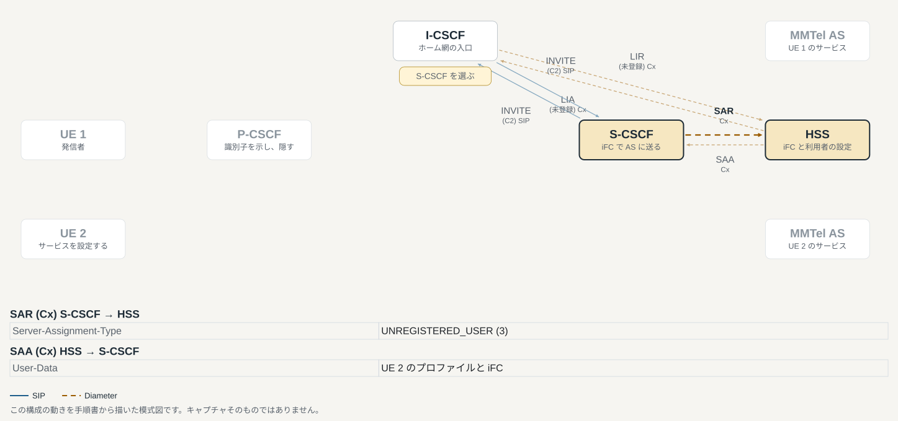

| 順 | 見るもの | 見どころ |
| --- | --- | --- |
| 1 | I-CSCF の LIR | DIAMETER_UNREGISTERED_SERVICE（2003）と S-CSCF の能力。 |
| 2 | S-CSCF の SAR | UNREGISTERED_USER でプロファイルを取る。 |
| 3 | AS への INVITE | `sescase=term;regstate=unreg` |
| 4 | AS の転送 | `<not-registered/>` の規則で、すぐに `cause=404`。 |

LIA が 2003 になるのは、どの試験用の加入者にも TERMINATING_UNREGISTERED の iFC があるからです（TS 29.228 6.1.4.1 step 3）。その iFC が無い加入者なら DIAMETER_ERROR_IDENTITY_NOT_REGISTERED になり、I-CSCF が 480 を返します。CFNL が無ければ、AS は INVITE をそのまま返し、S-CSCF が 480 を返します。

### CFNR（タイマーが CANCEL の時刻を決める）

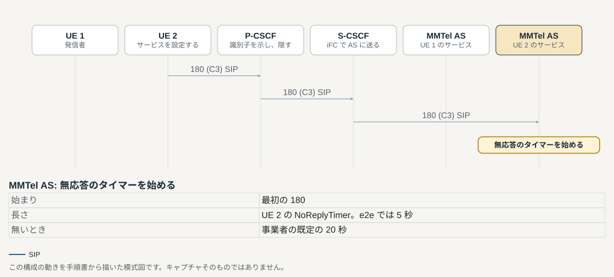

CFNR では、AS は UE 2 を呼び出しながら時間を測ります。タイマーが始まるのは、UE 2 への区間の最初の 180 が AS に届いたときです（TS 24.604 4.5.2.6.3 item 2）。

[internal/mmtel/call.go](../../../internal/mmtel/call.go)

```go
			if code == 180 && noReply > 0 && timer == nil {
				// TS 24.604 4.5.2.6.3 item 2: the first 180 starts the no
				// reply timer, and a 180 of another fork does not start
				// it again.
				timedOut = make(chan struct{})
				timer = c.as.cfg.AfterFunc(noReply, func() { close(timedOut) })
				go c.cancelOnNoReply(out, timedOut, settled)
			}
```

`attempt` は UE 2 への区間の応答を 1 つずつ受け取ります。`code == 180` で、タイマーの長さ `noReply` が 0 でなく、まだタイマーが無いときだけ、`AfterFunc` でタイマーを始めます。`timer == nil` の条件があるので、フォークのほかの分岐から来た 2 つ目の 180 では、タイマーをやり直しません。タイマーが切れると `cancelOnNoReply` が、`Reason: SIP;cause=408;text="Request Timeout"` を付けた CANCEL を UE 2 への区間に送ります。

長さは次の関数が決めます。

[internal/mmtel/diversion.go](../../../internal/mmtel/diversion.go)

```go
// noReplyTimer is how long the leg to the served user may ring before
// CFNR diverts the call: the NoReplyTimer of the user, or else the
// operator's default (TS 24.604 4.8.1, 4.9.1.1A). It is 0 when no rule
// for no answer can match this call, so that no timer runs. An operator
// default below the least time a user may set (5 s) counts as that
// time.
func (c *call) noReplyTimer(info simservs.CallInfo) time.Duration {
	cdiv := c.communicationDiversion()
	if cdiv == nil || !simservs.EvaluateDiversion(&cdiv.CommunicationDiversion, simservs.OnNoAnswer, info).Diverts() {
		return 0
	}
	return time.Duration(max(cdiv.NoReplyTimer(), simservs.MinNoReplyTimer)) * time.Second
}
```

無応答の規則が一致しない通話では 0 を返し、タイマーは動きません。規則があれば、利用者の `NoReplyTimer` を使い、それが無ければ事業者の既定値を使います（TS 24.604 4.8.1）。この構成の `hss.yaml` では、利用者の文書の `NoReplyTimer` も事業者の既定値も 20 秒です。利用者は `ue xcap noreply` で 5 秒から 180 秒のあいだに変えられます（4.9.1.1A）。

そのため、180 から CANCEL までの時間は、この値そのものになります。`noreply 5` なら 5 秒、`noreply 10` に変えれば約 10 秒です。e2e のスクリプトは 5 秒に設定し、手順書のキャプチャでは、最初の 180 の 5.0 秒あとに CANCEL が出ています。10 秒の例は、この関数と試験から導いた値で、著者がキャプチャで測ったものではありません。

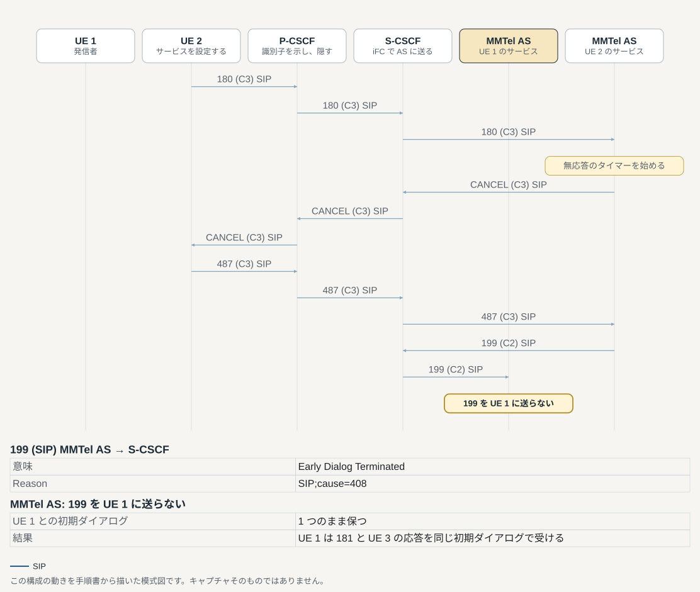

CANCEL のあと、UE 2 は 487 で答え、UE 2 への区間が終わります。UE 2 の AS は、C2 に 199 Early Dialog Terminated を送って UE 2 の初期ダイアログを終わらせます（RFC 6228）。UE 1 の AS は UE 1 との初期ダイアログを 1 つのまま保ち、199 を UE 1 には送りません。そのため UE 1 は、181 と UE 3 の応答を同じ初期ダイアログで受けます。181 から先は CFU と同じで、`cause=408` で転送します。

### 規制

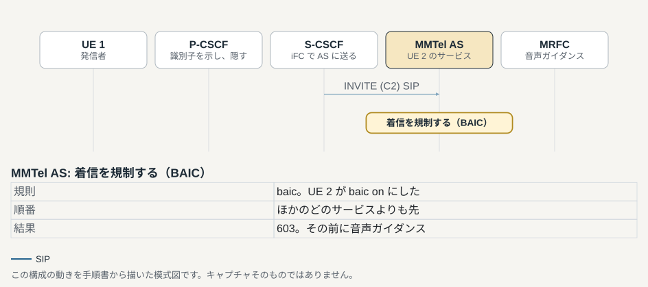

| サービス | 設定 | 見どころ |
| --- | --- | --- |
| BAIC | UE 2 の `baic on` | UE 2 の AS が 603 Decline。ほかのどのサービスよりも先。 |
| ACR | `<anonymous/>` の規則 | 433 Anonymity Disallowed。 |
| BAOC | UE 1 の `baoc on` | UE 1 の AS が 603。自分の INVITE を送らない。緊急通報は規制しない。 |
| BOIC、BOIC-exHC | `boic on` など | 着信者の国番号をホーム網の `1` と比べる。 |

603 や 433 の前に、発信者には音声ガイダンスが流れます。AS は MRFC に SDP の無い INVITE を送り、MRFP の SDP と `P-Early-Media: sendonly` を付けた 183 を発信者に返します。その流れは [MRF の音声ガイダンス、呼び出し音、会議](mrf.md) の章で追います。

BOIC は国際発信の規制です。国際かどうかは、次の関数が着信者の番号の国番号で決めます。

[internal/simservs/evaluate.go](../../../internal/simservs/evaluate.go)

```go
// SIMPLIFIED: TS 24.611 4.9.1.4. The country of a number is read from
// its country code, so countries that share a code (the NANP countries
// under 1) count as one. A number without a country code (a local number
// with phone-context) is taken to be in the country of the served user.
// Number plans per country are out of scope.
func international(call CallInfo) bool {
	number, ok := telephoneNumber(call.CalledIdentity)
	if !ok || call.HomeCountryCode == "" || !strings.HasPrefix(number, "+") {
		return false
	}
	located := call.VisitedCountryCode
	if located == "" {
		located = call.HomeCountryCode
	}
	return !strings.HasPrefix(number[1:], located)
}
```

入力は通話の情報 `call` で、着信者の番号 `CalledIdentity` と、ホーム網の国番号 `HomeCountryCode` を持っています。この構成の国番号は `deploy/compose/mmtel.yaml` の `1` です。利用者が国外にいなければ、`located` はホーム網の国番号になります。番号が `+1` で始まれば国際ではありません。そのため、UE 1 が `boic on` にして UE 2（`tel:+12025550102`）にかけても、通話は規制されません。UE 2 の国番号はホーム網と同じ 1 だからです。コメントにあるとおり、国番号 1 を共有する北米番号計画の国々は 1 つの国として扱う簡略化です。

### CW と HOLD

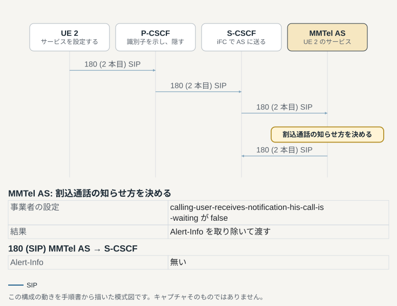

IR.92 は割込通話を網ではなく UE で行うよう求めています（2.3.4）。通話中の UE 2 は、2 本目の着信に `Alert-Info: <urn:alert:service:call-waiting>` の 180 を返します（TS 24.615 4.5.5.3.2、RFC 7462）。AS はそれを渡すか、事業者の設定で Alert-Info を取り除きます（4.5.5.2.3）。この網の文書は `calling-user-receives-notification-his-call-is-waiting` が `false` で、発信者に知らせない設定です。保留は `a=sendonly` の re-INVITE で、AS はもう一方の側に届いたまま渡します（TS 24.610 4.5.2.1）。

## キャプチャで見るもの

| サービス | きっかけ | キャプチャで見るもの |
| --- | --- | --- |
| OIR | 発信者の既定が非通知 | 匿名の From、`Privacy: id` |
| CFU、CFB、CFNR、CFNL | 着信、486、無応答、未登録 | 181、History-Info、`cause=` |
| BAIC、ACR、BAOC | 着信、匿名の着信、発信 | 183 で音声ガイダンス、そのあと 603 か 433 |

e2e のスクリプトは、すべてのサービスを 1 つのキャプチャに残します。サービスごとの表示フィルタは、手順書の「Wireshark の表示フィルタ」の表にあります。

## 簡略化していること

| 場所 | 主なもの |
| --- | --- |
| AS | 181 で音声ガイダンスを流さない。設定を購読せず、通話ごとに読む。BIC-Roam は成り立たない。 |
| XCAP | GBA が無い。キャプチャで XML を読めるように平文の HTTP。nonce count の繰り返しに気づかない。xcap-diff の購読が無い。 |
| simservs | 一部の条件と serv-cap が無い。国は国番号で決め、国番号 1 の国々は 1 つになる。 |
| CSCF と HSS | History-Info の非通知を掛けない。公開サービス識別子と ORIGINATING_UNREGISTERED が無い。 |

nonce count を確かめないのは、AS を複数のインスタンスで動かすための代わりです。数を覚えるには、どのインスタンスも共有する Store が要ります。PUT にはいつも If-Match が付くので、文書が変わったあとの繰り返しは 412 になります。どの項目にも、コードに `SIMPLIFIED:` で始まるコメントがあり、項目ごとの条項と理由は手順書の表にあります。

MRF の章で見る音声ガイダンス、呼び出し音、会議も、頼むのはこの MMTel AS です。VoLTE の通話も、すべてこの AS を通ります。

## この説明の根拠

著者は次の試験を実行し、通ることを確かめました。

- `internal/ifc` のパッケージの試験。trigger point の照らし合わせを確かめます。
- `internal/scscf/services_test.go` の `TestPServedUser`、`TestTerminatingApplicationServer`、`TestDefaultHandling`。P-Served-User、着信側で AS が宛先を変えたときの経路、DefaultHandling ごとの結果を確かめます。`TestDefaultHandling` が使うのは SMS の条件で、試験の相手役が返す 486 は一般の応答ではありません。
- `internal/mmtel/relay_test.go` の `TestINVITEWithoutAServedUser`。P-Served-User の無い INVITE に 403 を返すことを確かめます。
- `internal/mmtel/diversion_test.go` の `TestCommunicationForwardingNoReply`。無応答のタイマーが最初の 180 で始まり、長さが利用者の 5 秒であること、切れると Reason が SIP cause 408 の CANCEL が出て、発信者に 199、181 が届き、転送の INVITE が `cause=408` を持つことを確かめます。タイマーは試験が手で切るので、実際に 5 秒待つ試験ではありません。`TestNoReplyTimerOnlyWithARule` は、無応答の規則が無ければタイマーが動かないことを確かめます。
- `internal/mmtel/network_test.go` の `TestCFUSetOverUt`、`TestCFBThroughTheIMS`、`TestCFNRThroughTheIMS`、`TestCFNLThroughTheIMS`、`TestBarringThroughTheIMS`、`TestHoldThroughTheIMS`。IMS 全体を 1 つのプロセスで動かし、各サービスの結果を確かめます。
- `internal/xcap/handler_test.go` の `TestConcurrentWritersRetry` と `TestWriterBetweenReadAndWrite`。古い版の PUT が 412 になり、読み直した PUT が通ること、読んでから書くまでのあいだに別の書き込みが入ると、条件付きの PUT は 412、条件の無い PUT はやり直して通ることを確かめます。上の 2 台の端末の例は、前の試験の手順です。
- `internal/xcap/digest_test.go` の `TestChallengeOrder`。チャレンジが SHA-256、MD5 の順に出ることを確かめます。
- `internal/simservs/evaluate_test.go` の `TestEvaluateOutgoingBarring`。ホーム網の国番号が 1 のとき、`tel:+12025550180` への通話を BOIC が規制しないことを確かめます。

表の値は試験、`deploy/compose` の設定、手順書のものです。図は手順書から描いたこの構成の動きの模式図で、キャプチャそのものではありません。

## 自分で動かす場合

構成を起動してサービスを 1 つずつ試す手順は、手順書 [MMTel AS の付加サービス](../../guide/ja/mmtel.md#動かしてみる) の「動かしてみる」に、キャプチャの表示フィルタは「Wireshark の表示フィルタ」にあります。ラボからの設定は [ラボで IMS を見る](../../guide/ja/lab.md#ue-シミュレータを操作する) にあります。スライドでは [付加サービスのデッキ](../../../slides/decks/ja/07-mmtel.md) が、この章の図をシーンの段階として見せます。

次の中級の章では、MMTel AS が MRF に頼む音声を追います。[MRF の音声ガイダンス、呼び出し音、会議](mrf.md)
