# MRF の音声ガイダンス、呼び出し音、会議

電話をかけると、相手が鳴っているあいだに短い旋律が聞こえます。旋律は相手が選んだものです。流すと決めたのは着信者の MMTel AS で、流しているのは MRF の MRFP です。AS は利用者の設定を読んで、何をいつ流すかを決めます。MRF は頼まれた音声を流し、会議では参加者の音声を混ぜます。

AS は MRFC に、流すものを Request-URI で指定した INVITE を、SDP を付けずに送ります。MRFC は MRFP のターミネーションの offer を 200 で返し、AS はその SDP で発信者の offer に自分で答えます。通話に応答する前の音声なので、AS は高信頼の暫定応答と `P-Early-Media: sendonly` で early media を認めます。発信者が PRACK でその応答を受け取ったことを知ってから、AS は MRFC に ACK を送り、MRFP はそこで流し始めます。この章では、この順番が何を守るかと、音声ガイダンス、呼び出し音（CAT）、3 人の会議で、MRF の資源がいつ作られ、いつ消えるかを追います。

## この章で扱う構成と版

例は `deploy/compose` の構成です。音声ガイダンスと呼び出し音は UE 1（`tel:+12025550101`、172.28.0.100）が発信者、UE 2（`tel:+12025550102`、172.28.0.101）が着信者です。会議は `phones` プロファイルの phone1、phone2、phone3 で作ります。MMTel AS は 172.28.0.75、MRFC は 172.28.0.85、MRFP は 172.28.0.86 です。

AS が通話の 3 つのダイアログを持つ B2BUA であることと、P-Served-User の読み方は [iFC と MMTel AS の付加サービス](mmtel.md) の章を前提にします。高信頼の暫定応答（PRACK）とプリコンディションは 番号から相手の電話へ の章にあります。

条項番号は、手順書と同じ次の版のものです。TS 23.228 V20.1.0、TS 24.229 V20.1.0、TS 24.182 V19.0.0（CAT）、TS 24.628 V19.0.0（音声ガイダンスと early media）、TS 24.611 V19.0.0（規制）、TS 24.615 V19.0.0（CW）、TS 24.147 V19.0.0（会議）、TS 23.333 V19.0.0（MRFP）、RFC 4240、RFC 4575、GSMA IR.92 v24.0。

## MRFC と MRFP

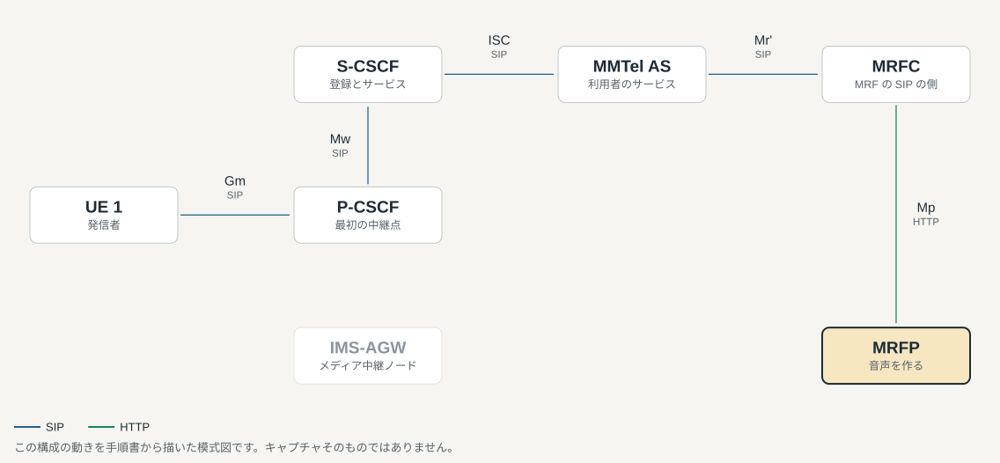

MRF は IMS の中で自分からメディアを作るノードです（TS 23.228 4.7）。SIP の側の MRFC と、RTP の側の MRFP に分かれます。

- **MRFC** は SIP を話します。AS が INVITE でサービスを頼むと、MRFC はそれに要るメディアの資源を決め、MRFP にターミネーションを作らせます。
- **MRFP** は RTP を扱います。ターミネーションに音声を流し、複数のターミネーションの音声を足し合わせて、それぞれに混ぜ合わせた音声を返します（TS 23.333 6.2.9）。

| 参照点 | どこの間か | このプロジェクトでは |
| --- | --- | --- |
| Mr' | AS と MRFC | SIP。MMTel AS から直接送ります。S-CSCF からの Mr は使いません。 |
| Mp | MRFC と MRFP | 標準では H.248（TS 29.333）。ここでは 8080 番ポートの小さな HTTP API で、H.248 のコマンドごとに操作が 1 つあります。 |
| Cr | AS と MRFC | 流す音声の取得とメディア制御の命令。作っていません。MRFP は持っている WAV ファイルだけを流します。 |

Mp の操作は、ターミネーションの追加、変更（モード、相手のアドレス、再生）、削除と、再生が終わったことを知らせる Notify です。メディアを頼むのは S-CSCF ではなく AS です（TS 23.218）。MRFP は P-CSCF のメディアゲートウェイ（IMS-AGW）と同じ中継の実装に、音声ガイダンスと混ぜ合わせを加えたものです。UE と MRFP の RTP は IMS-AGW を通ります。

## AS は Request-URI で頼む

AS は MRFC への INVITE の Request-URI の user part でサービスを指定します。形は RFC 4240 が決めています。

| Request-URI | サービス |
| --- | --- |
| `sip:annc@mrfc...:5060;play=/provisioned/notice` | `notice` を 1 回流します。 |
| `sip:annc@...;play=/provisioned/cat1;repeat=forever` | AS がダイアログを終えるまで `cat1` を流し続けます。 |
| `sip:conf=conf-pcn6hpat5alr@mrfc...` | その会議に加わります。最初の INVITE が会議を作ります。 |

`annc` は再生、`conf=` は会議への参加です（RFC 4240 3、5）。`play=` は MRFP の設定にあるファイルの名前で、`deploy/compose/mrfp.yaml` が `notice`、`cat1`、`cat2` を `deploy/announcements` の WAV ファイルに対応させます。AS がこの URI を作るのは次の関数です。

[internal/mmtel/mrf.go](../../../internal/mmtel/mrf.go)

```go
func (as *AS) announcementURI(name string, repeat int) (string, error) {
	if as.cfg.MRFC == "" {
		return "", errNoMRFC
	}
	u, err := sip.ParseURI(as.cfg.MRFC)
	if err != nil {
		return "", err
	}
	u.User = "annc"
	u.Params.Set("play", "/provisioned/"+name)
	switch {
	case repeat < 0:
		u.Params.Set("repeat", "forever")
	case repeat > 0:
		u.Params.Set("repeat", strconv.Itoa(repeat))
	}
	return u.String(), nil
```

入力は流すものの名前 `name` と繰り返しの回数 `repeat` です。設定の MRFC の URI から、ユーザー部を `annc` にし、`play` に `/provisioned/` と名前を付けます。`repeat` が負なら `repeat=forever`、正ならその回数です。音声ガイダンスは 0（1 回だけ）、呼び出し音は -1（止めるまで）で呼ばれます。

## 応答の前に届く音声

### SDP の無い INVITE で、再生の始まりを AS が決める

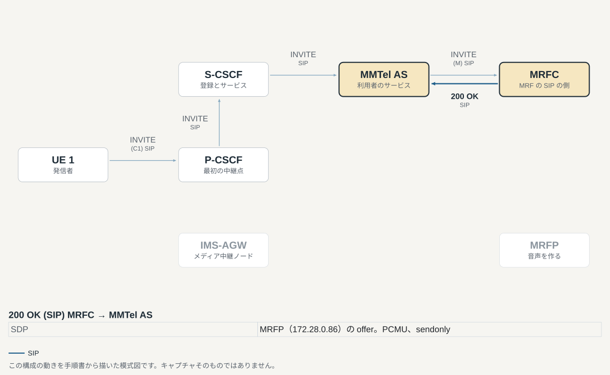

AS が MRFC に送る INVITE には SDP が付きません。

[internal/mmtel/mrf.go](../../../internal/mmtel/mrf.go)

```go
	inv := sip.Invitation{RequestURI: uri, From: c.as.uri()}
	if pcv := chargingVector(c.in.Request); pcv != "" {
		inv.Headers = append(inv.Headers, sip.HeaderField{Name: "P-Charging-Vector", Value: pcv})
	}
	out, err := ua.Invite(inv)
```

`sip.Invitation` には Request-URI、From、P-Charging-Vector だけが入り、ボディがありません。offer の無い INVITE を受けた MRFC は、MRFP にターミネーションを作らせ、その offer（MRFP の 172.28.0.86、PCMU、`sendonly`）を 200 に入れて返します。すると answer は AS が送る ACK に入ることになります。MRFP は ACK を受けてから流し始めます（TS 24.229 5.8.2.2.1）。つまり、offer の無い INVITE にすることで、再生の始まりを AS が ACK の時機で決められます。P-Charging-Vector を付けるので、MRFC とのダイアログも発信者の通話と同じ icid-value を持ち、ラボはそれを通話のシーケンス図に並べて描きます。

### early media と P-Early-Media

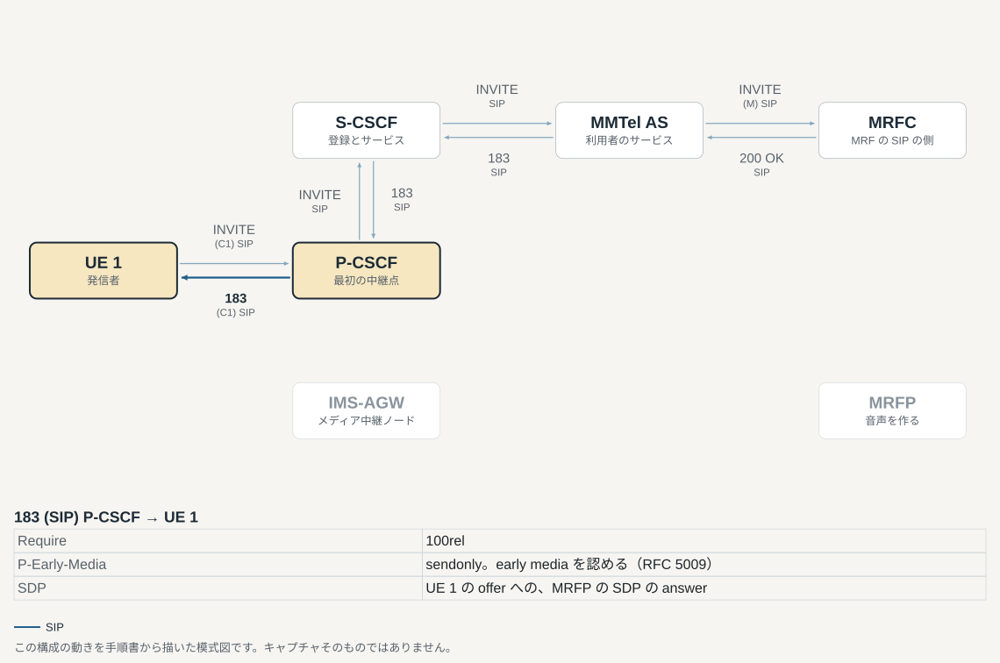

通話にはまだ誰も応答していないので、発信者への音声は early media です。AS は TS 24.628 Annex G のゲートウェイのモデルを使い、発信者の offer に MRFP の SDP で自分から答えます。その answer を入れた暫定応答に `P-Early-Media: sendonly` を付けて、網がその音声を認めたことを示します（RFC 5009）。発信者の UE は、自分の呼び出し音の代わりに、届いた音声を流します（TS 24.628 4.7.2.1）。

このモデルには、発信者が高信頼の暫定応答を受け付けることが要ります。AS は先にそれを確かめます。

[internal/mmtel/announcement.go](../../../internal/mmtel/announcement.go)

```go
// earlyMediaOffer is the caller's SDP offer when the MRF can play early
// media to it: the INVITE has an offer with PCMU, and the caller
// takes reliable provisional responses, which the gateway model needs
// (TS 24.628 G.1). A caller that requires preconditions gets none: the
// MRFC writes no precondition attributes.
func (c *call) earlyMediaOffer() (sdp.Session, bool) {
	req := c.in.Request
	if !req.Supports(sip.Option100rel) && !req.Requires(sip.Option100rel) || req.Requires(sip.OptionPrecondition) {
		return sdp.Session{}, false
	}
	offer, err := sdp.Parse(req.Body)
	if err != nil || !hasPCMU(offer) {
		return sdp.Session{}, false
	}
	return offer, true
}
```

入力は発信者の INVITE です。Supported か Require に `100rel` が無い発信者と、プリコンディションを必須にした発信者には、MRF の early media を流しません。MRFC はプリコンディションの属性を書かないので、それを必須にした発信者には答えられないからです。offer に PCMU が無いときも同じです。MRFP は PCMU しか流せません。どれかに当たると、AS は音声を流さずに、すぐ次へ進みます。規制なら、すぐ 603 を返します。

## 規制した通話を断る前の音声ガイダンス

UE 1 が `ue xcap set baoc on` で自分の発信を規制してから UE 2 にかけると、UE 1 の AS は通話を断ります（TS 24.611 4.5.2.4.1）。その前に `notice` を流します（TS 24.628 4.2.4）。

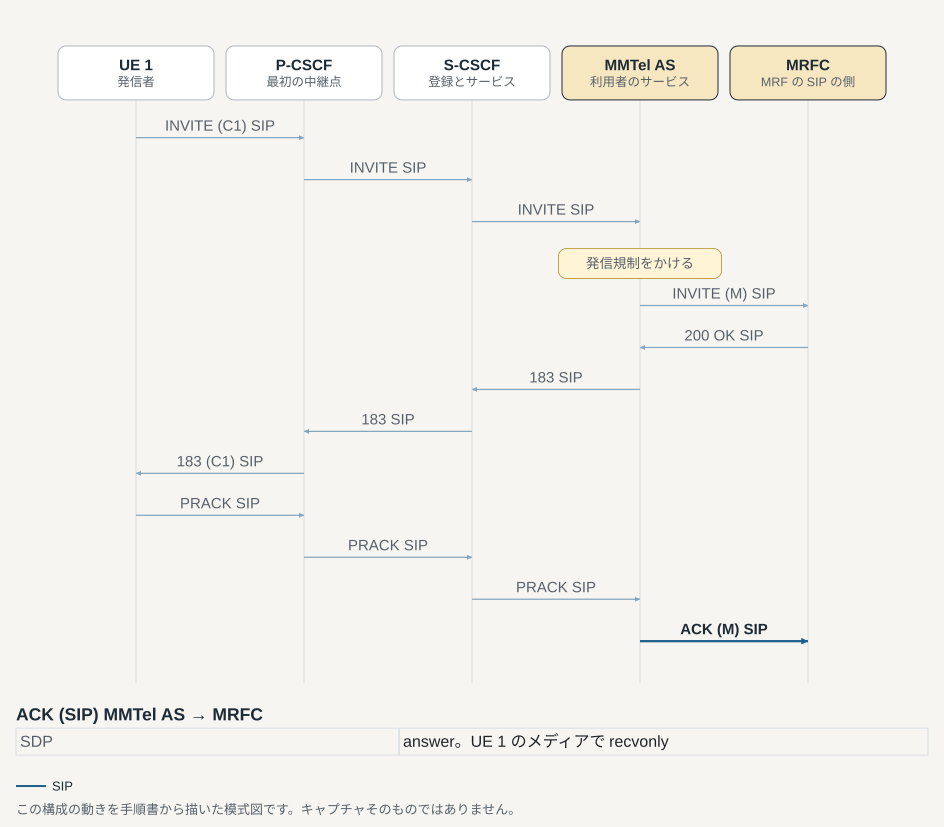

AS の手順は次の部分です。

[internal/mmtel/announcement.go](../../../internal/mmtel/announcement.go)

```go
	c.mu.Lock()
	c.toCaller, c.sessionToCaller = true, true
	c.mu.Unlock()
	fields := []sip.HeaderField{sip.PEarlyMedia{Directions: []string{sip.EarlyMediaSendonly}}.Header()}
	if pcv := responseChargingVector(c.in.Request, c.as.cfg.HomeDomain); pcv != "" {
		fields = append(fields, sip.HeaderField{Name: "P-Charging-Vector", Value: pcv})
	}
	if err := c.legs.Progress(183, sdpBody(answer), fields...); err != nil {
		c.log.Info("announcement not offered to the caller", "error", err.Error())
		return false
	}
	if err := media.start(offer.Address(*offer.AudioMedia())); err != nil {
		c.log.Warn("announcement not started", "error", err.Error())
		return false
	}
	c.actedOn("announcement")
	select {
	case <-media.dialog.Done():
	case <-c.in.Done():
	case <-time.After(maxAnnouncement):
		c.log.Warn("the announcement did not end", "announcement", name)
	}
	return true
```

`c.legs.Progress(183, ...)` は、MRFP の answer と P-Early-Media を付けた 183 を発信者に送ります。発信者の INVITE が `100rel` を挙げているので、この 183 は高信頼の暫定応答で、発信者は PRACK で受け取ったことを伝えます。`media.start` が MRFC に ACK を送り、answer に発信者のメディアのアドレスを入れます。そのあと `select` で、MRFC がダイアログを終えるか、発信者がいなくなるか、1 分が過ぎるまで待ちます。

AS が PRACK を待ってから ACK を送るのは、UE 1 が SDP を受け取る前に、音声ガイダンスのフレームが失われないようにするためです。UE 1 は 183 の SDP を読むまで、どのアドレスから何が届くかを知りません。ACK を先に送ると、MRFP が流し始めた最初のフレームを UE 1 が捨てるかもしれません。

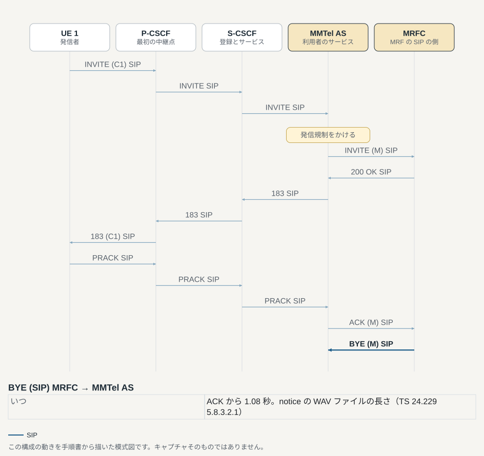

終わりのある再生が済むと、MRFC が BYE でダイアログを終えます（TS 24.229 5.8.3.2.1）。手順書のキャプチャでは、AS の ACK から MRFC の BYE までが 1.08 秒です。`notice` の WAV ファイルの長さと同じで、再生が終わると MRFC が BYE を送るからです。BYE を受けた AS は、`Reason: SIP;cause=603;text="Decline"` を付けた 603 を返します。発信者にはすでに early dialog があるので、断る理由をそこで伝えます（TS 24.628 4.2.4）。

```text
#525  MMTel  -> MRFC   M  INVITE   sip:annc@mrfc...;play=/provisioned/notice, no SDP
#546  MRFC   -> MMTel  M  200 OK   SDP offer: the MRFP 172.28.0.86, PCMU, sendonly
#559  P-CSCF -> UE 1   C1 183      Require: 100rel, P-Early-Media: sendonly, SDP answer from the MRFP
#564  UE 1   -> P-CSCF C1 PRACK
#582  MMTel  -> MRFC   M  ACK      SDP answer: UE 1's media, recvonly
#728  MRFC   -> MMTel  M  BYE      notice has played, 1.08 s after the ACK
#746  P-CSCF -> UE 1   C1 603      Reason: SIP;cause=603;text="Decline"
```

この並びは手順書の、スクリプトを 1 回動かしたときのキャプチャから写したものです。フレームの番号は実行ごとに変わります。

## CAT（着信側が選ぶ呼び出し音）

### 着信側の AS が、呼び出す前に頼む

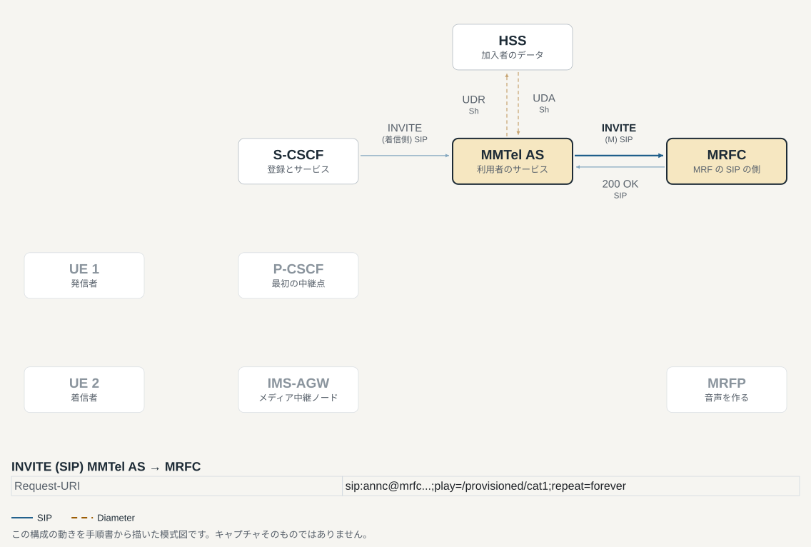

利用者の呼び出し音は、事業者が HSS に設定します（TS 24.182 4.5.2）。ここでは OAM が設定します。利用者が自分で設定する標準の手段はありません（4.8）。呼び出し音を決めるのは着信側の AS です。着信のたびに、Service-Indication `Customized-Alerting-Tone` の UDR で設定を読み、UE 2 への INVITE を送る前に MRFC に頼みます（4.5.5.3.7）。

[internal/mmtel/cat.go](../../../internal/mmtel/cat.go)

```go
func (c *call) startAlertingTone(fields *sip.Message) {
	if c.as.cfg.MRFC == "" || c.withhold {
		return
	}
	offer, ok := c.earlyMediaOffer()
	if !ok {
		return
	}
	tone := c.alertingToneName()
	if tone == "" {
		return
	}
	media, err := c.reserveMedia(tone, -1)
	if err != nil {
		c.log.Warn("CAT: no tone from the MRF", "tone", tone, "error", err.Error())
		return
	}
	fields.Remove("P-Early-Media")
	c.cat = &alertingTone{media: media, callerOffer: offer, content: catContent}
	c.actedOn("CAT")
	c.log.Info("CAT: the tone is reserved", "tone", tone)
}

```

設定に MRFC が無いとき、転送のために AS が着信者の answer を止めているとき（`c.withhold`）、発信者が MRF の early media を受けられないとき（`earlyMediaOffer`）は、何もしません。HSS に設定を尋ねるのは、呼び出し音を流せる通話のときだけです。呼び出し音があれば、`reserveMedia(tone, -1)` が `repeat=forever` で MRFC に頼みます。着信者へ渡す INVITE からは P-Early-Media を取り除き、呼び出し音の状態を `c.cat` に置きます。この時点では、まだ何も流れません。ACK をまだ送っていないからです。

### 呼び出し音の SDP の届き方

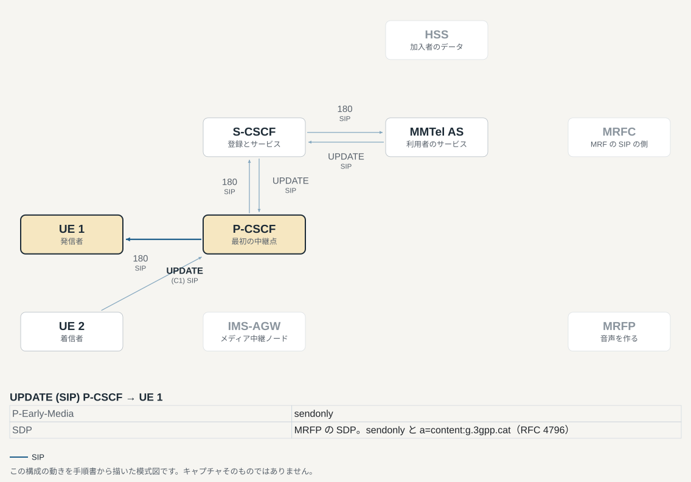

UE 1 はプリコンディションを使います。そのため UE 2 の 183 は、プリコンディションの表とともにそのまま UE 1 に届き、呼び出し音は UE 2 が呼び出しを始めた 180 のあとの UPDATE で届きます（TS 24.182 4.5.5.3.7 b 1）。プリコンディションを使わない発信者には、18x そのものに呼び出し音の SDP が入ります。

呼び出し音の SDP を示すのは `a=content:g.3gpp.cat` の属性（RFC 4796）で、その音声を認めるのは `P-Early-Media: sendonly` のヘッダです（TS 24.182 4.5.5.3.7 b 2）。UE 1 が UPDATE に答えると AS は MRFC に ACK を送り、MRFP の音声が、応答より前に IMS-AGW を通って UE 1 に届きます。

### 応答で止め、メディアを着信者に移す

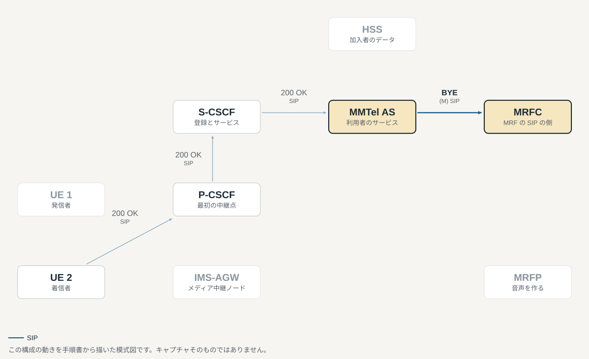

UE 2 の 200 が届くと、AS は MRFC に BYE を送って呼び出し音を止めます。そして UE 1 に 200 を送る前に、UE 2 の SDP を入れた UPDATE を送り、UE 1 のメディアを UE 2 に移します。これも TS 24.628 Annex G のゲートウェイのモデルです。

| 見るもの | `cat1` のとき | 止めたとき |
| --- | --- | --- |
| UE 1 のログ | `"ringback":"network"` | `"ringback":"local"` |
| UE 1 に届くもの | P-Early-Media の付いた UPDATE | 180 だけ |
| MRFC | `repeat=forever` の INVITE | 無し |
| MRFP | 応答前に UE 1 へ届く RTP | 無し |

呼び出し音を止めた加入者への通話と並べると、呼び出し音が増やすのは MRFC とのダイアログ、UPDATE、MRFP の RTP だけで、ほかは何も変わりません。e2e のスクリプトは、UE 1 が受け取った最初の 1 秒を、MRFP が PCMU に符号化した `cat1.wav` と比べ、1 バイトも違わないことを確かめています。

## 割込通話のとき

通話中の利用者への 2 本目の着信では、着信者の UE が call-waiting の Alert-Info を付けた 180 を返します（TS 24.615 4.5.5.3.2）。このとき着信側の AS は呼び出し音を流しません。待たされる通話には呼び出し音ではなく、待っていることの知らせを渡します（TS 24.182 4.6.11 の 2 つ目の方法）。この網の文書は発信者に知らせない設定なので、AS は Alert-Info を取り除いて渡し、MRF は出てきません。知らせる設定で音声ガイダンスがあれば、AS はその Alert-Info をそのまま渡し、待たせているあいだ発信者に音声ガイダンスを流します（TS 24.615 4.5.5.2.3）。MRF が出てくるのは、その設定のときです。

## 3 人の会議

### ファクトリの URI と REFER

phone1 が応答済みの通話を 2 つ持って **Merge** を押すと、次の順で会議ができます。

| 段階 | 見どころ |
| --- | --- |
| 1 | 会議ファクトリの URI `sip:mmtel@conf-factory...` への INVITE。 |
| 2 | AS は `conf=` と phone1 の offer で MRFC に頼み、`isfocus` を付けた会議の URI を Contact に入れて phone1 に応答します。 |
| 3 | phone1 がその会議の URI を SUBSCRIBE します。Event は `conference` です。 |
| 4 | 相手ごとの REFER。Refer-To には、phone1 とその相手の通話を置き換える Replaces が入ります。 |
| 5 | フォーカスは、その Replaces と MRFP の新しい offer を付けて相手に INVITE します。相手は置き換えられた通話を BYE で終えます。 |

作った人が相手ごとに REFER で招く方法です。TS 24.147 5.3.1.3.3 の option 2b で、IR.92 2.3.3 が求めるものです。フォーカスは REFER を 200 で受け付け、202 は使いません。RFC 7647 5 が RFC 3515 の 202 を改めたためです。

### 会議の URI は PSI で、DNS がフォーカスを指す

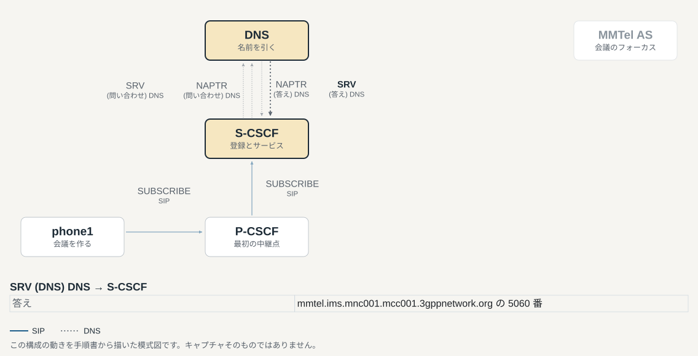

会議の URI は、ホーム網の公開サービス識別子（PSI）です（TS 23.228 4.3.6）。形は `sip:conf-<id>@conf.ims.mnc001.mcc001.3gppnetwork.org` で、ドメインは事業者が決めます。ノードの名前を含まず、ポート番号も付けません。網の外に出る可能性がある PSI には、ポート番号を付けないほうがよいためです（TS 23.003 13.5）。このサブドメインの NAPTR と SRV のレコードが、会議を受け持つ AS を指し、S-CSCF はほかのホストと同じく RFC 3263 でフォーカスを見つけます（TS 23.228 5.4.12.3）。S-CSCF は HSS に問い合わせません。

### フォーカスと混ぜ合わせ

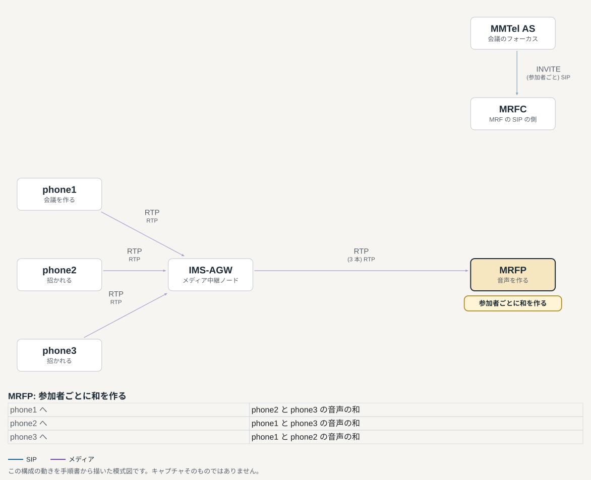

AS は会議のフォーカスであり、通知サービスでもあります（TS 24.147 4）。参加者それぞれとダイアログを持ち、参加者ごとにメディアのための MRFC とのダイアログも持ちます。MRFC は最初の `conf=` の INVITE で混ぜ合わせを作り、そのあとの INVITE ごとにターミネーションを足します。MRFP は、それぞれの参加者に、ほかの参加者の音声の和を送ります。自分の音声は自分に返しません（TS 23.333 6.2.9）。

そのため、3 人の会議では、MRFP と IMS-AGW のあいだの RTP のストリームが、どちら向きにも 3 つあります。参加者が 3 人で、それぞれが自分の音声を MRFP に送り、ほかの 2 人の和を受け取るからです。ある参加者が受け取る混ぜ合わせた音声は、どの参加者 1 人のトーンよりも大きくなります。招かれた相手もプリコンディションを使うので、それぞれが MRFP の offer に高信頼の 183 で答え、200 には SDP を付けません。AS はその answer を ACK に入れて MRFC に渡します（RFC 3262 5）。

### 会議イベントパッケージ

| 見るもの | 見どころ |
| --- | --- |
| NOTIFY | conference-info の XML（RFC 4575）。参加者ごとに `<user>` と、状態が `connected` の `<endpoint>` があります。 |
| `<user>` の `entity` | 網がその参加者に保証した識別子です。プライバシーを求めた参加者では、匿名の URI です（RFC 4575 8.2）。 |
| `<endpoint>` の `entity` | フォーカスが作るキーで、`urn:uuid:` の URI です。RFC 4575 5.7 はキーの作り方をフォーカスに任せています。 |
| maximum-user-count | 6 人です。7 人目には 403 を返します。 |

`<endpoint>` のキーに UE の Contact を使わないのは、Contact がその UE のアドレスで、NOTIFY がほかの網の購読者を含む、会議のすべての購読者に届くからです。キーを Contact にすると、どの参加者の UE のアドレスも、ほかのすべての購読者に見えてしまいます。

## 会議に戻る

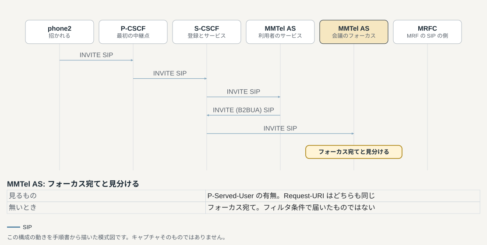

会議を抜けた参加者は、会議が続いているあいだなら戻れます。フォーカスの Contact で知った会議の URI に INVITE を送ります（TS 24.147 5.3.1.4.1）。この INVITE は、その利用者のほかの発信と同じ道を通ります。S-CSCF は発信側のサービスのために、この INVITE を `sescase=orig` の P-Served-User を付けて AS に渡します。B2BUA の AS は、同じ URI に宛てた新しい INVITE を S-CSCF に返し、S-CSCF は DNS でフォーカスを見つけます。そのため AS には、同じ Request-URI の INVITE が 2 回届きます。

AS は P-Served-User の有無で 2 つを見分けます。

[internal/mmtel/call.go](../../../internal/mmtel/call.go)

```go
func (as *AS) serve(in *sip.IncomingCall) {
	req := in.Request
	log := as.log.With("call_id", req.Get("Call-ID"))
	// TS 24.229 5.7.1.3A: the S-CSCF names the served user in
	// P-Served-User, and this S-CSCF always adds the session case. A
	// request without one came by no filter criterion. The INVITE to a
	// conference URI comes that way, by DNS (conference.go).
	served, err := sip.ParsePServedUser(req.Get("P-Served-User"))
	if err != nil || served.SessionCase == sip.SessionCaseNone {
		if _, ok := as.conferenceID(req.RequestURI); ok {
			as.joinConference(in, log)
			return
		}
		log.Info("INVITE without a served user and its session case", "p_served_user", req.Get("P-Served-User"))
		in.Reject(403, as.warning("No served user"))
		return
	}
```

フォーカスに INVITE を届けるのはフィルタ条件ではなく DNS なので、フォーカス宛ての INVITE には P-Served-User がありません。`served.SessionCase` が空で、Request-URI が会議の URI なら、`joinConference` に進みます。P-Served-User があれば、利用者のサービスのための INVITE として扱い、B2BUA として同じ URI に送り返します。

フォーカスは、作った人と同じやり方でその参加者を迎え入れます（TS 24.147 5.3.2.4.1）。参加者の offer で MRFC に新しいターミネーションを頼み、`isfocus` の Contact を付けた 200 で答えます。NOTIFY はその参加者を再び `connected` として並べ、joining-method は `dialed-out` ではなく `dialed-in` になります。

## 資源の寿命（コンテキストと参加者）

MRF の資源は、MRFC とのダイアログと同じあいだだけあります。いつ作られ、誰が終わらせるかは、使い方ごとに決まっています。

| 使い方 | MRFC とのダイアログを作るとき | 流れ始めるとき | 終わらせるもの |
| --- | --- | --- | --- |
| 規制の前の音声ガイダンス | 断ると決めたとき | 発信者の PRACK のあとの ACK | 再生を終えた MRFC の BYE |
| CAT | 着信者への INVITE の前 | 発信者が呼び出し音の SDP を受け取ったあとの ACK | 着信者の応答か、通話の終わりで AS が送る BYE |
| 会議の参加者 | 参加者が加わるとき（最初の 1 人で混ぜ合わせを作る） | MRFC とのダイアログができたとき。招かれた相手では、その answer を入れた ACK | 参加者が抜けたときに AS が送る BYE |

会議の参加者が抜けたときの処理は次の関数です。

[internal/mmtel/conference.go](../../../internal/mmtel/conference.go)

```go
func (f *conference) left(p *party) {
	if err := p.media.Bye(); err != nil && !errors.Is(err, sip.ErrCallEnded) {
		f.log.Warn("BYE to the MRFC failed", "error", err.Error())
	}
	f.mu.Lock()
	f.setStatus(p, confinfo.Disconnected)
	if f.ended {
		f.mu.Unlock()
		return
	}
	connected := 0
	for _, o := range f.record.Participants {
		if o.Status != confinfo.Disconnected {
			connected++
		}
	}
	ends := p.creator || connected == 0
	var others []*party
	if ends {
		f.ended = true
		others = slices.Clone(f.parties)
	}
	f.writeRecord()
	f.mu.Unlock()
	f.log.Info("participant left", "creator", p.creator, "connected", connected)
	if !ends {
		f.notify(nil)
		f.mu.Lock()
		f.remove(p)
		f.mu.Unlock()
		return
	}
	f.end(others)
}
```

`p` は抜けた参加者です。最初に `p.media.Bye()` で、その参加者の MRFC とのダイアログを終え、MRFP のターミネーションを手放します。参加者の状態を `disconnected` にし、まだつながっている参加者を数えます。`ends` は、抜けたのが会議を作った人か、残りが 0 人のときに真です。真でなければ、ほかの購読者に NOTIFY を送って、その参加者だけを外します。真なら `end` に進みます。`end` は残りの参加者すべてに BYE を送り、それぞれの BYE のあとで、その参加者の MRFC とのダイアログも終わります。そのうえで、会議イベントパッケージの購読をすべて最後の NOTIFY で終え、会議の URI を手放します（TS 24.147 5.3.2.7）。

URI を手放すので、終わった会議の URI に発信すると 404 が返ります。作った人が戻ろうとしても同じです。

[internal/mmtel/conference.go](../../../internal/mmtel/conference.go)

```go
	f := as.conferenceAt(req.RequestURI)
	if f == nil {
		// Step 1: no conference has this URI, or none has it any more.
		log.Info("INVITE to a conference URI that is not allocated", "request_uri", req.RequestURI)
		in.Reject(404)
		return
	}
```

`conferenceAt` がその URI の会議を見つけられなければ、フォーカスは 404（Not Found）で答えます（TS 24.147 5.3.2.4.1 step 1）。

## 簡略化していること

| 場所 | 主なもの |
| --- | --- |
| MRFC | PCMU だけで、トランスコードをしない。PCMU の無い offer には Warning を付けた 488 を返す。用意してある音声だけを流し、Cr が無い。Contact はその台の URI で、GRUU ではない。 |
| MRFP | 混ぜ合わせは PCMU だけを扱い、ジッタのために 3 フレームだけをためる。CSRC の一覧を書かず、RTCP も送らない。 |
| AS。呼び出し音 | プリコンディションの付いた着信者の 183 をそのまま発信者に渡し、発信者のプリコンディションを確かめずに呼び出し音を始める。 |
| AS。会議 | AS が受け持つ利用者は誰でも会議を作れ、会議のポリシーが無い。参加者を外すようフォーカスに頼む REFER は 403 で断る。 |

PCMU だけなのは、会議で混ぜるのが復号した音声で、このリポジトリには AMR の復号器が無いからです。UE シミュレータは PCMU を offer に入れます。どの項目にも、コードに `SIMPLIFIED:` で始まるコメントがあり、項目ごとの条項と理由は手順書の表にあります。

## この説明の根拠

著者は次の試験を実行し、通ることを確かめました。

- `internal/mmtel/mrf_network_test.go` の `TestAnnouncementBeforeBarring`。BAIC の着信者の AS が、603 の前に発信者に音声ガイダンスを流すことを確かめます。発信者が 183 と 603 をこの順に受け取り、183 が MRFP の PCMU、`sendonly` の answer と、`Require: 100rel`、`P-Early-Media: sendonly` を持つこと、603 の Reason が SIP cause 603 であること、603 の前に音声ガイダンスのフレームがすべて順に届き、603 のあとには届かないこと、終わったあと MRFP にコンテキストが残らないことです。規制する側はこの章の例（BAOC）と違いますが、AS の手順は同じ `reject` です。`TestBarringWithoutPCMU` は、PCMU の無い発信者がすぐに 603 だけを受け取ることを確かめます。
- `internal/mmtel/cat_test.go` の `TestGatewayModelOrder`。試験の相手役の MRFC で、MRF への INVITE が着信者への INVITE より先に出ること、呼び出し音は MRFP の SDP の付いた 180 を発信者が受け取ってから ACK で始まること、応答で MRFC に BYE、発信者に着信者の SDP の UPDATE、そのあと 200 が届くことを確かめます。`TestNoToneForAWaitingCall` と `TestAnnouncementForAWaitingCall` は、待たされる通話の扱いを確かめます。
- 同じく `mrf_network_test.go` の `TestCustomizedAlertingTone`、`TestCustomizedAlertingToneWithPreconditions`、`TestLocalRingbackWithoutCAT`。プリコンディションの無い発信者とある発信者に呼び出し音が応答の前に届くこと、呼び出し音を止めた加入者では発信者が 180 だけを受け取り、応答の前に RTP が届かないことを確かめます。
- `internal/mmtel/conference_network_test.go` の `TestThreeWayConference`。MRFP のコンテキストが 1 つで、ターミネーションが 3 つあること、どの区間も PCMU であること、それぞれの参加者がほかの 2 人の音声を聞くこと、1 人が抜けても会議が 2 人で続き、作った人が抜けると会議が終わって MRFP にコンテキストが残らないことを確かめます。
- 同じファイルの `TestRejoinWithTheConferenceURI`。会議を抜けた参加者が会議の URI に INVITE を送ると、発信側のサービスを通ってから DNS でフォーカスに届き、会議に戻ることを確かめます。`internal/mmtel/conference_test.go` の `TestJoinWithTheConferenceURI` は、会議の URI で加わる参加者を、会議がいっぱいになるまでフォーカスが迎え入れることを確かめます。
- `internal/mrfc` と `internal/netann` のパッケージの試験。MRFC と、RFC 4240 の Request-URI の読み方を確かめます。

1.08 秒とフレームの並びは、手順書のキャプチャから写した値です。著者がこの章のために測ったものではありません。図は手順書から描いたこの構成の動きの模式図で、キャプチャそのものではありません。

## 自分で動かす場合

音声ガイダンス、呼び出し音、割込通話、会議を自分で動かす手順は、手順書 [MRF による音声ガイダンス、呼び出し音、会議](../../guide/ja/mrf.md#動かしてみる) の「動かしてみる」にあり、キャプチャの表示フィルタは同じ手順書の「Wireshark の表示フィルタ」にあります。ラボでの操作は [ラボで IMS を見る](../../guide/ja/lab.md#ue-シミュレータを操作する) にあります。参加者が 2 つの網にいる会議は、手順書 [IMS 網どうしを相互接続する](../../guide/ja/interconnect.md#境界を越える会議) で追えます。スライドでは [MRF のデッキ](../../../slides/decks/ja/08-mrf.md) が、この章の図をシーンの段階として見せます。

次の中級の章では、携帯のアクセスが加える認証と資源の制御を見ます。VoLTE の通話も、この章の MMTel AS を通ります。VoLTE の登録と通話
