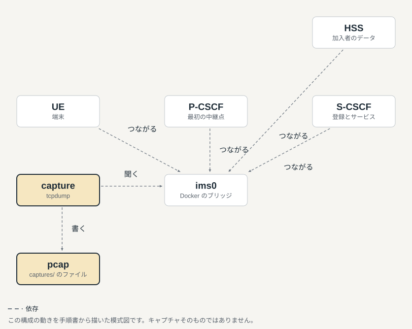
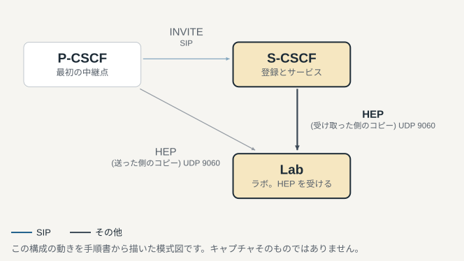
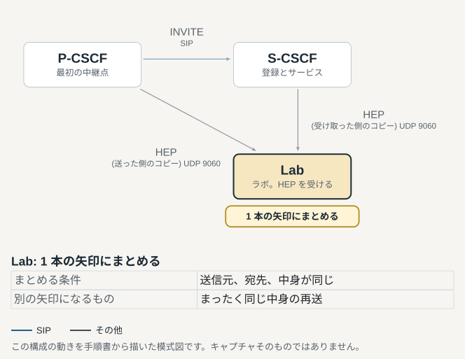
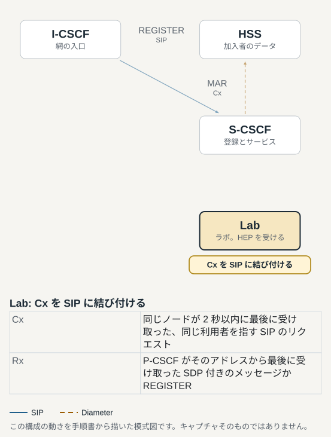
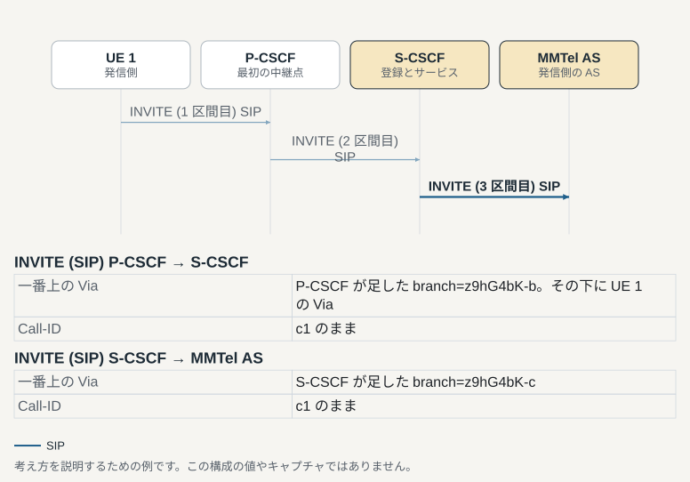
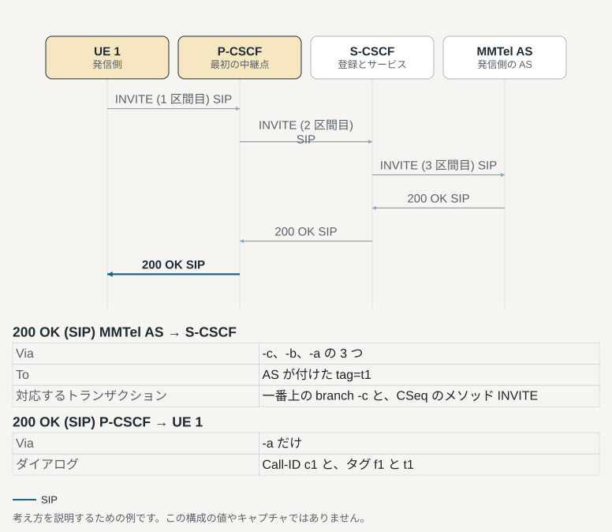
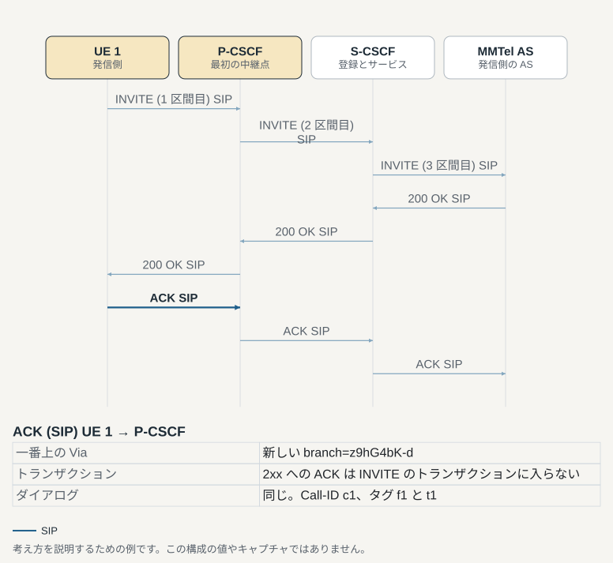
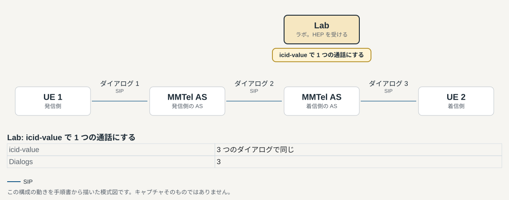

# 信号を観測する

この本の章は、キャプチャとラボのシーケンス図から描いた信号を読みます。2 つは同じ信号を見せますが、根拠が違います。キャプチャは、Docker のブリッジを通ったパケットそのものを記録したファイルです。そこにあるものは観測したことです。ラボは、ノードが送るメッセージのコピーから図を組み立てます。SIP と Diameter のメッセージの中身は観測したものですが、Cx や Rx のメッセージがどの SIP の要求のためのものかは、ラボが規則で推定したものです。推定は外れることがあります。

この章では、キャプチャがどこから来て何を写さないか、本で使う表示フィルタが何を残すか、ラボが何を組み立て何を推定するか、そしてキャプチャの中でトランザクションとダイアログをどう見分けるかを説明します。

## この章で扱う構成

`deploy/compose` の構成です。ノードはすべて 1 つの Docker のネットワーク（172.28.0.0/24）につながり、そのブリッジの名前は `ims0` です。キャプチャ用のコンテナ `capture` がブリッジを聞き、ラボ（172.28.0.60）がノードからのコピーを UDP の 9060 番で受けます。トランザクションとダイアログの規則は RFC 3261 の条項で書きます。

## キャプチャはブリッジを通ったものを写す



`capture` のコンテナは、ノードのネットワークに入らず、ホストのネットワークをそのまま使います。そこからブリッジ `ims0` の上の tcpdump を動かし、すべてのパケットを `captures/ims-<UTC の起動時刻>.pcap` に書きます。ノードは、このコンテナで tcpdump が動き出してから起動します。そのため、各ノードが最初に送るメッセージもファイルに入ります。起動するたびに新しいファイルができ、ファイルは削除するまで残ります。2 つの網をつなぐ構成では、2 つの網と網のあいだのリンクの 3 つのブリッジに、それぞれキャプチャのコンテナとファイルができます。

キャプチャに写らないものもあります。1 つは、ノードが自分自身に送るメッセージです。S-CSCF が発信者と着信者の両方を受け持つとき、自分に INVITE を送ります。このメッセージはコンテナの外に出ないので、ブリッジには現れません。もう 1 つは、tcpdump が取りこぼしたパケットです。キャプチャのスクリプトは、その起き方と、減らすための設定を説明しています。

[images/capture/capture.sh](../../../images/capture/capture.sh)

```sh
# The kernel keeps the packets that tcpdump has not written out yet in a
# buffer of its own, and drops the ones that no longer fit. A dropped
# packet leaves a hole that nothing in the file points at: the capture
# simply does not hold that message, and whoever reads the file sees the
# flow go on without it. -B asks for 32 MiB rather than the 2 MiB that
# the default gives, so that a burst on the bridge does not fill the
# buffer while tcpdump waits for the processor. -U writes each packet out
# as it comes, so that a reader of the file sees the flow as it happens.
exec tcpdump -i "$iface" -U -n -B 32768 -w "$file"
```

カーネルは、tcpdump がまだ書き出していないパケットを自分のバッファに溜め、入りきらないものを捨てます。捨てたパケットは、ファイルのどこにも跡を残しません。読む人には、そのメッセージが無いまま流れが進んだように見えます。`-B 32768` はそのバッファを既定の 2 メビバイトから 32 メビバイトに広げ、`-U` は届いたパケットをすぐ書き出します。キャプチャに無いことは、送られなかったことの証明になりません。

### 登録の前から写っているもの

UE が何もしないうちから、ファイルには Diameter の接続ができる様子が入っています。表示フィルタ `diameter` で見えます。

| 見るもの | 何が見えるか |
| --- | --- |
| CER と CEA | 3868 番への 7 本の接続。I-CSCF と S-CSCF は Cx、2 つの AS は Sh、IP-SM-GW から SC へは SGd、SC から HSS へは S6c、P-CSCF から PCRF へは Rx |
| DWR と DWA | 約 30 秒なにも受け取らなかった側が、相手が動いているかを確かめる（RFC 3539 3.4.1） |
| DPR と DPA | 止まるノードが、接続を閉じる前に相手に伝える。S-CSCF を止めると Disconnect-Cause が `REBOOTING` の DPR を送る |

## 表示フィルタで残すもの

1 つのファイルには、構成のすべての信号が入っています。Wireshark の表示フィルタで、読みたいものだけを残します。フィルタは、次の部品を `&&`（かつ）と `||`（または）でつなぎ、`not` か `!` で裏返したものです。

| 書き方 | 残るもの |
| --- | --- |
| `sip`、`diameter`、`rtp` | そのプロトコルのパケットのすべて |
| `diameter.cmd.code == 302` | フィールドが値と等しいもの。302 は Cx の LIR と LIA |
| `diameter.cmd.code in {302, 306, 307}` | 1 つのフィールドが、いくつかの値のどれかのもの |
| `ip.addr == 172.28.0.70` | 1 つのノード（ここでは IP-SM-GW）の両方向。`ip.src` と `ip.dst` は片方向 |
| `sip.CSeq.method in {"MESSAGE", "REGISTER"}` | SIP のメソッドで絞ったもの |
| `sip.Call-ID == "<Call-ID>"` | 1 つのダイアログのメッセージ |
| `not udp.port == 9060` | ラボへのコピーを隠したもの |

本の章が案内する手順書は、それぞれ次のフィルタを使います。どれも、その流れのメッセージを残し、関係の無いものを隠します。

登録。SIP、Cx のメッセージ（コマンドコードが 300 以上）、NAPTR と SRV の問い合わせを残し、Diameter の監視（DWR と DWA、コマンドコード 280）を隠します。

```text
sip || diameter.cmd.code >= 300 || dns.qry.type == 35 || dns.qry.type == 33
```

通話。SIP、LIR と LIA、NAPTR の問い合わせ（ENUM）、RTP と RTCP を残します。

```text
sip || diameter.cmd.code == 302 || dns.qry.type == 35 || rtp || rtcp
```

SMS。REGISTER と MESSAGE、IP-SM-GW の SIP、LIR、UDR、PUR、SGd と S6c のコマンド、このプロジェクトの Ready-For-SM を残します。

```text
sip.CSeq.method in {"MESSAGE", "REGISTER"} || (sip && ip.addr == 172.28.0.70) || diameter.cmd.code in {302, 306, 307, 8388645, 8388646, 8388647, 8388648, 8388649, 16777214}
```

付加サービス。登録、購読、ショートメッセージを除いた SIP、MMTel AS の HTTP（Ut）、SAR、LIR、UDR、PUR を残します。

```text
(sip && !(sip.CSeq.method in {"REGISTER", "SUBSCRIBE", "NOTIFY", "MESSAGE"})) || (http && ip.addr == 172.28.0.75) || diameter.cmd.code in {301, 302, 306, 307}
```

MRF。通話の SIP、会議の購読、MRFP の HTTP（Mp）を残します。

```text
(sip && !(sip.CSeq.method in {"REGISTER", "SUBSCRIBE", "NOTIFY", "MESSAGE"})) || (sip.Event contains "conference") || (http && ip.addr == 172.28.0.86)
```

VoLTE。登録と通話の SIP、Rx のコマンド（AAR、STR、ASR）、MAR、EPC スタブの API を残します。

```text
(sip && !(sip.CSeq.method in {"SUBSCRIBE", "NOTIFY", "MESSAGE"})) || diameter.cmd.code in {265, 274, 275, 303} || (http && ip.addr == 172.28.0.80)
```

網間接続の手順書には、2 つの網と網のあいだの 3 つのキャプチャに当てるフィルタの表があります。SMS の手順書には、RP 層と TP 層のフィールドで絞るフィルタの表があります。

Wireshark は、残したメッセージを図にもします。**Statistics > Flow Graph** で **Limit to display filter** に印を付けると、残ったメッセージがシーケンス図になります。**Telephony > VoIP Calls** は SIP のダイアログを 1 つずつ通話として並べ、**Play Streams** で音声を聞けます。

## ラボはノードが送るコピーから組み立てる



ノードは、設定に `hep` の項目があると、送受信した SIP と Diameter のメッセージのコピーをラボに送ります。UE シミュレータは `-hep lab:9060` を付けると送ります。形式は HEP のバージョン 3 で、UDP の 9060 番に送りっぱなしです。ノードはラボの答えを待たず、ラボはノードに状態を問い合わせません。ラボは IMS の一部ではなく、呼の経路にもいません。

1 つのメッセージには、送った側と受け取った側の 2 つのコピーが届きます。コピーもブリッジを通るので、キャプチャには UDP の 9060 番へのパケットとして入ります。Wireshark は HEP を標準では解読しないので、`not udp.port == 9060` で隠します。

HEP は、ノードがそのメッセージを送ったのか受け取ったのかを伝えません。ラボは、メッセージの送信元と宛先を、コピーを送ってきたノードのアドレスと比べて、向きを決めます。

### 2 つのコピーを 1 本の矢印にする



ラボの画面がシーケンス図を描くとき、2 つのコピーを 1 本の矢印にまとめます。

[web/lab/src/ladder.ts](../../../web/lab/src/ladder.ts)

```ts
// A send and a recv with the same payload, src and dst are one message on
// the wire. Each key keeps a queue of arrows still missing a side, so that
// identical retransmissions stay separate arrows, and a recv captured
// before its send still pairs.
export function pairArrows(ordered: Message[]): Arrow[] {
  const arrows: Arrow[] = [];
  const unpaired = new Map<string, Arrow[]>();
  for (const m of ordered) {
    const key = JSON.stringify([m.protocol, m.src, m.dst, m.payload]);
    const waiting = unpaired.get(key) ?? [];
    const match = waiting.findIndex(
      (a) => a.messages.length < 2 && (m.direction === "" || !a.messages.some((seen) => seen.direction === m.direction)),
    );
    const partner = match >= 0 ? waiting[match] : undefined;
    if (partner) {
      partner.messages.push(m);
      waiting.splice(match, 1);
      continue;
    }
    const arrow: Arrow = {
      from: hostOf(m.src),
      to: hostOf(m.dst),
      protocol: m.protocol,
      summary: m.summary,
      messages: [m],
    };
    arrows.push(arrow);
    unpaired.set(key, [...waiting, arrow]);
  }
  return arrows;
}
```

入力は、時刻の順に並べたコピーです。キーは、プロトコル、送信元、宛先、中身の 4 つです。同じキーの矢印のうち、まだ片側しか無く、同じ向きのコピーをまだ持っていないものがあれば、そこに加えます。無ければ新しい矢印にします。そのため、受け取った側のコピーが先に届いても組になります。まったく同じ中身を 2 回送った再送は、送る側のコピーが 2 つあるので、2 本の矢印になります。片側のノードしかコピーを送らないメッセージ（HEP を送らないソフトフォンとのやり取りなど）は、コピー 1 つの矢印になります。

ここまでは観測です。矢印 1 本が、ネットワークの上の 1 つのメッセージにあたります。矢印の順は、各ノードがコピーに入れた時刻の順です。この構成は 1 台のマシンの上で動くので、どのノードの時刻も同じ時計から来ます。

## Cx と Rx の結び付きはラボの推定



シーケンス図には、REGISTER と、そのために送った UAR、MAR、SAR が並びます。しかし Cx のメッセージには、どの SIP の要求のために送ったかが書かれていません。Diameter の Session-Id と SIP の Call-ID は無関係で、HEP も結び付きを運びません。そこでラボは、手順の決まりから推定します。

[internal/lab/causes.go](../../../internal/lab/causes.go)

```go
// callIDOf is the Call-ID of the SIP request that caused the Cx request
// d, which the node at from sent at t, or "" when none did.
func (ix causeIndex) callIDOf(d *diameterMessage, from netip.Addr, t time.Time) string {
	var best cause
	for _, rule := range diameterCauses[d.Code] {
		for _, identity := range d.identities(rule.avp) {
			list := ix[causeKey{from, rule.field, identity}]
			// Newest first. The copies of one node arrive in the order it
			// sent them, so an older one ends the search.
			for i := len(list) - 1; i >= 0; i-- {
				c := list[i]
				if c.time.After(t) {
					continue
				}
				if t.Sub(c.time) > causeWindow {
					break
				}
				if best.callID == "" || c.time.After(best.time) || c.time.Equal(best.time) && c.id > best.id {
					best = c
				}
				break
			}
		}
	}
	return best.callID
}
```

入力は、ノード `from` が時刻 `t` に送った Cx か Rx の要求 `d` です。`diameterCauses` は、コマンドごとに、利用者を指す AVP と、それと比べる SIP の側の値を挙げています。UAR、MAR、SAR では、User-Name が REGISTER の Authorization のユーザー名と、Public-Identity が REGISTER の To と比べられます。LIR では、Public-Identity が要求の Request-URI と比べられます。Rx の最初の AAR では、Framed-IP-Address が、SDP の付いたメッセージか REGISTER の送信元のアドレスと比べられます。

関数は、同じノードが受け取った、同じ値を持つ SIP のメッセージを新しい順にたどります。要求より後に受け取ったものは飛ばし、`causeWindow`（2 秒）より前のものに来たら探すのをやめます。条件に合ういちばん新しいものの Call-ID が、その要求の Call-ID になります。応答と、同じセッションのあとのメッセージは、Session-Id で同じ Call-ID を受け継ぎます。

この規則は、手順が決まっているから当たります。I-CSCF が REGISTER を受けてすぐ UAR を送る、S-CSCF が REGISTER を受けてすぐ MAR を送る、という順です。そのため、次のときには外れます。

- **タイマーが始めた要求。** 登録の期限が切れて S-CSCF が送る SAR は、どの SIP の要求のためでもありません。それでも、同じ利用者の REGISTER を 2 秒以内に受け取っていれば、その REGISTER に結び付きます。2 秒より前なら、どこにも結び付きません。
- **同じ利用者の要求が 2 秒以内に重なったとき。** いちばん新しいものが選ばれます。前の要求のための Cx が、あとから届いた要求の後に送られると、あとのほうに結び付きます。
- **HSS が自分から送るもの。** 加入を変えたときの PPR と、加入を消したときの RTR は、SIP の要求を受けて送るものではないので、どのシーケンス図にも結び付きません。キャプチャにはあります。

ラボの画面は、矢印を選ぶと、Cx と Rx のメッセージの詳細の **Link to this ladder** に、この結び付きがラボの推定で、メッセージに書かれたものではないことを出します。

## キャプチャの中のトランザクションとダイアログ

キャプチャで SIP を読むときは、トランザクションとダイアログを分けて見ます。トランザクションは、1 つの要求と、それへの応答の組です（RFC 3261 17）。ダイアログは、2 つの UA のあいだで続く関係で、INVITE が作り、BYE で終わります（RFC 3261 12）。



INVITE は、中継点ごとに別のトランザクションになります。P-CSCF と S-CSCF はプロキシで、要求を受けると、自分の Via を新しい branch で一番上に足して送ります（RFC 3261 16.6 の手順 8）。応答が戻るときは、各ノードが一番上の自分の Via を外して送ります（16.7 の手順 3）。だからキャプチャでは、同じ INVITE が区間ごとに 1 回ずつ写り、一番上の Via の branch が区間ごとに違います。



応答をどのトランザクションのものとして扱うかは、一番上の Via の branch と、CSeq のメソッドで決まります。このリポジトリの SIP のスタックは、その対応をキーの型にしています。

[internal/sip/stack.go](../../../internal/sip/stack.go)

```go
// clientKey matches a response to a client transaction: the branch of
// the top Via and the CSeq method (RFC 3261 17.1.3).
type clientKey struct {
	branch string
	method Method
}

// serverKey matches a request to a server transaction: the branch and
// sent-by of the top Via and the method, where an ACK counts as the
// INVITE it acknowledges (RFC 3261 17.2.3).
type serverKey struct {
	branch string
	sentBy sentBy
	method Method
}
```

`clientKey` は、送った要求への応答を見つけるキーです（RFC 3261 17.1.3）。CANCEL は INVITE と同じ branch を使うので、メソッドも比べないと、CANCEL への 200 を INVITE への 200 と取り違えます。`serverKey` は、受け取った要求が新しいものか再送かを見分けるキーです（17.2.3）。

ダイアログは、Call-ID と 2 つのタグで決まります。

[internal/sip/dialog.go](../../../internal/sip/dialog.go)

```go
// DialogID identifies a dialog at one UA (RFC 3261 12). The local tag
// of one UA is the remote tag of its peer.
type DialogID struct {
	CallID    string
	LocalTag  string
	RemoteTag string
}
```

From のタグは要求を出した側が、To のタグは応答した側が付けます。片方の UA の自分のタグは、もう片方の相手のタグです。プロキシは Call-ID もタグも変えないので、P-CSCF と S-CSCF の前後で、ダイアログは同じです。キャプチャで `sip.Call-ID == "<Call-ID>"` を当てると、そのダイアログのメッセージが、すべての区間の分だけ残ります。



2xx への ACK は、新しい branch の別のトランザクションです（RFC 3261 17、8.1.1.7）。INVITE のトランザクションは 200 OK で終わり、ACK は UAC がダイアログの中の要求として送ります。2xx でない最終応答への ACK は、INVITE と同じ branch で、同じトランザクションに入ります。キャプチャで INVITE、200 OK、ACK の branch を比べると、この違いが見えます。

### 1 つの通話に 3 つのダイアログ



プロキシはダイアログを作りませんが、MMTel AS は違います。MMTel AS は routeing B2BUA で（TS 24.229 5.7.5）、受け取った INVITE に自分で答え、自分の Call-ID を付けた新しい INVITE を送ります。そのため、UE 1 から UE 2 への通話は、UE 1 と発信側の AS、2 つの AS のあいだ、着信側の AS と UE 2 の 3 つのダイアログになります。Call-ID で絞ったフィルタは、そのうちの 1 つだけを残します。

3 つのダイアログを 1 つの通話として見せるのは、ラボの解釈です。手がかりは、網の中のどのダイアログにもある P-Charging-Vector の icid-value です。発信側の P-CSCF が入れ、それぞれの AS が残した値です（TS 24.229 5.2.6.3.3 の手順 7、5.7.5.1）。

[internal/lab/store.go](../../../internal/lab/store.go)

```go
// joinCall puts the INVITE session of e into the call of its
// icid-value, once a copy of the INVITE that started it shows one, and
// reports whether it did.
//
// A routeing B2BUA, such as the MMTel AS, answers the INVITE it got and
// sends a new one, with a Call-ID of its own. It passes on what it does
// not change, and of the P-Charging-Vector it takes out only the
// orig-ioi (TS 24.229 5.7.5.1), so every dialog of the call carries the
// icid-value that the caller's P-CSCF put in (5.2.6.3.3 step 7). The
// UE's own copy of its INVITE has none yet.
func (st *store) joinCall(e *callIDEntry, s *sip.Message, callID string) bool {
	if e.call == nil || e.icid != "" || s.Method != sip.INVITE || hasToTag(s) {
		return false
	}
	icid := icidValue(s)
	if icid == "" {
		return false
	}
	e.icid = icid
	st.legs[icid] = append(st.legs[icid], callID)
	return true
}
```

ラボは、ダイアログを作る最初の INVITE（To にタグが無いもの）のコピーに icid-value があれば、そのダイアログを、同じ値の通話に加えます。UE 自身の INVITE のコピーには、まだ P-Charging-Vector がありません。P-CSCF が足すので、次の区間のコピーで加わります。P-CSCF は UE に送るものからこのヘッダを消すので、UE の側では値を見られません。Calls のパネルの Dialogs の列が、まとめたダイアログの数です。

## 観測したことと推定したこと

| 知りたいこと | キャプチャ | ラボのシーケンス図 |
| --- | --- | --- |
| SIP と Diameter のメッセージの中身 | 観測。ブリッジを通ったとおり | 観測。ノードが送ったコピーのとおり。Diameter は JSON にしたもの |
| ノードが自分自身に送ったメッセージ | 写らない | 観測。同じ縦の線に戻る矢印 |
| Cx と Rx がどの SIP の要求のためか | どこにも書かれていない | 推定。2 秒と同じ利用者の規則 |
| どのダイアログが 1 つの通話か | icid-value のヘッダは観測できる | icid-value による解釈 |
| RTP、HTTP、DNS | 観測 | 描かない |
| HSS が自分から送る PPR と RTR | 観測 | 描かない |
| UE のカード、アクセス網、障害のパネル | 関係しない | コピーではなく、UE シミュレータ、EPC スタブ、障害注入のエージェントの API が返す状態 |

本の図は、このどちらでもありません。手順書とコードから描いた模式図です。値を確かめたいときは、キャプチャが根拠になります。

## この説明の根拠

- `internal/lab/causes_test.go` の `TestCxMessagesGetTheCallIDOfTheirCause`。登録の UAR、MAR、SAR、解除の 200 のあとに送る SAR、同じ利用者と別の利用者の LIR が、それぞれ正しい要求の Call-ID を受けることと、利用者が合わない、別のノードが受けた、2 秒より後のタイマー、のときにどこにも結び付かないことを確かめています。
- 同じファイルの `TestCxLinkDoesNotDependOnArrivalOrder`。コピーがラボに届く順が入れ替わっても、同じ結び付きになることを確かめています。`TestRxSessionsGetTheCallIDOfTheirCause` は、Rx のセッションの結び付きを確かめています。
- `internal/lab/calls_test.go` の `TestCallThroughTheASIsOneCall`。同じ icid-value の 3 つのダイアログが 1 つの通話になり、別の icid-value と、icid-value の無いダイアログは別の通話になることを確かめています。
- `web/lab/test/ladder.test.ts` の「pairing of captured copies」。受け取った側のコピーが先でも組になること、同じ中身の再送が 2 本の矢印になること、中身が違うコピーは組にならないことを確かめています。
- トランザクションとダイアログのキーは、上に引いた `internal/sip` のコードです。

トランザクションの図の branch、Call-ID、タグは、説明のために短く書いた例です。ほかの図は、この構成の動きを手順書から描いた模式図で、どちらもキャプチャそのものではありません。

## 自分で動かす場合

この章を読むのに、構成を動かす必要はありません。キャプチャを開く手順は、手順書の [システムを起動する](../../guide/ja/capture.md#システムを起動する)、[キャプチャのファイルを開く](../../guide/ja/capture.md#キャプチャのファイルを開く)、[通信をライブで見る](../../guide/ja/capture.md#通信をライブで見る) にあります。ラボは [ラボを開く](../../guide/ja/lab.md#ラボを開く) と [UE シミュレータを操作する](../../guide/ja/lab.md#ue-シミュレータを操作する) にあります。止め方は [システムを止める](../../guide/ja/capture.md#システムを止める) です。スライドでは [キャプチャとラボのデッキ](../../../slides/decks/ja/03-captures.md) が、この章の図を 1 段階ずつ見せます。

次の章では、この見方で最初の流れ、登録を読みます。[登録で決まる 3 つのこと](registration.md)
