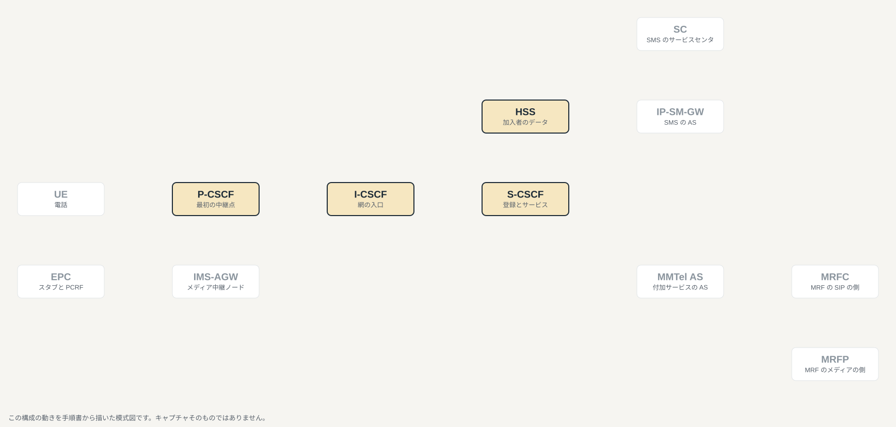
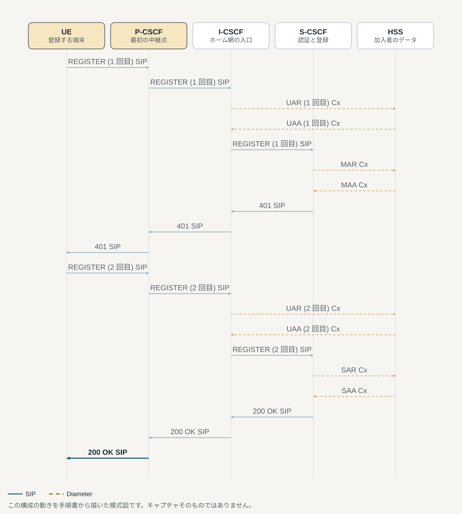
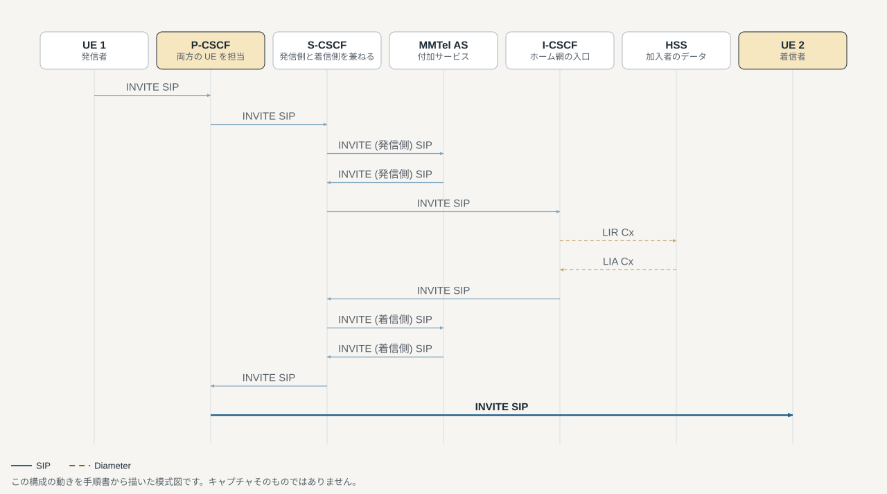
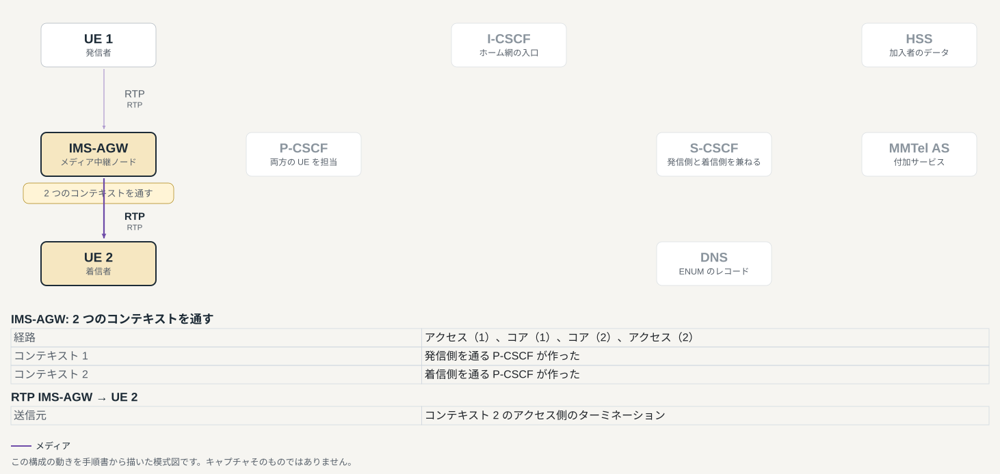
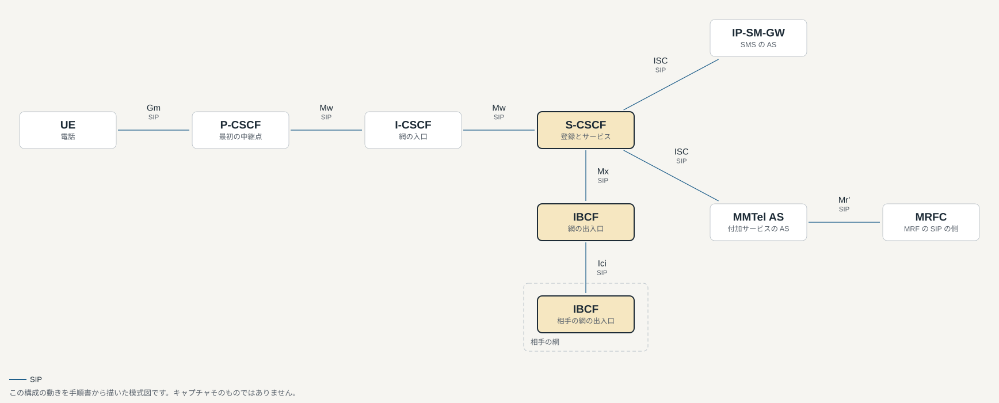
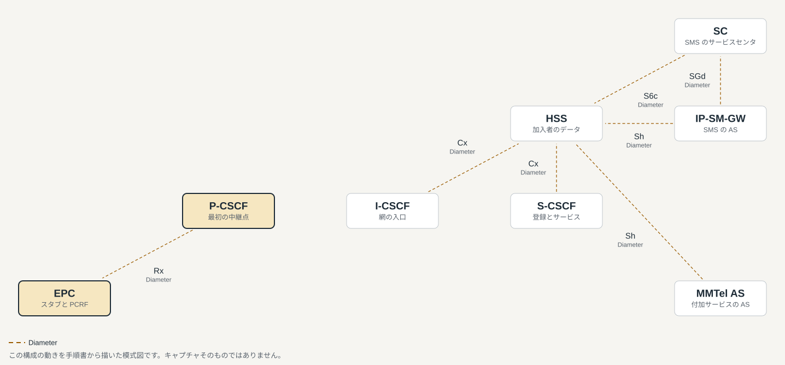
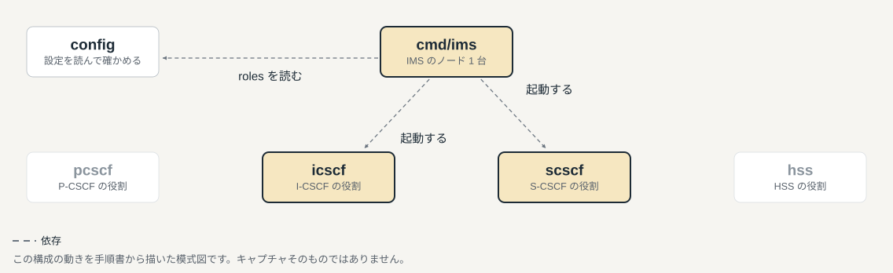
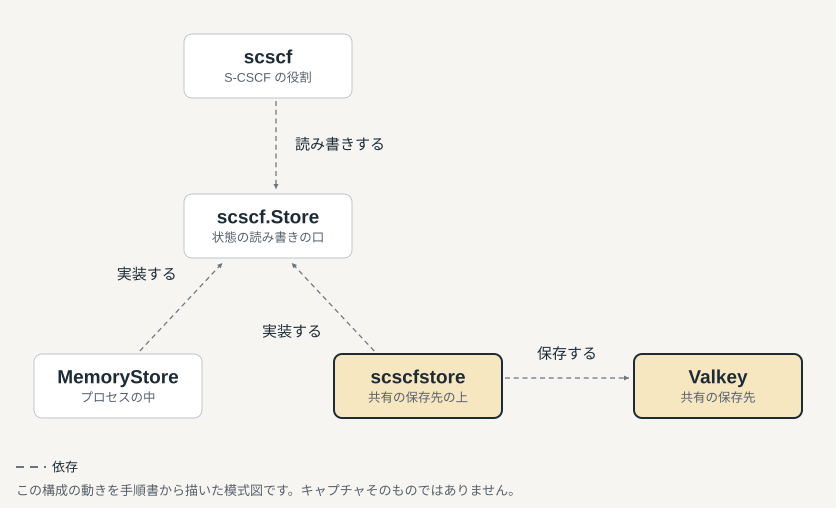

# IMS が受け持つ仕事

IMS は、電話をかけるために網がしなければならない仕事を、役目が 1 つずつのノードに分けた仕組みです。端末が「いまここにいる、本人だ」と網に知らせる登録、番号から相手を探して呼び出す通話の信号、転送や規制のように通話を変えるサービス、そして声そのものを運ぶメディアです。登録と通話の信号は SIP で運び、加入者のデータへの問い合わせは Diameter で行い、声は RTP で運びます。

2 台の電話をつなぐだけなら、SIP のプロキシが 1 台あればできます。IMS はその仕事を分け、ノードのあいだのインタフェースに名前（参照点）を付けました（TS 23.228）。名前の付いたインタフェースでは、作る会社の違うノードどうしも、事業者の違う網どうしも出会えます。仕事ごとにノードが分かれているので、仕事ごとに必要なだけ台数を増やせます。キャプチャを見れば、どのノードが何をしたかも分かります。

この章では、1 回の登録と 1 回の通話を例にして、どのノードが何を受け持ち、信号と声がそれぞれどこを通るかを見ます。細かい条件は、あとの章で 1 つずつ扱います。

## この章で扱う構成

例は `deploy/compose` の構成です。役割ごとに 1 台のノードが、1 つの Docker のネットワークに並びます。UE は SIM カードの無いソフトフォン型で、SIP Digest で登録し、G.711 で通話します。加入者 1 の UE（UE 1、`tel:+1-202-555-0101`）が登録し、加入者 2 の UE（UE 2、`tel:+1-202-555-0102`）に電話をかけます。UE 2 も同じように登録しています。

条項番号は、登録と通話の手順書と同じ TS 24.229 V18.11.0 と TS 29.228 V18.0.0 のものです。MRF の役目を定める TS 23.228 4.7 は、MRF の手順書と同じ V20.1.0 のものです。

## ノードと、それぞれの仕事



図は、この構成の IMS のノードを、役目ごとに並べたものです。濃く描いた 4 つが、登録と、この網の中の通話のどれにもかかわるノードです。

| ノード | 仕事 | 持っているもの |
| --- | --- | --- |
| P-CSCF | 端末から見て最初の SIP の中継点。端末の要求はどれもここから入り、端末への要求もここから出る | 担当する UE ごとの IP の対応付けと、その UE の登録の状態への購読 |
| I-CSCF | ホーム網の入口。この利用者を担当する S-CSCF を HSS に尋ね、そこへ要求を送る | 利用者の状態は持たない |
| S-CSCF | 認証し、登録を保持する。iFC（初期フィルタ条件）を評価して、要求をアプリケーションサーバーに通す | 登録（Contact、経路、期限、ユーザープロファイル） |
| HSS | 加入者のデータを持つ | 識別子、認証の鍵、iFC、サービスの設定、担当の S-CSCF |
| アプリケーションサーバー | 通話を変える。MMTel AS は転送や規制を、IP-SM-GW はショートメッセージを受け持つ | MMTel AS は呼を、IP-SM-GW は配達の途中のショートメッセージを持つ |
| MRF（MRFC と MRFP） | 網が自分で音声を作る。音声ガイダンスと呼び出し音を流し、会議の音声を混ぜる | MRFC は会議ごとに使う MRFP のコンテキストを、MRFP は音声を流し混ぜるコンテキストを持つ |
| メディア中継ノード（IMS-AGW） | 通話の RTP を中継する。P-CSCF が制御する | 通話ごとのコンテキスト |
| EPC スタブ | VoLTE の UE にアドレスと P-CSCF を渡し、通話ごとにメディアを許可する。PCRF を含む | 接続した UE と bearer |

このほかに、ショートメッセージを預かって配達する SC（SMS のサービスセンタ）、ほかの事業者の網との境界にいる IBCF と TrGW、ノードを探す DNS があります。SC は IMS ではなく SMS の網のノードで、IP-SM-GW が Diameter でつながります。

CSCF は、要求の行き先を決めるだけです。通話の中身を変えるのはアプリケーションサーバーで、自分でメディアを作るのは MRF です（TS 23.228 4.7）。この分け方が、あとの章の説明の土台になります。

ラボ、OAM のサーバー、キャプチャ用のコンテナも同じネットワークにいますが、IMS の一部ではありません。どの通話も、これらの応答を待ちません。ラボとキャプチャは [信号を観測する](observing.md) で扱います。

## 1 回の登録で決まること

UE が電話をかけたり受けたりする前に、網はその UE を知っていなければなりません。それを決めるのが登録です。UE は REGISTER を送ります。



1. UE が知っている網のアドレスは、P-CSCF のものだけです。ソフトフォンは設定で持ち、VoLTE の UE は接続のときにアクセス網から受け取ります。REGISTER はまず P-CSCF に届きます。
2. P-CSCF は、REGISTER のあて先のドメインから、DNS でホーム網の I-CSCF を探して送ります。
3. I-CSCF は、この利用者を担当する S-CSCF を、HSS に UAR で尋ねます。最初の登録では、まだ担当がいません。HSS は必要な能力を返し、I-CSCF がそれを持つ S-CSCF を選びます。
4. S-CSCF は、認証に使う情報を HSS に MAR で求め、401 で UE に問いを返します。UE は答えを入れた 2 回目の REGISTER を送ります。2 回目も P-CSCF と I-CSCF を通り、I-CSCF がもう一度 HSS に尋ねて、同じ S-CSCF に送ります。
5. S-CSCF は答えを確かめ、SAR で HSS に登録を知らせて、ユーザープロファイルを受け取ります。登録先を保存して、200 OK で答えます。

登録が済むと、3 つのノードがそれぞれ別のものを覚えています。HSS は担当の S-CSCF を、S-CSCF は UE の連絡先（Contact）と、UE に届く要求の経路（Path）を、UE は自分の要求の経路（Service-Route）を覚えます。I-CSCF は何も覚えません。

なぜ REGISTER が 2 回なのかは [REGISTER が 2 回送られる理由](registration-two-registers.md) で、2 つの経路の使い分けは [Path と Service-Route の使い分け](registration-routes.md) で説明します。

## 1 回の通話の信号が通る道

UE 1 が UE 2 の番号に電話をかけます。UE 1 は相手がどこにいるかを知りません。知っているのは番号 `tel:+1-202-555-0102` だけです。INVITE が相手に届くまでに、次のノードを通ります。



- **発信側。** UE 1 は INVITE を P-CSCF に送ります。P-CSCF は、登録で受け取った Service-Route に沿って、UE 1 の S-CSCF に送ります。I-CSCF は通りません。S-CSCF は UE 1 の iFC に従って、INVITE を MMTel AS に通します。
- **網の入口。** S-CSCF は、DNS の ENUM で番号を SIP URI に変え、I-CSCF に送ります。I-CSCF は HSS に LIR で着信者の S-CSCF を尋ね、そこへ送ります。
- **着信側。** 着信者の S-CSCF は、UE 2 の iFC に従ってもう一度 MMTel AS に通し、登録で保存した Path に沿って、UE 2 の P-CSCF に送ります。P-CSCF が UE 2 に届けます。

この構成では、UE 1 と UE 2 の S-CSCF は同じノードで、そのノードが発信側と着信側の 2 つの立場で動きます。I-CSCF に尋ねる手順は、2 人が別の S-CSCF にいても同じです。

MMTel AS は、受け取った INVITE に自分で答え、自分の Call-ID を付けた新しい INVITE を送ります（TS 24.229 5.7.5）。そのため、2 人のあいだの 1 つの通話が、3 つのダイアログになります。UE 1 と発信側の AS、2 つの AS のあいだ、着信側の AS と UE 2 です。

UE 2 が鳴り、応答すると、183、180、200 OK がそれぞれのダイアログを逆にたどって UE 1 に戻ります。通話を切る BYE も、ダイアログごとに進みます。詳しい手順は [番号から相手の電話へ](call.md) にあります。

## 声は信号と別の道を通る

信号は CSCF とアプリケーションサーバーを渡っていきました。声は、その道をたどりません。



RTP の行き先は、INVITE と応答に入っている SDP が決めます。SDP には、メディアを受け取るアドレスとポートが書いてあります。この構成では、P-CSCF が SDP のアドレスをメディア中継ノード（IMS-AGW）のものに書き換えます。そのため RTP は、UE とメディア中継ノードのあいだだけを流れ、CSCF もアプリケーションサーバーも通りません。発信側と着信側の P-CSCF がそれぞれコンテキストを作るので（この構成では、同じ P-CSCF が 2 つの立場で 1 つずつ作ります）、RTP は中継ノードの中で 2 つのコンテキストを通ります。

P-CSCF は、中継ノードを HTTP の API（参照点 Iq）で操作します。この API はこのプロジェクト独自のもので、標準の H.248 に切り替える構成もあります。VoLTE の通話では、P-CSCF がさらに Diameter の Rx で PCRF にメディアの許可を求め、アクセス網が声のための bearer を用意します。それは [携帯のアクセスと、別の事業者の網](access-and-borders.md) で扱います。

## 参照点とプロトコル

ノードのあいだのインタフェースには、名前とプロトコルがあります。キャプチャでどの参照点かを見分ける手がかりは、プロトコルとアドレスです。





| プロトコル | この構成のポート | 参照点と運ぶもの |
| --- | --- | --- |
| SIP | 5060 | Gm（UE と P-CSCF）、Mw（CSCF どうし）、ISC（S-CSCF とアプリケーションサーバー）、Mr'（AS と MRFC）、Mx と Ici（網の境界）。登録、通話、ショートメッセージ、購読 |
| Diameter | 3868 | Cx（CSCF と HSS）、Sh（AS と HSS）、SGd（IP-SM-GW と SC）、S6c（SC と HSS）、Rx（P-CSCF と PCRF）。加入者のデータ、認証の情報、担当のノード、メディアの許可 |
| DNS | 53 | SIP のサーバーを探す NAPTR、SRV、A（RFC 3263）と、番号を SIP URI に変える ENUM（RFC 6116） |
| RTP と RTCP | SDP が決める | 声。UE とメディア中継ノード、MRFP のあいだ。境界では TrGW どうしの Izi |
| HTTP | Ut は 80、Mp と Iq は 8080 | Ut（UE と MMTel AS。XCAP で付加サービスの設定を読み書きする。TS 24.623）、Mp（MRFC と MRFP）、Iq（P-CSCF とメディア中継ノード） |

SIP と Diameter は、ふるまいが違います。SIP は要求を先へ運びます。REGISTER も INVITE も、中継点を渡って先へ進み、応答が同じ道を戻ります。Diameter は問いを出して答えを待ちます。Cx の UAR は I-CSCF から HSS への 1 往復で、HSS がそれを先へ送ることはありません。キャプチャで SIP の 1 つのメッセージが何度も見えるのは、中継点ごとに 1 回ずつ写るからです。

Mp と Iq は、標準では H.248 です（TS 29.333、TS 29.334）。この構成は、命令 1 つに操作 1 つの簡単な HTTP の API を使います。Diameter の接続は、Cx と Sh では SCTP のところを TCP で運んでいます。どちらも、手順書の「簡略化したこと」に理由があります。

## 役割は設定で選ぶ

IMS のノードは、どれも同じ実行ファイル `cmd/ims` です。何のノードになるかは、ノードの設定ファイルの `roles` が決めます。S-CSCF の設定ファイルは、最初のコメントのあとが次のように始まります。

[deploy/compose/scscf.yaml](../../../deploy/compose/scscf.yaml)

```yaml
node: scscf
roles: [scscf]
home_domain: ims.mnc001.mcc001.3gppnetwork.org
```

設定を読むパッケージ `config` は、知っている役割の一覧を持ち、一覧に無い役割を書いた設定を起動のときに断ります。

[internal/config/config.go](../../../internal/config/config.go)

```go
var knownRoles = []Role{RoleHSS, RoleICSCF, RoleSCSCF, RolePCSCF, RoleAGW, RoleLab, RoleOAM, RoleIPSMGW, RoleSC, RoleEPC, RoleMMTel, RoleMRFP, RoleMRFC, RoleIBCF, RoleFault}

// Config is a node's validated configuration. Each role's section is
// set exactly when the node has that role.
type Config struct {
```

検証を通った設定には、ノードが持つ役割の節だけがあります。`cmd/ims/main.go` の `run` は、`if c := cfg.SCSCF; c != nil` のように役割の節があるかを見て、その役割の部品を作り、SIP や Diameter の口を開きます。役割のコードは、自分がどのノードの上で動いているかを知りません。



`roles` に 2 つ以上を書くと、1 つのノードがいくつかの役割を兼ねます。コードは変わりません。設定の試験は、P-CSCF、I-CSCF、S-CSCF、HSS の 4 つを兼ねる設定を使います。

[internal/config/config_test.go](../../../internal/config/config_test.go)

```yaml
node: ims
roles: [pcscf, icscf, scscf, hss]
home_domain: ims.mnc001.mcc001.3gppnetwork.org
pcscf:
  sip: {listen: 0.0.0.0:5060, host: pcscf.ims.mnc001.mcc001.3gppnetwork.org}
  visited_network_id: ims.mnc001.mcc001.3gppnetwork.org
icscf:
  sip: {listen: 0.0.0.0:5061, host: icscf.ims.mnc001.mcc001.3gppnetwork.org}
  scscfs:
    - name: sip:scscf.ims.mnc001.mcc001.3gppnetwork.org:5062
scscf:
  sip: {listen: 0.0.0.0:5062, host: scscf.ims.mnc001.mcc001.3gppnetwork.org}
```

兼ねるときも、SIP の役割はそれぞれ自分のポートで待ちます。I-CSCF が S-CSCF に要求を送るときは、同じホストの 5062 番に送ります。2 つの役割が同じポートを指す設定は、`config` が断ります。

### 台数を増やすときに意味すること

役割を設定で選べることは、同じ役割を何台にもできることでもあります。商用の網は役割ごとに多くのノードを動かします。この構成は、信号を追うには足りるので、役割ごとに 1 台を動かします。台数を増やせるのは、次のように作ってあるからです。

- I-CSCF は状態を持ちません。どの I-CSCF に REGISTER が届いても、担当の S-CSCF は HSS が覚えているので、同じ S-CSCF に送られます。
- 利用者の状態を持つ役割は、それを `Store` というインタフェースの後ろに置きます。Compose の構成ではプロセスの中のメモリに、冗長の構成（`deploy/redundancy/`）では共有の保存先（Valkey）に置きます。役割のコードは同じです。



- HSS に Diameter でつなぐノードは、HSS の台をいくつでも設定に書けます。どの台も全加入者を扱います。
- 1 人の利用者の処理には、その利用者だけのロックをかけます。役割全体を止めるロックや、全加入者を走査する処理はありません。

状態を共有の保存先に置いても、それだけで障害のあいだも呼が続くわけではありません。何をどの台が引き継げるかは、[複数台と障害で引き継ぐもの](design-shared-state.md) で扱います。

## コードの場所

コードを読みたいときの入口は、役割の名前のパッケージです。すべてのパッケージの一覧を読む必要はありません。

| 何を読みたいか | どこにあるか |
| --- | --- |
| ノード 1 台の組み立て | `cmd/ims/main.go` の `run` |
| P-CSCF、I-CSCF、S-CSCF、HSS | `internal/pcscf`、`internal/icscf`、`internal/scscf`、`internal/hss` |
| アプリケーションサーバー、SC、MRF | `internal/mmtel`、`internal/ipsmgw`、`internal/smsc`（役割 `sc`）、`internal/mrfc`。MRFP はメディア中継ノードと同じ `internal/agw` |
| SIP、Diameter、Cx のメッセージ | `internal/sip`（RFC 3261）、`internal/diameter`（RFC 6733）、`internal/cx`（TS 29.228、TS 29.229） |
| UE シミュレータ | `cmd/ue` と `internal/ue` |
| 各ノードの設定 | `deploy/compose/` のノードごとのファイルと、DNS のゾーン |

役割のパッケージの中は、手順ごとにファイルが分かれています。たとえば `internal/scscf` では、`scscf.go` が登録、`session.go` が通話、`services.go` が iFC です。パッケージの全体の一覧は [パッケージ構成のデッキ](../../../slides/decks/ja/01-packages.md) にあります。

## この構成に無いもの

| 無いもの | 何のためのものか |
| --- | --- |
| 電話網への出口 | ENUM のレコードが無い番号にはつながりません。大きな網なら BGCF へ出すところを、S-CSCF が 404 で答えます |
| Gx | bearer 側のゲートウェイと PCRF が EPC スタブの中で状態を共有するので、その間に見るものがありません |
| Mr | S-CSCF が自分で MRFC に頼む道です。ここではメディアの依頼はすべて AS から Mr' で出ます |
| GBA | AKA から Ut 用の鍵を作るしくみです。UE は、AS が Sh で読むパスワードを使います |

どの手順書にも「簡略化したこと」の表があり、その流れで何を省いたかと理由が書いてあります。

## この説明の根拠

- `internal/ue/ue_test.go` の `TestRegisterRefreshAndDeregisterThroughTheWholeIMS`。P-CSCF、I-CSCF、S-CSCF、HSS を 1 つのプロセスの中で動かし、登録、再登録、解除が通ることを確かめています。
- `internal/ue/call_test.go` の `TestCallThroughTheWholeIMS`。同じ網で 2 台の UE が登録し、一方がもう一方に電話をかけ、相手が応答して、発信側が送った 25 個の RTP のパケットがそのまま着信側に届くことを確かめています。この試験の網には MMTel AS もメディア中継ノードも無いので、MMTel AS を通る道と中継ノードを通る声は、この試験の範囲の外です。それは図のもとにした手順書の流れです。
- `internal/config/config_test.go` の `TestParseCombinedRoles`。4 つの役割を兼ねる設定から、4 つの役割の節ができることと、2 つの役割が同じポートで待つ設定を断ることを確かめています。同じファイルの `TestParseRejects` は、知らない役割（`mgcf`）を書いた設定を断ることを確かめています。

図は、この構成の動きを手順書から描いた模式図で、キャプチャそのものではありません。

## 自分で動かす場合

この章を読むのに、構成を動かす必要はありません。同じ登録と通話を自分のキャプチャで見たいときは、手順書の [最初のコマンド](../../guide/ja/README.md#最初のコマンド) で構成を起動し、[UE が IMS に登録する流れを追う](../../guide/ja/registration.md) と [音声通話の流れを追う](../../guide/ja/call.md) に進みます。サービスごとのアドレスは [Compose のプロジェクトが起動するもの](../../guide/ja/README.md#compose-のプロジェクトが起動するもの) にあります。スライドでは [網の地図のデッキ](../../../slides/decks/ja/02-network.md) が参照点を 1 本ずつ、[パッケージ構成のデッキ](../../../slides/decks/ja/01-packages.md) がコードの場所を見せます。

次の章では、この地図の上を流れる信号を、キャプチャとラボでどう見るかを扱います。[信号を観測する](observing.md)
