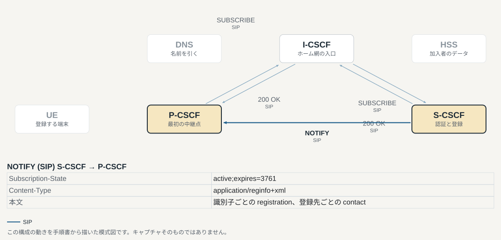
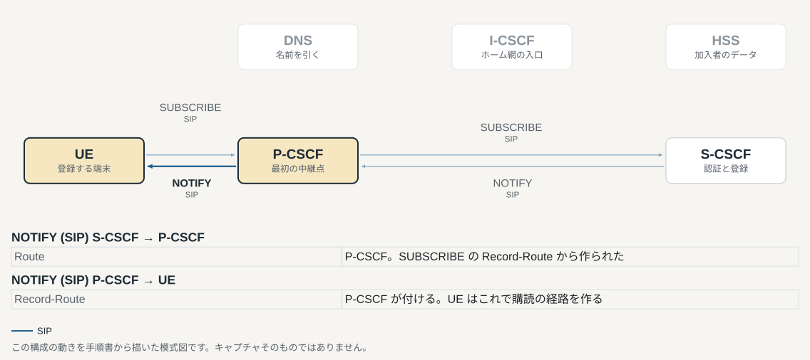
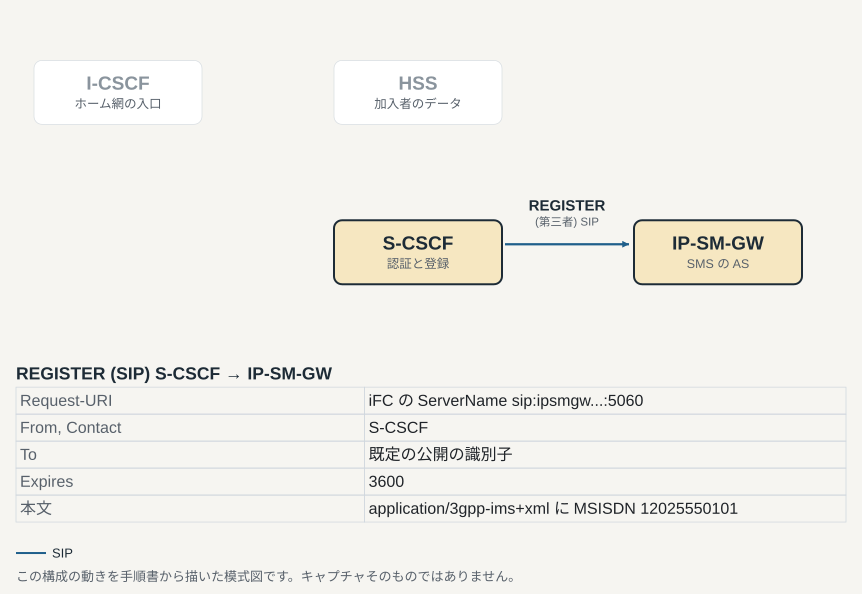
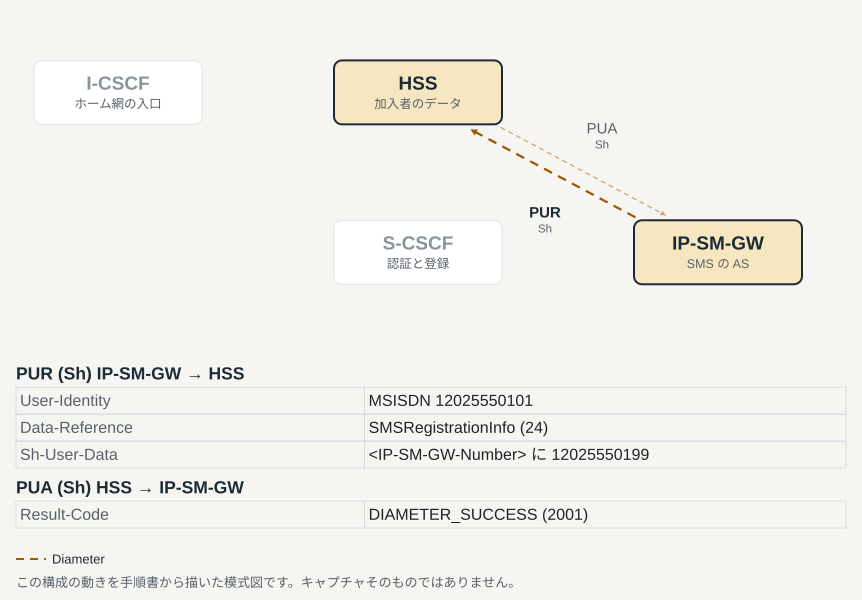
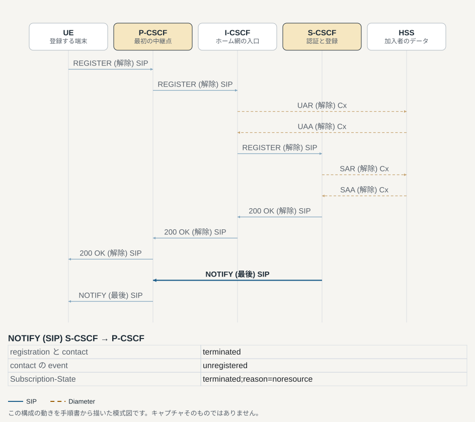
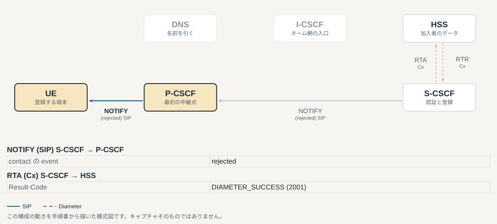
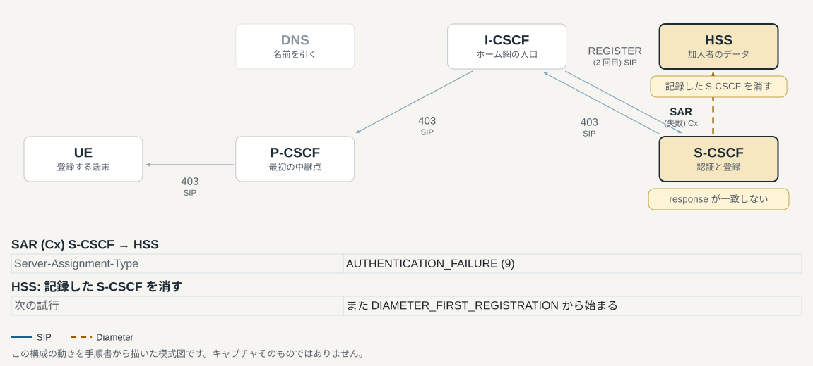

# 登録の更新、解除、購読、網からの取り消し

200 OK で登録は決まりますが、そこで終わりではありません。登録には期限があり、UE は期限の前に再登録します。登録が終わる道は 3 つあります。UE が自分で解除する、更新されないまま期限が切れる、網が取り消す、です。どの終わり方でも、S-CSCF は登録の状態を購読しているノードに NOTIFY で知らせ、HSS に SAR で知らせます。HSS が取り消したときだけは、HSS が始めた手順なので SAR を送りません。

購読しているのは P-CSCF、UE、アプリケーションサーバーの IP-SM-GW です。NOTIFY は、登録先がどうなったかを `event` の値で伝えます。購読者はその値で次の動きを決めます。P-CSCF は IP の対応付けを終わらせ、UE は登録し直すかどうかを決め、IP-SM-GW は SMS を受け持つことを HSS に書くか取り消します。

この章では、200 OK のあとに起きることを、購読、第三者 REGISTER、解除、期限切れ、網からの取り消しの順に追います。最後に、何も変えない Contact の無い REGISTER と、ラボが登録をどう見せるかを見ます。

## この章で扱う構成

前の章と同じく、`deploy/compose` の構成で、SIP Digest で登録するソフトフォン型の UE を例にします。ノードは UE、P-CSCF、I-CSCF、S-CSCF、HSS に、SMS のアプリケーションサーバーの IP-SM-GW が加わります。この構成の S-CSCF は、登録の期限の上限を 3600 秒にしています。

この章が引く仕様の版は、TS 24.229 V18.11.0、TS 29.228 V18.0.0、TS 29.229 V18.1.0 です。登録の状態の通知は、RFC 3680 の reg イベントパッケージと、RFC 6665 の SUBSCRIBE と NOTIFY の仕組みを使います。

## 登録の状態を購読する 3 つのノード

登録のあと、3 つのノードが S-CSCF に「この利用者の登録が変わったら知らせてほしい」と頼みます。`Event: reg` の SUBSCRIBE です。S-CSCF は購読を受け付けるとすぐに、登録の状態を NOTIFY で送ります。購読が要るのは、UE が自分で解除しなかった登録の終わり、たとえば期限切れや網からの取り消しを、購読者が知るためです。

| 購読者 | 始めるとき | SUBSCRIBE の経路 | P-Asserted-Identity | Expires |
| --- | --- | --- | --- | --- |
| P-CSCF | 秘密の識別子の最初の登録への 200 OK を UE に渡したあと（TS 24.229 5.2.3） | I-CSCF が LIR で S-CSCF を探して転送する | P-CSCF が Path に入れた URI `sip:term@pcscf...` | 3761 |
| UE | 最初の登録への 200 OK を受けたあと（TS 24.229 5.1.1.3） | P-CSCF と Service-Route。I-CSCF を通らない | P-CSCF が付ける利用者の識別子 | 600000 |
| IP-SM-GW | 第三者 REGISTER を受けたあと（TS 24.341 5.3.3.2） | I-CSCF が LIR で S-CSCF を探して転送する | IP-SM-GW の URI。iFC の ServerName と同じ | 3761 |

TS 24.229 5.2.3 は、P-CSCF の購読の Expires を、200 OK が示した登録の期間より長くするよう定めています。3761 秒は RFC 3680 4.4 の購読の既定の期間で、登録の既定の 3600 秒より少し長くして、購読と登録の更新が重ならないようにした値です。この実装は、登録の期間に同じ差の 161 秒を足して、P-CSCF と IP-SM-GW の Expires にしています。

P-CSCF はホーム網の中にあるので、SUBSCRIBE をホーム網の入口の I-CSCF へ送ります。I-CSCF は、利用者がどの S-CSCF にいるかを LIR（Location-Info-Request、TS 29.228 6.1.4）で HSS に尋ね、その S-CSCF へ転送します。



200 OK で購読のダイアログができると、そのあとの NOTIFY は、P-CSCF が SUBSCRIBE の Contact に書いたアドレスへ直接届きます。I-CSCF は経路に残らないので、NOTIFY を中継しません。P-CSCF はこの購読を秘密の識別子ごとに 1 回だけ作り、再登録では作り直しません。購読の更新は、期限の 600 秒前にダイアログの中で S-CSCF へ直接送ります。

UE の SUBSCRIBE は、UE が出すほかの要求と同じく、P-CSCF と Service-Route を Route に入れます。そのため I-CSCF を通らず、登録した S-CSCF に届きます。



P-CSCF は SUBSCRIBE に Record-Route を付け、NOTIFY にも自分の Record-Route を付けます（TS 24.229 5.2.6.4.5）。UE は購読の経路を NOTIFY から作るので（RFC 6665 4.4.1）、あとの購読の更新も P-CSCF を通ります。

### 購読を受け付ける条件

S-CSCF が誰の購読でも受け付けるわけではありません。購読者は P-Asserted-Identity で示され、次の関数がそれを確かめます（TS 24.229 5.4.2.1.1 の手順 1）。

[internal/scscf/regevent.go](../../../internal/scscf/regevent.go)

```go
func authorizedSubscriber(req *sip.Message, reg Registration) (string, bool) {
	asserted, err := sip.ParseNameAddr(req.Get("P-Asserted-Identity"))
	if err != nil {
		return "", false
	}
	for _, own := range reg.NonBarredIdentities() {
		if ims.SamePublicIdentity(own, asserted.URI) {
			return asserted.URI, true
		}
	}
	for _, p := range reg.Path {
		if path, err := sip.ParseNameAddr(p); err == nil && sameURI(path.URI, asserted.URI) {
			return asserted.URI, true
		}
	}
	for _, c := range reg.InitialFilterCriteria {
		if sameURI(c.ApplicationServer.ServerName, asserted.URI) {
			return asserted.URI, true
		}
	}
	return "", false
}
```

入力は、届いた SUBSCRIBE `req` と、その利用者の登録 `reg` です。受け付けるのは 3 つの場合です。P-Asserted-Identity が利用者自身の規制されていない識別子のとき（UE の購読）、登録の Path にある P-CSCF の URI のとき（P-CSCF の購読）、利用者の iFC のアプリケーションサーバーのとき（IP-SM-GW の購読）です。どれにも当たらなければ、S-CSCF は 403 で断ります。この関数の前に、S-CSCF は利用者に登録があるかを確かめ、無ければ 480 で断ります。Accept があって `application/reginfo+xml` を含まない購読は、NOTIFY で送れる形が無いので 406 で断ります（RFC 3680 4.5）。

別の P-CSCF の URI では受け付けないことに意味があります。登録の Path にあるのは、UE がその登録に使った P-CSCF だけだからです。

## NOTIFY が伝えること

NOTIFY の本文は `application/reginfo+xml` の文書です。一緒に登録された識別子ごとに `registration` があり、その中に登録先ごとの `contact` があります。S-CSCF は毎回、状態のすべてを送ります（TS 24.229 5.4.2.1.2）。次は、最初の登録のあとの NOTIFY の本文の形です。手順書のキャプチャの例を短くしたもので、`...` は省いた値です。

```xml
<reginfo xmlns="urn:ietf:params:xml:ns:reginfo" version="0" state="full">
  <registration aor="sip:+12025550101@ims.mnc001.mcc001.3gppnetwork.org" id="reg1" state="active">
    <contact id="..." state="active" event="registered" expires="3600" callid="..." cseq="2">
      <uri>sip:4218b61b-4e20-8e1c-872d-5b39fca1e64f@172.28.0.100:5060</uri>
      <unknown-param name="+g.3gpp.smsip"></unknown-param>
    </contact>
  </registration>
</reginfo>
```

購読者が読むのは、`registration` と `contact` の `state`（`active` か `terminated`）と、`contact` の `event` です。`event` は、その登録先を今の状態にしたできごとです。

| event | 起きたこと | 登録先の state | 購読者の次の動き |
| --- | --- | --- | --- |
| `registered` | 新しい登録先ができた | `active` | 登録を使い始める |
| `refreshed` | 同じ Contact の再登録 | `active` | 何も変えない |
| `unregistered` | UE が解除した。別の Contact に置き換わった古い登録先もこれになる | `terminated` | P-CSCF は IP の対応付けを終える |
| `expired` | 再登録されないまま期限が切れた | `terminated` | P-CSCF は IP の対応付けを終える。UE は登録が無くなったと知る |
| `rejected` | 網が取り消した。登録し直しても無駄 | `terminated` | UE は登録し直さず、ダイアログを解放する |
| `deactivated` | 網が取り消した。登録し直してほしい | `terminated` | UE は最初の登録をやり直す |

`registered` と `refreshed` を分けるのは、S-CSCF が登録を受け付ける `accept` の次の数行です。

[internal/scscf/scscf.go](../../../internal/scscf/scscf.go)

```go
	// TS 24.229 5.4.2.1.2: a new binding gets a new contact id and the
	// event registered, and replaces the binding of an older contact; a
	// binding that stays is refreshed.
	var replaced *Registration
	if registered && sameURI(old.Contact, reg.Contact) {
		reg.ContactID, reg.ContactEvent = old.ContactID, reginfo.Refreshed
	} else {
		reg.ContactID, reg.ContactEvent = sip.NewTag(), reginfo.Registered
		if registered {
			replaced = &old
		}
	}
```

すでに登録があり、届いた Contact が保存した Contact と同じなら、同じ登録先の更新なので `refreshed` です。登録先の ID も前のものを引き継ぎます。それ以外は新しい登録先なので、新しい ID を作って `registered` にします。前の登録先が別の Contact だったときは、それを `replaced` に残し、次の NOTIFY に `terminated` の `unregistered` としてもう 1 度載せます。

### 最後の NOTIFY

登録が終わると、S-CSCF は購読ごとに最後の NOTIFY を送ります。

[internal/scscf/regevent.go](../../../internal/scscf/regevent.go)

```go
func (s *SCSCF) endRegistration(ctx context.Context, reg Registration, event reginfo.Event, log *slog.Logger) {
	doc := regInfo(reg, reginfo.Terminated, event, time.Now())
	subs, err := s.store.SubscriptionsOf(ctx, reg.PrivateIdentity)
	if err != nil {
		log.Warn("reg event NOTIFYs not sent: the store failed; the subscriptions end when they expire", "error", err.Error())
		return
	}
	for _, sub := range subs {
		sub.Terminate(sip.ReasonNoResource)
		s.notify(ctx, sub, doc, log)
	}
}
```

入力は、終わった登録 `reg` と、終わらせたできごと `event` です。`regInfo` は、識別子と登録先をすべて `terminated` にし、`contact` の `event` に終わった理由を入れた文書を作ります。続けて、利用者の購読をすべて読み、それぞれを理由 `noresource` で終わらせてから NOTIFY を送ります。Subscription-State は `terminated;reason=noresource` になり、購読のダイアログもここで終わります。購読者は、次に最初の登録をしたあとで購読し直します。

P-CSCF は、この NOTIFY で UE の IP の対応付けを終えるかどうかを、次の関数で決めます（TS 24.229 5.2.5.2）。

[internal/pcscf/regevent.go](../../../internal/pcscf/regevent.go)

```go
func removedByTheNetwork(r reginfo.Registration, c reginfo.Contact) bool {
	if r.State == reginfo.Terminated {
		return true
	}
	if c.State != reginfo.Terminated {
		return false
	}
	switch c.Event {
	case reginfo.Unregistered, reginfo.Rejected, reginfo.Deactivated:
		return true
	}
	return false
}
```

識別子の `registration` が `terminated` なら、終わりです。そうでなくても、`contact` が `terminated` で、その理由が `unregistered`、`rejected`、`deactivated` のどれかなら、その登録先は網の側で消えています。どちらの場合も、P-CSCF はその Contact の IP の対応付けを終え、UE から届く要求を受け付けなくなります。ただし、最後の NOTIFY がまだ UE に届くように、終えた対応付けをしばらく残し、そのあいだは UE あての要求を通します。

## 再登録で変わること

UE は、登録の期限が切れる前に再登録します。前の登録が 1200 秒より長ければ期限の 600 秒前、それ以下なら半分が過ぎたときです（TS 24.229 5.1.1.4.1）。この構成の 3600 秒の登録なら、3000 秒後です。

再登録では、次のことが起きます。

- SIP Digest の再登録は、最初の登録と同じく 401 で問い直されます。S-CSCF は、登録を受け付けたときにチャレンジを消しているからです。
- 答えが正しければ、S-CSCF は RE_REGISTRATION の SAR を送り、期限を延ばします。NOTIFY の `contact` は `refreshed` になります。
- P-CSCF は購読を作り直しません。購読の更新は、登録とは別の時刻で行います。
- S-CSCF は IP-SM-GW にも第三者 REGISTER をもう 1 度送ります。IP-SM-GW はそれを受けて購読を更新します。状態が変わらないので、HSS には何も送りません。

再登録の REGISTER が網の中で順序を入れ替えて届いたときの扱いは、[遅れて届いた登録の解除が、新しい登録を消さない理由](registration-stale-deregistration.md) にあります。

## アプリケーションサーバーへの第三者 REGISTER

S-CSCF は、SAA で受け取ったプロファイルの iFC と UE の REGISTER を照らし合わせ、一致した iFC のアプリケーションサーバーごとに、自分で REGISTER を送ります。これを第三者 REGISTER と呼びます（TS 24.229 5.4.1.7）。この構成のプロファイルの 1 つ目の iFC は、すべての REGISTER に一致し、IP-SM-GW を指しています。

[internal/scscf/thirdparty.go](../../../internal/scscf/thirdparty.go)

```go
func (s *SCSCF) notifyApplicationServers(req *sip.Message, reg Registration, expires time.Duration, log *slog.Logger) {
	for _, c := range ifc.Ordered(reg.InitialFilterCriteria) {
		// TS 23.218 5.2.1 NOTE 2: a REGISTER is part of the originating
		// case.
		if !c.Matches(req, ifc.OriginatingRegistered) {
			continue
		}
		m := s.thirdPartyRegister(req, reg, c.ApplicationServer, expires)
		go s.sendThirdPartyRegister(m, reg, c.ApplicationServer, expires, log)
	}
}
```

入力は、UE の REGISTER `req`、受け付けた登録 `reg`、UE に返した期限 `expires` です。`ifc.Ordered` は iFC を優先度の順に並べ、`Matches` は REGISTER をその条件に照らします。REGISTER は発信側の要求として照らします。一致した iFC ごとに `thirdPartyRegister` が REGISTER を組み立て、別の goroutine で送ります。UE には 200 OK をもう返していて、UE はこの答えを待ちません。



第三者 REGISTER の Request-URI は iFC の ServerName、From と Contact は S-CSCF、To は利用者の既定の識別子、Expires は UE に返したのと同じ 3600 です。本文は `application/3gpp-ims+xml` で、iFC の ServiceInfo の MSISDN `12025550101` が入ります（TS 24.229 5.4.1.7A）。

IP-SM-GW が答えないときは、iFC の DefaultHandling に従います。この構成では SESSION_CONTINUED なので、登録はそのまま残ります。SESSION_TERMINATED の iFC なら、S-CSCF は利用者の登録を解除し、UE に `rejected` の NOTIFY を送ります（TS 24.229 5.4.1.5）。

IP-SM-GW は 200 OK で答え、前の節の表のとおり登録の状態を購読します。最初の NOTIFY を受けると、利用者が IP で SMS を受けられるかを次の関数で調べます。

[internal/ipsmgw/regevent.go](../../../internal/ipsmgw/regevent.go)

```go
func takesShortMessages(doc reginfo.Document, publicID string) bool {
	for _, r := range doc.Registrations {
		if r.State != reginfo.Active || !ims.SamePublicIdentity(r.AOR, publicID) {
			continue
		}
		for _, c := range r.Contacts {
			if c.State != reginfo.Active {
				continue
			}
			for _, p := range c.UnknownParams {
				if strings.EqualFold(p.Name, featureSMSOverIP) {
					return true
				}
			}
		}
	}
	return false
}
```

入力は NOTIFY の reginfo の文書 `doc` と、第三者 REGISTER の To の識別子 `publicID` です。その識別子の `registration` が `active` で、その中に `active` の `contact` があり、Contact のパラメータに `+g.3gpp.smsip` があれば、`true` です。この機能タグは、UE が SMS over IP を受けられることを示します（TS 24.341 5.3.2.2）。S-CSCF は、RFC 3261 で決まっていない Contact のパラメータを `unknown-param` として載せるので、関数はそこを探します。



受けられるなら、IP-SM-GW は Sh の UDR で利用者の IMSI を読み、PUR（Profile-Update-Request、Sh のコマンド 307、TS 29.328 6.1.2）を HSS に送ります。Data-Reference は SMSRegistrationInfo（24）で、Sh-User-Data の `<IP-SM-GW-Number>` に IP-SM-GW の番号 `12025550199` が入ります。HSS は DIAMETER_SUCCESS（2001）の PUA で答えます。これで、ほかの網から届く SMS の宛先として、HSS がこの IP-SM-GW を答えるようになります。UE が `+g.3gpp.smsip` を付けずに登録したときは、PUR を送りません。SMS の配達そのものは [SMS の章](sms.md) で扱います。

## UE が登録を解除する

UE は、Contact に `expires=0` を付けた REGISTER で登録を解除します（TS 24.229 5.1.1.6.1）。最初の登録と違い、401 は返りません。REGISTER は 1 回で済みます。



401 が返らない理由は、P-CSCF が付ける 1 つのパラメータにあります。P-CSCF は REGISTER を転送する前に、その UE との IP の対応付けがあるかを調べ、Authorization の `integrity-protected` を書き直します（TS 24.229 5.2.2.3）。

[internal/pcscf/pcscf.go](../../../internal/pcscf/pcscf.go)

```go
	switch {
	case protected || asksSecAgree(req):
		var refusal *sip.Message
		if agreement, refusal = p.receiveSecAgree(st, out, privateID, creds, protected, log); refusal != nil {
			respond(refusal)
			return
		}
		integrity = agreement.integrity
	case associated:
		integrity = sip.IPAssociationYes
	case creds != nil && creds.Response != "":
		integrity = sip.IPAssociationPending
	}
```

IMS-AKA の保護が無い SIP Digest の UE では、最初の `case` には当たりません。この UE はすでに登録していて、P-CSCF は 200 OK のときに IP の対応付けを作っているので、`associated` が真になり、`ip-assoc-yes` が付きます。認証の答えだけがあって対応付けがまだ無ければ、最初の登録の 2 回目と同じ `ip-assoc-pending` です。UE が自分で書いた値は使いません。

I-CSCF は、Expires が 0 の REGISTER なので、UAR の User-Authorization-Type を変えます。

[internal/icscf/icscf.go](../../../internal/icscf/icscf.go)

```go
	// TS 29.228 6.1.1: DE_REGISTRATION when the REGISTER asks for an
	// interval of zero.
	uat := cx.Registration
	if seconds, _, _ := sip.RequestedExpires(req); seconds == 0 {
		uat = cx.DeRegistration
	}
```

DE_REGISTRATION（1）の UAR です（TS 29.228 6.1.1）。HSS は担当の S-CSCF の名前を返し、I-CSCF はそこへ REGISTER を送ります。S-CSCF の `register` では、Expires が 0 の要求を、認証を求める前に次の分かれ道で扱います。

[internal/scscf/scscf.go](../../../internal/scscf/scscf.go)

```go
	if expires == 0 {
		// TS 24.229 5.4.1.4.1: nothing to deregister gets 481 before any
		// authentication, and an existing IP association needs no new
		// authentication.
		if !registered {
			s.respond(st, 481, nil)
			return
		}
		// With IMS AKA, a protected REGISTER needs no new authentication
		// either (5.4.1.2.2 step 2).
		if integrity == sip.IPAssociationYes || integrity == sip.IntegrityProtectedYes {
			s.deregister(st, privateID, wildcard, log)
			return
		}
	}
```

登録が無い利用者の解除には、認証の前に 481 で答えます。期限の過ぎた登録も、S-CSCF がその期限をまだ処理していなくても、ここでは無いものとして数えます。登録があり、`integrity-protected` が `ip-assoc-yes` なら、問い直さずに `deregister` へ進みます（TS 24.229 5.4.1.4.1）。IP の対応付けは、この UE が P-CSCF を通って正しく登録したことを示しているからです。`ip-assoc-yes` が無い解除の要求は、この分かれ道を抜け、普通の REGISTER と同じく 401 で問い直されます。

`deregister` は、Contact が保存した登録先と同じかと、順序が古くないかを確かめたあと、HSS に Server-Assignment-Type が USER_DEREGISTRATION（5）の SAR を送ります。SAA が成功を返したあとの処理が次の数行です。

[internal/scscf/scscf.go](../../../internal/scscf/scscf.go)

```go
	if err := s.store.DeleteRegistration(ctx, privateID); err != nil {
		s.storeFailed(st, err, log)
		return
	}
	log.Info("deregistered")
	s.respond(st, 200, func(r *sip.Message) {
		r.Add("Contact", fmt.Sprintf("<%s>;expires=0", reg.Contact))
	})
	s.endRegistration(ctx, reg, reginfo.Unregistered, log)
	s.notifyApplicationServers(st.Request, reg, 0, log)
}
```

S-CSCF は登録を保存先から消し、`expires=0` の Contact を付けた 200 OK で答えます。HSS が SAR に答えてから 200 OK を返すのは、TS 23.228 5.3.1 の手順の順です。続けて、`endRegistration` が `unregistered` の最後の NOTIFY を購読者に送り、`notifyApplicationServers` が Expires 0 の第三者 REGISTER を IP-SM-GW に送ります。IP-SM-GW は 200 OK で答え、最後の NOTIFY を受けると、`<IP-SM-GW-Number>` を空にした PUR で HSS から自分の登録を消します。

SAA が返らないときや、HSS が SAR を断ったときは、S-CSCF は登録を残したまま 500 で答え、NOTIFY も第三者 REGISTER も送りません。SAR が HSS に届かなかったのか、SAA だけが失われたのかが分からないからです。UE がもう一度解除を送れば、SAR も送り直されます。

## 更新されない登録が期限で終わる

UE が期限までに再登録しないと、登録の期限が切れます。S-CSCF は、期限の来た登録を 1 秒ごとに探し、見つけた登録ごとに次の処理をします。

[internal/scscf/scscf.go](../../../internal/scscf/scscf.go)

```go
	}
	// Under the lock, the registration may have ended or been refreshed
	// since its expiry came up.
	if !ok || time.Now().Before(reg.Expires) {
		return nil
	}
	log.Info("registration expired")
	if err := s.store.DeleteRegistration(ctx, privateID); err != nil {
		return err
	}
	// The registration is gone, so the expiry is handled: a NOTIFY or a
	// SAR that does not get through is not sent again.
	//
	// SIMPLIFIED: TS 24.229 5.4.2.1.2 and TS 29.228 6.1.2. The expiry
	// is an event of the user's registration state, which the NOTIFYs
	// tell the subscribers, and the SAR tells the HSS that the S-CSCF no
	// longer serves the user. Both go out only after the registration is
	// deleted from the store. An instance that stops after the delete
	// sends neither, and the instance that claims the expiry again finds
	// no registration: no subscriber gets a NOTIFY of the expiry, and the
	// HSS keeps the user registered until a later SAR for the user
	// changes that. Sending first and deleting afterwards would send the
	// NOTIFYs and the SAR again whenever the delete fails or the instance
	// stops before it, since the expiry is then handled once more.
	s.endRegistration(ctx, reg, reginfo.Expired, log)
	s.serverAssignment(ctx, privateID, reg.PublicIdentities[0], reg.HSSHost, reg.ServerName, cx.TimeoutDeregistration)
```

この処理は、利用者のロックを取ったあとで登録を読み直します。期限が来たと分かったあとで、ほかの台が再登録か、期限が切れたあとの新しい登録を受け付けているかもしれないからです。期限がまだ先なら、何もしません。期限が過ぎていれば、登録を保存先から消し、`expired` の最後の NOTIFY を送り、HSS に TIMEOUT_DEREGISTRATION（4）の SAR を送ります（TS 24.229 5.4.2.1.2、TS 29.228 6.1.2）。登録を探すのが 1 秒ごとなので、この 2 つのメッセージは期限そのものより 1 秒ほど遅れることがあります。そのあいだに利用者あての要求が来ても、S-CSCF は期限の過ぎた登録先へは送りません。そのあいだに REGISTER が来ても、登録先は見つかりません。S-CSCF はその REGISTER を最初の登録として扱うので、SAR には RE_REGISTRATION ではなく `REGISTRATION` が入り、新しい登録を知らせる NOTIFY の contact の id も新しくなります。IMS-AKA の保護された REGISTER は、登録があるあいだは新しい問いが要りませんが、ここでは 500 を受けます（TS 24.229 5.4.1.2.3A）。UE はそこで最初の登録をやり直します。そうして登録し直したあとで期限を処理すると、読み直した登録の期限は先にあるので、期限切れの NOTIFY も SAR も送られません。

コメントの `SIMPLIFIED:` は、消すことと知らせることの順についての簡略化です。この実装は、先に消してから NOTIFY と SAR を送ります。消したあとで台が止まると、どちらも送られず、購読者は期限切れを知らず、HSS は次の SAR まで利用者を登録済みとして扱います。逆の順にすると、消すのに失敗するたびに期限切れをもう一度処理し、NOTIFY と SAR を重ねて送ります。この実装は、重ねて送るほうを避けています。

NOTIFY を受けた P-CSCF は、解除のときと同じく UE の IP の対応付けを終えます。UE も、自分の購読への NOTIFY で、登録が無くなったことを知ります。

## 網が登録を取り消す

利用者の登録を終わらせるのは、UE だけではありません。運用者が HSS から加入を削除すると、HSS は利用者を登録している S-CSCF に RTR（Registration-Termination-Request、Cx のコマンド 304）を送ります（TS 29.228 6.1.3）。User-Name は秘密の識別子で、Deregistration-Reason の Reason-Code は PERMANENT_TERMINATION（0）です。



S-CSCF は、Reason-Code から、NOTIFY で UE に伝える `event` を決めます（TS 24.229 5.4.1.5）。

[internal/scscf/scscf.go](../../../internal/scscf/scscf.go)

```go
var deregistrationEvents = map[cx.ReasonCode]reginfo.Event{
	// TS 29.228 6.1.3.1: no other S-CSCF can be assigned.
	cx.PermanentTermination: reginfo.Rejected,
	// TS 29.228 6.1.3.1: the user is asked to register again.
	cx.ServerChange: reginfo.Deactivated,
}
```

PERMANENT_TERMINATION は、ほかの S-CSCF も割り当てられないという意味です。登録し直しても無駄なので `rejected` にします。SERVER_CHANGE は、登録し直してほしいという意味なので `deactivated` にします。この表に無い Reason-Code の RTR には、DIAMETER_UNABLE_TO_COMPLY で答えます。この構成の HSS が送るのは、この 2 つだけです。

S-CSCF は、利用者の待っている認証と登録を消し、最後の NOTIFY を送り、第三者 REGISTER で IP-SM-GW にも知らせます。そして DIAMETER_SUCCESS の RTA で答えます。SAR は送りません。HSS がすでに登録を解除しているからです（TS 29.228 A.4.4.2）。S-CSCF が知らない利用者の RTR には、DIAMETER_ERROR_USER_UNKNOWN で答えます。

UE は `event` を見て、次の動きを決めます。`ue serve` では次の数行です。

[internal/ue/phone.go](../../../internal/ue/phone.go)

```go
		case state := <-r.lost:
			r.unregistered()
			p.ue.Unbind()
			// TS 24.229 5.1.1.7: with the event rejected the UE releases
			// the dialogs of the identities it lost and does not register
			// again. A call that rings is declined with 603 (Decline).
			if state.Event != reginfo.Deactivated {
				p.log.Info("deregistered by the network", "event", string(state.Event))
				if state.Event == reginfo.Rejected {
					p.releaseCalls()
				}
				continue
			}
			// TS 24.229 5.1.1.7: deactivated asks for a new initial
			// registration, after which the UE subscribes again.
			p.log.Info("registering again after a network-initiated deregistration")
			r.register(ctx)
```

`r.lost` は、登録を奪う NOTIFY を 1 つ届けます。`deactivated` でなければ、UE は登録し直しません。`rejected` なら、通話も解放します。成立している通話には BYE、自分がかけて呼び出し中の通話には CANCEL、自分が受けて呼び出し中の通話には 603 を送ります。`deactivated` なら、最初の登録をやり直し、そのあとで購読し直します（TS 24.229 5.1.1.7）。期限切れの `expired` でも、UE は自分から登録し直しません。

加入を削除された利用者が、もう一度 REGISTER を送ったとします。I-CSCF の UAR に HSS は DIAMETER_ERROR_USER_UNKNOWN で答え（TS 29.228 6.1.1.1）、I-CSCF はそれを 403 にして返します（TS 24.229 5.3.1.3）。

## パスワードが誤っているとき



パスワードが誤っていると、2 回目の REGISTER までは正常な登録と同じに進み、S-CSCF の答えの確かめで分かれます。S-CSCF は 403 で答え、AUTHENTICATION_FAILURE（9）の SAR を送ります（TS 24.229 5.4.1.2.3B）。最初の登録なら、HSS は記録していた担当の S-CSCF を消し（TS 29.228 6.1.2.1）、次の試行はまた DIAMETER_FIRST_REGISTRATION から始まります。401 と 403 の違いは [REGISTER が 2 回送られる理由](registration-two-registers.md) で見ました。

最初の登録の失敗では、まだ登録も購読も無いので、NOTIFY は出ません。再登録で答えを誤ったときは、S-CSCF は 403 で答えますが、登録はそのまま残ります。その登録は、UE が正しく再登録しなければ、期限で終わります。

## Contact の無い REGISTER

Contact の無い REGISTER は、登録を変えません。S-CSCF が利用者について何を持っているかを尋ねる要求です（RFC 3261 10.2.3、TS 24.229 5.1.1.4.1）。S-CSCF は、ほかの REGISTER と同じく 401 で問い、答えを確かめます。そのあと `accept` の最初で分かれます。

[internal/scscf/scscf.go](../../../internal/scscf/scscf.go)

```go
	if req.Get("Contact") == "" {
		s.answerQuery(st, old, registered, c, ch, log)
		return
	}
```

`answerQuery` は、保存した Contact と、その期限の残りを Contact の `expires` に入れた 200 OK を返します（RFC 3261 10.3 の手順 8）。登録が無い利用者には、Contact の無い 200 OK を返し、登録先を作りません。どちらの場合も、登録先の Contact も期限も変えず、HSS への SAR も、NOTIFY も、第三者 REGISTER も送りません。HSS と購読者に知らせる変化が無いからです。この要求の Expires ヘッダは期間ではないので、S-CSCF は読みません。P-CSCF も、この 200 OK を UE に渡し、IP の対応付けはそのままにします。

## 終わり方を比べる

| 終わり方 | 始めるノード | 401 | Cx | NOTIFY の event | UE の次の動き |
| --- | --- | --- | --- | --- | --- |
| UE が解除する | UE | 返らない（`ip-assoc-yes`） | DE_REGISTRATION の UAR、USER_DEREGISTRATION の SAR | `unregistered` | 登録しない |
| 期限が切れる | S-CSCF | 無い | TIMEOUT_DEREGISTRATION の SAR | `expired` | 自分からは登録し直さない |
| HSS が加入を削除する | HSS | 無い | RTR（PERMANENT_TERMINATION）と RTA。SAR は無い | `rejected` | 登録し直さず、ダイアログを解放する |
| HSS が担当を変える | HSS | 無い | RTR（SERVER_CHANGE）と RTA | `deactivated` | 最初の登録をやり直す |
| 第三者 REGISTER が失敗し、iFC が SESSION_TERMINATED | S-CSCF | 無い | ADMINISTRATIVE_DEREGISTRATION の SAR | `rejected` | 登録し直さない |

この構成の iFC は SESSION_CONTINUED なので、最後の行の場合は起きません。この構成の HSS が SERVER_CHANGE の RTR を送るのは、登録中の利用者の既定の識別子を運用者が変えたときです。識別子をすべて規制したときは、加入の削除と同じ PERMANENT_TERMINATION です。

## ラボが見せる登録

ラボの **Registrations** パネルは、登録した公開の識別子ごとに 1 行を出し、Contact、期限、S-CSCF を並べます。識別子を選ぶと、最後の REGISTER のシーケンス図を描きます。ラボはノードに状態を問い合わせません。各ノードが送受信したメッセージのコピー（HEP）だけから、この表を組み立てます。

- REGISTER への 200 OK からは、P-Associated-URI のそれぞれの識別子に行を作ります。S-CSCF は Service-Route から読みます。
- reg イベントの NOTIFY からは、識別子ごとの状態と期限を更新します。NOTIFY だけで知った識別子には REGISTER の Call-ID が無いので、シーケンス図を描けません。
- 第三者 REGISTER は、利用者の登録として数えません。次の関数で見分けます。

[internal/lab/registrations.go](../../../internal/lab/registrations.go)

```go
func isThirdPartyRegister(m *sip.Message) bool {
	from, to := m.Get("From"), m.Get("To")
	return from != "" && to != "" && addressURI(from) != addressURI(to)
}
```

UE は自分を登録するので、REGISTER の From と To は同じ識別子です。第三者 REGISTER では From が S-CSCF、To が利用者になります（TS 24.229 5.4.1.7）。From と To が違う REGISTER とその 200 OK は、行を増やすことも変えることもしません。そのメッセージは、自分の Call-ID でキャプチャに残ります。

シーケンス図には SIP と Cx が並び、DNS は出ません。Cx のメッセージには、どの SIP の要求のために送ったかを示すものが無いので、ラボは推定で結び付けます。同じノードが 2 秒以内に最後に受けた、同じ利用者の REGISTER に属するとみなします。HSS が始める RTR は、どの SIP の要求にも続かないので、図に描きません。

| 道具 | 向いていること |
| --- | --- |
| Wireshark | すべてのパケット。DNS、TCP、AVP の中身まで |
| ラボ | 1 つの登録を、すぐにシーケンス図で見る。Cx との結び付きは推定 |

## この説明の根拠

この章の説明は、次の試験に照らして確かめたものです。どれも、このリポジトリの Go の試験として通ることを確かめています。

- `internal/scscf/regevent_test.go` の `TestRegEventFollowsTheRegistration`。P-CSCF の購読への NOTIFY が、登録で `registered`、再登録で `refreshed`、解除で `terminated` の `unregistered` になり、最後の Subscription-State が `terminated` の `noresource` であることを確かめています。
- 同じファイルの `TestRegEventSubscriptionsThatAreRefused`。登録の無い利用者の購読が 480、利用者でも Path の P-CSCF でもない購読者と、別の P-CSCF が 403、reginfo を受け付けない購読が 406 で断られ、利用者自身の購読は受け付けられることを確かめています。
- 同じファイルの `TestRegEventReportsAnExpiredContact`、`internal/scscf/scscf_test.go` の `TestRegistrationExpires`。期限が切れると `expired` の NOTIFY が届くこと、HSS に届く SAR が `REGISTRATION` と TIMEOUT_DEREGISTRATION であることを確かめています。
- `internal/ue/regevent_test.go` の `TestRegEventReportsTheExpiryThroughTheWholeIMS`。IMS 全体を 1 つのプロセスで動かし、期限切れの NOTIFY が UE と P-CSCF に届き、P-CSCF が IP の対応付けを終えることを確かめています。
- `internal/scscf/registration_deadline_test.go` の `TestRegisterAfterTheBindingExpiredStartsAfresh`、`TestDeregisterAfterTheBindingExpiredGets481`、`TestProtectedRegisterAfterTheBindingExpiredIsRefused`、`TestTheExpiryOfAReplacedBindingLeavesTheNewRegistration`。見回りを 1 時間に 1 回にして、期限が切れたあとの REGISTER が `REGISTRATION` の SAR と新しい id の contact で 200 OK を受けること、解除が 481 を受けること、IMS-AKA の保護された REGISTER が 500 を受けることを確かめています。新しい登録のあとで処理した期限は、その登録を残し、SAR を送りません。
- `internal/pcscf/regevent_test.go` の `TestPCSCFSubscribesToTheRegEventAndEndsTheAssociation`。P-CSCF の SUBSCRIBE のヘッダ、再登録で購読し直さないこと、最後の NOTIFY のあと対応付けをしばらく残して UE あての要求を通し、UE からの要求は捨てることを確かめています。同じファイルの `TestRemovedByTheNetwork` は、上に引いた関数の場合分けの試験です。
- `internal/scscf/services_test.go` の `TestThirdPartyRegister`。第三者 REGISTER の To、Contact、Expires、本文の MSISDN と、解除での Expires 0 の第三者 REGISTER を確かめています。
- `internal/ipsmgw/regevent_test.go` の `TestThirdPartyRegisterSubscribesToTheRegistrationState`。IP-SM-GW の SUBSCRIBE のヘッダ、最初の NOTIFY のあとの PUR、同じ状態の NOTIFY では PUR を送らないこと、最後の NOTIFY で登録を取り消す PUR を送ることを確かめています。同じファイルの `TestContactWithoutTheFeatureTag` は、`+g.3gpp.smsip` の無い登録先では PUR を送らないことの試験です。
- `internal/scscf/scscf_test.go` の `TestRegistrationWithSIPDigest`。`ip-assoc-yes` の解除が問い直されずに `expires=0` の 200 OK を受け、SAR が `REGISTRATION` と USER_DEREGISTRATION であることを確かめています。同じファイルの `TestDeregisteringAnUnregisteredUserGets481` と `TestDeregistrationWithoutAnSAA` は、登録の無い解除の 481 と、SAA の無い解除の 500 の試験です。
- `internal/scscf/regevent_test.go` の `TestRegistrationTerminationByTheHSS` と `TestRegistrationTerminationReasons`。PERMANENT_TERMINATION の RTR で `rejected`、SERVER_CHANGE で `deactivated` の NOTIFY になること、RTA が DIAMETER_SUCCESS で SAR を送らないこと、扱わない Reason-Code に DIAMETER_UNABLE_TO_COMPLY で答えることを確かめています。登録が残っているあいだは、`ip-assoc-yes` の無い解除の要求が 401 を受けることも、この試験が確かめています。
- `internal/ue/regevent_test.go` の `TestRemovedSubscriptionIsDeregisteredThroughTheWholeIMS`。HSS から加入を削除すると、UE に `rejected` の NOTIFY が届き、そのあとの REGISTER が 403 になることを確かめています。
- `internal/scscf/scscf_test.go` の `TestFailedReauthenticationKeepsTheRegistrationExpiry`。再登録で答えを誤ると 403 になり、登録は期限まで残ることを確かめています。
- 同じファイルの `TestRegisterWithoutContactFetchesTheBinding`。Contact の無い REGISTER が認証されること、保存した Contact と期限を返して変えないこと、SAR を送らないこと、登録の無い利用者には Contact の無い 200 OK を返すことを確かめています。
- `internal/lab/registrations_test.go` の `TestRegistration` と `TestThirdPartyRegisterIsNoRegistrationOfTheUE`。ラボが 200 OK と NOTIFY から識別子ごとの行を作ることと、第三者 REGISTER が行を変えないことを確かめています。

NOTIFY の本文の例は手順書のキャプチャの値で、図はこの構成の動きを手順書から描いた模式図です。どちらもこの章のための例で、試験の値ではありません。

## 自分で動かす場合

この章を読むのに、構成を動かす必要はありません。キャプチャで見たいときは、手順書の [登録の状態を購読する](../../guide/ja/registration.md#登録の状態を購読する)、[アプリケーションサーバーにも登録する（第三者 REGISTER）](../../guide/ja/registration.md#アプリケーションサーバーにも登録する第三者-register)、[バインディングを取得する](../../guide/ja/registration.md#バインディングを取得する)、[登録の解除](../../guide/ja/registration.md#登録の解除)、[加入を削除する（HSS からの登録解除）](../../guide/ja/registration.md#加入を削除するhss-からの登録解除)、[パスワードが誤っているとき](../../guide/ja/registration.md#パスワードが誤っているとき) に、コマンドと表示フィルタがあります。ラボで見るときは、ラボの手順書の [各パネルの内容](../../guide/ja/lab.md#各パネルの内容) と [網が登録を取り消す](../../guide/ja/lab.md#網が登録を取り消す) にあります。スライドでは [登録のデッキ](../../../slides/decks/ja/04-registration.md) の「P-CSCF が登録の状態を購読する」から「失敗の例」までのシーンが、この章の図を段階に分けて見せます。

次は、登録で決まった経路を使って、電話をかける流れを見ます。[番号から相手の電話へ](call.md)
