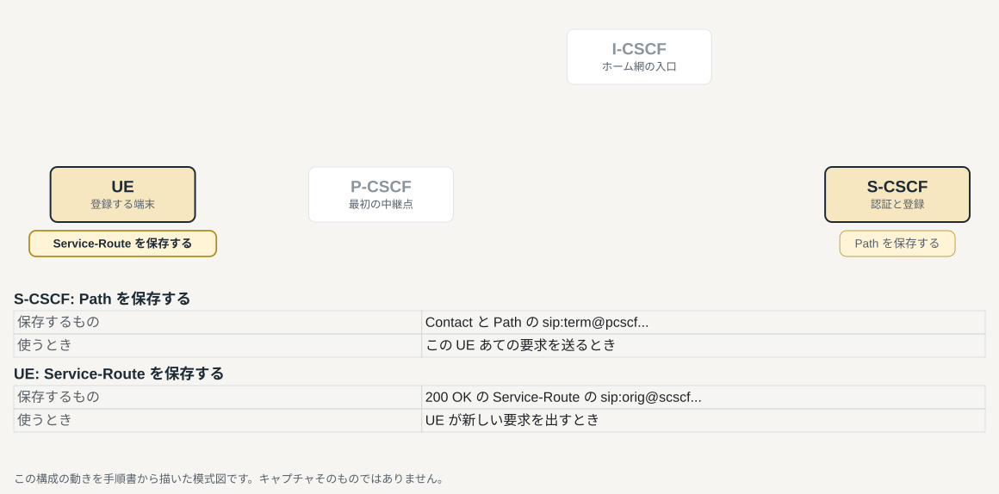
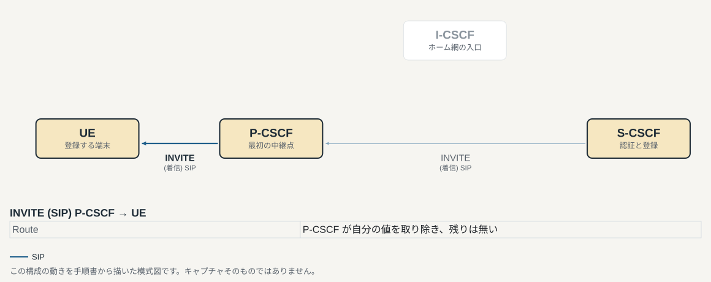
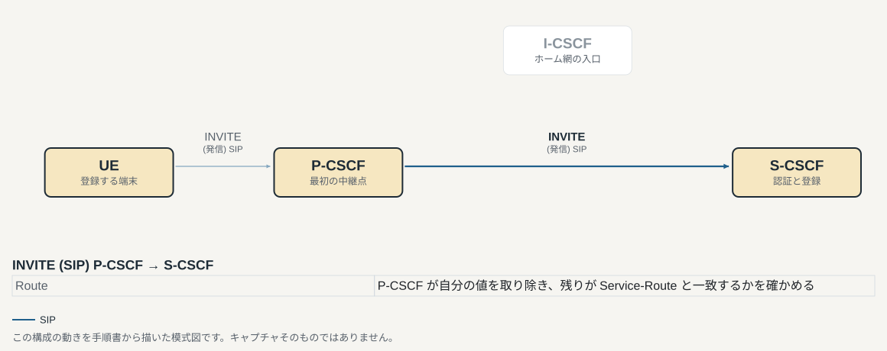

# Path と Service-Route の使い分け

登録は、端末がどこにいるかを網に知らせるだけではありません。その端末へ要求を届ける経路と、端末が要求を出すときの経路も決めます。前者が Path で、S-CSCF が登録先と一緒に保存し、端末あての要求を送るときに使います。後者が Service-Route で、端末が 200 OK から受け取って保存し、自分が出す要求の経路にします。

どちらも 200 OK に入って UE に届くので、同じ種類のものに見えます。しかし、保存するノードと、使う要求の向きが逆です。また、どちらも「このあとの新しい要求」のための経路で、いま送った REGISTER への応答が戻る Via の一覧とは役目が違います。

## この章で扱う構成と区間

前の章と同じく、`deploy/compose` の構成で、SIP Digest で登録するソフトフォン型の UE を例にします。この章が見るのは、UE、P-CSCF、S-CSCF のあいだの区間です。着信の要求では S-CSCF から P-CSCF を通って UE へ、発信の要求では UE から P-CSCF を通って発信者の S-CSCF までを見ます。I-CSCF、HSS、アプリケーションサーバーで起きることは、通話の章で扱います。

## 登録で決まる 2 つの経路

[前の章](registration-two-registers.md) の 200 OK から始めます。登録の途中で、2 つの値が次のように作られ、保存されます。



1. P-CSCF は、REGISTER を I-CSCF へ転送する前に、自分の URI `sip:term@pcscf.ims.mnc001.mcc001.3gppnetwork.org:5060;lr` を Path に入れます（TS 24.229 5.2.2.1）。Require に `path` も付け、レジストラが Path に対応することを求めます。
2. S-CSCF は、登録を受け付けるときに、Path の値を登録先（Contact と期限など）と一緒に保存します。RFC 3327 5.3 は、レジストラが Path の値の並びを、その Contact の登録に結び付けて保存するよう定めています。
3. S-CSCF は 200 OK に、保存した Path と、自分の URI の Service-Route を入れます（TS 24.229 5.4.1.2.2F）。
4. UE は 200 OK の Service-Route を保存します。P-CSCF も、同じ 200 OK から Service-Route を記録します。

S-CSCF のコードで 200 OK を組み立てる部分の最初が、3 の手順です。

[internal/scscf/scscf.go](../../../internal/scscf/scscf.go)

```go
func (s *SCSCF) bindingResponse(reg Registration, expires time.Duration, c sip.Credentials, ch Challenge) func(*sip.Message) {
	return func(r *sip.Message) {
		for _, p := range reg.Path {
			r.Add("Path", p)
		}
		r.Add("Service-Route", fmt.Sprintf("<sip:orig@%s:%d;lr>", s.cfg.Host, s.cfg.Port))
```

`reg` は保存した登録先です。Path は REGISTER で受け取った値をそのまま返し、Service-Route は S-CSCF が自分のホスト名とポートから作ります。ユーザー部の `orig` は、この URI に届いた要求が発信側のものだと、S-CSCF があとで見分けるための印です。同じように、Path のユーザー部の `term` は、P-CSCF が着信側の要求を見分ける印です。

| 比べるもの | Path | Service-Route |
| --- | --- | --- |
| この構成で値を作るノード | P-CSCF が REGISTER に自分の URI を入れる | S-CSCF が 200 OK に自分の URI を入れる |
| この章で注目する保存先 | S-CSCF の登録先 | UE の登録の結果（P-CSCF も記録する） |
| 使う要求 | 登録した UE あての新しい要求 | UE が出す新しい要求 |
| 使い方 | Request-URI を Contact にし、保存した Path を Route に入れる | UE が P-CSCF の URI のあとに Service-Route を並べ、Route にする |
| この章の区間 | 着信側の S-CSCF から P-CSCF、UE | 発信する UE から P-CSCF、発信者の S-CSCF |

## Path は UE に届く要求の経路

登録したあとで、この UE あての INVITE が S-CSCF に届いたとします。S-CSCF は、保存した登録先から、最終的な宛先と途中の経由地を別々に決めます。



[internal/scscf/session.go](../../../internal/scscf/session.go)

```go
	out.RequestURI = reg.Contact
	for i := len(reg.Path) - 1; i >= 0; i-- {
		out.Prepend("Route", reg.Path[i])
	}
```

`reg.Contact` は UE が登録したアドレスで、Request-URI、つまり最終的な宛先になります。`reg.Path` は途中の経由地で、Route の先頭に、保存した順のまま入ります。後ろから `Prepend` するのは、Path の並びを崩さずに Route の先頭へ置くためです。この処理は TS 24.229 5.4.3.3 の、着信の要求を登録先へ送る手順です。RFC 3327 5.4 も、ホームのプロキシが Request-URI を登録した Contact に書き換え、保存した Path を Route にすると定めています。

この構成で、試験の値を当てはめると次のようになります。

| ヘッダ | 値 | 役目 |
| --- | --- | --- |
| Request-URI | `sip:001010000000001@192.0.2.10:5060` | 登録した Contact。最終的な宛先 |
| Route | `<sip:term@pcscf.ims.mnc001.mcc001.3gppnetwork.org:5060;lr>` | 保存した Path。途中の経由地 |

INVITE はまず Route の P-CSCF に届きます。P-CSCF は、一番上の Route が自分の `term` の URI なので、着信側の要求として扱い、自分の Route を取り除いて UE へ送ります。UE が登録に使った P-CSCF を必ず通るので、P-CSCF はその UE との IP の対応付けや、メディアの制御を続けられます。

## Service-Route は UE から出る要求の経路

反対向きの要求では、UE が経路を作ります。UE が発信の INVITE を送るとき、Route は次の関数で決まります。



[internal/ue/call.go](../../../internal/ue/call.go)

```go
// routeSet is the preloaded Route of a request from the UE: the P-CSCF,
// then the Service-Route of the registration (TS 24.229 5.1.2A.1.1).
func (u *UE) routeSet(reg Registration) []string {
	return append([]string{"<" + u.pcscfURI() + ";lr>"}, reg.ServiceRoute...)
}
```

入力は UE の登録の結果 `reg` で、`reg.ServiceRoute` が 200 OK で受け取った値です。UE は P-CSCF の URI を先頭に置き、そのあとに Service-Route を、受け取った順に並べます。TS 24.229 5.1.2A.1.1 は、UE が新しいダイアログや単独のトランザクションの要求に、この順で Route を作るよう定めています。RFC 3608 6.1 も、UE が Service-Route を、あとで送る最初の要求の Route に使うことを述べています。

| ヘッダ | 値 | 役目 |
| --- | --- | --- |
| Request-URI | `tel:+1-202-555-0102` | 相手の番号。UE は相手がどこにいるかを知らない |
| Route | `<sip:pcscf.ims.mnc001.mcc001.3gppnetwork.org:5060;lr>`、`<sip:orig@scscf.ims.mnc001.mcc001.3gppnetwork.org:5060;lr>` | P-CSCF と、保存した Service-Route |

P-CSCF は自分の Route を取り除き、残りが記録した Service-Route と同じかを確かめます。UE が違う経路を入れていれば、P-CSCF は Service-Route に入れ直します（TS 24.229 5.2.6.3.3）。そのため、発信の要求は必ず、UE が登録した S-CSCF に届きます。S-CSCF は、一番上の Route が自分の `orig` の URI なので、発信者を担当する側として処理します。

この区間では、要求は I-CSCF を通りません。I-CSCF は、HSS に尋ねて担当の S-CSCF を探すためのノードで、発信者の S-CSCF はすでに Service-Route で分かっているからです。ただし、これは発信者の S-CSCF に届くまでの話です。発信者の S-CSCF が相手の網を探したあと、相手の網の入口では、相手の I-CSCF が相手の S-CSCF を探します。

## Via と Record-Route は別の役目

この章の 2 つの経路は、どちらも「このあとに出す新しい要求」の経路です。ほかの 2 つのヘッダと混ぜないようにします。

- **Via** は、いま送っている要求への応答が戻る道です。各ノードが要求を転送するときに自分の Via を足し、応答が戻るときに取り除きます。REGISTER の 200 OK が UE に戻るのは Via によるもので、Path や Service-Route によるものではありません。
- **Record-Route** は、ダイアログを作る要求（INVITE など）に、ノードが「このダイアログの中の要求も自分を通して」と書くものです。ダイアログの中の要求（ACK、BYE など）の経路になります。登録で決まる経路ではなく、呼ごとに決まります。

| 経路 | 決まるとき | 使う要求 |
| --- | --- | --- |
| Via | 要求を転送するたび | その要求への応答 |
| Path | 登録 | 登録した UE あての新しい要求 |
| Service-Route | 登録 | UE が出す新しい要求 |
| Record-Route | ダイアログを作る要求 | そのダイアログの中の要求 |

## この説明の根拠

- `internal/scscf/session_test.go` の `TestTerminatingCallFollowsThePath`。登録した S-CSCF に着信の INVITE を送り、試験の相手役の P-CSCF に届いた INVITE の Request-URI が Contact、Route が Path であることを確かめています。この試験の P-CSCF は 486 で答えるので、通話が最後までつながる例ではありません。確かめているのは経路です。
- `internal/pcscf/session_test.go` の `TestOriginatingCallGoesThroughTheRelay`。UE が P-CSCF だけを Route に入れた INVITE を送ると、S-CSCF に届く INVITE の Route が Service-Route になることを確かめています。P-CSCF が経路を入れ直す処理の試験です。
- `internal/ue/call.go` の `routeSet` と `internal/scscf/session.go` の着信の処理は、上に引いたとおりです。

上の表の値は、試験と `deploy/compose` の設定の値です。図は、この構成の動きを手順書から描いた模式図で、キャプチャそのものではありません。

## 自分で動かす場合

実際の INVITE で Route を見たいときは、手順書の [音声通話の流れを追う](../../guide/ja/call.md) の「1. UE 1 が INVITE を送る」と「6. 着信側の S-CSCF が Path に沿って INVITE を送る」に、見るヘッダが書いてあります。スライドでは [登録のデッキ](../../../slides/decks/ja/04-registration.md) の「Path と Service-Route の使い分け」のシーンが、この章の 3 つの図を順に見せます。

登録の最後の章では、保存した登録先を、古い要求からどう守るかを見ます。[遅れて届いた登録の解除が、新しい登録を消さない理由](registration-stale-deregistration.md)
