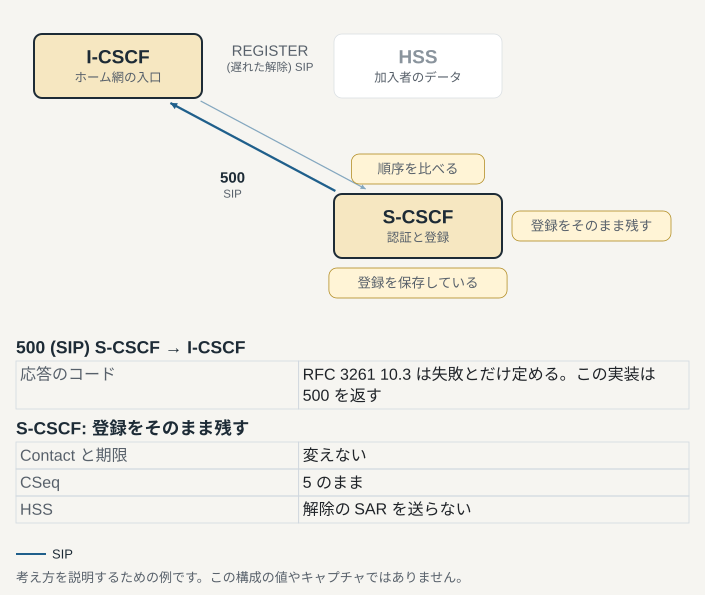
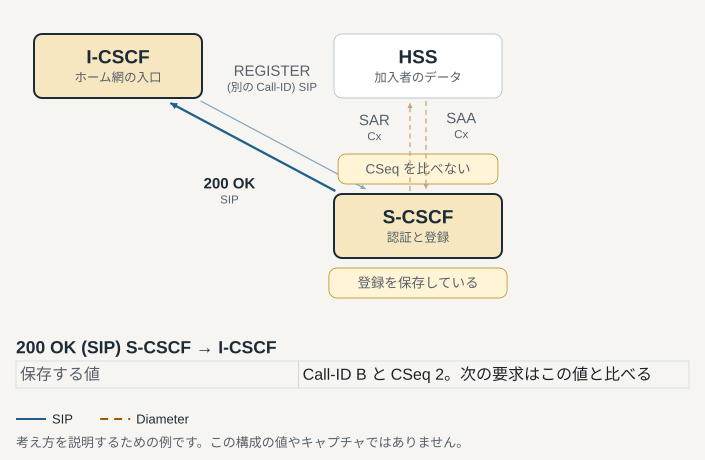

# 遅れて届いた登録の解除が、新しい登録を消さない理由

登録の要求は、UE が送った順に S-CSCF へ届くとは限りません。UE が登録を解除しようとして REGISTER を送り、すぐに考えを変えて再登録したとします。網の中で解除の要求が遅れ、再登録のあとに届いたらどうなるでしょうか。届いた順にそのまま処理すると、まだ有効な新しい登録が消え、この UE には着信が届かなくなります。

これを防ぐのが、Call-ID と CSeq の比較です。同じ Call-ID で同じ登録先を変えようとする要求について、S-CSCF は保存しておいた CSeq と、届いた要求の CSeq を比べます。保存した値より大きくない要求では、登録先を変えません。そのためには、Call-ID と CSeq を、届いたメッセージから読むだけでなく、登録先と一緒に保存しておく必要があります。

## この章で扱う構成

前の 2 つの章と同じく、`deploy/compose` の構成で、SIP Digest で登録するソフトフォン型の UE を例にします。この実装の S-CSCF は、1 つの秘密の識別子について Contact を 1 つだけ保存します（TS 24.229 5.4.1.2.2A。reg-id を使わない場合）。この章の例も、登録先が 1 つの場合です。

この章の図と表では、長い Call-ID を A と B、Contact を C と短く書きます。説明のための例で、キャプチャの値ではありません。

## 比べなければ何が壊れるか

UE が次の順に REGISTER を送ったとします。Call-ID はどれも A です。

| UE が送った順 | 要求 | CSeq |
| --- | --- | --- |
| 1 | 最初の登録（401 を受けて答える） | 1 で問いを受け、2 で答える |
| 2 | 登録の解除（`expires=0`） | 3。応答が来ないまま、UE のトランザクションは時間切れになる |
| 3 | 再登録（401 を受けて答える） | 4 で問いを受け、5 で答える |

CSeq は、同じ Call-ID の中で要求ごとに増える番号です。2 の解除は UDP で送られ、UE は応答を待つあいだに同じ要求を再送します（RFC 3261 17.1.2）。そのうちの 1 つが網の中で遅れ、3 の再登録が CSeq 5 で受け付けられたあとに S-CSCF に届いたとします。S-CSCF が届いた要求をそのまま処理すると、登録先は消え、HSS にも解除が伝わります。UE は登録できたと思っているので、再登録の時期まで何もしません。そのあいだ、この UE あての着信は届きません。

## 比べる規則

RFC 3261 10.3 の手順 7 が、この規則を定めています。レジストラは、届いた要求の Contact と同じ登録先が無いかを探し、あれば Call-ID を比べます。

- Call-ID が登録先と違えば、登録先を更新します（Expires が 0 なら消します）。
- Call-ID が同じなら、CSeq を比べます。登録先の値より大きければ更新するか消し、そうでなければ更新をやめ、要求は失敗します。

この比較のために、レジストラは登録先ごとに、その登録先を作った要求の Call-ID と CSeq を記録します。この実装の S-CSCF では、登録の記録 `Registration` に、Contact や期限と並んで次のフィールドがあります。

[internal/scscf/store.go](../../../internal/scscf/store.go)

```go
	ContactID    string
	ContactEvent reginfo.Event
	CallID       string
	CSeq         uint32
```

S-CSCF は、登録を受け付けるたびに、その REGISTER の値をここに書きます。

[internal/scscf/scscf.go](../../../internal/scscf/scscf.go)

```go
	cseq, _ := sip.ParseCSeq(req.Get("CSeq"))
	reg.CallID, reg.CSeq = req.Get("Call-ID"), cseq.Number
```

## 比べる関数

比べる処理は `outOfOrder` の 1 つの関数です。

[internal/scscf/scscf.go](../../../internal/scscf/scscf.go)

```go
func outOfOrder(req *sip.Message, reg Registration) bool {
	if req.Get("Call-ID") != reg.CallID {
		return false
	}
	cseq, _ := sip.ParseCSeq(req.Get("CSeq"))
	return cseq.Number <= reg.CSeq
}
```

入力は、届いた REGISTER `req` と、保存した登録 `reg` です。Call-ID が違えば、比べる対象ではないので `false` を返します。Call-ID が同じなら、届いた CSeq が保存した CSeq 以下のときに `true`、つまり「順序が古い」と判断します。等しい場合も古いとみなすのは、規則が「大きければ更新する」と定めているからです。

この関数は Contact を見ません。比べるのは、Contact が同じ登録先についてだけです。それを決めるのは、関数を呼ぶ側です。

## どこで比べるか

S-CSCF がこの関数を呼ぶ場所は 2 つあります。どちらも、HSS への SAR と、保存した登録の変更より前です。

1 つ目は、認証の答えを確かめたあとで登録を受け付ける `accept` です。

[internal/scscf/scscf.go](../../../internal/scscf/scscf.go)

```go
	contact, contactErr := sip.ParseNameAddr(req.Get("Contact"))
	if registered && contactErr == nil && sameURI(contact.URI, old.Contact) && outOfOrder(req, old) {
		s.refuseOutOfOrder(st, old, log)
		return
	}
	assignment := cx.AssignRegistration
```

登録が保存されていて、届いた Contact が保存した Contact と同じときだけ比べます。Contact が違えば、規則のうえでは別の登録先なので比べません。この実装では、新しい Contact が古い登録先を置き換えます。

2 つ目は、登録の解除 `deregister` です。

[internal/scscf/scscf.go](../../../internal/scscf/scscf.go)

```go
	if !wildcard {
		contact, err := sip.ParseNameAddr(st.Request.Get("Contact"))
		if err != nil || !sameURI(contact.URI, reg.Contact) {
			s.respond(st, 481, nil)
			return
		}
	}
	if outOfOrder(st.Request, reg) {
		s.refuseOutOfOrder(st, reg, log)
		return
```

解除する Contact が保存した Contact と違えば、消すものが無いので 481 で答えます。同じなら、順序を比べます。Contact に `*` を書いてすべてを消す解除（`wildcard`）も、Contact の確かめは飛ばしますが、順序は比べます。

比べる位置が副作用より前にあることが大切です。`accept` では、比べたあとに SAR を送り、登録を書き換えます。`deregister` では、比べたあとに解除の SAR を送り、登録を消します。比べる前にこれらをすると、要求を断っても HSS と S-CSCF の記録が変わってしまいます。

なお、解除の REGISTER は、P-CSCF が IP の対応付けを持っていれば `integrity-protected="ip-assoc-yes"` が付き、S-CSCF は認証を求め直さずに `deregister` へ進みます。再登録は、401 で問い直し、答えが正しいことを確かめてから `accept` に進みます。認証と順序の確かめは別の条件です。順序が新しくても答えが違えば 403 になり、答えが正しくても順序が古ければ断られます。

## 断った要求で変わらないもの



順序が古いと判断すると、S-CSCF は `refuseOutOfOrder` で 500 を返します。登録先の Contact、期限、Call-ID、CSeq は変わらず、HSS への SAR も送りません。

ここで応答のコードを分けて考えます。RFC 3261 10.3 の手順 7 は、このような要求が失敗するとだけ定め、どの応答のコードを返すかは定めていません。この実装は、同じ手順が、登録先の更新を確定できなかったときのコードとして挙げる 500 を選んでいます。500 は標準がこの場合に一意に定めたコードではなく、この実装の選択です。同じ要求を送り直しても同じ理由で断られるので、Retry-After は付けません。

再登録の側では、断られた要求が使ったチャレンジは、答えを確かめたときに消えています。断ったあとに残るのは、それより前の登録先です。

## 別の Call-ID の要求は比べない



Call-ID が違う要求は、CSeq の大小で断りません。たとえば UE が起動し直し、新しい Call-ID B で登録し直した場合です。B の CSeq が 2 でも、A の 5 とは比べません。認証の答えが正しければ、RE_REGISTRATION の SAR を送り、200 OK で答え、登録には B の Call-ID と CSeq が残ります。このあとの比較は、B の値と行います。

別の Call-ID であることは、認証を省く理由にはなりません。B の要求も 401 を受け、正しく答えてから受け付けられます。

## 試験で確かめていること

`internal/scscf/scscf_test.go` の `TestRegisterOutOfOrderLeavesTheBindingAlone` が、この章の場合を順に確かめています。試験は S-CSCF に直接 REGISTER を送るので、P-CSCF と I-CSCF は通りません。試験の CSeq は上の例と少し違い、再登録が CSeq 4 で保存され、そこへ CSeq 3 と 4 の要求を送ります。

| 保存した状態 | 届いた要求 | 試験が確かめる結果 |
| --- | --- | --- |
| Call-ID A、CSeq 4 | A、CSeq 3、`expires=0` | 500。登録は残る |
| 同じ | A、CSeq 4、`expires=0` | 500。登録は残る |
| 同じ | A、CSeq 3 で問いを受け、CSeq 4 で答えた再登録 | 500。Contact、期限、CSeq 4 が変わらない |
| 同じ | A、CSeq 4、Contact が `*` の解除 | 500 |
| 同じ | B、CSeq 1 で問いを受け、CSeq 2 で答えた再登録 | 200 |
| B、CSeq 2 | B、CSeq 3、`expires=0` | 200。登録が消える |

断った要求のあいだ、試験は HSS に届いた SAR が、最初の登録の `REGISTRATION` と、CSeq 4 の再登録の RE_REGISTRATION の 2 つだけであることも確かめます。断った要求は HSS に届いていません。

3 行目では、CSeq 3 の REGISTER は 500 ではなく 401 を受けています。順序を比べるのは、認証の答えを確かめたあとの `accept` だからです。

同じ CSeq が届くことと、同じ要求の再送は別のことです。UDP で同じ REGISTER が再送されると、SIP のトランザクションの層（RFC 3261 17.2）がそれを受け止め、前の応答を送り直します。再送は S-CSCF の登録の処理に届かず、この比較の対象にもなりません。この層の動きは `internal/sip/stack_test.go` の `TestServerTransactionAbsorbsRetransmissions` が確かめています。

## 保存先を共有するときに加わる条件

S-CSCF を複数台で動かし、登録を共有の保存先に置くと、比べる処理と書き換える処理のあいだに、別の台が同じ利用者の登録を書き換えるおそれがあります。2 台がそれぞれ古い CSeq を読んで比べ、両方が書き込めば、比較は意味を失います。

この実装の S-CSCF は、REGISTER の処理の最初に、利用者ごとのロックを取ります（`register` の中の `s.users.Lock`）。読む、比べる、書くを、同じ利用者について 1 つの台だけが行うためです。役割全体を止めるロックではなく、利用者ごとのロックです。このロックが何を保証し、何を保証しないかは [登録の順序と期限](design-registration-order.md) で見ます。

## 自分で動かす場合

この比較を構成の上で起こすには、遅れた要求を網の中で作る必要があり、手順書の通常の手順にはありません。試験は `go test ./internal/scscf -run TestRegisterOutOfOrderLeavesTheBindingAlone` で動かせます。スライドでは [登録のデッキ](../../../slides/decks/ja/04-registration.md) の「遅れて届いた登録の解除」のシーンが、この章の 2 つの図を段階に分けて見せます。

次の章では、登録のあとに続くこと、つまり登録の更新、解除、購読、網からの取り消しを見ます。[登録の更新、解除、購読、網からの取り消し](registration-lifecycle.md)
