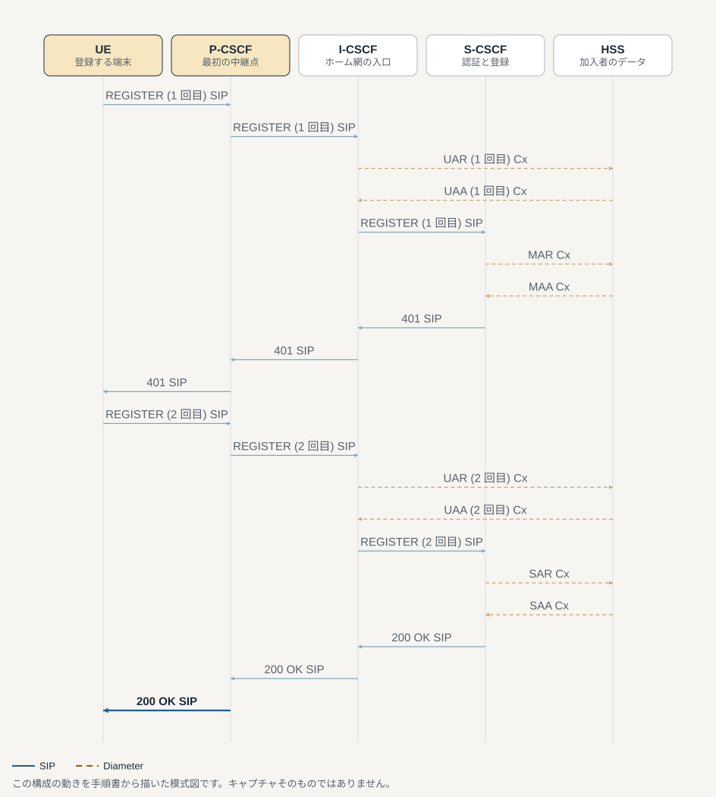
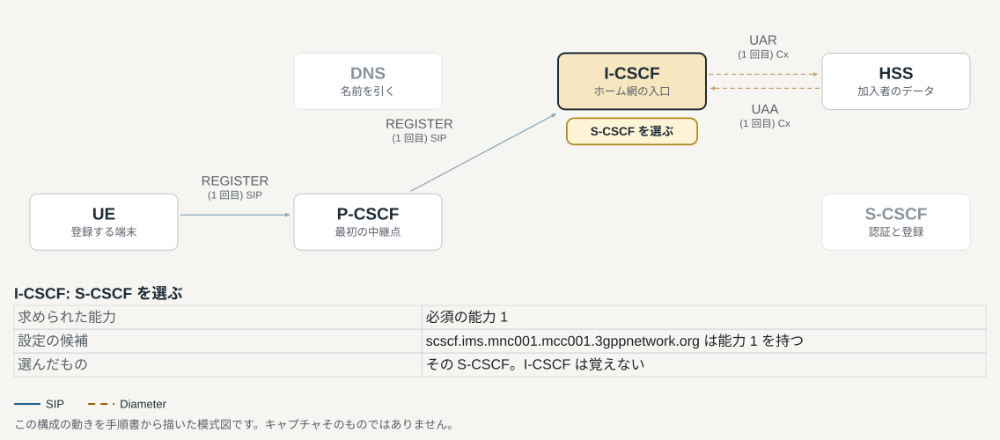
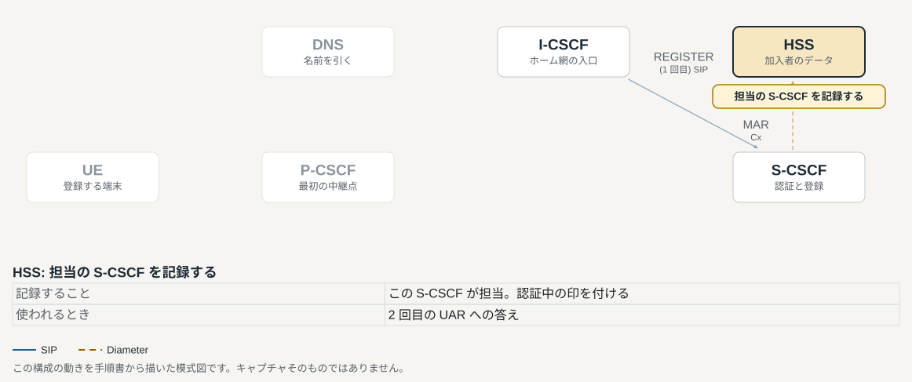
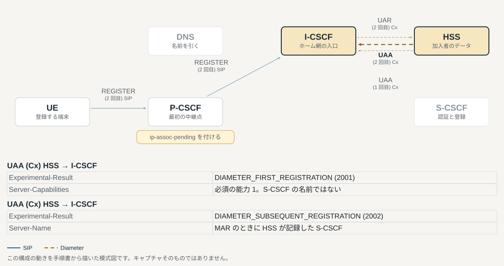
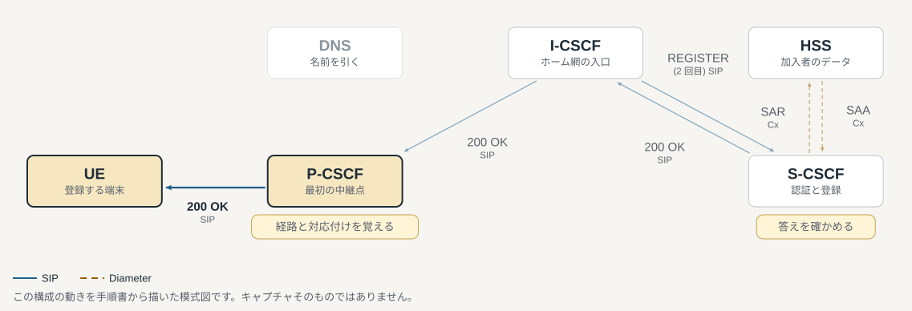

# REGISTER が 2 回送られる理由

最初の REGISTER で、端末はどの利用者として登録したいかを伝えます。このときの端末は、網が出す nonce をまだ受け取っていないので、認証への答えを入れられません。S-CSCF は認証に使う情報を HSS から受け取り、401 で問いを返します。端末はその問いへの答えを 2 回目の REGISTER に入れます。S-CSCF が答えを確かめ、利用者のプロファイルを HSS から受け取り、登録先を記録すると、200 OK が返ります。

つまり 1 回目と 2 回目は、同じ要求の再送ではありません。1 回目は「誰か」を伝える要求で、2 回目は「本人であること」を示す要求です。この章では、そのあいだに網の中で決まること、つまり担当の S-CSCF と、HSS と S-CSCF がそれぞれ記録するものを、順に追います。

## この章で扱う構成

この章の例は、`deploy/compose` の構成で、SIM カードの無いソフトフォン型の UE が SIP Digest で登録する場合です。ノードは UE、P-CSCF、I-CSCF、S-CSCF、HSS の 5 つです。P-CSCF が I-CSCF を DNS で探す処理は、この章では省きます。

VoLTE の端末は USIM の鍵を使う IMS-AKA で登録し、REGISTER の往復の形は同じですが、401 に入る問いと、P-CSCF とのあいだに張る保護が違います。それは [VoLTE の章](volte.md) で扱います。

この章が引く仕様の版は、TS 24.229 V18.11.0、TS 29.228 V18.0.0、TS 29.229 V18.1.0 です。

## 往復の全体像



UE から見ると、やり取りは REGISTER、401、REGISTER、200 OK の 4 つです。網の中では、HSS への問い合わせが 4 回あります。I-CSCF が送る UAR が 2 回、S-CSCF が送る MAR と SAR が 1 回ずつです。2 つの REGISTER はどちらも P-CSCF と I-CSCF を通って S-CSCF に届き、401 と 200 OK は同じ道を逆にたどって UE に戻ります。

2 つの REGISTER の違いは、次の 3 つのヘッダに出ます。

| ヘッダ | 1 回目 | 2 回目 |
| --- | --- | --- |
| Authorization | `username` に秘密の識別子。`nonce` と `response` は空 | 401 で受け取った `nonce` と、それに対する `response`。`cnonce`、`nc=00000001`、`qop=auth` も入る |
| Call-ID | UE が選んだ値 | 1 回目と同じ |
| CSeq | 1 | 1 つ増えて 2 |

1 回目の Authorization は空ではありません。認証に使う秘密の識別子を、問いを受け取る前に網へ伝えています。S-CSCF はこの識別子で HSS に認証の情報を求めます。

## 担当の S-CSCF を選ぶのは I-CSCF

1 回目の REGISTER を受け取った I-CSCF は、この利用者を担当する S-CSCF を知りません。そこで HSS に UAR（User-Authorization-Request）を送ります（TS 29.228 6.1.1）。

まだどの S-CSCF も割り当てられていないので、HSS は DIAMETER_FIRST_REGISTRATION（2001）で答えます。この答えに S-CSCF の名前は入っていません。入っているのは Server-Capabilities、つまり担当する S-CSCF に必要な能力です。S-CSCF を選ぶのは I-CSCF です（TS 29.228 6.7）。



I-CSCF のコードでは、この分かれ道が次の数行です。

[internal/icscf/icscf.go](../../../internal/icscf/icscf.go)

```go
	server := uaa.ServerName
	if server == "" {
		server = i.choose(uaa.ServerCapabilities)
		if server == "" {
			// 5.3.1.3: no S-CSCF has the mandatory capabilities.
			log.Warn("no S-CSCF has the capabilities", "capabilities", uaa.ServerCapabilities)
			st.Respond(sip.NewResponse(req, 600, sip.NewTag()))
			return
		}
	}
	log.Info("selected S-CSCF", "server_name", server, "result", uaa.Result.String())
```

入力は HSS の答え `uaa` です。Server-Name があればそれを使い、無ければ `choose` が、設定の S-CSCF の一覧から、必須の能力をすべて持ち、任意の能力をいちばん多く持つものを選びます。どの S-CSCF も必須の能力を持たなければ、I-CSCF は 600 で答えます。1 回目の REGISTER では Server-Name が無いので、`choose` の側を通ります。

I-CSCF は、選んだ S-CSCF を覚えません。I-CSCF に登録の状態は残らず、選んだ結果は REGISTER の転送先になるだけです。それでも 2 回目が同じ S-CSCF に届くのは、次に見るように HSS が担当を記録するからです。

## 401 を返す前に HSS と S-CSCF が記録すること

REGISTER を受け取った S-CSCF は、HSS に MAR（Multimedia-Auth-Request）を送ります（TS 24.229 5.4.1.2.1、TS 29.228 6.3）。REGISTER に `integrity-protected` パラメータが無いので、S-CSCF は認証の方式を `Unknown` にして、HSS に選ばせます。HSS は SIP Digest を選び、MAA（Multimedia-Auth-Answer）で答えます。

ここで 2 つのノードが、それぞれ別のものを記録します。



- **HSS** は、MAR を送ってきた S-CSCF をこの利用者の担当として記録し、認証中の印を付けます。まだ登録が済んだわけではありません。
- **S-CSCF** は、自分で作った nonce と、HSS から受け取った H(A1) を、待っている認証（チャレンジ）として保存します。認証を求めた REGISTER の Call-ID と、401 で示す algorithm も一緒に保存します。そして、答えを待つタイマー reg-await-auth（TS 24.229 Table 7.8.1 で 4 分）を始めます。

MAA に入っているのは、パスワードそのものではなく H(A1) です。H(A1) は、ユーザー名、レルム、パスワードから計算したハッシュです（RFC 7616 3.4.2）。S-CSCF はこれだけで UE の答えを確かめられます。ただし、H(A1) を知っていれば、同じレルムで正しい答えを作れます。パスワードではないとはいえ、認証に使う秘密の情報として扱います。

S-CSCF は 401 Unauthorized で答えます。TS 24.229 5.4.1.2.1B は、S-CSCF が使えるダイジェストのアルゴリズムごとに WWW-Authenticate を 1 つずつ入れ、いちばん望むものを先に並べるよう求めています。それぞれに、レルム、nonce、algorithm、qop が入ります。ダイジェストの決まりは RFC 7616 と RFC 8760 のもので（5.4.1.2.2A）、MD5 は前の版との互換のためだけに残っています。この S-CSCF が出すのは MD5 だけです。HSS のスタブが MD5 の H(A1) しか渡さないためで、これは簡略化です。そのため WWW-Authenticate は 1 つで、レルム、nonce、`algorithm=MD5`、`qop="auth"` が入ります。この 401 は、手順が決まったとおりに進んでいることを表します。401 という応答のコードがいつも成功を表すわけではありませんが、最初の REGISTER への 401 は、登録を受け付ける前に本人の答えを求めるための、決まった一歩です。

## 2 回目が同じ S-CSCF に届く理由

UE はパスワードと nonce から答えを計算し、2 回目の REGISTER を送ります。P-CSCF は Authorization に `integrity-protected="ip-assoc-pending"` を付けます（TS 24.229 5.2.2.3）。この要求が問いへの答えで、IP の対応付けはまだ無いことを、S-CSCF に伝えるためです。

I-CSCF は 1 回目のことを覚えていないので、もう一度 UAR を送ります。今度の HSS の答えは違います。



答えが変わるのは、HSS の記録が変わったからです。HSS のコードでは、UAR への答えの最後が次のようになっています。

[internal/hss/hss.go](../../../internal/hss/hss.go)

```go
	case u.ServerName != "":
		// Not registered, but an S-CSCF was stored by a MAR whose
		// authentication is still pending: send the user there again.
		return cx.UserAuthorizationAnswer{Result: diameter.Experimental(cx.DiameterSubsequentRegistration), ServerName: u.ServerName}
	}
	caps := h.config.ServerCapabilities
	return cx.UserAuthorizationAnswer{Result: diameter.Experimental(cx.DiameterFirstRegistration), ServerCapabilities: &caps}
```

利用者はまだ登録されていませんが、MAR のときに記録した S-CSCF の名前 `u.ServerName` があります。そのため HSS は DIAMETER_SUBSEQUENT_REGISTRATION（2002）と Server-Name で答えます（TS 29.228 6.1.1.1）。1 回目の答えは、名前が無いので最後の行の DIAMETER_FIRST_REGISTRATION と Server-Capabilities でした。

I-CSCF は前の節の分かれ道で Server-Name のある側を通り、`choose` を呼ばずにその S-CSCF へ転送します。2 回目が同じ S-CSCF に届くのは、HSS が担当を記録しているからで、I-CSCF が前の選択を覚えているからではありません。別の I-CSCF が 2 回目を受け取っても、同じ S-CSCF に届きます。

## 答えを確かめてから登録する

2 回目の REGISTER を受け取った S-CSCF は、保存していたチャレンジと照らし合わせます。

[internal/scscf/scscf.go](../../../internal/scscf/scscf.go)

```go
func (s *SCSCF) check(req *sip.Message, c sip.Credentials, ch Challenge) verdict {
	if req.Get("Call-ID") != ch.CallID || c.Realm != ch.Realm || c.CNonce == "" || c.NC == "" {
		return wrong
	}
	// Step 3: the algorithm is one that the 401 offered.
	if !ch.offers(c.Algorithm) {
		return wrong
	}
	want, err := sip.DigestResponse(ch.digestHA1(c.Algorithm), sip.REGISTER, c)
	if err != nil || subtle.ConstantTimeCompare([]byte(want), []byte(c.Response)) != 1 {
		return wrong
	}
	// A fresh nonce is answered with the first nonce count.
	if c.Nonce != ch.Nonce || c.NC != "00000001" {
		return stale
	}
	return valid
}
```

入力は、届いた REGISTER `req`、その Authorization の値 `c`、保存していたチャレンジ `ch` です。関数は 4 つのことを順に確かめます。

1. Call-ID が、認証を求めた REGISTER と同じか。レルムが S-CSCF の出したものか。この 2 つが違えば、問いへの答えになっていません（TS 24.229 5.4.1.2.2A）。
2. UE が Authorization に書いた algorithm が、401 で示したものか。ここでは MD5 です。algorithm を書かない答えも MD5 とみなします（RFC 2617 3.2.1）。示していない algorithm の答えは、確かめるまでもなく誤りです。
3. その algorithm の H(A1) から計算した答えが、UE の `response` と一致するか。一致しなければパスワードが違います。SIP Digest では、`ch.digestHA1` が返すのは HSS から受け取った H(A1) そのものです。同じ関数は、IMS-AKA では認証ベクトルから H(A1) を作ります（[VoLTE の登録と通話](volte.md)）。
4. 答えが、いま待っている nonce への最初の答えか。パスワードは正しいのに nonce が古い場合は、誤りではなく「古い」として扱い、新しい nonce で問い直します（TS 24.229 5.4.1.2.3B）。

`valid` なら、S-CSCF はチャレンジを消し、SAR（Server-Assignment-Request）を Server-Assignment-Type が `REGISTRATION`（1）で HSS に送ります。HSS は利用者がこの S-CSCF に登録されたと記録し、SAA の User-Data で利用者のプロファイルを返します。プロファイルには、一緒に登録される識別子と iFC が入っています。S-CSCF はそのあとで登録先を保存し、200 OK で答えます。



この流れで、3 つのノードが知っていることは、同時には変わりません。

| 時点 | HSS が記録していること | S-CSCF が保存していること | UE が知っていること |
| --- | --- | --- | --- |
| 1 回目の UAR と UAA | 加入者がいること。必要な能力 | まだ何も無い | REGISTER を送った |
| MAR、MAA、401 | この S-CSCF が担当。認証中 | チャレンジ（nonce、H(A1)、Call-ID、algorithm）と、答えの期限 | 401 で nonce を受け取った |
| 答えが正しく、SAR と SAA が済んだ | この S-CSCF に登録済み。プロファイル | 登録先（Contact、Path、期限、識別子、iFC、Call-ID と CSeq） | まだ応答を待っている |
| 200 OK が UE に届いた | 同じ | 同じ | 登録できた。rspauth で S-CSCF も H(A1) を知っていると確かめ、Service-Route と期限を受け取る |

HSS の「登録済み」と、S-CSCF の登録先の保存と、UE が 200 OK を受け取ることは、別々の時点に起きます。途中でノードが止まると、この食い違いが残ります。その扱いは [複数台と障害で引き継ぐもの](design-shared-state.md) で見ます。

200 OK の Authentication-Info にある `rspauth` は、S-CSCF も H(A1) を知っていることの証明です（RFC 7616 3.5）。UE はこれを確かめて、網の側も本物であることを知ります。

## 401 と 403 の違い

パスワードが誤っていると、2 回目の REGISTER までは同じように進みます。分かれるのは S-CSCF の `check` で、答えが一致しないので `wrong` になります。TS 24.229 5.4.1.2.3B は、このとき 403 で断ることと、新しいチャレンジの 401 で問い直すことの、どちらも認めています。この実装は 403 を選びます。S-CSCF は 403 Forbidden で答え、Server-Assignment-Type が AUTHENTICATION_FAILURE（9）の SAR を HSS に送ります。最初の登録なら、HSS は記録していた担当の S-CSCF を消すので、次の試行はまた最初の UAR から始まります。

401 は「答えをください」で、403 は「答えが違います」です。問いを受けた REGISTER と別の Call-ID で答えた場合も、`check` の最初の条件に当たり、403 になります。

## いつも 2 回とは限らない

この章で見たのは、正常な最初の登録です。次の場合は REGISTER の数が変わります。

- **答えが古いとき。** パスワードは正しいのに nonce が古ければ、S-CSCF は `stale=true` を付けた新しい 401 で問い直します。REGISTER は 3 回以上になります。
- **答えが期限に遅れたとき。** reg-await-auth が切れたら、認証は失敗です（TS 24.229 5.4.1.2.3）。S-CSCF は Server-Assignment-Type が AUTHENTICATION_TIMEOUT の SAR を HSS に送り、HSS が答えたらチャレンジを終えます。答えが来なければ、しばらくあとで同じ SAR を送り直します。期限を過ぎて届いた答えは、待っている認証の無い REGISTER として扱います。答えを持つ REGISTER なので、S-CSCF は新しい nonce と `stale=true` を付けた 401 で問い直します（5.4.1.2.2A step 1）。
- **登録の解除。** 解除の REGISTER は、P-CSCF が IP の対応付けを持っていれば `ip-assoc-yes` が付き、S-CSCF は問い直さずに処理します。1 回で済みます。
- **再登録。** S-CSCF は、登録を受け付けたときにチャレンジを消しています。そのため SIP Digest の再登録も新しい 401 で問い直され、REGISTER はまた 2 回になります。前の nonce で答えてきた REGISTER への 401 には `stale=true` が付きます（TS 24.229 5.4.1.2.2A）。

## この説明の根拠

この章の説明は、次のコードと試験に照らして確かめたものです。どの試験も、このリポジトリの Go の試験として通ることを確かめています。

- `internal/scscf/scscf_test.go` の `TestRegistrationWithSIPDigest`。最初の REGISTER が 401 を受け、答えた REGISTER が 200 OK を受けることを確かめています。
- `internal/icscf/icscf_test.go` の `TestFirstRegistrationChoosesAnSCSCFByCapability`。Server-Name の無い UAA を受けた I-CSCF が、能力で S-CSCF を選ぶことを確かめています。
- `internal/scscf/scscf_test.go` の `TestWrongPasswordIsForbidden` と `TestAnswerOnAnotherCallIDIsForbidden`。誤ったパスワードで 403 と AUTHENTICATION_FAILURE の SAR になること、別の Call-ID の答えが 403 になることを確かめています。
- `internal/scscf/challenge_deadline_test.go` の `TestRegistrationRejectsExpiredChallengeBeforeSweep`。reg-await-auth を過ぎた答えが、新しい nonce と `stale=true` の 401 になり、HSS に AUTHENTICATION_TIMEOUT の SAR が届くことを確かめています。
- `internal/ue/ue_test.go` の `TestRegisterRefreshAndDeregisterThroughTheWholeIMS`。P-CSCF から HSS までのすべてのノードを 1 つのプロセスの中で動かし、登録、再登録、解除が通ることを確かめています。

図は、この構成の動きを手順書から描いた模式図で、キャプチャそのものではありません。

## 自分で動かす場合

この章を読むのに、構成を動かす必要はありません。実際のキャプチャで同じ往復を見たいときは、手順書の [登録を実行する](../../guide/ja/registration.md#登録を実行する) と [キャプチャを開く](../../guide/ja/registration.md#キャプチャを開く) に手順があります。スライドでは [登録のデッキ](../../../slides/decks/ja/04-registration.md) の「全体の流れ」から「SAR と 200 OK」までのシーンが、この章と同じ順に 1 区間ずつ進みます。

次の章では、この 200 OK が運んでくる 2 つの経路、Path と Service-Route を見ます。[Path と Service-Route の使い分け](registration-routes.md)
