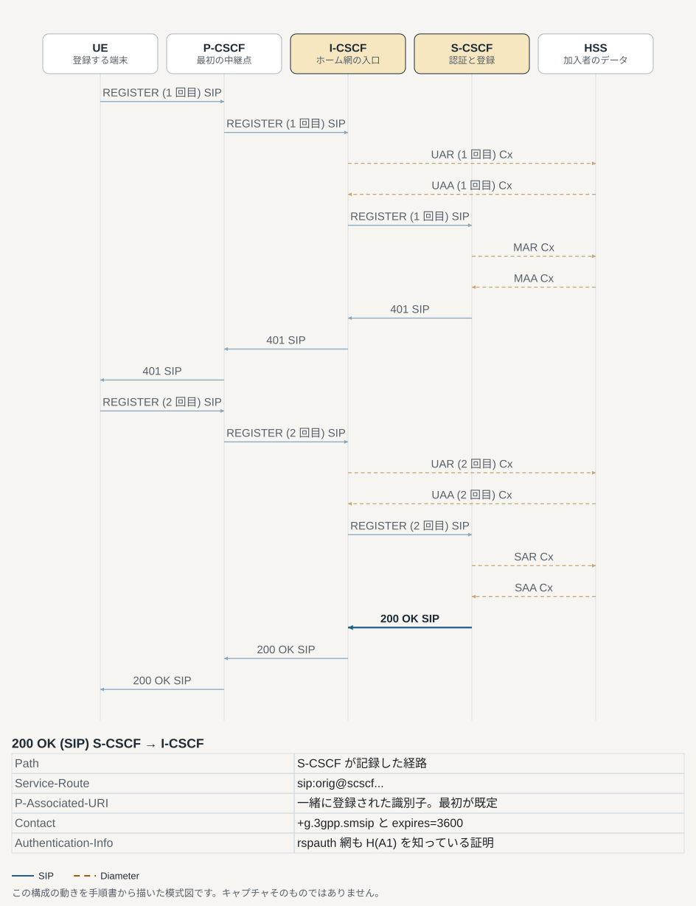

# 登録で決まる 3 つのこと

端末は、電話をかけたり SMS を送ったりする前に、IMS に登録します。登録で網が決めることは 3 つです。端末がどこにいるか、利用者が名乗ったとおりの本人か、このあとの要求がどの経路を通るか、です。場所は REGISTER の Contact で伝わり、本人であることは 401 の問いへの答えで確かめ、経路は 200 OK の Path と Service-Route で決まります。

登録は、このほかに 2 つのことをします。一緒に登録された識別子を、200 OK の P-Associated-URI で端末に知らせます。そして、登録のあとに続く仕組みを始めます。P-CSCF と端末は登録の状態を購読し（reg イベント）、S-CSCF はアプリケーションサーバーにも利用者を登録します（第三者 REGISTER）。

この章は、登録の全体を 1 つの図で見て、3 つのことがそれぞれどこで決まるかを示します。それぞれの仕組みの詳しい説明は、中級の章にあります。

## この章で扱う構成

例は `deploy/compose` の構成で、SIM カードの無いソフトフォン型の UE が SIP Digest で登録する場合です。登録に関わるノードは次のとおりです。

| ノード | 登録で受け持つこと |
| --- | --- |
| UE | REGISTER を送り、認証の問いに答える。200 OK の経路を保存する |
| P-CSCF | UE から見て最初の中継点。ホーム網の入口を DNS で探し、REGISTER に Path を付ける |
| I-CSCF | ホーム網の入口。この利用者を担当する S-CSCF を HSS に尋ね、REGISTER をそこへ送る |
| S-CSCF | 登録を受け付けるノード（レジストラ）。利用者を認証し、登録先を保存する |
| HSS | 加入者のデータベース。認証の情報と利用者のプロファイルを持ち、担当の S-CSCF を記録する |
| IP-SM-GW | SMS のアプリケーションサーバー。S-CSCF が第三者 REGISTER で利用者を登録する |

試験用の利用者は、秘密の識別子 `001010000000001@ims.mnc001.mcc001.3gppnetwork.org` と、公開の識別子 `sip:+12025550101@ims.mnc001.mcc001.3gppnetwork.org` を持ちます。秘密の識別子は認証に使う名前で、公開の識別子はほかの利用者から見える名前です。

VoLTE の端末は USIM の鍵を使う IMS-AKA で登録します。決まる 3 つのことは同じで、認証の方法と、P-CSCF とのあいだの保護が違います。それは VoLTE の章 で扱います。

## 登録の往復の全体



UE から見ると、やり取りは REGISTER、401、REGISTER、200 OK の 4 つです。2 つの REGISTER はどちらも P-CSCF と I-CSCF を通って S-CSCF に届き、401 と 200 OK は同じ道を逆にたどります。網の中では、HSS への問い合わせが 4 回あります。I-CSCF が担当の S-CSCF を尋ねる UAR が 2 回、S-CSCF が認証の情報を求める MAR と、登録を知らせる SAR が 1 回ずつです。

図の下の表は、S-CSCF が返す 200 OK の主なヘッダです。登録で決まったことは、この 200 OK の値として UE に戻ります。場所は Contact とその期限、経路は Path と Service-Route、一緒に登録された識別子は P-Associated-URI です。Authentication-Info の `rspauth` は、網の側も本物であることの証明です。

| 決まること | 伝えるもの | 決めるノード | 保存するノード |
| --- | --- | --- | --- |
| 端末の場所 | REGISTER の Contact | S-CSCF が受け付け、期限を決める | S-CSCF の登録先 |
| 本人であること | 2 回目の REGISTER の答え（`response`） | S-CSCF が HSS の H(A1) で確かめる | HSS が担当の S-CSCF を、S-CSCF が登録先を記録する |
| 後の要求の経路 | REGISTER の Path、200 OK の Service-Route | P-CSCF が Path を、S-CSCF が Service-Route を作る | Path は S-CSCF、Service-Route は UE（P-CSCF も記録する） |

## 端末の場所

REGISTER の Request-URI は、サーバーではなくホーム網のドメイン `ims.mnc001.mcc001.3gppnetwork.org` です。どのサーバーが受け付けるかは網が決めます。P-CSCF が DNS でホーム網の入口の I-CSCF を探し、I-CSCF が HSS に尋ねて S-CSCF を決めます。

端末が自分の場所として伝えるのは、REGISTER の Contact です。要求を受け付けるアドレスで、この構成ではユーザー部に UUID の入った `sip:...@172.28.0.100:5060` です。S-CSCF は、この Contact を登録先（バインディング）として、期限と一緒に保存します。UE は 600000 秒を求めますが、S-CSCF は設定の上限の 3600 秒まで短くし、200 OK の Contact の `expires` でその値を返します。UE は期限が切れる前に再登録します。この構成の 3600 秒の登録なら、期限の 600 秒前です（TS 24.229 5.1.1.4.1）。

場所を知っているのは S-CSCF です。HSS が知っているのは、どの S-CSCF がこの利用者を担当しているかです。そのため、あとでこの利用者への着信が来ると、I-CSCF は HSS に担当の S-CSCF を尋ね、S-CSCF は保存した Contact へ要求を送ります。

## 本人であること

1 回目の REGISTER は「誰か」を伝え、2 回目の REGISTER は「本人であること」を示します。1 回目の Authorization には秘密の識別子だけが入り、答えは空です。S-CSCF は HSS から認証の情報を受け取り、401 で問い（nonce）を返します。UE はパスワードと nonce から答えを計算し、2 回目の REGISTER に入れます。

HSS は S-CSCF にパスワードを渡しません。渡すのは、ユーザー名、レルム、パスワードから計算したハッシュの H(A1) です。S-CSCF はこれだけで答えを確かめられます。200 OK の Authentication-Info の `rspauth` は、S-CSCF も H(A1) を知っていることの証明で、UE はこれで網の側も本物だと確かめます。

I-CSCF は 1 回の登録で HSS に 2 回尋ねます。1 回目の答えは DIAMETER_FIRST_REGISTRATION と、担当に必要な能力（Server-Capabilities）で、I-CSCF がそれに合う S-CSCF を選びます。2 回目の答えは DIAMETER_SUBSEQUENT_REGISTRATION と、HSS が MAR のときに記録した S-CSCF の名前（Server-Name）です。そのため 2 回目の REGISTER も同じ S-CSCF に届きます。

この往復のあいだに HSS と S-CSCF が何を記録するか、パスワードが誤っていると何が起きるかは、[REGISTER が 2 回送られる理由](registration-two-registers.md) で見ます。

## このあとの要求の経路

登録は、このあとに出る新しい要求の経路を、向きごとに 1 つずつ決めます。

- **Path** は、UE あての要求の経路です。P-CSCF が REGISTER に自分の URI を入れ、S-CSCF が登録先と一緒に保存します。この UE あての INVITE が来ると、S-CSCF は Request-URI を Contact にし、Path を Route に入れて、UE が登録に使った P-CSCF を通して送ります。
- **Service-Route** は、UE が出す要求の経路です。S-CSCF が 200 OK に自分の URI を入れ、UE が保存します。UE は発信の INVITE や SUBSCRIBE の Route に、P-CSCF のあとに Service-Route を並べます。要求は I-CSCF を通らずに、自分の S-CSCF に届きます。

どちらも、いま送った REGISTER への応答が戻る道（Via）とは別のものです。誰がどの値を作り、どの要求で使うかは、[Path と Service-Route の使い分け](registration-routes.md) で見ます。

## 一緒に登録される識別子

利用者は、公開の識別子を 1 つだけ持つとは限りません。この構成の試験用の利用者は、SIP URI の `sip:+12025550101@ims.mnc001.mcc001.3gppnetwork.org` と、電話番号の `tel:+12025550101` の 2 つを持ちます。1 つを登録すると、組になっている識別子がすべて登録されます。

S-CSCF は SAR の答え（SAA）で利用者のプロファイルを HSS から受け取ります。プロファイルには、この識別子の組と、要求にどのアプリケーションサーバーを加えるかを決める iFC が入っています。S-CSCF は 200 OK を組み立てるときに、識別子の組を P-Associated-URI に並べます。

[internal/scscf/scscf.go](../../../internal/scscf/scscf.go)

```go
		for _, id := range reg.NonBarredIdentities() {
			r.Add("P-Associated-URI", "<"+id+">")
		}
```

`reg.NonBarredIdentities()` は、組の識別子のうち規制されていないものを、既定の識別子を先頭にして返します（TS 24.229 5.4.1.2.2F）。規制された識別子は入りません。UE は最初の P-Associated-URI を既定の識別子として扱い、購読などの要求に使います。

## 登録のあとに続くこと

200 OK で登録は決まりますが、網の仕事はそこで終わりません。

- **登録の状態の購読。** P-CSCF と UE は、`Event: reg` の SUBSCRIBE で登録の状態を購読します。S-CSCF は状態が変わるたびに NOTIFY で知らせます。UE が自分で解除しなかった登録の終わり、たとえば期限切れや網からの取り消しも、これで分かります。
- **第三者 REGISTER。** S-CSCF はプロファイルの iFC に従い、IP-SM-GW にも REGISTER を送ります。IP-SM-GW も登録の状態を購読し、この利用者の SMS を受け持つことを HSS に知らせます。UE はこれを待ちません。
- **更新と終わり方。** UE は期限の前に再登録します。登録の解除では、P-CSCF が IP の対応付けを持っているので、S-CSCF は問い直さず、401 は返りません。更新されない登録は期限で終わり、HSS から加入を削除すると、網が登録を取り消します。

これらは [登録の更新、解除、購読、網からの取り消し](registration-lifecycle.md) で見ます。また、網の中で遅れた古い解除の要求が新しい登録を消さない仕組みは、[遅れて届いた登録の解除が、新しい登録を消さない理由](registration-stale-deregistration.md) で見ます。

## 詳しく読む章

| 問い | 章 |
| --- | --- |
| なぜ REGISTER を 2 回送るのか。担当の S-CSCF は誰が決めるのか | [REGISTER が 2 回送られる理由](registration-two-registers.md) |
| Path と Service-Route は、誰が何のために使うのか | [Path と Service-Route の使い分け](registration-routes.md) |
| 遅れて届いた解除が、新しい登録を消さないのはなぜか | [遅れて届いた登録の解除が、新しい登録を消さない理由](registration-stale-deregistration.md) |
| 登録のあと、購読、第三者 REGISTER、解除、期限切れ、網からの取り消しで何が起きるか | [登録の更新、解除、購読、網からの取り消し](registration-lifecycle.md) |

## この説明の根拠

- `internal/scscf/scscf_test.go` の `TestRegistrationWithSIPDigest`。最初の REGISTER が 401 を受けること、答えた REGISTER への 200 OK に、Service-Route、P-Associated-URI、Path、`expires=3600` の Contact、正しい `rspauth` が入ることを確かめています。続けて、`ip-assoc-yes` の付いた解除が問い直されずに 200 OK を受け、HSS に届いた SAR が `REGISTRATION` と USER_DEREGISTRATION の 2 つであることも確かめています。
- `internal/ue/ue_test.go` の `TestRegisterRefreshAndDeregisterThroughTheWholeIMS`。P-CSCF から HSS までのすべてのノードを 1 つのプロセスの中で動かし、登録、再登録、解除が通ることを確かめています。

どちらも、このリポジトリの Go の試験として通ることを確かめています。図は、この構成の動きを手順書から描いた模式図で、キャプチャそのものではありません。

## 自分で動かす場合

この章を読むのに、構成を動かす必要はありません。実際のキャプチャで同じ往復を見たいときは、手順書の [登録を実行する](../../guide/ja/registration.md#登録を実行する) と [キャプチャを開く](../../guide/ja/registration.md#キャプチャを開く) に手順があります。スライドでは [登録のデッキ](../../../slides/decks/ja/04-registration.md) の「全体の流れ」のシーンが、この章の図を段階に分けて見せます。

次の章では、登録で決まった経路を使って、電話をかける流れを見ます。番号から相手の電話へ
