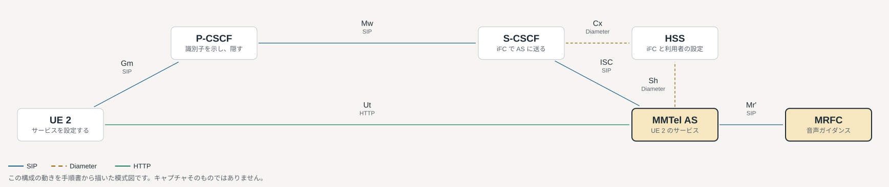
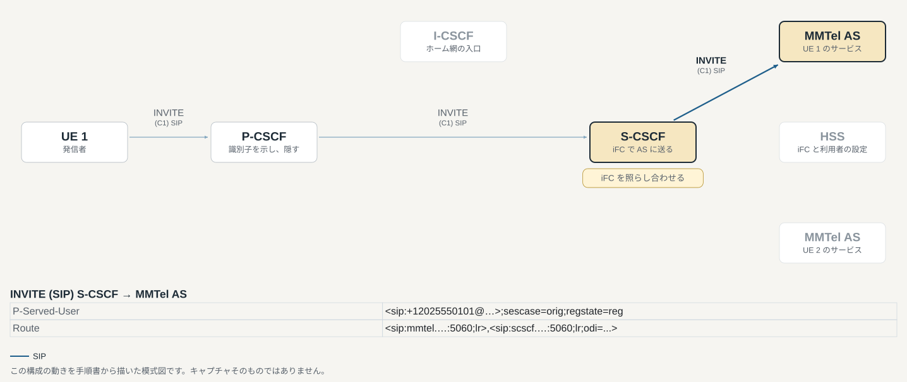
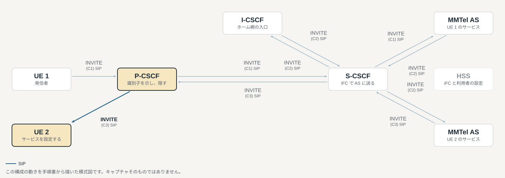
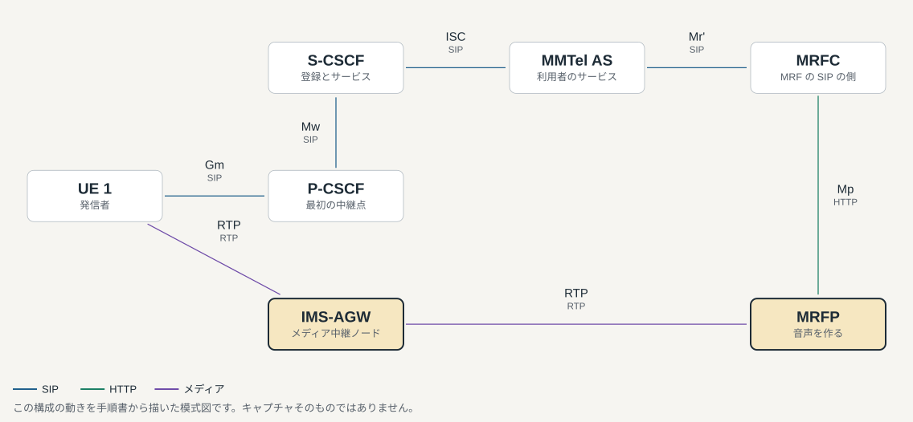

# アプリケーションサーバーが加えるサービス

着信の転送、発信の規制、番号の非通知、ショートメッセージ、通話を断る前の音声ガイダンス。こうしたサービスを決めるのは CSCF ではありません。CSCF は要求の経路を決めるだけで、利用者の設定を知りません。サービスを受け持つのは、経路の外に置いたアプリケーションサーバー（AS）です。

S-CSCF は、利用者のプロファイルにある初期フィルタ条件（iFC）と要求を照らし合わせ、一致した条件の AS に要求を渡します。そのとき Route の先頭に AS を、その次に自分を置き、自分の URI にオリジナルダイアログ識別子（ODI）を付けます。AS が要求を送り返すと、要求は ODI を持って S-CSCF に戻り、S-CSCF は一致した条件の次から照らし合わせを続けます。この章では、この仕組みと、このリポジトリの 3 つのサーバーが加えるものを見ます。

## この章で扱う構成

例は `deploy/compose` の構成です。登録と通話の流れは、[登録で決まる 3 つのこと](registration.md) と [番号から相手の電話へ](call.md) の章を前提にします。この章に出てくるサービスのノードは次の 3 つです。

| ノード | Compose の役割 | 受け持つもの |
| --- | --- | --- |
| MMTel AS | `mmtel` | 電話の付加サービス。識別子の通知と非通知、着信転送、規制、割込通話と保留。Ut での設定。会議のフォーカス。 |
| IP-SM-GW | `ipsmgw` | SIP の MESSAGE で運ぶショートメッセージと、SMS の網のサービスセンタ（SC）とのあいだの橋渡し。 |
| MRF | `mrfc` と `mrfp` | 網が自分で流す音声。音声ガイダンス、呼び出し音、会議の混ぜ合わせ。MMTel AS が頼む。 |

MRF は iFC で呼ばれるサーバーではありません。MMTel AS が自分の判断で MRF に頼みます。この章では、AS が使う資源としてまとめて扱います。

## AS とつながる参照点



AS はどの UE とも直接 SIP を話しません。UE の要求は Gm で P-CSCF に、Mw で S-CSCF に届き、S-CSCF が ISC で AS に渡します。ISC は S-CSCF と AS のあいだの SIP の参照点です。

AS が判断に使う利用者の設定は、AS の中ではなく HSS にあります。AS は通話ごとに Sh で HSS から読みます。利用者が設定を変えるときは、UE が Ut で AS に HTTP の要求を送ります。MMTel AS は、Ut の要求を XCAP のサーバーとして受け、同じ設定を Sh で HSS に書きます。音声が要るときは、AS が Mr' で MRFC に頼みます。

| 参照点 | どこの間か | プロトコル | 運ぶもの |
| --- | --- | --- | --- |
| ISC | S-CSCF と AS | SIP | iFC に一致した要求 |
| Cx | S-CSCF と HSS | Diameter | 登録のときに受け取る、iFC を含むプロファイル |
| Sh | AS と HSS | Diameter | 利用者ごとのサービスの設定 |
| Ut | UE と AS | HTTP（XCAP） | 利用者が変える設定 |
| Mr' | AS と MRFC | SIP | 音声ガイダンス、呼び出し音、会議の頼み |

## S-CSCF が要求を AS に渡す

### iFC は登録のときに届く

S-CSCF は登録を受け付けるとき、SAR で HSS から利用者のプロファイルを受け取ります（[REGISTER が 2 回送られる理由](registration-two-registers.md)）。プロファイルには iFC が並んでいます。iFC の 1 つ 1 つが、どの要求を、どのサーバーへ送るかを表します（TS 29.228 Annex E）。この構成の HSS は、どの加入者にも次の 4 つの条件を MMTel AS のために与えています。

[deploy/compose/hss.yaml](../../../deploy/compose/hss.yaml)

```yaml
      - priority: 10
        feature: mmtel
        trigger_point: {condition_type_cnf: true, spt: [{group: [0], method: INVITE}, {group: [1], session_case: ORIGINATING_REGISTERED}]}
        application_server: {server_name: sip:mmtel.ims.mnc001.mcc001.3gppnetwork.org:5060, default_handling: SESSION_TERMINATED}
      - priority: 11
        feature: mmtel
        trigger_point: {condition_type_cnf: true, spt: [{group: [0], method: INVITE}, {group: [1], session_case: TERMINATING_REGISTERED}]}
        application_server: {server_name: sip:mmtel.ims.mnc001.mcc001.3gppnetwork.org:5060, default_handling: SESSION_CONTINUED}
      - priority: 12
        feature: mmtel
        trigger_point: {condition_type_cnf: true, spt: [{group: [0], method: INVITE}, {group: [1], session_case: TERMINATING_UNREGISTERED}]}
        application_server: {server_name: sip:mmtel.ims.mnc001.mcc001.3gppnetwork.org:5060, default_handling: SESSION_CONTINUED}
      - priority: 13
        feature: mmtel
        trigger_point: {condition_type_cnf: true, spt: [{group: [0], method: INVITE}, {group: [1], session_case: ORIGINATING_CDIV}]}
        application_server: {server_name: sip:mmtel.ims.mnc001.mcc001.3gppnetwork.org:5060, default_handling: SESSION_TERMINATED}
```

1 つの条件は、優先度（`priority`）、要求が満たすべき点（`trigger_point`）、送り先（`application_server`）からなります。

- **trigger_point** は、要求のメソッドが INVITE であることと、session case の 2 つを AND で結んでいます（`condition_type_cnf: true`。TS 29.228 B.2.3）。session case は、その要求が利用者の何であるかです。`ORIGINATING_REGISTERED` は登録した利用者がかける通話、`TERMINATING_REGISTERED` は登録した利用者への通話、`TERMINATING_UNREGISTERED` は登録していない利用者への通話、`ORIGINATING_CDIV` は利用者への通話を AS が転送したものです。
- **server_name** は AS の SIP URI です。S-CSCF は DNS でそのアドレスを引きます。
- **default_handling** は、AS が答えないときに S-CSCF がすることです。`SESSION_TERMINATED` は要求を終わらせ、`SESSION_CONTINUED` はその AS を飛ばして次の条件へ進みます。この構成では発信側を終わらせ、着信側を続けます。発信の規制を、AS が答えないときにもすり抜けさせないためです。

同じ HSS は、優先度 0 から 2 に IP-SM-GW のための 3 つの条件も持っています。REGISTER と MESSAGE の条件で、INVITE には一致しません。

### 一致した条件の AS に送る

S-CSCF は条件を優先度の小さい順に並べ、上から照らし合わせます。UE 1 が UE 2 に電話をかけると、INVITE は発信側の S-CSCF で優先度 10 の条件に一致します。



S-CSCF が AS に送る INVITE を作る部分は、次の数行です。

[internal/scscf/services.go](../../../internal/scscf/services.go)

```go
	own := s.ownURI()
	own.Params.Set(odiParam, d.ID)
	toAS.Prepend("Route", sip.NameAddr{URI: own.String()}.String())
	toAS.Prepend("Route", sip.NameAddr{URI: server.String()}.String())
	// 5.4.3.2 step 5 b and 5.4.3.3 step 4 c: whom the server serves, and
	// in which session case, so that one server can tell its originating
	// services from its terminating ones (5.7.1.3A). Those steps leave
	// sescase and regstate to operator policy; this S-CSCF always adds
	// them.
	// There is one value, never two (RFC 8498 5).
	toAS.Set("P-Served-User", d.pServedUser().String())
```

`own` は S-CSCF 自身の URI で、`odi` のパラメータに ODI の値を入れます。`Prepend` は Route の先頭に足すので、2 行の結果、Route は AS、ODI 付きの S-CSCF の順になります。INVITE はまず AS に届き、AS が送り返すと S-CSCF に戻ってきます。ODI の値はランダムな文字列で、S-CSCF はその値に、どこまで照らし合わせたかを結び付けて保存します（TS 24.229 5.4.3.4）。

P-Served-User は、この要求が誰のための、どの場合のものかを AS に伝えます。1 つの MMTel AS が通話の両端を受け持つので、AS はこれを見て、発信側のサービスを動かすか着信側のサービスを動かすかを決めます。

```text
P-Served-User: <sip:+12025550101@ims.mnc001.mcc001.3gppnetwork.org>;sescase=orig;regstate=reg
```

## AS が要求を送り返すと、S-CSCF は次の条件から続ける

AS が何をするかは、AS ごとに違います。S-CSCF は AS の中身を知らないので、どの AS にも同じように ODI を付けて送ります。

- **MMTel AS は送り返します。** AS は受けた INVITE に UA として答え、自分の Call-ID を付けた新しい INVITE を、残りの Route に沿って送ります。新しい INVITE は ODI を持って S-CSCF に戻ります。このような AS を routeing B2BUA と呼びます（TS 24.229 5.7.5）。
- **IP-SM-GW は送り返しません。** MESSAGE を UA として受け取って終わらせ（TS 24.229 5.7.2）、ショートメッセージをサービスセンタへ渡します。

戻ってきた要求を受けた S-CSCF は、ODI から保存した状態を読み、照らし合わせを続けます。続けるのは次の関数です。

[internal/scscf/services.go](../../../internal/scscf/services.go)

```go
func (s *SCSCF) invokeApplicationServers(st *sip.ServerTransaction, out *sip.Message, d OriginalDialog, log *slog.Logger) {
	for i := d.Invoked + 1; i < len(d.Criteria); i++ {
		if !d.Criteria[i].Matches(out, d.SessionCase) {
			continue
		}
		if s.invoke(st, out, d, i, log) {
			return
		}
		// The server failed and its criterion says SESSION_CONTINUED: the
		// evaluation goes on from step 5 (5.4.3.2) or step 4 (5.4.3.3)
		// with the criteria after it.
	}
```

`d` は ODI に結び付けた状態で、`d.Invoked` は前に要求を送った条件の番号です。ループは `d.Invoked + 1` から始まるので、同じ AS に同じ要求をもう一度送ることはありません。`Matches` が一致しない条件は飛ばし、一致した条件で `invoke` が AS に送ると、そこで戻ります。AS が答えず、その条件が `SESSION_CONTINUED` なら、`invoke` は `false` を返し、ループが次の条件へ進みます。どの条件も残っていなければ、ループのあとで、要求は宛先へ進みます。発信側なら番号を引いて着信者の網へ、着信側なら着信者の UE へです。

この仕組みで、1 つの通話は MMTel AS を 2 回通ります。1 回目は UE 1 の S-CSCF が発信側の条件で、2 回目は UE 2 の S-CSCF が着信側の条件で送ります。



AS が新しい INVITE を作るたびに、ダイアログが分かれます。UE 1 から UE 1 の AS までが 1 つ目、UE 1 の AS から UE 2 の AS までが 2 つ目、UE 2 の AS から UE 2 までが 3 つ目のダイアログです。それぞれが自分の Call-ID、タグ、CSeq を持ちます。キャプチャで 1 つの Call-ID だけを追うと、通話の 3 分の 1 しか見えません。網の中では、3 つのダイアログとも同じ P-Charging-Vector の icid-value を持つので、それで 1 つの通話にまとめられます。

図では MMTel AS を 2 か所に描いていますが、この構成では同じ 1 台です。上は UE 1 のサービスを、下は UE 2 のサービスを動かすときの姿です。

## 3 つのサーバーが加えるもの

### MMTel AS の付加サービス

IMS の電話は MMTel のサービスです（TS 24.173）。MMTel AS は、電話網が通話のほかに提供してきた付加サービスを受け持ちます。VoLTE の網がどれを提供するかは GSMA IR.92 2.3 にあります。

| サービス | 何をするか | どちらの側で動くか |
| --- | --- | --- |
| OIP、OIR | 発信者の識別子を見せる、隠す | 隠すのは発信側、見せるのは着信側 |
| TIP、TIR | 応答した相手の識別子を見せる、隠す | 見せるのは発信側、隠すのは着信側 |
| CDIV（CFU、CFB、CFNR、CFNRc、CFNL） | 着信を別の番号へ転送する | 着信側 |
| CB（BAOC、BOIC、BAIC、ACR など） | 発信や着信を規制する | 発信の規制は発信側、着信の規制は着信側 |
| HOLD、CW | 保留、割込通話 | 保留の re-INVITE は渡すだけ。割込通話は UE が行い、AS は発信者への知らせ方を決める |

AS は通話ごとに、served user（P-Served-User の利用者）の設定を Sh で HSS から読みます。設定は XCAP の simservs の XML 文書で、利用者は Ut でこの文書の規則を変えてサービスを有効にします。AS は設定の写しを持たないので、AS のどのインスタンスでも、どの通話を受けられます。仕組みの詳しい説明は [iFC と MMTel AS の付加サービス](mmtel.md) の章にあります。

### IP-SM-GW の役目

ショートメッセージは、SIP の MESSAGE の本文に入って運ばれます。しかし、ショートメッセージを預かって配達するのは、もともと SMS の網のサービスセンタです。IP-SM-GW は、その 2 つの網のあいだに立つ AS です。

- 利用者が登録すると、S-CSCF は優先度 0 の条件で、IP-SM-GW に第三者登録の REGISTER を送ります。IP-SM-GW はこれで、利用者が IMS でショートメッセージを受け取れることを知ります。
- 利用者が送った MESSAGE は、発信側の条件で IP-SM-GW に届きます。IP-SM-GW は MESSAGE を受け取って終わらせ、中のショートメッセージをサービスセンタに渡します。
- 利用者宛のショートメッセージは、サービスセンタから IP-SM-GW に届き、IP-SM-GW が自分で MESSAGE を作って利用者に送ります。

この本では IP-SM-GW の役目だけを挙げます。報告、預かり、送り直しは [SMS の配達と報告](sms.md) の章で扱います。

### MMTel AS が使う MRF

付加サービスの中には、音声が要るものがあります。規制した通話を断る前の音声ガイダンス、着信者が選んだ呼び出し音（CAT）、3 人の会議です。AS は音声を作りません。IMS の中で自分からメディアを作るのは MRF です（TS 23.228 4.7）。



MRF は 2 つに分かれます。MRFC は SIP を話し、AS からの INVITE を受けて、要るメディアの資源を決めます。MRFP は RTP を扱い、音声を流したり、会議の参加者の音声を混ぜたりします。何を流すかは AS が Request-URI で指定します。

| AS が送る Request-URI の例 | 頼むこと |
| --- | --- |
| `sip:annc@mrfc...;play=/provisioned/notice` | 音声ガイダンス `notice` を 1 回流す |
| `sip:annc@mrfc...;play=/provisioned/cat1;repeat=forever` | AS がやめるまで呼び出し音 `cat1` を流し続ける |
| `sip:conf=conf-...@mrfc...` | 会議の混ぜ合わせに加わる |

流すと決めるのは AS で、流すのは MRFP です。この分け方で、どの通話にいつ音声を流すかの判断は、利用者の設定を読む AS の中にまとまります。詳しくは [MRF の音声ガイダンス、呼び出し音、会議](mrf.md) の章にあります。

## 標準が決めていることと、この実装が選んだこと

| 項目 | 標準 | この実装 |
| --- | --- | --- |
| iFC を照らし合わせる順と、AS への送り方 | TS 24.229 5.4.3.2（発信側）と 5.4.3.3（着信側）。優先度の順に照らし、Route に AS と ODI 付きの S-CSCF を入れる | そのとおり |
| P-Served-User の `sescase` と `regstate` | 付けるかどうかは事業者が決める | S-CSCF がいつも付ける |
| AS の動き方 | AS は UA、プロキシ、B2BUA のどれとしても動ける（TS 24.229 5.7） | MMTel AS はどのサービスでも B2BUA。IP-SM-GW は UA |
| AS が読む設定 | AS は設定の変更を購読してもよい（TS 29.364） | 購読せず、通話ごとに読む。購読を省いた簡略化 |
| 割り当て | 事業者が iFC を決める | どの加入者の INVITE も MMTel AS を通る |

## この説明の根拠

- `internal/scscf/services_test.go` の `TestPServedUser`。S-CSCF が AS に送る要求に、served user、session case、登録の状態を P-Served-User で付け、宛先や UE へ出る要求には付けないことを確かめています。
- 同じファイルの `TestRequestBackFromAProxyAS`。AS が ODI を付けた要求を送り返すと、S-CSCF が次の条件から続け、条件が残っていなければ宛先へ送ることを確かめています。`TestTerminatingApplicationServer` は着信側で同じことを確かめます。
- `internal/mmtel/network_test.go` の `TestPlainCallThroughTheAS`。既定の設定の文書では、通話が両側で MMTel AS を通り、AS が無いときと同じように音声までつながることを確かめています。
- `internal/mmtel/charging_network_test.go` の `TestOneICIDThroughTheIMS`。3 つのダイアログのどのノードにも同じ icid-value が届き、UE には P-Charging-Vector が届かないことを確かめています。

著者はこれらの試験を実行し、通ることを確かめました。表の値は `deploy/compose/hss.yaml` の設定と、手順書に載っている値です。図はこの構成の動きを手順書から描いた模式図で、キャプチャそのものではありません。条項番号は、手順書と同じ TS 24.229 V20.1.0 のものです。

## 自分で動かす場合

実際の INVITE で P-Served-User と ODI を見たいときは、手順書 [MMTel AS の付加サービス](../../guide/ja/mmtel.md#as-を通る通常の通話) の「AS を通る通常の通話」に、キャプチャのフレームの並びがあります。IP-SM-GW の第三者登録は手順書 [SMS の流れを追う](../../guide/ja/sms.md) にあります。スライドでは [付加サービスのデッキ](../../../slides/decks/ja/07-mmtel.md) の「付加サービスはどこで動くか」と「ODI と 3 つのダイアログ」のシーンが、この章の図を段階に分けて見せます。

次の中級の章では、iFC の条件と、MMTel AS の各サービスがどの判断で動くかを追います。[iFC と MMTel AS の付加サービス](mmtel.md)
