# SMS の配達と報告

UE 1 は、ショートメッセージを UE 2 ではなく、サービスセンタ（SC）に宛てて送ります。S-CSCF は SMS を知りませんが、HSS から受け取った iFC に従って、その MESSAGE を IP-SM-GW に渡します。IP-SM-GW は中身を SGd で SC に渡し、SC がショートメッセージを預かります。SC は、受信者をどのノードが受け持っているかを S6c で HSS に尋ね、HSS が教えた IP-SM-GW に配達を頼みます。その IP-SM-GW が、UE 2 へ新しい MESSAGE を送ります。

この道のりで、「受け取った」という知らせは 3 種類あり、意味が違います。

- SIP の 202 と 200 は、MESSAGE の宛先のノード（IP-SM-GW か UE）がその MESSAGE を受け取ったことだけを伝えます。
- RP-ACK は、相手がショートメッセージを引き受けたことを伝えます。送信者への submit report の RP-ACK は SC が引き受けたこと、受信者からの delivery report の RP-ACK は UE 2 が受け取ったことです。
- status report は、SC が受信者に届けたことを、あとから送信者に伝えます。

UE 2 が受け取れないとき、SC はショートメッセージを捨てずに預かります。HSS は SC のアドレスを UE 2 の message waiting data（MWD）に書き、受け取れなかった理由を印（UNRI か MCEF）で覚えます。UE 2 が戻ったことを IP-SM-GW が伝えると、HSS が SC に知らせ、SC が送り直します。知らせが来なければ SC の再送が、有効期間が過ぎればその期限が、預かりを終わらせます。

この章では、どの条件でどのノードが何を決めるかを、判断する関数と、その動きを確かめる試験と一緒に追います。

## この章で扱う構成

例は `deploy/compose` の構成です。UE 1（`+1-202-555-0101`）が UE 2（`+1-202-555-0102`）へ「Hello UE-B, this is UE-A.」を送り、status report を頼みます。SC のアドレスは `+12025550100`、IP-SM-GW の番号は `+12025550199` です。どれも北米番号計画が架空の用途に取ってある範囲の番号です。

この章は、登録と通話の流れを知っていることを前提にします。REGISTER と Path と Service-Route は [REGISTER が 2 回送られる理由](registration-two-registers.md) と [Path と Service-Route の使い分け](registration-routes.md) で、I-CSCF が LIR で利用者の S-CSCF を探すことは [番号から相手の電話へ](call.md) で説明しています。

この章が引く仕様の版は、TS 24.341 V19.0.0 と TS 23.204 V19.1.0（SMS over IP）、TS 24.011 V20.0.0（中継層）、TS 23.040 V20.0.0（転送層）、TS 23.038 V20.0.0（文字の符号化）、TS 29.338 V19.3.0（SGd と S6c）、TS 29.328 V20.0.0（Sh）、TS 24.229 V20.1.0、TS 29.228 V20.0.0（iFC）です。

ショートメッセージを端末へ運ぶ方法は、IMS のほかに、NAS で運ぶ方法（MSC、MME、SMSF を通るもの）もあります。この実装は IMS で運ぶ方法だけを扱います。どの方法でも、中のショートメッセージは同じ 2 つの層でできています。

## IP-SM-GW と SC の分担

CSCF は SIP を中継するだけで、ショートメッセージの中身を読みません。SIP と SMS の網の両方の言葉を話すノードが要ります。それが IP-SM-GW で、SMS over IP のアプリケーションサーバー（AS）です（TS 24.341 5.3.3）。

| ノード | 受け持つこと | 話す相手 |
| --- | --- | --- |
| IP-SM-GW | UE の MESSAGE を SC 向けのショートメッセージに変え、SC から来たものを UE への MESSAGE に変える。利用者がショートメッセージを受けられるかを登録の状態で知り、自分がその利用者を受け持つことを HSS に書く。 | S-CSCF と I-CSCF（SIP）、SC（SGd）、HSS（Sh） |
| SC | ショートメッセージを受け取り、配達できるか有効期間が切れるまで預かり、配達する（TS 23.040 6.1）。受け取る SMS-IWMSC と、配達する SMS-GMSC を兼ねる（TS 23.040 4.1 は 1 つのノードにまとめてよいとしている）。 | IP-SM-GW（SGd）、HSS（S6c） |
| HSS | iFC を S-CSCF に渡す。IP-SM-GW の登録を受け、SC の問いに、受信者を受け持つ IP-SM-GW を答える。配達できなかった SC を MWD に覚え、利用者が戻ったら知らせる。 | S-CSCF（Cx）、IP-SM-GW（Sh と S6c）、SC（S6c） |

MESSAGE のボディは、中継層（RP、TS 24.011）と転送層（TP、TS 23.040）の 2 つの層でできています。RP は「網のノードどうしの 1 区間の受け渡し」を、TP は「送信者から受信者までのショートメッセージ」を表します。

| 層 | メッセージ | 使う場面 |
| --- | --- | --- |
| RP | RP-DATA | ショートメッセージか status report を運ぶ |
| RP | RP-ACK、RP-ERROR | RP-DATA への答え。受け取ったか、断ったかと、その理由（RP-Cause） |
| RP | RP-SMMA | UE のメモリに空きができたことの知らせ |
| TP | SMS-SUBMIT、SMS-DELIVER | 送信者が SC へ出すもの、SC が受信者へ出すもの |
| TP | SMS-SUBMIT-REPORT、SMS-DELIVER-REPORT | RP-ACK か RP-ERROR に入る答え。断るときは理由（TP-FCS） |
| TP | SMS-STATUS-REPORT | 受信者に届いたかを送信者に伝える |

SIP はこの 2 つの層を運ぶ部分を置き換えているだけです。ボディの Content-Type は `application/vnd.3gpp.sms` です。

## 3 つの「受け取った」

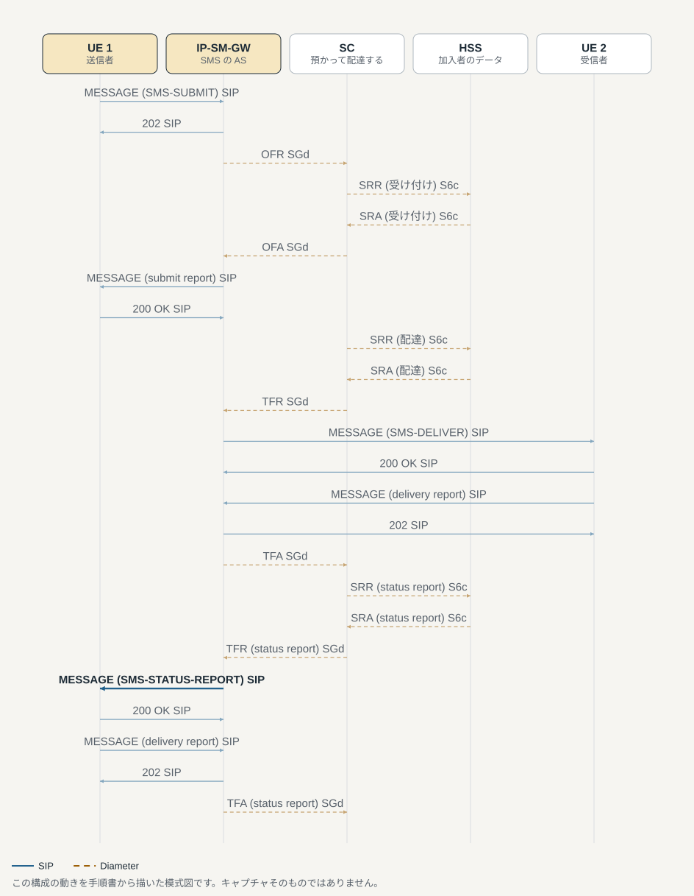

図は CSCF を省き、UE、IP-SM-GW、SC、HSS のあいだのやり取りだけを描いています。MESSAGE は 6 通あり、どれも別の Call-ID を持つ独立した要求です。

| 通 | 向き | ボディ | 答えの SIP 応答 |
| --- | --- | --- | --- |
| 1 | UE 1 から IP-SM-GW | RP-DATA と SMS-SUBMIT | 202 |
| 2 | IP-SM-GW から UE 1 | submit report。RP-ACK と SMS-SUBMIT-REPORT | 200 |
| 3 | IP-SM-GW から UE 2 | RP-DATA と SMS-DELIVER | 200 |
| 4 | UE 2 から IP-SM-GW | delivery report。RP-ACK と SMS-DELIVER-REPORT | 202 |
| 5 | IP-SM-GW から UE 1 | status report。RP-DATA と SMS-STATUS-REPORT | 200 |
| 6 | UE 1 から IP-SM-GW | delivery report。RP-ACK | 202 |

IP-SM-GW が答える SIP の応答は 200 ではなく 202 です。MESSAGE を受け取ったが、中身はまだどこにも届けていない、という応答です（RFC 3428 7、TS 24.341 5.3.3.4.1）。IP-SM-GW は、MESSAGE の中身を読む前に 202 を返します。

[internal/ipsmgw/message.go](../../../internal/ipsmgw/message.go)

```go
	if callID := req.Get("In-Reply-To"); callID != "" {
		g.deliveryReport(st, callID, log)
		return
	}
	g.respond(st, 202, nil)

	// Steps b and c: the RPDU type, and the format of the SC address.
	rp, err := sms.ParseRP(req.Body)
	if err != nil {
		g.refuseUndecodable(req, sender, err, log)
		return
	}
	switch m := rp.(type) {
	case sms.RPDataMSToNetwork:
		g.submit(req, sender, m, log)
	case sms.RPSMMA:
		g.memoryAvailable(req, sender, m, log)
```

入力は、UE から届いた MESSAGE です。In-Reply-To があれば、それは IP-SM-GW が前に送った MESSAGE への delivery report なので、`deliveryReport` に任せます。無ければ、まず 202 を返し、そのあとで初めてボディを RP として読みます。読めなければ、`refuseUndecodable` が RP-ERROR を作り、別の MESSAGE で UE に返します。読めたら、RP-DATA は SC へ渡すショートメッセージとして `submit` に、RP-SMMA はメモリの知らせとして `memoryAvailable` に進みます。

つまり 202 は、ボディが正しいかどうかさえ表しません。ボディの壊れた RP-DATA も 202 を受け、そのあとの submit report が RP-Cause 96（invalid mandatory information）の RP-ERROR になります。`internal/ipsmgw/network_test.go` の `TestShortMessagesThatFail` が、S-CSCF と IP-SM-GW を 1 つのプロセスで動かして、この順を確かめています。

同じことが UE の側にも言えます。UE 2 が 3 通目に返す 200 は、MESSAGE が UE 2 に届いたことだけを示します（TS 24.341 5.3.2.3）。UE 2 がショートメッセージを受け取れたかは、4 通目の delivery report の RP-ACK か RP-ERROR が伝えます。

まとめると、送信者の UE 1 が知ることは次の 3 段階です。

| UE 1 が受け取るもの | 送るノード | 分かること | まだ分からないこと |
| --- | --- | --- | --- |
| 1 通目への 202 | IP-SM-GW | IP-SM-GW が MESSAGE を受け取った | SC が受け付けたか |
| 2 通目、submit report の RP-ACK | IP-SM-GW（SC の答えを運ぶ） | SC がショートメッセージを引き受けた | 受信者に届いたか |
| 5 通目、status report | SC（IP-SM-GW が運ぶ） | 受信者に届いた（TP-ST が 0x00） | ― |

UE 1 は、自分が送った MESSAGE の Call-ID を覚えておき、submit report の In-Reply-To と照らし合わせます（TS 24.341 5.3.1.2）。status report は、TP-MR、TP-RA、TP-SCTS で照らし合わせます。照らし合わせ方は、あとの「status report が送信者に届くまで」で見ます。

## S-CSCF が IP-SM-GW を呼び込む iFC

S-CSCF は、どの要求をどの AS へ送るかを、登録のときに SAA の User-Data で受け取った iFC で決めます（TS 29.228 B.2.2）。この構成の iFC は `deploy/compose/hss.yaml` にあり、SMS over IP に関わるものは 3 つです。

| 優先度 | 一致する要求 | 送り先と DefaultHandling |
| --- | --- | --- |
| 0 | REGISTER のすべて | IP-SM-GW に第三者 REGISTER を送る。ServiceInfo に利用者の MSISDN。SESSION_CONTINUED |
| 1 | 登録済みの利用者が送る MESSAGE で、Content-Type が `application/vnd.3gpp.sms` のもの | IP-SM-GW。SESSION_TERMINATED |
| 2 | 登録済みの利用者に宛てた同じ MESSAGE。ただし IP-SM-GW 自身が送ったものは除く | IP-SM-GW |

1 通目の MESSAGE は、UE 1 が送るので優先度 1 に一致します。Request-URI は SC の `tel:+12025550100` ですが、S-CSCF はそこへは送らず、Route の先頭に IP-SM-GW を入れて送ります（TS 24.229 5.4.3.2）。4 通目と 6 通目の delivery report も、それぞれ UE 2 と UE 1 が送る SMS のボディの MESSAGE なので、送った UE 自身の優先度 1 に一致して IP-SM-GW に届きます。

IP-SM-GW から UE へ向かう 2、3、5 通目は、IP-SM-GW が UA として新しく始める要求です。IP-SM-GW はこれをホーム網の入口の I-CSCF へ送り、I-CSCF が LIR で利用者の S-CSCF を探します（TS 24.229 5.7.3）。S-CSCF にとっては、利用者に宛てた MESSAGE です。ここで優先度 2 の条件を見ます。

[deploy/compose/hss.yaml](../../../deploy/compose/hss.yaml)

```yaml
      - priority: 2
        feature: sms
        trigger_point:
          condition_type_cnf: true
          spt:
            - {group: [0], method: MESSAGE}
            - {group: [1], sip_header: {header: ^Content-Type$, content: '^[Aa][Pp][Pp][Ll][Ii][Cc][Aa][Tt][Ii][Oo][Nn]/[Vv][Nn][Dd]\.3[Gg][Pp][Pp]\.[Ss][Mm][Ss]([[:space:]]*;.*)?$'}}
            - {group: [2], session_case: TERMINATING_REGISTERED}
            - {group: [3], condition_negated: true, sip_header: {header: ^P-Asserted-Identity$, content: 'sip:ipsmgw\.ims\.mnc001\.mcc001\.3gppnetwork\.org'}}
        application_server: {server_name: sip:ipsmgw.ims.mnc001.mcc001.3gppnetwork.org:5060}
```

4 つの SPT は別々の Group にあり、`condition_type_cnf: true` なので、4 つすべてが成り立つときだけ一致します。最後の SPT は `condition_negated: true` で、「P-Asserted-Identity が IP-SM-GW の URI である」の否定です。IP-SM-GW は自分が送る MESSAGE の P-Asserted-Identity に自分の URI を入れるので、2、3、5 通目はこの条件に一致しません。否定が無ければ、IP-SM-GW が UE へ送った MESSAGE が、また IP-SM-GW に戻ってしまいます（TS 23.218 5.2.3 NOTE 5）。この条件に一致するのは、ほかの網から利用者に届いたショートメッセージで、それは [網間接続](interconnect.md) の主題です。

S-CSCF は、この組み合わせを次のように評価します。

[internal/ifc/ifc.go](../../../internal/ifc/ifc.go)

```go
func (t TriggerPoint) matches(req *sip.Message, sc SessionCase) bool {
	groups := map[int][]bool{}
	for _, spt := range t.SPT {
		result := spt.matches(req, sc) != spt.ConditionNegated
		for _, g := range spt.Group {
			groups[g] = append(groups[g], result)
		}
	}
	if t.ConditionTypeCNF {
		// Every group needs one SPT that holds.
		for _, results := range groups {
			if !slices.Contains(results, true) {
				return false
			}
		}
		return true
	}
	// One group needs all of its SPTs to hold.
	for _, results := range groups {
		if !slices.Contains(results, false) {
			return true
		}
	}
	return false
}
```

各 SPT の結果を `ConditionNegated` で反転してから、Group ごとに集めます。連言標準形では、どの Group にも成り立つ SPT が 1 つは要ります。同じ Group の SPT は OR、Group どうしは AND になる、ということです（TS 29.228 B.2.3）。優先度 2 では各 Group に SPT が 1 つずつなので、4 つの AND です。

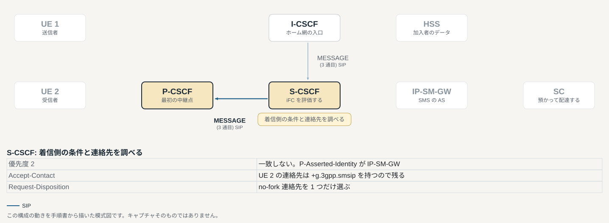

DefaultHandling は、AS が応答しないときの扱いです。どちらにするかは仕様ではなく運用者が選びます。この構成では、登録の条件を SESSION_CONTINUED にしています。IP-SM-GW が答えなくても登録は残ります。UE が送る MESSAGE の条件は SESSION_TERMINATED です。ショートメッセージを扱えるノードはほかに無いので、IP-SM-GW が答えなければ、S-CSCF は MESSAGE をそこで終わらせ、UE は失敗の応答を受けます。SESSION_CONTINUED にすると、S-CSCF は MESSAGE を Request-URI の SC の番号へ送ろうとし、ENUM に無い番号として 404 を返すことになります。

`internal/ifc/ifc_test.go` の `TestSMSCriteria` が、Content-Type の書き方の違い（小文字のヘッダ名、パラメータ付き）を含めて、優先度 1 の条件に一致する要求と一致しない要求を確かめています。`internal/ue/sms_ims_test.go` の `TestShortMessageThroughTheWholeIMS` は、P-CSCF から S-CSCF までを 1 つのプロセスで動かし、IP-SM-GW を試験の相手役にして、UE-A の MESSAGE が UE-A の条件で、UE-B の delivery report が UE-B の条件で IP-SM-GW に届くことを確かめています。この試験の iFC は優先度 1 と同じ形の条件を試験の中で作ったものです。

## IP-SM-GW が利用者を受け持つまで

SC が配達先を HSS に尋ねたとき、HSS が IP-SM-GW を答えられるのは、IP-SM-GW が前もって自分を HSS に書いているからです。それは利用者の登録のときに起きます（TS 24.341 5.3.3.2）。

1. UE 2 は、REGISTER の Contact に機能タグ `+g.3gpp.smsip` を付けて登録します（TS 24.341 5.3.2.2）。この連絡先が IP でショートメッセージを受けられる、という印です（R1）。
2. 登録が済むと、S-CSCF は優先度 0 の条件に従って、IP-SM-GW へ第三者 REGISTER を送ります（TS 24.229 5.4.1.7）。ボディの `<service-info>` に利用者の MSISDN が入ります（R2）。
3. 第三者 REGISTER には UE の Contact が無いので、UE が機能タグを付けたかは分かりません。そこで IP-SM-GW は、利用者の reg イベントを購読します（TS 24.229 5.7.1.1）。S-CSCF の NOTIFY の reginfo に、連絡先ごとの機能タグが `<unknown-param>` として並びます（R3、R4）。
4. 機能タグを持つ active の連絡先があれば、IP-SM-GW は Sh の UDR で利用者の IMSI を読み、PUR で自分の番号を HSS に書きます（R5。TS 29.328 6.1.2、7.6.16）。

R1 から R5 は、手順書とスライドがこの手順に付けている名前で、図のラベルにも出ます。

3 の判断は次の関数です。

[internal/ipsmgw/regevent.go](../../../internal/ipsmgw/regevent.go)

```go
func takesShortMessages(doc reginfo.Document, publicID string) bool {
	for _, r := range doc.Registrations {
		if r.State != reginfo.Active || !ims.SamePublicIdentity(r.AOR, publicID) {
			continue
		}
		for _, c := range r.Contacts {
			if c.State != reginfo.Active {
				continue
			}
			for _, p := range c.UnknownParams {
				if strings.EqualFold(p.Name, featureSMSOverIP) {
					return true
				}
			}
		}
	}
	return false
}
```

入力は NOTIFY の reginfo と、購読している利用者の公開ユーザー識別子です。active の登録の active の連絡先に `+g.3gpp.smsip` があれば true です。IP-SM-GW は、この結果が前の NOTIFY から変わったときだけ HSS を更新します。true になれば番号を入れた PUR を、false になれば番号を空にした PUR を送ります。

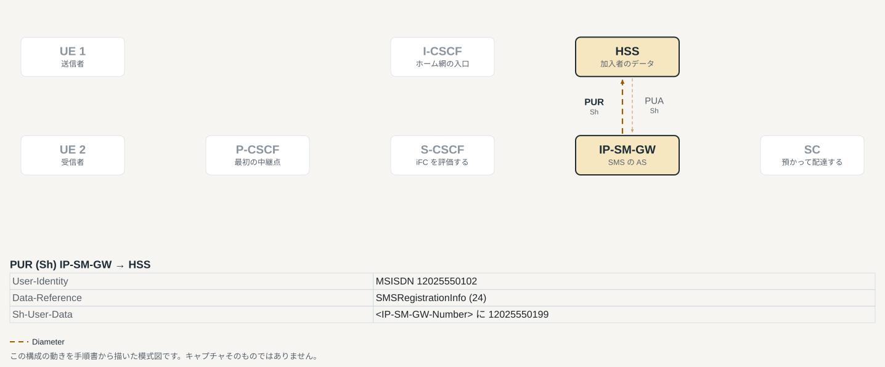

UDR で読む IMSI は、あとで SC から届く TFR が受信者を IMSI で示すためのものです。IP-SM-GW は IMSI を購読の状態と一緒に保存してから PUR を送ります。PUR を受けた HSS が、すぐに待っている SC に知らせることがあり、その TFR が PUR の答えより先に届いても利用者を見つけられるようにするためです。

機能タグを付けずに登録した UE には PUR が送られません。HSS にはその利用者の IP-SM-GW が無いので、SC が尋ねても配達先が返らず、SC はショートメッセージを預かります。`internal/ipsmgw/regevent_test.go` の `TestContactWithoutTheFeatureTag` は、機能タグの無い NOTIFY では PUR が出ず、機能タグのある NOTIFY で PUR が出ることを確かめています。`internal/ipsmgw/network_test.go` の `TestRegistrationWithoutTheFeatureTag` は、同じことを S-CSCF と HSS を含めて確かめています。

## SC が引き受けるまで（submit report）

202 を返した IP-SM-GW は、RP-DATA を確かめます。RP-DA が自分の SC の番号であること、中の SMS-SUBMIT をデコードできること、P-Asserted-Identity に送信者の tel URI があることです。S-CSCF は、送信者を担当するときに tel URI を 2 つ目の P-Asserted-Identity として加えます（TS 24.229 5.4.3.2）。SC は送信者を電話番号で扱うので、IP-SM-GW はこの番号を SC に渡します（TS 24.341 5.3.1.2 NOTE 2）。

IP-SM-GW は SMS-SUBMIT を OFR（MO-Forward-Short-Message、SGd）で SC に渡します（TS 23.204 6.3、TS 29.338 6.2.1）。SC は受け取る前に、受信者の番号を持つ利用者がいるかを SRR（Send-Routing-Info-for-SM、S6c）で HSS に尋ねます。TS 23.040 8.2.2 が SMS-IWMSC に認めている問い合わせです。

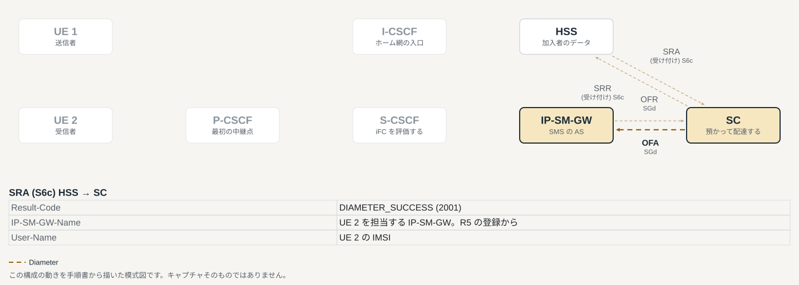

SC の判断は、HSS の答えで分かれます。HSS が番号を知らない（DIAMETER_ERROR_USER_UNKNOWN）なら、SC は OFA で断ります。番号を持つ利用者がいれば、その利用者に今届くかどうかにかかわらず引き受けます。届くかどうかは配達で分かることだからです。引き受けた SC は、受け取った時刻 TP-SCTS を付けて預かり、OFA に SMS-SUBMIT-REPORT を入れて返します。ここから先、ショートメッセージは SC のものです。

IP-SM-GW は、この答えを submit report に写します。

[internal/ipsmgw/message.go](../../../internal/ipsmgw/message.go)

```go
	// Step e: the short message goes to the SC.
	report, err := g.sc.Submit(context.Background(), originator, submit)
	var answer sms.RPMessage
	var refusal *Refusal
	switch {
	case err == nil:
		log.Info("SC accepted the short message")
		answer, err = ackWith(rp.MessageReference, report)
	case errors.As(err, &refusal):
		log.Info("SC refused the short message", "reason", refusal.Error())
		answer, err = errorWith(rp.MessageReference, refusal)
	default:
		// The SC could not be asked. TS 24.011 Table 8.4 part 1: cause 41
		// is a failure that the sender may try again soon.
		log.Warn("SC did not answer", "error", err.Error())
		answer, err = sms.RPError{Direction: sms.NetworkToMS, MessageReference: rp.MessageReference, Cause: sms.RPCauseTemporaryFailure}, nil
	}
```

`g.sc.Submit` が OFR を送り、OFA を読みます。成功なら、SC の SMS-SUBMIT-REPORT を入れた RP-ACK を作ります。SC が断ったなら（`*Refusal`）、SC の決めた RP-Cause と、TP-FCS の入った SMS-SUBMIT-REPORT で RP-ERROR を作ります。SC に尋ねられなかったなら、送り直してよい失敗として RP-Cause 41（temporary failure）を返します（TS 24.011 Table 8.4）。どの場合も、このあとで `g.answer` が新しい MESSAGE を UE 1 へ送ります。それが submit report で、In-Reply-To に 1 通目の Call-ID が入ります（TS 24.341 5.3.3.4.3）。

| 宛先 | SC の判断 | UE 1 が受け取る submit report |
| --- | --- | --- |
| 登録している加入者 | 引き受ける | RP-ACK。中の SMS-SUBMIT-REPORT に TP-SCTS |
| 登録していない加入者（`+12025550103`） | 引き受ける。配達で届かないと分かり、預かる | RP-ACK |
| 番号を持つ加入者がいない（`+12025550198`） | 断る。SRA が DIAMETER_ERROR_USER_UNKNOWN（5001） | RP-ERROR。RP-Cause 1（unassigned number）、TP-FCS 0xC3（invalid SME address） |

番号を間違えた送信者は、status report を待たずに submit report で失敗を知ります。`internal/smsc/smsc_test.go` の `TestRefusals` が、番号を持つ利用者がいない場合を含む、SC が断る場合ごとの答えと TP-FCS を確かめています。

## SC が配達するまで（delivery report と TFA）

SC は SMS-SUBMIT を SMS-DELIVER に作り変えます。受信者の番号 TP-DA の代わりに送信者の番号 TP-OA を入れ、TP-SCTS を付けます。本文はそのままです。送信者が status report を頼んだので、TP-SRI も立てます。

配達の前に、SC はもう一度 SRR を送ります。今度は配達する SMS-GMSC としての問い合わせです（TS 23.040 8.1.1）。受け付けたときから、利用者が移ったり、いなくなったりしていることがあるためです。HSS は次の関数で、配達先を答えるかを決めます。

[internal/hss/s6c.go](../../../internal/hss/s6c.go)

```go
func servingNode(u Subscriber) *sgd.ServingNode {
	if u.IPSMGWNumber == "" || u.IPSMGW.OriginHost == "" || u.UNRI {
		return nil
	}
	return &sgd.ServingNode{
		IPSMGWNumber: u.IPSMGWNumber,
		IPSMGWName:   u.IPSMGW.OriginHost,
		IPSMGWRealm:  u.IPSMGW.OriginRealm,
	}
}
```

HSS が配達先（serving node）を返すのは、IP-SM-GW が PUR で番号を書き、その Diameter の名前を HSS が知っていて、しかも UNRI が立っていないときです。UNRI は、前の配達で利用者がいないと分かったときに立つ印で、あとの節で見ます。返さないとき、SRA は DIAMETER_ERROR_ABSENT_USER（5550）になり、SC は TFR を送りません（TS 29.338 5.2.1.3）。

SRA は IP-SM-GW の名前と、受信者の IMSI を返します。SC は TFR（MT-Forward-Short-Message、SGd）を、その IP-SM-GW を Destination-Host に書いて送ります。TFR は宛先のノードを必ず書く要求で（TS 29.338 6.3.1.2）、受信者は User-Name の IMSI で示します。

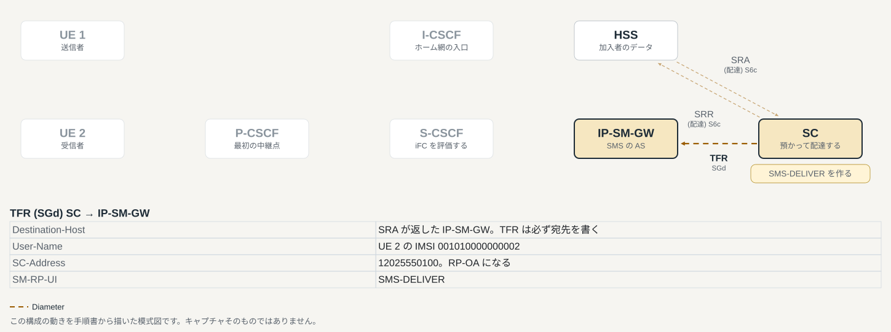

IP-SM-GW は、登録のときに UDR で読んだ IMSI から UE 2 を見つけ、3 通目の MESSAGE を UE 2 の tel URI に宛てて送ります。この MESSAGE には `Accept-Contact: *;+g.3gpp.smsip;require;explicit` が付きます。UE 2 の S-CSCF は、これを UE 2 が登録した連絡先のパラメータと照らし合わせ（RFC 3841 7.2.4）、機能タグを登録していない UE なら送らずに 480 を返します。`internal/ue/sms_ims_test.go` の `TestShortMessageToAUEWithoutSMSOverIP` が、MMTel だけを登録した UE への MESSAGE が 480 になり、UE が何も受け取らないことを確かめています。

UE 2 は 200 を返し、続けて 4 通目の delivery report を送ります。IP-SM-GW は In-Reply-To の Call-ID で配達を見つけ、202 で答えます。TFR への答え TFA は、このときに初めて SC に返ります。

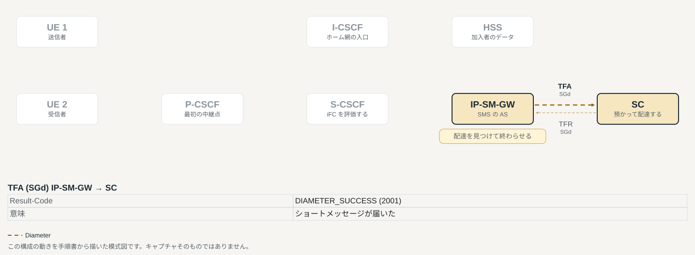

TFA が配達の結果を表すので、IP-SM-GW は TFR を、delivery report が来るまで答えずに持っています。delivery report を待つのは 64 秒までで、TFR への答えは最長 66 秒かかります。待ち時間を過ぎた配達は、「確認できなかった」結果として SC に伝わります。IP-SM-GW のどの台が delivery report を受けても配達を終わらせられるように、配達の途中の状態は台のあいだで共有する保存先にあります（`internal/ipsmgw/network_test.go` の `TestDeliveryReportThroughAnotherIPSMGW`）。

配達の結果は、MESSAGE への SIP の応答か、delivery report の RP で決まります。MESSAGE が失敗の応答を受けたときの写し方は TS 29.311 6.1.4.4.1 にあり、IP-SM-GW はその表を持っています。

[internal/ipsmgw/servicecentre.go](../../../internal/ipsmgw/servicecentre.go)

```go
var failedMessageOutcomes = map[int]Outcome{
	401: IllegalSubscriber,
	404: UnidentifiedSubscriber,
	407: IllegalSubscriber,
	480: AbsentSubscriber,
	486: SubscriberBusy,
	600: SubscriberBusy,
	603: SubscriberBusy,
	604: UnidentifiedSubscriber,
}
```

この表に無い応答（408 や 500 など）は system failure になります。MESSAGE が 200 を受け、delivery report が来たときは、その RP で決まります。RP-ACK なら届いた、RP-Cause 22（memory capacity exceeded）の RP-ERROR ならメモリ不足、ほかの RP-ERROR なら端末の誤りです。

| 結果 | IP-SM-GW が返す TFA | SC が覚えること |
| --- | --- | --- |
| delivery report が RP-ACK | DIAMETER_SUCCESS（2001） | 届いた。待ち行列から外し、頼まれていれば status report を作る |
| MESSAGE が 480 | DIAMETER_ERROR_ABSENT_USER（5550） | 受信者がいない。預かり、HSS に報告する |
| delivery report が RP-Cause 22 の RP-ERROR | DIAMETER_ERROR_SM_DELIVERY_FAILURE（5555）と MEMORY_CAPACITY_EXCEEDED | メモリが無い。預かり、HSS に報告する |

`internal/ipsmgw/sgd_test.go` の `TestMTForwardShortMessageFailures` が、MESSAGE の応答と delivery report の組み合わせごとに、TFA の結果を確かめています。

## status report が送信者に届くまで

TFA が 2001 で返ると、SC はショートメッセージを待ち行列から外します。送信者が SMS-SUBMIT の TP-SRR で頼んでいれば、SC は SMS-STATUS-REPORT を作り、送信者の番号の待ち行列に入れます。そのあとは、ふつうのショートメッセージと同じです。SC は送信者について SRR を送り、UE 1 を受け持つ IP-SM-GW へ TFR を送り、IP-SM-GW が 5 通目の MESSAGE で UE 1 に届けます（TS 24.341 5.3.3.4.4）。

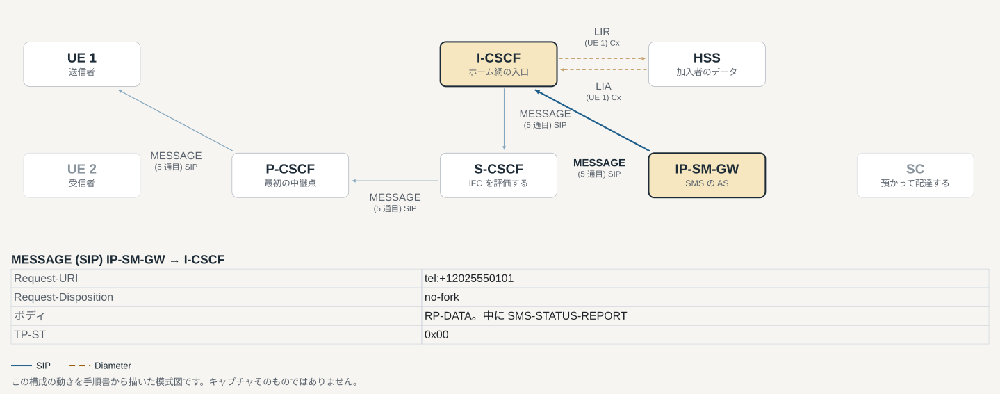

status report には、SMS-SUBMIT の TP-MR、受信者の番号 TP-RA、SC が受け取った時刻 TP-SCTS が入ります。TP-ST の 0x00 は、受信者が受け取ったことを示します（TS 23.040 9.2.3.15）。UE 1 は、どのショートメッセージの報告かを次の関数で決めます。

[internal/ue/sms.go](../../../internal/ue/sms.go)

```go
func statusReportIsFor(s SentSMS, r sms.StatusReport) bool {
	if !s.StatusReportRequested || s.MessageReference != r.MessageReference {
		return false
	}
	if r.RecipientAddress.TypeOfNumber != sms.TONInternational || r.RecipientAddress.String() != s.To {
		return false
	}
	return s.ServiceCentreTimeStamp == nil || s.ServiceCentreTimeStamp.Equal(r.ServiceCentreTimeStamp)
}
```

TP-MR は 8 ビットで一周するので、TP-MR だけでは、遅れて届いた古い報告が新しいショートメッセージの結果に見えることがあります。そこで UE は TP-RA と、submit report で受け取っていれば TP-SCTS も比べます。3 つが合うショートメッセージが 1 つだけのときに、報告を記録します。UE 1 はそのあと、6 通目の delivery report で status report を受け取ったことを伝えます（TS 24.341 5.3.1.3）。

`internal/smsc/smsc_test.go` の `TestStatusReport` が、SC が status report に SMS-SUBMIT の TP-MR、TP-DA、受け取った時刻を入れることを確かめています。`internal/ipsmgw/network_test.go` の `TestShortMessageThroughTheIMS` は、登録から status report までの 6 通を、`deploy/compose` の iFC を使う S-CSCF を通して確かめています。

## 受信者が受け取れないとき

登録している UE でも、いつもショートメッセージを受け取れるとは限りません。この実装の UE シミュレータでは、制御 API で 2 つの状態を作れます。ショートメッセージを受け取らない状態と、メモリに空きが無い状態です。どちらも SC はショートメッセージを捨てずに預かりますが、HSS に残る印が違います（TS 23.040 3.2.6）。このあとの図のラベルの A1〜A9、B1〜B8、D1〜D3 は手順書とスライドの手順の名前で、A は受け取らない場合、B はメモリに空きが無い場合、D はメモリの知らせが失われた場合です。

| 状態 | UE 2 の答え | TFA | SC の RDR の `SM-Delivery-Cause` | HSS の印 |
| --- | --- | --- | --- | --- |
| 受け取らない | MESSAGE に 480（Temporarily Unavailable） | DIAMETER_ERROR_ABSENT_USER（5550） | ABSENT_USER | UNRI |
| メモリに空きが無い | MESSAGE に 200、続けて RP-Cause 22 の RP-ERROR | DIAMETER_ERROR_SM_DELIVERY_FAILURE（5555）と MEMORY_CAPACITY_EXCEEDED | UE_MEMORY_CAPACITY_EXCEEDED | MCEF |

480 は「相手には届いたが、その状態では要求を受けられない」という意味です。IP-SM-GW はこれを不在の加入者として SC に伝え（TS 24.341 5.3.3.4.2、TS 29.311 6.1.4.4.1、TS 29.338 7.3.3）、自分の UNRI（UE-Not-Reachable-for-IP）も立てます。IMS での配達が失敗したことを知っているのは IP-SM-GW だけなので、UE が戻ったときに知らせるのも IP-SM-GW です。

SC は、どちらの失敗も一時的なものとして扱い、ショートメッセージを預かったまま、Report-SM-Delivery-Status（RDR、S6c）で HSS に報告します（TS 29.338 5.2.3）。HSS は次の関数で記録します。

[internal/hss/store.go](../../../internal/hss/store.go)

```go
func (s *Subscriber) addMessageWaiting(scAddress string, cause DeliveryFailure) bool {
	switch cause {
	case MemoryCapacityExceeded:
		s.MCEF, s.UNRI = true, false
	default:
		s.UNRI = true
	}
	if slices.Contains(s.MessageWaitingData, scAddress) {
		return true
	}
	if len(s.MessageWaitingData) >= maxMessageWaitingData {
		return false
	}
	s.MessageWaitingData = append(s.MessageWaitingData, scAddress)
	return true
}
```

SC のアドレスを MWD に入れ、理由に応じて印を立てます。不在なら UNRI を立てます。メモリ不足なら MCEF を立て、UNRI は落とします。UE には届いており、入れる場所が無いだけだからです。MWD が一杯なら、SC のアドレスは入らず、SC は自分の再送だけに頼ります。

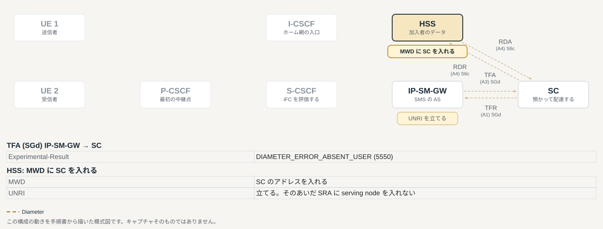

印の違いは、そのあとの SRR への答えに出ます。UNRI が立っているあいだ、前の節の `servingNode` は配達先を返しません。SC をまた失敗する IP-SM-GW へ向かわせないためです。MCEF のときは UNRI が落ちているので配達先が返り、SRA の MWD-Status に MCEF-Set のビットが立ちます（TS 29.338 5.3.3.8）。

`internal/hss/s6c_test.go` の `TestReportSMDeliveryStatusKeepsTheSCAddress` は、不在の RDR で SC のアドレスと UNRI が、メモリ不足の RDR で MCEF が残り、UNRI が落ちることを確かめています。`internal/smsc/smsc_test.go` の `TestDeliveryFailures` は、TFA の結果ごとに、SC がショートメッセージを預かって再送するか、捨てて status report を出すかを確かめています。同じく `TestSendRoutingInfoLeavesOutANodeMarkedNotReachable` は、不在の報告のあとの SRR が 5550 になり、利用者が登録し直すと配達先が戻ることを確かめています。

## 戻ったことの知らせと送り直し

SC は、預かったショートメッセージを、HSS からの知らせ（Alert-Service-Centre、ALR、S6c）を受けてすぐ送り直します（TS 29.338 5.2.2、TS 23.040 3.2.6）。HSS が知らせるきっかけは、利用者が受け取れるようになったという IP-SM-GW からの知らせです。

UE が戻ったことは、UE 2 から何かが IP-SM-GW に届けば分かります。中身は何でもかまいません。UE 2 自身のショートメッセージでも、再登録の第三者 REGISTER でもよいです（TS 23.204 6.5b）。IP-SM-GW は、自分の UNRI が立っていればそれを落とし、HSS に知らせます。登録していなかった加入者 3 のように、IP-SM-GW がまだ HSS に自分を書いていなかった利用者では、登録のときの PUR そのものが知らせになり、HSS は待っている SC に知らせます（TS 23.040 3.2.6。`internal/hss/s6c_test.go` の `TestRegistrationAlertsTheServiceCentre`）。メモリの場合は、UE 2 が空きのできたことを RP-SMMA で知らせます（TS 24.011 7.3.2、TS 23.204 6.6）。

この知らせを、実際の網は MAP の READY_FOR_SM で運びます。S6c にも Sh にもこの知らせのコマンドが無く、このプロジェクトは MAP を話さないので、IP-SM-GW は S6c に独自のコマンド Ready-For-SM（コマンドコード 16777214、RFC 6733 が実験用に取ってある値）を送ります。理由は `Alert-Reason` で示し、UE_PRESENT か UE_MEMORY_AVAILABLE です。HSS は次の関数で、印を落とし、SC に知らせるかを決めます。

[internal/hss/store.go](../../../internal/hss/store.go)

```go
func (s *Subscriber) readyForShortMessages(reason sgd.AlertReason) bool {
	switch reason {
	case sgd.AlertReasonUEPresent:
		// Item 2c: the UE is reachable over IP again, so UNRI goes. While
		// MCEF is set the service centres wait for free memory instead.
		s.UNRI = false
		return len(s.MessageWaitingData) > 0 && !s.MCEF
	case sgd.AlertReasonUEMemoryAvailable:
		// Item 2f alerts the service centres when the UE has memory
		// again, and clears UNRI, since a UE that says so is reachable.
		// MCEF goes too: TS 23.040 3.2.8 Case 1 has the HLR clear it on
		// the MS Memory Capacity Available message, together with UNRI
		// for a UE reachable via the IP-SM-GW.
		s.MCEF, s.UNRI = false, false
		return len(s.MessageWaitingData) > 0
	}
	return false
}
```

UE_PRESENT は UNRI を落とします。ただし MCEF が立っているあいだは知らせません。UE がいても、メモリの空きを待っている SC には役に立たないからです。UE_MEMORY_AVAILABLE は MCEF と UNRI の両方を落とします。どちらの場合も、MWD に SC が残っていれば、HSS はその SC に ALR を送ります。`internal/hss/s6c_test.go` の `TestReadyForShortMessages` が、印と MWD の組み合わせごとに、この結果を確かめています。

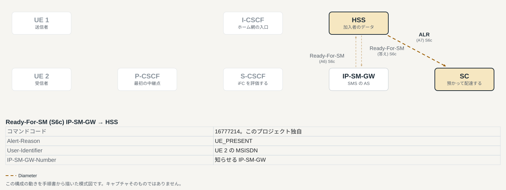

知らせを受けた SC は、その番号の待ち行列を、再送の間隔を待たずに配達に回します。今度の SRR には IP-SM-GW が返り、配達は前の節と同じように進みます。

メモリの知らせには、もう 1 つの条件があります。IP-SM-GW は RP-SMMA を運んだ MESSAGE にすぐ 202 で答えますが、RP-SMMA への RP-ACK は、HSS が Ready-For-SM に成功で答えてから別の MESSAGE で送ります（`internal/ipsmgw/message.go` の `memoryAvailable`）。届いていない知らせを、届いたと UE に伝えないためです。HSS が答えなかったときは RP-Cause 38（network out of order）の RP-ERROR を返し、UE は知らせを、まだ送るべきものとして持ち続けます（TS 23.040 11.2）。`internal/ipsmgw/ipsmgw_test.go` の `TestMemoryAvailableThatTheHSSRefuses` が、HSS の答えごとに RP-ERROR の RP-Cause を確かめています。

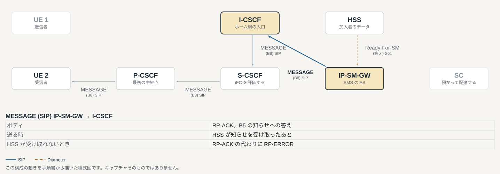

`internal/ipsmgw/chain_test.go` の 3 つの試験が、IP-SM-GW、SC、HSS を本物の Diameter の接続でつないで、この流れを確かめています。`TestAbsentUserIsAlertedThroughTheServiceCentre` は 480 のあとに UE 自身の MESSAGE で、`TestAbsentUserWhoRegistersAgainIsAlertedThroughTheServiceCentre` は再登録だけで、`TestMemoryFullIsAlertedThroughTheServiceCentre` は RP-SMMA で、HSS の MWD と印が空になり、預かったショートメッセージが UE に届くことを確かめています。

## 知らせが無いときの再送と、印の後始末

SC は、知らせとは別に、自分で再送もします。再送の間隔は運用者が決めることで（TS 23.040 3.2.7 NOTE 5）、この構成では `deploy/compose/sc.yaml` の `retry_delays` で 1 時間です。ショートメッセージを届けるのは、ふつうは知らせのほうです。再送は、知らせが届かなかったときの備えです。

再送が意味を持つのは、たとえば RP-SMMA が途中で失われたときです。UE 2 にはメモリの空きがあるのに、HSS では MCEF が立ったままになります。MCEF が立っているあいだは、UE 2 が登録し直しても知らせは出ません。再送の SRR に、HSS は MCEF-Set の立った MWD-Status を返し、配達は成功します。SC は、この答えを見て、配達が成功したことを HSS に報告します。

[internal/smsc/deliver.go](../../../internal/smsc/deliver.go)

```go
func (c *SMSC) reportDelivered(ctx context.Context, msisdn string, kind nodeKind, status *sgd.MWDStatus, log *slog.Logger) {
	if status == nil || *status&(sgd.MWDMNRFSet|sgd.MWDMCEFSet|sgd.MWDMNRGSet) == 0 {
		return
	}
```

MWD-Status に MNRF、MCEF、MNRG のどれかが立っていなければ、何も報告しません。立っていれば、`SM-Delivery-Cause` が SUCCESSFUL_TRANSFER の RDR を送ります（TS 23.040 10.1 の operation 3、TS 29.338 5.2.3.1）。HSS は MCEF を落とし、SC のアドレスを MWD から消します。この報告が無ければ、MCEF は立ったままになり、あとで UE 2 が届かなくなって戻っても、誰にも知らせが行きません。`internal/ipsmgw/chain_test.go` の `TestARetryAfterAFullMemoryClearsTheFlag` が、再送の間隔を 1 秒にして、この報告で MCEF と MWD が空になることを確かめています。

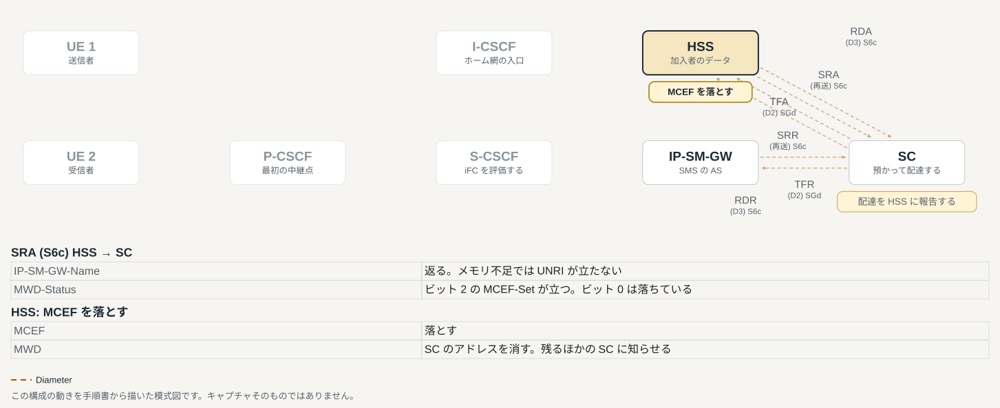

## 有効期間が過ぎたとき

SC がショートメッセージに責任を持つのは、有効期間が切れるまでです（TS 23.040 6.1）。SMS-SUBMIT が TP-VP で有効期間を求めていなければ、SC は既定の 72 時間だけ預かります。この実装の UE は有効期間を求めないので、どのショートメッセージも 72 時間です。

SC は、待ち行列を配達に回すたびに、まず期限を見ます。

[internal/smsc/deliver.go](../../../internal/smsc/deliver.go)

```go
	for _, m := range queue {
		if now.Before(m.Expires) {
			live = append(live, m)
			continue
		}
		if err := c.store.Remove(ctx, l, m.ID); err != nil {
			log.Warn("cannot discard a message", "message_id", m.ID, "error", err.Error())
			return false
		}
		// TS 23.040 6.1: the SC is responsible for the message only
		// until its validity period ends.
		log.Info("short message discarded: its validity period ended", "message_id", m.ID, "expires", m.Expires)
		c.reportStatus(ctx, m, statusValidityPeriodExpired, now)
	}
```

期限の過ぎたショートメッセージは待ち行列から消し、送信者が頼んでいれば status report を作ります。そのときの TP-ST は `SM Validity Period Expired`（0x46）で、送り直さない失敗を示します（TS 23.040 9.2.3.15）。`internal/smsc/smsc_test.go` の `TestValidityPeriodExpires` は、有効期間を 5 分にしたショートメッセージが受信者に届かないまま、期限ちょうどに status report が出て、そのあとは何も送られないことを確かめています。

そのため、登録していない加入者 3 に宛てたショートメッセージの送信者は、submit report の RP-ACK のあと、しばらく何も受け取りません。status report が来るのは、加入者 3 が登録して配達されたときか、72 時間が過ぎたときです。

## 再送と重複の扱い

ここまでの説明では、要求への答えが必ず返るものとしてきました。実際には、OFR や TFR の答えが失われ、送り手が送り直すことがあります。送り直した要求が別の台に届いたとき、同じショートメッセージを 2 度預からないこと、2 度届けないことを、何で見分け、どこまで保証するかは、SMS の再送と重複 で扱います。

## ボディを読む（1 通目の MESSAGE）

1 通目の MESSAGE のボディは 47 オクテットです。手順書が示す、UE シミュレータが `internal/sms` で作った並びです。

```text
00 00 00 07 91 21 20 55 05 01 f0 23 21 00 0b 91 21 20 55 05 01 f2 00 00 19 c8 32 9b fd 06 55 8b 2d 21 0b
44 47 a7 e7 a0 f4 1c 54 2d b6 82 2e
```

最初の 12 オクテットが RP-DATA です（TS 24.011 7.3.1.2、8.2）。

| オクテット | フィールド | 意味 |
| --- | --- | --- |
| `00` | RP-MTI | 下位 3 ビットが 0。端末から網への RP-DATA |
| `00` | RP-MR | 0。答えの RP-ACK や RP-ERROR は同じ値を持つ |
| `00` | RP-OA の長さ | 0。端末からの RP-DATA では発信元のアドレスは空 |
| `07` | RP-DA の長さ | このあとに 7 オクテット続く |
| `91` | アドレスの種別 | 国際番号で、番号計画は E.164 |
| `21 20 55 05 01 f0` | RP-DA の数字 | 1 オクテットに 2 桁で、下位の半分が先。余りは `f`。1 2 0 2 5 5 5 0 1 0 0 で、SC の `+12025550100` |
| `23` | RP-User-Data の長さ | このあとに 35 オクテット続く。これが TPDU |

残りの 35 オクテットが SMS-SUBMIT です（TS 23.040 9.2.2.2、9.2.3）。

| オクテット | フィールド | 意味 |
| --- | --- | --- |
| `21` | 1 オクテット目 | `0010 0001`。TP-MTI が 01 で SMS-SUBMIT、TP-VPF が 00 で有効期間なし、TP-SRR が 1 で status report を頼む |
| `00` | TP-MR | 0。status report はこの値を繰り返す |
| `0b` | TP-DA の長さ | 11 桁 |
| `91` | アドレスの種別 | 国際番号で E.164 |
| `21 20 55 05 01 f2` | TP-DA の数字 | 受信者の `+12025550102` |
| `00` | TP-PID | 0。ふつうのショートメッセージ |
| `00` | TP-DCS | 0。GSM 7 ビットの既定のアルファベット |
| `19` | TP-UDL | 25 セプテット。25 文字 |
| `c8 32 9b fd ... b6 82 2e` | TP-UD | 22 オクテットに詰めた本文 |

同じ 11 桁の番号でも、RP-DA の長さは 7、TP-DA の長さは 11 です。RP は長さのあとに続くオクテットの数を、アドレスの種別も含めて数え、TP は桁の数を数えるからです。TP-MTI の 01 は、端末からなら SMS-SUBMIT、網からなら SMS-SUBMIT-REPORT です。どちらなのかは、包んでいる RP のメッセージの向きで決まります。

本文の 7 ビットの文字（セプテット）は、下位のビットから順にオクテットへ詰めます（TS 23.038 6.1.2.1.1）。最初の 2 オクテットは次のようになります。

```text
H = 100 1000, e = 110 0101, l = 110 1100
octet 1: lowest bit of 'e' (1), then 'H' (1001000)            = 1100 1000 = c8
octet 2: lowest 2 bits of 'l' (00), then rest of 'e' (110010) = 0011 0010 = 32
```

25 セプテットは 175 ビットなので、22 オクテットに収まります。この並びは、本文からこの規則で計算した値と一致します。日本語のように既定のアルファベットに無い文字を含む本文は UCS2 で送り、TP-DCS は `08` になり、1 文字が 2 オクテットになり、TP-UDL はオクテットの数を数えます。手順書の例では、`こんにちは、UE-A さん` の TP-UDL は `1a`（26 オクテット）です。

## この説明の根拠

この章の動きは、次のコードと試験に照らして確かめたものです。どの試験も、このリポジトリの Go の試験として通ることを確かめています。

- `internal/ipsmgw/chain_test.go` の `TestShortMessageThroughTheServiceCentre`。UE の MESSAGE が SGd で SC に届き、SC が HSS に尋ねて IP-SM-GW に戻し、submit report が RP-ACK で、delivery report で配達が終わり、HSS に待っている SC が残らないことを確かめています。この試験の S-CSCF と UE は試験の相手役で、IP-SM-GW、SC、HSS は本物です。
- 同じファイルの `TestAbsentUserIsAlertedThroughTheServiceCentre`、`TestAbsentUserWhoRegistersAgainIsAlertedThroughTheServiceCentre`、`TestMemoryFullIsAlertedThroughTheServiceCentre`、`TestARetryAfterAFullMemoryClearsTheFlag`。預かり、印、知らせ、送り直し、再送のあとの報告です。
- `internal/ipsmgw/network_test.go` の `TestShortMessageThroughTheIMS`、`TestShortMessagesThatFail`、`TestRegistrationWithoutTheFeatureTag`、`TestDeliveryReportThroughAnotherIPSMGW`。S-CSCF、IP-SM-GW、HSS を 1 つのプロセスで動かす試験です。SC の代わりに、試験が結果を受け取る相手役を置いています。そのため、この試験の SC の動きを、`sc` のノードの動きとしては読めません。
- `internal/ipsmgw/sgd_test.go` の `TestMTForwardShortMessageFailures`、`internal/ipsmgw/regevent_test.go` の `TestContactWithoutTheFeatureTag`、`internal/ipsmgw/ipsmgw_test.go` の `TestMemoryAvailableThatTheHSSRefuses`。
- `internal/smsc/smsc_test.go` の `TestRefusals`、`TestStatusReport`、`TestDeliveryFailures`、`TestValidityPeriodExpires`。SC の判断を、相手のノードを試験の相手役にして確かめています。
- `internal/hss/s6c_test.go` の `TestReportSMDeliveryStatusKeepsTheSCAddress`、`TestSendRoutingInfoLeavesOutANodeMarkedNotReachable`、`TestReadyForShortMessages`、`TestRegistrationAlertsTheServiceCentre`。
- `internal/ifc/ifc_test.go` の `TestSMSCriteria`、`internal/ue/sms_ims_test.go` の `TestShortMessageThroughTheWholeIMS` と `TestShortMessageToAUEWithoutSMSOverIP`。

図は、この構成の動きを手順書から描いた模式図で、キャプチャそのものではありません。ボディのオクテットは手順書のもので、本文と符号化の規則から計算した値と一致することを確かめています。

## 自分で動かす場合

この章を読むのに、構成を動かす必要はありません。実際のキャプチャで同じ流れを見たいときは、手順書の [ショートメッセージを送る](../../guide/ja/sms.md#ショートメッセージを送る) と [キャプチャを開く](../../guide/ja/sms.md#キャプチャを開く) に手順があります。受け取れない状態の作り方とそのシーケンス図は [UE が受け取れないとき（預かる、知らせる、送り直す）](../../guide/ja/sms.md#ue-が受け取れないとき預かる知らせる送り直す) に、ボディのすべてのフィールドと表示フィルタは [ボディを読む](../../guide/ja/sms.md#ボディを読む) にあります。ラボの UE のカードから送る方法は、ラボの手順書の [UE シミュレータを操作する](../../guide/ja/lab.md#ue-シミュレータを操作する) にあります。スライドでは [SMS のデッキ](../../../slides/decks/ja/06-sms.md) が、この章と同じ流れを 1 区間ずつ進みます。
