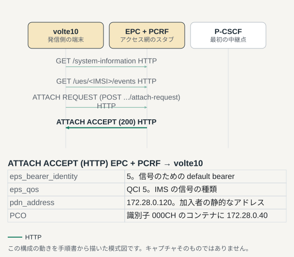
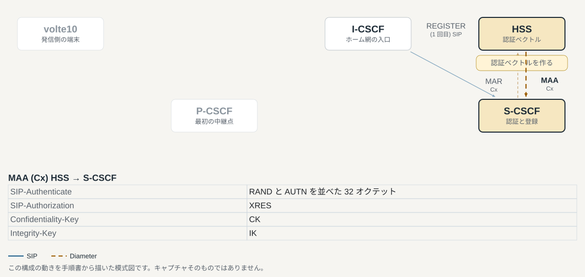
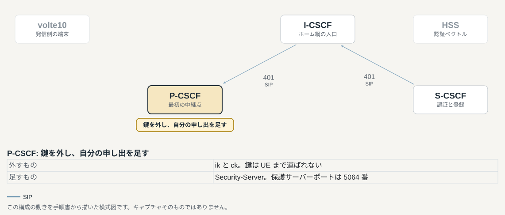
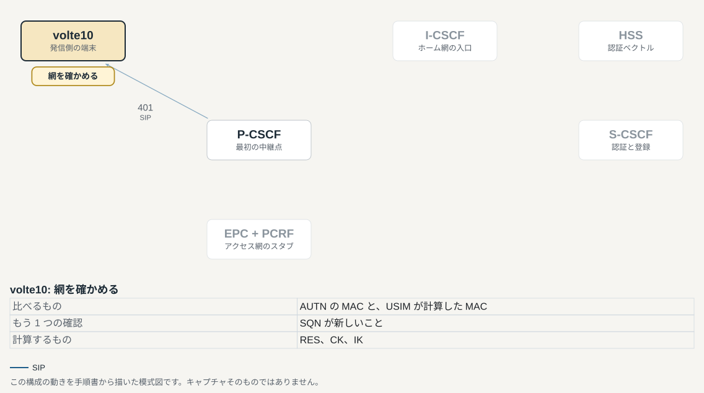
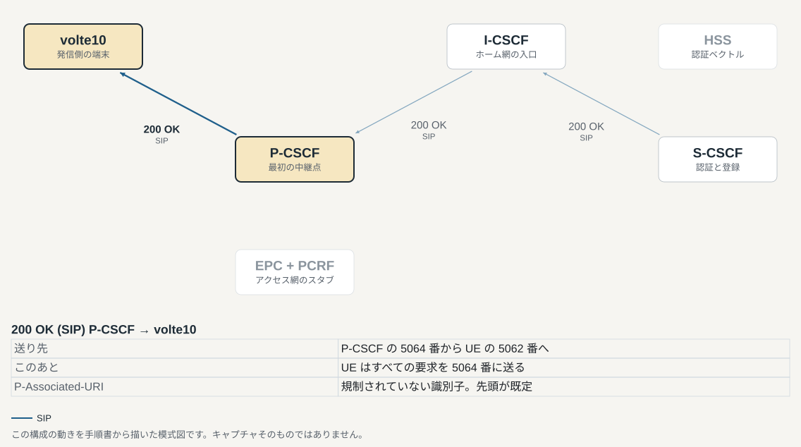
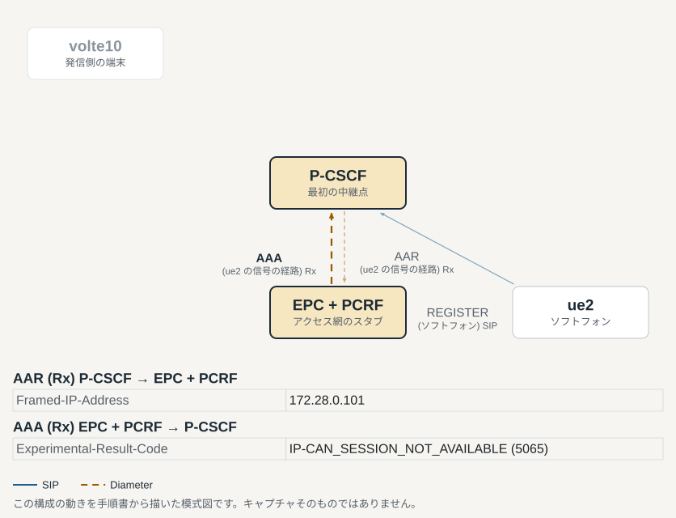
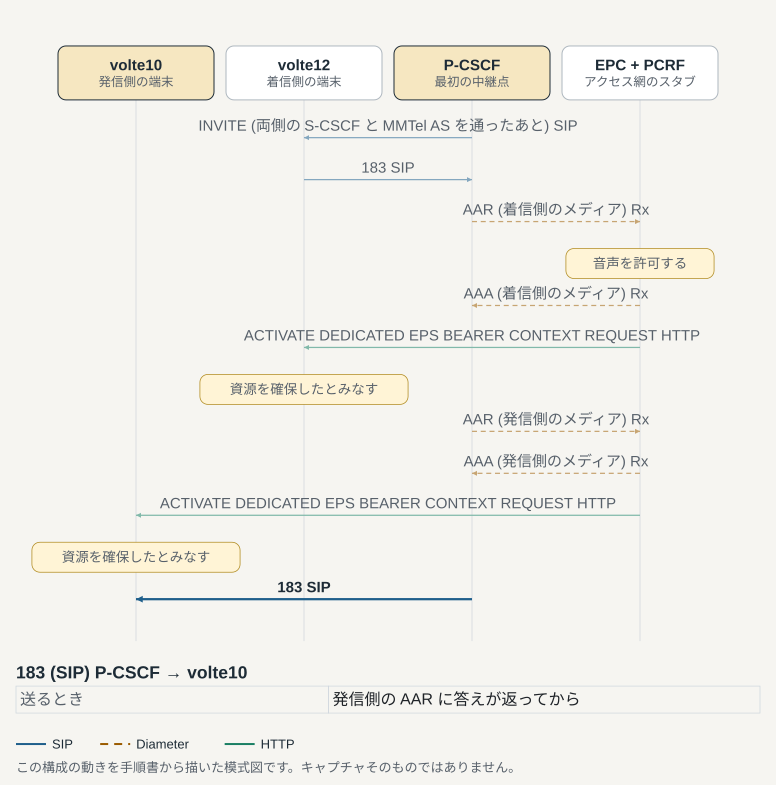
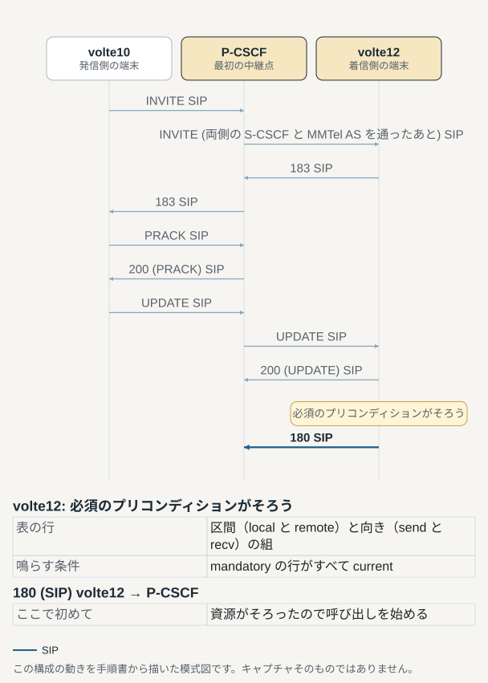
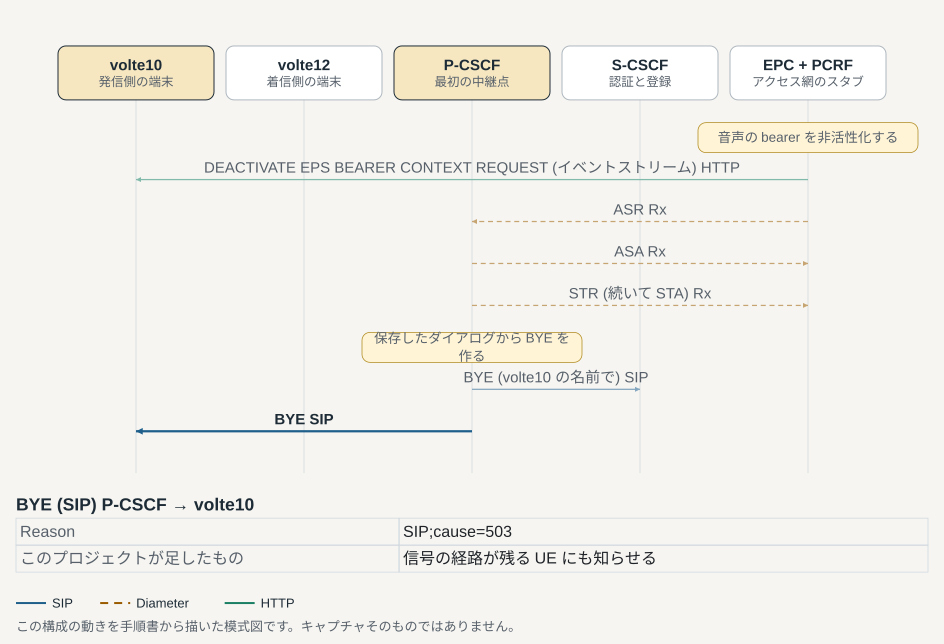

# VoLTE の登録と通話

VoLTE の端末は、登録の前に携帯のアクセス網に attach します。網はそこで、端末の IP アドレスと、SIP を運ぶ default bearer と、P-CSCF のアドレスを渡します。登録は REGISTER を 2 回送る形のままですが、パスワードの代わりに USIM の鍵を使う IMS-AKA になります。網は 1 回だけ使う認証ベクトルで問い、端末はその問いで網が本物かも確かめます。そのあいだに、端末と P-CSCF はセキュリティアソシエーションを取り決め、以後の要求は保護ポートを通ります。

通話では、P-CSCF が SDP の answer を見て、Rx で PCRF に音声の資源を求めます。網は端末ごとに音声の bearer を作り、着信側は両方の資源がそろうまで鳴りません。網が bearer を取り上げると、端末が切らなくても P-CSCF が通話を終えます。

この章では、この流れの各段で、どの条件がどのノードの判断を変えるかを、判断する関数と、それを確かめる試験で追います。SIP Digest の登録の形は [REGISTER が 2 回送られる理由](registration-two-registers.md) で、通話の INVITE、PRACK、ACK は [通話のトランザクション、ダイアログ、メディアの交渉](call-signaling.md) で説明しています。この章はその違いだけを扱います。

## この章で扱う構成

例は、`deploy/compose` の構成にプロファイル `volte` の 2 台の端末を足した場合です。

| ノード | アドレス | この章での役割 |
| --- | --- | --- |
| volte10 | 172.28.0.120 | 発信側の端末。番号は `tel:+12025550110`。USIM に K と OPc がある |
| volte12 | 172.28.0.121 | 着信側の端末。番号は `tel:+12025550112` |
| EPC スタブと PCRF | 172.28.0.80 | アクセス網の代わり。端末には HTTP で、P-CSCF には Rx で答える |
| P-CSCF | 172.28.0.40 | 5060 番と、IMS-AKA の端末のための保護サーバーポート 5064 番で待つ。Rx のクライアント |
| I-CSCF、S-CSCF、HSS | 172.28.0.20、30、10 | 登録の章と同じ。HSS が認証ベクトルを作る |
| MMTel AS、メディアの中継ノード | 172.28.0.75、50 | すべての通話が MMTel AS を通り、音声は中継ノードを通る |

K と OPc は MILENAGE の試験データの値です（TS 35.208 4.3.1、4.3.3）。EPC スタブは本物の EPC ではありません。メッセージの名前と項目は TS 24.301 の EMM と ESM のとおりですが、無線も NAS の符号化もなく、端末とは HTTP の上の JSON でやり取りします。PCRF と PDN GW は 1 つのノードの中で状態を共有し、あいだに Gx はありません。

この章が引く仕様の版は、手順書と同じく TS 24.229 V20.1.0、TS 29.214 V20.0.0、TS 24.301 V20.1.0、TS 33.203 V20.0.0、TS 33.102 V19.1.0、RFC 3310、RFC 3329、RFC 3312、RFC 4867、GSMA IR.92 v24.0 です。

## attach で P-CSCF のアドレスを受け取る

ソフトフォンは、P-CSCF のアドレスを設定で与えられます。VoLTE の端末は、それをアクセス網から受け取ります。



端末は最初にセルの情報を読み、網が自分から送るものを受けるイベントストリームを開きます。開くのを attach より先にするのは、attach した直後に網が送るものを取りこぼさないためです。そのあと ATTACH REQUEST で IMS の APN（`ims`）への PDN 接続を求め、プロトコル設定オプション（PCO）で P-CSCF のアドレスを求めます。

ATTACH ACCEPT には 3 つのものが入っています。EPS bearer 5 は default bearer で、QCI は IMS の信号の種類の 5 です（IR.92 4.4.1）。PDN のアドレスは加入者の静的なアドレスです。PCO の識別子 `000CH` のコンテナが、P-CSCF のアドレス 172.28.0.40 を運びます（TS 24.008 10.5.6.3）。PCO で P-CSCF を伝えるのは TS 24.229 L.2.2.1 の方法 II で、IR.92 4.5 が求める方法です。

端末がこのアドレスをどう使うかは、UE シミュレータのこの数行で決まります。

[cmd/ue/main.go](../../../cmd/ue/main.go)

```go
		// TS 24.229 L.2.2.1: the first P-CSCF of the PCO is the most
		// preferred. The PCO gives an address only, so the port is the
		// one of -pcscf, 5060 by default.
		//
		// SIMPLIFIED: TS 24.229 L.2.2.1. The PCO may give a list of
		// P-CSCF addresses, and the UE takes the first one and drops the
		// rest. Where TS 24.229 5.1.1.2.1 and 5.1.2A.1.6 have the UE
		// register through another P-CSCF of the list, it registers
		// through the same one again (ue.RegistrationBackoff). The EPC
		// stub of each deployment of this project gives one address.
		target = netip.AddrPortFrom(attached.PCSCFs[0], target.Port())
```

入力は ATTACH ACCEPT から取り出した P-CSCF のアドレスの一覧です。一覧の先頭がいちばん優先されるので（TS 24.229 L.2.2.1）、端末はそのアドレスを使います。PCO にはポートが無いので、送り先のポートは標準の 5060 番のままです。標準は、登録に失敗したときに一覧のほかの P-CSCF を使う場合を定めていますが、この実装は先頭だけを使い、残りを捨てます。どの構成でも、EPC スタブが渡すアドレスは 1 つだからです。

続いて端末は、PDN のアドレスが、自分が P-CSCF に届くアドレスと同じかを確かめ、違えば起動を止めます（同じファイルの `the PDN address ... is not the address` の誤り）。スタブにはトンネルが無く、端末のパケットはコンテナのアドレスのまま P-CSCF に届くので、2 つが食い違うと PCRF が端末を見つけられなくなるためです。

## IMS-AKA の最初の REGISTER と 401

最初の REGISTER は、SIP Digest のときと同じく「誰か」を伝えるだけです。違いは 3 つあります。REGISTER に `Security-Client` と `Require: sec-agree` が付くこと、P-CSCF がその申し出を預かって `integrity-protected="no"` を付けること、そして S-CSCF がその印を見て認証の方式を IMS-AKA に決めることです。

S-CSCF のコードでは、この分かれ道が次の数行です。

[internal/scscf/scscf.go](../../../internal/scscf/scscf.go)

```go
	// 5.4.1.1 items 1 and 2.
	if integrity == sip.IntegrityProtectedNo || integrity == sip.IntegrityProtectedYes {
		s.registerAKA(st, privateID, publicID, current.ServerName, *creds, integrity == sip.IntegrityProtectedYes, min(expires, s.cfg.MaxExpires), ch, pending, log)
		return
	}
```

`integrity` は、P-CSCF が Authorization に書いた `integrity-protected` の値です。`no` なら IMS-AKA の最初の登録、`yes` なら保護された経路を通った REGISTER です（TS 24.229 5.4.1.1）。どちらでもなければ、この先の SIP Digest の処理に進みます。SIP Digest の登録では、S-CSCF は方式を `Unknown` にして HSS に選ばせていました。IMS-AKA では、`registerAKA` の先の `challengeAKA` が MAR で方式 `Digest-AKAv1-MD5` の項目を 1 つ求めます（TS 29.229 6.3.9）。



HSS が返すのはパスワードではなく、1 回だけ使う認証ベクトルです。HSS は SQN_HE を 1 つ進め、新しい RAND を選び、加入者の K と OPc から MILENAGE で残りの値を計算します（TS 33.102 6.3.2、TS 35.206）。

[internal/aka/aka.go](../../../internal/aka/aka.go)

```go
func NewAuthenticationVector(secret Secret, rand RAND, sqn SQN, amf AMF) AuthenticationVector {
	m := secret.milenage()
	mac := m.F1(rand, sqn.octets(), amf)
	res := m.F2(rand)
	return AuthenticationVector{
		RAND: rand,
		XRES: res[:],
		CK:   m.F3(rand),
		IK:   m.F4(rand),
		AUTN: newAUTN(conceal(sqn, m.F5(rand)), amf, mac),
	}
}
```

f1 から f5 が MILENAGE の関数です。f1 が網を認証するための MAC、f2 が端末の答えの期待値 XRES、f3 と f4 がアソシエーションの鍵 CK と IK、f5 が SQN を隠す鍵 AK を作ります。AUTN は SQN ⊕ AK（6 オクテット）、AMF（2 オクテット）、MAC（8 オクテット）を並べたものです。同じ K と OPc を持つ USIM は、RAND と AUTN を受け取れば、同じ計算をやり直せます。

S-CSCF は RAND と AUTN を並べて base64 にし、401 の nonce にします（RFC 3310 3.2）。RAND と XRES は、答えを確かめるためにチャレンジと一緒に保存します。CK と IK は、`ik` と `ck` のパラメータに入れて P-CSCF に渡します（TS 24.229 5.4.1.2.1A）。

[internal/scscf/aka.go](../../../internal/scscf/aka.go)

```go
	challenge := sip.Challenge{Realm: ch.Realm, Nonce: ch.Nonce, Stale: stale, Algorithm: ch.Algorithm, QOP: []string{"auth"}}
	// 5.4.1.2.1A item 1 c: IK and CK for the P-CSCF (7.2A.1).
	challenge.SetKeys(hex.EncodeToString(av.IK[:]), hex.EncodeToString(av.CK[:]))
	s.respond(st, 401, func(r *sip.Message) { r.Add("WWW-Authenticate", challenge.String()) })
```

`ch.Nonce` は、同じ関数が `aka.Nonce(av.RAND, av.AUTN)` で作った値です。nonce を base64 で戻すと、MAA の SIP-Authenticate と同じ 32 オクテットになります。最初の 16 オクテットが RAND、残りが AUTN で、AUTN の 7 と 8 オクテット目が AMF です。この構成の加入者では AMF は `0000` です。

## P-CSCF が鍵を外して保護を申し出る

401 は I-CSCF を通って P-CSCF に戻ります。P-CSCF はそれを端末にそのまま渡しません。



[internal/pcscf/secagree.go](../../../internal/pcscf/secagree.go)

```go
func (p *PCSCF) challenged(st *sip.ServerTransaction, final *sip.Message, a *secAgreement, log *slog.Logger) (*sip.Message, error) {
	var ik aka.IK
	var ck aka.CK
	found := false
	challenges := final.GetAll("WWW-Authenticate")
	final.Remove("WWW-Authenticate")
	for _, v := range challenges {
		if ch, err := sip.ParseChallenge(v); err == nil {
			if hexIK, hexCK, ok := ch.Keys(); ok {
				found = found || (decodeKey(ik[:], hexIK) && decodeKey(ck[:], hexCK))
				ch.RemoveKeys()
				v = ch.String()
			}
		}
		final.Add("WWW-Authenticate", v)
	}
	if !found {
		log.Warn("401 without ik and ck")
		return sip.NewResponse(st.Request, 500, sip.NewTag()), nil
	}
```

P-CSCF は 401 の WWW-Authenticate を 1 つずつ読み、`ik` と `ck` があれば取り出して、その 2 つを外した値に書き直します。鍵が端末まで運ばれることはありません。端末は同じ鍵を自分の K と RAND から計算できるので、送る必要がないためです。TS 24.229 5.2.2.2 の 2 は、`ck` と `ik` を外したときにだけ、P-CSCF が 401 を端末に送るよう定めています。そのため、鍵の無い 401 は端末に届きません。代わりに何を返すかは、この条項には書かれていません。この実装は、端末とアソシエーションを作れないので、500 を返します。

この先で、P-CSCF は自分の SPI と保護ポートを決め、`Security-Server` に書いて 401 に足します。保護サーバーポートは 5064 番です。同時に、IK と CK を持つ一時的なアソシエーションを SA の表に置き、期限を答えを待つ時間に合わせます（TS 33.203 7.2）。端末に届く 401 は、行きの REGISTER と同じく 5060 番どうしの組です。

## 端末が網を確かめて答える

SIP Digest では、網が端末を確かめるだけでした。IMS-AKA では、端末も網を確かめます。



USIM の確認は、次の関数です（TS 33.102 6.3.3）。

[internal/aka/usim.go](../../../internal/aka/usim.go)

```go
func (u *USIM) Authenticate(rand RAND, autn AUTN) (Response, error) {
	m := u.secret.milenage()
	concealed, amf, mac := autn.parts()
	sqn := reveal(concealed, m.F5(rand))
	xmac := m.F1(rand, sqn.octets(), amf)
	if subtle.ConstantTimeCompare(mac[:], xmac[:]) != 1 {
		return Response{}, ErrMACFailure
	}
	if !u.fresh(sqn) {
		return Response{}, SynchronisationFailure{AUTS: newAUTS(m, rand, u.SQNMS())}
	}
	u.seqMS[sqn.IND()] = sqn.SEQ()
	res := m.F2(rand)
	return Response{RES: res[:], CK: m.F3(rand), IK: m.F4(rand)}, nil
}
```

入力は nonce から取り出した RAND と AUTN です。関数は、AK で隠された SQN を戻し、自分の K で MAC を計算し直して、AUTN の MAC と比べます。一致すれば、網が同じ K を知っていると分かります。一致しなければ `ErrMACFailure` で、端末は答えを作りません。次に SQN が新しいかを確かめ（TS 33.102 C.2）、古ければ `SynchronisationFailure` を返します。この失敗には AUTS が付き、端末はそれを次の REGISTER に入れます。S-CSCF は保存していた RAND と AUTS を MAR で HSS に渡し、HSS が SQN_HE を合わせ直したベクトルで問い直します。両方の確認を通ったときだけ、USIM は自分の SQN を進め、RES、CK、IK を返します。

2 回目の REGISTER の Digest の response は、RES をパスワードにして計算します（RFC 3310 3.3）。送り先は、端末の保護サーバーポート 5062 番から P-CSCF の保護サーバーポート 5064 番に変わります。端末は Security-Client をもう一度入れ、受け取った Security-Server を `Security-Verify` に写します。途中の誰かが強い方式の申し出を消していないかを、P-CSCF が確かめられるようにするためです（RFC 3329）。

P-CSCF は、REGISTER が保護ポートに届いたこと、アソシエーションの私的な識別子が同じこと、Security-Verify と Security-Client が自分の覚えたものと同じことを確かめ、`integrity-protected="yes"` を付けて転送します（TS 24.229 5.2.2.2）。どれかが違えば 403 か 494 で断ります。S-CSCF は保存していた XRES で同じ Digest を計算して比べ、一致すれば SAR で HSS に登録を知らせます（TS 24.229 5.4.1.2.2）。



200 OK はアソシエーションを通って戻り、P-CSCF はそこで一時的なアソシエーションを確立したものに変えます。寿命は登録に合わせます。これ以降、端末はすべての要求を 5064 番に送り、5060 番に送る REGISTER は最初の 1 通だけになります。再登録と登録の解除は、このアソシエーションの上で、新しい問いなしに行います（TS 24.229 5.1.1.4.2、5.1.1.6.2）。

## 既定では ESP をかけない

標準では、401 のあとのメッセージを IPsec の ESP で保護します。鍵は IK と CK から導きます（TS 33.203 7.1）。この構成は既定では、アソシエーションを取り決めて保存し、保護ポートも使いますが、ESP はかけません。キャプチャで登録した VoLTE の端末の SIP も読めるようにするためです。保護しない IMS-AKA は標準に無い、この実装の簡略化です。そのため、既定の構成では保護クライアントポート（`port-c`）を取り決めるだけで使わず、P-CSCF は保護サーバーポートに届いたことで保護されたものとみなします。

`deploy/esp` の構成では、UE と P-CSCF のあいだに ESP をかけます。完全性は取り決めたアルゴリズムで保護し、暗号化は null（`ealg=null`）にします。ESP の完全性の保護は TS 33.203 6.3 がどの場合にも求め、秘匿は P-CSCF の方針が求めるときだけかけるものなので（6.2）、これは実際の網にもありうる形です。暗号化が null なので、この構成でもキャプチャの SIP は読めます。読み方と、カーネルに入るアソシエーションの見え方は、手順書の [ESP をかけた sec-agree](../../guide/ja/volte.md#esp-をかけた-sec-agree) にあります。

## ISIM の無い端末の識別子

volte10 のカードには USIM があり、ISIM がありません。USIM には IMSI と鍵があっても、IMS の識別子はありません。そこで端末は IMSI から識別子を作ります（TS 24.229 5.1.1.1A、TS 23.003 13.2、13.3、13.4B）。

| 識別子 | 値 | 現れる場所 |
| --- | --- | --- |
| 秘密の識別子 | `001010000000010@ims.mnc001.mcc001.3gppnetwork.org` | Authorization の `username` と、Cx の User-Name |
| 一時的な公開の識別子 | `sip:001010000000010@ims.mnc001.mcc001.3gppnetwork.org` | REGISTER の From と To、Cx の Public-Identity |
| 既定の公開の識別子 | `sip:+12025550110@ims.mnc001.mcc001.3gppnetwork.org` | 200 OK の最初の P-Associated-URI と、そのあとの From と P-Asserted-Identity |

一時的な公開の識別子には IMSI が入っているので、この網の HSS はそれを規制しています。S-CSCF は 200 OK の P-Associated-URI に、規制されていない識別子だけを、既定の識別子を先頭にして並べます（TS 24.229 5.4.1.2.2F）。端末はその先頭を既定の識別子として覚え、通話とショートメッセージの From に使います。そのため、REGISTER のほかの要求に IMSI は現れません。

## 信号の経路を見張る Rx のセッション

P-CSCF は、ポリシーと課金の制御のアプリケーション機能（AF）です。アクセス網が何を運ぶかは PCRF が決めます（TS 29.214 4 章）。登録が成功すると、P-CSCF は Rx で PCRF に AAR を送り、端末が信号の bearer を失ったら知らせるよう頼みます（TS 29.214 A.4）。Media-Component-Description は 1 つで、番号は 0、`Flow-Usage` は AF_SIGNALLING です。PCRF は `Framed-IP-Address` で端末の IP-CAN セッションを見つけて結び付けます。



attach していないソフトフォンでも、P-CSCF は同じ AAR を送ります。PCRF にはそのアドレスの PDN 接続が無いので、5065（IP-CAN_SESSION_NOT_AVAILABLE）で答えます。P-CSCF はこの答えを失敗として扱わず、その端末をポリシー制御なしで扱います。登録は成功し、その端末の通話には AAR を送りません。ソフトフォンの登録のキャプチャに、いつもこの AAR と 5065 の組が出るのはこのためです。

## 通話のメディアの AAR

通話では、両側の P-CSCF が SDP の answer を見て AAR を送ります（TS 29.214 A.1）。着信側の P-CSCF は volte12 からの 183 で、発信側の P-CSCF は volte10 へ向かう同じ 183 で、answer を手にします。1 回の通話で、信号の経路とは別に、メディアの Rx のセッションが側ごとに 1 つずつできます。

[internal/pcscf/setup.go](../../../internal/pcscf/setup.go)

```go
func (s *setup) authorize(answer []byte) error {
	if s.p.policy == nil || bytes.Equal(answer, s.authorized) {
		return nil
	}
	// The P-CSCF subscribes to the signalling path after its 200 to the
	// REGISTER (watchSignallingPath), so a UE that calls at once can send
	// its INVITE before the policy session is in the association. The
	// answer comes back through the callee, so the registration is read
	// as it is now, not as it was when the INVITE came.
	a, ok, err := s.p.store.Association(context.Background(), s.ue.Source)
	if err != nil {
		return storeError(err)
	}
	if !ok || a.SignallingSession == "" {
		return nil
	}
	session, err := s.p.policy.AuthorizeMedia(context.Background(), policy.MediaRequest{
		Session:       s.session,
		UE:            s.ue.Source.Addr.Addr(),
		SDP:           policy.OfferAnswer{Offer: s.offered, Answer: answer, UEOffered: !s.toUE()},
		ApplicationID: s.communicationService(),
		Subscribe:     mediaEvents,
	})
	if err != nil {
		s.log.Warn("the network has no resources for the media", "error", err.Error())
		return fmt.Errorf("%w: %w", errResources, err)
	}
	s.log.Info("media authorised", "policy_session", string(session))
	s.session, s.authorized = session, answer
	return nil
}
```

入力の `answer` は、端末から見た SDP の answer です。最初の条件で、すでに許可を受けた answer なら何もしません。同じ answer は、信頼性の無い 183 のあとの 2xx や、2xx の再送にも入っているためです。次に、登録のときの信号の経路の Rx のセッションがあるかを読みます。無ければ、この端末は EPC を通っていないので、通話にもポリシー制御をかけません。あれば `AuthorizeMedia` が AAR を送ります。offer と answer の両方と、端末のアドレスと、知らせてほしい事象（bearer の喪失、解放、割り当ての失敗）を渡します。PCRF が断れば、P-CSCF は通話をここで終わらせます。

AAR の中身は SDP から作ります（TS 29.213 6.2）。着信側の AAR では、`Flow-Description` が `permit in 17 from 172.28.0.121 to 172.28.0.50 40004` で、メディアのもう一方の端はもう一方の端末ではなく中継ノードです。`Max-Requested-Bandwidth-UL` と `-DL` は b=AS から決めた 80000 と 41000（単位は bit/s）、`Flow-Status` は sendrecv から `ENABLED` です。保留すると、発信側の `Flow-Status` は `ENABLED-UPLINK`、着信側は `ENABLED-DOWNLINK` になります。`AF-Application-Identifier` を送るのは着信側の P-CSCF だけで、これは簡略化です。発信側は Feature-Caps から取るはずですが、それを書くノードがありません。

## AAA と bearer の順

PCRF は音声を QCI 1 で許可し、EPC スタブが dedicated bearer を作ります。ここで順番が決まっています。



[internal/epc/pcrf.go](../../../internal/epc/pcrf.go)

```go
	// TS 29.214 4.4.1: the AAA goes before, or in parallel with, the
	// provisioning of the PCC rules, which here is the bearer for the UE.
	e.node.AfterAnswer(request, func() { e.carryOut(context.Background(), fx) })
	return answer(diameter.Base(diameter.DiameterSuccess))
```

PCRF は AAA を先に返し、bearer を作る処理 `carryOut` は答えを送ったあとに走らせます。TS 29.214 4.4.1 が、AAA は PCC ルールを当てる前か、それと並行して返すものとしているためです。P-CSCF の側では、`authorize` が AAA を待ってから戻り、そのあとで 183 を先へ送ります。P-CSCF が待つのは AAA だけで、bearer ができるのは待ちません。そのため、発信側の端末には、bearer を作る知らせと 183 のどちらが先に届くこともあります。

bearer はイベントストリームで端末に届きます。EPS bearer 6 が音声の bearer で、`linked_eps_bearer_identity` は default bearer の 5 です。トラフィックフローテンプレート（TFT）には、端末と中継ノードのあいだの RTP と RTCP の上りと下りで 4 つのパケットフィルタがあります。端末はこの bearer を受け取ると、自分の区間の資源を確保したとみなします（TS 24.229 L.2.2.5.1B、IR.92 2.4.3.1）。

attach していない ue2 にかけた場合は、ue2 の側に信号の経路の Rx のセッションが無いので、`authorize` の 2 つ目の条件で戻ります。通話の AAR は volte10 の側にだけあります。ue2 は PCMU しか知らないので、answer は `RTP/AVP 0 101` になり、VoLTE の端末は PCMU で話します。

## 資源がそろうまで鳴らさない

音声の通り道ができる前に着信側が鳴ると、出ても何も聞こえません。プリコンディション（RFC 3312）は、両側が SDP で自分の資源の状態を示し、着信側が必須のものがそろってから呼び出しを始めるしくみです。IR.92 2.4.1 はこのしくみと、状態の更新に UPDATE を使うことを求めています。INVITE は Supported に `precondition` を挙げるだけで、Require には入れません（TS 24.229 5.1.3.1）。

| SDP | 送った側 | `curr` local | `curr` remote | `des` の強さ（local、remote） | `conf` |
| --- | --- | --- | --- | --- | --- |
| INVITE | volte10 | none | none | mandatory、optional | |
| 183 | volte12 | none | none | mandatory、mandatory | remote |
| UPDATE | volte10 | sendrecv | none | mandatory、mandatory | |
| UPDATE への 200 | volte12 | sendrecv | sendrecv | mandatory、mandatory | |

値は、その SDP を送った側から見たものです。端末は自分の区間だけを確保する segmented status type を使います（TS 24.229 6.1.2）。着信側は 183 で、発信側の区間の強さを mandatory に上げ、`conf:qos remote sendrecv` で、発信側の資源がそろったら知らせるよう求めます（RFC 3312 7 章）。発信側は音声の bearer を受け取ると、PRACK への 200 を待ってから、`curr:qos local sendrecv` の UPDATE を送ります。着信側から見て local と remote の両方がそろうのは、その UPDATE を受けたときです。



着信側が鳴らしてよいかは、プリコンディションの表のこの関数が決めます（RFC 3312 6 章）。

[internal/precondition/table.go](../../../internal/precondition/table.go)

```go
func (t *Table) Met() bool {
	for _, r := range t.rows {
		if r.Strength == Mandatory && !r.Current {
			return false
		}
	}
	return true
}
```

表の行は、区間（local と remote）と向き（send と recv）の組です。強さが mandatory で、まだ資源が無い（`Current` が false の）行が 1 つでもあれば、false です。着信側の端末はこれが true になるまで 180 を返さず、利用者を呼び出しません。そのため着信側から見ると、180 はいつも UPDATE への 200 のあとです。発信側では、180 が UPDATE への 200 より先に届くことがあります。P-CSCF が新しい answer の AAR のあいだ、その 200 を止めておくためです。

200 (INVITE) には SDP がありません。answer は信頼性のある 183 で届いているためです。

## AMR-WB で話す

VoLTE の端末の offer は、AMR-WB を先に、次に AMR を、それぞれ RFC 4867 の 2 つのペイロード形式で並べます。bandwidth-efficient（96、98）を octet-aligned（97、99）より先に置くのは、IR.92 3.2.5 が発信側にそれを優先させるためです。mode-set は付けないので、すべてのモードを使えます（IR.92 2.4.3.2）。最後に PCMU を残しているのは、PCMU しか知らないソフトフォンとも話せるようにするためです。そのため b=AS は PCMU に合わせた 80 になり、P-CSCF が PCRF に求める上りの帯域もこの値になります。volte12 は `m=audio 60734 RTP/AVP 96 100` と `b=AS:41` で答えます。bandwidth-efficient の AMR-WB と、16000 Hz の telephone-event です。

この UE は AMR を符号化も復号もしません。RFC 4867 5 章の格納形式で用意したフレームを、1 パケットに 20 ms のフレーム 1 つずつ送ります。そのため CMR に従えません。これも簡略化の 1 つです。RTCP は RTP の 1 つ上のポートで送り（RFC 3550 11、IR.92 3.2.4）、DTMF は telephone-event で送ります（RFC 4733）。

## 網が bearer を落とすと P-CSCF が通話を終える

ソフトフォンの通話は、端末の BYE でだけ終わりました。VoLTE では、網が資源を失ったときに網の側から通話を終えます（TS 24.229 5.2.8.1.2、IR.92 2.4.2.3）。



スタブは、無線の切断と同じように、網が始める EPS bearer コンテキストの非活性化を行います（TS 24.301 6.4.4.2）。音声の bearer がこのセッションのメディアをすべて運んでいたので、PCRF は失ったフローを RAR で知らせるのではなく、ASR で Rx のセッションごと終えます（TS 29.214 4.4.6.1、4.4.6.2）。`Abort-Cause` は BEARER_RELEASED です。P-CSCF は ASA で答え、STR でセッションを終え、自分で通話を解放します。端末の volte10 は、自分では BYE を送りません。

P-CSCF は、ダイアログが確定していれば、次の関数で 2 つの BYE を送ります。

[internal/pcscf/release.go](../../../internal/pcscf/release.go)

```go
func (p *PCSCF) sendBYEs(d Dialog, log *slog.Logger) {
	toRemote := p.sendBYE(releaseBYE(d, d.remote(), d.ue()), "the other party", log)
	toUE := p.sendBYE(releaseBYE(d, d.ue(), d.remote()), "the served UE", log)
	go func() {
		logAnswer(toRemote, "the other party", log)
		logAnswer(toUE, "the served UE", log)
		p.endDialog(d.Key, d, log)
	}()
}
```

BYE の材料は、P-CSCF が `Store` に保存したダイアログの Contact、タグ、CSeq、経路です。1 つ目は、サービスを受ける端末の名前で相手の側へ送ります。標準が求めるのはこの BYE です。2 つ目は、相手の名前でサービスを受ける端末へ送ります。これはこの実装が足したもので、コードに `SIMPLIFIED:` の注記があります。音声の bearer だけを失った端末は信号の経路を持ったままなので、BYE が来なければ、網が終えた通話に残り続けるためです。どちらの BYE にも `Reason: SIP;cause=503;text="Service Unavailable"` が付きます。2 つの BYE に答えが来ると、P-CSCF はダイアログを消します。

通話に答える前に音声の bearer を失ったときは、P-CSCF は INVITE をあきらめ、INVITE に 500 を返し、着信側への INVITE を CANCEL で取り消します。TS 24.229 5.2.8.1.1 は、メディアの資源が無くなったときには、P-CSCF がどちらの側にいても、この 2 つを求めています。側によって分けるのは、信号の bearer を失ったときだけです。そのときは、発信者の P-CSCF が CANCEL を送り、着信者の P-CSCF が 500 を返します。普通の BYE で終わる通話では、両側の P-CSCF が STR で Rx のセッションを終え、`Termination-Cause` は DIAMETER_LOGOUT です（TS 29.214 4.4.4）。

## 簡略化していること

この章に関わる主な簡略化です。どれも、コードに `SIMPLIFIED:` のコメントがあります。

| 場所 | 省いたこと | 理由 |
| --- | --- | --- |
| EPC スタブ | NAS の符号化、S1-AP、無線、GTP-U、Gx、attach の認証が無い。bearer は記録だけで、QoS を強制しない | 読むのは手順で、符号化ではないため。PCRF と PDN GW は 1 つのノードの中にいる |
| PCRF | 許可するのは音声だけで、QCI 1。DRA を使わない | この網の通話は音声のストリームが 1 本だけ |
| P-CSCF と UE | 既定では ESP をかけない（`deploy/esp` の構成ではかける）。S-CSCF は AKAv1-MD5 だけ | キャプチャを読めるようにするため。独立した試験相手の SIPp が AKAv1-MD5 しか話さない |
| UE | PCO の P-CSCF の一覧の先頭だけを使う | どの構成でもスタブが渡すアドレスは 1 つ |
| P-CSCF | bearer を失うとすぐに解放し、サービスを受ける端末にも BYE を送る | 通話ごとに音声の流れは 1 つ。BYE が無いと端末が通話に残る |
| UE と AMR | CMR と mode-set に従わない | UE は符号化できない |

## この説明の根拠

この章の説明は、次のコードと試験に照らして確かめたものです。どの試験も、このリポジトリの Go の試験として通ることを確かめています。

- `internal/ue/volte_epc_test.go` の `TestVoLTECallOverTheEPCStub`。両方の端末が EPC スタブに attach し、P-CSCF が 183 の answer で両側のメディアの許可を PCRF に求め、スタブが端末ごとに音声の bearer を作り、発信側が UPDATE で資源を伝え、着信側が呼び出すことを確かめています。発信側の信号が INVITE、183、PRACK、UPDATE、180、200、ACK、BYE の順になることも確かめます。
- `internal/ue/volte_epc_test.go` の `TestNetworkEndsTheCallWhenItTakesTheBearer`。スタブが発信側の音声の bearer を解放すると、PCRF が P-CSCF に知らせ、P-CSCF が両側に BYE を送って通話を終えることを確かめています。
- `internal/ue/aka_ims_test.go` の `TestIMSAKAThroughTheWholeIMS`。すべてのノードを通して、USIM が HSS より先に進んだ端末が 1 回の再同期のあとで登録し、保護サーバーポートを通して通話とショートメッセージを送ることを確かめています。
- `internal/scscf/aka_test.go` の `TestRegistrationWithIMSAKA`、`TestIMSAKAResynchronisation`、`TestIMSAKANetworkAuthenticationFailure`。S-CSCF が RAND と AUTN の問いと P-CSCF 向けの IK と CK を出し、XRES で答えを確かめること、AUTS で問い直すこと、網を認証できなかった端末に 403 を返すことを確かめています。
- `internal/pcscf/secagree_test.go` の `TestIMSAKASecurityAgreement`。Security-Client が P-CSCF にとどまり、401 から `ik` と `ck` が消えて Security-Server が足され、保護されて届いた答えに `integrity-protected="yes"` が付くことを確かめています。
- `internal/aka/aka_test.go` の `TestUSIMAcceptsTheNetworksVector` と `TestResynchronisation`。USIM が網のベクトルを受け入れて同じ RES と鍵を出すこと、SQN が合わないときに AUTS で同期し直せることを確かめています。
- `internal/pcscf/policy_test.go` の `TestUEWithoutIPCANSessionRegistersWithoutPolicyControl` と `TestTerminatingCallHasItsMediaAuthorised`。PCRF が知らない端末も登録でき、着信側の P-CSCF が answer で通話のメディアの許可を求めることを確かめています。
- `internal/epc/epc_test.go` の `TestAttachGivesTheAddressAndTheP_CSCFs` と `TestTheMediaOfACallGetAVoiceBearer`。ATTACH ACCEPT が QCI 5 の default bearer、静的なアドレス、P-CSCF のアドレスを渡すこと、通話の AAR で QCI 1 の音声の bearer ができることを確かめています。
- `internal/precondition/precondition_test.go` の `TestVoLTEFlow`。上の表の 4 つの SDP のプリコンディションの行を確かめています。
- `internal/pcscf/release_test.go` の `TestReleasedBearerEndsTheCallWithBYEs`。PCRF が bearer の解放を知らせると、P-CSCF が保存したダイアログから `Reason: SIP;cause=503` の BYE を作ることを確かめています。

図は、この構成の動きを手順書から描いた模式図で、キャプチャそのものではありません。

## 自分で動かす場合

この章を読むのに、構成を動かす必要はありません。実際のキャプチャで同じ流れを見たいときは、手順書の [動かしてみる](../../guide/ja/volte.md#動かしてみる) と [キャプチャを開く](../../guide/ja/volte.md#キャプチャを開く) に手順があります。認証ベクトルと response を手で計算し直す方法は [認証ベクトルを手で確かめる](../../guide/ja/volte.md#認証ベクトルを手で確かめる) に、網に bearer を落とさせる方法は [網が bearer を落とす](../../guide/ja/volte.md#網が-bearer-を落とす) にあります。スライドでは [VoLTE のデッキ](../../../slides/decks/ja/09-volte.md) の「attach と P-CSCF の発見」から「網が bearer を落とす」までのシーンが、この章と同じ順に 1 区間ずつ進みます。

この網が別の事業者の網とつながると何が加わるかは、[網間接続](interconnect.md) で見ます。
